<!-- source: DeepWiki mcp.deepwiki.com · repo android/games-samples · page 2.5 Common Framework Architecture · fetched 2026-10-23 -->

# Common Framework Architecture

<details>
<summary>Relevant source files</summary>

The following files were used as context for generating this wiki page:

- [agdk/agdktunnel/README.md](agdk/agdktunnel/README.md)
- [agdk/agdktunnel/app/build.gradle](agdk/agdktunnel/app/build.gradle)
- [agdk/agdktunnel/app/src/main/AndroidManifest.xml](agdk/agdktunnel/app/src/main/AndroidManifest.xml)
- [agdk/agdktunnel/app/src/main/cpp/CMakeLists.txt](agdk/agdktunnel/app/src/main/cpp/CMakeLists.txt)
- [agdk/agdktunnel/app/src/main/cpp/native_engine.cpp](agdk/agdktunnel/app/src/main/cpp/native_engine.cpp)
- [agdk/agdktunnel/build.gradle](agdk/agdktunnel/build.gradle)
- [agdk/agdktunnel/gradle.properties](agdk/agdktunnel/gradle.properties)
- [agdk/agdktunnel/gradle/wrapper/gradle-wrapper.properties](agdk/agdktunnel/gradle/wrapper/gradle-wrapper.properties)
- [agdk/common/base_game_framework/include/graphics_api_features.h](agdk/common/base_game_framework/include/graphics_api_features.h)
- [agdk/common/base_game_framework/src/android/display_manager_android.cpp](agdk/common/base_game_framework/src/android/display_manager_android.cpp)
- [agdk/common/base_game_framework/src/android/platform_util_vulkan_android.cpp](agdk/common/base_game_framework/src/android/platform_util_vulkan_android.cpp)
- [agdk/common/base_game_framework/src/gles/graphics_api_gles.cpp](agdk/common/base_game_framework/src/gles/graphics_api_gles.cpp)
- [agdk/common/base_game_framework/src/vulkan/graphics_api_vulkan.cpp](agdk/common/base_game_framework/src/vulkan/graphics_api_vulkan.cpp)
- [agdk/common/base_game_framework/src/vulkan/graphics_api_vulkan_utils.cpp](agdk/common/base_game_framework/src/vulkan/graphics_api_vulkan_utils.cpp)
- [agdk/common/simple_renderer/renderer_render_pass_vk.cpp](agdk/common/simple_renderer/renderer_render_pass_vk.cpp)

</details>


## Purpose and Scope

This document describes the **Base Game Framework** (`agdk/common/base_game_framework/`) and **Simple Renderer** (`agdk/common/simple_renderer/`), which provide shared graphics API abstraction and rendering infrastructure used across AGDK native samples. The framework encapsulates the complexities of initializing Vulkan and OpenGL ES, managing swapchains, handling display lifecycles, and providing a unified interface for rendering operations.

For information about individual samples that use this framework, see [AGDKTunnel Sample](#2.3), [Game Mode Sample](#2.1), and [ADPF Sample](#2.2). For build system integration, see [Build System and Development Workflow](#5).

---

## Framework Architecture Overview

The Common Framework consists of two primary layers:

1. **Base Game Framework**: Low-level graphics API abstraction, display management, and platform integration
2. **Simple Renderer**: High-level rendering primitives (render passes, shaders, buffers, textures)

### Component Hierarchy

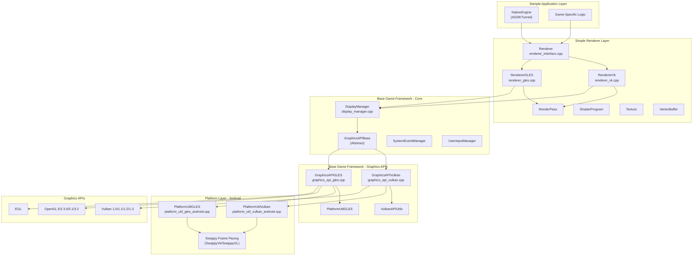

**Sources:** [agdk/common/base_game_framework/src/](), [agdk/common/simple_renderer/](), [agdk/agdktunnel/app/src/main/cpp/native_engine.cpp:1-467]()

---

## Base Game Framework Core Components

### DisplayManager - Central Coordinator

The `DisplayManager` class is the primary interface between game code and graphics APIs. It implements a singleton pattern and manages:

- Graphics API initialization and selection
- Swapchain lifecycle
- Display format/resolution enumeration
- Display state change callbacks

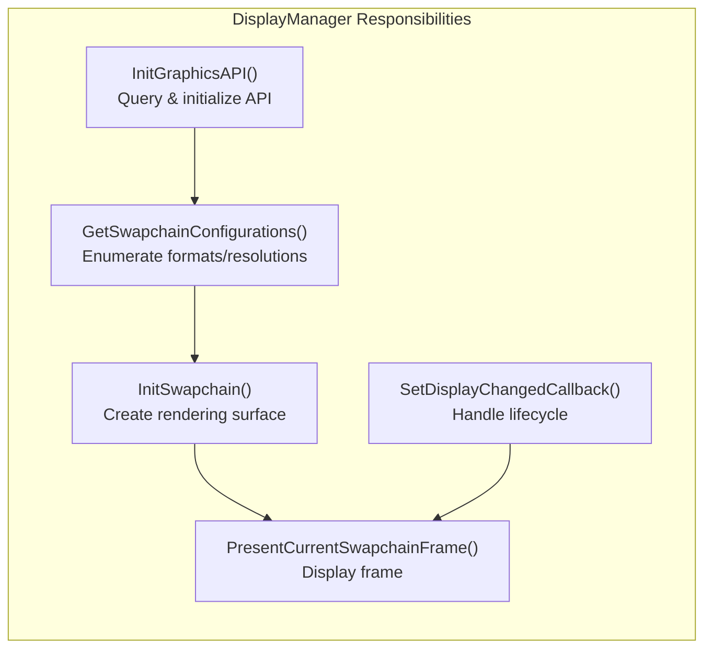

**Key Methods:**

| Method | Purpose |
|--------|---------|
| `GetGraphicsAPISupportFlags()` | Query which graphics APIs are available and their feature levels |
| `InitGraphicsAPI()` | Initialize Vulkan or OpenGL ES based on device capabilities |
| `GetSwapchainConfigurations()` | Retrieve supported display formats, resolutions, and refresh rates |
| `InitSwapchain()` | Create swapchain with specified format, resolution, and frame count |
| `GetCurrentSwapchainFrame()` | Get handle to current frame for rendering |
| `PresentCurrentSwapchainFrame()` | Submit frame for display |

**Sources:** [agdk/common/base_game_framework/include/display_manager.h](), [agdk/common/base_game_framework/src/display_manager.cpp]()

### GraphicsAPI Abstraction Layer

The framework uses an abstract base class `GraphicsAPIBase` with two concrete implementations:

#### Class Hierarchy

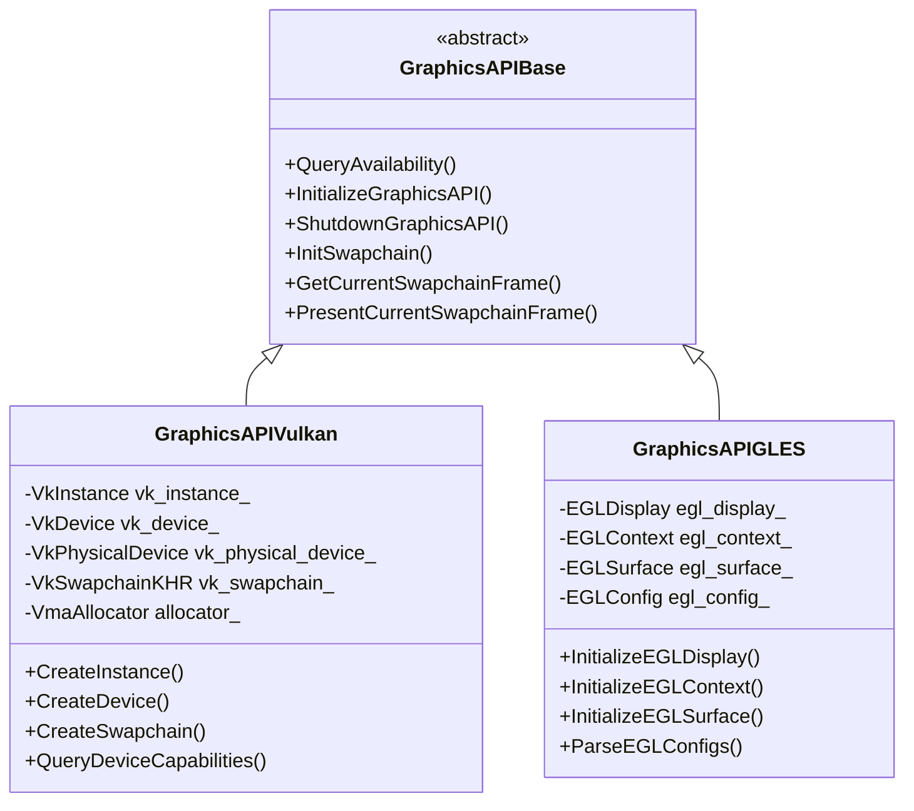

**Vulkan Implementation Highlights:**

- **Volk dynamic loading**: Uses Volk for runtime Vulkan function loading [agdk/common/base_game_framework/src/vulkan/graphics_api_vulkan.cpp:129]()
- **Vulkan Memory Allocator (VMA)**: Manages GPU memory allocations [agdk/common/base_game_framework/src/vulkan/graphics_api_vulkan.cpp:409-427]()
- **Device selection**: Filters physical devices based on rendering capabilities [agdk/common/base_game_framework/src/vulkan/graphics_api_vulkan.cpp:90-115]()
- **Extension management**: Handles required and optional device extensions [agdk/common/base_game_framework/src/vulkan/graphics_api_vulkan.cpp:193-204]()

**OpenGL ES Implementation Highlights:**

- **EGL configuration parsing**: Enumerates all GLES 3.0+ capable configs [agdk/common/base_game_framework/src/gles/graphics_api_gles.cpp:227-345]()
- **sRGB framebuffer support**: Detects and enables sRGB color spaces when available [agdk/common/base_game_framework/src/gles/graphics_api_gles.cpp:65]()
- **Surface lifecycle**: Handles Android window attach/detach [agdk/common/base_game_framework/src/gles/graphics_api_gles.cpp:433-459]()

**Sources:** [agdk/common/base_game_framework/include/graphics_api_base.h](), [agdk/common/base_game_framework/src/vulkan/graphics_api_vulkan.cpp:1-897](), [agdk/common/base_game_framework/src/gles/graphics_api_gles.cpp:1-581]()

---

## Graphics API Initialization Flow

### Capability Query and Selection

The framework follows a two-phase initialization pattern: **query phase** (capabilities discovery) and **initialization phase** (resource creation).

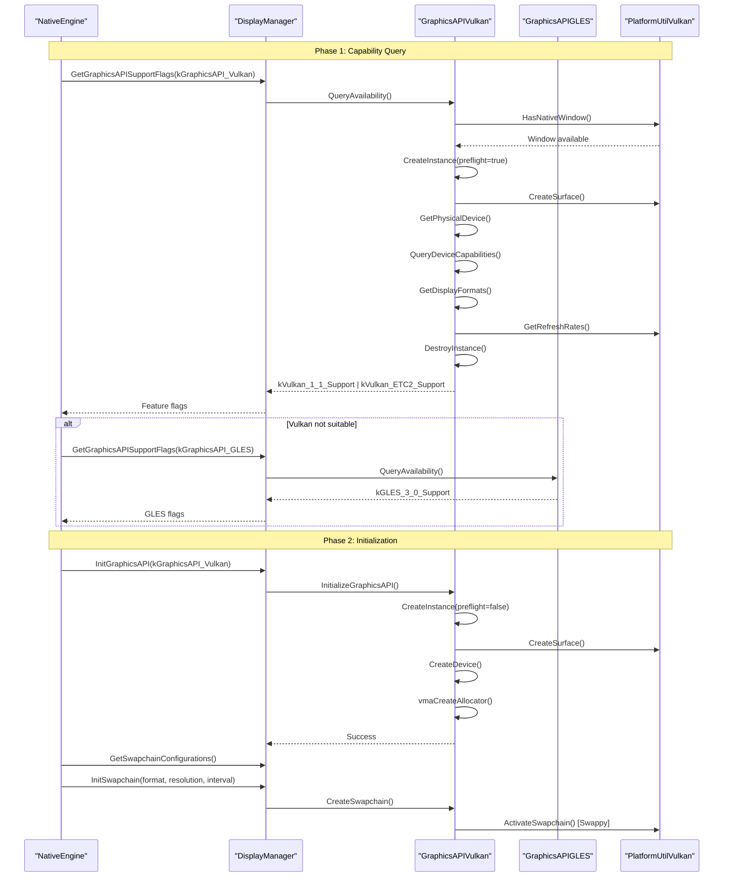

**Key Decision Points:**

1. **Check Vulkan 1.1+ with ETC2**: Preferred path for modern devices [agdk/agdktunnel/app/src/main/cpp/native_engine.cpp:119-125]()
2. **Fallback to OpenGL ES 3.0**: Used when Vulkan unavailable or insufficient [agdk/agdktunnel/app/src/main/cpp/native_engine.cpp:126-145]()
3. **Preflight device creation**: Query capabilities without allocating production resources [agdk/common/base_game_framework/src/vulkan/graphics_api_vulkan.cpp:143-158]()

**Sources:** [agdk/agdktunnel/app/src/main/cpp/native_engine.cpp:108-157](), [agdk/common/base_game_framework/src/vulkan/graphics_api_vulkan.cpp:117-168](), [agdk/common/base_game_framework/src/gles/graphics_api_gles.cpp:54-129]()

---

## Swapchain Management

### Display Configuration Structure

The framework exposes display capabilities through a structured configuration system:

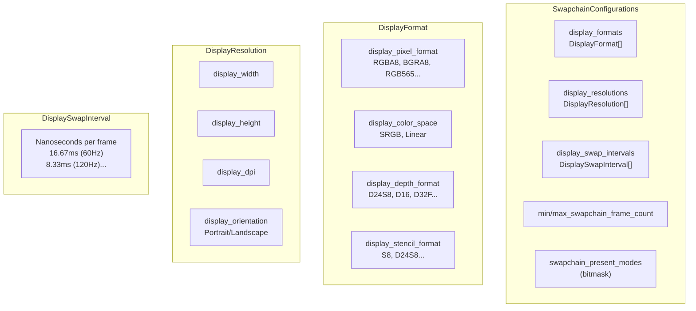

**Format Translation Tables:**

The framework maintains lookup tables to convert between platform-specific formats and internal enums:

| Internal Format | Vulkan Format | OpenGL ES Format |
|----------------|---------------|------------------|
| `kDisplay_Pixel_Format_RGBA8` | `VK_FORMAT_R8G8B8A8_SRGB` | RGB8/RGBA8 EGL config |
| `kDisplay_Depth_Format_D24S8_Packed` | `VK_FORMAT_D24_UNORM_S8_UINT` | Depth=24, Stencil=8 |
| `kDisplay_Pixel_Format_RGB565` | `VK_FORMAT_R5G6B5_UNORM_PACK16` | R5G6B5 EGL config |

**Sources:** [agdk/common/base_game_framework/src/vulkan/graphics_api_vulkan_utils.cpp:25-46](), [agdk/common/base_game_framework/src/gles/graphics_api_gles.cpp:141-219]()

### Swapchain Creation and Lifecycle

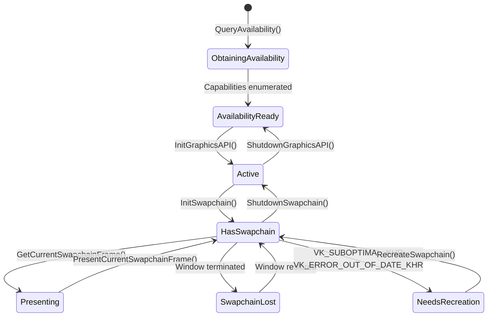

**Critical Lifecycle Events:**

1. **Window Loss (Android suspend)**: Surface destroyed but graphics API remains active [agdk/common/base_game_framework/src/android/display_manager_android.cpp:24-29]()
2. **Window Restoration**: New surface created, swapchain recreated [agdk/common/base_game_framework/src/android/display_manager_android.cpp:31-39]()
3. **Suboptimal Swapchain (Vulkan)**: Rotation or resolution change requires recreation [agdk/common/base_game_framework/src/vulkan/graphics_api_vulkan.cpp:625-634]()

**Sources:** [agdk/common/base_game_framework/src/vulkan/graphics_api_vulkan.cpp:470-578](), [agdk/common/base_game_framework/src/gles/graphics_api_gles.cpp:461-510](), [agdk/common/base_game_framework/src/android/display_manager_android.cpp:1-44]()

---

## Platform Integration Layer

### Android-Specific Utilities

The framework isolates platform-specific code in dedicated utility classes:

#### Vulkan Platform Utilities (`PlatformUtilVulkan`)

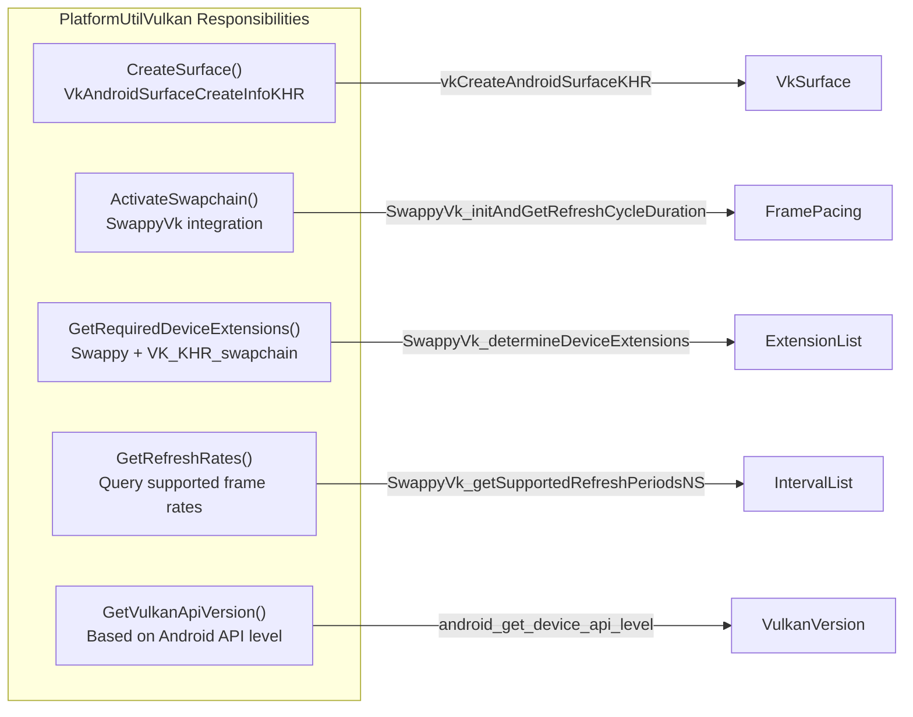

**API Level to Vulkan Version Mapping:**

```cpp
// Minimum Android API levels for Vulkan support
API Level 33+ → Vulkan 1.3
API Level 29+ → Vulkan 1.1
API Level < 29 → Vulkan 1.0
```

**Swappy Integration:**

The framework integrates Google's Swappy library for frame pacing, which provides:
- Automatic frame rate adjustment
- Support for multiple refresh rates (60Hz, 90Hz, 120Hz)
- Reduced jitter and improved frame consistency

**Sources:** [agdk/common/base_game_framework/src/android/platform_util_vulkan_android.cpp:1-307]()

#### OpenGL ES Platform Utilities (`PlatformUtilGLES`)

| Function | Purpose |
|----------|---------|
| `GetNativeWindow()` | Returns `ANativeWindow*` from GameActivity |
| `GetPlatformDisplay()` | Calls `eglGetPlatformDisplay()` with Android-specific parameters |
| `GetRefreshRates()` | Uses Swappy to enumerate supported frame rates |
| `PlatformInitSwapchain()` | Initializes `SwappyGL` with EGL display/surface |
| `CheckScreenResolutionChange()` | Detects window resize events |

**Sources:** [agdk/common/base_game_framework/src/android/platform_util_gles_android.cpp]()

---

## Feature Detection System

### GraphicsAPIFeatures Class

The `GraphicsAPIFeatures` class encapsulates capabilities of the active graphics API:

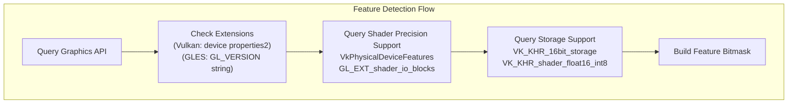

**Detected Features:**

| Feature Flag | Vulkan Source | GLES Source |
|-------------|---------------|-------------|
| `kGraphicsFeature_F16_Math` | `VkPhysicalDeviceShaderFloat16Int8FeaturesKHR.shaderFloat16` | Not supported |
| `kGraphicsFeature_I16_Math` | `VkPhysicalDeviceFeatures.shaderInt16` | Not supported |
| `kGraphicsFeature_Wide_Lines` | `VkPhysicalDeviceFeatures.wideLines` | Always available |
| `kGraphicsFeature_F16_I16_SSBO` | `VkPhysicalDevice16BitStorageFeaturesKHR.storageBuffer16BitAccess` | Not supported |

**Usage Example:**

```cpp
GraphicsAPIFeatures features = DisplayManager::GetInstance().GetGraphicsAPIFeatures();
if (features.HasGraphicsFeature(kGraphicsFeature_F16_Math)) {
    // Use half-precision shaders for performance
}
```

**Sources:** [agdk/common/base_game_framework/include/graphics_api_features.h:1-109](), [agdk/common/base_game_framework/src/vulkan/graphics_api_vulkan.cpp:170-277]()

---

## Simple Renderer Layer

The Simple Renderer provides higher-level abstractions on top of Base Game Framework:

### Renderer Interface Architecture

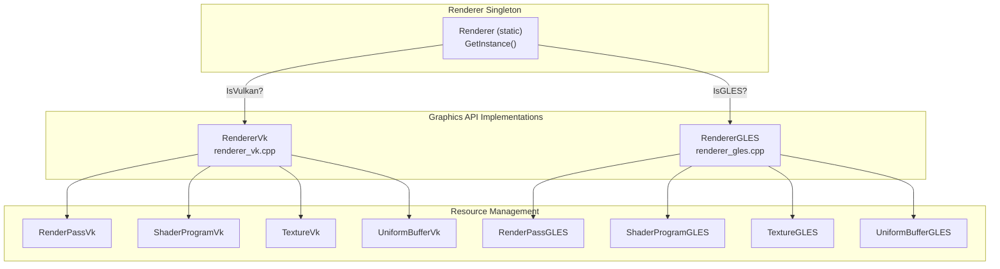

**Key Abstractions:**

| Component | Vulkan Backing | OpenGL ES Backing |
|-----------|----------------|-------------------|
| `RenderPass` | `VkRenderPass` + `VkFramebuffer` | EGL surface + `glClear()` |
| `ShaderProgram` | `VkPipeline` | `GLuint program` |
| `Texture` | `VkImage` + `VkImageView` | `GLuint texture` |
| `VertexBuffer` | `VkBuffer` (vertex) | `GLuint VBO` |
| `IndexBuffer` | `VkBuffer` (index) | `GLuint EBO` |
| `UniformBuffer` | `VkBuffer` (uniform) + `VkDescriptorSet` | `GLuint UBO` |

**Sources:** [agdk/common/simple_renderer/renderer_interface.cpp](), [agdk/common/simple_renderer/renderer_vk.cpp](), [agdk/common/simple_renderer/renderer_gles.cpp]()

### Render Pass Management

The `RenderPass` class encapsulates framebuffer setup and clear operations:

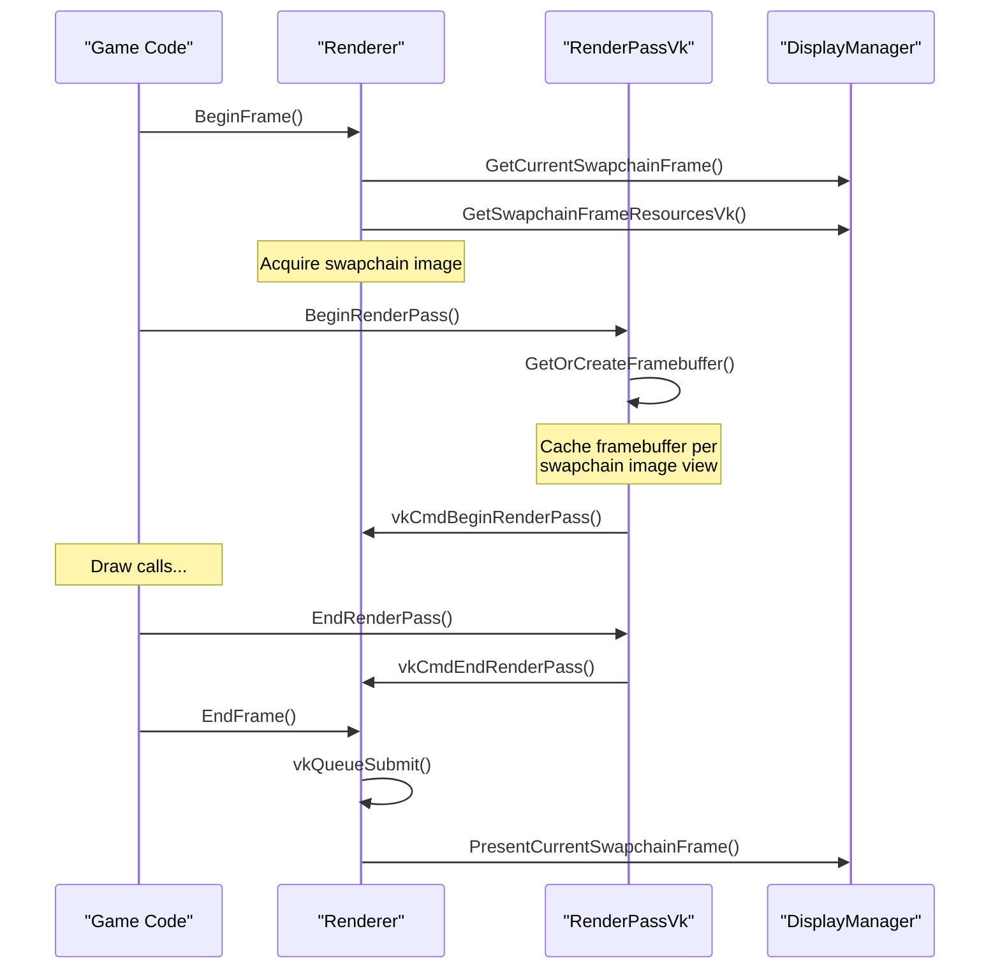

**Framebuffer Caching:**

`RenderPassVk` maintains a cache of `VkFramebuffer` objects indexed by swapchain image view. This avoids recreating framebuffers every frame while handling swapchain recreation [agdk/common/simple_renderer/renderer_render_pass_vk.cpp:122-149]().

**Sources:** [agdk/common/simple_renderer/renderer_render_pass_vk.cpp:1-196](), [agdk/common/simple_renderer/renderer_render_pass_gles.cpp]()

---

## Sample Integration Pattern

### AGDKTunnel Integration Example

AGDKTunnel demonstrates typical framework usage:

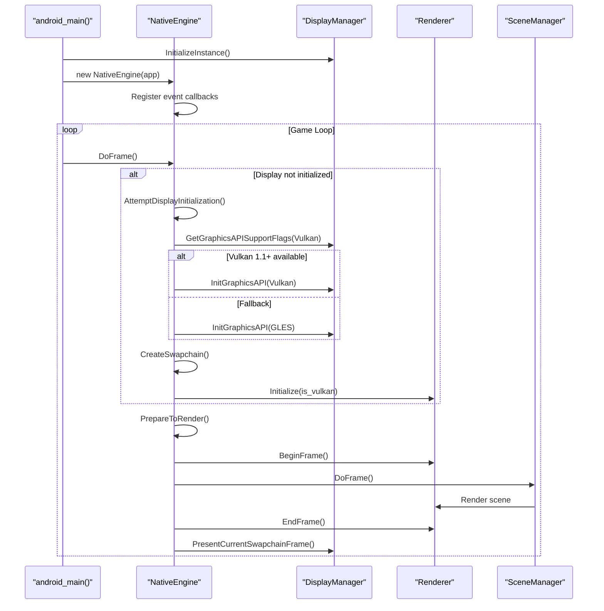

**Initialization Code Structure:**

1. **Display Check** [agdk/agdktunnel/app/src/main/cpp/native_engine.cpp:108-157]():
   - Query Vulkan support flags
   - Check for Vulkan 1.1 + ETC2 texture compression
   - Fall back to OpenGL ES 3.0 if needed

2. **Swapchain Setup** [agdk/agdktunnel/app/src/main/cpp/native_engine.cpp:159-218]():
   - Get available configurations
   - Select SRGB color space for Vulkan, Linear for GLES
   - Request D24S8 depth/stencil format
   - Use minimum swapchain frame count

3. **Frame Rendering** [agdk/agdktunnel/app/src/main/cpp/native_engine.cpp:284-311]():
   - `Renderer::BeginFrame()` acquires swapchain image
   - Scene rendering occurs
   - `Renderer::EndFrame()` submits commands
   - `PresentCurrentSwapchainFrame()` displays result

**Sources:** [agdk/agdktunnel/app/src/main/cpp/native_engine.cpp:44-467](), [agdk/agdktunnel/app/src/main/cpp/CMakeLists.txt:57-104]()

---

## Build System Integration

### CMake Configuration

Samples include the framework by directly compiling source files:

```cmake
# Base Game Framework sources
set(BGF_SRCS
    ${BGF_SRC_DIR}/debug_manager.cpp
    ${BGF_SRC_DIR}/display_manager.cpp
    ${BGF_SRC_DIR}/graphics_api_features.cpp
    ${BGF_SRC_DIR}/android/display_manager_android.cpp
    ${BGF_SRC_DIR}/gles/graphics_api_gles.cpp
    ${BGF_SRC_DIR}/vulkan/graphics_api_vulkan.cpp
    ${BGF_SRC_DIR}/vulkan/graphics_api_vulkan_utils.cpp
    # ... additional sources
)

# Simple Renderer sources
set(SIMPLE_RENDERER_SRCS
    ${SIMPLE_RENDERER_DIR}/renderer_interface.cpp
    ${SIMPLE_RENDERER_DIR}/renderer_vk.cpp
    ${SIMPLE_RENDERER_DIR}/renderer_gles.cpp
    # ... additional renderer sources
)

add_library(${CMAKE_PROJECT_NAME} SHARED
    ${BGF_SRCS}
    ${SIMPLE_RENDERER_SRCS}
    # Game-specific sources
)
```

**Include Directories:**

The framework requires several third-party libraries:

| Library | Purpose | Location |
|---------|---------|----------|
| **Volk** | Vulkan meta-loader | `agdk/third_party/volk` |
| **VulkanMemoryAllocator** | GPU memory management | `agdk/third_party/VulkanMemoryAllocator` |
| **GLM** | Mathematics library | `agdk/third_party/glm` |
| **Swappy** | Frame pacing | Gradle dependency: `androidx.games:games-frame-pacing` |

**Sources:** [agdk/agdktunnel/app/src/main/cpp/CMakeLists.txt:1-181]()

---

## Display Rotation Handling

### Vulkan Pre-Rotation

Vulkan on Android uses pre-rotation to avoid composition overhead:

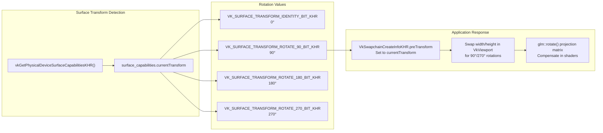

**Implementation in NativeEngine:**

The rotation matrix compensates for Vulkan's inverted Y-axis while handling device rotation [agdk/agdktunnel/app/src/main/cpp/native_engine.cpp:263-278]():

```cpp
// Swap 90/270 because Vulkan Y-axis points down
if (rotation == kSwapchain_Rotation_90) {
    rotationMatrix = glm::rotate(rotationMatrix, glm::radians(270.0f), rotationAxis);
} else if (rotation == kSwapchain_Rotation_270) {
    rotationMatrix = glm::rotate(rotationMatrix, glm::radians(90.0f), rotationAxis);
}
```

**Sources:** [agdk/common/base_game_framework/src/vulkan/graphics_api_vulkan.cpp:279-307](), [agdk/common/base_game_framework/src/vulkan/graphics_api_vulkan.cpp:591-601](), [agdk/agdktunnel/app/src/main/cpp/native_engine.cpp:263-278]()

---

## Thread Safety and Event Handling

### Event Callback Architecture

The framework uses callback registration for asynchronous events:

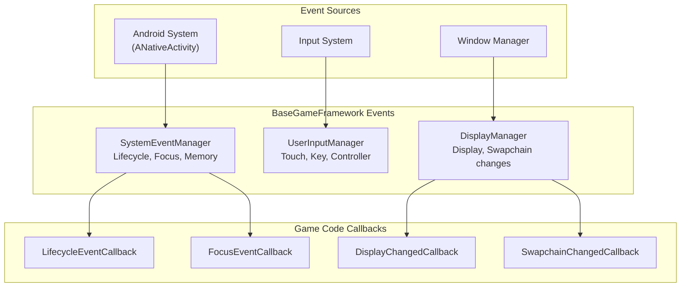

**Callback Registration Pattern:**

```cpp
// NativeEngine constructor
SystemEventManager& event_manager = SystemEventManager::GetInstance();
event_manager.SetFocusEventCallback(
    std::bind(&NativeEngine::FocusEvent, this, 
              std::placeholders::_1, std::placeholders::_2),
    nullptr);

DisplayManager& display_manager = DisplayManager::GetInstance();
display_manager.SetSwapchainChangedCallback(
    std::bind(&NativeEngine::SwapchainChanged, this,
              std::placeholders::_1, std::placeholders::_2),
    nullptr);
```

**Thread Considerations:**

- All framework APIs must be called from the **main game thread**
- JNI environment is attached per-thread [agdk/agdktunnel/app/src/main/cpp/native_engine.cpp:220-232]()
- Vulkan command buffers are not thread-safe (framework uses single-threaded rendering)

**Sources:** [agdk/agdktunnel/app/src/main/cpp/native_engine.cpp:60-86](), [agdk/agdktunnel/app/src/main/cpp/native_engine.cpp:358-386]()

---

## Key Design Decisions

### Rationale for Architecture Choices

1. **Direct Source Compilation vs. Static Library**
   - Samples compile framework sources directly [agdk/agdktunnel/app/src/main/cpp/CMakeLists.txt:57-104]()
   - Allows per-sample customization
   - Simplifies dependency management across samples

2. **Runtime Graphics API Selection**
   - Query phase avoids creating production resources [agdk/common/base_game_framework/src/vulkan/graphics_api_vulkan.cpp:125-168]()
   - Enables graceful fallback from Vulkan to OpenGL ES
   - Supports devices with varying capabilities

3. **Swapchain Handle Abstraction**
   - `SwapchainFrameHandle` opaque type [agdk/common/base_game_framework/include/display_manager.h]()
   - Isolates samples from graphics API differences
   - Simplifies multi-swapchain scenarios (future-proofing)

4. **Framebuffer Caching (Vulkan)**
   - Avoids recreating `VkFramebuffer` every frame [agdk/common/simple_renderer/renderer_render_pass_vk.cpp:122-149]()
   - Handles swapchain image view changes transparently
   - Purged on swapchain recreation

5. **Swappy Integration for Frame Pacing**
   - Abstracts platform refresh rate APIs [agdk/common/base_game_framework/src/android/platform_util_vulkan_android.cpp:106-169]()
   - Provides consistent frame delivery across devices
   - Supports dynamic refresh rate switching

**Sources:** [agdk/agdktunnel/app/src/main/cpp/CMakeLists.txt:57-104](), [agdk/common/base_game_framework/src/vulkan/graphics_api_vulkan.cpp:125-168](), [agdk/common/simple_renderer/renderer_render_pass_vk.cpp:122-149](), [agdk/common/base_game_framework/src/android/platform_util_vulkan_android.cpp:106-169]()

---

