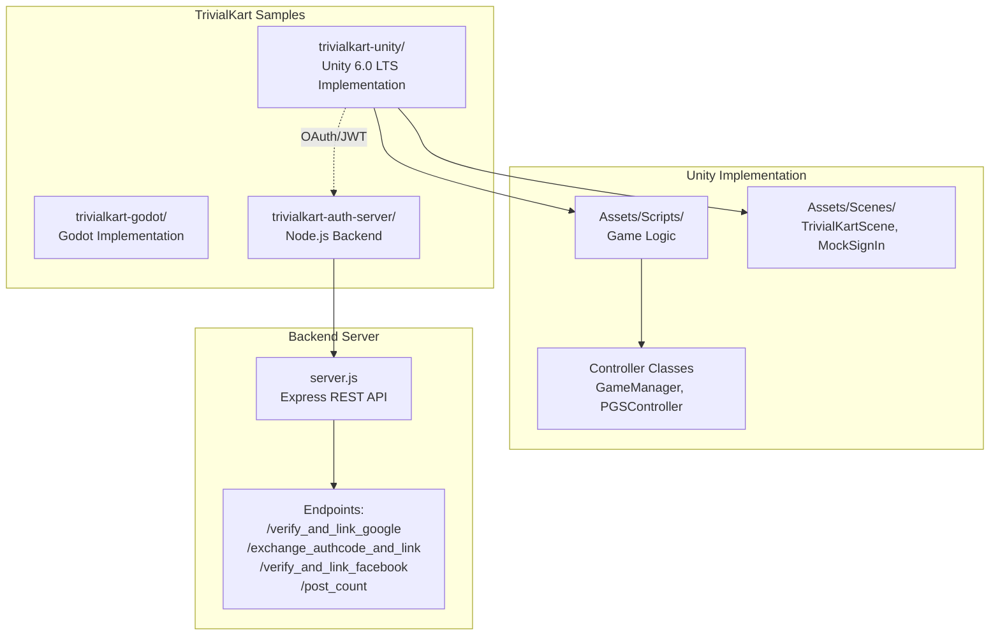
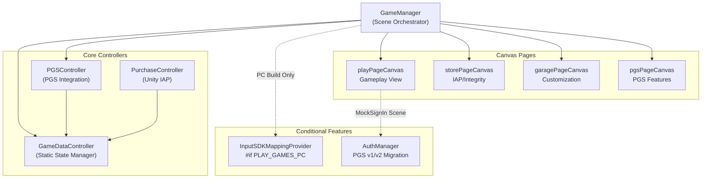
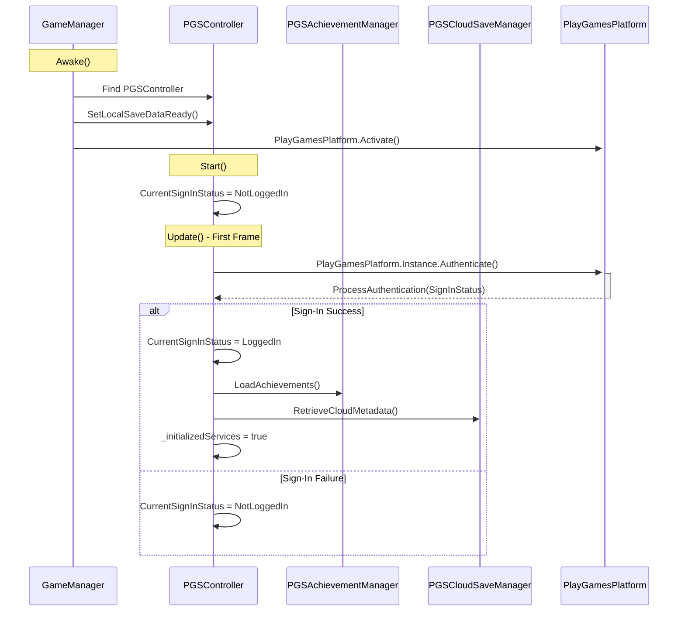
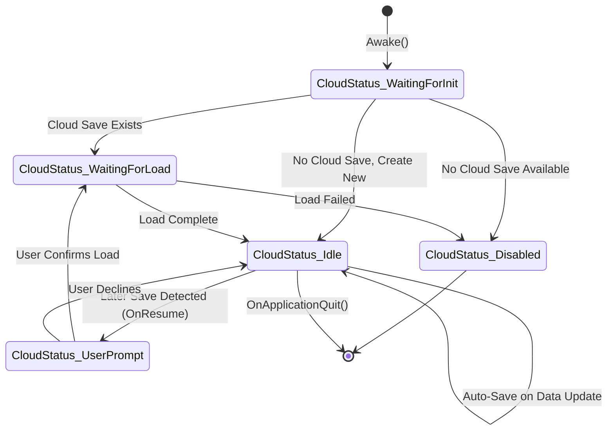
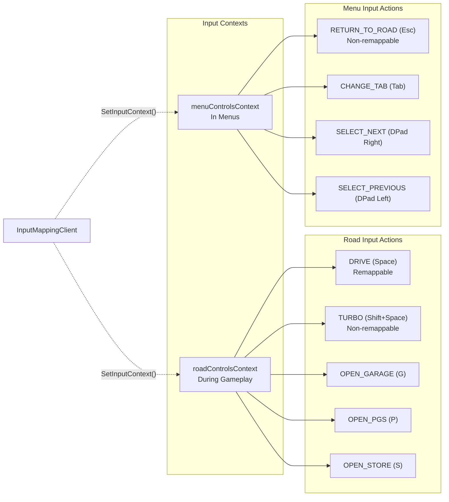
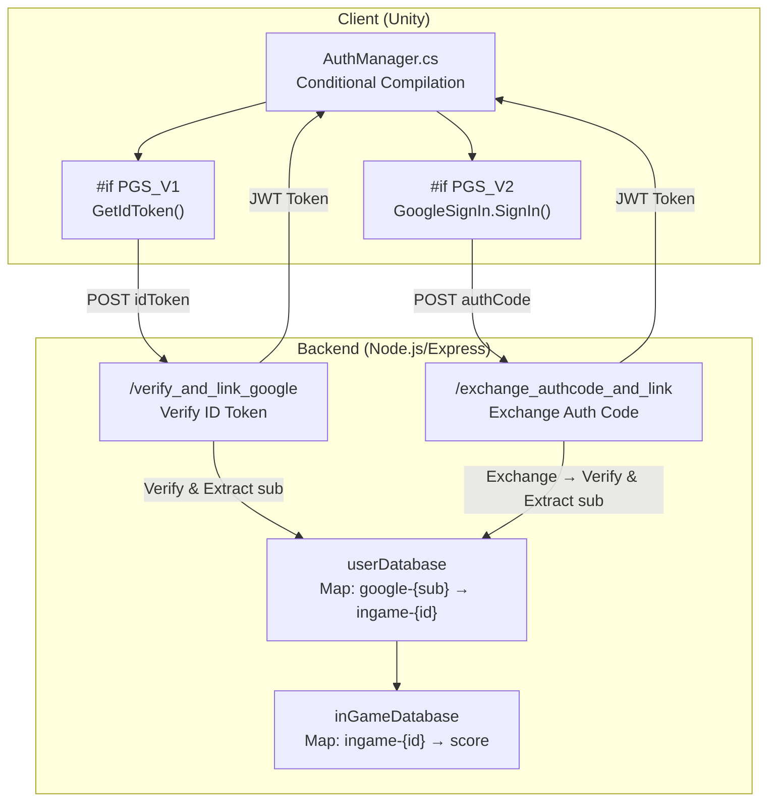

<!-- source: DeepWiki mcp.deepwiki.com · repo android/games-samples · page 3 TrivialKart Game Samples · fetched 2026-10-23 -->

# TrivialKart Game Samples

<details>
<summary>Relevant source files</summary>

The following files were used as context for generating this wiki page:

- [trivialkart/trivialkart-auth-server/.gitignore](trivialkart/trivialkart-auth-server/.gitignore)
- [trivialkart/trivialkart-auth-server/README.md](trivialkart/trivialkart-auth-server/README.md)
- [trivialkart/trivialkart-auth-server/package.json](trivialkart/trivialkart-auth-server/package.json)
- [trivialkart/trivialkart-auth-server/server.js](trivialkart/trivialkart-auth-server/server.js)
- [trivialkart/trivialkart-unity/Assets/Scenes/MockSignIn.unity](trivialkart/trivialkart-unity/Assets/Scenes/MockSignIn.unity)
- [trivialkart/trivialkart-unity/Assets/Scenes/MockSignIn.unity.meta](trivialkart/trivialkart-unity/Assets/Scenes/MockSignIn.unity.meta)
- [trivialkart/trivialkart-unity/Assets/Scripts/AuthManager.cs](trivialkart/trivialkart-unity/Assets/Scripts/AuthManager.cs)
- [trivialkart/trivialkart-unity/Assets/Scripts/AuthManager.cs.meta](trivialkart/trivialkart-unity/Assets/Scripts/AuthManager.cs.meta)
- [trivialkart/trivialkart-unity/Assets/Scripts/Controller/PGS/AchievementsPageController.cs](trivialkart/trivialkart-unity/Assets/Scripts/Controller/PGS/AchievementsPageController.cs)
- [trivialkart/trivialkart-unity/Assets/Scripts/Controller/PGS/FriendsPageController.cs](trivialkart/trivialkart-unity/Assets/Scripts/Controller/PGS/FriendsPageController.cs)
- [trivialkart/trivialkart-unity/Assets/Scripts/Controller/PGS/LeaderboardPageController.cs](trivialkart/trivialkart-unity/Assets/Scripts/Controller/PGS/LeaderboardPageController.cs)
- [trivialkart/trivialkart-unity/Assets/Scripts/Controller/PGS/PGSAchievementManager.cs.meta](trivialkart/trivialkart-unity/Assets/Scripts/Controller/PGS/PGSAchievementManager.cs.meta)
- [trivialkart/trivialkart-unity/Assets/Scripts/Controller/PGS/PGSController.cs](trivialkart/trivialkart-unity/Assets/Scripts/Controller/PGS/PGSController.cs)
- [trivialkart/trivialkart-unity/Assets/Scripts/Controller/PGS/SigninPageController.cs](trivialkart/trivialkart-unity/Assets/Scripts/Controller/PGS/SigninPageController.cs)
- [trivialkart/trivialkart-unity/Assets/Scripts/GameManager.cs](trivialkart/trivialkart-unity/Assets/Scripts/GameManager.cs)
- [trivialkart/trivialkart-unity/Assets/Scripts/InputSDK/InputSDKProvider.cs](trivialkart/trivialkart-unity/Assets/Scripts/InputSDK/InputSDKProvider.cs)
- [trivialkart/trivialkart-unity/ProjectSettings/ProjectSettings.asset](trivialkart/trivialkart-unity/ProjectSettings/ProjectSettings.asset)
- [trivialkart/trivialkart-unity/README.md](trivialkart/trivialkart-unity/README.md)

</details>


## Purpose and Scope

TrivialKart is a complete, production-ready game sample demonstrating integration of Google Play technologies with the Unity engine. This page provides an overview of the TrivialKart sample structure, its core architecture, and the technologies it demonstrates. For detailed coverage of specific subsystems, see [TrivialKart Unity Architecture](#3.1), [Authentication and PGS Migration](#3.2), [Gameplay and State Management](#3.3), and [Google Play Integration](#3.4).

For native C++ game development samples using AGDK, see [AGDK Native Samples](#2). For Unity-specific development tools and diagnostics, see [Unity Development Tools](#4).

**Sources:** [trivialkart/trivialkart-unity/README.md:1-16]()

---

## Sample Overview

TrivialKart is a simple driving game where players tap their vehicle to move, consuming gas and earning distance. The game demonstrates real-world implementation patterns for monetization, player progression, and cross-platform play.

### What TrivialKart Demonstrates

| Technology | Purpose | Implementation |
|------------|---------|----------------|
| **Unity IAP** | Monetization via consumables, unlocks, subscriptions | In-game currency, car unlocks, VIP subscriptions |
| **Play Games Services v2** | Player identity, progression, social features | Sign-in, achievements, leaderboards, friends, cloud save |
| **Play Integrity** | Anti-cheat and license verification | Integrity verdict display on store page |
| **Input SDK** | Keyboard/mouse support for PC | Context-aware input mapping for Google Play Games for PC |
| **PGS v1→v2 Migration** | Account continuity during SDK upgrade | OpenID-based account linking with backend server |

**Sources:** [trivialkart/trivialkart-unity/README.md:6-14]()

---

## Repository Structure



**Diagram: TrivialKart Sample Structure**

The Unity implementation provides the complete game client, while the auth server demonstrates secure account linking patterns for PGS migration. The Godot implementation (not covered in this documentation) demonstrates similar patterns for the Godot engine.

**Sources:** [trivialkart/trivialkart-unity/README.md:1-4](), [trivialkart/trivialkart-auth-server/README.md:1-20]()

---

## Architecture Overview

### Core Components

TrivialKart Unity follows a scene-based architecture with a central orchestrator pattern:



**Diagram: TrivialKart Unity Component Architecture**

**Sources:** [trivialkart/trivialkart-unity/Assets/Scripts/GameManager.cs:26-40](), [trivialkart/trivialkart-unity/Assets/Scripts/GameManager.cs:354-355]()

### Component Responsibilities

| Component | File | Responsibility |
|-----------|------|----------------|
| `GameManager` | [GameManager.cs:32]() | Canvas orchestration, cloud save coordination, initialization |
| `GameDataController` | Referenced in [GameManager.cs:96]() | Static state management, save/load operations |
| `PGSController` | [PGSController.cs:25]() | PGS lifecycle, sign-in status, service initialization |
| `PurchaseController` | Referenced in README | Unity IAP integration, purchase processing |
| `InputSDKMappingProvider` | [InputSDKProvider.cs:21]() | Input mapping for Google Play Games for PC |
| `AuthManager` | [AuthManager.cs:35]() | PGS v1/v2 migration demo with backend auth |

**Sources:** [trivialkart/trivialkart-unity/Assets/Scripts/GameManager.cs:27-90](), [trivialkart/trivialkart-unity/Assets/Scripts/Controller/PGS/PGSController.cs:25-56]()

---

## Conditional Compilation System

TrivialKart uses Unity's scripting define symbols to enable/disable features at compile time:

| Symbol | Purpose | Affected Code |
|--------|---------|---------------|
| `PLAY_GAMES_SERVICES` | Enables PGS integration | [GameManager.cs:67-85](), [PGSController.cs:19-141]() |
| `PLAY_GAMES_PC` | Enables Input SDK for PC | [GameManager.cs:21-25](), [GameManager.cs:108-124]() |
| `USE_IAP` / `NO_IAP` | Toggles Unity IAP | Controlled via menu [README.md:98-103]() |
| `PGS_V1` / `PGS_V2` | Selects PGS SDK version | [AuthManager.cs:24-28](), [AuthManager.cs:123-148]() |

This pattern allows building different variants without code changes, supporting development, testing, and platform-specific builds.

**Sources:** [trivialkart/trivialkart-unity/Assets/Scripts/GameManager.cs:67](), [trivialkart/trivialkart-unity/ProjectSettings/ProjectSettings.asset:813-814]()

---

## Key Integration Patterns

### Play Games Services v2 Integration



**Diagram: Play Games Services Initialization Flow**

The `PGSController` manages the authentication lifecycle, waiting for local save data to be ready before initializing achievements and cloud save. This ensures that achievement progress can be immediately synchronized after sign-in.

**Sources:** [trivialkart/trivialkart-unity/Assets/Scripts/Controller/PGS/PGSController.cs:58-99](), [trivialkart/trivialkart-unity/Assets/Scripts/GameManager.cs:94-107]()

### Cloud Save State Machine



**Diagram: Cloud Save State Machine**

The cloud save system in [GameManager.cs:68-82]() uses a state machine to handle initialization, loading, and conflict resolution. When the app resumes and a later cloud save is detected (e.g., the user played on another device), the system prompts the user to choose between local and cloud data.

**Sources:** [trivialkart/trivialkart-unity/Assets/Scripts/GameManager.cs:68-82](), [trivialkart/trivialkart-unity/Assets/Scripts/GameManager.cs:140-232]()

---

## Input SDK for Google Play Games for PC

TrivialKart demonstrates context-aware input mapping for PC gameplay:



**Diagram: Input SDK Context Switching**

The `InputSDKMappingProvider` defines two contexts with different input actions. The `GameManager` switches contexts when navigating between gameplay and menus [GameManager.cs:328-338](). Reserved keys like Escape are configured as non-remappable [InputSDKProvider.cs:189-197]().

**Sources:** [trivialkart/trivialkart-unity/Assets/Scripts/InputSDK/InputSDKProvider.cs:21-204](), [trivialkart/trivialkart-unity/Assets/Scripts/GameManager.cs:108-124](), [trivialkart/trivialkart-unity/Assets/Scripts/GameManager.cs:325-339]()

---

## PGS v1 to v2 Migration Architecture

TrivialKart includes a complete reference implementation for migrating from deprecated Play Games Services v1 to v2 while preserving player accounts:



**Diagram: PGS v1 to v2 Migration Flow**

The critical insight is that both v1 ID Tokens and v2 Auth Codes resolve to the same OpenID `sub` claim. The backend uses `google-{sub}` as the database key, ensuring account continuity across SDK versions. See [Authentication and PGS Migration](#3.2) for detailed implementation.

**Sources:** [trivialkart/trivialkart-auth-server/README.md:1-18](), [trivialkart/trivialkart-auth-server/server.js:75-135](), [trivialkart/trivialkart-auth-server/server.js:142-210](), [trivialkart/trivialkart-unity/Assets/Scripts/AuthManager.cs:24-176]()

---

## Prerequisites and Setup

### Unity Requirements

| Requirement | Version/Details |
|-------------|----------------|
| Unity Editor | 6.0 LTS or higher with Android build support |
| Android NDK | Included with Unity Android module |
| Scripting Backend | IL2CPP (required for x86/x86-64 PC builds) |

**Sources:** [trivialkart/trivialkart-unity/README.md:18-20]()

### Google Play Console Setup

1. **Application Package**: Configure at [ProjectSettings.asset:169]() (`com.GoogleLLC.TrivialKart`)
2. **In-App Products**: Define consumables (coins), unlocks (cars), subscriptions [README.md:123-139]()
3. **Play Games Services**: Configure achievements, leaderboards, cloud save [README.md:149-187]()
4. **Play Integrity**: Enable in Play Console [README.md:239-246]()

### Required Unity Packages

| Package | Version | Purpose |
|---------|---------|---------|
| Unity IAP | 5.0+ | In-app purchases |
| Play Games Services Plugin | v2.1.0+ | PGS v2 integration |
| Play Integrity Plugin | Latest | Integrity verdicts |
| Input SDK | Latest | PC keyboard/mouse |

**Sources:** [trivialkart/trivialkart-unity/README.md:73-82](), [trivialkart/trivialkart-unity/README.md:190-193](), [trivialkart/trivialkart-unity/README.md:246-251](), [trivialkart/trivialkart-unity/README.md:319-323]()

### Backend Server Setup

The PGS migration demo requires a Node.js backend:

1. Install dependencies: `express`, `google-auth-library`, `jsonwebtoken`, `axios`
2. Configure `.env` with Web Client ID/Secret, JWT secret, FB credentials
3. Run `node server.js` on port 3000

**Sources:** [trivialkart/trivialkart-auth-server/README.md:36-59](), [trivialkart/trivialkart-auth-server/server.js:15-40]()

---

## Building Different Variants

TrivialKart supports multiple build configurations via scripting define symbols:

### Standard Android Build (IAP + PGS)

```
Scripting Define Symbols: USE_IAP;PLAY_GAMES_SERVICES
Target Architectures: ARM64, ARMv7
```

### Google Play Games for PC Build

```
Scripting Define Symbols: USE_IAP;PLAY_GAMES_SERVICES;PLAY_GAMES_PC
Target Architectures: ARM64, ARMv7, x86, x86-64
Scripting Backend: IL2CPP (required for x86)
```

Disable unsupported Android features in custom manifest [README.md:315-318]().

### PGS Migration Test Build

```
Scene: Assets/Scenes/MockSignIn.unity
Scripting Define Symbols: PGS_V1 or PGS_V2
Player Settings > Allow downloads over HTTP: Development builds only
```

**Sources:** [trivialkart/trivialkart-unity/README.md:98-103](), [trivialkart/trivialkart-unity/README.md:214-217](), [trivialkart/trivialkart-unity/README.md:311-323](), [trivialkart/trivialkart-auth-server/README.md:99-114]()

---

## Project Structure

### Key Directories

```
trivialkart/trivialkart-unity/
├── Assets/
│   ├── Scenes/
│   │   ├── TrivialKartScene.unity       # Main game scene
│   │   └── MockSignIn.unity             # PGS migration demo scene
│   ├── Scripts/
│   │   ├── GameManager.cs               # Scene orchestrator
│   │   ├── AuthManager.cs               # PGS v1/v2 migration
│   │   ├── Controller/
│   │   │   └── PGS/
│   │   │       ├── PGSController.cs     # PGS lifecycle manager
│   │   │       ├── PGSAchievementManager.cs
│   │   │       ├── PGSCloudSaveManager.cs
│   │   │       ├── LeaderboardPageController.cs
│   │   │       ├── FriendsPageController.cs
│   │   │       └── SigninPageController.cs
│   │   └── InputSDK/
│   │       └── InputSDKProvider.cs      # PC input mapping
│   └── ...
└── ProjectSettings/
    └── ProjectSettings.asset            # Package name, build config

trivialkart/trivialkart-auth-server/
├── server.js                            # Express backend
├── package.json                         # Dependencies
└── README.md                            # Setup instructions
```

**Sources:** File paths from provided file list

---

## Related Documentation

For detailed coverage of specific TrivialKart subsystems:

- **[TrivialKart Unity Architecture](#3.1)**: Deep dive into `GameManager`, `GameData`, UI navigation, and scene structure
- **[Authentication and PGS Migration](#3.2)**: Complete guide to PGS v1→v2 migration, OpenID-based account linking, and backend server architecture
- **[Gameplay and State Management](#3.3)**: Car movement, distance tracking, achievement unlocking, and the `GameData` ownership model
- **[Google Play Integration](#3.4)**: Unity IAP setup, Play Games Services (achievements, leaderboards, cloud save), and Input SDK for PC

For other samples in this repository:

- **[AGDK Native Samples](#2)**: C++ game development with native Android APIs
- **[Unity Development Tools](#4)**: ANR Plugin and Power Efficiency Demo

---

## Sample Game Mechanics

TrivialKart implements a simple progression loop to demonstrate the integration technologies:

| Mechanic | Purpose | Google Play Technology |
|----------|---------|------------------------|
| Drive by tapping | Core gameplay | Input SDK (PC keyboard alternative) |
| Gas consumption | Drives monetization | Unity IAP (gas purchase) |
| Distance traveled | Progression metric | Leaderboards, Achievements |
| Car unlocks | Permanent progression | Unity IAP (one-time purchases) |
| VIP subscriptions | Recurring revenue | Unity IAP (subscriptions), visual perks |
| Cloud save | Cross-device play | PGS Cloud Save |

The game intentionally keeps mechanics simple to focus on demonstrating the integration patterns rather than complex gameplay systems.

**Sources:** [trivialkart/trivialkart-unity/README.md:35-52]()

---

## Next Steps

To explore specific TrivialKart implementation details:

1. Start with **[TrivialKart Unity Architecture](#3.1)** for overall system design
2. If implementing PGS authentication, see **[Authentication and PGS Migration](#3.2)**
3. For gameplay systems and state management, see **[Gameplay and State Management](#3.3)**
4. For complete Google Play feature integration, see **[Google Play Integration](#3.4)**

For setting up and running the sample:

1. Follow prerequisites in [README.md:16-20]()
2. Configure Play Console per [README.md:55-148]()
3. Set up Unity packages per [README.md:73-237]()
4. Build and test using instructions in [README.md:105-148]()

---

