<!-- source: DeepWiki mcp.deepwiki.com · repo android/games-samples · page 3.1 TrivialKart Unity Architecture · fetched 2026-10-23 -->

# TrivialKart Unity Architecture

Relevant source files

The following files were used as context for generating this wiki page:

- [trivialkart/trivialkart-unity/Assets/Scenes/TrivialKartScene.unity](trivialkart/trivialkart-unity/Assets/Scenes/TrivialKartScene.unity)
- [trivialkart/trivialkart-unity/Assets/Scripts/Controller/Game/CarMove.cs](trivialkart/trivialkart-unity/Assets/Scripts/Controller/Game/CarMove.cs)
- [trivialkart/trivialkart-unity/Assets/Scripts/Controller/Garage/BackgroundGaragePageController.cs](trivialkart/trivialkart-unity/Assets/Scripts/Controller/Garage/BackgroundGaragePageController.cs)
- [trivialkart/trivialkart-unity/Assets/Scripts/Controller/Garage/CarGaragePageController.cs](trivialkart/trivialkart-unity/Assets/Scripts/Controller/Garage/CarGaragePageController.cs)
- [trivialkart/trivialkart-unity/Assets/Scripts/Controller/Garage/GarageController.cs](trivialkart/trivialkart-unity/Assets/Scripts/Controller/Garage/GarageController.cs)
- [trivialkart/trivialkart-unity/Assets/Scripts/Controller/PGS/AchievementsPageController.cs](trivialkart/trivialkart-unity/Assets/Scripts/Controller/PGS/AchievementsPageController.cs)
- [trivialkart/trivialkart-unity/Assets/Scripts/Controller/PGS/FriendsPageController.cs](trivialkart/trivialkart-unity/Assets/Scripts/Controller/PGS/FriendsPageController.cs)
- [trivialkart/trivialkart-unity/Assets/Scripts/Controller/PGS/LeaderboardPageController.cs](trivialkart/trivialkart-unity/Assets/Scripts/Controller/PGS/LeaderboardPageController.cs)
- [trivialkart/trivialkart-unity/Assets/Scripts/Controller/PGS/PGSAchievementManager.cs.meta](trivialkart/trivialkart-unity/Assets/Scripts/Controller/PGS/PGSAchievementManager.cs.meta)
- [trivialkart/trivialkart-unity/Assets/Scripts/Controller/PGS/PGSController.cs](trivialkart/trivialkart-unity/Assets/Scripts/Controller/PGS/PGSController.cs)
- [trivialkart/trivialkart-unity/Assets/Scripts/Controller/PGS/PGSPageController.cs](trivialkart/trivialkart-unity/Assets/Scripts/Controller/PGS/PGSPageController.cs)
- [trivialkart/trivialkart-unity/Assets/Scripts/Controller/PGS/SigninPageController.cs](trivialkart/trivialkart-unity/Assets/Scripts/Controller/PGS/SigninPageController.cs)
- [trivialkart/trivialkart-unity/Assets/Scripts/Controller/PurchaseController.cs](trivialkart/trivialkart-unity/Assets/Scripts/Controller/PurchaseController.cs)
- [trivialkart/trivialkart-unity/Assets/Scripts/GameManager.cs](trivialkart/trivialkart-unity/Assets/Scripts/GameManager.cs)
- [trivialkart/trivialkart-unity/Assets/Scripts/InputSDK/InputSDKProvider.cs](trivialkart/trivialkart-unity/Assets/Scripts/InputSDK/InputSDKProvider.cs)
- [trivialkart/trivialkart-unity/Assets/Scripts/Objects/GameData.cs](trivialkart/trivialkart-unity/Assets/Scripts/Objects/GameData.cs)
- [trivialkart/trivialkart-unity/ProjectSettings/ProjectVersion.txt](trivialkart/trivialkart-unity/ProjectSettings/ProjectVersion.txt)

## Purpose and Scope

This document describes the core Unity architecture of TrivialKart, focusing on the structural organization of the game's main components. It covers the `GameManager` orchestration pattern, the `GameData` state management model, and the UI navigation system for switching between game canvases (Play, Store, Garage, PGS).

For details on Play Games Services authentication and migration, see [Authentication and PGS Migration](#3.2). For gameplay mechanics and achievement tracking, see [Gameplay and State Management](#3.3). For in-app purchase flows and cloud save integration, see [Google Play Integration](#3.4).

---

## System Overview

TrivialKart Unity follows a centralized orchestration pattern with clear separation between state, presentation, and control logic.

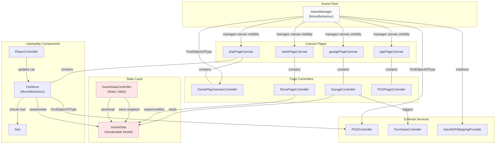

**Sources:** [trivialkart/trivialkart-unity/Assets/Scripts/GameManager.cs:1-463](), [trivialkart/trivialkart-unity/Assets/Scripts/Objects/GameData.cs:1-234](), [trivialkart/trivialkart-unity/Assets/Scripts/Controller/Game/CarMove.cs:1-192]()

---

## GameManager - Scene Orchestrator

The `GameManager` class serves as the central orchestrator for the entire scene. It is responsible for:

1. **Initialization** - Setting up constant data and loading save state
2. **Canvas Management** - Switching between the four main UI pages
3. **Lifecycle Coordination** - Handling application focus, pause, and quit events
4. **Cloud Save Orchestration** - Managing cloud load prompts and wait states (when PGS is enabled)

### Key Responsibilities

| Responsibility | Implementation |
|---|---|
| Scene initialization | `Awake()` calls `InitConstantData()` and `GameDataController.LoadGameData()` |
| Canvas switching | `SetCanvas(GameObject)` activates target canvas and deactivates others |
| Wait message display | `SetWaitMessageActive(bool)` manages modal overlay during PGS operations |
| Cloud load prompts | State machine in `Update()` monitors `_cloudStatus` enum |
| Save triggers | `DoSaveGame()` called on focus loss, pause, and quit |

### Initialization Sequence

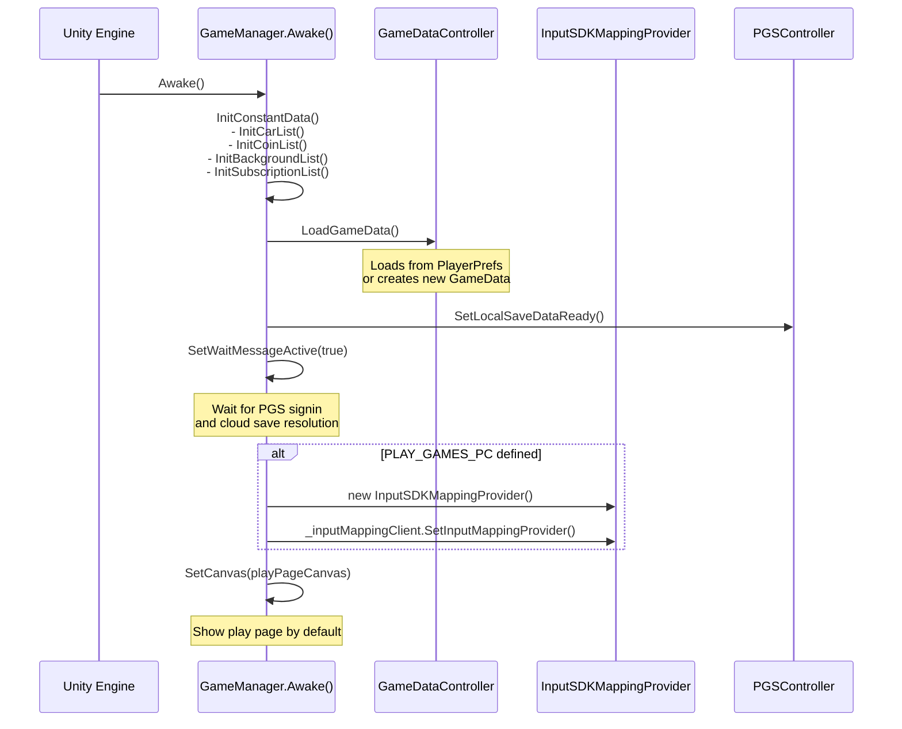

**Sources:** [trivialkart/trivialkart-unity/Assets/Scripts/GameManager.cs:93-136](), [trivialkart/trivialkart-unity/Assets/Scripts/GameManager.cs:348-398]()

### Canvas Navigation State Machine

The `GameManager` maintains a list of canvas pages and ensures only one is active at a time.

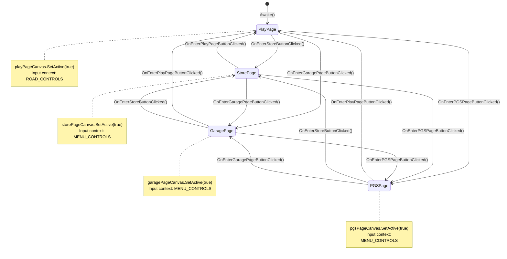

**Sources:** [trivialkart/trivialkart-unity/Assets/Scripts/GameManager.cs:292-339]()

### Cloud Save State Machine

When `PLAY_GAMES_SERVICES` is defined, `GameManager` monitors cloud save status and prompts users when newer saves are detected.

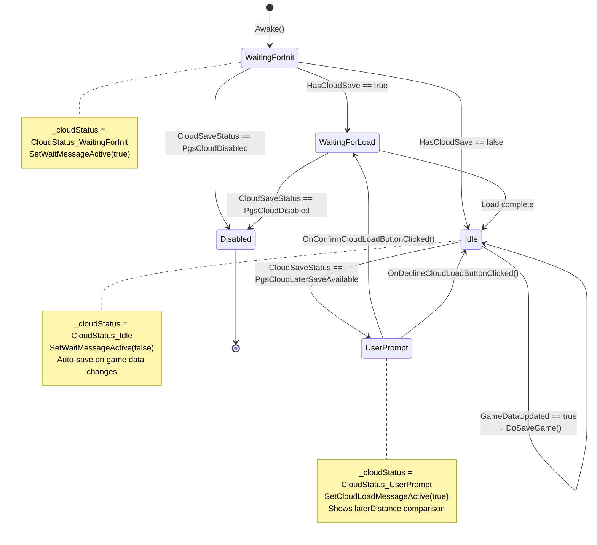

**Sources:** [trivialkart/trivialkart-unity/Assets/Scripts/GameManager.cs:68-84](), [trivialkart/trivialkart-unity/Assets/Scripts/GameManager.cs:138-233]()

---

## GameData - State Model

`GameData` is a serializable class representing all player-owned content and progress. It acts as the single source of truth for the game's state.

### State Schema

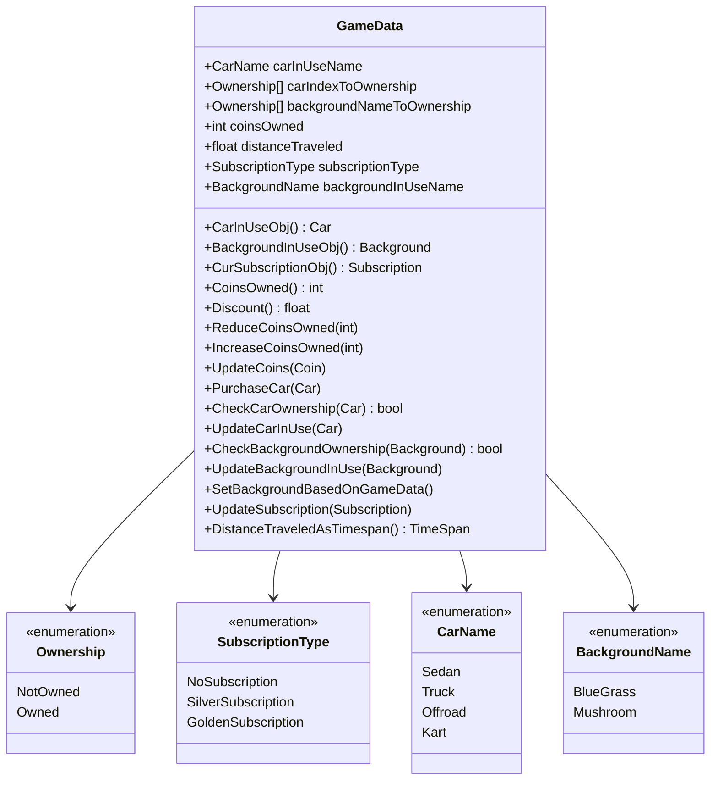

**Sources:** [trivialkart/trivialkart-unity/Assets/Scripts/Objects/GameData.cs:19-234]()

### GameData Ownership Model

The `GameData` class is owned by the static `GameDataController` utility, which manages persistence.

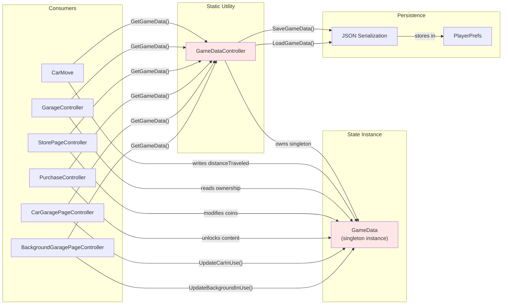

**Sources:** [trivialkart/trivialkart-unity/Assets/Scripts/Objects/GameData.cs:52-234]()

### Key GameData Patterns

| Pattern | Description | Example |
|---|---|
| **Ownership Arrays** | Fixed-size arrays indexed by enum values | `carIndexToOwnership[(int)CarName.Sedan]` |
| **Computed Properties** | Object references derived from enum state | `CarInUseObj => CarList.GetCarByName(carInUseName)` |
| **Discount Calculation** | Dynamic pricing based on subscription | `Discount => subscriptionType == GoldenSubscription ? 0.6f : 1` |
| **Side Effects** | State changes trigger UI updates | `ReduceCoinsOwned()` calls `UpdateCoinText()` |
| **Achievement Checks** | Conditional achievement unlocks on purchases | `PurchaseCar()` calls `CheckTruckAchievement()` |

**Sources:** [trivialkart/trivialkart-unity/Assets/Scripts/Objects/GameData.cs:94-110](), [trivialkart/trivialkart-unity/Assets/Scripts/Objects/GameData.cs:139-176]()

---

## UI Navigation System

Each canvas page contains page-specific controllers that manage UI state and respond to user interactions.

### Page Controller Hierarchy

```mermaid
graph TB
    subgraph "Play Page"
        PlayCanvas["playPageCanvas<br/>(GameObject)"]
        GPC["GamePlayCanvasController"]
        CM["CarMove"]
        Gas["Gas"]
        
        PlayCanvas ---|"contains"| GPC
        PlayCanvas ---|"contains"| CM
        PlayCanvas ---|"contains"| Gas
    end
    
    subgraph "Store Page"
        StoreCanvas["storePageCanvas<br/>(GameObject)"]
        SPC["StorePageController"]
        CarSPC["CarStorePageController"]
        CoinSPC["CoinStorePageController"]
        SubSPC["SubscriptionStorePageController"]
        
        StoreCanvas ---|"contains"| SPC
        SPC ---|"manages tabs"| CarSPC
        SPC ---|"manages tabs"| CoinSPC
        SPC ---|"manages tabs"| SubSPC
    end
    
    subgraph "Garage Page"
        GarageCanvas["garagePageCanvas<br/>(GameObject)"]
        GC["GarageController"]
        CarGPC["CarGaragePageController"]
        BgGPC["BackgroundGaragePageController"]
        
        GarageCanvas ---|"contains"| GC
        GC ---|"manages tabs"| CarGPC
        GC ---|"manages tabs"| BgGPC
    end
    
    subgraph "PGS Page"
        PGSCanvas["pgsPageCanvas<br/>(GameObject)"]
        PGSC["PGSPageController"]
        SigninPC["SigninPageController"]
        AchievPC["AchievementsPageController"]
        LeaderPC["LeaderboardPageController"]
        FriendsPC["FriendsPageController"]
        
        PGSCanvas ---|"contains"| PGSC
        PGSC ---|"manages tabs"| SigninPC
        PGSC ---|"manages tabs"| AchievPC
        PGSC ---|"manages tabs"| LeaderPC
        PGSC ---|"manages tabs"| FriendsPC
    end
    
    GM["GameManager"] -->|"SetCanvas()"| PlayCanvas
    GM -->|"SetCanvas()"| StoreCanvas
    GM -->|"SetCanvas()"| GarageCanvas
    GM -->|"SetCanvas()"| PGSCanvas
```

**Sources:** [trivialkart/trivialkart-unity/Assets/Scripts/GameManager.cs:34-61](), [trivialkart/trivialkart-unity/Assets/Scripts/Controller/PGS/PGSPageController.cs:24-102]()

### Tab Navigation Pattern

Both `GarageController` and `PGSPageController` implement a common tab navigation pattern with shared characteristics:

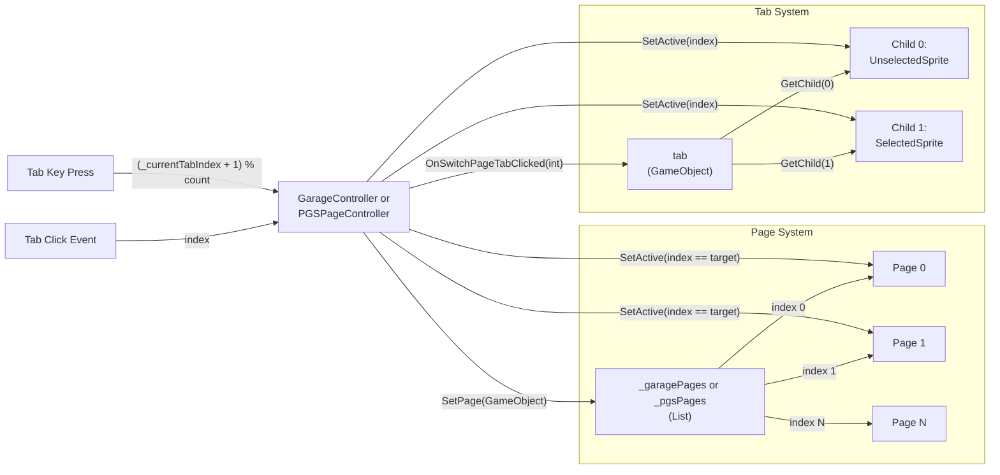

**Sources:** [trivialkart/trivialkart-unity/Assets/Scripts/Controller/Garage/GarageController.cs:26-153](), [trivialkart/trivialkart-unity/Assets/Scripts/Controller/PGS/PGSPageController.cs:24-102]()

---

## Input Handling

TrivialKart uses Unity's Input System with two distinct input contexts for gameplay and menu navigation.

### Input Architecture

```mermaid
graph TB
    subgraph "Unity Input System"
        IAA["InputActionAsset<br/>(TrivialKartInputActions)"]
        
        subgraph "Action Maps"
            RoadActions["Road Actions<br/>- Move (Space)<br/>- Boost (Shift+Space)<br/>- Garage (G)<br/>- PGS (P)<br/>- Store (S)"]
            
            MenuActions["Menu Actions<br/>- PlayPage (Esc)<br/>- SwitchTabs (Tab)<br/>- LeftTab (Left Arrow)<br/>- RightTab (Right Arrow)"]
        end
        
        IAA ---|"contains"| RoadActions
        IAA ---|"contains"| MenuActions
    end
    
    subgraph "Game Components"
        CM["CarMove"]
        GC["GarageController"]
        PGSC["PGSPageController"]
        CarGPC["CarGaragePageController"]
        BgGPC["BackgroundGaragePageController"]
    end
    
    CM -->|"FindAction('Move')"| RoadActions
    CM -->|"FindAction('Boost')"| RoadActions
    CM -->|"FindAction('Garage')"| RoadActions
    CM -->|"FindAction('PGS')"| RoadActions
    CM -->|"FindAction('Store')"| RoadActions
    
    GC -->|"FindAction('SwitchTabs')"| MenuActions
    PGSC -->|"FindAction('SwitchTabs')"| MenuActions
    CarGPC -->|"FindAction('LeftTab')"| MenuActions
    CarGPC -->|"FindAction('RightTab')"| MenuActions
    BgGPC -->|"FindAction('LeftTab')"| MenuActions
    BgGPC -->|"FindAction('RightTab')"| MenuActions
    
    subgraph "Google Play Games for PC"
        InputSDK["InputSDKMappingProvider"]
        RoadContext["roadControlsContext<br/>(ROAD_CONTEXT)"]
        MenuContext["menuControlsContext<br/>(MENU_CONTEXT)"]
        
        InputSDK ---|"provides"| RoadContext
        InputSDK ---|"provides"| MenuContext
    end
    
    GM["GameManager"] -->|"SetInputContext()"| InputSDK
    GM -->|"IsInPlayCanvas()?"| RoadContext
    GM -->|"!IsInPlayCanvas()?"| MenuContext
```

**Sources:** [trivialkart/trivialkart-unity/Assets/Scripts/Controller/Game/CarMove.cs:51-88](), [trivialkart/trivialkart-unity/Assets/Scripts/GameManager.cs:108-124]()

### Input SDK Mapping (PC Builds)

When `PLAY_GAMES_PC` is defined, `InputSDKMappingProvider` defines remappable input mappings for the Google Play Games for PC platform.

| Input Event | Default Keys | Remappable | Context |
|---|---|---|---|
| DRIVE | Space | Yes | ROAD_CONTEXT |
| TURBO | Shift+Space | No | ROAD_CONTEXT |
| OPEN_GARAGE | G | Yes | ROAD_CONTEXT |
| OPEN_PGS | P | Yes | ROAD_CONTEXT |
| OPEN_STORE | S | Yes | ROAD_CONTEXT |
| RETURN_TO_ROAD | Escape | No | MENU_CONTEXT |
| CHANGE_TAB | Tab | Yes | MENU_CONTEXT |
| SELECT_NEXT | Right Arrow | Yes | MENU_CONTEXT |
| SELECT_PREVIOUS | Left Arrow | Yes | MENU_CONTEXT |

**Sources:** [trivialkart/trivialkart-unity/Assets/Scripts/InputSDK/InputSDKProvider.cs:21-203]()

### Input Context Switching

The `GameManager` switches input contexts based on which canvas is active:

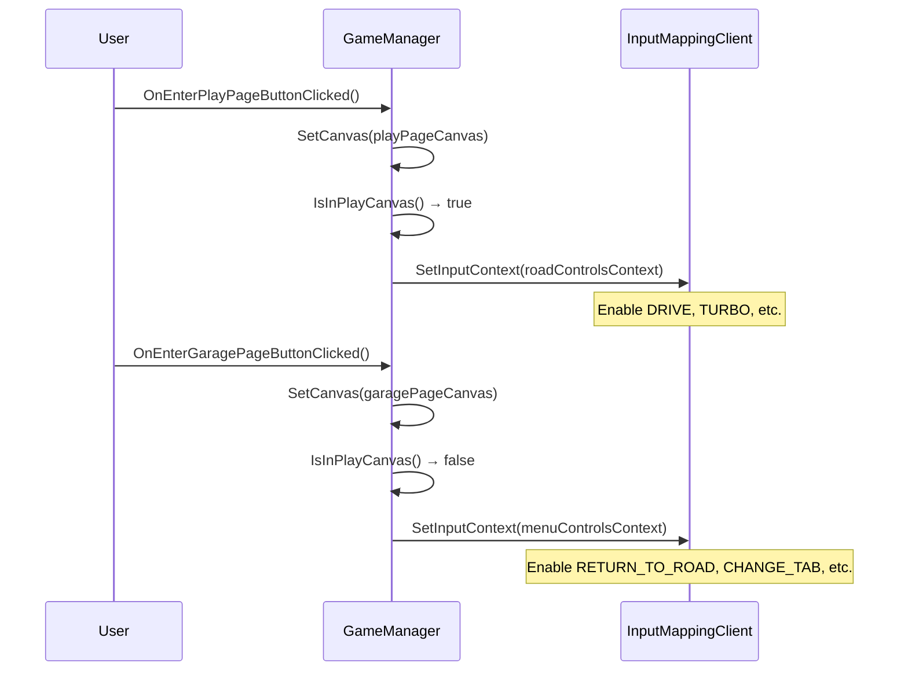

**Sources:** [trivialkart/trivialkart-unity/Assets/Scripts/GameManager.cs:315-339]()

---

## Lifecycle Management

`GameManager` implements several Unity lifecycle methods to ensure data integrity across application state changes.

### Application Event Flow

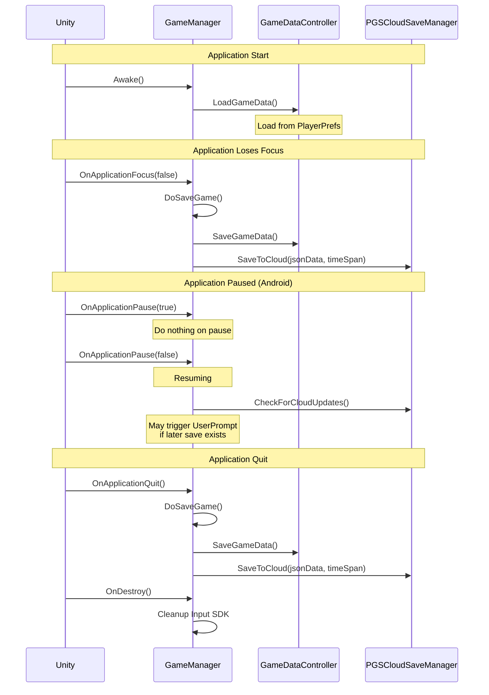

**Sources:** [trivialkart/trivialkart-unity/Assets/Scripts/GameManager.cs:400-463]()

### Save/Load Flow

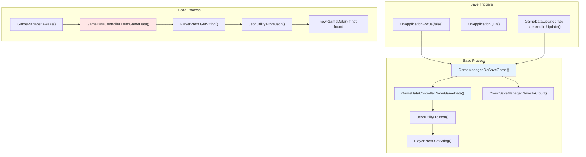

**Sources:** [trivialkart/trivialkart-unity/Assets/Scripts/GameManager.cs:400-422](), [trivialkart/trivialkart-unity/Assets/Scripts/GameManager.cs:424-454]()

---

## Component Communication Patterns

### FindObjectOfType Pattern

Most components use `FindObjectOfType<T>()` to locate singleton-like managers:

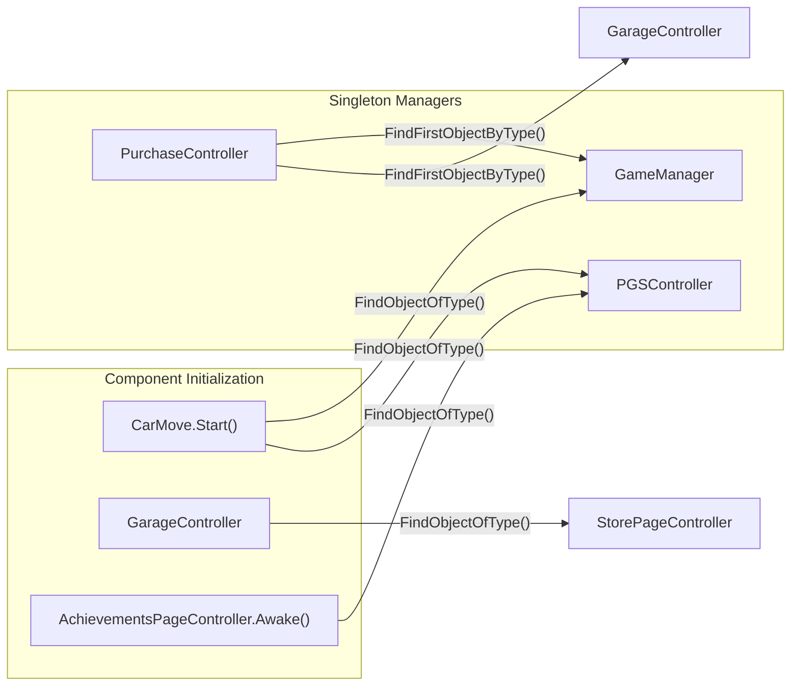

**Sources:** [trivialkart/trivialkart-unity/Assets/Scripts/Controller/Game/CarMove.cs:59-69](), [trivialkart/trivialkart-unity/Assets/Scripts/Controller/PurchaseController.cs:92-95]()

### Static GameDataController Access

All game state access flows through the static `GameDataController`:

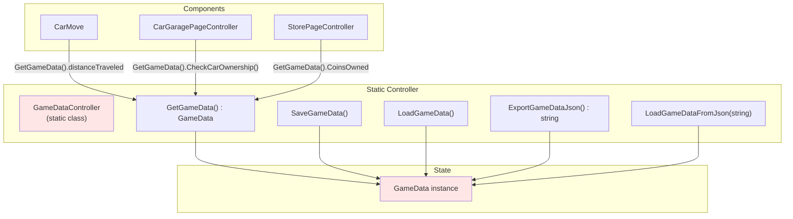

**Sources:** [trivialkart/trivialkart-unity/Assets/Scripts/Controller/Game/CarMove.cs:92-94](), [trivialkart/trivialkart-unity/Assets/Scripts/Controller/Garage/CarGaragePageController.cs:64-82]()

### UI Refresh Pattern

Page controllers implement an `OnEnable()` → `RefreshPage()` pattern to update UI when pages become visible:

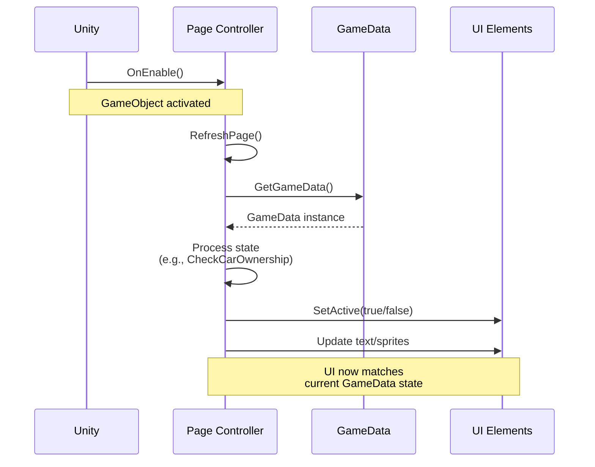

**Sources:** [trivialkart/trivialkart-unity/Assets/Scripts/Controller/Garage/CarGaragePageController.cs:52-82](), [trivialkart/trivialkart-unity/Assets/Scripts/Controller/Garage/GarageController.cs:71-82](), [trivialkart/trivialkart-unity/Assets/Scripts/Controller/PGS/PGSPageController.cs:67-75]()

---

## Summary

The TrivialKart Unity architecture demonstrates a clear separation of concerns:

- **GameManager** orchestrates scene-level concerns: canvas switching, lifecycle events, and cloud save coordination
- **GameData** serves as the immutable single source of truth for all player state
- **GameDataController** provides static utility methods for state persistence
- **Page Controllers** manage UI-specific logic and implement the `OnEnable()` refresh pattern
- **Input System** provides keyboard/mouse support with context-aware mappings for PC builds

This architecture enables:
- Clean state management with a single serializable model
- Testable UI controllers that query state rather than owning it
- Consistent save/load behavior across application lifecycle events
- Extensible page navigation without complex state machines

**Sources:** [trivialkart/trivialkart-unity/Assets/Scripts/GameManager.cs:1-463](), [trivialkart/trivialkart-unity/Assets/Scripts/Objects/GameData.cs:1-234](), [trivialkart/trivialkart-unity/Assets/Scripts/Controller/Game/CarMove.cs:1-192]()

---

