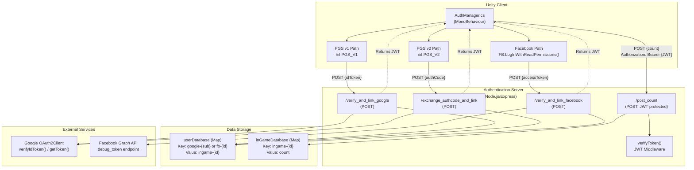
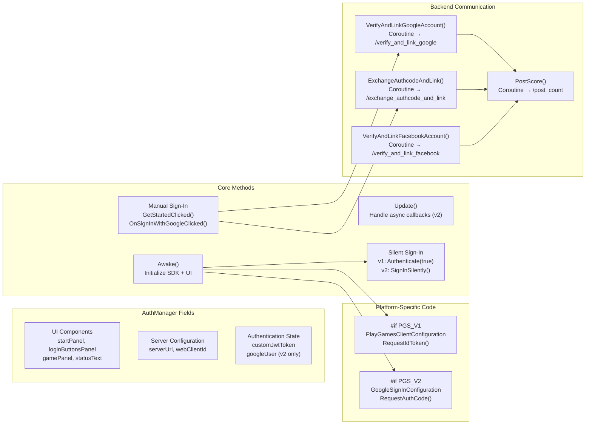
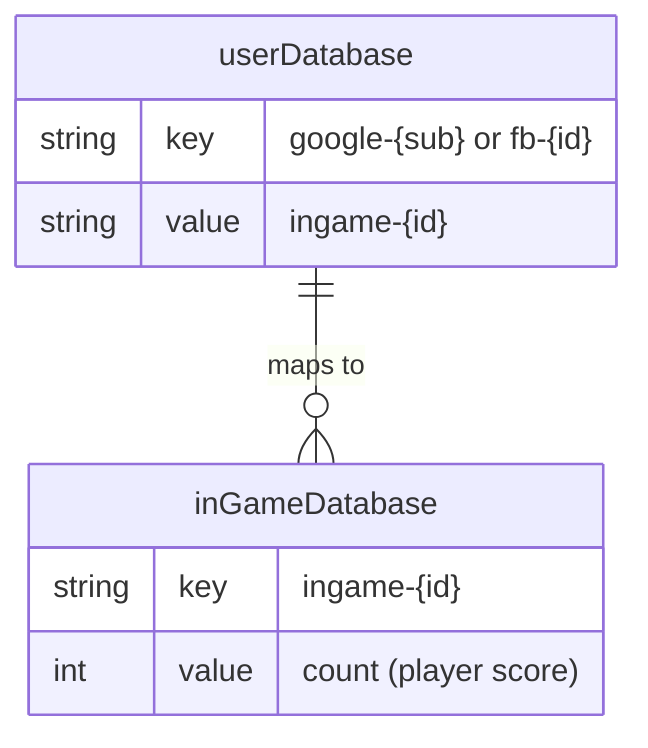
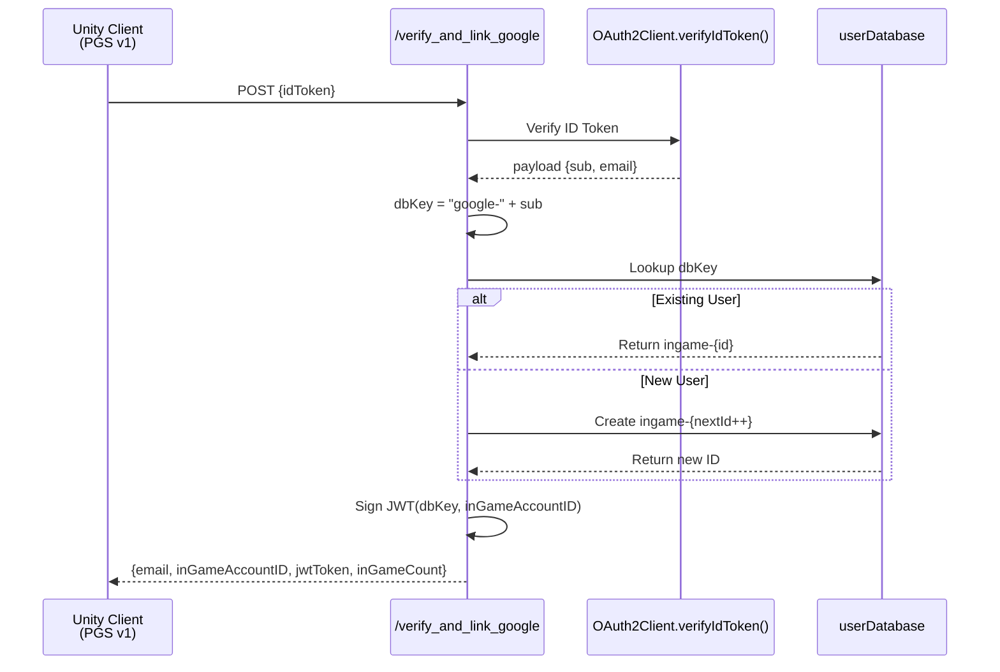
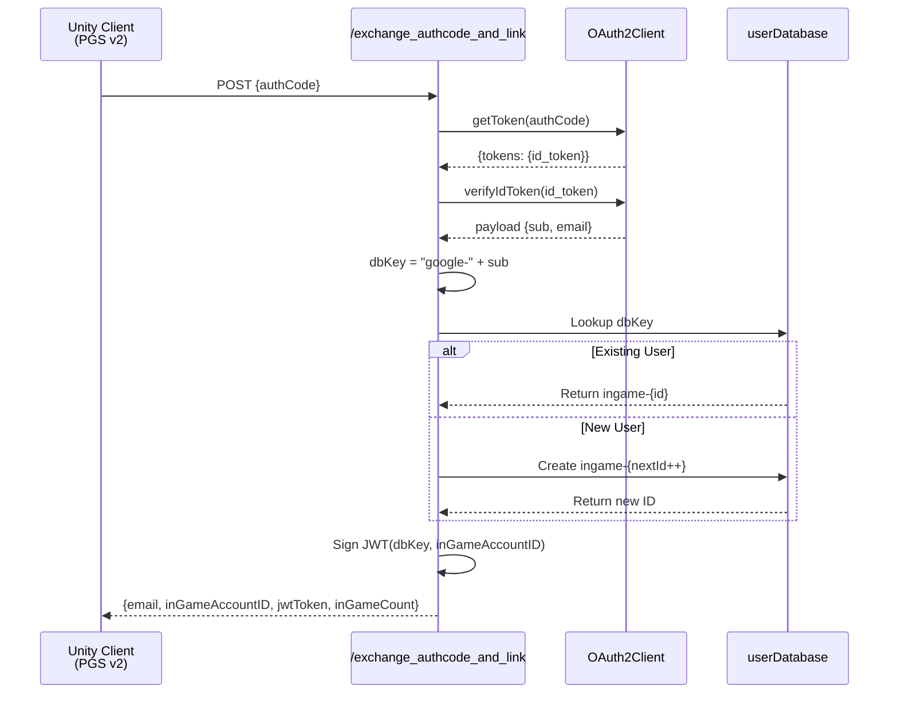
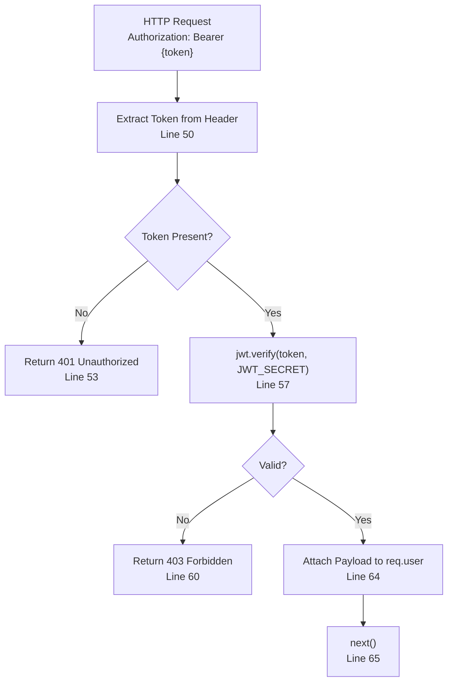
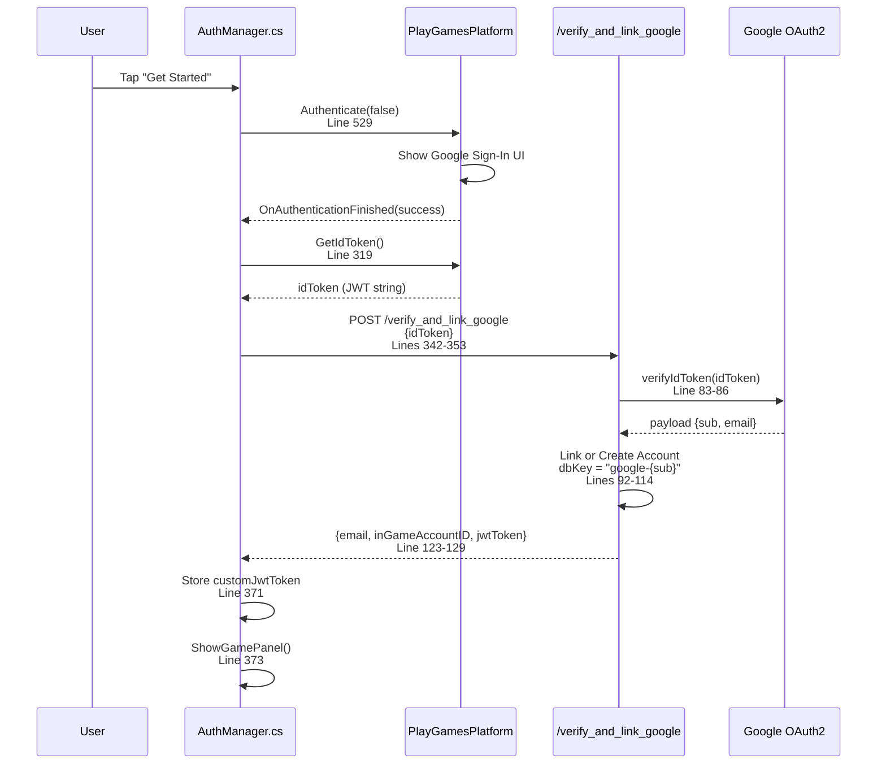
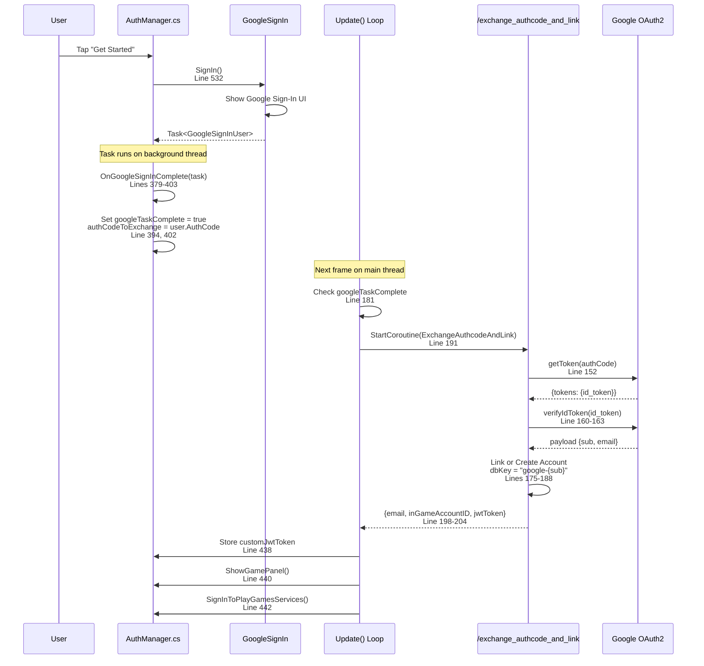

<!-- source: DeepWiki mcp.deepwiki.com · repo android/games-samples · page 3.2 Authentication and PGS Migration · fetched 2026-10-23 -->

# Authentication and PGS Migration

<details>
<summary>Relevant source files</summary>

The following files were used as context for generating this wiki page:

- [trivialkart/trivialkart-auth-server/.gitignore](trivialkart/trivialkart-auth-server/.gitignore)
- [trivialkart/trivialkart-auth-server/README.md](trivialkart/trivialkart-auth-server/README.md)
- [trivialkart/trivialkart-auth-server/package.json](trivialkart/trivialkart-auth-server/package.json)
- [trivialkart/trivialkart-auth-server/server.js](trivialkart/trivialkart-auth-server/server.js)
- [trivialkart/trivialkart-unity/Assets/Scenes/MockSignIn.unity](trivialkart/trivialkart-unity/Assets/Scenes/MockSignIn.unity)
- [trivialkart/trivialkart-unity/Assets/Scenes/MockSignIn.unity.meta](trivialkart/trivialkart-unity/Assets/Scenes/MockSignIn.unity.meta)
- [trivialkart/trivialkart-unity/Assets/Scripts/AuthManager.cs](trivialkart/trivialkart-unity/Assets/Scripts/AuthManager.cs)
- [trivialkart/trivialkart-unity/Assets/Scripts/AuthManager.cs.meta](trivialkart/trivialkart-unity/Assets/Scripts/AuthManager.cs.meta)
- [trivialkart/trivialkart-unity/ProjectSettings/ProjectSettings.asset](trivialkart/trivialkart-unity/ProjectSettings/ProjectSettings.asset)
- [trivialkart/trivialkart-unity/README.md](trivialkart/trivialkart-unity/README.md)

</details>


## Purpose and Scope

This document details the authentication system implemented in TrivialKart Unity, focusing on the migration path from Play Games Services (PGS) v1 to v2. The system demonstrates OpenID-based account linking that preserves player progress during SDK upgrades, using a backend server architecture for secure token verification.

**Related Pages:**
- For overall TrivialKart architecture and scene management, see [TrivialKart Unity Architecture](#3.1)
- For PGS achievements and leaderboards integration, see [Google Play Integration](#3.4)

**Scope:** This page covers the `AuthManager.cs` client implementation, the Node.js authentication server (`server.js`), and the OpenID-based migration strategy. It does not cover in-game gameplay systems or Unity IAP integration.

---

## Migration Challenge and Solution

### The Problem

Google deprecated Play Games Services v1 authentication in favor of v2, which uses a completely different authentication flow:

| Aspect | PGS v1 | PGS v2 |
|--------|--------|--------|
| **Authentication Method** | ID Token (direct) | Server Auth Code |
| **Client SDK** | Play Games Plugin v0.10.x | Play Games Plugin v2.1.0 + Google Sign-In Plugin |
| **Token Type** | `PlayGamesPlatform.Instance.GetIdToken()` | `GoogleSignIn.DefaultInstance.SignIn()` returns Auth Code |
| **Server Workflow** | Verify ID Token directly | Exchange Auth Code for ID Token, then verify |

The critical challenge: **players upgrading from v1 to v2 must retain their account progress**.

### The OpenID Solution

Both authentication methods resolve to the same **OpenID Connect `sub` claim** for a given Google user. The server uses this `sub` value as the database key, ensuring consistent account identification across SDK versions.

```
PGS v1 Flow: ID Token → Verify → Extract sub → Database Key: "google-{sub}"
PGS v2 Flow: Auth Code → Exchange for ID Token → Verify → Extract sub → Database Key: "google-{sub}"
```

**Sources:** [trivialkart/trivialkart-auth-server/README.md:1-18](), [trivialkart/trivialkart-unity/README.md:14-14]()

---

## System Architecture

The authentication system consists of three primary components:



**Sources:** [trivialkart/trivialkart-unity/Assets/Scripts/AuthManager.cs:35-673](), [trivialkart/trivialkart-auth-server/server.js:15-317]()

---

## Client-Side Implementation

### AuthManager Component Structure

The `AuthManager` class uses conditional compilation to support both PGS v1 and v2 within the same codebase:



**Sources:** [trivialkart/trivialkart-unity/Assets/Scripts/AuthManager.cs:35-176]()

### Conditional Compilation Strategy

The client uses scripting define symbols to compile different code paths:

| Symbol | SDK Version | Key Methods |
|--------|-------------|-------------|
| `PGS_V1` | Play Games Plugin v0.10.x | `PlayGamesPlatform.Instance.Authenticate()`, `GetIdToken()` |
| `PGS_V2` | Play Games Plugin v2.1.0 + Google Sign-In | `GoogleSignIn.DefaultInstance.SignIn()`, `googleUser.AuthCode` |

**Key Implementation Details:**

**Awake() Initialization:**
- Lines [100-176]() initialize the appropriate SDK based on compilation symbol
- PGS v1: [124-133]() configures `PlayGamesClientConfiguration` with `RequestIdToken()`
- PGS v2: [135-148]() configures `GoogleSignInConfiguration` with `RequestAuthCode()`

**Thread Safety in v2:**
- Lines [56-59]() declare volatile flags for main thread dispatching
- Lines [178-228]() in `Update()` handle async `Task<GoogleSignInUser>` completion on main thread
- Required because Unity coroutines must execute on main thread

**Sources:** [trivialkart/trivialkart-unity/Assets/Scripts/AuthManager.cs:24-33](), [trivialkart/trivialkart-unity/Assets/Scripts/AuthManager.cs:100-176]()

---

## Server-Side Implementation

### Database Schema

The server maintains two in-memory maps (production would use persistent storage):



**Database Operations:**

| Operation | Code Location | Key Format |
|-----------|---------------|------------|
| Google v1/v2 Lookup | [server.js:102-114](), [server.js:175-188]() | `google-{payload.sub}` |
| Facebook Lookup | [server.js:249-259]() | `fb-{facebookUserId}` |
| Account Creation | [server.js:108-112]() | Sequential ID: `ingame-{nextInGameAccountId++}` |
| Score Update | [server.js:296-296]() | Uses `inGameAccountID` from JWT payload |

**Sources:** [trivialkart/trivialkart-auth-server/server.js:42-46]()

### Endpoint Implementations

**PGS v1 Endpoint: `/verify_and_link_google`**



**Implementation:** [server.js:75-135]()

**PGS v2 Endpoint: `/exchange_authcode_and_link`**



**Implementation:** [server.js:142-210]()

**Critical Difference:** Line [152]() exchanges the auth code for tokens using `client.getToken(authCode)`, while the v1 endpoint directly verifies the ID token at line [83-86](). Both paths converge at extracting `payload.sub` and using it to construct the database key.

**Sources:** [trivialkart/trivialkart-auth-server/server.js:75-210]()

### JWT Authentication Middleware

The `verifyToken` middleware protects authenticated endpoints:

**Middleware Flow:**



**Implementation:** [server.js:48-67]()

**Usage Example:** The `/post_count` endpoint at [server.js:282-312]() uses `verifyToken` middleware to:
1. Authenticate the request (line [282]())
2. Extract `inGameAccountID` from verified JWT payload (line [288]())
3. Update the score for the correct user (line [296]())

**Sources:** [trivialkart/trivialkart-auth-server/server.js:48-67](), [trivialkart/trivialkart-auth-server/server.js:282-312]()

---

## Authentication Flows

### PGS v1 Flow (ID Token)



**Client Implementation:** [AuthManager.cs:297-340](), [AuthManager.cs:342-375]()

**Server Implementation:** [server.js:75-135]()

**Sources:** [trivialkart/trivialkart-unity/Assets/Scripts/AuthManager.cs:297-375](), [trivialkart/trivialkart-auth-server/server.js:75-135]()

### PGS v2 Flow (Auth Code Exchange)



**Key Architectural Detail:** Lines [178-228]() in `Update()` handle the asynchronous `Task<GoogleSignInUser>` result on Unity's main thread, which is required for coroutine execution. The background thread sets `googleTaskComplete = true` at line [402](), and the main thread detects this flag at line [181]().

**Client Implementation:** [AuthManager.cs:378-444](), [AuthManager.cs:178-228]()

**Server Implementation:** [server.js:142-210]()

**Sources:** [trivialkart/trivialkart-unity/Assets/Scripts/AuthManager.cs:178-228](), [trivialkart/trivialkart-unity/Assets/Scripts/AuthManager.cs:378-444](), [trivialkart/trivialkart-auth-server/server.js:142-210]()

---

## Account Linking Strategy

### OpenID Claim Consistency

The migration strategy relies on the `sub` claim from OpenID Connect remaining identical across authentication methods:

| Data Point | PGS v1 Path | PGS v2 Path |
|------------|-------------|-------------|
| **Client Obtains** | ID Token | Server Auth Code |
| **Server Receives** | ID Token (direct) | Auth Code |
| **Server Extracts** | `payload.sub` from ID Token verification | `payload.sub` from ID Token (after exchange) |
| **Database Key** | `google-{payload.sub}` | `google-{payload.sub}` |

**Example Migration Scenario:**

1. **Day 1 (v1):** User signs in → Server creates `userDatabase["google-123456789"] = "ingame-1001"` → Progress saved
2. **Day 30 (App Update to v2):** User signs in → Server looks up `userDatabase["google-123456789"]` → Returns existing `"ingame-1001"` → Progress preserved

**Implementation:**

**PGS v1:** [server.js:91-95]()
```
const openId = payload.sub;
const dbKey = `google-${openId}`;
```

**PGS v2:** [server.js:167-171]()
```
const openId = payload.sub;
const dbKey = `google-${openId}`;
```

**Sources:** [trivialkart/trivialkart-auth-server/server.js:91-95](), [trivialkart/trivialkart-auth-server/server.js:167-171](), [trivialkart/trivialkart-auth-server/README.md:8-18]()

### Facebook Account Linking

Facebook uses a similar strategy with a prefixed user ID:

**Facebook Implementation:** [server.js:232-246]()

```
const facebookUserId = debugData.data.user_id;
const prefixedFacebookId = `fb-${facebookUserId}`;  // Prevents collision with Google IDs
```

**Client Flow:** [AuthManager.cs:549-598]()
1. `FB.LogInWithReadPermissions()` at line [563]()
2. Extract `AccessToken.CurrentAccessToken.TokenString` at line [586-587]()
3. Send to server endpoint `/verify_and_link_facebook` at line [606]()
4. Server verifies token against Facebook Graph API at lines [222-230]()

**Sources:** [trivialkart/trivialkart-unity/Assets/Scripts/AuthManager.cs:549-633](), [trivialkart/trivialkart-auth-server/server.js:213-280]()

---

## Configuration and Setup

### Server Environment Variables

The backend requires a `.env` file with OAuth credentials:

| Variable | Purpose | Example |
|----------|---------|---------|
| `WEB_CLIENT_ID` | Google Cloud OAuth 2.0 Web Client ID | `123-abc.apps.googleusercontent.com` |
| `WEB_CLIENT_SECRET` | Google Cloud OAuth 2.0 Secret | `GOCSPX-xyz...` |
| `FB_APP_ID` | Facebook App ID (optional) | `123456789` |
| `FB_APP_SECRET` | Facebook App Secret (optional) | `abc123...` |
| `JWT_SECRET` | Custom JWT signing key | `super-secret-key-for-your-game-jwt` |

**Critical:** The `WEB_CLIENT_ID` must be a "Web application" type OAuth client, **not** an Android client. This is required for the auth code exchange flow at [server.js:152]().

**Initialization Check:** [server.js:31-34]() validates all required environment variables and exits if missing.

**Sources:** [trivialkart/trivialkart-auth-server/README.md:44-52](), [trivialkart/trivialkart-auth-server/server.js:22-37]()

### Unity Client Configuration

**AuthManager Inspector Fields:**

The `AuthManager` MonoBehaviour requires configuration via Unity Inspector:

| Field | Type | Purpose | Example |
|-------|------|---------|---------|
| `serverUrl` | `string` | Backend API base URL | `http://192.168.1.5:3000` (dev)<br/>`https://api.yourgame.com` (prod) |
| `webClientId` | `string` | Google Web Client ID (v2 only) | `123-abc.apps.googleusercontent.com` |

**URL Construction:** Lines [102-105]() construct endpoint URLs:
```
verify_and_link_google = serverUrl + "/verify_and_link_google";
exchange_authcode_and_link = serverUrl + "/exchange_authcode_and_link";
```

**Google Sign-In Configuration (v2):** Lines [137-145]() configure the Google Sign-In plugin:
```csharp
GoogleSignIn.Configuration = new GoogleSignInConfiguration
{
    WebClientId = webClientId,  // Must match server WEB_CLIENT_ID
    RequestAuthCode = true,      // Critical for backend exchange
    UseGameSignIn = false,
    RequestEmail = true,
};
```

**Player Settings Requirements:**
- **HTTP Downloads:** For local testing, enable "Allow downloads over HTTP" in Player Settings → Other Settings
- **Scripting Define Symbols:** Add either `PGS_V1` or `PGS_V2` in Player Settings → Other Settings → Scripting Define Symbols

**Sources:** [trivialkart/trivialkart-unity/Assets/Scripts/AuthManager.cs:62-67](), [trivialkart/trivialkart-unity/Assets/Scripts/AuthManager.cs:100-148](), [trivialkart/trivialkart-auth-server/README.md:91-96]()

### Testing Migration Workflow

**Step 1: Deploy v1 Client**
1. Set scripting define symbol to `PGS_V1`
2. Build and install app
3. Sign in with Google account
4. Note the displayed `inGameAccountID` (e.g., `ingame-1001`)
5. Increment the counter to save data

**Step 2: Simulate App Update to v2**
1. Remove old PGS plugin files (see [README:66-76]())
2. Install Google Sign-In plugin and PGS v2 plugin
3. Change scripting define symbol to `PGS_V2`
4. Update `webClientId` field in AuthManager Inspector
5. Build and install app (simulates app store update)

**Step 3: Verify Migration**
1. Sign in with the same Google account
2. Server logs should show: `(PGS v2) Verified... Existing user linked to OpenID`
3. Client should display the **same** `inGameAccountID` (`ingame-1001`)
4. Previous counter value should be preserved

**Server Log Output Example:**
```
(PGS v1) Successfully verified idToken for: user@gmail.com, OpenID: 123456789
(PGS v1) New user. Created In-Game ID: ingame-1001

[App Update]

(PGS v2) Verified. Email: user@gmail.com, OpenID: 123456789
(PGS v2) Existing user linked to OpenID. In-Game ID: ingame-1001
```

**Sources:** [trivialkart/trivialkart-auth-server/README.md:115-131]()

---

