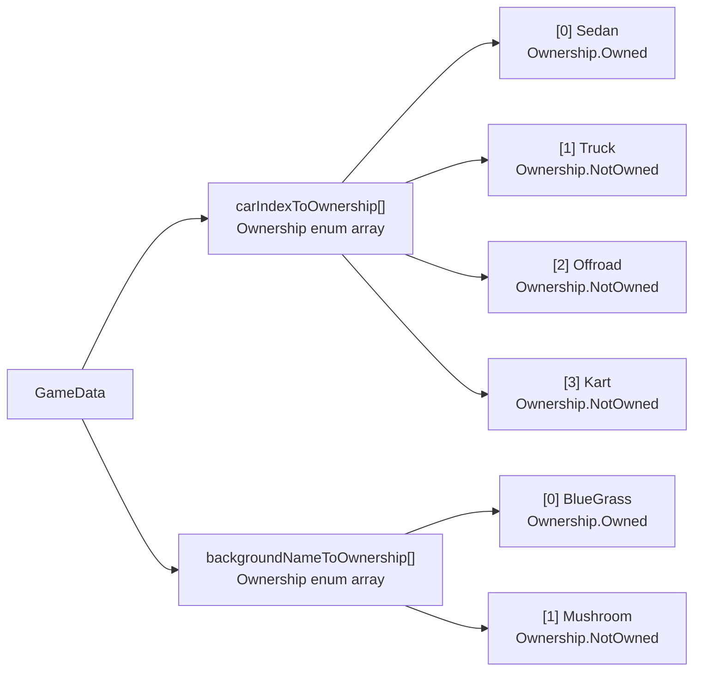
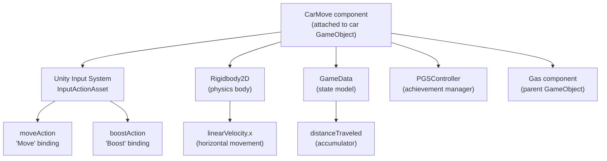
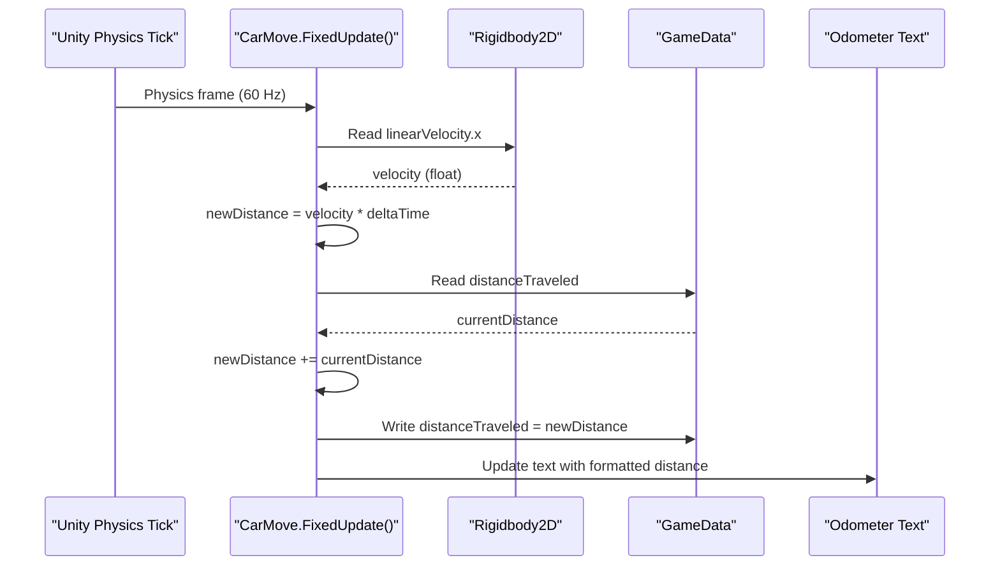
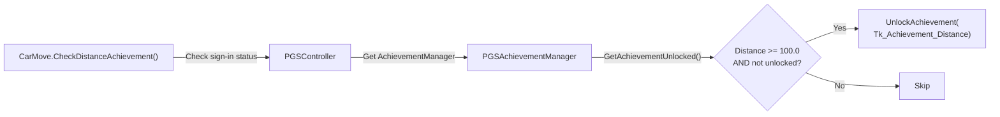
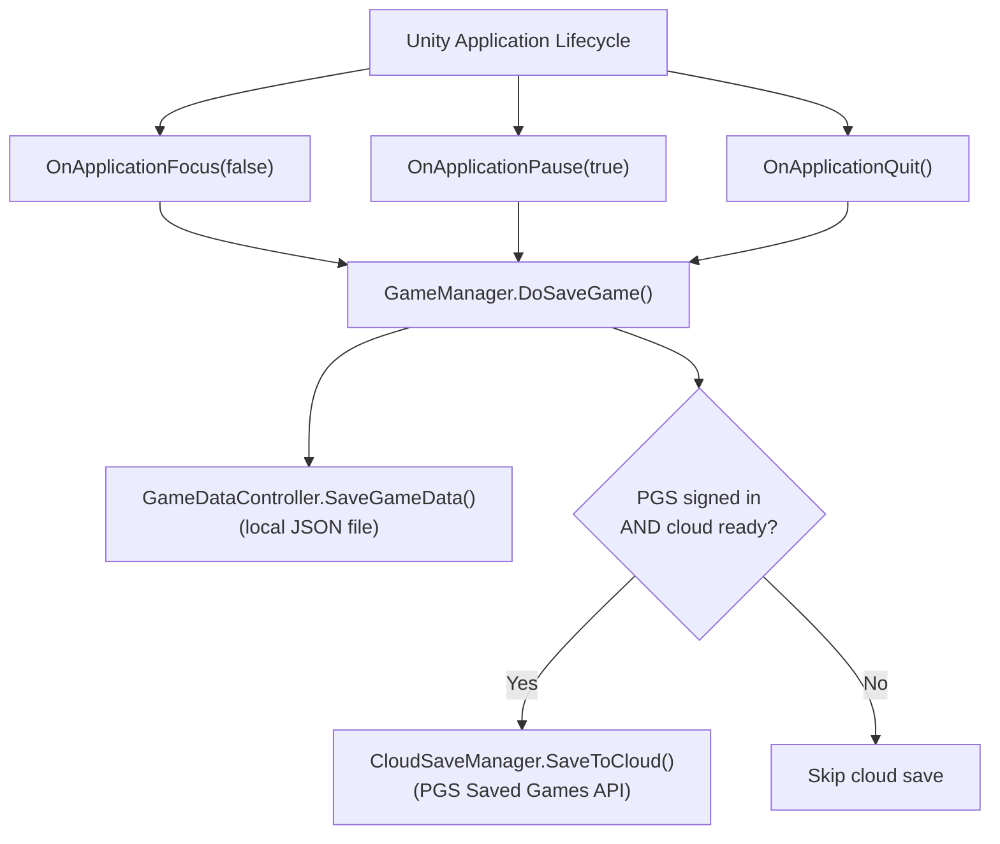
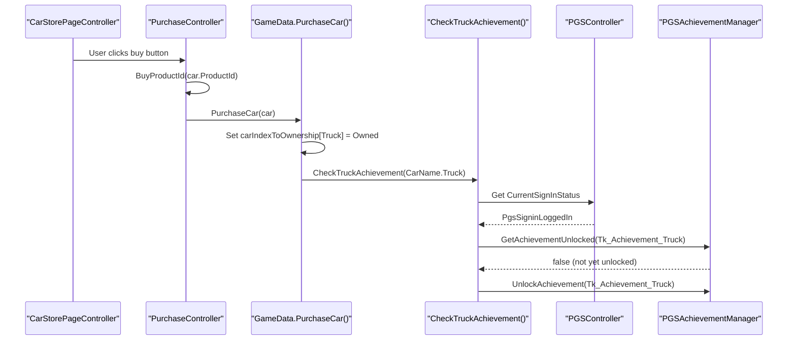

<!-- source: DeepWiki mcp.deepwiki.com · repo android/games-samples · page 3.3 Gameplay and State Management · fetched 2026-10-23 -->

# Gameplay and State Management

Relevant source files

The following files were used as context for generating this wiki page:

- [trivialkart/trivialkart-unity/Assets/Scenes/TrivialKartScene.unity](trivialkart/trivialkart-unity/Assets/Scenes/TrivialKartScene.unity)
- [trivialkart/trivialkart-unity/Assets/Scripts/Controller/Game/CarMove.cs](trivialkart/trivialkart-unity/Assets/Scripts/Controller/Game/CarMove.cs)
- [trivialkart/trivialkart-unity/Assets/Scripts/Controller/Garage/BackgroundGaragePageController.cs](trivialkart/trivialkart-unity/Assets/Scripts/Controller/Garage/BackgroundGaragePageController.cs)
- [trivialkart/trivialkart-unity/Assets/Scripts/Controller/Garage/CarGaragePageController.cs](trivialkart/trivialkart-unity/Assets/Scripts/Controller/Garage/CarGaragePageController.cs)
- [trivialkart/trivialkart-unity/Assets/Scripts/Controller/Garage/GarageController.cs](trivialkart/trivialkart-unity/Assets/Scripts/Controller/Garage/GarageController.cs)
- [trivialkart/trivialkart-unity/Assets/Scripts/Controller/PGS/AchievementsPageController.cs](trivialkart/trivialkart-unity/Assets/Scripts/Controller/PGS/AchievementsPageController.cs)
- [trivialkart/trivialkart-unity/Assets/Scripts/Controller/PGS/FriendsPageController.cs](trivialkart/trivialkart-unity/Assets/Scripts/Controller/PGS/FriendsPageController.cs)
- [trivialkart/trivialkart-unity/Assets/Scripts/Controller/PGS/LeaderboardPageController.cs](trivialkart/trivialkart-unity/Assets/Scripts/Controller/PGS/LeaderboardPageController.cs)
- [trivialkart/trivialkart-unity/Assets/Scripts/Controller/PGS/PGSAchievementManager.cs.meta](trivialkart/trivialkart-unity/Assets/Scripts/Controller/PGS/PGSAchievementManager.cs.meta)
- [trivialkart/trivialkart-unity/Assets/Scripts/Controller/PGS/PGSController.cs](trivialkart/trivialkart-unity/Assets/Scripts/Controller/PGS/PGSController.cs)
- [trivialkart/trivialkart-unity/Assets/Scripts/Controller/PGS/PGSPageController.cs](trivialkart/trivialkart-unity/Assets/Scripts/Controller/PGS/PGSPageController.cs)
- [trivialkart/trivialkart-unity/Assets/Scripts/Controller/PGS/SigninPageController.cs](trivialkart/trivialkart-unity/Assets/Scripts/Controller/PGS/SigninPageController.cs)
- [trivialkart/trivialkart-unity/Assets/Scripts/Controller/PurchaseController.cs](trivialkart/trivialkart-unity/Assets/Scripts/Controller/PurchaseController.cs)
- [trivialkart/trivialkart-unity/Assets/Scripts/GameManager.cs](trivialkart/trivialkart-unity/Assets/Scripts/GameManager.cs)
- [trivialkart/trivialkart-unity/Assets/Scripts/InputSDK/InputSDKProvider.cs](trivialkart/trivialkart-unity/Assets/Scripts/InputSDK/InputSDKProvider.cs)
- [trivialkart/trivialkart-unity/Assets/Scripts/Objects/GameData.cs](trivialkart/trivialkart-unity/Assets/Scripts/Objects/GameData.cs)
- [trivialkart/trivialkart-unity/ProjectSettings/ProjectVersion.txt](trivialkart/trivialkart-unity/ProjectSettings/ProjectVersion.txt)

## Purpose and Scope

This document covers TrivialKart Unity's core gameplay mechanics and state management systems. It describes the `GameData` model as the single source of truth for player state, the `CarMove` gameplay loop that tracks distance traveled, and how state mutations trigger persistence and achievement unlocking. For authentication and cloud save synchronization, see [Authentication and PGS Migration](#3.2). For Unity IAP purchase flows that modify state, see [Google Play Integration](#3.4).

## GameData: The Central State Model

`GameData` serves as the authoritative player state container, storing all owned items, current selections, and progress metrics. The class is marked `[Serializable]` to enable JSON serialization for local and cloud save operations.

[trivialkart/trivialkart-unity/Assets/Scripts/Objects/GameData.cs:51-233]()

### Core State Properties

| Property | Type | Purpose |
|----------|------|---------|
| `carInUseName` | `CarName` enum | Currently equipped car |
| `carIndexToOwnership` | `Ownership[]` | Ownership status for each car |
| `backgroundNameToOwnership` | `Ownership[]` | Ownership status for each background |
| `coinsOwned` | `int` | Current coin balance |
| `distanceTraveled` | `float` | Total distance driven (gameplay metric) |
| `subscriptionType` | `SubscriptionType` enum | Active subscription tier |
| `backgroundInUseName` | `BackgroundName` enum | Currently equipped background |

### Ownership Model

The ownership system uses enumerated indices to map items to their `Ownership` state. The `Ownership` enum has two values: `NotOwned` and `Owned`.

**Sources:** [trivialkart/trivialkart-unity/Assets/Scripts/Objects/GameData.cs:19-44](), [trivialkart/trivialkart-unity/Assets/Scripts/Objects/GameData.cs:69-92]()

### Initial State

The constructor initializes the player with default starter content:
- 20 coins (`InitialCoinAmount`)
- Sedan car owned and equipped
- BlueGrass background owned and equipped
- No active subscription

[trivialkart/trivialkart-unity/Assets/Scripts/Objects/GameData.cs:69-92]()

### State Mutation Methods

`GameData` provides methods that modify state and trigger UI updates:

| Method | Purpose | Side Effects |
|--------|---------|--------------|
| `ReduceCoinsOwned(int)` | Decrease coin balance | Updates store page UI via `UpdateCoinText()` |
| `IncreaseCoinsOwned(int)` | Increase coin balance | Updates store page UI via `UpdateCoinText()` |
| `PurchaseCar(CarList.Car)` | Mark car as owned | Checks for truck achievement, refreshes car store page |
| `UpdateCarInUse(CarList.Car)` | Change equipped car | Updates play page via `PlayerController.UpdateCarInUse()` |
| `UpdateBackgroundInUse(BackgroundList.Background)` | Change equipped background | Updates sprite renderer in play page |
| `UpdateSubscription(SubscriptionList.Subscription)` | Change subscription tier | Locks/unlocks mushroom background, refreshes UI |

[trivialkart/trivialkart-unity/Assets/Scripts/Objects/GameData.cs:112-233]()

## Gameplay Loop and Distance Tracking

The `CarMove` component, attached to each car GameObject in the play scene, implements the core driving mechanics and distance accumulation system.

### CarMove Component Architecture

**Sources:** [trivialkart/trivialkart-unity/Assets/Scripts/Controller/Game/CarMove.cs:25-191]()

### Input Handling

`CarMove` uses Unity's new Input System to detect driving commands:

[trivialkart/trivialkart-unity/Assets/Scripts/Controller/Game/CarMove.cs:71-88]()

The `Update()` method checks for key presses:
- `Space` key → Normal speed drive
- `Shift + Space` → Turbo speed drive
- Navigation keys (G, P, S, etc.) → Switch UI pages

[trivialkart/trivialkart-unity/Assets/Scripts/Controller/Game/CarMove.cs:118-156]()

### Distance Accumulation

The `FixedUpdate()` method runs every physics frame and accumulates distance based on the car's horizontal velocity:

**Sources:** [trivialkart/trivialkart-unity/Assets/Scripts/Controller/Game/CarMove.cs:90-99]()

The formula is straightforward: `newDistance = velocity.x * Time.deltaTime + currentDistance`. This calculates the distance traveled since the last physics frame and adds it to the cumulative total.

### Achievement Checking During Gameplay

When `PLAY_GAMES_SERVICES` is defined, `CarMove.FixedUpdate()` checks if the distance threshold has been crossed:

[trivialkart/trivialkart-unity/Assets/Scripts/Controller/Game/CarMove.cs:95-116]()

The `CheckDistanceAchievement()` method unlocks the distance achievement when the player reaches 100.0 units:

**Sources:** [trivialkart/trivialkart-unity/Assets/Scripts/Controller/Game/CarMove.cs:101-116]()

### Leaderboard Update Throttling

The `Update()` method also calls `_pgsController.UpdateLeaderboard()` to periodically report the distance to Play Games Services leaderboards. The `LeaderboardPageController` implements throttling logic to prevent excessive API calls, updating at most once every 5 minutes unless the app loses focus.

[trivialkart/trivialkart-unity/Assets/Scripts/Controller/Game/CarMove.cs:118-123](), [trivialkart/trivialkart-unity/Assets/Scripts/Controller/PGS/LeaderboardPageController.cs:49-62]()

## State Persistence and Save Triggers

`GameManager` coordinates automatic save operations at critical lifecycle points. The game saves state when:
1. The application loses focus
2. The application pauses (Android lifecycle)
3. The application quits

**Sources:** [trivialkart/trivialkart-unity/Assets/Scripts/GameManager.cs:400-454]()

### Local Save Implementation

The `DoSaveGame()` method first persists to local storage, then conditionally uploads to cloud if PGS is available:

[trivialkart/trivialkart-unity/Assets/Scripts/GameManager.cs:400-422]()

The method converts `distanceTraveled` to a `TimeSpan` for the cloud save metadata. This design allows the cloud save system to use "time played" as its conflict resolution metric while the actual game state stores raw distance.

**Sources:** [trivialkart/trivialkart-unity/Assets/Scripts/Objects/GameData.cs:103-107]()

### Reactive Save on Purchase

In addition to lifecycle-driven saves, any mutation to `GameData` that sets the "updated" flag triggers a save on the next `Update()` cycle when cloud save is idle:

[trivialkart/trivialkart-unity/Assets/Scripts/GameManager.cs:210-232]()

This ensures purchases and other state changes are quickly persisted without waiting for app backgrounding.

## Purchase-Triggered Achievement Unlocking

Beyond the gameplay-driven distance achievement, TrivialKart includes a purchase-driven achievement that unlocks when the player acquires the Truck car.

### Truck Achievement Flow

**Sources:** [trivialkart/trivialkart-unity/Assets/Scripts/Objects/GameData.cs:138-176]()

The `CheckTruckAchievement()` method is called within `PurchaseCar()` after the ownership flag is set, but only when `PLAY_GAMES_SERVICES` is defined:

[trivialkart/trivialkart-unity/Assets/Scripts/Objects/GameData.cs:153-176]()

This pattern demonstrates how TrivialKart integrates achievement unlocking directly into state mutation methods, ensuring achievements trigger immediately when the qualifying condition is met.

## GameDataController: Static Access Layer

`GameDataController` provides static methods to access and manipulate the singleton `GameData` instance. While not shown in the provided files, it is referenced extensively throughout the codebase as the gateway to the state model:

| Referenced Method | Purpose |
|-------------------|---------|
| `GetGameData()` | Returns the singleton `GameData` instance |
| `SaveGameData()` | Serializes `GameData` to local JSON file |
| `LoadGameData()` | Deserializes `GameData` from local JSON file |
| `LoadGameDataFromJson(string)` | Deserializes from provided JSON string (used for cloud loads) |
| `ExportGameDataJson()` | Returns JSON string of current state (used for cloud saves) |
| `GetGameDataUpdated()` | Returns whether state has been modified since last save |
| `ConvertDistanceToTimespan(float)` | Converts distance to TimeSpan for cloud metadata |
| `ConvertTimespanToDistance(TimeSpan)` | Converts TimeSpan back to distance value |

**Sources:** [trivialkart/trivialkart-unity/Assets/Scripts/GameManager.cs:96](), [trivialkart/trivialkart-unity/Assets/Scripts/GameManager.cs:197](), [trivialkart/trivialkart-unity/Assets/Scripts/GameManager.cs:222](), [trivialkart/trivialkart-unity/Assets/Scripts/GameManager.cs:416-417]()

## Key State Management Patterns

### Ownership as Boolean Arrays

TrivialKart uses indexed arrays of `Ownership` enums rather than dictionaries or lists. This design optimizes for serialization simplicity and fixed catalog sizes. Each item in the game has a corresponding enum value that doubles as its array index.

**Sources:** [trivialkart/trivialkart-unity/Assets/Scripts/Objects/GameData.cs:55-56]()

### Separation of Display and Domain Logic

`GameData` does not directly reference Unity UI components. Instead, state mutation methods call controller methods (e.g., `UpdateCoinText()` calling `StorePageController.SetCoinsBasedOnGameData()`), maintaining a clean separation between the data model and presentation layer.

**Sources:** [trivialkart/trivialkart-unity/Assets/Scripts/Objects/GameData.cs:126-129]()

### Conditional PGS Integration

Achievement checking code is wrapped in `#if PLAY_GAMES_SERVICES` directives, allowing the game to compile and run without PGS dependencies while preserving achievement integration when enabled. This pattern appears in both `CarMove` and `GameData`.

**Sources:** [trivialkart/trivialkart-unity/Assets/Scripts/Controller/Game/CarMove.cs:95-116](), [trivialkart/trivialkart-unity/Assets/Scripts/Objects/GameData.cs:153-176]()

### Distance-as-Timespan Encoding

The cloud save system expects a `TimeSpan` for conflict resolution, but the game stores a `float` for distance. Conversion methods treat the distance value as seconds, creating a proportional but arbitrary time metric. This allows the cloud save "played time" conflict resolution to function correctly while keeping gameplay logic simple.

**Sources:** [trivialkart/trivialkart-unity/Assets/Scripts/Objects/GameData.cs:103-107](), [trivialkart/trivialkart-unity/Assets/Scripts/GameManager.cs:221-222]()

---

