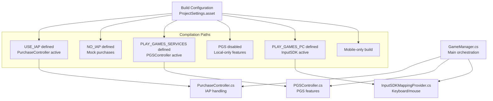
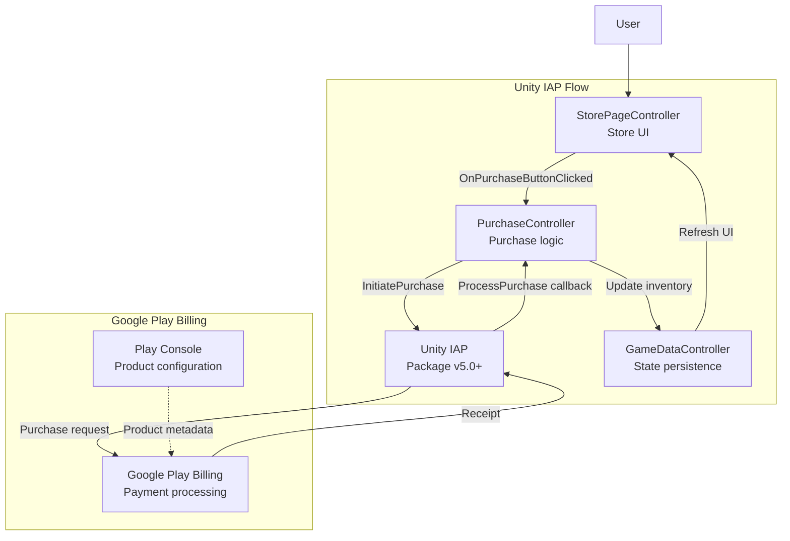
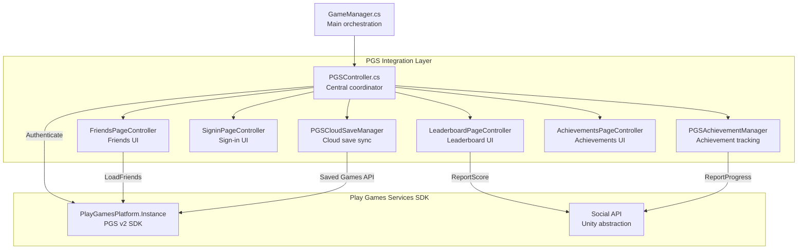
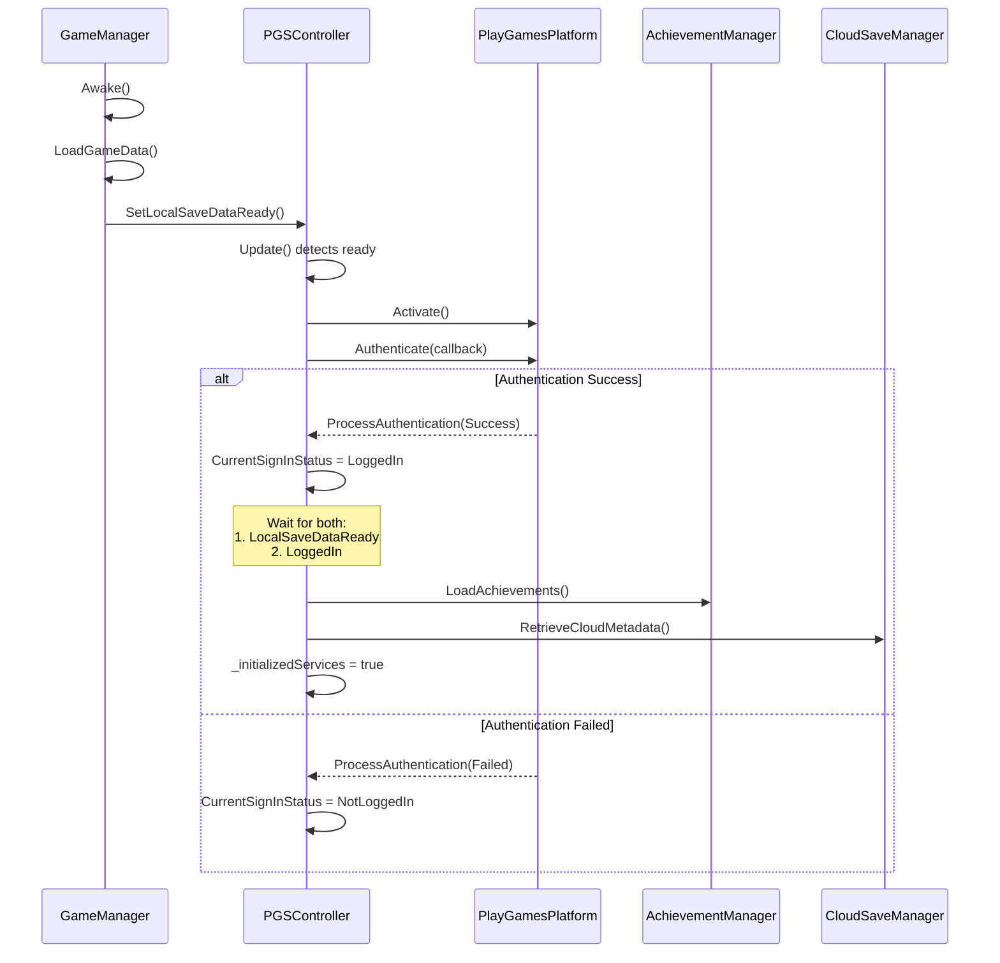
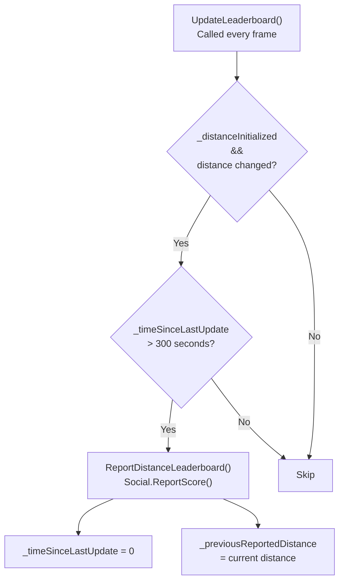
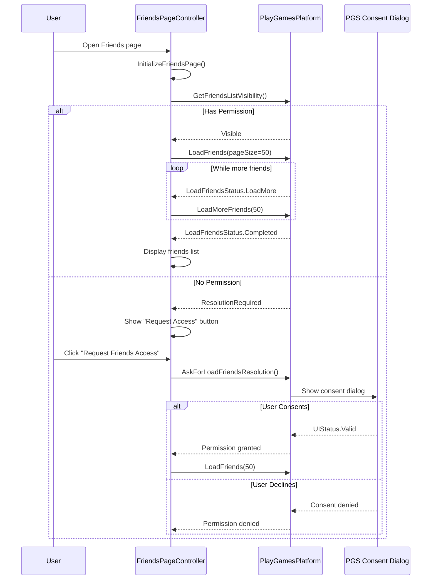
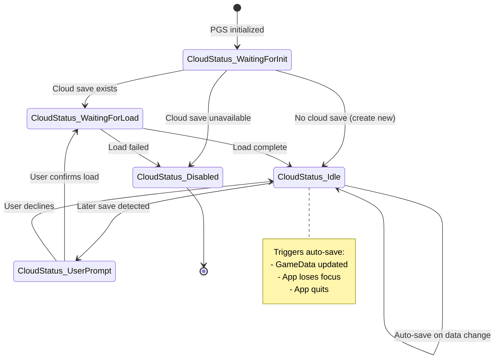
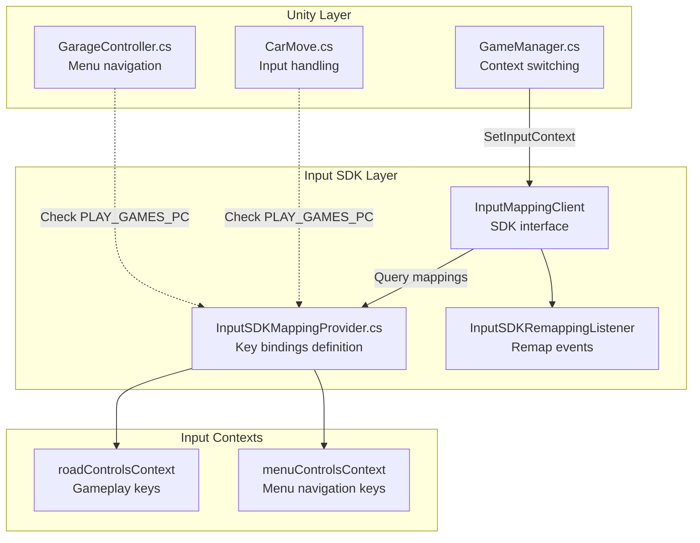

<!-- source: DeepWiki mcp.deepwiki.com · repo android/games-samples · page 3.4 Google Play Integration · fetched 2026-10-23 -->

# Google Play Integration

<details>
<summary>Relevant source files</summary>

The following files were used as context for generating this wiki page:

- [trivialkart/trivialkart-auth-server/.gitignore](trivialkart/trivialkart-auth-server/.gitignore)
- [trivialkart/trivialkart-auth-server/README.md](trivialkart/trivialkart-auth-server/README.md)
- [trivialkart/trivialkart-auth-server/package.json](trivialkart/trivialkart-auth-server/package.json)
- [trivialkart/trivialkart-auth-server/server.js](trivialkart/trivialkart-auth-server/server.js)
- [trivialkart/trivialkart-unity/Assets/Scenes/MockSignIn.unity](trivialkart/trivialkart-unity/Assets/Scenes/MockSignIn.unity)
- [trivialkart/trivialkart-unity/Assets/Scenes/MockSignIn.unity.meta](trivialkart/trivialkart-unity/Assets/Scenes/MockSignIn.unity.meta)
- [trivialkart/trivialkart-unity/Assets/Scripts/AuthManager.cs](trivialkart/trivialkart-unity/Assets/Scripts/AuthManager.cs)
- [trivialkart/trivialkart-unity/Assets/Scripts/AuthManager.cs.meta](trivialkart/trivialkart-unity/Assets/Scripts/AuthManager.cs.meta)
- [trivialkart/trivialkart-unity/Assets/Scripts/Controller/PGS/AchievementsPageController.cs](trivialkart/trivialkart-unity/Assets/Scripts/Controller/PGS/AchievementsPageController.cs)
- [trivialkart/trivialkart-unity/Assets/Scripts/Controller/PGS/FriendsPageController.cs](trivialkart/trivialkart-unity/Assets/Scripts/Controller/PGS/FriendsPageController.cs)
- [trivialkart/trivialkart-unity/Assets/Scripts/Controller/PGS/LeaderboardPageController.cs](trivialkart/trivialkart-unity/Assets/Scripts/Controller/PGS/LeaderboardPageController.cs)
- [trivialkart/trivialkart-unity/Assets/Scripts/Controller/PGS/PGSAchievementManager.cs.meta](trivialkart/trivialkart-unity/Assets/Scripts/Controller/PGS/PGSAchievementManager.cs.meta)
- [trivialkart/trivialkart-unity/Assets/Scripts/Controller/PGS/PGSController.cs](trivialkart/trivialkart-unity/Assets/Scripts/Controller/PGS/PGSController.cs)
- [trivialkart/trivialkart-unity/Assets/Scripts/Controller/PGS/SigninPageController.cs](trivialkart/trivialkart-unity/Assets/Scripts/Controller/PGS/SigninPageController.cs)
- [trivialkart/trivialkart-unity/Assets/Scripts/GameManager.cs](trivialkart/trivialkart-unity/Assets/Scripts/GameManager.cs)
- [trivialkart/trivialkart-unity/Assets/Scripts/InputSDK/InputSDKProvider.cs](trivialkart/trivialkart-unity/Assets/Scripts/InputSDK/InputSDKProvider.cs)
- [trivialkart/trivialkart-unity/ProjectSettings/ProjectSettings.asset](trivialkart/trivialkart-unity/ProjectSettings/ProjectSettings.asset)
- [trivialkart/trivialkart-unity/README.md](trivialkart/trivialkart-unity/README.md)

</details>


This document covers the integration of Google Play technologies in TrivialKart Unity, including Unity In-App Purchases (IAP), Play Games Services features (achievements, leaderboards, friends, cloud save), and Input SDK support for Google Play Games for PC. For authentication flows and PGS v1 to v2 migration, see [Authentication and PGS Migration](#3.2).

---

## Feature Toggle System

TrivialKart uses conditional compilation symbols to enable/disable Google Play features at build time. This allows building the game with different feature sets without code changes.

### Scripting Define Symbols

The project uses three primary symbols defined in [trivialkart/trivialkart-unity/ProjectSettings/ProjectSettings.asset:813-814]():

| Symbol | Purpose | Dependencies |
|--------|---------|--------------|
| `USE_IAP` / `NO_IAP` | Toggles Unity IAP integration | Unity IAP package |
| `PLAY_GAMES_SERVICES` | Enables Play Games Services features | Play Games Plugin for Unity v2.1.0+ |
| `PLAY_GAMES_PC` | Enables Input SDK for PC builds | Input SDK Unity package |

These symbols are configured via Unity menu: `TrivialKart -> BuildOptions -> Build with [Feature]` as documented in [trivialkart/trivialkart-unity/README.md:96-104]().

### Conditional Compilation Pattern



**Sources:** [trivialkart/trivialkart-unity/Assets/Scripts/GameManager.cs:67-90](), [trivialkart/trivialkart-unity/README.md:96-104]()

---

## Unity IAP Integration

### IAP Product Catalog

TrivialKart defines products in several categories as documented in [trivialkart/trivialkart-unity/README.md:124-139]():

| Product Type | Product ID | Price | Description |
|--------------|-----------|-------|-------------|
| Consumable | `five_coins` | $0.99 | 5 in-game coins |
| Consumable | `ten_coins` | $1.99 | 10 in-game coins |
| Consumable | `twenty_coins` | $2.49 | 20 in-game coins |
| Consumable | `fifty_coins` | $4.99 | 50 in-game coins |
| Non-Consumable | `car_offroad` | $2.99 | Unlock off-road car |
| Non-Consumable | `car_kart` | $4.99 | Unlock kart car |
| Subscription | `silver_subscription` | $1.99 | Background unlock |
| Subscription | `golden_subscription` | $4.99 | Background + 40% discount |

### IAP Architecture



**Sources:** [trivialkart/trivialkart-unity/README.md:53-148]()

### Receipt Obfuscation

Unity IAP requires obfuscation of the Google Play license key for security. The setup process is documented in [trivialkart/trivialkart-unity/README.md:83-94]():

1. Obtain Base64-encoded public key from Play Console → Monetisation Setup
2. Use Unity menu: `Services -> Unity IAP -> Receipt Validation Obfuscation`
3. Paste key and click `Obfuscate Google Play License Key`

This generates obfuscated credentials used by Unity IAP to validate receipts locally, preventing tampering.

**Sources:** [trivialkart/trivialkart-unity/README.md:83-94]()

---

## Play Games Services Features

### PGS Architecture Overview

Play Games Services integration is centralized in `PGSController`, which coordinates multiple feature-specific controllers.



**Sources:** [trivialkart/trivialkart-unity/Assets/Scripts/Controller/PGS/PGSController.cs:25-142](), [trivialkart/trivialkart-unity/Assets/Scripts/GameManager.cs:84-107]()

### PGS Initialization Flow

The initialization sequence ensures proper ordering of dependencies:



**Sources:** [trivialkart/trivialkart-unity/Assets/Scripts/Controller/PGS/PGSController.cs:74-99](), [trivialkart/trivialkart-unity/Assets/Scripts/GameManager.cs:93-107]()

### Achievements System

Achievements are defined in Play Console and referenced via generated constants in `GPGSIds.achievement_*` [trivialkart/trivialkart-unity/README.md:167-186]().

**Achievement Definitions:**

| Achievement ID | Description | Type | Points |
|----------------|-------------|------|--------|
| `tk_achievement_drive` | Drive a while | Standard | 5 |
| `tk_achievement_truck` | Unlock the truck | Standard | 5 |

**Achievement Manager Pattern:**

The `PGSAchievementManager` tracks achievement state locally and synchronizes with Play Games Services. Key methods from [trivialkart/trivialkart-unity/Assets/Scripts/Controller/PGS/PGSAchievementManager.cs]():

- `LoadAchievements()`: Fetches achievement state from PGS
- `GetAchievementUnlocked(id)`: Checks local cache
- `UnlockAchievement(id)`: Reports progress to PGS

**Sources:** [trivialkart/trivialkart-unity/README.md:167-186](), [trivialkart/trivialkart-unity/Assets/Scripts/Controller/PGS/AchievementsPageController.cs:36-45]()

### Leaderboards

TrivialKart implements a single leaderboard tracking total distance traveled, defined in [trivialkart/trivialkart-unity/README.md:180-185]():

**Leaderboard Configuration:**
- **ID:** `tk_leaderboard_distance`
- **Format:** Number with 2 decimals
- **Sort:** Largest first

**Reporting Strategy:**

The `LeaderboardPageController` uses throttled reporting to reduce API calls [trivialkart/trivialkart-unity/Assets/Scripts/Controller/PGS/LeaderboardPageController.cs:28-108]():



**Immediate Reporting Triggers:**
- Application loses focus (`OnApplicationFocus(false)`) forces immediate report if distance changed [trivialkart/trivialkart-unity/Assets/Scripts/Controller/PGS/LeaderboardPageController.cs:72-83]()

**Loading Leaderboard Data:**

The `LoadLeaderboardScores()` method retrieves 5 scores centered on the player's position [trivialkart/trivialkart-unity/Assets/Scripts/Controller/PGS/LeaderboardPageController.cs:130-160]():

```
PlayGamesPlatform.Instance.LoadScores(
    leaderboard_id,
    LeaderboardStart.PlayerCentered,
    5,
    LeaderboardCollection.Public,
    LeaderboardTimeSpan.AllTime,
    callback)
```

**Sources:** [trivialkart/trivialkart-unity/Assets/Scripts/Controller/PGS/LeaderboardPageController.cs:28-199](), [trivialkart/trivialkart-unity/README.md:180-185]()

### Friends List

The Friends feature demonstrates consent-based access to the player's PGS friends list.

**Friends Access Flow:**



**Key Implementation Details:**

The pagination logic in [trivialkart/trivialkart-unity/Assets/Scripts/Controller/PGS/FriendsPageController.cs:128-175]() handles large friends lists:

1. Initial `LoadFriends(pageSize)` call with `DefaultPageSize = 50`
2. If status is `LoadMore`, call `LoadMoreFriends(pageSize)` recursively
3. Accumulate friends using `Social.localUser.friends` array
4. Generate comma-delimited string for display

**Force Refresh:**

The `_forceFriendListRefresh` flag bypasses local cache when `Unknown` status is returned [trivialkart/trivialkart-unity/Assets/Scripts/Controller/PGS/FriendsPageController.cs:78-101]().

**Sources:** [trivialkart/trivialkart-unity/Assets/Scripts/Controller/PGS/FriendsPageController.cs:22-194]()

### Cloud Save Integration

Cloud Save enables cross-device progress synchronization using Play Games Services Saved Games API.

**Cloud Save State Machine:**



**Cloud Save Lifecycle in GameManager:**

The cloud save system is managed in [trivialkart/trivialkart-unity/Assets/Scripts/GameManager.cs:68-83, 138-233]():

**Initialization:**
1. `GameDataController.LoadGameData()` loads local save
2. `SetWaitMessageActive(true)` shows loading UI
3. `_cloudStatus = CloudStatus_WaitingForInit`

**Update Loop Logic:**

```
void Update() {
    if (_cloudStatus == CloudStatus_WaitingForInit)
        UpdateCloudWaitingForInit();
    else if (_cloudStatus == CloudStatus_WaitingForLoad)
        UpdateCloudWaitingForLoad();
    else if (_cloudStatus == CloudStatus_Idle)
        CheckForUpdatedCloudSave();
}
```

**Later Save Detection:**

When resuming the app, the system checks for a later save on the cloud [trivialkart/trivialkart-unity/Assets/Scripts/GameManager.cs:210-232]():

```
if (cloudSaveManager.CloudSaveStatus == PgsCloudLaterSaveAvailable) {
    var laterTimespan = GetLaterCloudSaveTimespan();
    var laterDistance = ConvertTimespanToDistance(laterTimespan);
    SetCloudLoadMessageText(laterDistance);  // "Load cloud save with X distance?"
    SetCloudLoadMessageActive(true);
}
```

**Save Triggers:**

The `DoSaveGame()` method [trivialkart/trivialkart-unity/Assets/Scripts/GameManager.cs:400-422]() is called:
- When `GameDataController.GetGameDataUpdated()` returns true
- On `OnApplicationFocus(false)` [trivialkart/trivialkart-unity/Assets/Scripts/GameManager.cs:424-431]()
- On `OnApplicationQuit()` [trivialkart/trivialkart-unity/Assets/Scripts/GameManager.cs:450-454]()
- On `OnApplicationPause(false)` to check for updates [trivialkart/trivialkart-unity/Assets/Scripts/GameManager.cs:434-447]()

**Data Format:**

Cloud saves store JSON-serialized `GameData` with a `TimeSpan` representing time played (derived from distance traveled) [trivialkart/trivialkart-unity/Assets/Scripts/GameManager.cs:416-417]():

```
cloudSaveManager.SaveToCloud(
    GameDataController.ExportGameDataJson(),
    GameDataController.GetGameData().DistanceTraveledAsTimespan()
);
```

**Sources:** [trivialkart/trivialkart-unity/Assets/Scripts/GameManager.cs:68-233, 400-454](), [trivialkart/trivialkart-unity/README.md:157-160]()

---

## Input SDK for Google Play Games for PC

The Input SDK enables keyboard and mouse controls when running on Google Play Games for PC. This requires the `PLAY_GAMES_PC` compilation symbol.

### Input Mapping Architecture



**Sources:** [trivialkart/trivialkart-unity/Assets/Scripts/InputSDK/InputSDKProvider.cs:21-204](), [trivialkart/trivialkart-unity/Assets/Scripts/GameManager.cs:88-124]()

### Input Context Definitions

The `InputSDKMappingProvider` defines two contexts in [trivialkart/trivialkart-unity/Assets/Scripts/InputSDK/InputSDKProvider.cs:44-182]():

**Road Controls Context:**

| Action | Default Key | Remappable |
|--------|-------------|------------|
| Drive | `SPACE` | Yes |
| Turbo | `SHIFT + SPACE` | No (disabled) |
| Open Garage | `G` | Yes |
| Open PGS | `P` | Yes |
| Open Store | `S` | Yes |

**Menu Controls Context:**

| Action | Default Key | Remappable |
|--------|-------------|------------|
| Return to Road | `ESC` | No (reserved) |
| Change Tab | `TAB` | Yes |
| Select Next | `DPAD_RIGHT` | Yes |
| Select Previous | `DPAD_LEFT` | Yes |

**Reserved Keys:**

The `inputMap` configuration [trivialkart/trivialkart-unity/Assets/Scripts/InputSDK/InputSDKProvider.cs:184-198]() declares `ESC` as reserved, preventing players from remapping it (ensures they can always exit menus).

### Context Switching

The `GameManager` switches input contexts based on the active canvas [trivialkart/trivialkart-unity/Assets/Scripts/GameManager.cs:315-339]():

```
private void SetCanvas(GameObject targetCanvasPage) {
    // Activate target canvas, deactivate others
    
    #if PLAY_GAMES_PC
    if (IsInPlayCanvas()) {
        _inputMappingClient.SetInputContext(
            InputSDKMappingProvider.roadControlsContext);
    } else {
        _inputMappingClient.SetInputContext(
            InputSDKMappingProvider.menuControlsContext);
    }
    #endif
}
```

### Input SDK Initialization

Initialization occurs in `GameManager.Awake()` [trivialkart/trivialkart-unity/Assets/Scripts/GameManager.cs:108-124]():

```
#if PLAY_GAMES_PC
Context context = Utils.GetUnityActivity().GetRawObject();
_inputMappingClient = Input.GetInputMappingClient(context);
_inputMappingClient.RegisterRemappingListener(new InputSDKRemappingListener());
_inputMappingClient.SetInputMappingProvider(_inputMapProvider);
#endif
```

**Cleanup:**

The `OnDestroy()` method [trivialkart/trivialkart-unity/Assets/Scripts/GameManager.cs:456-462]() clears references:

```
_inputMappingClient.ClearInputMappingProvider();
_inputMappingClient.ClearRemappingListener();
```

**Button Label Updates:**

Menu buttons display keyboard shortcuts when built for PC [trivialkart/trivialkart-unity/Assets/Scripts/GameManager.cs:109-115]():

```
GameObject.Find("GarageButton").GetComponentInChildren<Text>().text 
    = string.Format("Garage ({0})", "G");
```

**Sources:** [trivialkart/trivialkart-unity/Assets/Scripts/GameManager.cs:88-124, 315-339, 456-462](), [trivialkart/trivialkart-unity/Assets/Scripts/InputSDK/InputSDKProvider.cs:21-204]()

### Platform Detection and Permissions

The Input SDK requires special handling for platform-specific features [trivialkart/trivialkart-unity/Assets/Scripts/GameManager.cs:126-134]():

```
#if PLAY_GAMES_PC
// On PC, some Android permissions are inaccessible
// Unsupported permission requests automatically fail
#elif PLATFORM_ANDROID
if (!Permission.HasUserAuthorizedPermission(Permission.Camera)) {
    Permission.RequestUserPermission(Permission.Camera);
}
#endif
```

**Sources:** [trivialkart/trivialkart-unity/Assets/Scripts/GameManager.cs:126-134]()

---

## Configuration and Setup

### Prerequisites

**Unity Packages:**
- Unity IAP v5.0+ (via Package Manager)
- Play Games Plugin for Unity v2.1.0+ (manual `.unitypackage` import)
- Input SDK Unity package (for PC builds)

**Google Cloud Console:**
- Android OAuth 2.0 Client (for mobile)
- Web OAuth 2.0 Client (for PGS v2 auth code flow)

**Play Console Configuration:**
- App created with package name matching Unity's `applicationIdentifier`
- IAP products and subscriptions defined
- Play Games Services enabled with achievements and leaderboards configured
- Saved Games feature enabled

**Sources:** [trivialkart/trivialkart-unity/README.md:16-26, 149-203]()

### Unity IAP Setup

**Step 1: Install Package**

Install via Unity Package Manager: `Window -> Package Manager -> In App Purchasing`.

**Step 2: Obfuscate License Key**

[trivialkart/trivialkart-unity/README.md:83-94]()

1. Obtain Base64 public key from Play Console → Monetisation Setup
2. `Services -> Unity IAP -> Receipt Validation Obfuscation`
3. Paste key and click `Obfuscate Google Play License Key`

**Step 3: Define Products**

Create products in Play Console matching the catalog in [trivialkart/trivialkart-unity/README.md:124-139]().

**Step 4: Enable Feature**

`TrivialKart -> BuildOptions -> Build with IAP` sets `USE_IAP` symbol.

**Sources:** [trivialkart/trivialkart-unity/README.md:74-148]()

### Play Games Services Setup

**Step 1: Enable in Play Console**

Follow [Play Console setup instructions](https://developers.google.com/games/services/console/enabling) to create PGS configuration.

**Step 2: Configure Saved Games**

Enable under Play Console → Play Games Services → Setup → Saved Games.

**Step 3: Define Achievements and Leaderboards**

Create resources in Play Console matching definitions in [trivialkart/trivialkart-unity/README.md:167-186]().

**Step 4: Install Plugin**

Download Play Games Plugin v2.1.0+ `.unitypackage` from [GitHub](https://github.com/playgameservices/play-games-plugin-for-unity) and import via `Assets -> Import Package -> Custom Package`.

**Step 5: Generate Constants**

[trivialkart/trivialkart-unity/README.md:196-203]()

1. Play Console → Setup and Management → Configuration → Get Resources
2. Copy Android (XML) resource text
3. Unity: `Window -> Google Play Games -> Setup -> Android Setup`
4. Paste and click `Setup` to generate `GPGSIds.cs`

**Step 6: Configure Proguard**

[trivialkart/trivialkart-unity/README.md:206-211]()

1. Enable Proguard: `Player Settings -> Publishing Settings -> Proguard`
2. Copy `Assets/GooglePlaygames/com.google.play.games/Proguard/games.txt`
3. Paste into `Assets/Plugins/Android/proguard-user.txt`

**Step 7: Enable Feature**

`TrivialKart -> BuildOptions -> Build with Google Play Games Services` sets `PLAY_GAMES_SERVICES` symbol.

**Sources:** [trivialkart/trivialkart-unity/README.md:149-216]()

### Local Testing with Upload Key

Builds signed with upload keys (not Play-signed) require additional OAuth client configuration [trivialkart/trivialkart-unity/README.md:219-238]():

1. Play Console → App Integrity → App Signing
2. Copy SHA-1 from Upload Key Certificate section
3. Play Games Services → Configuration → Credentials → Add Credential
4. Create OAuth Client with upload key SHA-1
5. Refresh OAuth clients and save

**Sources:** [trivialkart/trivialkart-unity/README.md:219-238]()

### Google Play Games for PC Setup

**Step 1: Enable x86 Architectures**

[trivialkart/trivialkart-unity/README.md:313-314]()

`Player Settings -> Other Settings -> Target Architectures`: Enable x86 and x86-64 (requires IL2CPP scripting backend).

**Step 2: Disable Unsupported Features**

[trivialkart/trivialkart-unity/README.md:315-318]()

Enable custom manifests and add `android:required="false"` to unsupported permissions/features in `AndroidManifest.xml`.

**Step 3: Install Input SDK**

Import Input SDK Unity package via `Assets -> Import Package -> Custom Package`.

**Step 4: Enable Feature**

`TrivialKart -> BuildOptions -> Build for Google Play Games PC` sets `PLAY_GAMES_PC` symbol.

**Sources:** [trivialkart/trivialkart-unity/README.md:311-323]()

---

## Summary

TrivialKart demonstrates comprehensive Google Play integration patterns:

| Feature | Key Classes | Configuration |
|---------|------------|---------------|
| Unity IAP | `PurchaseController`, `StorePageController` | Play Console products, obfuscated license key |
| Achievements | `PGSAchievementManager`, `AchievementsPageController` | Generated `GPGSIds.cs` constants |
| Leaderboards | `LeaderboardPageController` | PGS leaderboard config, throttled reporting |
| Friends | `FriendsPageController` | Consent-based pagination |
| Cloud Save | `PGSCloudSaveManager`, `GameManager` | Saved Games API, conflict resolution |
| Input SDK | `InputSDKMappingProvider`, `GameManager` | Context-aware key bindings |
| Feature Toggles | Conditional compilation | `USE_IAP`, `PLAY_GAMES_SERVICES`, `PLAY_GAMES_PC` |

All features are orchestrated through `GameManager` [trivialkart/trivialkart-unity/Assets/Scripts/GameManager.cs]() with proper initialization ordering and lifecycle management.

**Sources:** [trivialkart/trivialkart-unity/Assets/Scripts/GameManager.cs:1-463](), [trivialkart/trivialkart-unity/README.md:1-357]()

---

