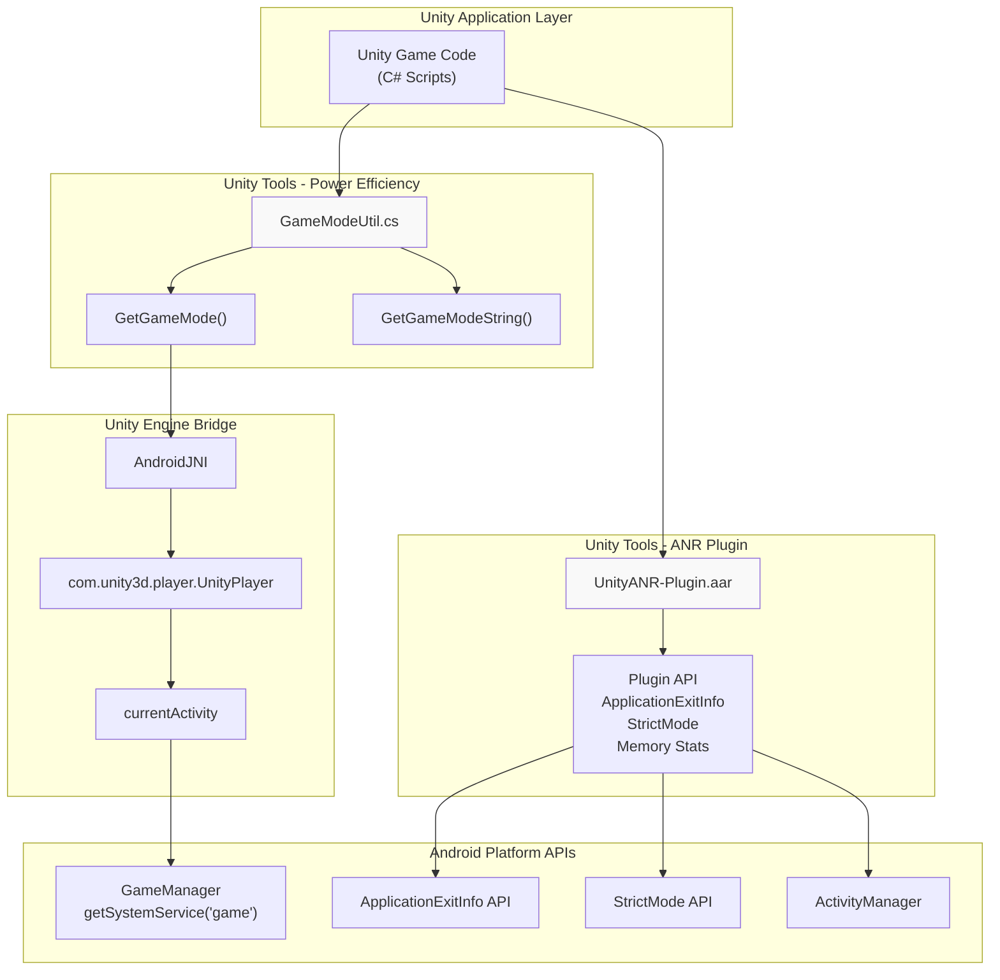
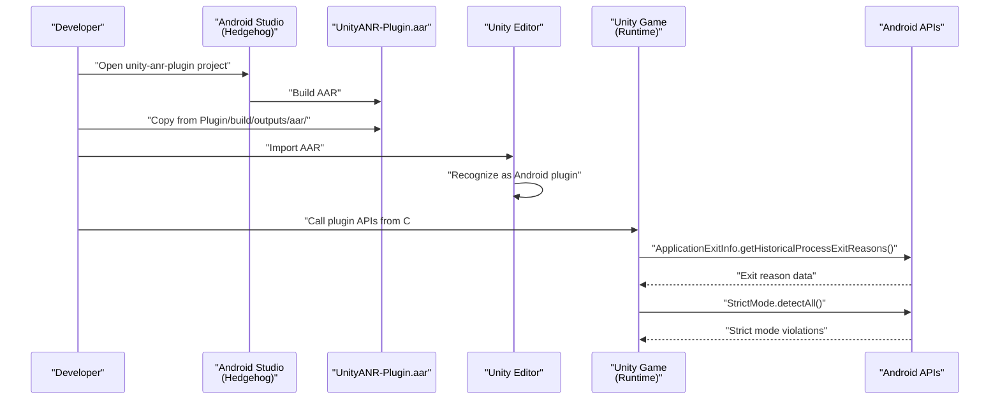
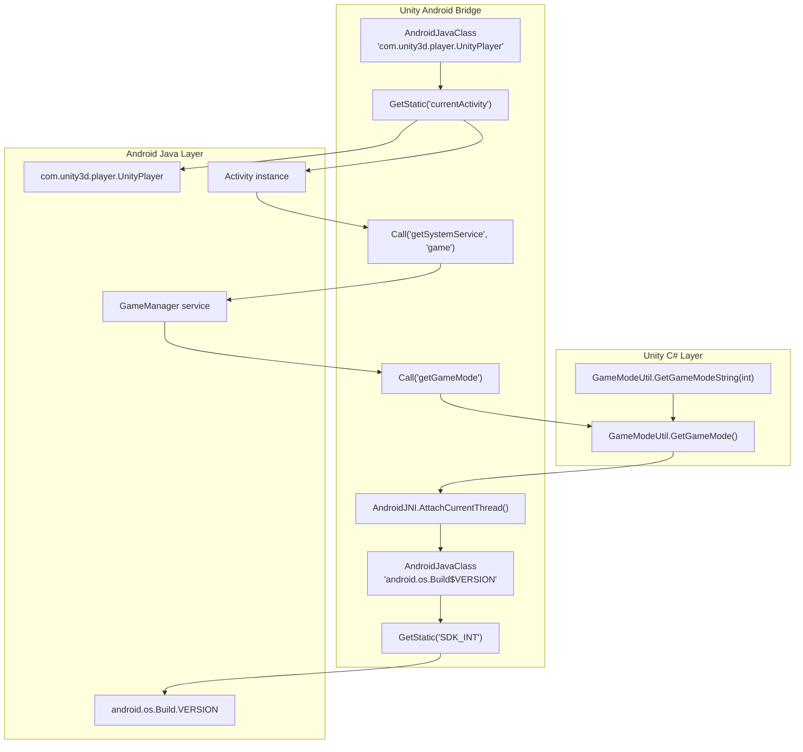

<!-- source: DeepWiki mcp.deepwiki.com · repo android/games-samples · page 4 Unity Development Tools · fetched 2026-10-23 -->

# Unity Development Tools

<details>
<summary>Relevant source files</summary>

The following files were used as context for generating this wiki page:

- [README.md](README.md)
- [agdk/README.md](agdk/README.md)
- [agdk/game_mode/README.md](agdk/game_mode/README.md)
- [agdk/game_mode/docs/gamedashboardactivity.png](agdk/game_mode/docs/gamedashboardactivity.png)
- [unity/anr_plugin/README.md](unity/anr_plugin/README.md)
- [unity/anr_plugin/unity-anr-plugin/README.md](unity/anr_plugin/unity-anr-plugin/README.md)
- [unity/power_efficiency_demo/Assets/GameModeUtil.cs](unity/power_efficiency_demo/Assets/GameModeUtil.cs)

</details>


## Purpose and Scope

This page provides an overview of Unity-specific development tools and plugins included in the repository for Android game development. These tools bridge Unity engine capabilities with Android platform APIs that are not natively exposed by Unity.

The repository includes two primary Unity tools:
- **ANR Plugin**: A diagnostic plugin for detecting Application Not Responding errors, strict mode violations, and memory issues on Unity 2022 and older
- **Power Efficiency Demo**: A sample project demonstrating adaptive performance using the Android Game Mode API

For detailed information about the ANR Plugin implementation, see [ANR Plugin](#4.1). For the Power Efficiency Demo implementation, see [Power Efficiency Demo](#4.2). For native C++ approaches to adaptive performance, see [Game Mode Sample](#2.1) and [ADPF Sample](#2.2).

Sources: [README.md:51-61](), [unity/anr_plugin/README.md:1-23]()

---

## Unity Tools Architecture

The Unity tools in this repository address gaps in Unity's native Android support by providing custom plugins and C# wrappers that access Android APIs through JNI (Java Native Interface).



**Unity Tools High-Level Architecture**

The architecture demonstrates two distinct integration patterns:
- **ANR Plugin**: Packaged as an AAR (Android Archive) file that Unity imports as a native Android library
- **Power Efficiency Tools**: Implemented as C# scripts that use Unity's `AndroidJNI` and `AndroidJavaClass` APIs to invoke Android system services

Sources: [unity/anr_plugin/README.md:1-10](), [unity/power_efficiency_demo/Assets/GameModeUtil.cs:1-72]()

---

## Tool Comparison

| Feature | ANR Plugin | Power Efficiency Demo |
|---------|-----------|----------------------|
| **Purpose** | Diagnose ANRs, crashes, and performance issues | Demonstrate adaptive performance based on user preferences |
| **Target Unity Version** | Unity 2022 and older | Unity 2022.3+ |
| **Distribution Format** | `UnityANR-Plugin.aar` | Source code (`.cs` files) |
| **Android APIs Used** | `ApplicationExitInfo`, `StrictMode`, `ActivityManager` | `GameManager` (Game Mode API) |
| **Minimum API Level** | API 21+ (for full functionality) | API 31+ (for Game Mode support) |
| **Integration Method** | Import AAR into Unity project | Copy C# scripts into Assets folder |
| **Build Requirement** | Android Studio (Hedgehog recommended) | Unity Editor only |
| **Primary Use Case** | Production diagnostics and debugging | Runtime performance optimization |

Sources: [unity/anr_plugin/README.md:3-12](), [unity/anr_plugin/unity-anr-plugin/README.md:14-22](), [unity/power_efficiency_demo/Assets/GameModeUtil.cs:26-43]()

---

## ANR Plugin Overview

The ANR Plugin provides access to Android diagnostic APIs that are not natively exposed in Unity 2022 and older versions. Unity 2023+ integrates this functionality natively.

### Capabilities

The plugin exposes three primary diagnostic capabilities:

1. **ApplicationExitInfo API**: Retrieves historical information about application exits, including ANRs and crashes
2. **StrictMode API**: Detects I/O operations on the main thread that may cause ANRs or deadlocks
3. **Memory Statistics**: Polls memory usage for Unity 2021 and older

### Plugin Structure

The plugin is distributed as `UnityANR-Plugin.aar`, built from the `unity-anr-plugin` Android Studio project. After building, the AAR file is located at `Plugin/build/outputs/aar/`.

### Integration Workflow



**ANR Plugin Integration Sequence**

The workflow requires building the plugin in Android Studio before importing into Unity. This is necessary because the plugin contains native Android code that must be compiled into an AAR format.

Sources: [unity/anr_plugin/unity-anr-plugin/README.md:14-22](), [unity/anr_plugin/README.md:14-18]()

---

## Power Efficiency Demo Overview

The Power Efficiency Demo showcases how to implement adaptive performance in Unity games by querying Android's Game Mode API. This allows games to adjust quality settings based on user-selected optimization preferences.

### GameModeUtil Implementation

The `GameModeUtil` class provides a C# wrapper around Android's `GameManager` system service.

**Game Mode Constants**

[unity/power_efficiency_demo/Assets/GameModeUtil.cs:20-24]() defines the game mode values:

| Constant | Value | Description |
|----------|-------|-------------|
| `GameModeUnsupported` | 0 | Game Mode API not available |
| `GameModeStandard` | 1 | Default mode with balanced settings |
| `GameModePerformance` | 2 | High performance (60 FPS, max resolution) |
| `GameModeBattery` | 3 | Battery saving (30 FPS, reduced resolution) |
| `GameModeCustom` | 4 | OEM-defined custom mode |

### JNI Bridge Architecture



**GameModeUtil JNI Bridge Implementation**

The diagram shows the complete call chain from C# through Unity's Android bridge to the native Android `GameManager` service. The implementation uses `AndroidJNI.AttachCurrentThread()` to ensure the thread can make JNI calls, then navigates through Unity's Java layer to access system services.

Sources: [unity/power_efficiency_demo/Assets/GameModeUtil.cs:28-43]()

### API Level Check

[unity/power_efficiency_demo/Assets/GameModeUtil.cs:26-35]() implements a runtime check for Game Mode API availability:

```
MinimumGameModeApiLevel = 31 (Android 12)
```

If `SDK_INT < 31`, the method returns `GameModeUnsupported` immediately, preventing crashes on older Android versions. This pattern allows the same APK to run on devices with and without Game Mode support.

### Usage Pattern

The typical usage pattern in a Unity game:

1. **Query Current Mode**: Call `GameModeUtil.GetGameMode()` during initialization or when game mode changes
2. **Apply Settings**: Adjust Unity quality settings, frame rate caps, and asset loading based on the returned mode
3. **Display Information**: Use `GameModeUtil.GetGameModeString(int)` to show the current mode to the user

[unity/power_efficiency_demo/Assets/GameModeUtil.cs:45-70]() provides a helper method to convert numeric mode values to human-readable strings for debugging and UI display.

Sources: [unity/power_efficiency_demo/Assets/GameModeUtil.cs:1-72]()

---

## Development Workflow Comparison

### ANR Plugin Workflow

```mermaid
flowchart LR
    A["Clone Repository"] --> B["Navigate to<br/>unity/anr_plugin/unity-anr-plugin"]
    B --> C["Open in Android Studio Hedgehog"]
    C --> D["Build Project"]
    D --> E["Locate AAR:<br/>Plugin/build/outputs/aar/"]
    E --> F["Open Unity Project:<br/>unity/anr_plugin/unity-anr-project"]
    F --> G["Import UnityANR-Plugin.aar<br/>into Assets/Plugins/Android"]
    G --> H["Call Plugin APIs<br/>from C# Scripts"]
    H --> I["Build Unity APK"]
    
    style E fill:#f9f9f9
    style G fill:#f9f9f9
```



**ANR Plugin Development Workflow**

Sources: [unity/anr_plugin/README.md:14-18](), [unity/anr_plugin/unity-anr-plugin/README.md:14-22]()

### Power Efficiency Demo Workflow

```mermaid
flowchart LR
    A["Clone Repository"] --> B["Navigate to<br/>unity/power_efficiency_demo"]
    B --> C["Open Project in Unity Editor 2022.3+"]
    C --> D["Review GameModeUtil.cs<br/>implementation"]
    D --> E["Implement Adaptive Logic<br/>(QualitySettings, FPS)"]
    E --> F["Build APK"]
    F --> G["Install on Android 12+ Device"]
    G --> H["Open Game Dashboard"]
    H --> I["Select Game Mode<br/>(Standard/Performance/Battery)"]
    I --> J["Observe Adaptive Behavior"]
    
    style D fill:#f9f9f9
    style E fill:#f9f9f9
```



**Power Efficiency Demo Development Workflow**

Sources: [README.md:56-58](), [agdk/game_mode/README.md:36-48]()

---

## Integration Requirements

### ANR Plugin Requirements

| Requirement | Specification |
|-------------|--------------|
| **Build Tool** | Android Studio Hedgehog or compatible |
| **Unity Version** | Unity 2022 and older (superseded in Unity 2023+) |
| **Android API Level** | API 21+ (for full functionality) |
| **Output Format** | AAR file at `Plugin/build/outputs/aar/UnityANR-Plugin.aar` |
| **Import Location** | Unity `Assets/Plugins/Android/` folder |

### Power Efficiency Demo Requirements

| Requirement | Specification |
|-------------|--------------|
| **Unity Version** | Unity 2022.3+ recommended |
| **Android API Level** | API 31+ (Android 12) for Game Mode support |
| **Target Devices** | Pixel 6+ or devices with Game Dashboard/OEM game tools |
| **Testing Method** | Game Dashboard UI or `adb shell cmd game mode [mode] [package]` |
| **Integration Files** | `GameModeUtil.cs` copied to Unity project Assets folder |

Sources: [unity/anr_plugin/unity-anr-plugin/README.md:15-16](), [agdk/game_mode/README.md:18-22](), [unity/power_efficiency_demo/Assets/GameModeUtil.cs:26]()

---

## Key Code Entities Reference

### ANR Plugin

- **Build Output**: `Plugin/build/outputs/aar/UnityANR-Plugin.aar`
- **Android APIs**: `ApplicationExitInfo`, `StrictMode`, `ActivityManager`
- **Integration Path**: Unity `Assets/Plugins/Android/`

### Power Efficiency Demo

- **Main Class**: `GameModeUtil` [unity/power_efficiency_demo/Assets/GameModeUtil.cs:18]()
- **Public Methods**:
  - `GetGameMode()` [unity/power_efficiency_demo/Assets/GameModeUtil.cs:28-43]() - Queries current game mode
  - `GetGameModeString(int)` [unity/power_efficiency_demo/Assets/GameModeUtil.cs:45-70]() - Converts mode to string
- **Unity Bridge Classes**:
  - `AndroidJNI` [unity/power_efficiency_demo/Assets/GameModeUtil.cs:31]()
  - `AndroidJavaClass` [unity/power_efficiency_demo/Assets/GameModeUtil.cs:33,37]()
  - `AndroidJavaObject` [unity/power_efficiency_demo/Assets/GameModeUtil.cs:38,39]()
- **Android System Service**: `"game"` [unity/power_efficiency_demo/Assets/GameModeUtil.cs:39]() - Accesses `GameManager`
- **Android Java Method**: `"getGameMode"` [unity/power_efficiency_demo/Assets/GameModeUtil.cs:40]() - Returns current mode value

Sources: [unity/anr_plugin/README.md:3-9](), [unity/power_efficiency_demo/Assets/GameModeUtil.cs:1-72]()

---

## Relationship to Native AGDK Samples

The Unity tools provide equivalent functionality to native AGDK samples but adapted for Unity's managed runtime:

| Functionality | Unity Tool | Native AGDK Equivalent |
|---------------|-----------|------------------------|
| Game Mode API | `GameModeUtil.cs` in Power Efficiency Demo | [Game Mode Sample](#2.1) |
| Performance Diagnostics | ANR Plugin | Platform APIs accessed via NDK |
| Adaptive Performance | Manual quality adjustment based on mode | [ADPF Sample](#2.2) with automatic thermal response |

The key difference is the integration layer: Unity tools use JNI bridges (`AndroidJNI`, `AndroidJavaClass`) to access Android APIs, while native samples use NDK headers and direct C++ API calls. Both approaches access the same underlying Android system services (`GameManager`, `ApplicationExitInfo`, etc.).

Sources: [README.md:7-18](), [README.md:51-61](), [agdk/game_mode/README.md:1-12]()

---

