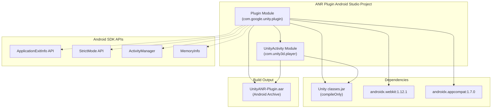
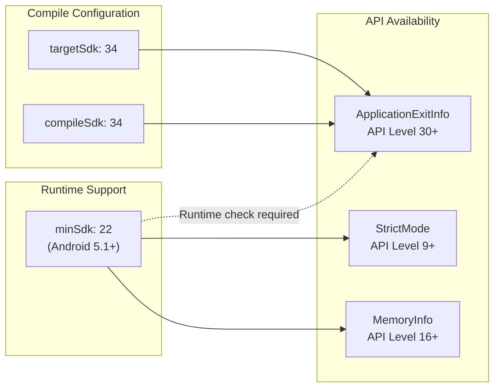
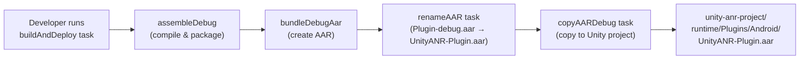
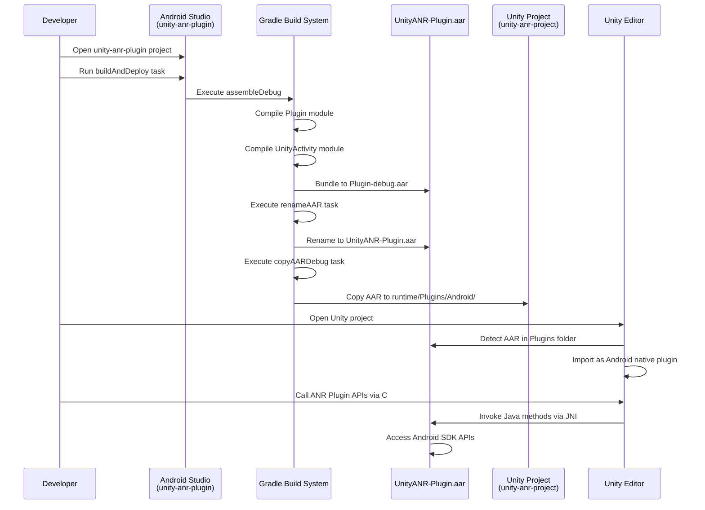
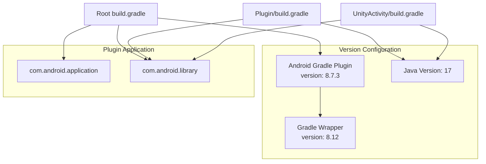
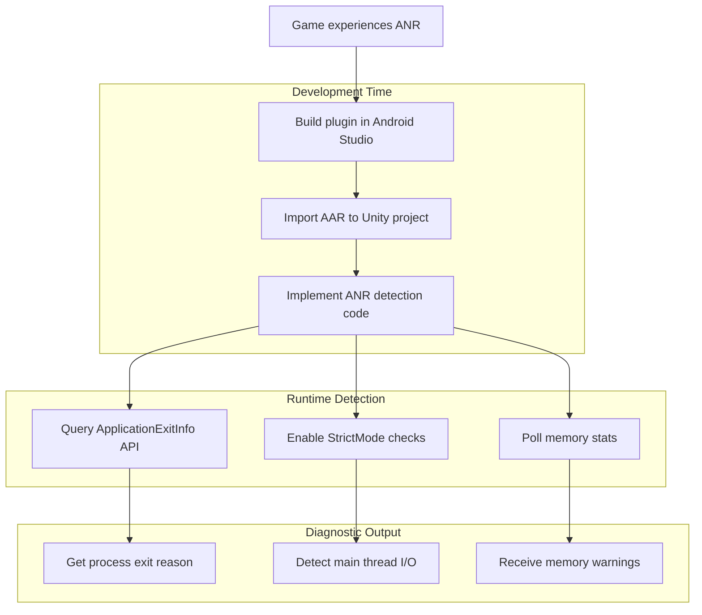

<!-- source: DeepWiki mcp.deepwiki.com · repo android/games-samples · page 4.1 ANR Plugin · fetched 2026-10-23 -->

# ANR Plugin

<details>
<summary>Relevant source files</summary>

The following files were used as context for generating this wiki page:

- [unity/anr_plugin/README.md](unity/anr_plugin/README.md)
- [unity/anr_plugin/unity-anr-plugin/Plugin/build.gradle](unity/anr_plugin/unity-anr-plugin/Plugin/build.gradle)
- [unity/anr_plugin/unity-anr-plugin/README.md](unity/anr_plugin/unity-anr-plugin/README.md)
- [unity/anr_plugin/unity-anr-plugin/UnityActivity/build.gradle](unity/anr_plugin/unity-anr-plugin/UnityActivity/build.gradle)
- [unity/anr_plugin/unity-anr-plugin/build.gradle](unity/anr_plugin/unity-anr-plugin/build.gradle)
- [unity/anr_plugin/unity-anr-plugin/gradle/wrapper/gradle-wrapper.properties](unity/anr_plugin/unity-anr-plugin/gradle/wrapper/gradle-wrapper.properties)
- [unity/anr_plugin/unity-anr-plugin/settings.gradle](unity/anr_plugin/unity-anr-plugin/settings.gradle)
- [unity/anr_plugin/unity-anr-project/CHANGELOG.md](unity/anr_plugin/unity-anr-project/CHANGELOG.md)
- [unity/anr_plugin/unity-anr-project/Runtime/Plugins/Android/UnityANR-Plugin.aar](unity/anr_plugin/unity-anr-project/Runtime/Plugins/Android/UnityANR-Plugin.aar)
- [unity/anr_plugin/unity-anr-project/package.json](unity/anr_plugin/unity-anr-project/package.json)

</details>


## Purpose and Scope

The ANR Plugin is a Unity plugin that provides access to Android diagnostic APIs for detecting and analyzing Application Not Responding (ANR) errors, crashes, and memory issues on Unity 2022 and older. This plugin is specifically designed for Unity developers who need ANR diagnostics on pre-2023 Unity versions, as Unity 2023+ includes this functionality natively.

For information about adaptive performance and Game Mode integration in Unity, see [Power Efficiency Demo](#4.2). For native AGDK performance samples, see [ADPF Sample](#2.2).

**Sources:** [unity/anr_plugin/README.md:1-12](), [unity/anr_plugin/unity-anr-plugin/README.md:1-12]()

## System Overview

The ANR Plugin wraps three critical Android SDK APIs that are not exposed through Unity's standard C# interface on older Unity versions:

| Android API | Purpose | Target Unity Version |
|-------------|---------|---------------------|
| `ApplicationExitInfo` | Diagnose crashes and ANRs by retrieving historical process exit information | Unity 2022 and older |
| `StrictMode` | Identify ANRs/deadlocks caused by I/O operations on the main thread | Unity 2022 and older |
| Memory Stats Polling | Monitor memory usage at specified intervals | Unity 2021 and older |

The plugin is distributed as a compiled Android Archive (`UnityANR-Plugin.aar`) that Unity projects import as a native Android library. The plugin bridges the gap between Unity's C# environment and Android's Java/Kotlin APIs through Unity's JNI interop mechanisms.

**Sources:** [unity/anr_plugin/README.md:3-9](), [unity/anr_plugin/unity-anr-project/package.json:6]()

## Architecture

### Two-Module Structure



**Diagram: ANR Plugin Module Architecture**

The plugin consists of two Gradle modules that are compiled together into a single AAR file:

- **Plugin Module** (`namespace: com.google.unity.plugin`): Contains the core diagnostic functionality that wraps Android SDK APIs. This module depends on the UnityActivity module and uses Unity's `classes.jar` as a compile-only dependency.

- **UnityActivity Module** (`namespace: com.unity3d.player`): Provides Unity-specific activity stubs and interfaces required for the plugin to interact with Unity's runtime environment.

**Sources:** [unity/anr_plugin/unity-anr-plugin/Plugin/build.gradle:22](), [unity/anr_plugin/unity-anr-plugin/UnityActivity/build.gradle:22](), [unity/anr_plugin/unity-anr-plugin/settings.gradle:32-33]()

### API Version Requirements



**Diagram: API Level Requirements and Compatibility**

The plugin targets Android 5.1 (API 22) as the minimum SDK version, allowing broad device compatibility. The `ApplicationExitInfo` API requires API level 30+, so the plugin performs runtime checks before accessing this functionality.

**Sources:** [unity/anr_plugin/unity-anr-plugin/Plugin/build.gradle:26-27](), [unity/anr_plugin/unity-anr-project/CHANGELOG.md:13]()

## Plugin Module Configuration

The Plugin module is defined in [unity/anr_plugin/unity-anr-plugin/Plugin/build.gradle:1-95]() with the following key characteristics:

| Configuration | Value |
|---------------|-------|
| Plugin ID | `com.android.library` |
| Namespace | `com.google.unity.plugin` |
| Version Code | `9` |
| Version Name | `1.2` |
| Min SDK | `22` |
| Target SDK | `34` |
| Java Version | `17` |

### Dependencies

The Plugin module declares three key dependencies at [unity/anr_plugin/unity-anr-plugin/Plugin/build.gradle:48-52]():

1. **Project Dependency**: `implementation project(path: ':UnityActivity')` - Links to the UnityActivity module
2. **Unity Classes**: `compileOnly files('libs/classes.jar')` - Unity's Java classes, used only at compile time
3. **AndroidX WebKit**: `implementation 'androidx.webkit:webkit:1.12.1'` - For web view functionality if needed
4. **AndroidX AppCompat**: `implementation 'androidx.appcompat:appcompat:1.7.0'` - For compatibility support

**Sources:** [unity/anr_plugin/unity-anr-plugin/Plugin/build.gradle:21-53]()

## Build System and Custom Tasks

### Build Task Pipeline



**Diagram: Build and Deployment Task Flow**

The Plugin module defines three custom Gradle tasks for building and deploying the AAR:

### Custom Task Definitions

**1. `buildAndDeploy` Task** [unity/anr_plugin/unity-anr-plugin/Plugin/build.gradle:55-58]()
- Orchestrates the entire build and deployment process
- Depends on `assembleDebug` and `renameAAR`
- Finalizes with `copyAARDebug`

**2. `renameAAR` Task** [unity/anr_plugin/unity-anr-plugin/Plugin/build.gradle:60-74]()
- Renames `Plugin-debug.aar` to `UnityANR-Plugin.aar`
- Operates on `buildDir/outputs/aar/`
- Executes after `bundleDebugAar` completes

**3. `copyAARDebug` Task** [unity/anr_plugin/unity-anr-plugin/Plugin/build.gradle:76-90]()
- Copies the renamed AAR to the Unity project's plugin directory
- Destination: `..\\..\\unity-anr-project\\runtime\\Plugins\\Android\\`
- Automatically triggered by `assembleDebug` via `afterEvaluate` hook at [unity/anr_plugin/unity-anr-plugin/Plugin/build.gradle:92-94]()

**Sources:** [unity/anr_plugin/unity-anr-plugin/Plugin/build.gradle:55-94]()

## UnityActivity Module Configuration

The UnityActivity module provides a stub implementation of Unity's activity classes required for the plugin to compile. Configuration details:

| Configuration | Value |
|---------------|-------|
| Namespace | `com.unity3d.player` |
| Min SDK | `16` (lower than Plugin module) |
| Compile SDK | `34` |
| MultiDex | Enabled |

### Dependencies

Defined at [unity/anr_plugin/unity-anr-plugin/UnityActivity/build.gradle:44-52]():

- `compileOnly files('libs/classes.jar')` - Unity's Java classes
- `implementation 'androidx.appcompat:appcompat:1.6.1'`
- `implementation 'com.google.android.material:material:1.10.0'`
- Test dependencies: JUnit, AndroidX Test

**Sources:** [unity/anr_plugin/unity-anr-plugin/UnityActivity/build.gradle:21-52]()

## Unity Package Configuration

The Unity project package is configured at [unity/anr_plugin/unity-anr-project/package.json:1-17]():

| Property | Value |
|----------|-------|
| Package Name | `com.google.unity.anr` |
| Display Name | `Unity ANR` |
| Version | `1.0.1` |
| Minimum Unity Version | `2022.3` |
| Keywords | `Tool`, `Debug`, `Android`, `Profiling` |

The package description lists four key features:
1. **ApplicationExitInfo** - Describes process death information
2. **Strict Mode** - Detects I/O operations on main thread
3. **Memory Stats** - Retrieves memory statistics at specified intervals
4. **Enhanced Memory Warnings** - Provides Android OS memory warning levels

**Sources:** [unity/anr_plugin/unity-anr-project/package.json:1-17]()

## Integration Pattern: Android Studio to Unity



**Diagram: End-to-End Integration Workflow**

The integration workflow consists of two distinct phases:

### Build Phase (Android Studio)
1. Developer opens the `unity-anr-plugin` project in Android Studio
2. Executes the `buildAndDeploy` Gradle task
3. Gradle compiles both modules and packages them into an AAR
4. The AAR is automatically renamed and copied to the Unity project's plugin directory

### Integration Phase (Unity)
1. Unity Editor detects the AAR in the `runtime/Plugins/Android/` directory
2. The AAR is imported as an Android native plugin
3. Unity C# scripts can invoke the plugin's Java methods through Unity's JNI bridge
4. The plugin accesses Android SDK APIs on behalf of the Unity application

**Sources:** [unity/anr_plugin/unity-anr-plugin/Plugin/build.gradle:55-90](), [unity/anr_plugin/README.md:14-15](), [unity/anr_plugin/unity-anr-plugin/README.md:14-22]()

## Build Environment Requirements

### Gradle and AGP Versions



**Diagram: Build System Version Dependencies**

Key version requirements:

| Tool | Version | Configuration File |
|------|---------|-------------------|
| Gradle | 8.12 | [gradle-wrapper.properties:4]() |
| Android Gradle Plugin | 8.7.3 | [build.gradle:19,25-26]() |
| Java Source/Target | 17 | [Plugin/build.gradle:42-44]() |
| Android Studio | Hedgehog or earlier | Recommended in README |

**Note**: The README at [unity/anr_plugin/unity-anr-plugin/README.md:15-16]() recommends using Android Studio Hedgehog, as newer versions may have toolchain compatibility issues.

**Sources:** [unity/anr_plugin/unity-anr-plugin/build.gradle:17-27](), [unity/anr_plugin/unity-anr-plugin/gradle/wrapper/gradle-wrapper.properties:1-6](), [unity/anr_plugin/unity-anr-plugin/Plugin/build.gradle:42-44]()

## Output Artifacts and File Structure

### AAR Internal Structure

The compiled `UnityANR-Plugin.aar` file contains the following structure (visible from the binary at [unity/anr_plugin/unity-anr-project/Runtime/Plugins/Android/UnityANR-Plugin.aar:1-80]()):

```
UnityANR-Plugin.aar
├── AndroidManifest.xml          # Manifest declaring plugin namespace
├── classes.jar                   # Compiled Java bytecode
├── R.txt                         # Android resource IDs
├── proguard.txt                  # ProGuard rules (empty)
├── res/
│   └── values/
│       └── values.xml            # Android resources
└── META-INF/
    └── com/android/build/gradle/
        └── aar-metadata.properties  # AAR metadata
```

The AAR is a standard Android Archive format that Unity's build system can extract and integrate into the final APK during the Android build process.

**Sources:** [unity/anr_plugin/unity-anr-project/Runtime/Plugins/Android/UnityANR-Plugin.aar:1-80]()

## Version History

| Version | Date | Changes |
|---------|------|---------|
| 1.0.1 | 2023-10-04 | Set minimum Android SDK from 28 to 22 for broader device support |
| 1.0.0 | 2023-10-04 | Initial release of Unity ANR Plugin source code |

The reduction in minimum SDK from 28 to 22 in version 1.0.1 expanded device compatibility to include Android 5.1+ devices, significantly increasing the plugin's applicability for games targeting older devices.

**Sources:** [unity/anr_plugin/unity-anr-project/CHANGELOG.md:1-19]()

## Usage Workflow



**Diagram: Plugin Usage Flow**

The typical usage pattern involves:

1. **Setup Phase**: Build the plugin in Android Studio and import the AAR into the Unity project
2. **Implementation Phase**: Write C# code to invoke the plugin's diagnostic APIs
3. **Runtime Phase**: The plugin monitors for ANRs, strict mode violations, and memory issues
4. **Analysis Phase**: Collect diagnostic information to identify root causes

**Sources:** [unity/anr_plugin/README.md:1-15](), [unity/anr_plugin/unity-anr-plugin/README.md:1-26]()

---

