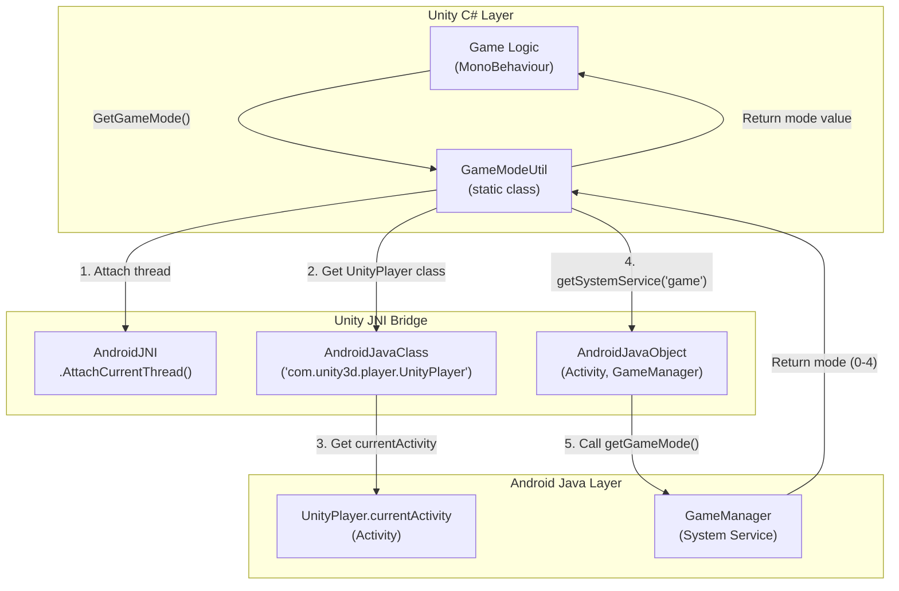
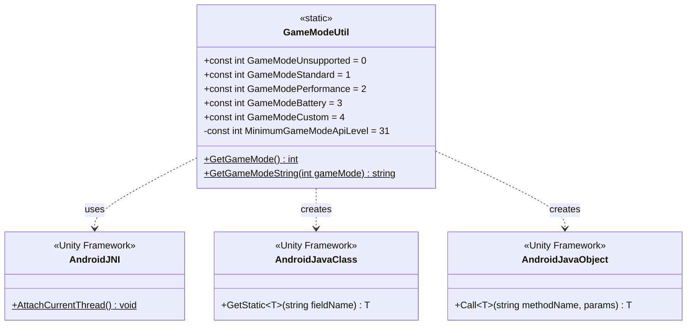
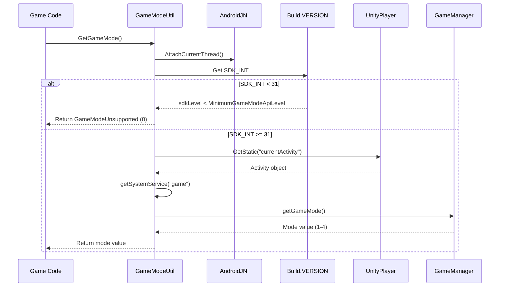
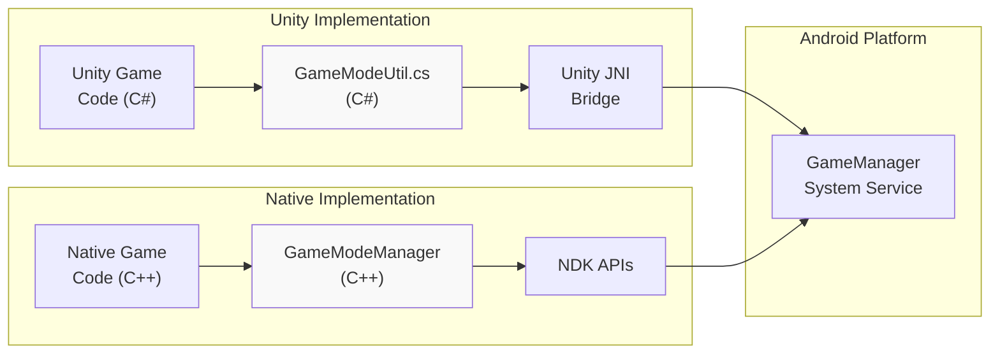
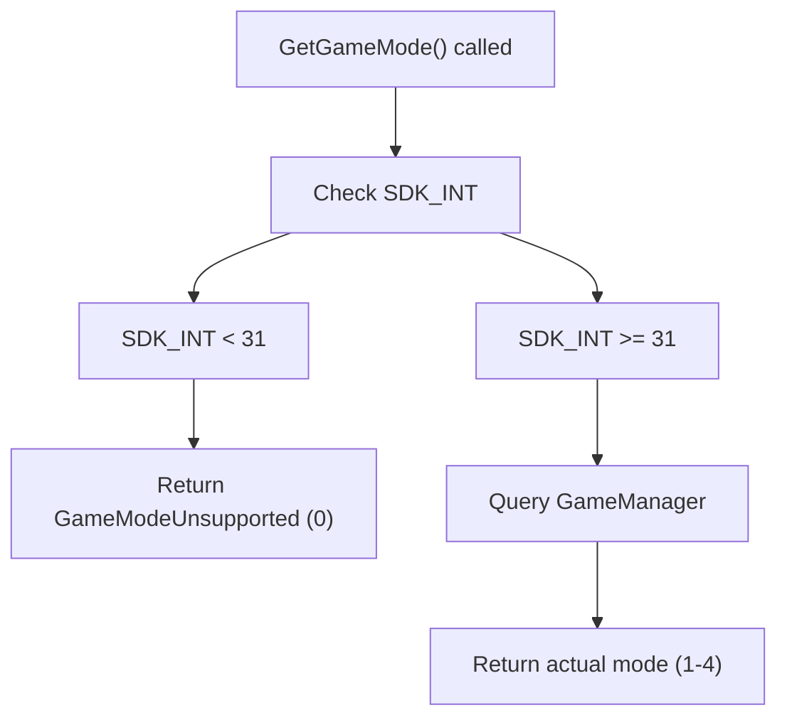

<!-- source: DeepWiki mcp.deepwiki.com · repo android/games-samples · page 4.2 Power Efficiency Demo · fetched 2026-10-23 -->

# Power Efficiency Demo

<details>
<summary>Relevant source files</summary>

The following files were used as context for generating this wiki page:

- [README.md](README.md)
- [agdk/README.md](agdk/README.md)
- [agdk/game_mode/README.md](agdk/game_mode/README.md)
- [agdk/game_mode/app/build.gradle](agdk/game_mode/app/build.gradle)
- [agdk/game_mode/app/src/main/cpp/CMakeLists.txt](agdk/game_mode/app/src/main/cpp/CMakeLists.txt)
- [agdk/game_mode/app/src/main/cpp/native_engine.cpp](agdk/game_mode/app/src/main/cpp/native_engine.cpp)
- [agdk/game_mode/build.gradle](agdk/game_mode/build.gradle)
- [agdk/game_mode/docs/gamedashboardactivity.png](agdk/game_mode/docs/gamedashboardactivity.png)
- [agdk/game_mode/gradle.properties](agdk/game_mode/gradle.properties)
- [agdk/game_mode/gradle/wrapper/gradle-wrapper.jar](agdk/game_mode/gradle/wrapper/gradle-wrapper.jar)
- [agdk/game_mode/gradle/wrapper/gradle-wrapper.properties](agdk/game_mode/gradle/wrapper/gradle-wrapper.properties)
- [agdk/game_mode/gradlew](agdk/game_mode/gradlew)
- [agdk/game_mode/gradlew.bat](agdk/game_mode/gradlew.bat)
- [unity/power_efficiency_demo/Assets/GameModeUtil.cs](unity/power_efficiency_demo/Assets/GameModeUtil.cs)

</details>


## Purpose and Scope

This document describes the **Power Efficiency Demo**, a Unity-based sample project demonstrating best practices for power efficiency on Android through integration with the [Game Mode API](https://developer.android.com/games/gamemode/gamemode-api). The demo showcases how Unity games can adapt their performance characteristics (frame rate, quality settings) based on user-selected game modes.

For the native C++ implementation of Game Mode API integration, see [Game Mode Sample](#2.1). For general build system information applicable to Unity projects, see [Build System and Development Workflow](#5).

---

## Overview

The Power Efficiency Demo is a Unity sample located at [unity/power_efficiency_demo/](). It demonstrates adaptive performance techniques by querying Android's `GameManager` system service to determine the user's optimization preference and adjusting game behavior accordingly.

**Key Capabilities:**
- Query current Game Mode setting (Standard, Performance, Battery, Custom)
- Bridge Unity C# code to Android Java APIs via JNI
- Provide a reusable utility class for Unity developers
- Demonstrate power efficiency best practices

The sample is designed for API level 31+ (Android 12+), where Game Mode API support begins, but includes backwards compatibility checks for older devices.

**Sources:** [README.md:56-58](), [unity/power_efficiency_demo/Assets/GameModeUtil.cs:1-72]()

---

## Architecture

### Unity to Android JNI Bridge



The architecture follows a layered approach where Unity C# code accesses Android platform APIs through Unity's JNI wrapper classes. The `GameModeUtil` class encapsulates this complexity, providing a simple static method for game code to query the current mode.

**Sources:** [unity/power_efficiency_demo/Assets/GameModeUtil.cs:28-43]()

---

### GameModeUtil Class Structure



The `GameModeUtil` class is a static utility providing:
- **Constants** representing the five possible game mode values
- **GetGameMode()** for querying the current mode
- **GetGameModeString()** for converting mode integers to human-readable strings

**Sources:** [unity/power_efficiency_demo/Assets/GameModeUtil.cs:18-71]()

---

## GameModeUtil API Reference

### Constants

| Constant | Value | Description |
|----------|-------|-------------|
| `GameModeUnsupported` | 0 | API not available or not configured |
| `GameModeStandard` | 1 | Balanced performance/efficiency |
| `GameModePerformance` | 2 | Maximize performance (60 FPS, high quality) |
| `GameModeBattery` | 3 | Maximize battery life (30 FPS, low quality) |
| `GameModeCustom` | 4 | OEM-defined custom mode |

**Sources:** [unity/power_efficiency_demo/Assets/GameModeUtil.cs:20-24]()

### GetGameMode() Method

**Signature:** `public static int GetGameMode()`

**Returns:** Integer representing the current Game Mode (0-4)

**Implementation Flow:**



**Key Steps:**
1. **Thread Attachment** [line 31](): Ensures current thread is attached to JVM
2. **API Level Check** [lines 33-35](): Returns `GameModeUnsupported` for devices below API 31
3. **Activity Retrieval** [lines 37-38](): Gets Unity's current activity context
4. **Service Query** [line 39](): Requests `GameManager` system service
5. **Mode Query** [line 40](): Calls `getGameMode()` on the service

**Sources:** [unity/power_efficiency_demo/Assets/GameModeUtil.cs:28-43]()

### GetGameModeString() Method

**Signature:** `public static string GetGameModeString(int gameMode)`

**Returns:** Human-readable string representation of game mode

**Example Mappings:**
- `0` → `"GameModeUnsupported"`
- `1` → `"GameModeStandard"`
- `2` → `"GameModePerformance"`
- `3` → `"GameModeBattery"`
- `4` → `"GameModeCustom"`

**Sources:** [unity/power_efficiency_demo/Assets/GameModeUtil.cs:45-70]()

---

## Integration Pattern

### Basic Usage Example

```
// Example usage in a Unity MonoBehaviour
void Start()
{
    int currentMode = GameModeUtil.GetGameMode();
    string modeName = GameModeUtil.GetGameModeString(currentMode);
    Debug.Log($"Current Game Mode: {modeName}");
    
    ApplyGameModeSettings(currentMode);
}

void ApplyGameModeSettings(int mode)
{
    switch (mode)
    {
        case GameModeUtil.GameModePerformance:
            QualitySettings.SetQualityLevel(5);  // Highest quality
            Application.targetFrameRate = 60;
            break;
            
        case GameModeUtil.GameModeBattery:
            QualitySettings.SetQualityLevel(1);  // Lower quality
            Application.targetFrameRate = 30;
            break;
            
        case GameModeUtil.GameModeStandard:
        case GameModeUtil.GameModeUnsupported:
        default:
            QualitySettings.SetQualityLevel(3);  // Medium quality
            Application.targetFrameRate = 30;
            break;
    }
}
```

### Adaptive Performance Strategy

| Game Mode | Typical Adaptations |
|-----------|---------------------|
| **Performance** | • 60 FPS target<br/>• Maximum resolution<br/>• Highest quality settings<br/>• Full post-processing effects |
| **Standard** | • 30 FPS target<br/>• Native resolution<br/>• Medium quality settings<br/>• Balanced effects |
| **Battery** | • 30 FPS target<br/>• Reduced resolution (e.g., 50-75%)<br/>• Lowest quality settings<br/>• Minimal effects |

**Sources:** [agdk/game_mode/README.md:5-12]() (native equivalent implementation)

---

## Relationship to Native Game Mode Sample

### Feature Parity

Both the Unity Power Efficiency Demo and the [Native Game Mode Sample](#2.1) demonstrate the same Game Mode API concepts but target different development environments:

| Aspect | Unity Demo | Native Sample |
|--------|------------|---------------|
| **Language** | C# | C++ |
| **API Access** | JNI via `AndroidJavaClass` | Direct NDK via `AGameManager_getGameMode()` |
| **File Location** | [unity/power_efficiency_demo/Assets/GameModeUtil.cs]() | [agdk/game_mode/app/src/main/cpp/game_mode_manager.cpp]() |
| **Adaptations** | Unity Quality Settings, `Application.targetFrameRate` | OpenGL viewport, Swappy frame pacing |
| **Graphics Backend** | Unity rendering pipeline | OpenGL ES with Swappy |

### Architectural Comparison



**Key Insight:** Both implementations query the same `GameManager` service but use different language-specific bridges. Unity developers should use `GameModeUtil.cs`, while native developers should use the NDK `AGameManager` APIs directly.

**Sources:** [unity/power_efficiency_demo/Assets/GameModeUtil.cs:28-43](), [agdk/game_mode/app/src/main/cpp/native_engine.cpp:650-689]()

---

## Platform Requirements

### Minimum Requirements

- **API Level:** 31 (Android 12) for Game Mode API support
- **Unity Version:** Any version supporting AndroidJavaClass/AndroidJavaObject
- **Device:** Must support Game Dashboard or OEM equivalent

### Backwards Compatibility

The implementation gracefully handles older devices:



Games can treat `GameModeUnsupported` as equivalent to `GameModeStandard` for fallback behavior.

**Sources:** [unity/power_efficiency_demo/Assets/GameModeUtil.cs:26-35]()

---

## Testing and Validation

### Setting Game Mode via ADB

During development, Game Mode can be changed via command line:

```bash
# Set to Performance mode
adb shell cmd game mode performance com.your.package.name

# Set to Battery mode
adb shell cmd game mode battery com.your.package.name

# Set to Standard mode
adb shell cmd game mode standard com.your.package.name
```

### Production Testing

On production devices with Game Dashboard:
1. Launch the game
2. Swipe from top-right corner to open Game Dashboard
3. Tap the game mode icon to cycle through modes
4. Observe game adaptations in real-time

**Sources:** [agdk/game_mode/README.md:44-48]()

---

## Summary

The Power Efficiency Demo provides Unity developers with a simple, reusable pattern for integrating Android's Game Mode API. The `GameModeUtil` class abstracts JNI complexity into two straightforward methods: `GetGameMode()` for querying the current mode and `GetGameModeString()` for display purposes. By adapting quality settings and frame rates based on user preferences, games can improve battery life and thermal performance while respecting player choice.

**Key Takeaways:**
- Use `GameModeUtil.GetGameMode()` to query current mode
- Adapt Unity Quality Settings and frame rate based on mode
- Handle `GameModeUnsupported` gracefully for older devices
- Test mode changes during development using ADB commands

**Sources:** [unity/power_efficiency_demo/Assets/GameModeUtil.cs:1-72](), [README.md:56-58]()

---

