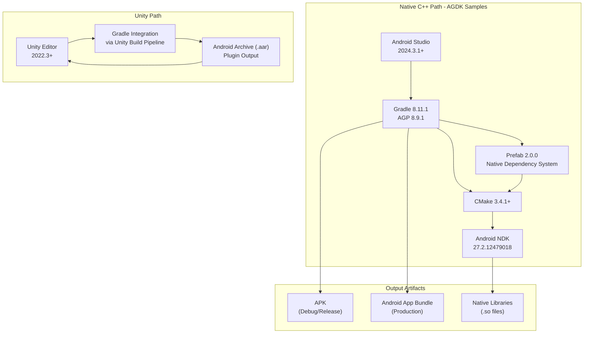
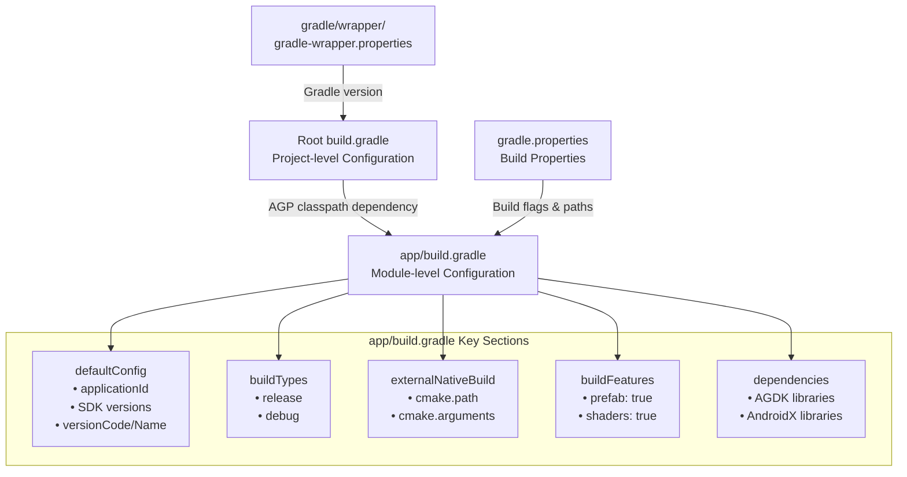
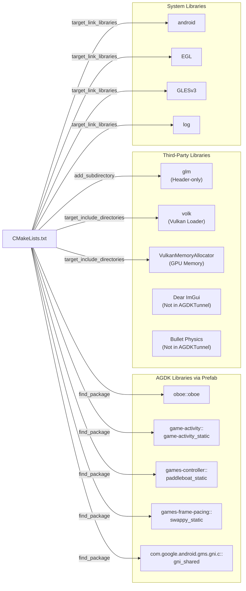
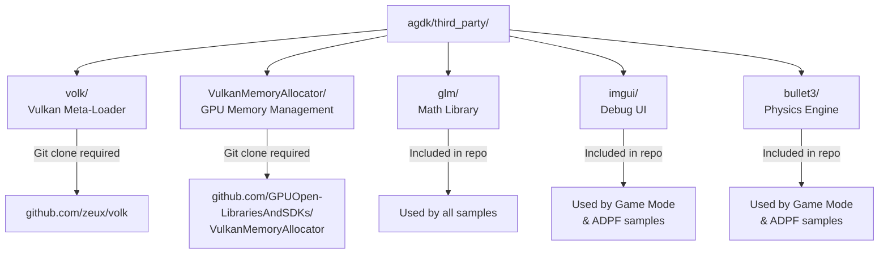
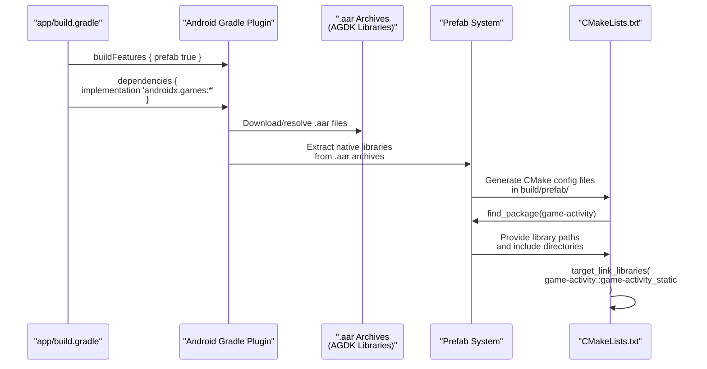
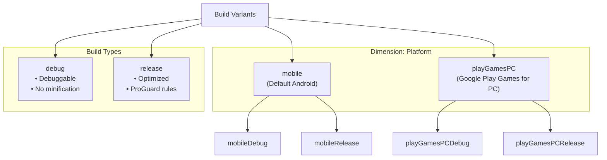
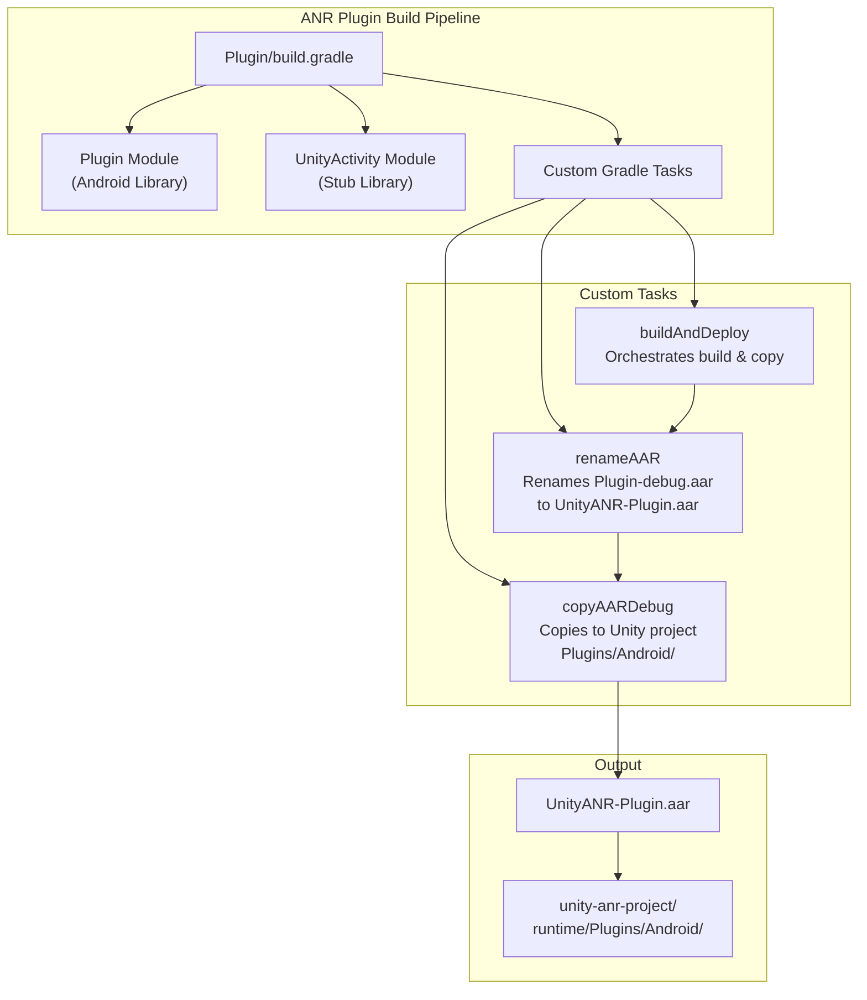
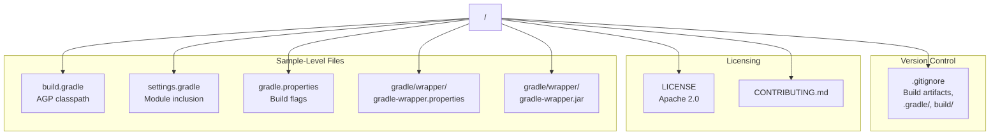
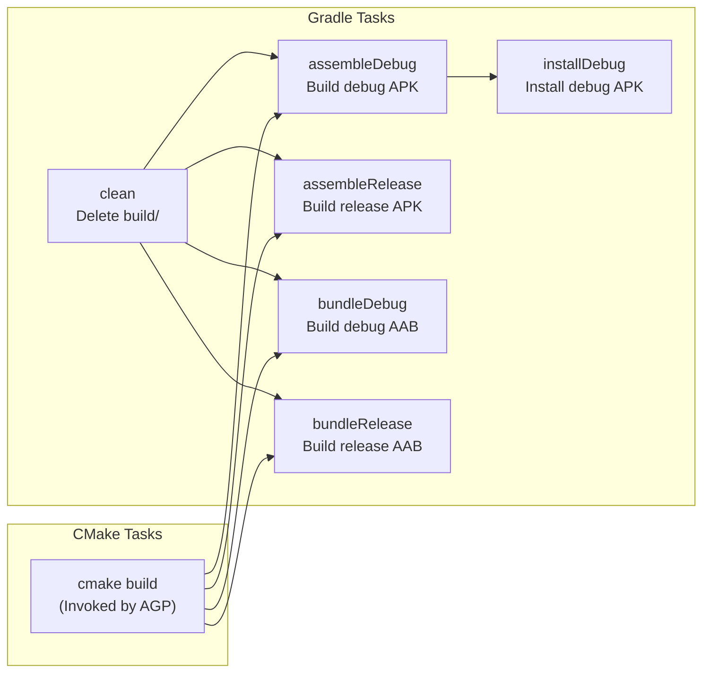

<!-- source: DeepWiki mcp.deepwiki.com · repo android/games-samples · page 5 Build System and Development Workflow · fetched 2026-10-23 -->

# Build System and Development Workflow

<details>
<summary>Relevant source files</summary>

The following files were used as context for generating this wiki page:

- [.gitignore](.gitignore)
- [CONTRIBUTING.md](CONTRIBUTING.md)
- [LICENSE](LICENSE)
- [agdk/agdktunnel/README.md](agdk/agdktunnel/README.md)
- [agdk/agdktunnel/app/build.gradle](agdk/agdktunnel/app/build.gradle)
- [agdk/agdktunnel/app/src/main/AndroidManifest.xml](agdk/agdktunnel/app/src/main/AndroidManifest.xml)
- [agdk/agdktunnel/app/src/main/cpp/CMakeLists.txt](agdk/agdktunnel/app/src/main/cpp/CMakeLists.txt)
- [agdk/agdktunnel/build.gradle](agdk/agdktunnel/build.gradle)
- [agdk/agdktunnel/gradle.properties](agdk/agdktunnel/gradle.properties)
- [agdk/agdktunnel/gradle/wrapper/gradle-wrapper.properties](agdk/agdktunnel/gradle/wrapper/gradle-wrapper.properties)
- [agdk/game_mode/app/build.gradle](agdk/game_mode/app/build.gradle)
- [agdk/game_mode/app/src/main/cpp/CMakeLists.txt](agdk/game_mode/app/src/main/cpp/CMakeLists.txt)
- [agdk/game_mode/app/src/main/cpp/native_engine.cpp](agdk/game_mode/app/src/main/cpp/native_engine.cpp)
- [agdk/game_mode/build.gradle](agdk/game_mode/build.gradle)
- [agdk/game_mode/gradle.properties](agdk/game_mode/gradle.properties)
- [agdk/game_mode/gradle/wrapper/gradle-wrapper.jar](agdk/game_mode/gradle/wrapper/gradle-wrapper.jar)
- [agdk/game_mode/gradle/wrapper/gradle-wrapper.properties](agdk/game_mode/gradle/wrapper/gradle-wrapper.properties)
- [agdk/game_mode/gradlew](agdk/game_mode/gradlew)
- [agdk/game_mode/gradlew.bat](agdk/game_mode/gradlew.bat)
- [unity/anr_plugin/unity-anr-plugin/Plugin/build.gradle](unity/anr_plugin/unity-anr-plugin/Plugin/build.gradle)
- [unity/anr_plugin/unity-anr-plugin/UnityActivity/build.gradle](unity/anr_plugin/unity-anr-plugin/UnityActivity/build.gradle)
- [unity/anr_plugin/unity-anr-plugin/build.gradle](unity/anr_plugin/unity-anr-plugin/build.gradle)
- [unity/anr_plugin/unity-anr-plugin/gradle/wrapper/gradle-wrapper.properties](unity/anr_plugin/unity-anr-plugin/gradle/wrapper/gradle-wrapper.properties)
- [unity/anr_plugin/unity-anr-plugin/settings.gradle](unity/anr_plugin/unity-anr-plugin/settings.gradle)

</details>


## Purpose and Scope

This document describes the build systems, development tools, and workflows used across the Android Games Samples repository. It covers Gradle and CMake configuration for native C++ samples, Unity plugin development workflows, third-party library integration, and version requirements. For information about specific sample architectures, see their respective documentation pages ([2]() for AGDK samples, [3]() for TrivialKart, [4]() for Unity tools).

---

## Build System Architecture

The repository employs different build systems depending on the development path:



**Sources:** [agdk/agdktunnel/build.gradle:24-26](), [agdk/agdktunnel/gradle/wrapper/gradle-wrapper.properties:3](), [agdk/agdktunnel/app/build.gradle:29-30](), [agdk/agdktunnel/gradle.properties:18]()

---

## Native C++ Development Path

### Version Requirements

The AGDK samples require specific tool versions for compatibility with the latest Android Game Development Kit libraries:

| Tool | Version | Configuration File |
|------|---------|-------------------|
| Android Studio | 2024.3.1 Patch 1+ | N/A |
| Gradle | 8.11.1 | [gradle-wrapper.properties]() |
| Android Gradle Plugin | 8.9.1 | [build.gradle:25]() |
| Android NDK | 27.2.12479018 | [app/build.gradle:30]() |
| CMake | 3.4.1+ | [CMakeLists.txt:16]() |
| Compile SDK | 36 | [app/build.gradle:29]() |
| Min SDK | 24 | [app/build.gradle:34]() |
| Target SDK | 36 | [app/build.gradle:35]() |

**Sources:** [agdk/agdktunnel/README.md:32](), [agdk/game_mode/gradle/wrapper/gradle-wrapper.properties:1-7](), [agdk/agdktunnel/app/build.gradle:28-36]()

### Gradle Configuration Structure

Native samples use a two-level Gradle configuration:



**Key configuration in `agdk/agdktunnel/app/build.gradle`:**

- **Line 29:** `compileSdkVersion 36` - Target Android API level
- **Line 30:** `ndkVersion '27.2.12479018'` - Required NDK version
- **Lines 39-46:** CMake arguments including `-DANDROID_STL=c++_shared`, `-DPLAYCORE_LOCATION`, `-DANDROID_SUPPORT_FLEXIBLE_PAGE_SIZES=ON`
- **Lines 47-49:** ABI filters for multi-architecture builds
- **Lines 85-87:** Prefab and shaders build features enabled
- **Lines 108-130:** AGDK library dependencies

**Sources:** [agdk/agdktunnel/app/build.gradle:28-140]()

### CMake Configuration for Native Libraries

The CMake build system links native code with AGDK libraries through `find_package`:



**Key CMake directives in `agdk/agdktunnel/app/src/main/cpp/CMakeLists.txt`:**

- **Lines 21-25:** `find_package()` calls for AGDK libraries delivered via Prefab
- **Lines 28-37:** Directory paths for common framework and third-party libraries
- **Lines 41-42:** Export `GameActivity_onCreate()` to prevent linker stripping
- **Lines 44-50:** Compiler flags including C++17, warnings, optimization
- **Lines 52-54:** Third-party library integration (GLM via CMake subdirectory)
- **Lines 57-140:** Source file lists for Base Game Framework and Simple Renderer
- **Lines 154-166:** `target_link_libraries()` linking all dependencies

**Sources:** [agdk/agdktunnel/app/src/main/cpp/CMakeLists.txt:1-181]()

### Third-Party Library Integration

AGDK samples require manual setup of third-party libraries:



**Setup steps from `agdk/agdktunnel/README.md`:**

1. **Lines 25-28:** Prerequisites require cloning `volk` and `VulkanMemoryAllocator` into `agdk/third_party`
2. **CMakeLists.txt Lines 52-54:** GLM is imported via `add_subdirectory()`
3. **CMakeLists.txt Lines 143-145:** Volk and VMA are included via `target_include_directories()`

**Game Mode and ADPF samples build third-party libraries as static libs:**

- **[agdk/game_mode/app/src/main/cpp/CMakeLists.txt:40-100]():** ImGui and Bullet3 are compiled as static libraries
- **Lines 51-57:** ImGui build from source files in `third_party/imgui/`
- **Lines 63-89:** Bullet3 build from multiple source directories

**Sources:** [agdk/agdktunnel/README.md:24-29](), [agdk/agdktunnel/app/src/main/cpp/CMakeLists.txt:52-151](), [agdk/game_mode/app/src/main/cpp/CMakeLists.txt:40-100]()

### Prefab: Native Library Dependency System

Prefab enables seamless integration of prebuilt native libraries into CMake builds:



**Prefab configuration:**

- **[agdk/agdktunnel/app/build.gradle:86]():** `prefab true` enables the Prefab system
- **[agdk/agdktunnel/gradle.properties:18]():** `android.prefabVersion=2.0.0` specifies Prefab version
- **[agdk/agdktunnel/app/src/main/cpp/CMakeLists.txt:21-25]():** `find_package()` calls resolve to Prefab-generated configs

**AGDK libraries consumed via Prefab in AGDKTunnel:**

| Gradle Dependency | CMake Target | Purpose |
|-------------------|--------------|---------|
| `com.google.oboe:oboe:1.5.0` | `oboe::oboe` | High-performance audio |
| `androidx.games:games-activity:3.0.5` | `game-activity::game-activity_static` | Native app lifecycle |
| `androidx.games:games-controller:2.0.2` | `games-controller::paddleboat_static` | Game controller input |
| `androidx.games:games-frame-pacing:2.1.2` | `games-frame-pacing::swappy_static` | Frame pacing |
| `com.google.android.gms:play-services-gni-native-c:1.0.0-beta2` | `com.google.android.gms.gni.c::gni_shared` | Wrapped Android APIs |

**Sources:** [agdk/agdktunnel/app/build.gradle:85-122](), [agdk/agdktunnel/app/src/main/cpp/CMakeLists.txt:21-25]()

### Build Variants and Product Flavors

AGDKTunnel uses build variants to differentiate between mobile and PC platforms:



**Build variant configuration:**

- **[agdk/agdktunnel/README.md:50-55]():** Instructions to select `playGamesPC` build variant for PC platform
- Variants affect native library builds through CMake arguments
- Different texture compression formats (ETC2 for mobile, DXT1 for PC) via Play Asset Delivery

**Sources:** [agdk/agdktunnel/README.md:48-56]()

### Play Asset Delivery Configuration

AGDKTunnel optionally uses Play Asset Delivery for optimized texture compression:

**Gradle configuration:**

- **[agdk/agdktunnel/gradle.properties:23]():** `PADEnabled=false` by default
- **[agdk/agdktunnel/app/build.gradle:22]():** `def usePad = PADEnabled` reads the property
- **[agdk/agdktunnel/app/build.gradle:26]():** `def playcoreDir = file('libs/play-core-native-sdk')` defines Play Core SDK path
- **[agdk/agdktunnel/app/build.gradle:89]():** `assetPacks = [":install_time_assets", ":on_demand_assets"]` declares asset packs
- **[agdk/agdktunnel/app/build.gradle:91-95]():** Texture compression format targeting enabled

**CMake integration:**

- **[agdk/agdktunnel/app/build.gradle:42-44]():** CMake receives `-DPLAYCORE_LOCATION=$playcoreDir` and `-DUSE_ASSET_PACKS=$usePad`
- **[agdk/agdktunnel/app/src/main/cpp/CMakeLists.txt:171-180]():** Conditionally includes Play Core library

**Build process:**

- **[agdk/agdktunnel/README.md:70-103]():** Instructions for building AAB files and installing via bundletool
- Asset packs support Texture Compression Format Targeting (TCFT) for ETC2/DXT1

**Sources:** [agdk/agdktunnel/gradle.properties:22-23](), [agdk/agdktunnel/app/build.gradle:21-96](), [agdk/agdktunnel/app/src/main/cpp/CMakeLists.txt:171-180](), [agdk/agdktunnel/README.md:65-103]()

---

## Unity Development Path

### Unity Plugin Build System

Unity plugins for Android are built as Android Archive (AAR) files and integrated into Unity projects:



**Custom Gradle task implementation in `unity/anr_plugin/unity-anr-plugin/Plugin/build.gradle`:**

- **Lines 55-58:** `buildAndDeploy` task orchestrates the full pipeline
- **Lines 60-74:** `renameAAR` task renames output from `Plugin-debug.aar` to `UnityANR-Plugin.aar`
- **Lines 76-90:** `copyAARDebug` task copies the AAR to `unity-anr-project\runtime\Plugins\Android\`
- **Lines 92-94:** `assembleDebug` is configured to automatically trigger `copyAARDebug`

**Sources:** [unity/anr_plugin/unity-anr-plugin/Plugin/build.gradle:55-94]()

### Unity Plugin Dependencies

Unity plugins have different dependency requirements than native samples:

**ANR Plugin configuration:**

- **[unity/anr_plugin/unity-anr-plugin/Plugin/build.gradle:22-23]():** `namespace 'com.google.unity.plugin'`, `compileSdk 34`
- **[unity/anr_plugin/unity-anr-plugin/Plugin/build.gradle:25-28]():** `minSdk 22`, `targetSdk 34`
- **[unity/anr_plugin/unity-anr-plugin/Plugin/build.gradle:42-44]():** Java 17 compatibility
- **[unity/anr_plugin/unity-anr-plugin/Plugin/build.gradle:49-52]():** Dependencies include project `:UnityActivity`, Unity classes.jar (compile-only), androidx.webkit, androidx.appcompat

**UnityActivity stub module:**

- **[unity/anr_plugin/unity-anr-plugin/UnityActivity/build.gradle:22-23]():** `namespace 'com.unity3d.player'`, `compileSdk 34`
- **[unity/anr_plugin/unity-anr-plugin/UnityActivity/build.gradle:26]():** `minSdk 16` (lower than Plugin for compatibility)
- **[unity/anr_plugin/unity-anr-plugin/UnityActivity/build.gradle:46]():** `compileOnly files('libs/classes.jar')` - Unity classes

**Gradle wrapper and AGP versions:**

- **[unity/anr_plugin/unity-anr-plugin/gradle/wrapper/gradle-wrapper.properties:4]():** Gradle 8.12
- **[unity/anr_plugin/unity-anr-plugin/build.gradle:19]():** `agp_version = '8.7.3'`
- **[unity/anr_plugin/unity-anr-plugin/build.gradle:25-26]():** AGP 8.7.3 applied to library modules

**Sources:** [unity/anr_plugin/unity-anr-plugin/Plugin/build.gradle:1-94](), [unity/anr_plugin/unity-anr-plugin/UnityActivity/build.gradle:1-52](), [unity/anr_plugin/unity-anr-plugin/build.gradle:17-27]()

### Unity Integration Workflow

The workflow for Unity developers differs from native development:

1. **Build Plugin in Android Studio:**
   - Open `unity/anr_plugin/unity-anr-plugin` in Android Studio
   - Run `./gradlew buildAndDeploy` or use Gradle panel

2. **Unity Project Integration:**
   - Plugin AAR is automatically copied to `Plugins/Android/` folder
   - Unity detects the AAR and includes it in the build

3. **Unity Build Process:**
   - Unity Editor invokes its own Gradle build system
   - Merges plugin AndroidManifest.xml with main manifest
   - Packages plugin native libraries (.so files) into APK

4. **No CMake Required:**
   - Unity handles IL2CPP or Mono compilation
   - Native plugins are pre-built as .so libraries in the AAR

**Sources:** [unity/anr_plugin/unity-anr-plugin/Plugin/build.gradle:76-90]()

---

## Common Build Configuration Files

### Root-Level Configuration



**Key ignore patterns in `.gitignore`:**

- **Lines 19-20:** `/.gradle/` and `/build/` directories ignored
- **Line 23:** `local.properties` (SDK path) ignored
- **Lines 34-36:** Android Studio/IntelliJ IDEA files ignored

**Sources:** [.gitignore:1-43]()

### Gradle Properties Configuration

Common properties defined in `gradle.properties`:

| Property | Purpose | Example Value |
|----------|---------|---------------|
| `android.useAndroidX` | Enable AndroidX libraries | `true` |
| `android.prefabVersion` | Prefab system version | `2.0.0` |
| `android.defaults.buildfeatures.buildconfig` | Enable BuildConfig generation | `true` |
| `android.nonTransitiveRClass` | R class optimization | `false` |
| `android.nonFinalResIds` | Resource ID optimization | `false` |
| `PADEnabled` (AGDKTunnel) | Play Asset Delivery toggle | `false` |

**Sources:** [agdk/game_mode/gradle.properties:14-20](), [agdk/agdktunnel/gradle.properties:13-26]()

### Gradle Wrapper Standardization

All samples use consistent Gradle wrapper configurations:

- **AGDK samples:** Gradle 8.11.1
  - [agdk/game_mode/gradle/wrapper/gradle-wrapper.properties:3]()
  - [agdk/agdktunnel/gradle/wrapper/gradle-wrapper.properties:3]()
- **Unity ANR Plugin:** Gradle 8.12
  - [unity/anr_plugin/unity-anr-plugin/gradle/wrapper/gradle-wrapper.properties:4]()

**Gradle wrapper scripts:**

- **[agdk/game_mode/gradlew:1-253]():** Unix/Linux shell script
- **[agdk/game_mode/gradlew.bat:1-95]():** Windows batch script
- Both scripts bootstrap the Gradle build system using the wrapper JAR

**Sources:** [agdk/game_mode/gradle/wrapper/gradle-wrapper.properties:1-7](), [agdk/game_mode/gradlew:1-253](), [agdk/game_mode/gradlew.bat:1-95]()

---

## Build System Version Matrix

The following table summarizes version requirements across sample types:

| Component | AGDK Samples | Unity ANR Plugin | Notes |
|-----------|--------------|------------------|-------|
| **Gradle** | 8.11.1 | 8.12 | Defined in gradle-wrapper.properties |
| **Android Gradle Plugin** | 8.9.1 | 8.7.3 | AGDKTunnel uses newer version |
| **Android NDK** | 27.2.12479018 | N/A | Native samples only |
| **CMake** | 3.4.1+ | N/A | Native samples only |
| **Compile SDK** | 36 | 34 | AGDKTunnel targets latest |
| **Min SDK** | 24 | 22 (UnityActivity: 16) | Unity supports older devices |
| **Target SDK** | 36 | 34 | Matches compile SDK |
| **Java Version** | VERSION_17 | VERSION_17 | Source/target compatibility |
| **C++ Standard** | C++17 | N/A | Set via CMAKE_CXX_FLAGS |
| **Prefab** | 2.0.0 | N/A | Native dependency system |

**Sources:** [agdk/agdktunnel/app/build.gradle:28-44](), [agdk/game_mode/app/build.gradle:20-34](), [unity/anr_plugin/unity-anr-plugin/Plugin/build.gradle:22-44](), [unity/anr_plugin/unity-anr-plugin/UnityActivity/build.gradle:22-41]()

---

## Common Build Tasks and Workflows

### Native Sample Build Tasks



**Common command-line operations:**

```bash
# Build debug APK
./gradlew assembleDebug

# Build and install debug APK
./gradlew installDebug

# Build release APK
./gradlew assembleRelease

# Build Android App Bundle (for Play Store)
./gradlew bundleRelease

# Clean build artifacts
./gradlew clean
```

**Sources:** Gradle standard tasks

### Unity Plugin Build Tasks

**ANR Plugin custom tasks:**

```bash
# Build and deploy to Unity project
./gradlew buildAndDeploy

# Just build the AAR
./gradlew assembleDebug

# Manually copy AAR
./gradlew copyAARDebug
```

**Task dependencies defined in `Plugin/build.gradle`:**

- **Line 56:** `buildAndDeploy` depends on `assembleDebug` and `renameAAR`, finalized by `copyAARDebug`
- **Line 61:** `renameAAR` depends on `bundleDebugAar`
- **Line 77:** `copyAARDebug` depends on `renameAAR`
- **Line 93:** `assembleDebug` automatically finalizes with `copyAARDebug`

**Sources:** [unity/anr_plugin/unity-anr-plugin/Plugin/build.gradle:55-94]()

### Build Artifacts and Output Locations

Native samples output to standard Gradle locations:

```
agdk/agdktunnel/app/build/
├── intermediates/
│   ├── cmake/                      # CMake build files
│   ├── merged_native_libs/         # Merged .so libraries
│   └── prefab_package/             # Prefab metadata
├── outputs/
│   ├── apk/
│   │   ├── debug/
│   │   │   └── app-debug.apk
│   │   └── release/
│   │       └── app-release.apk
│   ├── bundle/
│   │   ├── mobileDebug/
│   │   │   └── app-mobile-debug.aab
│   │   └── playGamesPCDebug/
│   │       └── app-playGamesPC-debug.aab
│   └── native-debug-symbols/       # Debug symbols for Play Console
└── tmp/
```

Unity plugin outputs to custom location:

```
unity/anr_plugin/unity-anr-plugin/Plugin/build/
└── outputs/
    └── aar/
        └── UnityANR-Plugin.aar     # Renamed and copied to Unity project
```

**Sources:** Android Gradle Plugin documentation, [unity/anr_plugin/unity-anr-plugin/Plugin/build.gradle:76-90]()

---

## Troubleshooting Common Build Issues

### Missing Third-Party Libraries

**Problem:** CMake error about missing volk or VulkanMemoryAllocator

**Solution:** Clone required repositories into `agdk/third_party/`:

```bash
cd agdk/third_party
git clone https://github.com/zeux/volk.git
git clone https://github.com/GPUOpen-LibrariesAndSDKs/VulkanMemoryAllocator.git
```

**Sources:** [agdk/agdktunnel/README.md:25-28]()

### Gradle Sync Failures

**Problem:** Gradle sync fails with "Cannot resolve androidx.games:*"

**Solution:** Ensure repositories are configured in `build.gradle`:

- **[agdk/game_mode/build.gradle:20-22]():** Requires `google()` and `mavenCentral()` repositories
- Check network connectivity for dependency downloads

**Sources:** [agdk/game_mode/build.gradle:18-34]()

### NDK Version Mismatch

**Problem:** Build fails with "No version of NDK matched the requested version"

**Solution:** Install NDK 27.2.12479018 via Android Studio SDK Manager:
- Tools → SDK Manager → SDK Tools tab → NDK (Side by side)
- Check specific version 27.2.12479018

**Sources:** [agdk/agdktunnel/app/build.gradle:30]()

### CMake Configuration Errors

**Problem:** CMake cannot find AGDK libraries

**Solution:** Verify Prefab is enabled:
- **[agdk/agdktunnel/app/build.gradle:86]():** `prefab true` must be set
- Clean and rebuild: `./gradlew clean assembleDebug`

**Sources:** [agdk/agdktunnel/app/build.gradle:85-87]()

### Play Asset Delivery Build Issues

**Problem:** Asset pack texture files not found

**Solution:** Ensure correct build configuration:
- **[agdk/agdktunnel/gradle.properties:23]():** Set `PADEnabled=true`
- Download Play Core SDK and place in `app/libs/play-core-native-sdk/`
- Build AAB instead of APK: `./gradlew bundleDebug`

**Sources:** [agdk/agdktunnel/README.md:65-74](), [agdk/agdktunnel/app/build.gradle:21-26]()