# Page: Overview

# Overview

<details>
<summary>Relevant source files</summary>

The following files were used as context for generating this wiki page:

- [.gitignore](.gitignore)
- [CONTRIBUTING.md](CONTRIBUTING.md)
- [LICENSE](LICENSE)
- [README.md](README.md)
- [agdk/README.md](agdk/README.md)
- [agdk/game_mode/README.md](agdk/game_mode/README.md)
- [agdk/game_mode/docs/gamedashboardactivity.png](agdk/game_mode/docs/gamedashboardactivity.png)
- [unity/power_efficiency_demo/Assets/GameModeUtil.cs](unity/power_efficiency_demo/Assets/GameModeUtil.cs)

</details>


## Purpose and Scope

This document provides a high-level overview of the Android Games Samples repository, explaining its structure, purpose, and the types of samples it contains. The repository serves as a collection of reference implementations demonstrating best practices for Android game development, with a focus on:

- Native C++ game development using the Android Game Development Kit (AGDK)
- Integration of Google Play technologies (billing, achievements, leaderboards, cloud save)
- Adaptive performance optimization techniques
- Unity engine best practices for Android

For detailed information about specific samples, see:
- AGDK Native Samples: [#2]()
- TrivialKart Game Samples: [#3]()
- Unity Development Tools: [#4]()
- Build System and Development Workflow: [#5]()

Sources: [README.md:1-67]()

## Repository Structure

The repository is organized into four primary directories, each serving a distinct development purpose:

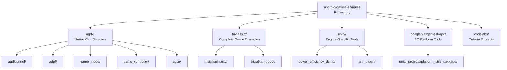

**Directory Descriptions:**

| Directory | Purpose | Technology |
|-----------|---------|------------|
| `agdk/` | Demonstrates AGDK libraries for native game development | C/C++, NDK |
| `trivialkart/` | Production-grade game samples with Google Play integration | Unity, Godot |
| `unity/` | Android best practices and diagnostic tools for Unity | C#, Unity |
| `googleplaygamesforpc/` | Tools for targeting Google Play Games for PC | Unity |
| `codelabs/` | Tutorial projects for Play Asset Delivery | C++, Unity |

Sources: [README.md:1-67](), [agdk/README.md:1-23]()

## AGDK Native Samples

The [agdk/](agdk) directory contains C++ samples demonstrating Android Game Development Kit libraries. These samples target native game engines and show how to integrate Android-specific APIs.

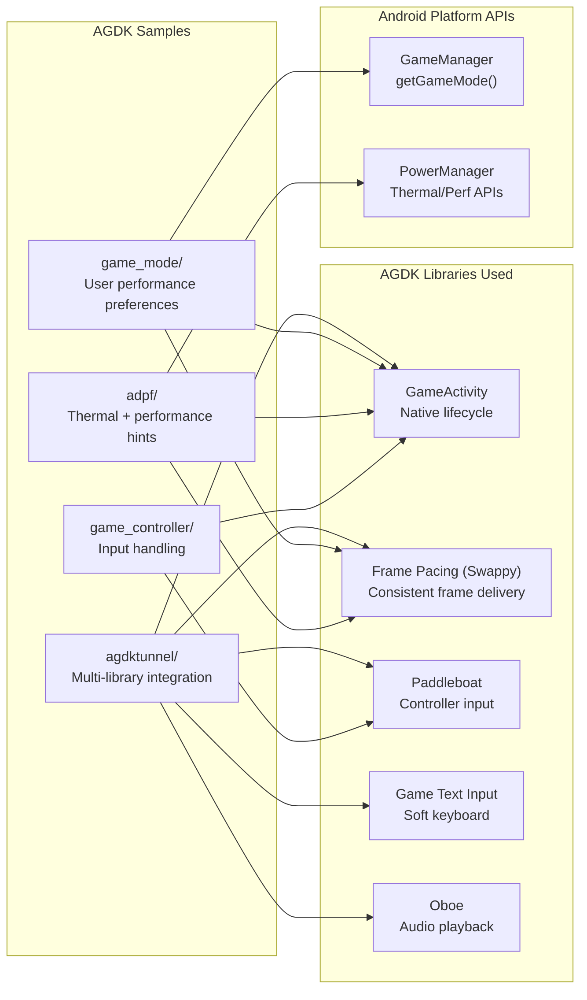

**Key Samples:**

- **AGDKTunnel** ([agdk/agdktunnel/](agdk/agdktunnel)): Comprehensive integration demonstrating six AGDK libraries including Play Games Services and Play Asset Delivery. See [#2.3]() for details.
- **Game Mode** ([agdk/game_mode/](agdk/game_mode)): Demonstrates `GameManager` API to adjust graphics fidelity based on user-selected modes (Standard/Performance/Battery). See [#2.1]() for details.
- **ADPF** ([agdk/adpf/](agdk/adpf)): Shows Android Dynamic Performance Framework APIs for thermal management and CPU scheduling hints. See [#2.2]() for details.
- **Game Controller** ([agdk/game_controller/](agdk/game_controller)): Visualizes Paddleboat library functionality for controller input, motion sensors, and vibration. See [#2.4]() for details.

Sources: [README.md:7-18](), [agdk/README.md:1-23](), [agdk/game_mode/README.md:1-67]()

## TrivialKart Game Samples

The [trivialkart/](trivialkart) directory contains complete, production-ready game implementations demonstrating Google Play technologies.

**Available Implementations:**

| Implementation | Technologies Demonstrated |
|----------------|---------------------------|
| **trivialkart-unity/** | Unity IAP, Play Games Services v1/v2 migration, authentication server, cloud save, Google Play Games for PC Input SDK, Play Integrity |
| **trivialkart-godot/** | Google Play Billing integration |

The Unity implementation is particularly comprehensive, featuring a server-side authentication architecture for migrating from Play Games Services v1 to v2 using OpenID-based account linking. This allows seamless player progress preservation during SDK updates.

Sources: [README.md:19-40]()

## Unity Development Tools

The [unity/](unity) directory provides Android-specific tools and best practices for Unity developers:

**Power Efficiency Demo** ([unity/power_efficiency_demo/](unity/power_efficiency_demo)): Demonstrates adaptive performance using the Game Mode API via JNI. The `GameModeUtil` class bridges C# to Android's `GameManager`:

```mermaid
sequenceDiagram
    participant Unity["Unity C# Code"]
    participant GameModeUtil["GameModeUtil.cs"]
    participant AndroidJNI["AndroidJNI Bridge"]
    participant GameManager["Android GameManager<br/>System Service"]
    
    Unity->>GameModeUtil: GetGameMode()
    GameModeUtil->>AndroidJNI: Get UnityPlayer.currentActivity
    AndroidJNI->>AndroidJNI: getSystemService("game")
    AndroidJNI->>GameManager: getGameMode()
    GameManager-->>AndroidJNI: Mode value (0-4)
    AndroidJNI-->>GameModeUtil: Return mode
    GameModeUtil-->>Unity: Apply adaptations
```

The `GameModeUtil.GetGameMode()` method at [unity/power_efficiency_demo/Assets/GameModeUtil.cs:28-43]() retrieves mode values:
- `GameModeUnsupported = 0`
- `GameModeStandard = 1`
- `GameModePerformance = 2`
- `GameModeBattery = 3`
- `GameModeCustom = 4`

**ANR Plugin** ([unity/anr_plugin/](unity/anr_plugin)): Diagnostic tool for identifying Application Not Responding errors, strict mode violations, and memory issues on Unity 2022 and older versions.

Sources: [README.md:52-61](), [unity/power_efficiency_demo/Assets/GameModeUtil.cs:1-72]()

## Common Framework Architecture

AGDK samples share a common framework located in [agdk/common/](agdk/common) that provides:

- **Graphics API Abstraction**: Unified interface supporting both Vulkan and OpenGL ES rendering backends
- **Display Management**: Screen resolution and orientation handling
- **Rendering Infrastructure**: Texture loading, shader management, and draw call abstraction

This shared infrastructure allows samples to focus on demonstrating specific AGDK features while maintaining consistent rendering quality. The framework follows a "Vulkan-first, OpenGL ES fallback" pattern to support a wide range of Android devices.

Sources: [README.md:1-67]()

## Development Workflows

The repository supports two primary development paths:

### Native C++ Path (AGDK Samples)

**Requirements:**
- Android Studio 2024.3.1 Patch 1 (Meerkat) or higher
- Android Game Development Extension
- CMake build system
- Android NDK 27.2
- Manual setup of third-party libraries (Dear ImGui, Bullet Physics, Volk, VMA)

**Build Flow:**
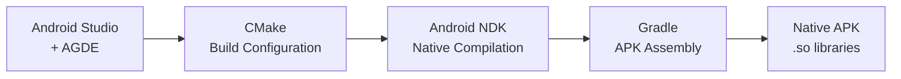

### Unity Path (TrivialKart, Tools)

**Requirements:**
- Unity Editor 2022.3+
- Unity IAP Package
- Play Games Services Plugin
- Custom plugins (ANR Plugin, GameModeUtil)

**Build Flow:**
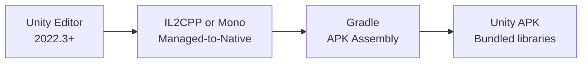

Both paths converge on Gradle + Android Gradle Plugin 8.7+ for final artifact generation.

Sources: [README.md:1-67](), [agdk/game_mode/README.md:14-35]()

## Key Concepts: Adaptive Performance

A central theme across multiple samples is adaptive performance—adjusting game behavior based on device state and user preferences.

**Two Approaches:**

| Approach | API | Sample | Trigger |
|----------|-----|--------|---------|
| **User-Driven** | Game Mode API | [game_mode/](agdk/game_mode) | User selects mode via Game Dashboard |
| **System-Driven** | ADPF APIs | [adpf/](agdk/adpf) | Thermal throttling detection |

**Common Adaptation Strategies:**

Both approaches employ similar techniques:
- Frame rate adjustment (60 FPS ↔ 30 FPS)
- Resolution scaling (Full ↔ Half ↔ Quarter)
- Physics complexity reduction
- Object count reduction
- Asset quality variation

The Game Mode sample demonstrates user preferences where players choose between Standard, Performance, and Battery modes. The ADPF sample showcases automatic adaptation responding to thermal events by dynamically reducing simulation complexity.

Sources: [README.md:1-67](), [agdk/game_mode/README.md:1-67]()

## Prerequisites and Third-Party Dependencies

### Native C++ Samples

Before building AGDK samples, third-party libraries must be manually installed:

1. Navigate to `agdk/third_party/`
2. Clone required repositories:
   ```
   git clone https://github.com/ocornut/imgui
   git clone https://github.com/bulletphysics/bullet3
   ```

Additional dependencies (Volk, Vulkan Memory Allocator) are sample-specific.

### Unity Samples

Unity samples manage dependencies via Unity Package Manager and include custom plugins distributed with the samples.

### Minimum API Levels

- **Game Mode API**: Requires API level 31 (Android 12) minimum. Samples demonstrate runtime API level checking at [unity/power_efficiency_demo/Assets/GameModeUtil.cs:26-35]().
- **ADPF APIs**: Require API level 31+ for Performance Hint Manager, API 29+ for Thermal API.
- **Base compatibility**: Most samples set `minSdkVersion` to 24 (Android 7.0) and demonstrate graceful degradation on older devices.

Sources: [agdk/game_mode/README.md:14-31](), [unity/power_efficiency_demo/Assets/GameModeUtil.cs:26-35]()

## Repository Contents Summary

| Category | Sample Count | Primary Language | Key APIs |
|----------|--------------|------------------|----------|
| AGDK Samples | 4+ | C/C++ | GameActivity, Swappy, Paddleboat, Oboe |
| TrivialKart | 2 | Unity (C#), Godot (GDScript) | Play Billing, PGS, Play Integrity |
| Unity Tools | 2 | C# | Game Mode API (JNI), ANR diagnostics |
| Codelabs | 2 | C++, Unity | Play Asset Delivery |

The repository is licensed under Apache License 2.0 and accepts contributions following Google's Open Source Community Guidelines.

Sources: [README.md:1-67](), [LICENSE:1-203](), [CONTRIBUTING.md:1-29]()

---

# Page: AGDK Native Samples

# AGDK Native Samples

<details>
<summary>Relevant source files</summary>

The following files were used as context for generating this wiki page:

- [README.md](README.md)
- [agdk/README.md](agdk/README.md)
- [agdk/agdktunnel/app/src/main/cpp/native_engine.cpp](agdk/agdktunnel/app/src/main/cpp/native_engine.cpp)
- [agdk/common/base_game_framework/include/graphics_api_features.h](agdk/common/base_game_framework/include/graphics_api_features.h)
- [agdk/common/base_game_framework/src/android/display_manager_android.cpp](agdk/common/base_game_framework/src/android/display_manager_android.cpp)
- [agdk/common/base_game_framework/src/android/platform_util_vulkan_android.cpp](agdk/common/base_game_framework/src/android/platform_util_vulkan_android.cpp)
- [agdk/common/base_game_framework/src/gles/graphics_api_gles.cpp](agdk/common/base_game_framework/src/gles/graphics_api_gles.cpp)
- [agdk/common/base_game_framework/src/vulkan/graphics_api_vulkan.cpp](agdk/common/base_game_framework/src/vulkan/graphics_api_vulkan.cpp)
- [agdk/common/base_game_framework/src/vulkan/graphics_api_vulkan_utils.cpp](agdk/common/base_game_framework/src/vulkan/graphics_api_vulkan_utils.cpp)
- [agdk/common/simple_renderer/renderer_render_pass_vk.cpp](agdk/common/simple_renderer/renderer_render_pass_vk.cpp)
- [agdk/game_mode/README.md](agdk/game_mode/README.md)
- [agdk/game_mode/docs/gamedashboardactivity.png](agdk/game_mode/docs/gamedashboardactivity.png)
- [unity/power_efficiency_demo/Assets/GameModeUtil.cs](unity/power_efficiency_demo/Assets/GameModeUtil.cs)

</details>


## Purpose and Scope

The AGDK Native Samples are a collection of C++ game samples demonstrating the integration and use of [Android Game Development Kit (AGDK) libraries](https://developer.android.com/games/agdk/libraries-overview). These samples showcase native Android game development using modern graphics APIs (Vulkan/OpenGL ES), adaptive performance features, and input handling through a shared framework architecture.

This page provides an architectural overview of the native samples and their common infrastructure. For details on individual samples, see:
- [Game Mode Sample](#2.1) - User-driven performance adaptation
- [ADPF Sample](#2.2) - System-driven thermal management
- [AGDKTunnel Sample](#2.3) - Multi-library integration example
- [Game Controller Sample](#2.4) - Input handling with Paddleboat
- [Common Framework Architecture](#2.5) - Shared rendering and display infrastructure

For Unity-based samples and tools, see [Unity Development Tools](#4). For complete game examples, see [TrivialKart Game Samples](#3).

## Sample Overview

The AGDK native samples are located in the `agdk/` directory and consist of four primary examples, each demonstrating different aspects of the AGDK:

| Sample | Primary Focus | Key AGDK Libraries | Importance Score |
|--------|---------------|-------------------|------------------|
| Game Mode | User-selected performance modes | GameActivity, Frame Pacing | 23.27 |
| ADPF | Thermal-aware adaptive performance | GameActivity, Frame Pacing, ADPF APIs | 18.00 |
| AGDKTunnel | Comprehensive multi-library integration | GameActivity, Frame Pacing, Paddleboat, Oboe, GameTextInput | 20.30 |
| Game Controller | Controller input and visualization | GameActivity, Paddleboat | 12.94 |

All samples share a common Base Game Framework that provides graphics API abstraction (Vulkan/OpenGL ES), display management, and system event handling.

**Sources:** [README.md:7-17](), [agdk/README.md:1-23]()

## AGDK Library Integration Pattern

```mermaid
graph TB
    subgraph "Sample Applications"
        GameMode["Game Mode Sample<br/>(game_mode/)"]
        ADPF["ADPF Sample<br/>(adpf/)"]
        Tunnel["AGDKTunnel<br/>(agdktunnel/)"]
        Controller["Game Controller<br/>(game_controller/)"]
    end
    
    subgraph "AGDK Libraries (Prefab Dependencies)"
        GameActivity["game-activity<br/>Native Lifecycle"]
        FramePacing["swappy (Frame Pacing)<br/>Consistent Frame Delivery"]
        Paddleboat["paddleboat<br/>Game Controller Input"]
        GameTextInput["game-text-input<br/>Soft Keyboard"]
        Oboe["oboe<br/>Audio API"]
    end
    
    subgraph "Android Platform APIs"
        GameModeAPI["GameManager.getGameMode()"]
        ADPFAPI["ThermalManager, PerformanceHintManager"]
    end
    
    subgraph "Common Infrastructure"
        BaseFramework["base_game_framework<br/>DisplayManager, GraphicsAPIBase"]
        SimpleRenderer["simple_renderer<br/>Renderer Interface"]
    end
    
    GameMode --> GameActivity
    GameMode --> FramePacing
    GameMode --> BaseFramework
    GameMode --> SimpleRenderer
    GameMode -.-> GameModeAPI
    
    ADPF --> GameActivity
    ADPF --> FramePacing
    ADPF --> BaseFramework
    ADPF --> SimpleRenderer
    ADPF -.-> ADPFAPI
    
    Tunnel --> GameActivity
    Tunnel --> FramePacing
    Tunnel --> Paddleboat
    Tunnel --> GameTextInput
    Tunnel --> Oboe
    Tunnel --> BaseFramework
    Tunnel --> SimpleRenderer
    
    Controller --> GameActivity
    Controller --> Paddleboat
    Controller --> BaseFramework
    Controller --> SimpleRenderer
```

The samples follow a consistent integration pattern:
- **GameActivity** provides native app lifecycle management (replaces deprecated NativeActivity)
- **Frame Pacing (Swappy)** ensures consistent frame delivery and refresh rate handling
- **Base Game Framework** abstracts graphics API selection and display management
- **Simple Renderer** provides a higher-level rendering interface built on the framework

Platform-specific APIs (Game Mode, ADPF) are accessed directly through JNI or NDK APIs where available.

**Sources:** [agdk/README.md:1-23](), [agdk/agdktunnel/app/src/main/cpp/native_engine.cpp:1-467]()

## Graphics API Architecture

### Dual Graphics API Support

All AGDK samples support both Vulkan and OpenGL ES through a unified abstraction layer. The framework automatically selects the appropriate backend based on device capabilities:

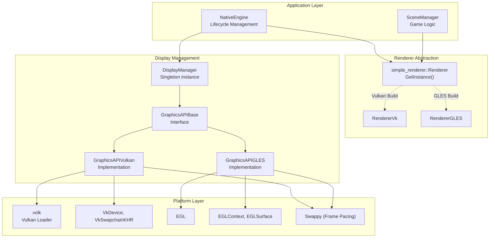

The graphics API selection follows this decision logic:

1. **Query Vulkan availability** via `DisplayManager::GetGraphicsAPISupportFlags(kGraphicsAPI_Vulkan)`
2. **Check for Vulkan 1.1+ and ETC2 texture compression** support
3. **Fall back to OpenGL ES 3.0** if Vulkan requirements not met
4. **Initialize graphics API** via `DisplayManager::InitGraphicsAPI()`

**Sources:** [agdk/agdktunnel/app/src/main/cpp/native_engine.cpp:108-157](), [agdk/common/base_game_framework/src/vulkan/graphics_api_vulkan.cpp:117-168](), [agdk/common/base_game_framework/src/gles/graphics_api_gles.cpp:54-129]()

### Display Manager Initialization Flow

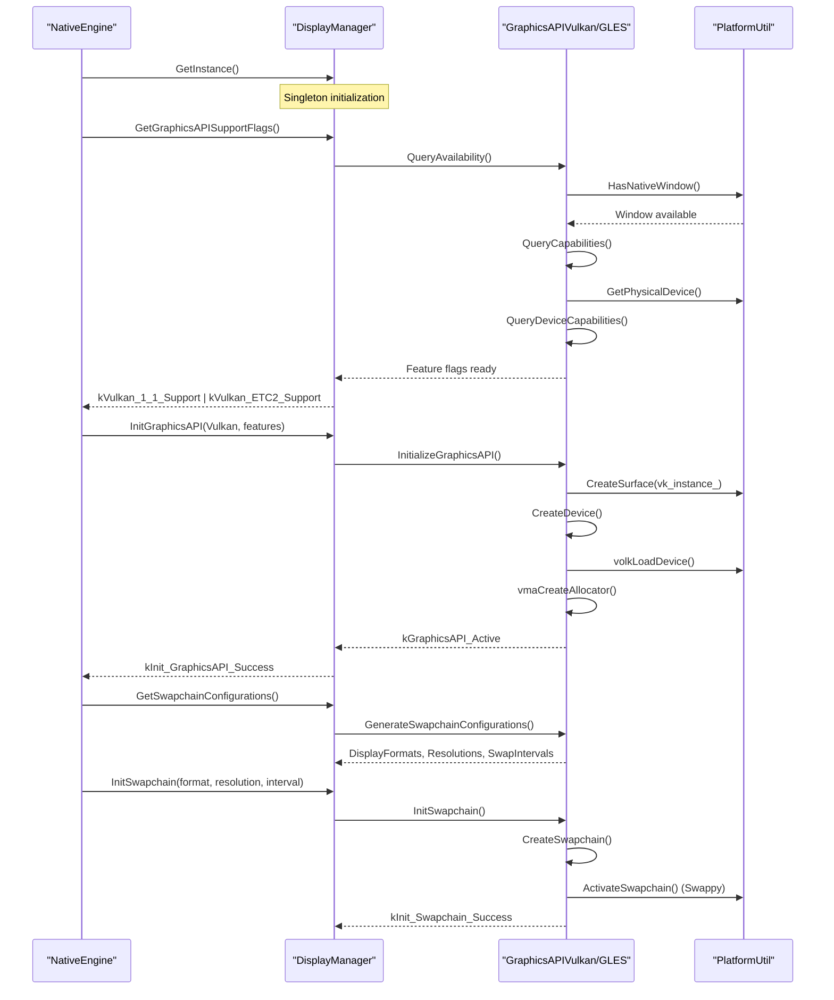

Key classes involved:
- **`DisplayManager`** ([agdk/common/base_game_framework/include/display_manager.h]()) - Singleton managing graphics API lifecycle
- **`GraphicsAPIVulkan`** ([agdk/common/base_game_framework/src/vulkan/graphics_api_vulkan.cpp:45-88]()) - Vulkan backend implementation
- **`GraphicsAPIGLES`** ([agdk/common/base_game_framework/src/gles/graphics_api_gles.cpp:31-52]()) - OpenGL ES backend implementation
- **`NativeEngine`** ([agdk/agdktunnel/app/src/main/cpp/native_engine.cpp:44-97]()) - Application lifecycle manager

**Sources:** [agdk/agdktunnel/app/src/main/cpp/native_engine.cpp:108-218](), [agdk/common/base_game_framework/src/vulkan/graphics_api_vulkan.cpp:117-435](), [agdk/common/base_game_framework/src/gles/graphics_api_gles.cpp:54-404]()

## Build System and Dependencies

### CMake Build Configuration

The AGDK native samples use CMake with the Android Gradle Plugin for building. Each sample follows a standard project structure:

```
agdk/<sample_name>/
├── app/
│   ├── src/main/
│   │   ├── cpp/           # C++ source files
│   │   └── AndroidManifest.xml
│   ├── CMakeLists.txt     # Native build configuration
│   └── build.gradle       # Android build configuration
└── gradle.properties
```

Key CMake patterns:

1. **Prefab dependency consumption** for AGDK libraries:
```cmake
find_package(game-activity REQUIRED CONFIG)
find_package(games-frame-pacing REQUIRED CONFIG)
```

2. **Static linking of common framework**:
```cmake
add_subdirectory(${AGDK_DIR}/common/base_game_framework base_game_framework)
target_link_libraries(${PROJECT_NAME} base_game_framework)
```

3. **Conditional graphics API selection**:
```cmake
target_compile_definitions(${PROJECT_NAME} PRIVATE AGDK_ENABLE_VULKAN)
```

**Sources:** [README.md:1-67](), [agdk/README.md:1-23]()

### Third-Party Library Requirements

All AGDK samples depend on manually-installed third-party libraries:

| Library | Purpose | Installation Path | Used By |
|---------|---------|------------------|---------|
| Dear ImGui | Debug UI overlays | `agdk/third_party/imgui/` | All samples |
| Bullet Physics | Physics simulation (workload) | `agdk/third_party/bullet3/` | ADPF, Game Mode |
| Volk | Vulkan meta-loader | Included in framework | Vulkan builds |
| VMA (Vulkan Memory Allocator) | GPU memory management | Included in framework | Vulkan builds |

**Installation steps** (from `agdk/third_party/`):
```bash
git clone https://github.com/ocornut/imgui
git clone https://github.com/bulletphysics/bullet3
```

These libraries are **not** managed through package managers and must be manually cloned before building in Android Studio.

**Sources:** [agdk/game_mode/README.md:24-31](), [agdk/common/base_game_framework/src/vulkan/graphics_api_vulkan.cpp:409-427]()

## System Event and Lifecycle Management

### Event Manager Architecture

The Base Game Framework provides a centralized event management system through `SystemEventManager` and `UserInputManager` singletons:

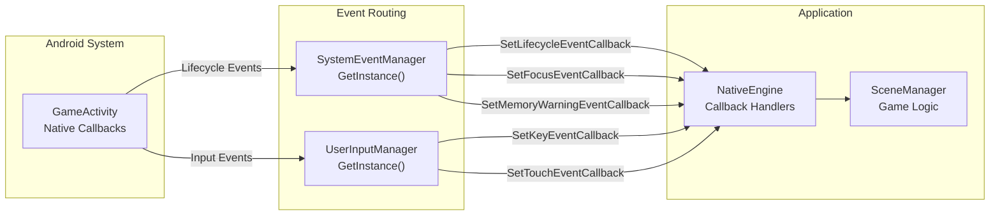

**Event categories managed:**

1. **Lifecycle Events** (`SystemEventManager::LifecycleEvent`):
   - `kLifecycleStart`, `kLifecycleResume`, `kLifecyclePause`
   - `kLifecycleStop`, `kLifecycleQuit`, `kLifecycleSaveState`

2. **Focus Events** (`SystemEventManager::FocusEvent`):
   - `kSentToBackground`, `kMadeForeground`

3. **Input Events** (`UserInputManager`):
   - `KeyEvent` with action codes
   - `TouchEvent` with touch coordinates and action

4. **Swapchain Events** (`DisplayManager::SwapchainChangeMessage`):
   - `kSwapchain_Gained_Window`, `kSwapchain_Lost_Window`
   - `kSwapchain_Needs_Recreation`

**Sources:** [agdk/agdktunnel/app/src/main/cpp/native_engine.cpp:60-80](), [agdk/agdktunnel/app/src/main/cpp/native_engine.cpp:388-438]()

### Swapchain Recreation Handling

A critical pattern in native Android games is handling window lifecycle events that require swapchain recreation:

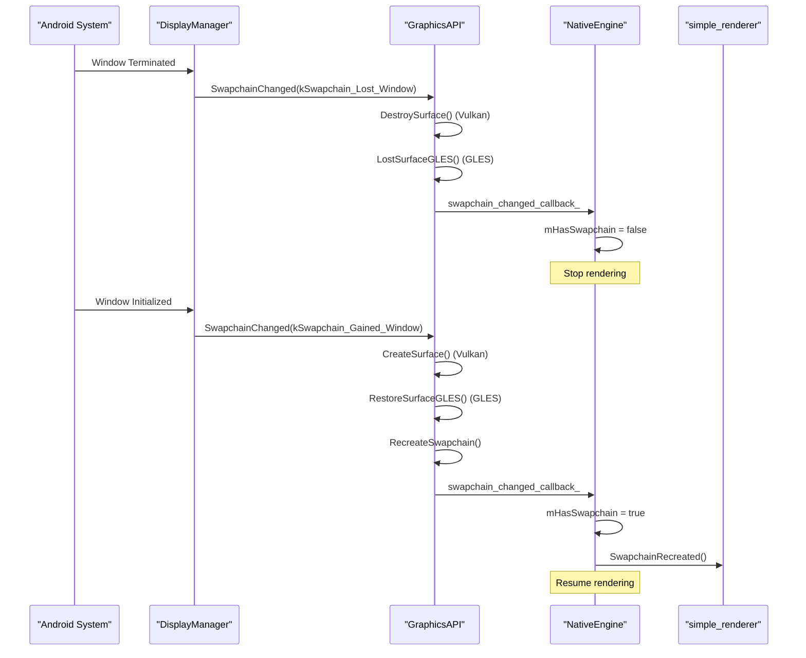

**Platform-specific handling:**

- **Vulkan**: Surface destruction/recreation via `PlatformUtilVulkan::CreateSurface()` / `DestroySurface()`
- **OpenGL ES**: EGL surface recreation via `GraphicsAPIGLES::InitializeEGLSurface()` / `eglDestroySurface()`
- **Renderer cleanup**: Framebuffer cache purge in `RenderPassVk::PurgeFramebufferCache()`

**Sources:** [agdk/agdktunnel/app/src/main/cpp/native_engine.cpp:359-386](), [agdk/common/base_game_framework/src/android/display_manager_android.cpp:22-43](), [agdk/common/base_game_framework/src/vulkan/graphics_api_vulkan.cpp:759-772](), [agdk/common/simple_renderer/renderer_render_pass_vk.cpp:188-194]()

## Graphics API Feature Detection

### Vulkan Device Capability Querying

The framework performs comprehensive feature detection during initialization to determine available graphics capabilities:

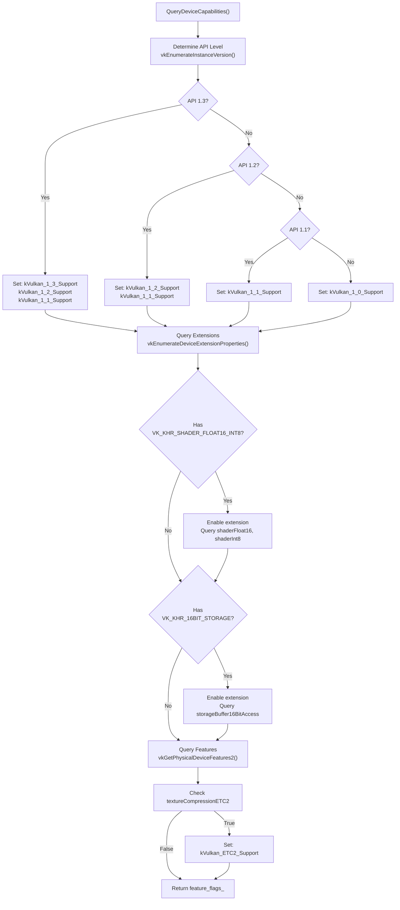

**Feature flags determined** (`DisplayManager::VulkanFeatureFlags`):
- `kVulkan_1_0_Support` through `kVulkan_1_3_Support` - API version support
- `kVulkan_ETC2_Support` - ETC2 texture compression
- Shader precision: `kGraphicsFeature_F16_Math`, `kGraphicsFeature_I8_Math`, `kGraphicsFeature_I16_Math`
- Storage formats: `kGraphicsFeature_F16_I16_SSBO`, `kGraphicsFeature_F16_I16_UBO`

The AGDKTunnel sample requires **Vulkan 1.1+ with ETC2 support**, falling back to OpenGL ES 3.0 if unavailable.

**Sources:** [agdk/common/base_game_framework/src/vulkan/graphics_api_vulkan.cpp:170-277](), [agdk/common/base_game_framework/src/vulkan/graphics_api_vulkan.cpp:309-377](), [agdk/common/base_game_framework/src/android/platform_util_vulkan_android.cpp:293-301](), [agdk/common/base_game_framework/include/graphics_api_features.h:24-108]()

### OpenGL ES Capability Detection

For OpenGL ES, the framework parses `GL_VERSION` strings and queries EGL configurations:

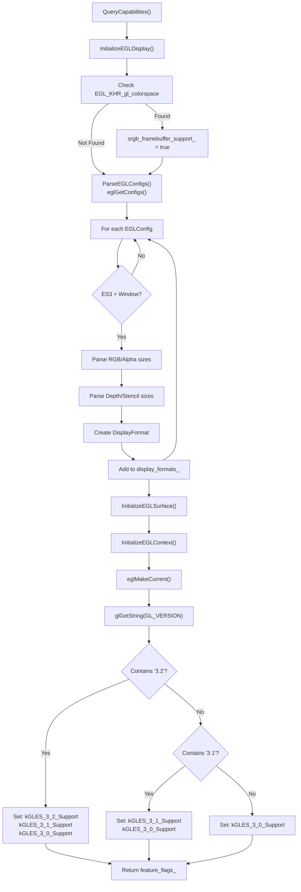

**Sources:** [agdk/common/base_game_framework/src/gles/graphics_api_gles.cpp:62-129](), [agdk/common/base_game_framework/src/gles/graphics_api_gles.cpp:227-345]()

## Frame Pacing Integration (Swappy)

All AGDK samples use **Swappy** (Frame Pacing library) for consistent frame delivery and refresh rate management:

### Swappy Initialization Pattern

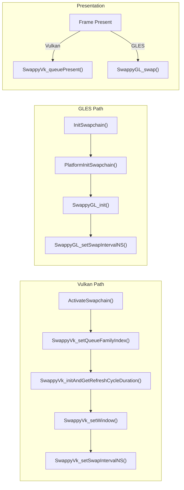

**Key Swappy functions used:**

- **Vulkan**: 
  - `SwappyVk_initAndGetRefreshCycleDuration()` - Initialize and query refresh cycle
  - `SwappyVk_setSwapIntervalNS()` - Set target frame rate
  - `SwappyVk_queuePresent()` - Present with pacing
  - `SwappyVk_getSupportedRefreshPeriodsNS()` - Query available refresh rates

- **OpenGL ES**:
  - `SwappyGL_init()` - Initialize Swappy
  - `SwappyGL_setSwapIntervalNS()` - Set target frame rate
  - `SwappyGL_swap()` - Swap buffers with pacing

**Refresh rate handling:** The framework queries supported refresh rates through Swappy and maps them to `DisplayManager::DisplaySwapInterval` constants (120 FPS, 90 FPS, 60 FPS, 45 FPS, 30 FPS).

**Sources:** [agdk/common/base_game_framework/src/android/platform_util_vulkan_android.cpp:32-169]()

## Development Prerequisites

### Android Studio Requirements

- **Android Studio**: 2024.3.1 Patch 1 (Meerkat) or higher
- **Android Game Development Extension**: Recommended for enhanced native development
- **NDK**: Version 27.2 (managed by Gradle)
- **Gradle**: 8.11+
- **Android Gradle Plugin**: 8.7+
- **Minimum API Level**: 24 (Android 7.0) for base samples
  - Game Mode API requires API 31+ (Android 12)
  - ADPF requires API 31+ for full features

### Sample-Specific Requirements

**Game Mode Sample:**
- Requires Pixel devices or OEM devices with Game Dashboard for user-facing mode selection
- Can use `adb shell cmd game mode [standard|performance|battery] <PACKAGE_NAME>` for testing

**ADPF Sample:**
- Requires API 31+ for `ThermalManager` and `PerformanceHintManager` APIs
- Best tested on devices with thermal throttling capability

**AGDKTunnel Sample:**
- Most comprehensive; demonstrates integration of 6 AGDK libraries
- Requires all third-party dependencies (ImGui, optional Bullet Physics for physics demo)

**Sources:** [agdk/game_mode/README.md:14-49](), [README.md:1-67]()

---

# Page: Game Mode Sample

# Game Mode Sample

<details>
<summary>Relevant source files</summary>

The following files were used as context for generating this wiki page:

- [README.md](README.md)
- [agdk/README.md](agdk/README.md)
- [agdk/game_mode/README.md](agdk/game_mode/README.md)
- [agdk/game_mode/app/build.gradle](agdk/game_mode/app/build.gradle)
- [agdk/game_mode/app/src/main/cpp/CMakeLists.txt](agdk/game_mode/app/src/main/cpp/CMakeLists.txt)
- [agdk/game_mode/app/src/main/cpp/android_main.cpp](agdk/game_mode/app/src/main/cpp/android_main.cpp)
- [agdk/game_mode/app/src/main/cpp/demo_scene.cpp](agdk/game_mode/app/src/main/cpp/demo_scene.cpp)
- [agdk/game_mode/app/src/main/cpp/demo_scene.h](agdk/game_mode/app/src/main/cpp/demo_scene.h)
- [agdk/game_mode/app/src/main/cpp/game_mode_manager.cpp](agdk/game_mode/app/src/main/cpp/game_mode_manager.cpp)
- [agdk/game_mode/app/src/main/cpp/game_mode_manager.h](agdk/game_mode/app/src/main/cpp/game_mode_manager.h)
- [agdk/game_mode/app/src/main/cpp/native_engine.cpp](agdk/game_mode/app/src/main/cpp/native_engine.cpp)
- [agdk/game_mode/app/src/main/cpp/welcome_scene.cpp](agdk/game_mode/app/src/main/cpp/welcome_scene.cpp)
- [agdk/game_mode/app/src/main/cpp/welcome_scene.h](agdk/game_mode/app/src/main/cpp/welcome_scene.h)
- [agdk/game_mode/app/src/main/java/com/android/example/games/ADPFSampleActivity.java](agdk/game_mode/app/src/main/java/com/android/example/games/ADPFSampleActivity.java)
- [agdk/game_mode/app/src/main/java/com/android/example/games/GameModeManager.java](agdk/game_mode/app/src/main/java/com/android/example/games/GameModeManager.java)
- [agdk/game_mode/build.gradle](agdk/game_mode/build.gradle)
- [agdk/game_mode/docs/gamedashboardactivity.png](agdk/game_mode/docs/gamedashboardactivity.png)
- [agdk/game_mode/gradle.properties](agdk/game_mode/gradle.properties)
- [agdk/game_mode/gradle/wrapper/gradle-wrapper.jar](agdk/game_mode/gradle/wrapper/gradle-wrapper.jar)
- [agdk/game_mode/gradle/wrapper/gradle-wrapper.properties](agdk/game_mode/gradle/wrapper/gradle-wrapper.properties)
- [agdk/game_mode/gradlew](agdk/game_mode/gradlew)
- [agdk/game_mode/gradlew.bat](agdk/game_mode/gradlew.bat)
- [unity/power_efficiency_demo/Assets/GameModeUtil.cs](unity/power_efficiency_demo/Assets/GameModeUtil.cs)

</details>


This document describes the Game Mode sample, a native C++ application that demonstrates integration with Android's Game Mode API to implement user-driven adaptive performance. The sample adjusts frame rate and rendering resolution based on the user's selected optimization preference (Standard, Performance, or Battery mode).

For system-driven adaptive performance based on thermal throttling, see [ADPF Sample](#2.2). For Unity integration of Game Mode API, see [Power Efficiency Demo](#4.2).

---

## Purpose and Scope

The Game Mode sample demonstrates:
- Querying the user's Game Mode preference via `GameManager` API
- Dynamically adjusting frame rate using Swappy (Frame Pacing library)
- Scaling rendering resolution using `ANativeWindow_setBuffersGeometry`
- Implementing a realistic workload using Bullet Physics to showcase performance differences
- Communicating Game State to the system for optimization hints
- Bridging Java-side `GameManager` access to native C++ code via JNI

**Minimum Requirements**: Android API 31+ for Game Mode API functionality. The sample targets minSdkVersion 24 but checks API level at runtime.

Sources: [agdk/game_mode/README.md:1-67](), [agdk/game_mode/app/build.gradle:23-26]()

---

## System Architecture

### Component Overview

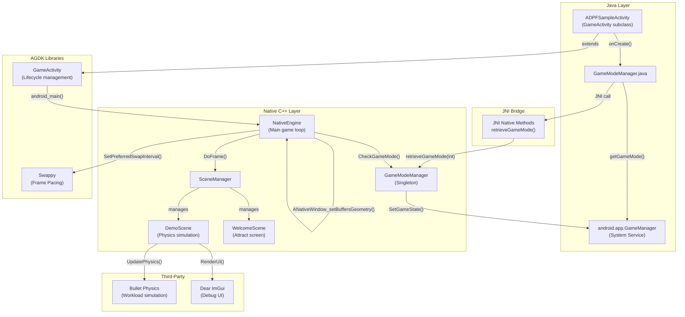

Sources: [agdk/game_mode/app/src/main/java/com/android/example/games/ADPFSampleActivity.java:32-101](), [agdk/game_mode/app/src/main/cpp/android_main.cpp:60-69](), [agdk/game_mode/app/src/main/cpp/native_engine.cpp:50-89]()

---

## Game Mode API Integration

### Java-Side Game Mode Retrieval

The `GameModeManager.java` class retrieves the current Game Mode from the Android system:

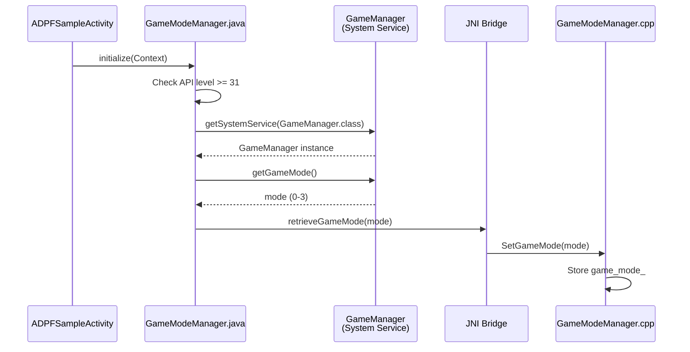

**Game Mode Values**:
| Value | Constant | Description |
|-------|----------|-------------|
| 0 | `GAME_MODE_UNSUPPORTED` | Device/app doesn't support Game Mode |
| 1 | `GAME_MODE_STANDARD` | Balanced performance and battery |
| 2 | `GAME_MODE_PERFORMANCE` | Prioritize performance |
| 3 | `GAME_MODE_BATTERY` | Prioritize battery life |

Sources: [agdk/game_mode/app/src/main/java/com/android/example/games/GameModeManager.java:26-59](), [agdk/game_mode/app/src/main/cpp/game_mode_manager.h:30-35](), [agdk/game_mode/app/src/main/cpp/game_mode_manager.cpp:23-29]()

### Native-Side Game Mode Monitoring

The native `NativeEngine` checks for Game Mode changes every frame in `CheckGameMode()`:

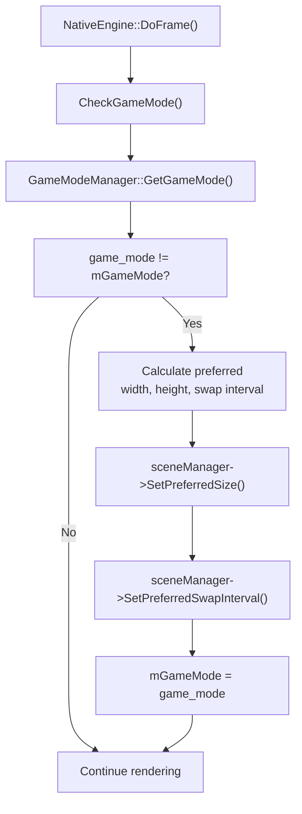

Sources: [agdk/game_mode/app/src/main/cpp/native_engine.cpp:650-690](), [agdk/game_mode/app/src/main/cpp/native_engine.cpp:737-769]()

---

## Adaptive Performance Strategy

### Resolution and Frame Rate Adjustments

The sample implements different performance profiles for each Game Mode:

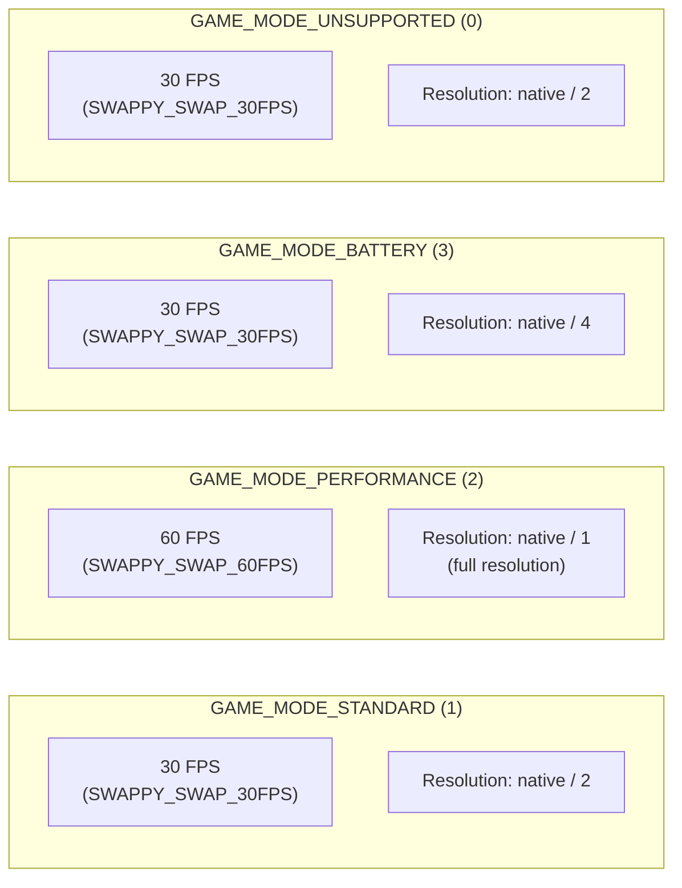

**Implementation Details**:

| Game Mode | Frame Rate | Resolution Divisor | Swap Interval |
|-----------|------------|-------------------|---------------|
| Standard (1) | 30 FPS | 2 | `SWAPPY_SWAP_30FPS` |
| Performance (2) | 60 FPS | 1 | `SWAPPY_SWAP_60FPS` |
| Battery (3) | 30 FPS | 4 | `SWAPPY_SWAP_30FPS` |
| Unsupported (0) | 30 FPS | 2 | `SWAPPY_SWAP_30FPS` |

Sources: [agdk/game_mode/app/src/main/cpp/native_engine.cpp:663-683](), [agdk/game_mode/README.md:6-10]()

### Resolution Switching Implementation

Resolution changes are applied via `ANativeWindow_setBuffersGeometry` in `SwitchToPreferredDisplaySize()`:

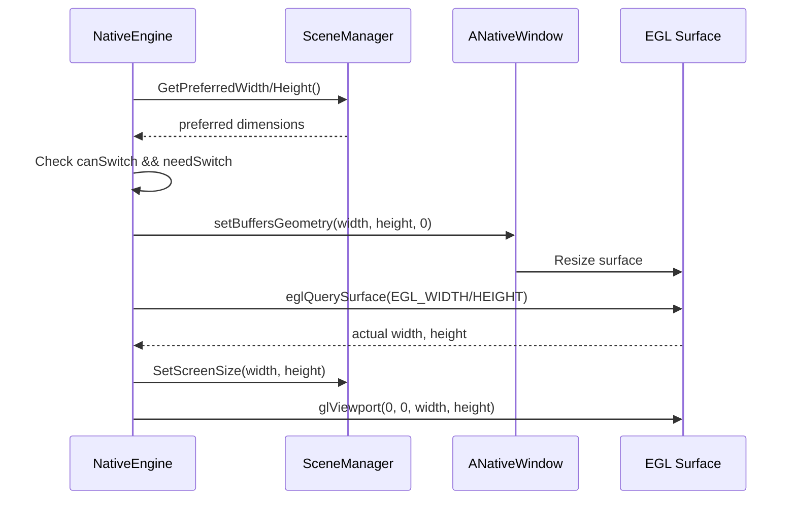

Sources: [agdk/game_mode/app/src/main/cpp/native_engine.cpp:692-735]()

---

## Key Classes and Responsibilities

### GameModeManager (Native)

**File**: [agdk/game_mode/app/src/main/cpp/game_mode_manager.h:48-86](), [agdk/game_mode/app/src/main/cpp/game_mode_manager.cpp:1-121]()

**Responsibilities**:
- Singleton pattern for managing Game Mode state
- Stores current `game_mode_` value
- Provides `GetGameModeString()` for UI display
- Implements `SetGameState()` to communicate game loading/gameplay state to system

**Key Methods**:
- `SetGameMode(int)` - Called from JNI bridge when mode changes
- `GetGameMode()` - Returns current mode value
- `SetGameState(bool is_loading, GAME_STATE_DEFINITION)` - Reports game state via `GameManager.setGameState()`

**Game State Values**:
| Value | Constant | Usage |
|-------|----------|-------|
| 1 | `GAME_STATE_NONE` | Loading or cleaning up |
| 2 | `GAME_STATE_GAMEPLAY_INTERRUPTIBLE` | Gameplay that can be interrupted (welcome screen) |
| 3 | `GAME_STATE_GAMEPLAY_UNINTERRUPTIBLE` | Active gameplay (demo scene) |

Sources: [agdk/game_mode/app/src/main/cpp/game_mode_manager.cpp:37-56](), [agdk/game_mode/app/src/main/cpp/demo_scene.cpp:104-116]()

### NativeEngine

**File**: [agdk/game_mode/app/src/main/cpp/native_engine.cpp:50-796]()

**Responsibilities**:
- Main game loop implementation via `GameLoop()` and `DoFrame()`
- EGL context and surface management
- Game Mode monitoring via `CheckGameMode()`
- Resolution switching via `SwitchToPreferredDisplaySize()`
- Swappy initialization and swap interval control
- Scene management lifecycle

**Key State Variables**:
- `mGameMode` - Cached Game Mode value for change detection
- `mSurfNativeWidth`, `mSurfNativeHeight` - Native display dimensions
- `mSurfWidth`, `mSurfHeight` - Current rendering dimensions

Sources: [agdk/game_mode/app/src/main/cpp/native_engine.cpp:50-112]()

### DemoScene

**File**: [agdk/game_mode/app/src/main/cpp/demo_scene.cpp:62-652]()

**Responsibilities**:
- Bullet Physics world simulation (ground + falling boxes)
- Physics complexity adjustment based on thermal state (ADPF integration)
- ImGui UI rendering showing current Game Mode and surface dimensions
- Box rendering via `BoxRenderer`

**Physics Workload**:
- Creates `array_size_^3` rigid body boxes (default: 8x8x8 = 512 boxes)
- Runs `current_physics_step_` simulation steps per frame (default: 16)
- Resets physics every 10 seconds to prevent boxes from falling off-screen

Sources: [agdk/game_mode/app/src/main/cpp/demo_scene.cpp:62-87](), [agdk/game_mode/app/src/main/cpp/demo_scene.cpp:391-477](), [agdk/game_mode/app/src/main/cpp/demo_scene.cpp:505-565]()

### WelcomeScene

**File**: [agdk/game_mode/app/src/main/cpp/welcome_scene.cpp:41-162]()

**Responsibilities**:
- Simple attract screen showing current Game Mode and surface size
- Displays "Touch Anywhere To Continue" instruction
- Transitions to `DemoScene` on any touch input
- Sets `GAME_STATE_GAMEPLAY_INTERRUPTIBLE` game state

Sources: [agdk/game_mode/app/src/main/cpp/welcome_scene.cpp:52-73](), [agdk/game_mode/app/src/main/cpp/welcome_scene.cpp:103-107]()

---

## User Interaction Flow

### Changing Game Mode

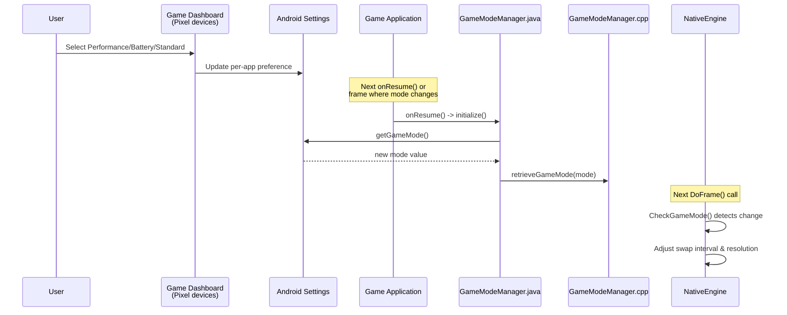

**Accessing Game Dashboard**:
- **Pixel Devices**: Swipe up from bottom corners during gameplay
- **Other OEMs**: Manufacturer-specific game tools (Game Space, Game Booster, etc.)
- **Development/Testing**: Use `adb` command:
  ```
  adb shell cmd game mode [standard|performance|battery] <PACKAGE_NAME>
  ```

Sources: [agdk/game_mode/README.md:37-48]()

### Runtime Behavior

The sample checks for Game Mode changes every frame but only reconfigures when the mode actually changes:

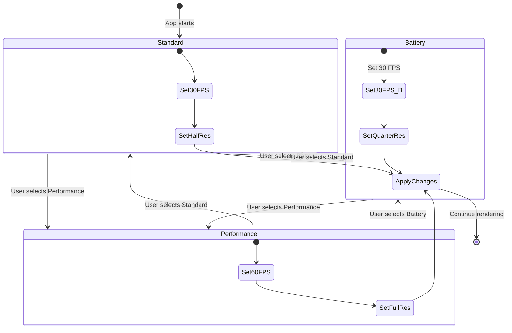

Sources: [agdk/game_mode/app/src/main/cpp/native_engine.cpp:650-690]()

---

## Build Configuration

### Dependencies

**Gradle Configuration** ([agdk/game_mode/app/build.gradle:57-65]()):
```
androidx.games:games-activity:3.0.5
androidx.games:games-frame-pacing:2.1.2
```

**CMake Dependencies** ([agdk/game_mode/app/src/main/cpp/CMakeLists.txt:22-23]()):
- `game-activity` (via Prefab)
- `games-frame-pacing` (Swappy, via Prefab)

**Third-Party Libraries** (Manual Setup):
- Dear ImGui: [agdk/third_party/imgui]()
- Bullet Physics: [agdk/third_party/bullet3]()

Sources: [agdk/game_mode/README.md:24-31](), [agdk/game_mode/app/src/main/cpp/CMakeLists.txt:39-157]()

### Setup Instructions

1. **Clone third-party dependencies**:
   ```bash
   cd agdk/third_party/
   git clone https://github.com/ocornut/imgui
   git clone https://github.com/bulletphysics/bullet3
   ```

2. **Open in Android Studio**: Version 2024.3.1+ (Meerkat) or higher

3. **Build and Run**: Target device must support API level 31+ for Game Mode functionality

Sources: [agdk/game_mode/README.md:15-34]()

### Target Configuration

| Property | Value | Note |
|----------|-------|------|
| `compileSdkVersion` | 36 | Latest Android SDK |
| `minSdkVersion` | 24 | Runtime API check for Game Mode |
| `targetSdkVersion` | 36 | Target latest APIs |
| `ndkVersion` | 27.2.12479018 | NDK version |

Sources: [agdk/game_mode/app/build.gradle:20-28]()

---

## Unity Integration

For Unity developers, the repository includes `GameModeUtil.cs` demonstrating JNI bridge to access Game Mode API:

**Key Implementation** ([unity/power_efficiency_demo/Assets/GameModeUtil.cs:28-43]()):
```csharp
public static int GetGameMode()
{
    using var unityPlayerClass = new AndroidJavaClass("com.unity3d.player.UnityPlayer");
    using var context = unityPlayerClass.GetStatic<AndroidJavaObject>("currentActivity");
    using var gameManager = context.Call<AndroidJavaObject>("getSystemService", "game");
    int gameMode = gameManager.Call<int>("getGameMode");
    return gameMode;
}
```

This approach bridges Unity's C# layer to Android's Java APIs, returning the same mode values (0-4) as the native sample.

Sources: [unity/power_efficiency_demo/Assets/GameModeUtil.cs:18-71]()

---

## Related Samples

- **[ADPF Sample](#2.2)**: Demonstrates system-driven adaptive performance based on thermal throttling
- **[Power Efficiency Demo](#4.2)**: Unity-specific implementation of Game Mode API integration
- **[AGDKTunnel](#2.3)**: Comprehensive game sample integrating multiple AGDK libraries

---

# Page: ADPF Sample

# ADPF Sample

<details>
<summary>Relevant source files</summary>

The following files were used as context for generating this wiki page:

- [agdk/adpf/README.md](agdk/adpf/README.md)
- [agdk/adpf/app/build.gradle](agdk/adpf/app/build.gradle)
- [agdk/adpf/app/src/main/AndroidManifest.xml](agdk/adpf/app/src/main/AndroidManifest.xml)
- [agdk/adpf/app/src/main/cpp/CMakeLists.txt](agdk/adpf/app/src/main/cpp/CMakeLists.txt)
- [agdk/adpf/app/src/main/cpp/demo_scene.cpp](agdk/adpf/app/src/main/cpp/demo_scene.cpp)
- [agdk/adpf/app/src/main/cpp/demo_scene.h](agdk/adpf/app/src/main/cpp/demo_scene.h)
- [agdk/adpf/app/src/main/cpp/native_engine.cpp](agdk/adpf/app/src/main/cpp/native_engine.cpp)
- [agdk/adpf/app/src/main/java/com/android/example/games/ADPFManager.java](agdk/adpf/app/src/main/java/com/android/example/games/ADPFManager.java)
- [agdk/adpf/app/src/main/java/com/android/example/games/ADPFSampleActivity.java](agdk/adpf/app/src/main/java/com/android/example/games/ADPFSampleActivity.java)
- [agdk/adpf/build.gradle](agdk/adpf/build.gradle)
- [agdk/adpf/gradle.properties](agdk/adpf/gradle.properties)
- [agdk/adpf/gradle/wrapper/gradle-wrapper.jar](agdk/adpf/gradle/wrapper/gradle-wrapper.jar)
- [agdk/adpf/gradle/wrapper/gradle-wrapper.properties](agdk/adpf/gradle/wrapper/gradle-wrapper.properties)
- [agdk/adpf/gradlew](agdk/adpf/gradlew)
- [agdk/adpf/gradlew.bat](agdk/adpf/gradlew.bat)
- [agdk/game_mode/app/src/main/java/com/android/example/games/ADPFManager.java](agdk/game_mode/app/src/main/java/com/android/example/games/ADPFManager.java)

</details>


## Purpose and Scope

This document describes the ADPF (Android Dynamic Performance Framework) sample, which demonstrates the use of Android's Adaptive Performance APIs for thermal management and performance optimization. The sample showcases how to monitor device thermal status, provide performance hints to the Android OS scheduler, and dynamically adjust application workload in response to thermal throttling conditions.

For information about the Game Mode API and user-driven performance preferences, see [Game Mode Sample](#2.1). For the shared rendering infrastructure used across samples, see [Common Framework Architecture](#2.5).

**Sources:** [agdk/adpf/README.md:1-14]()

---

## Architecture Overview

The ADPF sample consists of several integrated components that work together to demonstrate adaptive performance management:

```mermaid
graph TB
    subgraph "Application Layer"
        ADPFSampleActivity["ADPFSampleActivity<br/>(Java)"]
        ADPFManagerJava["ADPFManager<br/>(Java)"]
    end
    
    subgraph "Native Layer"
        NativeEngine["NativeEngine<br/>Game Loop & EGL Management"]
        SceneManager["SceneManager<br/>Scene Orchestration"]
        DemoScene["DemoScene<br/>Physics & Rendering"]
        ADPFManagerCpp["ADPFManager<br/>(C++ Singleton)"]
    end
    
    subgraph "Rendering"
        BoxRenderer["BoxRenderer<br/>Cube Rendering"]
        ImGuiManager["ImGuiManager<br/>Debug UI"]
        OpenGLES["OpenGL ES 2.0"]
    end
    
    subgraph "Physics"
        BulletPhysics["Bullet Physics<br/>btDiscreteDynamicsWorld"]
    end
    
    subgraph "AGDK Libraries"
        GameActivity["GameActivity<br/>Native Lifecycle"]
        Swappy["Swappy<br/>Frame Pacing"]
    end
    
    subgraph "Android Platform APIs"
        ThermalAPI["Thermal API<br/>AThermal_*"]
        PerfHintAPI["Performance Hint Manager<br/>APerformanceHint_*"]
        PowerManager["PowerManager<br/>Battery Usage"]
    end
    
    ADPFSampleActivity --> ADPFManagerJava
    ADPFSampleActivity --> GameActivity
    
    NativeEngine --> DemoScene
    NativeEngine --> SceneManager
    NativeEngine --> ImGuiManager
    NativeEngine --> Swappy
    
    DemoScene --> ADPFManagerCpp
    DemoScene --> BulletPhysics
    DemoScene --> BoxRenderer
    DemoScene --> ImGuiManager
    
    BoxRenderer --> OpenGLES
    ImGuiManager --> OpenGLES
    
    ADPFManagerJava -.->|"JNI<br/>nativeThermalStatusChanged()"| ADPFManagerCpp
    ADPFManagerCpp --> ThermalAPI
    ADPFManagerCpp --> PerfHintAPI
    ADPFManagerCpp --> PowerManager
    
    Swappy --> OpenGLES
```

**Sources:** [agdk/adpf/app/src/main/cpp/demo_scene.cpp:1-126](), [agdk/adpf/app/src/main/cpp/native_engine.cpp:1-711](), [agdk/adpf/app/src/main/java/com/android/example/games/ADPFSampleActivity.java:1-102]()

### Core Classes

| Class | Location | Responsibility |
|-------|----------|----------------|
| `ADPFSampleActivity` | [agdk/adpf/app/src/main/java/com/android/example/games/ADPFSampleActivity.java]() | GameActivity subclass, manages thermal listener lifecycle |
| `ADPFManager` (Java) | [agdk/adpf/app/src/main/java/com/android/example/games/ADPFManager.java]() | Java-side thermal status listener, bridges to native code |
| `NativeEngine` | [agdk/adpf/app/src/main/cpp/native_engine.cpp]() | Game loop, EGL context management, input handling |
| `DemoScene` | [agdk/adpf/app/src/main/cpp/demo_scene.cpp]() | Main scene implementation with physics and rendering |
| `ADPFManager` (C++) | Common framework | Native ADPF API wrapper (singleton) |
| `BoxRenderer` | Common framework | OpenGL ES renderer for cubes |

**Sources:** [agdk/adpf/app/src/main/cpp/demo_scene.h:1-147]()

---

## Frame Processing Flow

The sample processes each frame through a structured pipeline that integrates thermal monitoring, physics simulation, and rendering with performance hints:

```mermaid
sequenceDiagram
    participant GL as "Game Loop<br/>(NativeEngine::DoFrame)"
    participant DS as "DemoScene::DoFrame"
    participant ADPF as "ADPFManager<br/>(Singleton)"
    participant Bullet as "btDiscreteDynamicsWorld"
    participant ImGui as "ImGuiManager"
    participant Swappy as "SwappyGL"
    participant Platform as "Android Platform<br/>(Thermal/PerfHint APIs)"
    
    GL->>DS: DoFrame()
    DS->>ADPF: BeginPerfHintSession()
    ADPF->>Platform: Report session start
    
    DS->>DS: glClear()
    
    DS->>ADPF: Monitor()
    ADPF->>Platform: Query thermal headroom
    Platform-->>ADPF: Thermal status
    
    DS->>ADPF: GetThermalStatus()
    ADPF-->>DS: Current thermal state (0-6)
    
    alt Thermal status >= 2 (MODERATE)
        DS->>DS: target_frame_period_ = SWAPPY_SWAP_30FPS
    else Thermal status < 2
        DS->>DS: target_frame_period_ = SWAPPY_SWAP_60FPS
    end
    
    alt Frame period changed
        DS->>Swappy: SwappyGL_setSwapIntervalNS(target)
    end
    
    DS->>DS: UpdatePhysics()
    loop 8 times
        DS->>Bullet: stepSimulation(1/480, 10)
    end
    
    DS->>DS: Render cubes (BoxRenderer)
    
    DS->>ImGui: BeginImGuiFrame()
    DS->>DS: RenderUI() - thermal status
    DS->>ImGui: EndImGuiFrame()
    
    DS->>ADPF: EndPerfHintSession(target_frame_period_)
    ADPF->>Platform: reportActualWorkDuration()
    ADPF->>Platform: updateTargetWorkDuration()
    
    GL->>Swappy: SwappyGL_swap()
    Swappy->>Platform: Present frame
```

**Sources:** [agdk/adpf/app/src/main/cpp/demo_scene.cpp:79-126](), [agdk/adpf/app/src/main/cpp/native_engine.cpp:640-698]()

### Frame Processing Steps

1. **Performance Session Start** ([demo_scene.cpp:81]()): `ADPFManager::getInstance().BeginPerfHintSession()` marks the beginning of performance-critical work
2. **Thermal Monitoring** ([demo_scene.cpp:89]()): `ADPFManager::getInstance().Monitor()` queries current thermal status
3. **Frame Rate Adjustment** ([demo_scene.cpp:92-109]()): Target frame rate is set to 30 FPS when thermal status is `MODERATE` (2) or worse, otherwise 60 FPS
4. **Physics Update** ([demo_scene.cpp:111](), [445-454]()): Bullet physics simulation runs 8 substeps per frame
5. **Rendering** ([demo_scene.cpp:114-118]()): ImGui UI displays thermal metrics
6. **Performance Session End** ([demo_scene.cpp:125]()): `EndPerfHintSession()` reports work duration to the platform

**Sources:** [agdk/adpf/app/src/main/cpp/demo_scene.cpp:79-126]()

---

## ADPF API Integration

The sample integrates two key ADPF APIs: the Thermal API for monitoring device temperature state and the Performance Hint Manager API for providing scheduling hints.

### Thermal Status Levels

The sample tracks seven thermal states defined in [demo_scene.cpp:31-35]():

| Status Code | Constant | Description |
|-------------|----------|-------------|
| 0 | `THERMAL_STATUS_NONE` | No thermal throttling |
| 1 | `THERMAL_STATUS_LIGHT` | Light throttling, minimal impact |
| 2 | `THERMAL_STATUS_MODERATE` | Moderate throttling, performance reduction begins |
| 3 | `THERMAL_STATUS_SEVERE` | Severe throttling, significant performance reduction |
| 4 | `THERMAL_STATUS_CRITICAL` | Critical thermal state |
| 5 | `THERMAL_STATUS_EMERGENCY` | Emergency thermal state |
| 6 | `THERMAL_STATUS_SHUTDOWN` | Device approaching thermal shutdown |

The sample uses status code 2 (`MODERATE`) as the threshold for reducing frame rate from 60 FPS to 30 FPS ([demo_scene.cpp:96-101]()).

**Sources:** [agdk/adpf/app/src/main/cpp/demo_scene.cpp:30-35](), [agdk/adpf/app/src/main/cpp/demo_scene.cpp:92-101]()

### Thermal Listener Registration

The sample demonstrates two approaches to thermal monitoring based on API level:

```mermaid
graph TB
    subgraph "API Level >= 30 (Android R)"
        Native["Native Thermal API<br/>AThermal_acquireManager()"]
        Callback["AThermal_registerThermalStatusListener()"]
    end
    
    subgraph "API Level 29 (Android Q)"
        Java["Java PowerManager"]
        Listener["PowerManager.OnThermalStatusChangedListener"]
        JNI["JNI Bridge<br/>nativeThermalStatusChanged()"]
    end
    
    subgraph "API Level < 29"
        NotSupported["Thermal monitoring<br/>not available"]
    end
    
    ADPFManagerJava["ADPFManager.registerListener()"]
    
    ADPFManagerJava -->|"Build.VERSION.SDK_INT >= 30"| Native
    Native --> Callback
    
    ADPFManagerJava -->|"Build.VERSION.SDK_INT == 29"| Java
    Java --> Listener
    Listener --> JNI
    
    ADPFManagerJava -->|"Build.VERSION.SDK_INT < 29"| NotSupported
```

**Sources:** [agdk/adpf/app/src/main/java/com/android/example/games/ADPFManager.java:39-85]()

The Java `ADPFManager` class registers thermal listeners in [ADPFManager.java:53-68]():
- **Android R+**: Calls native `nativeRegisterThermalStatusListener()` to use NDK APIs
- **Android Q**: Uses Java `PowerManager.addThermalStatusListener()`
- **Pre-Q**: Returns false, thermal monitoring unavailable

**Sources:** [agdk/adpf/app/src/main/java/com/android/example/games/ADPFManager.java:38-85]()

### Performance Hint Manager Integration

The Performance Hint Manager API allows the application to communicate its workload characteristics to the Android scheduler:

| Method | Called From | Purpose |
|--------|-------------|---------|
| `InitializePerformanceHintManager()` | UI toggle ([demo_scene.cpp:262]()) | Creates performance hint session |
| `BeginPerfHintSession()` | Frame start ([demo_scene.cpp:81]()) | Marks beginning of critical work |
| `EndPerfHintSession()` | Frame end ([demo_scene.cpp:125]()) | Reports actual and target work duration |
| `ClosePerfHintSession()` | UI toggle ([demo_scene.cpp:264]()) | Closes performance hint session |

The session tracks work duration and provides scheduling hints via `reportActualWorkDuration()` and `updateTargetWorkDuration()` APIs (called in `EndPerfHintSession`).

**Sources:** [agdk/adpf/app/src/main/cpp/demo_scene.cpp:79-126](), [agdk/adpf/app/src/main/cpp/demo_scene.cpp:254-269]()

---

## Physics Simulation Workload

The sample uses Bullet Physics to generate a realistic computational workload that can trigger thermal throttling on sustained execution.

### Physics World Configuration

The physics simulation creates a 6×6×6 array of dynamic cubes ([demo_scene.h:65-70]()):

```mermaid
graph TB
    subgraph "Physics Components"
        Config["btDefaultCollisionConfiguration"]
        Dispatcher["btCollisionDispatcher"]
        Broadphase["btDbvtBroadphase"]
        Solver["btSequentialImpulseConstraintSolver"]
        World["btDiscreteDynamicsWorld"]
    end
    
    subgraph "Rigid Bodies"
        Ground["Ground Plane<br/>(50×50×50 cube)<br/>position: (0, -56, 0)"]
        Boxes["216 Dynamic Boxes<br/>(6×6×6 array)<br/>size: 1.0×1.0×1.0"]
    end
    
    InitializePhysics["DemoScene::InitializePhysics()"]
    
    InitializePhysics --> Config
    InitializePhysics --> Dispatcher
    InitializePhysics --> Broadphase
    InitializePhysics --> Solver
    
    Config --> World
    Dispatcher --> World
    Broadphase --> World
    Solver --> World
    
    World --> Ground
    World --> Boxes
```

**Sources:** [agdk/adpf/app/src/main/cpp/demo_scene.cpp:368-439](), [agdk/adpf/app/src/main/cpp/demo_scene.h:64-70]()

### Physics Update Loop

The `UpdatePhysics()` method ([demo_scene.cpp:445-500]()) performs intensive computation:

1. **Simulation Steps**: Runs 8 physics substeps per frame ([demo_scene.cpp:451-454]()):
   ```
   for (steps = 0; steps < max_steps; ++steps) {
       dynamics_world_->stepSimulation(1.f / (60.f * max_steps), 10);
   }
   ```
   Each substep simulates 1/480th of a second (60 FPS × 8 steps = 480 Hz)

2. **Rendering**: Iterates through all 217 collision objects (1 ground + 216 boxes) to render them ([demo_scene.cpp:461-489]())

3. **Reset Logic**: Every 600 frames (10 seconds at 60 FPS), calls `ResetPhysics()` to return boxes to initial positions ([demo_scene.cpp:494-499]())

The intentionally high step count creates sustained CPU load to demonstrate thermal throttling in a reasonable timeframe ([demo_scene.cpp:446-450]()).

**Sources:** [agdk/adpf/app/src/main/cpp/demo_scene.cpp:445-500](), [agdk/adpf/app/src/main/cpp/demo_scene.cpp:505-549]()

---

## Rendering and Frame Pacing

The sample uses OpenGL ES 2.0 for rendering and Swappy for consistent frame delivery.

### Graphics Stack

| Component | Implementation | Purpose |
|-----------|----------------|---------|
| Graphics API | OpenGL ES 2.0 | Rendering backend ([AndroidManifest.xml:42]()) |
| Frame Pacing | Swappy (`SwappyGL`) | Consistent frame timing ([native_engine.cpp:78-80]()) |
| Cube Rendering | `BoxRenderer` | Multi-instance cube rendering |
| UI Rendering | Dear ImGui | Debug overlay with thermal metrics |

**Sources:** [agdk/adpf/app/src/main/AndroidManifest.xml:42](), [agdk/adpf/app/src/main/cpp/native_engine.cpp:77-84]()

### Swappy Configuration

Swappy initialization occurs in [native_engine.cpp:78-80]():
```cpp
SwappyGL_init(GetJniEnv(), mApp->activity->javaGameActivity);
SwappyGL_setSwapIntervalNS(SWAPPY_SWAP_60FPS);
```

The frame period is dynamically adjusted based on thermal status:
- **60 FPS**: `SWAPPY_SWAP_60FPS` constant (16.67ms per frame)
- **30 FPS**: `SWAPPY_SWAP_30FPS` constant (33.33ms per frame)

The swap interval change occurs in [demo_scene.cpp:104-109]():
```cpp
if (current_frame_period_ != target_frame_period_) {
    if (SwappyGL_isEnabled()) {
        SwappyGL_setSwapIntervalNS(target_frame_period_);
    }
    current_frame_period_ = target_frame_period_;
}
```

**Sources:** [agdk/adpf/app/src/main/cpp/native_engine.cpp:77-84](), [agdk/adpf/app/src/main/cpp/demo_scene.cpp:104-109](), [agdk/adpf/app/src/main/cpp/demo_scene.cpp:46-47]()

---

## UI and Monitoring

The sample provides a comprehensive ImGui-based UI for monitoring ADPF metrics in real-time.

### UI Dashboard Components

```mermaid
graph TB
    RenderUI["DemoScene::RenderUI()"]
    RenderPanel["RenderPanel()"]
    
    subgraph "Display Metrics"
        FPS["FPS Target<br/>60 or 30"]
        ThermalState["Thermal State<br/>String label"]
        ThermalHeadroom["Thermal Headroom<br/>3 forecasts (1s, 10s, 100s)"]
        PowerDrain["Power Drain<br/>Current mA"]
        PowerAvg["Average Power<br/>w/ ADPF vs w/o ADPF"]
    end
    
    subgraph "Interactive Controls"
        ADPFToggle["ADPF Enable/Disable<br/>Checkbox"]
        ForecastInput["Forecast Range<br/>1-100 seconds"]
        ResetButton["Reset Statistics<br/>Button"]
    end
    
    subgraph "Visualizations"
        PowerGraph["Power Usage Graph<br/>30 second history"]
        HeadroomGraph["Thermal Headroom Graph<br/>3 forecast lines"]
    end
    
    RenderUI --> RenderPanel
    RenderPanel --> FPS
    RenderPanel --> ThermalState
    RenderPanel --> ThermalHeadroom
    RenderPanel --> PowerDrain
    RenderPanel --> PowerAvg
    RenderPanel --> ADPFToggle
    RenderPanel --> ForecastInput
    RenderPanel --> ResetButton
    RenderPanel --> PowerGraph
    RenderPanel --> HeadroomGraph
```

**Sources:** [agdk/adpf/app/src/main/cpp/demo_scene.cpp:188-359]()

### Key Metrics Display

The `RenderPanel()` method ([demo_scene.cpp:215-359]()) displays:

1. **FPS Target** ([demo_scene.cpp:225-226]()): Shows current target frame rate (60 or 30)
2. **Thermal State** ([demo_scene.cpp:227]()): Displays human-readable thermal status from the label array
3. **Thermal Headroom** ([demo_scene.cpp:233-248]()): Shows forecasted thermal headroom at three time horizons (configurable, default 1s/10s/100s)
4. **Power Drain** ([demo_scene.cpp:284-285]()): Current battery drain in milliamps from `GetBatteryUsage()`
5. **Power Averages** ([demo_scene.cpp:288-313]()): Separate running averages for ADPF enabled vs disabled states

The UI uses ImPlot for graphing ([demo_scene.cpp:325-357]()) with a 30-second history window.

**Sources:** [agdk/adpf/app/src/main/cpp/demo_scene.cpp:215-359]()

### ADPF Enable/Disable Toggle

The checkbox at [demo_scene.cpp:255-269]() allows runtime enable/disable of ADPF:
- **Enabling**: Calls `ADPFManager::getInstance().InitializePerformanceHintManager()`
- **Disabling**: Calls `ADPFManager::getInstance().ClosePerfHintSession()`

This toggle enables direct comparison of power consumption with and without ADPF optimization.

**Sources:** [agdk/adpf/app/src/main/cpp/demo_scene.cpp:254-269]()

---

## Build Configuration

### Dependencies

The sample requires the following third-party libraries to be manually installed in `agdk/third_party/` ([README.md:40-45]()):

| Library | Repository | Purpose |
|---------|------------|---------|
| **ImGui** | `github.com/ocornut/imgui` | Immediate-mode GUI for debug overlay |
| **ImPlot** | `github.com/epezent/implot` | Graph plotting extension for ImGui |
| **Bullet Physics** | `github.com/bulletphysics/bullet3` | 3D physics simulation |

**Sources:** [agdk/adpf/README.md:40-45]()

### CMake Build Configuration

The [CMakeLists.txt]() integrates these dependencies:

```mermaid
graph LR
    subgraph "AGDK Libraries (Prefab)"
        GameActivity["game-activity<br/>androidx.games:games-activity:3.0.5"]
        FramePacing["games-frame-pacing<br/>androidx.games:games-frame-pacing:2.1.2"]
    end
    
    subgraph "Third-Party Static Libraries"
        ImGui["imgui<br/>Static Library"]
        Bullet["bullet3<br/>Static Library"]
    end
    
    subgraph "System Libraries"
        Android["android"]
        EGL["EGL"]
        GLESv2["GLESv2"]
        Log["log"]
    end
    
    subgraph "Native Library"
        LibGame["libgame.so"]
    end
    
    GameActivity --> LibGame
    FramePacing --> LibGame
    ImGui --> LibGame
    Bullet --> LibGame
    Android --> LibGame
    EGL --> LibGame
    GLESv2 --> LibGame
    Log --> LibGame
```

**Sources:** [agdk/adpf/app/src/main/cpp/CMakeLists.txt:1-161](), [agdk/adpf/app/build.gradle:57-65]()

Key CMake configurations:

1. **AGDK Libraries** ([CMakeLists.txt:22-23]()): Uses `find_package()` to locate Prefab-packaged libraries
2. **Compiler Flags** ([CMakeLists.txt:34-38]()):
   - `-D__ANDROID_UNAVAILABLE_SYMBOLS_ARE_WEAK__`: Enables weak symbol linking for conditional API availability
   - `-Werror=unguarded-availability`: Ensures API level guards are used
3. **ImGui Build** ([CMakeLists.txt:55-65]()): Compiles ImGui and ImPlot as static library
4. **Bullet Build** ([CMakeLists.txt:68-106]()): Compiles multiple Bullet modules with `-O0` and warnings disabled
5. **Game Library** ([CMakeLists.txt:123-160]()): Links all dependencies into `libgame.so`

**Sources:** [agdk/adpf/app/src/main/cpp/CMakeLists.txt:17-161]()

### Gradle Configuration

The [app/build.gradle]() specifies:

| Property | Value | Purpose |
|----------|-------|---------|
| `compileSdkVersion` | 36 | Latest SDK for compilation |
| `minSdkVersion` | 24 | Minimum Android 7.0 (demonstrates conditional API availability) |
| `targetSdkVersion` | 36 | Target latest Android version |
| `ndkVersion` | 27.2.12479018 | NDK with weak symbol support |

The low `minSdkVersion` of 24 allows demonstrating conditional API availability checking using `__builtin_available` in C++ code ([README.md:32-38]()).

**Sources:** [agdk/adpf/app/build.gradle:19-35](), [agdk/adpf/README.md:32-38]()

---

## API Level Compatibility

The sample demonstrates best practices for supporting ADPF APIs conditionally based on device API level.

### API Level Requirements

| API | Minimum API Level | Platform Version |
|-----|-------------------|------------------|
| Thermal API | 30 | Android 11 (R) |
| Performance Hint Manager | 31 | Android 12 (S) |
| Sample minimum | 24 | Android 7.0 (Nougat) |

**Sources:** [agdk/adpf/README.md:22-38]()

### Conditional API Availability Pattern

The sample uses two techniques for conditional API availability:

1. **Weak Symbols** ([CMakeLists.txt:38]()): The `__ANDROID_UNAVAILABLE_SYMBOLS_ARE_WEAK__` preprocessor define enables weak linking of APIs not available on older Android versions. This allows the code to compile and run, with runtime checks determining if the API is available.

2. **Runtime Checks** ([ADPFManager.java:53-68]()): The Java `ADPFManager` checks `Build.VERSION.SDK_INT` to determine which thermal API variant to use:
   - API 30+: Use native NDK Thermal API
   - API 29: Use Java PowerManager API
   - API < 29: No thermal monitoring available

3. **Compile-Time Guards**: The `-Werror=unguarded-availability` flag ([CMakeLists.txt:34]()) enforces that all uses of newer APIs are properly guarded with availability checks.

This pattern was added in NDK 26 and allows a single APK to run across a wide range of Android versions while gracefully degrading functionality on older devices.

**Sources:** [agdk/adpf/README.md:32-38](), [agdk/adpf/app/src/main/cpp/CMakeLists.txt:34-38](), [agdk/adpf/app/src/main/java/com/android/example/games/ADPFManager.java:39-68]()

---

## Implementation Summary

The ADPF sample demonstrates a complete integration of Android's adaptive performance APIs:

1. **Thermal Monitoring**: Tracks device thermal state using appropriate API for device SDK level
2. **Dynamic Workload Adjustment**: Reduces frame rate from 60 to 30 FPS when thermal status reaches `MODERATE` or higher
3. **Performance Hints**: Provides scheduler hints about critical work duration using Performance Hint Manager
4. **Realistic Workload**: Uses Bullet Physics with 216 dynamic rigid bodies to generate sustained CPU load
5. **Comprehensive Monitoring**: ImGui UI displays real-time thermal status, headroom forecasts, and power consumption metrics
6. **API Level Compatibility**: Demonstrates conditional API availability using weak symbols and runtime checks

The sample provides a reference implementation for games that need to maintain optimal performance across varying thermal conditions on Android devices.

**Sources:** [agdk/adpf/README.md:1-14](), [agdk/adpf/app/src/main/cpp/demo_scene.cpp:1-591]()

---

# Page: AGDKTunnel Sample

# AGDKTunnel Sample

<details>
<summary>Relevant source files</summary>

The following files were used as context for generating this wiki page:

- [README.md](README.md)
- [agdk/README.md](agdk/README.md)
- [agdk/agdktunnel/README.md](agdk/agdktunnel/README.md)
- [agdk/agdktunnel/app/build.gradle](agdk/agdktunnel/app/build.gradle)
- [agdk/agdktunnel/app/src/main/AndroidManifest.xml](agdk/agdktunnel/app/src/main/AndroidManifest.xml)
- [agdk/agdktunnel/app/src/main/cpp/CMakeLists.txt](agdk/agdktunnel/app/src/main/cpp/CMakeLists.txt)
- [agdk/agdktunnel/build.gradle](agdk/agdktunnel/build.gradle)
- [agdk/agdktunnel/gradle.properties](agdk/agdktunnel/gradle.properties)
- [agdk/agdktunnel/gradle/wrapper/gradle-wrapper.properties](agdk/agdktunnel/gradle/wrapper/gradle-wrapper.properties)
- [agdk/game_mode/README.md](agdk/game_mode/README.md)
- [agdk/game_mode/docs/gamedashboardactivity.png](agdk/game_mode/docs/gamedashboardactivity.png)
- [unity/power_efficiency_demo/Assets/GameModeUtil.cs](unity/power_efficiency_demo/Assets/GameModeUtil.cs)

</details>


## Purpose and Scope

This document covers the **AGDKTunnel** sample, a complete demonstration game that integrates multiple Android Game Development Kit (AGDK) libraries into a single application. AGDKTunnel serves as a comprehensive reference implementation showing how AGDK libraries work together in a production-like game environment.

AGDKTunnel is derived from the NDK "Endless Tunnel" sample but has been significantly enhanced to demonstrate modern Android game development practices. It showcases native C++ game development using the Base Game Framework, graphics API abstraction, and optional Google Play integrations.

For information about:
- Individual AGDK library details, see the Common Framework Architecture page [#2.5]()
- Game Mode API adaptive performance, see [#2.1]()
- ADPF thermal management, see [#2.2]()
- Game controller input handling specifics, see [#2.4]()

## Overview

AGDKTunnel is an endless runner-style game where the player navigates a ship through a tunnel, avoiding obstacles. While the gameplay is simple, the implementation demonstrates professional game architecture patterns and the integration of six AGDK libraries plus optional Play services.

### Core AGDK Libraries Integrated

| Library | Purpose in AGDKTunnel |
|---------|---------------------|
| **GameActivity** | Native app lifecycle management, replaces NativeActivity |
| **Frame Pacing (Swappy)** | Consistent frame delivery and presentation timing |
| **Paddleboat** | Game controller input handling with device mapping |
| **GameTextInput** | Soft keyboard input for text entry |
| **Oboe** | High-performance, low-latency audio playback |
| **GNI (Library Wrapper)** | Wrapped Vibrator API for haptic feedback |

### Optional Play Integrations

- **Play Games Services v2**: Player authentication and cloud save synchronization
- **Play Asset Delivery**: Texture Compression Format Targeting (ETC2/DXT1)
- **Input SDK**: Keyboard/mouse mapping for Google Play Games for PC

Sources: [agdk/agdktunnel/README.md:1-23](), [agdk/README.md:8-9]()

## High-Level Architecture

```mermaid
graph TB
    subgraph "AGDKTunnel Application Layer"
        TunnelEngine["TunnelEngine<br/>Game Loop & State"]
        NativeEngine["NativeEngine<br/>Platform Integration"]
        SceneManager["SceneManager<br/>Scene Orchestration"]
        
        WelcomeScene["WelcomeScene"]
        PlayScene["PlayScene<br/>Gameplay Logic"]
        UIScene["UIScene"]
        LoaderScene["LoaderScene"]
    end
    
    subgraph "Rendering System"
        GfxManager["GfxManager<br/>Graphics Management"]
        ShapeRenderer["ShapeRenderer<br/>Geometry Rendering"]
        TextRenderer["TextRenderer<br/>Text Rendering"]
        TexQuad["TexQuad<br/>Textured Quads"]
        SimpleRenderer["SimpleRenderer<br/>Vulkan/GLES Abstraction"]
    end
    
    subgraph "Asset Management"
        GameAssetManager["GameAssetManager<br/>Asset Loading"]
        GameAssetManifest["GameAssetManifest<br/>Asset Metadata"]
        TextureManager["TextureManager<br/>Texture Cache"]
        LoadingThread["LoadingThread<br/>Async Loading"]
        DataLoaderMachine["DataLoaderMachine<br/>PAD State Machine"]
    end
    
    subgraph "Input & Audio"
        InputUtil["InputUtil<br/>Input Processing"]
        SfxMan["SfxMan<br/>Sound Effects"]
        VibrationHelper["VibrationHelper<br/>Haptics via Library Wrapper"]
    end
    
    subgraph "Base Game Framework - BGF"
        DisplayManager["DisplayManager<br/>Display Info & Callbacks"]
        UserInputManager["UserInputManager<br/>Input Event Routing"]
        SystemEventManager["SystemEventManager<br/>Lifecycle Events"]
        GameControllerManager["GameControllerManager<br/>Controller Detection"]
        GraphicsAPIGLES["GraphicsAPI_GLES"]
        GraphicsAPIVulkan["GraphicsAPI_Vulkan"]
    end
    
    subgraph "AGDK Libraries - Prefab"
        GameActivity["game-activity<br/>Native Activity"]
        Swappy["swappy<br/>Frame Pacing"]
        Paddleboat["paddleboat<br/>Game Controller"]
        GameTextInput["GameTextInput<br/>Soft Keyboard"]
        Oboe["oboe<br/>Audio"]
        GNI["GNI<br/>Wrapped Vibrator API"]
    end
    
    TunnelEngine --> NativeEngine
    TunnelEngine --> SceneManager
    SceneManager --> WelcomeScene
    SceneManager --> PlayScene
    SceneManager --> UIScene
    SceneManager --> LoaderScene
    
    NativeEngine --> GfxManager
    NativeEngine --> GameAssetManager
    NativeEngine --> InputUtil
    NativeEngine --> SfxMan
    
    PlayScene --> ShapeRenderer
    PlayScene --> TextRenderer
    
    GfxManager --> SimpleRenderer
    ShapeRenderer --> SimpleRenderer
    TextRenderer --> SimpleRenderer
    TexQuad --> SimpleRenderer
    
    GameAssetManager --> LoadingThread
    GameAssetManager --> DataLoaderMachine
    GameAssetManager --> TextureManager
    GameAssetManager --> GameAssetManifest
    
    SfxMan --> Oboe
    VibrationHelper --> GNI
    
    NativeEngine --> DisplayManager
    NativeEngine --> SystemEventManager
    InputUtil --> UserInputManager
    InputUtil --> GameControllerManager
    
    SimpleRenderer --> GraphicsAPIGLES
    SimpleRenderer --> GraphicsAPIVulkan
    
    DisplayManager --> GameActivity
    SystemEventManager --> GameActivity
    UserInputManager --> GameActivity
    UserInputManager --> GameTextInput
    GameControllerManager --> Paddleboat
    GraphicsAPIGLES --> Swappy
    GraphicsAPIVulkan --> Swappy
```

**AGDKTunnel Layered Architecture**: The application is built in layers, with game-specific logic at the top, reusable rendering and asset systems in the middle, the Base Game Framework providing platform abstraction, and AGDK libraries at the foundation. The architecture demonstrates separation of concerns and clean integration points.

Sources: [agdk/agdktunnel/app/src/main/cpp/CMakeLists.txt:106-140](), [agdk/agdktunnel/README.md:6-23]()

## Core Game Components

### TunnelEngine and Game Loop

`TunnelEngine` ([agdk/agdktunnel/app/src/main/cpp/tunnel_engine.cpp]()) is the central game controller, managing:
- Game state transitions
- Frame update loop
- Time delta calculation
- Integration with `NativeEngine` for platform services

### NativeEngine - Platform Integration Layer

`NativeEngine` ([agdk/agdktunnel/app/src/main/cpp/native_engine.cpp]()) serves as the bridge between AGDKTunnel game logic and the Base Game Framework:

```mermaid
graph LR
    subgraph "NativeEngine Responsibilities"
        Lifecycle["App Lifecycle<br/>Init/Resume/Pause/Destroy"]
        InputEvents["Input Event Processing<br/>Touch, Key, Controller"]
        DisplayMgmt["Display Management<br/>Orientation, DPI, Size"]
        AssetInit["Asset System Init<br/>PAD Integration"]
        AudioInit["Audio System Init<br/>Oboe Streams"]
    end
    
    subgraph "Base Game Framework"
        SystemEventMgr["SystemEventManager"]
        UserInputMgr["UserInputManager"]
        DisplayMgr["DisplayManager"]
        GameCtrlMgr["GameControllerManager"]
    end
    
    subgraph "AGDK Libraries"
        GA["GameActivity"]
        PB["Paddleboat"]
        GTI["GameTextInput"]
        OB["Oboe"]
    end
    
    Lifecycle --> SystemEventMgr
    InputEvents --> UserInputMgr
    DisplayMgmt --> DisplayMgr
    InputEvents --> GameCtrlMgr
    
    SystemEventMgr --> GA
    UserInputMgr --> GA
    UserInputMgr --> GTI
    DisplayMgr --> GA
    GameCtrlMgr --> PB
    AudioInit --> OB
```

**NativeEngine Integration Pattern**: `NativeEngine` does not directly call AGDK library APIs. Instead, it uses Base Game Framework managers, which in turn integrate with AGDK libraries through clean abstraction layers.

Sources: [agdk/agdktunnel/app/src/main/cpp/native_engine.cpp](), [agdk/agdktunnel/app/src/main/cpp/CMakeLists.txt:57-79]()

### Scene Management System

```mermaid
graph TB
    SceneMgr["SceneManager<br/>agdk/agdktunnel/app/src/main/cpp/scene_manager.cpp"]
    
    Scene["Scene<br/>Base Class<br/>Virtual OnStartGraphics/OnKillGraphics<br/>Virtual DoFrame"]
    
    WelcomeScene["WelcomeScene<br/>Initial splash screen"]
    PlayScene["PlayScene<br/>Core gameplay<br/>Obstacle generation<br/>Collision detection"]
    UIScene["UIScene<br/>Menu navigation<br/>Settings"]
    DialogScene["DialogScene<br/>Alert dialogs"]
    LoaderScene["LoaderScene<br/>Asset loading progress"]
    
    SceneMgr --> Scene
    Scene --> WelcomeScene
    Scene --> PlayScene
    Scene --> UIScene
    Scene --> DialogScene
    Scene --> LoaderScene
    
    PlayScene --> ObstacleGen["ObstacleGenerator<br/>Procedural obstacles"]
    PlayScene --> Obstacle["Obstacle<br/>Collision geometry"]
```

**Scene Hierarchy**: Each scene inherits from the `Scene` base class and implements lifecycle methods for graphics initialization, frame updates, and input handling. The `SceneManager` handles transitions and maintains the active scene.

Sources: [agdk/agdktunnel/app/src/main/cpp/CMakeLists.txt:114-135](), [agdk/agdktunnel/app/src/main/cpp/scene_manager.cpp](), [agdk/agdktunnel/app/src/main/cpp/scene.cpp]()

## Graphics Stack Integration

AGDKTunnel uses the **Simple Renderer** system from the common framework, which abstracts Vulkan and OpenGL ES 3.0 APIs. The renderer selection is automatic based on device capabilities (Vulkan-first with OpenGL ES fallback).

```mermaid
graph TB
    subgraph "Renderer Facade Layer"
        ShapeRenderer["ShapeRenderer<br/>Colored geometry<br/>Lines, triangles, cubes"]
        TextRenderer["TextRenderer<br/>Bitmap font rendering<br/>ASCII to geometry"]
        TexQuad["TexQuad<br/>Textured quad rendering<br/>UI backgrounds"]
    end
    
    subgraph "Simple Renderer Abstraction"
        RendererInterface["RendererInterface<br/>Platform-agnostic API"]
        
        RendererGLES["Renderer_GLES<br/>OpenGL ES 3.0 backend"]
        RendererVK["Renderer_VK<br/>Vulkan 1.1+ backend"]
        
        RenderPass["RenderPass<br/>Frame sequencing"]
        RenderState["RenderState<br/>Pipeline state"]
        ShaderProgram["ShaderProgram<br/>Vertex/Fragment shaders"]
        VertexBuffer["VertexBuffer"]
        IndexBuffer["IndexBuffer"]
        UniformBuffer["UniformBuffer"]
        Texture["Texture<br/>Image sampling"]
    end
    
    subgraph "Base Game Framework Graphics APIs"
        GraphicsAPIGLES["GraphicsAPI_GLES<br/>EGL context management"]
        GraphicsAPIVulkan["GraphicsAPI_Vulkan<br/>VkInstance, VkDevice<br/>Volk loader, VMA allocator"]
    end
    
    subgraph "Native APIs"
        EGL["EGL<br/>Surface management"]
        GLESv3["OpenGL ES 3.0"]
        VulkanAPI["Vulkan 1.1<br/>ANativeWindow"]
        Volk["Volk<br/>Vulkan meta-loader"]
        VMA["VulkanMemoryAllocator<br/>GPU memory management"]
    end
    
    ShapeRenderer --> RendererInterface
    TextRenderer --> RendererInterface
    TexQuad --> RendererInterface
    
    RendererInterface --> RendererGLES
    RendererInterface --> RendererVK
    
    RendererGLES --> RenderPass
    RendererVK --> RenderPass
    
    RenderPass --> RenderState
    RenderPass --> ShaderProgram
    RenderPass --> VertexBuffer
    RenderPass --> IndexBuffer
    RenderPass --> UniformBuffer
    RenderPass --> Texture
    
    RendererGLES --> GraphicsAPIGLES
    RendererVK --> GraphicsAPIVulkan
    
    GraphicsAPIGLES --> EGL
    GraphicsAPIGLES --> GLESv3
    
    GraphicsAPIVulkan --> VulkanAPI
    GraphicsAPIVulkan --> Volk
    GraphicsAPIVulkan --> VMA
    
    EGL --> Swappy["Swappy<br/>Frame Pacing"]
    VulkanAPI --> Swappy
```

**Graphics Stack Layers**: The architecture provides three levels of abstraction: (1) Game-specific renderers (`ShapeRenderer`, `TextRenderer`) for high-level drawing, (2) Simple Renderer abstraction for platform-agnostic rendering commands, (3) Base Game Framework graphics API wrappers for backend-specific implementations.

### Frame Pacing Integration

Both OpenGL ES and Vulkan rendering paths integrate **Swappy** (Frame Pacing library) to ensure consistent frame delivery:

- **OpenGL ES path**: Swappy replaces `eglSwapBuffers()` with `SwappyGL_swap()`
- **Vulkan path**: Swappy provides optimal present timing via `SwappyVk_queuePresent()`

This integration happens in the Base Game Framework's `GraphicsAPI_GLES` and `GraphicsAPI_Vulkan` implementations, transparent to game code.

Sources: [agdk/agdktunnel/app/src/main/cpp/CMakeLists.txt:82-104](), [common/simple_renderer/](), [common/base_game_framework/src/gles/graphics_api_gles.cpp](), [common/base_game_framework/src/vulkan/graphics_api_vulkan.cpp]()

## AGDK Library Integration Details

### GameActivity - Native Application Lifecycle

AGDKTunnel uses **GameActivity** instead of the deprecated `NativeActivity`. GameActivity provides:

- Native application lifecycle callbacks
- Input event delivery
- ANativeWindow management
- Text input integration
- Motion event processing

**Integration point**: The app exports `GameActivity_onCreate()` symbol:

```
set(CMAKE_SHARED_LINKER_FLAGS
    "${CMAKE_SHARED_LINKER_FLAGS} -u GameActivity_onCreate")
```

Base Game Framework's `PlatformEventLoop_Android` ([common/base_game_framework/src/android/platform_event_loop_android.cpp]()) handles GameActivity callbacks and dispatches them to registered managers.

**Manifest configuration**:

```xml
<activity android:name=".AGDKTunnelActivity"
    android:configChanges="orientation|keyboardHidden|keyboard|screenSize"
    android:screenOrientation="sensorLandscape">
    <meta-data android:name="android.app.lib_name"
        android:value="agdktunnel" />
</activity>
```

Sources: [agdk/agdktunnel/app/src/main/cpp/CMakeLists.txt:39-42](), [agdk/agdktunnel/app/src/main/AndroidManifest.xml:35-42](), [common/base_game_framework/src/android/platform_event_loop_android.cpp]()

### Paddleboat - Game Controller Support

**Paddleboat** provides unified game controller handling across Android devices with automatic device mapping:

```mermaid
graph LR
    GameInput["User Input<br/>Physical Controller"]
    
    subgraph "Base Game Framework"
        GameCtrlMgr["GameControllerManager_Android<br/>Controller lifecycle"]
        GameCtrl["GameController_Android<br/>Per-controller state"]
    end
    
    subgraph "Paddleboat Library"
        PBInit["Paddleboat_init"]
        PBUpdate["Paddleboat_update<br/>Per-frame polling"]
        PBGetData["Paddleboat_getControllerData<br/>Button/axis state"]
        PBGetInfo["Paddleboat_getControllerInfo<br/>Device capabilities"]
    end
    
    subgraph "AGDKTunnel Game Code"
        InputUtil["InputUtil<br/>High-level input abstraction"]
    end
    
    GameInput --> GameActivity["GameActivity<br/>Motion/Key Events"]
    GameActivity --> GameCtrlMgr
    
    GameCtrlMgr --> PBInit
    GameCtrlMgr --> GameCtrl
    
    GameCtrl --> PBUpdate
    GameCtrl --> PBGetData
    GameCtrl --> PBGetInfo
    
    InputUtil --> GameCtrlMgr
```

**Controller State Access Pattern**: Game code calls `InputUtil` methods, which query `GameControllerManager` for active controllers. The manager maintains per-controller `GameController_Android` objects that wrap Paddleboat API calls.

**Feature usage in AGDKTunnel**:
- Analog stick input for ship steering
- Button presses for acceleration/braking
- D-pad for menu navigation
- Device capability detection (battery, light bar)

Sources: [agdk/agdktunnel/app/src/main/cpp/CMakeLists.txt:162](), [common/base_game_framework/src/android/game_controller_manager_android.cpp](), [common/base_game_framework/src/android/game_controller_android.cpp](), [agdk/agdktunnel/app/src/main/cpp/input_util.cpp]()

### Oboe - High-Performance Audio

**Oboe** provides low-latency audio playback for sound effects:

```mermaid
graph TB
    SfxMan["SfxMan<br/>agdk/agdktunnel/app/src/main/cpp/sfxman.cpp<br/>Sound effect manager"]
    
    OboeStream["oboe::AudioStream<br/>Playback stream"]
    OboeBuilder["oboe::AudioStreamBuilder<br/>Stream configuration"]
    
    AudioCallback["AudioStreamCallback<br/>Real-time buffer fill"]
    
    SoundAssets["Sound Assets<br/>Raw PCM data"]
    MixBuffer["Mixing Buffer<br/>Multi-source blend"]
    
    SfxMan --> OboeBuilder
    OboeBuilder --> OboeStream
    OboeStream --> AudioCallback
    
    SfxMan --> SoundAssets
    AudioCallback --> MixBuffer
    MixBuffer --> SoundAssets
    
    OboeStream -.->|"Low-latency path<br/>AAudio or OpenSL ES"| AndroidAudio["Android Audio HAL"]
```

**Oboe Configuration in AGDKTunnel**:
- Stream direction: OUTPUT (playback)
- Performance mode: Low latency
- Sharing mode: Exclusive (when available)
- Sample rate: Device-optimal (typically 48kHz)
- Channel count: Stereo (2 channels)
- Format: Float or Int16 (device-dependent)

**Audio callback pattern**: The callback runs on a real-time audio thread. `SfxMan` maintains a queue of active sound effects and mixes them into the output buffer each callback invocation.

Sources: [agdk/agdktunnel/app/src/main/cpp/CMakeLists.txt:161](), [agdk/agdktunnel/app/src/main/cpp/sfxman.cpp](), [agdk/agdktunnel/app/build.gradle:115]()

### GameTextInput - Soft Keyboard

**GameTextInput** provides soft keyboard input for text entry (e.g., player name entry):

The Base Game Framework's `UserInputManager` integrates GameTextInput APIs to show/hide the soft keyboard and receive text input events. Game code calls high-level methods without directly touching GameTextInput APIs.

Sources: [agdk/agdktunnel/app/src/main/cpp/CMakeLists.txt:22](), [common/base_game_framework/src/android/user_input_manager.cpp]()

### Library Wrapper - Vibrator API

AGDKTunnel uses the **Library Wrapper** tool to generate JNI wrappers for the Android Vibrator API, providing haptic feedback on obstacle collisions:

```mermaid
graph LR
    VibHelper["VibrationHelper<br/>agdk/agdktunnel/app/src/main/cpp/vibration_helper.cpp"]
    
    NativeWrappers["Native Wrappers<br/>agdk/agdktunnel/app/src/main/cpp/native_wrappers/"]
    
    ConfigJSON["library_wrapper/config.json<br/>Wrapper configuration"]
    
    GNIJNI["GNI JNI Layer<br/>Generated C/C++ code"]
    
    VibratorAPI["android.os.Vibrator<br/>Android Framework"]
    
    VibHelper --> NativeWrappers
    NativeWrappers --> GNIJNI
    GNIJNI --> VibratorAPI
    
    ConfigJSON -.->|"Code generation input"| GNIJNI
```

**Wrapper Generation Command**:
```
java -jar lw.jar -o "agdktunnel/app/src/main/cpp/native_wrappers" 
                 -c "agdktunnel/library_wrapper/config.json"
```

**Generated files**: The Library Wrapper generates C and C++ interface files in `native_wrappers/` directory, allowing native code to call Vibrator methods without manual JNI coding.

**Dependency**: Requires `play-services-gni-native-c` library ([agdk/agdktunnel/app/build.gradle:121]()).

Sources: [agdk/agdktunnel/README.md:20-46](), [agdk/agdktunnel/app/src/main/cpp/CMakeLists.txt:19](), [agdk/agdktunnel/app/src/main/cpp/vibration_helper.cpp](), [agdk/agdktunnel/app/build.gradle:120-121]()

## Asset Management System

AGDKTunnel demonstrates a production-ready asset loading architecture with optional **Play Asset Delivery** integration:

```mermaid
graph TB
    subgraph "Asset Loading Flow"
        GameAssetMgr["GameAssetManager<br/>Public API<br/>LoadTexture/LoadSound"]
        
        Manifest["GameAssetManifest<br/>Asset metadata<br/>Filenames, sizes, pack info"]
        
        LoadingThread["LoadingThread<br/>Background loading<br/>Non-blocking I/O"]
        
        DataLoaderMachine["DataLoaderMachine<br/>PAD state machine<br/>Download management"]
        
        TextureMgr["TextureManager<br/>Texture cache<br/>KTX decompression"]
    end
    
    subgraph "Asset Sources"
        APKAssets["APK assets/<br/>Bundled assets<br/>PAD disabled"]
        
        InstallTimePack["install_time_assets<br/>ETC2 textures<br/>Always available"]
        
        OnDemandPack["on_demand_assets<br/>DXT1 textures<br/>PC variant only"]
    end
    
    subgraph "Play Asset Delivery Optional"
        PlayCore["Play Core Native SDK<br/>Asset pack APIs"]
        
        AssetManager["Android AssetManager<br/>Java interop"]
    end
    
    GameAssetMgr --> Manifest
    GameAssetMgr --> LoadingThread
    GameAssetMgr --> TextureMgr
    
    LoadingThread --> DataLoaderMachine
    
    DataLoaderMachine -->|"PAD enabled"| PlayCore
    DataLoaderMachine -->|"PAD disabled"| APKAssets
    
    PlayCore --> InstallTimePack
    PlayCore --> OnDemandPack
    
    PlayCore --> AssetManager
    APKAssets --> AssetManager
```

**Asset Loading Architecture**: The system abstracts asset sources, supporting both APK-bundled assets (PAD disabled) and Play Asset Delivery packs (PAD enabled). The `DataLoaderMachine` implements the state machine for pack download and mounting.

### Play Asset Delivery Configuration

**Gradle configuration** ([agdk/agdktunnel/gradle.properties:23]()):
```properties
PADEnabled=false  # Set to true to enable PAD
```

**Asset packs definition** ([agdk/agdktunnel/app/build.gradle:89]()):
```gradle
assetPacks = [":install_time_assets", ":on_demand_assets"]
```

**Texture Compression Format Targeting** ([agdk/agdktunnel/app/build.gradle:91-95]()):
```gradle
bundle {
    texture {
        enableSplit true
    }
}
```

This configuration enables TCFT, delivering:
- **ETC2 textures** (install_time_assets) for mobile devices
- **DXT1 textures** (on_demand_assets) for Google Play Games for PC

**Build types**:
- **PAD disabled**: Textures copied to `app/src/main/assets/no_asset_packs_textures/` at build time
- **PAD enabled**: Textures packaged in separate asset pack modules, downloaded via Play Core API

Sources: [agdk/agdktunnel/app/src/main/cpp/CMakeLists.txt:115-116](), [agdk/agdktunnel/app/src/main/cpp/game_asset_manager.cpp](), [agdk/agdktunnel/app/src/main/cpp/data_loader_machine.cpp](), [agdk/agdktunnel/README.md:65-103](), [agdk/agdktunnel/app/build.gradle:89-95]()

## Optional Play Integrations

### Play Games Services Integration

AGDKTunnel optionally integrates **Play Games Services v2** for:
- Player authentication (automatic sign-in)
- Cloud save synchronization (game progress)

**Enabling PGS**:
1. Rename the package name from `com.google.sample.agdktunnel`
2. Create a PGS project in Google Play Console
3. Configure OAuth 2.0 credentials
4. Update `game_services_project_id` in strings.xml:

```xml
<meta-data android:name="com.google.android.gms.games.APP_ID"
    android:value="@string/game_services_project_id"/>
```

**Dependency** ([agdk/agdktunnel/app/build.gradle:124]()):
```gradle
implementation "com.google.android.gms:play-services-games-v2:17.0.0"
```

**Cloud Save Usage**: Game progress (high scores, unlocked levels) is automatically synchronized across devices when the player is signed in.

Sources: [agdk/agdktunnel/README.md:57-64](), [agdk/agdktunnel/app/src/main/AndroidManifest.xml:33-34](), [agdk/agdktunnel/app/build.gradle:124]()

### Input SDK for Google Play Games for PC

When building the **playGamesPC** variant, AGDKTunnel includes the **Input SDK** for keyboard/mouse mapping on PC:

**Build variant selection**:
1. Go to **Build > Select Build Variant**
2. Select `playGamesPC` build variant
3. Build the project

**Dependency** ([agdk/agdktunnel/app/build.gradle:130]()):
```gradle
implementation 'com.google.android.libraries.play.games:inputmapping:1.1.0-beta'
```

The Input SDK allows PC players to use keyboard and mouse instead of touch controls, with automatic input remapping configured via the Play Console.

Sources: [agdk/agdktunnel/README.md:48-56](), [agdk/agdktunnel/app/build.gradle:130]()

## Build Variants and Configuration

AGDKTunnel uses Gradle **build variants** to differentiate between mobile and PC platforms:

| Build Variant | Target Platform | Asset Pack Configuration | Input SDK |
|---------------|----------------|-------------------------|-----------|
| `mobile` | Android devices | ETC2 textures (install-time) | Not included |
| `playGamesPC` | Google Play Games for PC | ETC2 + DXT1 textures (install-time + on-demand) | Included |

### CMake Configuration

**Key CMake arguments** ([agdk/agdktunnel/app/build.gradle:42-45]()):

```cmake
arguments "-DANDROID_STL=c++_shared",
          "-DPLAYCORE_LOCATION=$playcoreDir",
          "-DUSE_ASSET_PACKS=$usePad",
          "-DANDROID_SUPPORT_FLEXIBLE_PAGE_SIZES=ON"
```

**Third-party dependencies** ([agdk/agdktunnel/app/src/main/cpp/CMakeLists.txt:52-54]()):
- GLM (mathematics library)
- Volk (Vulkan meta-loader)
- VulkanMemoryAllocator (GPU memory management)

**Prefab dependencies**: AGDK libraries are consumed via Prefab ([agdk/agdktunnel/app/build.gradle:86]()):
```gradle
buildFeatures {
    prefab true
}
```

### NDK and AGP Versions

- **NDK version**: 27.2.12479018 ([agdk/agdktunnel/app/build.gradle:30]())
- **Android Gradle Plugin**: 8.9.1 ([agdk/agdktunnel/build.gradle:25]())
- **Gradle**: 8.11.1 ([agdk/agdktunnel/gradle/wrapper/gradle-wrapper.properties:3]())
- **Compile SDK**: 36 ([agdk/agdktunnel/app/build.gradle:29]())
- **Min SDK**: 24 (Android 7.0) ([agdk/agdktunnel/app/build.gradle:34]())
- **Target SDK**: 36 ([agdk/agdktunnel/app/build.gradle:35]())

Sources: [agdk/agdktunnel/app/build.gradle:28-106](), [agdk/agdktunnel/build.gradle:18-27](), [agdk/agdktunnel/gradle/wrapper/gradle-wrapper.properties:1-7]()

## Prerequisites and Setup

### Third-Party Libraries Setup

Before building, install required third-party libraries:

```bash
cd agdk/third_party/
git clone https://github.com/zeux/volk.git
git clone https://github.com/GPUOpen-LibrariesAndSDKs/VulkanMemoryAllocator.git
```

These libraries are referenced in CMakeLists.txt but not included in the repository.

### Play Core SDK (Optional - PAD only)

If enabling Play Asset Delivery:

1. Download Play Core Native SDK from [developer.android.com](https://developer.android.com/guide/playcore#native)
2. Extract `play-core-native-sdk` directory
3. Copy to `agdk/agdktunnel/app/libs/play-core-native-sdk/`

**Note**: The Play Core SDK is only required when `PADEnabled=true` in gradle.properties.

### Android Studio Requirements

- **Android Studio**: 2024.3.1 Patch 1 (Meerkat) or higher
- **Android Game Development Extension**: Recommended for debugging

Sources: [agdk/agdktunnel/README.md:24-29](), [agdk/agdktunnel/README.md:70-73]()

## Project Structure and Key Files

```
agdk/agdktunnel/
├── app/
│   ├── src/main/
│   │   ├── cpp/
│   │   │   ├── android_main.cpp          # Entry point, GameActivity_onCreate
│   │   │   ├── tunnel_engine.cpp         # Core game loop
│   │   │   ├── native_engine.cpp         # Platform integration
│   │   │   ├── scene_manager.cpp         # Scene transitions
│   │   │   ├── play_scene.cpp            # Gameplay logic
│   │   │   ├── welcome_scene.cpp         # Initial screen
│   │   │   ├── ui_scene.cpp              # Menu UI
│   │   │   ├── loader_scene.cpp          # Asset loading screen
│   │   │   ├── gfx_manager.cpp           # Graphics management
│   │   │   ├── shape_renderer.cpp        # Geometry rendering
│   │   │   ├── text_renderer.cpp         # Text rendering
│   │   │   ├── game_asset_manager.cpp    # Asset loading
│   │   │   ├── data_loader_machine.cpp   # PAD state machine
│   │   │   ├── texture_manager.cpp       # Texture cache
│   │   │   ├── sfxman.cpp                # Audio manager
│   │   │   ├── input_util.cpp            # Input abstraction
│   │   │   ├── vibration_helper.cpp      # Haptics wrapper
│   │   │   ├── obstacle.cpp              # Obstacle physics
│   │   │   ├── obstacle_generator.cpp    # Procedural generation
│   │   │   ├── native_wrappers/          # Library Wrapper generated code
│   │   │   └── CMakeLists.txt
│   │   ├── java/
│   │   │   └── AGDKTunnelActivity.java   # GameActivity subclass
│   │   ├── assets/                       # Game assets (PAD disabled)
│   │   ├── res/
│   │   │   └── values/strings.xml        # PGS project ID
│   │   └── AndroidManifest.xml
│   ├── libs/
│   │   └── play-core-native-sdk/         # PAD library (optional)
│   └── build.gradle
├── install_time_assets/                   # ETC2 texture pack
│   └── src/main/assets/textures/
├── on_demand_assets/                      # DXT1 texture pack (PC)
│   └── src/main/assets/textures/
├── library_wrapper/
│   └── config.json                        # Vibrator API wrapper config
├── build.gradle
└── gradle.properties                      # PADEnabled flag
```

### Key Source Files by Functionality

**Game Logic**:
- [agdk/agdktunnel/app/src/main/cpp/tunnel_engine.cpp]() - Game state machine, frame loop
- [agdk/agdktunnel/app/src/main/cpp/play_scene.cpp]() - Gameplay, collision detection
- [agdk/agdktunnel/app/src/main/cpp/obstacle_generator.cpp]() - Procedural obstacle generation

**Rendering**:
- [agdk/agdktunnel/app/src/main/cpp/gfx_manager.cpp]() - Graphics initialization, API selection
- [agdk/agdktunnel/app/src/main/cpp/shape_renderer.cpp]() - Colored geometry rendering
- [agdk/agdktunnel/app/src/main/cpp/text_renderer.cpp]() - Bitmap font rendering

**Asset System**:
- [agdk/agdktunnel/app/src/main/cpp/game_asset_manager.cpp]() - High-level asset API
- [agdk/agdktunnel/app/src/main/cpp/data_loader_machine.cpp]() - PAD download state machine
- [agdk/agdktunnel/app/src/main/cpp/loading_thread.cpp]() - Async I/O thread

**Platform Integration**:
- [agdk/agdktunnel/app/src/main/cpp/native_engine.cpp]() - Base Game Framework integration
- [agdk/agdktunnel/app/src/main/cpp/android_main.cpp]() - GameActivity entry point
- [agdk/agdktunnel/app/src/main/cpp/input_util.cpp]() - Input abstraction layer

**Audio & Haptics**:
- [agdk/agdktunnel/app/src/main/cpp/sfxman.cpp]() - Oboe audio streaming
- [agdk/agdktunnel/app/src/main/cpp/vibration_helper.cpp]() - Library Wrapper vibration

Sources: [agdk/agdktunnel/app/src/main/cpp/CMakeLists.txt:106-140]()

## Testing and Deployment

### Local Testing with Bundletool (PAD enabled)

When using Play Asset Delivery, test locally using **bundletool**:

1. Download bundletool from [GitHub releases](https://github.com/google/bundletool/releases)
2. Build Android App Bundle: **Build > Build bundle(s)/APK(s) > Build bundle(s)**
3. Generate APK set:

```bash
java -jar bundletool-all-1.9.1.jar build-apks \
    --bundle=app/build/outputs/bundle/mobileDebug/app-mobile-debug.aab \
    --output=agdktunnel.apks \
    --local-testing
```

4. Install to device:

```bash
java -jar bundletool-all-1.9.1.jar install-apks --apks=agdktunnel.apks
```

**PC variant** ([agdk/agdktunnel/README.md:92-101]()):
```bash
java -jar bundletool-all-1.9.1.jar build-apks \
    --bundle=app/build/outputs/bundle/playGamesPCDebug/app-playGamesPC-debug.aab \
    --output=agdktunnel.apks \
    --local-testing
```

### Graphics API Verification

AGDKTunnel automatically selects the optimal graphics API:
1. **Vulkan 1.1+**: Used if device supports it ([agdk/agdktunnel/app/src/main/AndroidManifest.xml:50-53]())
2. **OpenGL ES 3.0**: Fallback for devices without Vulkan support

Check logcat for initialization messages to verify which API is active.

Sources: [agdk/agdktunnel/README.md:74-103](), [agdk/agdktunnel/app/src/main/AndroidManifest.xml:49-53]()

## Version History

| Version | Changes |
|---------|---------|
| **1.2.5** | Current version (versionCode 125) |
| **1.2.1** | Updated to current AGDK/NDK/AGP versions, deprecated Android Performance Tuner integration |
| **1.2.0** | Major refactor: added Base Game Framework support, Vulkan/GLES Simple Renderer, updated AGDK versions |
| **1.0.4** | Merged Play integrations from AOSP: Play Asset Delivery, Input SDK, PGS sign-in |

Sources: [agdk/agdktunnel/README.md:105-111](), [agdk/agdktunnel/app/build.gradle:36-37]()

---

# Page: Game Controller Sample

# Game Controller Sample

<details>
<summary>Relevant source files</summary>

The following files were used as context for generating this wiki page:

- [agdk/game_controller/README.md](agdk/game_controller/README.md)
- [agdk/game_controller/app/build.gradle](agdk/game_controller/app/build.gradle)
- [agdk/game_controller/app/src/main/AndroidManifest.xml](agdk/game_controller/app/src/main/AndroidManifest.xml)
- [agdk/game_controller/app/src/main/cpp/CMakeLists.txt](agdk/game_controller/app/src/main/cpp/CMakeLists.txt)
- [agdk/game_controller/app/src/main/cpp/native_engine.cpp](agdk/game_controller/app/src/main/cpp/native_engine.cpp)
- [agdk/game_controller/app/src/main/cpp/texture_asset_loader.cpp](agdk/game_controller/app/src/main/cpp/texture_asset_loader.cpp)
- [agdk/game_controller/app/src/main/cpp/texture_asset_loader.h](agdk/game_controller/app/src/main/cpp/texture_asset_loader.h)
- [agdk/game_controller/build.gradle](agdk/game_controller/build.gradle)
- [agdk/game_controller/gradle.properties](agdk/game_controller/gradle.properties)
- [agdk/game_controller/gradle/wrapper/gradle-wrapper.jar](agdk/game_controller/gradle/wrapper/gradle-wrapper.jar)
- [agdk/game_controller/gradle/wrapper/gradle-wrapper.properties](agdk/game_controller/gradle/wrapper/gradle-wrapper.properties)
- [agdk/game_controller/gradlew](agdk/game_controller/gradlew)

</details>


## Purpose and Scope

The Game Controller sample demonstrates the **Paddleboat** library, which is part of the Android Game Development Kit (AGDK) for handling game controller input in native C++ applications. This sample provides a visual interface for testing and debugging controller inputs, including button presses, analog sticks, triggers, vibration (haptics), and integrated motion sensors.

This document covers the architecture, input processing flow, and integration patterns for the Paddleboat library. For information about other AGDK libraries demonstrated in the repository, see [AGDK Native Samples](#2). For the comprehensive sample integrating multiple AGDK libraries including Paddleboat, see [AGDKTunnel Sample](#2.3).

**Sources:** [agdk/game_controller/README.md:1-12]()

---

## Architecture Overview

The Game Controller sample is a native C++ application built on **GameActivity** that uses the **Paddleboat** library to process controller input. The sample renders a visual representation of controller state using OpenGL ES 2.0 and overlays debug information using Dear ImGui.

### High-Level Component Architecture

```mermaid
graph TB
    GameActivity["GameActivity<br/>(androidx.games:games-activity)"]
    NativeEngine["NativeEngine<br/>native_engine.cpp"]
    Paddleboat["Paddleboat Library<br/>(games-controller::paddleboat_static)"]
    SceneManager["SceneManager<br/>scene_manager.cpp"]
    DemoScene["DemoScene<br/>demo_scene.cpp"]
    ImGuiManager["ImGuiManager<br/>imgui_manager.cpp"]
    InputBuffer["android_input_buffer<br/>(Key & Motion Events)"]
    
    GameActivity -->|"Lifecycle callbacks<br/>Input events"| NativeEngine
    NativeEngine -->|"Initialize<br/>Paddleboat_init()"| Paddleboat
    NativeEngine -->|"Input buffer"| InputBuffer
    InputBuffer -->|"GameActivityKeyEvent"| Paddleboat
    InputBuffer -->|"GameActivityMotionEvent"| Paddleboat
    Paddleboat -->|"Processed input state"| DemoScene
    NativeEngine -->|"Manages scenes"| SceneManager
    SceneManager -->|"Renders active scene"| DemoScene
    DemoScene -->|"Controller visualization"| ImGuiManager
    ImGuiManager -->|"OpenGL ES 2.0 rendering"| NativeEngine
    
    style Paddleboat fill:#f9f9f9
    style GameActivity fill:#e8f4f8
```

**Sources:** [agdk/game_controller/app/src/main/cpp/native_engine.cpp:52-87](), [agdk/game_controller/app/src/main/cpp/CMakeLists.txt:21-22](), [agdk/game_controller/app/build.gradle:64-65]()

---

## Core Components

### NativeEngine

`NativeEngine` is the main application class that manages the rendering context, input processing, and application lifecycle. It serves as the bridge between GameActivity and the rest of the application.

| Responsibility | Implementation |
|---|---|
| **EGL Context Management** | Initializes and manages EGL display, surface, and OpenGL ES 2.0 context |
| **Paddleboat Initialization** | Calls `Paddleboat_init()` with JNI environment and GameActivity instance |
| **Input Processing** | Routes GameActivity input buffers to Paddleboat |
| **Lifecycle Management** | Handles APP_CMD events (INIT_WINDOW, START, STOP, etc.) |
| **Frame Rendering** | Orchestrates scene rendering and ImGui overlay |

**Key Methods:**

```mermaid
graph LR
    subgraph "NativeEngine Lifecycle"
        Constructor["Constructor<br/>line 52-87"]
        GameLoop["GameLoop()<br/>line 189-226"]
        HandleGameActivityInput["HandleGameActivityInput()<br/>line 363-388"]
        DoFrame["DoFrame()<br/>line 654-712"]
        PrepareToRender["PrepareToRender()<br/>line 497-551"]
    end
    
    Constructor -->|"Initialize Paddleboat"| GameLoop
    GameLoop -->|"Poll events"| HandleGameActivityInput
    HandleGameActivityInput -->|"Process input buffer"| DoFrame
    DoFrame -->|"Setup GL context"| PrepareToRender
```

**Sources:** [agdk/game_controller/app/src/main/cpp/native_engine.cpp:52-109](), [agdk/game_controller/app/src/main/cpp/native_engine.cpp:189-226](), [agdk/game_controller/app/src/main/cpp/native_engine.cpp:363-388]()

### Paddleboat Integration

Paddleboat is initialized in the `NativeEngine` constructor and processes input events throughout the application lifecycle.

**Initialization:**

```
Paddleboat_init(GetJniEnv(), app->activity->javaGameActivity);
```

[agdk/game_controller/app/src/main/cpp/native_engine.cpp:82]()

**Lifecycle Management:**

| Event | Paddleboat Call | Line Reference |
|---|---|---|
| `APP_CMD_STOP` | `Paddleboat_onStop(mJniEnv)` | [native_engine.cpp:312]() |
| `APP_CMD_START` | `Paddleboat_onStart(mJniEnv)` | [native_engine.cpp:317]() |
| Destructor | `Paddleboat_destroy(mJniEnv)` | [native_engine.cpp:96]() |

**Sources:** [agdk/game_controller/app/src/main/cpp/native_engine.cpp:82](), [agdk/game_controller/app/src/main/cpp/native_engine.cpp:312-317](), [agdk/game_controller/app/src/main/cpp/native_engine.cpp:96]()

### Input Processing Pipeline

The input processing flow demonstrates how raw GameActivity events are transformed into controller state that the application can query.

```mermaid
sequenceDiagram
    participant GL as "GameLoop<br/>(native_engine)"
    participant ALooper as "ALooper_pollOnce()"
    participant Swap as "android_app_swap_input_buffers()"
    participant Buffer as "android_input_buffer"
    participant PB_Key as "Paddleboat_processGameActivity<br/>KeyInputEvent()"
    participant PB_Motion as "Paddleboat_processGameActivity<br/>MotionInputEvent()"
    participant Cook as "_cook_game_activity_motion_event()"
    participant Scene as "SceneManager"
    
    GL->>ALooper: Poll for events
    ALooper-->>GL: Event available
    GL->>Swap: Get input buffer
    Swap-->>Buffer: android_input_buffer*
    
    alt keyEventsCount > 0
        loop each key event
            Buffer->>PB_Key: GameActivityKeyEvent*
            PB_Key-->>PB_Key: Update controller state
        end
    end
    
    alt motionEventsCount > 0
        loop each motion event
            Buffer->>PB_Motion: GameActivityMotionEvent*
            PB_Motion-->>PB_Motion: Check if controller event
            alt not controller event
                Buffer->>Cook: Process touch event
                Cook->>Scene: OnPointerDown/Move/Up
            end
        end
    end
```

**Key Functions:**

- **`HandleGameActivityInput()`** [line 363-388](): Main input processing entry point
- **`CheckForNewAxis()`** [line 390-407](): Dynamically enables new controller axes
- **`Paddleboat_processGameActivityKeyInputEvent()`** [line 373](): Processes keyboard/controller button events
- **`Paddleboat_processGameActivityMotionInputEvent()`** [line 380-381](): Processes analog stick/trigger motion
- **`_cook_game_activity_motion_event()`** [line 148-187](): Converts non-controller motion events to touch events

**Sources:** [agdk/game_controller/app/src/main/cpp/native_engine.cpp:363-388](), [agdk/game_controller/app/src/main/cpp/native_engine.cpp:390-407](), [agdk/game_controller/app/src/main/cpp/native_engine.cpp:148-187]()

### Dynamic Axis Registration

The sample demonstrates how to handle controllers with varying axis configurations by dynamically registering new axes with GameActivity.

```mermaid
graph TB
    PB_GetMask["Paddleboat_getActiveAxisMask()"]
    Compare["newAxisIds = activeAxisIds ^ mActiveAxisIds"]
    Loop["Iterate newAxisIds bits"]
    Enable["GameActivityPointerAxes_enableAxis(axisId)"]
    Update["mActiveAxisIds = activeAxisIds"]
    
    PB_GetMask -->|"uint64_t bitmask"| Compare
    Compare -->|"XOR to find new axes"| Loop
    Loop -->|"For each set bit"| Enable
    Enable -->|"Register with GameActivity"| Update
```

This ensures that GameActivity reports motion events for all axes that Paddleboat detects, even for controllers with non-standard axis configurations.

**Sources:** [agdk/game_controller/app/src/main/cpp/native_engine.cpp:390-407]()

---

## Scene Management and Rendering

The sample uses a scene-based architecture where `DemoScene` handles controller visualization and interaction.

### Scene Hierarchy

| Class | File | Purpose |
|---|---|---|
| `Scene` | `scene.cpp` | Abstract base class for scenes |
| `SceneManager` | `scene_manager.cpp` | Manages active scene and transitions |
| `DemoScene` | `demo_scene.cpp` | Main controller visualization scene |

The `DemoScene` queries Paddleboat for controller state and renders the information using ImGui widgets.

**Sources:** [agdk/game_controller/app/src/main/cpp/CMakeLists.txt:52-65]()

### ImGui Integration

Dear ImGui provides the debug UI overlay for displaying controller information. The integration uses OpenGL ES 2.0 backend.

**ImGui Setup:**

```mermaid
graph LR
    PrepareToRender["PrepareToRender()"]
    CreateManager["new ImGuiManager()"]
    SetDisplaySize["SetDisplaySize()<br/>(width, height, density)"]
    DoFrame["DoFrame()"]
    EndFrame["EndImGuiFrame()"]
    
    PrepareToRender -->|"First frame"| CreateManager
    CreateManager -->|"Initialize ImGui"| SetDisplaySize
    SetDisplaySize --> DoFrame
    DoFrame -->|"Render UI"| EndFrame
    EndFrame -->|"Submit draw commands"| PrepareToRender
```

**ImGui Build Configuration:**

The sample builds ImGui as a static library with OpenGL ES 2.0 backend:

- Source files: [CMakeLists.txt:40-46]()
- Definition: `IMGUI_IMPL_OPENGL_ES2` [CMakeLists.txt:32]()
- Backend: `imgui_impl_opengl3.cpp` [CMakeLists.txt:46]()

**Sources:** [agdk/game_controller/app/src/main/cpp/native_engine.cpp:534-536](), [agdk/game_controller/app/src/main/cpp/native_engine.cpp:547](), [agdk/game_controller/app/src/main/cpp/native_engine.cpp:689-691](), [agdk/game_controller/app/src/main/cpp/CMakeLists.txt:32](), [agdk/game_controller/app/src/main/cpp/CMakeLists.txt:40-46]()

---

## Build Configuration

### Gradle Dependencies

The sample uses Prefab to consume native AGDK libraries packaged as AARs.

**Key Dependencies:**

| Dependency | Version | Purpose |
|---|---|---|
| `androidx.games:games-activity` | 3.0.5 | Native app lifecycle via GameActivity |
| `androidx.games:games-controller` | 2.0.2 | Paddleboat controller library |
| `com.android.ndk.thirdparty:libpng` | 1.6.37-alpha-1 | PNG texture loading |

**Prefab Configuration:**

```
buildFeatures {
    prefab true
}
```

[agdk/game_controller/app/build.gradle:48-50]()

**Sources:** [agdk/game_controller/app/build.gradle:57-66](), [agdk/game_controller/app/build.gradle:48-50]()

### CMake Build

The CMake configuration demonstrates how to link against Paddleboat and GameActivity using Prefab.

**Package Discovery:**

```cmake
find_package(game-activity REQUIRED CONFIG)
find_package(games-controller REQUIRED CONFIG)
```

[agdk/game_controller/app/src/main/cpp/CMakeLists.txt:21-22]()

**Library Linkage:**

```cmake
target_link_libraries(game
    game-activity::game-activity_static
    games-controller::paddleboat_static
    ...)
```

[agdk/game_controller/app/src/main/cpp/CMakeLists.txt:83-95]()

**GameActivity Export:**

The sample must export the `GameActivity_onCreate` symbol for the activity to launch correctly:

```cmake
set(CMAKE_SHARED_LINKER_FLAGS
    "${CMAKE_SHARED_LINKER_FLAGS} -u GameActivity_onCreate")
```

[agdk/game_controller/app/src/main/cpp/CMakeLists.txt:26-27]()

**Sources:** [agdk/game_controller/app/src/main/cpp/CMakeLists.txt:21-22](), [agdk/game_controller/app/src/main/cpp/CMakeLists.txt:26-27](), [agdk/game_controller/app/src/main/cpp/CMakeLists.txt:83-95]()

### Third-Party Dependencies

The sample requires manual installation of Dear ImGui:

**ImGui Setup:**

1. Navigate to `agdk/third_party/`
2. Run: `git clone https://github.com/ocornut/imgui`

The CMake build references ImGui from this location: [CMakeLists.txt:38]()

**Sources:** [agdk/game_controller/README.md:18-21](), [agdk/game_controller/app/src/main/cpp/CMakeLists.txt:38]()

---

## AndroidManifest Configuration

The manifest declares the native activity and required permissions.

### Activity Declaration

```xml
<activity android:name=".PaddleboatDemoActivity"
          android:theme="@style/AppTheme"
          android:configChanges="orientation|keyboardHidden|keyboard|screenSize"
          android:screenOrientation="landscape">
    <meta-data android:name="android.app.lib_name"
               android:value="game" />
</activity>
```

Key attributes:
- **`android.app.lib_name`**: Specifies the native library name (`libgame.so`)
- **`configChanges`**: Prevents activity recreation on configuration changes
- **`screenOrientation`**: Forces landscape orientation

**Sources:** [agdk/game_controller/app/src/main/AndroidManifest.xml:28-40]()

### Permissions and Features

| Declaration | Purpose |
|---|---|
| `<uses-feature android:glEsVersion="0x00020000">` | Requires OpenGL ES 2.0 support |
| `<uses-permission android:name="android.permission.VIBRATE">` | Enables controller vibration/haptics |

**Sources:** [agdk/game_controller/app/src/main/AndroidManifest.xml:42-43]()

---

## Controller Features Demonstrated

The sample visualizes and tests the following controller capabilities:

### Input Visualization

| Feature | Paddleboat API | Description |
|---|---|---|
| **Button States** | `Paddleboat_getControllerStatus()` | Real-time button press/release display |
| **Analog Sticks** | Motion event processing | Left/right stick X/Y coordinates |
| **Triggers** | Motion event processing | L2/R2 analog trigger values |
| **D-Pad** | Key event processing | Directional pad input |

### Extended Features

| Feature | Purpose | UI Element |
|---|---|---|
| **Vibration** | Tests controller haptic feedback | Vibration control interface |
| **Motion Sensors** | Displays integrated accelerometer/gyroscope data | Sensor data overlay |
| **Hardware Keyboard Status** | Shows if a hardware keyboard is connected | Connection indicator |

**Sources:** [agdk/game_controller/README.md:4-11]()

### Controller Information Display

The sample displays detailed information about connected controllers:

- Controller index and connection status
- Vendor ID and Product ID
- Controller capabilities (buttons, axes, vibration support)
- Active axis configuration

**Sources:** [agdk/game_controller/README.md:7]()

---

## OpenGL Rendering Context

The sample uses OpenGL ES 2.0 for rendering, initialized through EGL.

### EGL Initialization Flow

```mermaid
graph TB
    InitDisplay["InitDisplay()<br/>eglGetDisplay()"]
    InitSurface["InitSurface()<br/>eglCreateWindowSurface()"]
    InitContext["InitContext()<br/>eglCreateContext()"]
    MakeCurrent["eglMakeCurrent()"]
    ConfigureGL["ConfigureOpenGL()<br/>glClearColor(), glEnable(GL_DEPTH_TEST)"]
    
    InitDisplay -->|"EGL_DEFAULT_DISPLAY"| InitSurface
    InitSurface -->|"mApp->window"| InitContext
    InitContext -->|"EGL_CONTEXT_CLIENT_VERSION = 2"| MakeCurrent
    MakeCurrent --> ConfigureGL
```

**EGL Configuration:**

The sample requests a simple EGL configuration:
- OpenGL ES 2.0 (`EGL_RENDERABLE_TYPE, EGL_OPENGL_ES2_BIT`)
- 8-bit RGB color channels
- 16-bit depth buffer
- Window surface (`EGL_SURFACE_TYPE, EGL_WINDOW_BIT`)

**Sources:** [agdk/game_controller/app/src/main/cpp/native_engine.cpp:409-423](), [agdk/game_controller/app/src/main/cpp/native_engine.cpp:425-462](), [agdk/game_controller/app/src/main/cpp/native_engine.cpp:464-488](), [agdk/game_controller/app/src/main/cpp/native_engine.cpp:439-447]()

---

## Integration Pattern Summary

The Game Controller sample demonstrates a complete integration of the Paddleboat library with GameActivity. The key integration points are:

### Initialization Pattern

1. Create `NativeEngine` instance in native app entry point
2. Call `Paddleboat_init()` with JNI environment and `javaGameActivity` reference
3. Set up motion event filter with `app->motionEventFilter`
4. Initialize EGL context and OpenGL ES

**Sources:** [agdk/game_controller/app/src/main/cpp/native_engine.cpp:52-87]()

### Input Processing Pattern

1. Use `android_app_swap_input_buffers()` to get input buffer
2. Process key events with `Paddleboat_processGameActivityKeyInputEvent()`
3. Process motion events with `Paddleboat_processGameActivityMotionInputEvent()`
4. Handle non-controller motion events as touch input
5. Clear buffers with `android_app_clear_key_events()` and `android_app_clear_motion_events()`

**Sources:** [agdk/game_controller/app/src/main/cpp/native_engine.cpp:363-388]()

### Lifecycle Pattern

1. Call `Paddleboat_onStart()` in `APP_CMD_START` handler
2. Call `Paddleboat_onStop()` in `APP_CMD_STOP` handler
3. Call `Paddleboat_destroy()` in destructor

**Sources:** [agdk/game_controller/app/src/main/cpp/native_engine.cpp:310-319](), [agdk/game_controller/app/src/main/cpp/native_engine.cpp:94-109]()

---

## Project Structure

```
agdk/game_controller/
├── app/
│   ├── build.gradle                    # App module build configuration
│   └── src/main/
│       ├── AndroidManifest.xml         # Activity and permissions
│       └── cpp/
│           ├── CMakeLists.txt          # Native build configuration
│           ├── native_engine.cpp/h     # Main engine and GameActivity integration
│           ├── demo_scene.cpp/h        # Controller visualization scene
│           ├── scene_manager.cpp/h     # Scene lifecycle management
│           ├── imgui_manager.cpp/h     # ImGui integration
│           ├── input_util.cpp/h        # Input event cooking
│           ├── controllerui_data.cpp/h # Controller UI texture data
│           └── texture_asset_loader.cpp/h # PNG texture loading
├── build.gradle                        # Root build configuration
├── gradle/wrapper/                     # Gradle wrapper files
└── README.md                           # Build prerequisites and license
```

**Sources:** [agdk/game_controller/README.md](), [agdk/game_controller/app/src/main/cpp/CMakeLists.txt:52-65]()

---

# Page: Common Framework Architecture

# Common Framework Architecture

<details>
<summary>Relevant source files</summary>

The following files were used as context for generating this wiki page:

- [agdk/agdktunnel/README.md](agdk/agdktunnel/README.md)
- [agdk/agdktunnel/app/build.gradle](agdk/agdktunnel/app/build.gradle)
- [agdk/agdktunnel/app/src/main/AndroidManifest.xml](agdk/agdktunnel/app/src/main/AndroidManifest.xml)
- [agdk/agdktunnel/app/src/main/cpp/CMakeLists.txt](agdk/agdktunnel/app/src/main/cpp/CMakeLists.txt)
- [agdk/agdktunnel/app/src/main/cpp/native_engine.cpp](agdk/agdktunnel/app/src/main/cpp/native_engine.cpp)
- [agdk/agdktunnel/build.gradle](agdk/agdktunnel/build.gradle)
- [agdk/agdktunnel/gradle.properties](agdk/agdktunnel/gradle.properties)
- [agdk/agdktunnel/gradle/wrapper/gradle-wrapper.properties](agdk/agdktunnel/gradle/wrapper/gradle-wrapper.properties)
- [agdk/common/base_game_framework/include/graphics_api_features.h](agdk/common/base_game_framework/include/graphics_api_features.h)
- [agdk/common/base_game_framework/src/android/display_manager_android.cpp](agdk/common/base_game_framework/src/android/display_manager_android.cpp)
- [agdk/common/base_game_framework/src/android/platform_util_vulkan_android.cpp](agdk/common/base_game_framework/src/android/platform_util_vulkan_android.cpp)
- [agdk/common/base_game_framework/src/gles/graphics_api_gles.cpp](agdk/common/base_game_framework/src/gles/graphics_api_gles.cpp)
- [agdk/common/base_game_framework/src/vulkan/graphics_api_vulkan.cpp](agdk/common/base_game_framework/src/vulkan/graphics_api_vulkan.cpp)
- [agdk/common/base_game_framework/src/vulkan/graphics_api_vulkan_utils.cpp](agdk/common/base_game_framework/src/vulkan/graphics_api_vulkan_utils.cpp)
- [agdk/common/simple_renderer/renderer_render_pass_vk.cpp](agdk/common/simple_renderer/renderer_render_pass_vk.cpp)

</details>


## Purpose and Scope

This document describes the **Base Game Framework** (`agdk/common/base_game_framework/`) and **Simple Renderer** (`agdk/common/simple_renderer/`), which provide shared graphics API abstraction and rendering infrastructure used across AGDK native samples. The framework encapsulates the complexities of initializing Vulkan and OpenGL ES, managing swapchains, handling display lifecycles, and providing a unified interface for rendering operations.

For information about individual samples that use this framework, see [AGDKTunnel Sample](#2.3), [Game Mode Sample](#2.1), and [ADPF Sample](#2.2). For build system integration, see [Build System and Development Workflow](#5).

---

## Framework Architecture Overview

The Common Framework consists of two primary layers:

1. **Base Game Framework**: Low-level graphics API abstraction, display management, and platform integration
2. **Simple Renderer**: High-level rendering primitives (render passes, shaders, buffers, textures)

### Component Hierarchy

```mermaid
graph TB
    subgraph "Sample Application Layer"
        NativeEngine["NativeEngine<br/>(AGDKTunnel)"]
        GameLogic["Game-Specific Logic"]
    end
    
    subgraph "Simple Renderer Layer"
        RendererInterface["Renderer<br/>renderer_interface.cpp"]
        RendererVk["RendererVk<br/>renderer_vk.cpp"]
        RendererGLES["RendererGLES<br/>renderer_gles.cpp"]
        RenderPass["RenderPass"]
        ShaderProgram["ShaderProgram"]
        Texture["Texture"]
        VertexBuffer["VertexBuffer"]
    end
    
    subgraph "Base Game Framework - Core"
        DisplayManager["DisplayManager<br/>display_manager.cpp"]
        GraphicsAPIBase["GraphicsAPIBase<br/>(Abstract)"]
        SystemEventManager["SystemEventManager"]
        UserInputManager["UserInputManager"]
    end
    
    subgraph "Base Game Framework - Graphics APIs"
        GraphicsAPIVulkan["GraphicsAPIVulkan<br/>graphics_api_vulkan.cpp"]
        GraphicsAPIGLES["GraphicsAPIGLES<br/>graphics_api_gles.cpp"]
        VulkanUtils["VulkanAPIUtils"]
        GLESUtils["PlatformUtilGLES"]
    end
    
    subgraph "Platform Layer - Android"
        PlatformUtilVulkan["PlatformUtilVulkan<br/>platform_util_vulkan_android.cpp"]
        PlatformUtilGLESAndroid["PlatformUtilGLES<br/>platform_util_gles_android.cpp"]
        Swappy["Swappy Frame Pacing<br/>(SwappyVk/SwappyGL)"]
    end
    
    subgraph "Graphics APIs"
        VulkanAPI["Vulkan 1.0/1.1/1.2/1.3"]
        GLESAPI["OpenGL ES 3.0/3.1/3.2"]
        EGL["EGL"]
    end
    
    NativeEngine --> RendererInterface
    GameLogic --> RendererInterface
    
    RendererInterface --> RendererVk
    RendererInterface --> RendererGLES
    RendererVk --> RenderPass
    RendererGLES --> RenderPass
    
    RendererVk --> DisplayManager
    RendererGLES --> DisplayManager
    
    DisplayManager --> GraphicsAPIBase
    GraphicsAPIBase --> GraphicsAPIVulkan
    GraphicsAPIBase --> GraphicsAPIGLES
    
    GraphicsAPIVulkan --> VulkanUtils
    GraphicsAPIVulkan --> PlatformUtilVulkan
    GraphicsAPIGLES --> GLESUtils
    GraphicsAPIGLES --> PlatformUtilGLESAndroid
    
    PlatformUtilVulkan --> Swappy
    PlatformUtilGLESAndroid --> Swappy
    
    GraphicsAPIVulkan --> VulkanAPI
    GraphicsAPIGLES --> GLESAPI
    GraphicsAPIGLES --> EGL
```

**Sources:** [agdk/common/base_game_framework/src/](), [agdk/common/simple_renderer/](), [agdk/agdktunnel/app/src/main/cpp/native_engine.cpp:1-467]()

---

## Base Game Framework Core Components

### DisplayManager - Central Coordinator

The `DisplayManager` class is the primary interface between game code and graphics APIs. It implements a singleton pattern and manages:

- Graphics API initialization and selection
- Swapchain lifecycle
- Display format/resolution enumeration
- Display state change callbacks

```mermaid
graph LR
    subgraph "DisplayManager Responsibilities"
        Init["InitGraphicsAPI()<br/>Query & initialize API"]
        Query["GetSwapchainConfigurations()<br/>Enumerate formats/resolutions"]
        CreateSwap["InitSwapchain()<br/>Create rendering surface"]
        Present["PresentCurrentSwapchainFrame()<br/>Display frame"]
        Callbacks["SetDisplayChangedCallback()<br/>Handle lifecycle"]
    end
    
    Init --> Query
    Query --> CreateSwap
    CreateSwap --> Present
    Callbacks --> Present
```

**Key Methods:**

| Method | Purpose |
|--------|---------|
| `GetGraphicsAPISupportFlags()` | Query which graphics APIs are available and their feature levels |
| `InitGraphicsAPI()` | Initialize Vulkan or OpenGL ES based on device capabilities |
| `GetSwapchainConfigurations()` | Retrieve supported display formats, resolutions, and refresh rates |
| `InitSwapchain()` | Create swapchain with specified format, resolution, and frame count |
| `GetCurrentSwapchainFrame()` | Get handle to current frame for rendering |
| `PresentCurrentSwapchainFrame()` | Submit frame for display |

**Sources:** [agdk/common/base_game_framework/include/display_manager.h](), [agdk/common/base_game_framework/src/display_manager.cpp]()

### GraphicsAPI Abstraction Layer

The framework uses an abstract base class `GraphicsAPIBase` with two concrete implementations:

#### Class Hierarchy

```mermaid
classDiagram
    class GraphicsAPIBase {
        <<abstract>>
        +QueryAvailability()
        +InitializeGraphicsAPI()
        +ShutdownGraphicsAPI()
        +InitSwapchain()
        +GetCurrentSwapchainFrame()
        +PresentCurrentSwapchainFrame()
    }
    
    class GraphicsAPIVulkan {
        -VkInstance vk_instance_
        -VkDevice vk_device_
        -VkPhysicalDevice vk_physical_device_
        -VkSwapchainKHR vk_swapchain_
        -VmaAllocator allocator_
        +CreateInstance()
        +CreateDevice()
        +CreateSwapchain()
        +QueryDeviceCapabilities()
    }
    
    class GraphicsAPIGLES {
        -EGLDisplay egl_display_
        -EGLContext egl_context_
        -EGLSurface egl_surface_
        -EGLConfig egl_config_
        +InitializeEGLDisplay()
        +InitializeEGLContext()
        +InitializeEGLSurface()
        +ParseEGLConfigs()
    }
    
    GraphicsAPIBase <|-- GraphicsAPIVulkan
    GraphicsAPIBase <|-- GraphicsAPIGLES
```

**Vulkan Implementation Highlights:**

- **Volk dynamic loading**: Uses Volk for runtime Vulkan function loading [agdk/common/base_game_framework/src/vulkan/graphics_api_vulkan.cpp:129]()
- **Vulkan Memory Allocator (VMA)**: Manages GPU memory allocations [agdk/common/base_game_framework/src/vulkan/graphics_api_vulkan.cpp:409-427]()
- **Device selection**: Filters physical devices based on rendering capabilities [agdk/common/base_game_framework/src/vulkan/graphics_api_vulkan.cpp:90-115]()
- **Extension management**: Handles required and optional device extensions [agdk/common/base_game_framework/src/vulkan/graphics_api_vulkan.cpp:193-204]()

**OpenGL ES Implementation Highlights:**

- **EGL configuration parsing**: Enumerates all GLES 3.0+ capable configs [agdk/common/base_game_framework/src/gles/graphics_api_gles.cpp:227-345]()
- **sRGB framebuffer support**: Detects and enables sRGB color spaces when available [agdk/common/base_game_framework/src/gles/graphics_api_gles.cpp:65]()
- **Surface lifecycle**: Handles Android window attach/detach [agdk/common/base_game_framework/src/gles/graphics_api_gles.cpp:433-459]()

**Sources:** [agdk/common/base_game_framework/include/graphics_api_base.h](), [agdk/common/base_game_framework/src/vulkan/graphics_api_vulkan.cpp:1-897](), [agdk/common/base_game_framework/src/gles/graphics_api_gles.cpp:1-581]()

---

## Graphics API Initialization Flow

### Capability Query and Selection

The framework follows a two-phase initialization pattern: **query phase** (capabilities discovery) and **initialization phase** (resource creation).

```mermaid
sequenceDiagram
    participant App as "NativeEngine"
    participant DM as "DisplayManager"
    participant VkAPI as "GraphicsAPIVulkan"
    participant GLESAPI as "GraphicsAPIGLES"
    participant Platform as "PlatformUtilVulkan"
    
    Note over App,Platform: Phase 1: Capability Query
    
    App->>DM: GetGraphicsAPISupportFlags(kGraphicsAPI_Vulkan)
    DM->>VkAPI: QueryAvailability()
    VkAPI->>Platform: HasNativeWindow()
    Platform-->>VkAPI: Window available
    VkAPI->>VkAPI: CreateInstance(preflight=true)
    VkAPI->>Platform: CreateSurface()
    VkAPI->>VkAPI: GetPhysicalDevice()
    VkAPI->>VkAPI: QueryDeviceCapabilities()
    VkAPI->>VkAPI: GetDisplayFormats()
    VkAPI->>Platform: GetRefreshRates()
    VkAPI->>VkAPI: DestroyInstance()
    VkAPI-->>DM: kVulkan_1_1_Support | kVulkan_ETC2_Support
    DM-->>App: Feature flags
    
    alt Vulkan not suitable
        App->>DM: GetGraphicsAPISupportFlags(kGraphicsAPI_GLES)
        DM->>GLESAPI: QueryAvailability()
        GLESAPI-->>DM: kGLES_3_0_Support
        DM-->>App: GLES flags
    end
    
    Note over App,Platform: Phase 2: Initialization
    
    App->>DM: InitGraphicsAPI(kGraphicsAPI_Vulkan)
    DM->>VkAPI: InitializeGraphicsAPI()
    VkAPI->>VkAPI: CreateInstance(preflight=false)
    VkAPI->>Platform: CreateSurface()
    VkAPI->>VkAPI: CreateDevice()
    VkAPI->>VkAPI: vmaCreateAllocator()
    VkAPI-->>DM: Success
    
    App->>DM: GetSwapchainConfigurations()
    App->>DM: InitSwapchain(format, resolution, interval)
    DM->>VkAPI: CreateSwapchain()
    VkAPI->>Platform: ActivateSwapchain() [Swappy]
```

**Key Decision Points:**

1. **Check Vulkan 1.1+ with ETC2**: Preferred path for modern devices [agdk/agdktunnel/app/src/main/cpp/native_engine.cpp:119-125]()
2. **Fallback to OpenGL ES 3.0**: Used when Vulkan unavailable or insufficient [agdk/agdktunnel/app/src/main/cpp/native_engine.cpp:126-145]()
3. **Preflight device creation**: Query capabilities without allocating production resources [agdk/common/base_game_framework/src/vulkan/graphics_api_vulkan.cpp:143-158]()

**Sources:** [agdk/agdktunnel/app/src/main/cpp/native_engine.cpp:108-157](), [agdk/common/base_game_framework/src/vulkan/graphics_api_vulkan.cpp:117-168](), [agdk/common/base_game_framework/src/gles/graphics_api_gles.cpp:54-129]()

---

## Swapchain Management

### Display Configuration Structure

The framework exposes display capabilities through a structured configuration system:

```mermaid
graph TB
    subgraph "SwapchainConfigurations"
        Formats["display_formats<br/>DisplayFormat[]"]
        Resolutions["display_resolutions<br/>DisplayResolution[]"]
        Intervals["display_swap_intervals<br/>DisplaySwapInterval[]"]
        FrameCounts["min/max_swapchain_frame_count"]
        PresentModes["swapchain_present_modes<br/>(bitmask)"]
    end
    
    subgraph "DisplayFormat"
        PixelFormat["display_pixel_format<br/>RGBA8, BGRA8, RGB565..."]
        ColorSpace["display_color_space<br/>SRGB, Linear"]
        DepthFormat["display_depth_format<br/>D24S8, D16, D32F..."]
        StencilFormat["display_stencil_format<br/>S8, D24S8..."]
    end
    
    subgraph "DisplayResolution"
        Width["display_width"]
        Height["display_height"]
        DPI["display_dpi"]
        Orientation["display_orientation<br/>Portrait/Landscape"]
    end
    
    subgraph "DisplaySwapInterval"
        RefreshRate["Nanoseconds per frame<br/>16.67ms (60Hz)<br/>8.33ms (120Hz)..."]
    end
```

**Format Translation Tables:**

The framework maintains lookup tables to convert between platform-specific formats and internal enums:

| Internal Format | Vulkan Format | OpenGL ES Format |
|----------------|---------------|------------------|
| `kDisplay_Pixel_Format_RGBA8` | `VK_FORMAT_R8G8B8A8_SRGB` | RGB8/RGBA8 EGL config |
| `kDisplay_Depth_Format_D24S8_Packed` | `VK_FORMAT_D24_UNORM_S8_UINT` | Depth=24, Stencil=8 |
| `kDisplay_Pixel_Format_RGB565` | `VK_FORMAT_R5G6B5_UNORM_PACK16` | R5G6B5 EGL config |

**Sources:** [agdk/common/base_game_framework/src/vulkan/graphics_api_vulkan_utils.cpp:25-46](), [agdk/common/base_game_framework/src/gles/graphics_api_gles.cpp:141-219]()

### Swapchain Creation and Lifecycle

```mermaid
stateDiagram-v2
    [*] --> ObtainingAvailability: QueryAvailability()
    ObtainingAvailability --> AvailabilityReady: Capabilities enumerated
    AvailabilityReady --> Active: InitGraphicsAPI()
    Active --> HasSwapchain: InitSwapchain()
    HasSwapchain --> Presenting: GetCurrentSwapchainFrame()
    Presenting --> HasSwapchain: PresentCurrentSwapchainFrame()
    
    HasSwapchain --> SwapchainLost: Window terminated
    SwapchainLost --> HasSwapchain: Window restored
    
    HasSwapchain --> NeedsRecreation: VK_SUBOPTIMAL_KHR<br/>VK_ERROR_OUT_OF_DATE_KHR
    NeedsRecreation --> HasSwapchain: RecreateSwapchain()
    
    HasSwapchain --> Active: ShutdownSwapchain()
    Active --> AvailabilityReady: ShutdownGraphicsAPI()
```

**Critical Lifecycle Events:**

1. **Window Loss (Android suspend)**: Surface destroyed but graphics API remains active [agdk/common/base_game_framework/src/android/display_manager_android.cpp:24-29]()
2. **Window Restoration**: New surface created, swapchain recreated [agdk/common/base_game_framework/src/android/display_manager_android.cpp:31-39]()
3. **Suboptimal Swapchain (Vulkan)**: Rotation or resolution change requires recreation [agdk/common/base_game_framework/src/vulkan/graphics_api_vulkan.cpp:625-634]()

**Sources:** [agdk/common/base_game_framework/src/vulkan/graphics_api_vulkan.cpp:470-578](), [agdk/common/base_game_framework/src/gles/graphics_api_gles.cpp:461-510](), [agdk/common/base_game_framework/src/android/display_manager_android.cpp:1-44]()

---

## Platform Integration Layer

### Android-Specific Utilities

The framework isolates platform-specific code in dedicated utility classes:

#### Vulkan Platform Utilities (`PlatformUtilVulkan`)

```mermaid
graph LR
    subgraph "PlatformUtilVulkan Responsibilities"
        CreateSurface["CreateSurface()<br/>VkAndroidSurfaceCreateInfoKHR"]
        Swappy["ActivateSwapchain()<br/>SwappyVk integration"]
        Extensions["GetRequiredDeviceExtensions()<br/>Swappy + VK_KHR_swapchain"]
        RefreshRates["GetRefreshRates()<br/>Query supported frame rates"]
        APIVersion["GetVulkanApiVersion()<br/>Based on Android API level"]
    end
    
    CreateSurface --> |vkCreateAndroidSurfaceKHR| VkSurface
    Swappy --> |SwappyVk_initAndGetRefreshCycleDuration| FramePacing
    Extensions --> |SwappyVk_determineDeviceExtensions| ExtensionList
    RefreshRates --> |SwappyVk_getSupportedRefreshPeriodsNS| IntervalList
    APIVersion --> |android_get_device_api_level| VulkanVersion
```

**API Level to Vulkan Version Mapping:**

```cpp
// Minimum Android API levels for Vulkan support
API Level 33+ → Vulkan 1.3
API Level 29+ → Vulkan 1.1
API Level < 29 → Vulkan 1.0
```

**Swappy Integration:**

The framework integrates Google's Swappy library for frame pacing, which provides:
- Automatic frame rate adjustment
- Support for multiple refresh rates (60Hz, 90Hz, 120Hz)
- Reduced jitter and improved frame consistency

**Sources:** [agdk/common/base_game_framework/src/android/platform_util_vulkan_android.cpp:1-307]()

#### OpenGL ES Platform Utilities (`PlatformUtilGLES`)

| Function | Purpose |
|----------|---------|
| `GetNativeWindow()` | Returns `ANativeWindow*` from GameActivity |
| `GetPlatformDisplay()` | Calls `eglGetPlatformDisplay()` with Android-specific parameters |
| `GetRefreshRates()` | Uses Swappy to enumerate supported frame rates |
| `PlatformInitSwapchain()` | Initializes `SwappyGL` with EGL display/surface |
| `CheckScreenResolutionChange()` | Detects window resize events |

**Sources:** [agdk/common/base_game_framework/src/android/platform_util_gles_android.cpp]()

---

## Feature Detection System

### GraphicsAPIFeatures Class

The `GraphicsAPIFeatures` class encapsulates capabilities of the active graphics API:

```mermaid
graph TB
    subgraph "Feature Detection Flow"
        QueryAPI["Query Graphics API"]
        CheckExtensions["Check Extensions<br/>(Vulkan: device properties2)<br/>(GLES: GL_VERSION string)"]
        QueryShaderSupport["Query Shader Precision Support<br/>VkPhysicalDeviceFeatures<br/>GL_EXT_shader_io_blocks"]
        QueryStorageSupport["Query Storage Support<br/>VK_KHR_16bit_storage<br/>VK_KHR_shader_float16_int8"]
        BuildFeatureMask["Build Feature Bitmask"]
    end
    
    QueryAPI --> CheckExtensions
    CheckExtensions --> QueryShaderSupport
    QueryShaderSupport --> QueryStorageSupport
    QueryStorageSupport --> BuildFeatureMask
```

**Detected Features:**

| Feature Flag | Vulkan Source | GLES Source |
|-------------|---------------|-------------|
| `kGraphicsFeature_F16_Math` | `VkPhysicalDeviceShaderFloat16Int8FeaturesKHR.shaderFloat16` | Not supported |
| `kGraphicsFeature_I16_Math` | `VkPhysicalDeviceFeatures.shaderInt16` | Not supported |
| `kGraphicsFeature_Wide_Lines` | `VkPhysicalDeviceFeatures.wideLines` | Always available |
| `kGraphicsFeature_F16_I16_SSBO` | `VkPhysicalDevice16BitStorageFeaturesKHR.storageBuffer16BitAccess` | Not supported |

**Usage Example:**

```cpp
GraphicsAPIFeatures features = DisplayManager::GetInstance().GetGraphicsAPIFeatures();
if (features.HasGraphicsFeature(kGraphicsFeature_F16_Math)) {
    // Use half-precision shaders for performance
}
```

**Sources:** [agdk/common/base_game_framework/include/graphics_api_features.h:1-109](), [agdk/common/base_game_framework/src/vulkan/graphics_api_vulkan.cpp:170-277]()

---

## Simple Renderer Layer

The Simple Renderer provides higher-level abstractions on top of Base Game Framework:

### Renderer Interface Architecture

```mermaid
graph TB
    subgraph "Renderer Singleton"
        RendererInterface["Renderer (static)<br/>GetInstance()"]
    end
    
    subgraph "Graphics API Implementations"
        RendererVk["RendererVk<br/>renderer_vk.cpp"]
        RendererGLES["RendererGLES<br/>renderer_gles.cpp"]
    end
    
    subgraph "Resource Management"
        RenderPassVk["RenderPassVk"]
        RenderPassGLES["RenderPassGLES"]
        ShaderProgramVk["ShaderProgramVk"]
        ShaderProgramGLES["ShaderProgramGLES"]
        TextureVk["TextureVk"]
        TextureGLES["TextureGLES"]
        UniformBufferVk["UniformBufferVk"]
        UniformBufferGLES["UniformBufferGLES"]
    end
    
    RendererInterface --> |IsVulkan?| RendererVk
    RendererInterface --> |IsGLES?| RendererGLES
    
    RendererVk --> RenderPassVk
    RendererVk --> ShaderProgramVk
    RendererVk --> TextureVk
    RendererVk --> UniformBufferVk
    
    RendererGLES --> RenderPassGLES
    RendererGLES --> ShaderProgramGLES
    RendererGLES --> TextureGLES
    RendererGLES --> UniformBufferGLES
```

**Key Abstractions:**

| Component | Vulkan Backing | OpenGL ES Backing |
|-----------|----------------|-------------------|
| `RenderPass` | `VkRenderPass` + `VkFramebuffer` | EGL surface + `glClear()` |
| `ShaderProgram` | `VkPipeline` | `GLuint program` |
| `Texture` | `VkImage` + `VkImageView` | `GLuint texture` |
| `VertexBuffer` | `VkBuffer` (vertex) | `GLuint VBO` |
| `IndexBuffer` | `VkBuffer` (index) | `GLuint EBO` |
| `UniformBuffer` | `VkBuffer` (uniform) + `VkDescriptorSet` | `GLuint UBO` |

**Sources:** [agdk/common/simple_renderer/renderer_interface.cpp](), [agdk/common/simple_renderer/renderer_vk.cpp](), [agdk/common/simple_renderer/renderer_gles.cpp]()

### Render Pass Management

The `RenderPass` class encapsulates framebuffer setup and clear operations:

```mermaid
sequenceDiagram
    participant App as "Game Code"
    participant Renderer as "Renderer"
    participant RenderPass as "RenderPassVk"
    participant BGF as "DisplayManager"
    
    App->>Renderer: BeginFrame()
    Renderer->>BGF: GetCurrentSwapchainFrame()
    Renderer->>BGF: GetSwapchainFrameResourcesVk()
    Note over Renderer: Acquire swapchain image
    
    App->>RenderPass: BeginRenderPass()
    RenderPass->>RenderPass: GetOrCreateFramebuffer()
    Note over RenderPass: Cache framebuffer per<br/>swapchain image view
    RenderPass->>Renderer: vkCmdBeginRenderPass()
    
    Note over App: Draw calls...
    
    App->>RenderPass: EndRenderPass()
    RenderPass->>Renderer: vkCmdEndRenderPass()
    
    App->>Renderer: EndFrame()
    Renderer->>Renderer: vkQueueSubmit()
    Renderer->>BGF: PresentCurrentSwapchainFrame()
```

**Framebuffer Caching:**

`RenderPassVk` maintains a cache of `VkFramebuffer` objects indexed by swapchain image view. This avoids recreating framebuffers every frame while handling swapchain recreation [agdk/common/simple_renderer/renderer_render_pass_vk.cpp:122-149]().

**Sources:** [agdk/common/simple_renderer/renderer_render_pass_vk.cpp:1-196](), [agdk/common/simple_renderer/renderer_render_pass_gles.cpp]()

---

## Sample Integration Pattern

### AGDKTunnel Integration Example

AGDKTunnel demonstrates typical framework usage:

```mermaid
sequenceDiagram
    participant Main as "android_main()"
    participant NativeEngine as "NativeEngine"
    participant DisplayManager as "DisplayManager"
    participant Renderer as "Renderer"
    participant SceneManager as "SceneManager"
    
    Main->>DisplayManager: InitializeInstance()
    Main->>NativeEngine: new NativeEngine(app)
    NativeEngine->>NativeEngine: Register event callbacks
    
    loop Game Loop
        Main->>NativeEngine: DoFrame()
        
        alt Display not initialized
            NativeEngine->>NativeEngine: AttemptDisplayInitialization()
            NativeEngine->>DisplayManager: GetGraphicsAPISupportFlags(Vulkan)
            alt Vulkan 1.1+ available
                NativeEngine->>DisplayManager: InitGraphicsAPI(Vulkan)
            else Fallback
                NativeEngine->>DisplayManager: InitGraphicsAPI(GLES)
            end
            NativeEngine->>NativeEngine: CreateSwapchain()
            NativeEngine->>Renderer: Initialize(is_vulkan)
        end
        
        NativeEngine->>NativeEngine: PrepareToRender()
        NativeEngine->>Renderer: BeginFrame()
        NativeEngine->>SceneManager: DoFrame()
        SceneManager->>Renderer: Render scene
        NativeEngine->>Renderer: EndFrame()
        NativeEngine->>DisplayManager: PresentCurrentSwapchainFrame()
    end
```

**Initialization Code Structure:**

1. **Display Check** [agdk/agdktunnel/app/src/main/cpp/native_engine.cpp:108-157]():
   - Query Vulkan support flags
   - Check for Vulkan 1.1 + ETC2 texture compression
   - Fall back to OpenGL ES 3.0 if needed

2. **Swapchain Setup** [agdk/agdktunnel/app/src/main/cpp/native_engine.cpp:159-218]():
   - Get available configurations
   - Select SRGB color space for Vulkan, Linear for GLES
   - Request D24S8 depth/stencil format
   - Use minimum swapchain frame count

3. **Frame Rendering** [agdk/agdktunnel/app/src/main/cpp/native_engine.cpp:284-311]():
   - `Renderer::BeginFrame()` acquires swapchain image
   - Scene rendering occurs
   - `Renderer::EndFrame()` submits commands
   - `PresentCurrentSwapchainFrame()` displays result

**Sources:** [agdk/agdktunnel/app/src/main/cpp/native_engine.cpp:44-467](), [agdk/agdktunnel/app/src/main/cpp/CMakeLists.txt:57-104]()

---

## Build System Integration

### CMake Configuration

Samples include the framework by directly compiling source files:

```cmake
# Base Game Framework sources
set(BGF_SRCS
    ${BGF_SRC_DIR}/debug_manager.cpp
    ${BGF_SRC_DIR}/display_manager.cpp
    ${BGF_SRC_DIR}/graphics_api_features.cpp
    ${BGF_SRC_DIR}/android/display_manager_android.cpp
    ${BGF_SRC_DIR}/gles/graphics_api_gles.cpp
    ${BGF_SRC_DIR}/vulkan/graphics_api_vulkan.cpp
    ${BGF_SRC_DIR}/vulkan/graphics_api_vulkan_utils.cpp
    # ... additional sources
)

# Simple Renderer sources
set(SIMPLE_RENDERER_SRCS
    ${SIMPLE_RENDERER_DIR}/renderer_interface.cpp
    ${SIMPLE_RENDERER_DIR}/renderer_vk.cpp
    ${SIMPLE_RENDERER_DIR}/renderer_gles.cpp
    # ... additional renderer sources
)

add_library(${CMAKE_PROJECT_NAME} SHARED
    ${BGF_SRCS}
    ${SIMPLE_RENDERER_SRCS}
    # Game-specific sources
)
```

**Include Directories:**

The framework requires several third-party libraries:

| Library | Purpose | Location |
|---------|---------|----------|
| **Volk** | Vulkan meta-loader | `agdk/third_party/volk` |
| **VulkanMemoryAllocator** | GPU memory management | `agdk/third_party/VulkanMemoryAllocator` |
| **GLM** | Mathematics library | `agdk/third_party/glm` |
| **Swappy** | Frame pacing | Gradle dependency: `androidx.games:games-frame-pacing` |

**Sources:** [agdk/agdktunnel/app/src/main/cpp/CMakeLists.txt:1-181]()

---

## Display Rotation Handling

### Vulkan Pre-Rotation

Vulkan on Android uses pre-rotation to avoid composition overhead:

```mermaid
graph LR
    subgraph "Surface Transform Detection"
        QueryCaps["vkGetPhysicalDeviceSurfaceCapabilitiesKHR()"]
        Transform["surface_capabilities.currentTransform"]
    end
    
    subgraph "Rotation Values"
        Identity["VK_SURFACE_TRANSFORM_IDENTITY_BIT_KHR<br/>0°"]
        Rotate90["VK_SURFACE_TRANSFORM_ROTATE_90_BIT_KHR<br/>90°"]
        Rotate180["VK_SURFACE_TRANSFORM_ROTATE_180_BIT_KHR<br/>180°"]
        Rotate270["VK_SURFACE_TRANSFORM_ROTATE_270_BIT_KHR<br/>270°"]
    end
    
    subgraph "Application Response"
        CreateSwapchain["VkSwapchainCreateInfoKHR.preTransform<br/>Set to currentTransform"]
        AdjustViewport["Swap width/height in VkViewport<br/>for 90°/270° rotations"]
        RotationMatrix["glm::rotate() projection matrix<br/>Compensate in shaders"]
    end
    
    QueryCaps --> Transform
    Transform --> Rotate90
    Transform --> Rotate180
    Transform --> Rotate270
    Transform --> Identity
    
    Rotate90 --> CreateSwapchain
    CreateSwapchain --> AdjustViewport
    AdjustViewport --> RotationMatrix
```

**Implementation in NativeEngine:**

The rotation matrix compensates for Vulkan's inverted Y-axis while handling device rotation [agdk/agdktunnel/app/src/main/cpp/native_engine.cpp:263-278]():

```cpp
// Swap 90/270 because Vulkan Y-axis points down
if (rotation == kSwapchain_Rotation_90) {
    rotationMatrix = glm::rotate(rotationMatrix, glm::radians(270.0f), rotationAxis);
} else if (rotation == kSwapchain_Rotation_270) {
    rotationMatrix = glm::rotate(rotationMatrix, glm::radians(90.0f), rotationAxis);
}
```

**Sources:** [agdk/common/base_game_framework/src/vulkan/graphics_api_vulkan.cpp:279-307](), [agdk/common/base_game_framework/src/vulkan/graphics_api_vulkan.cpp:591-601](), [agdk/agdktunnel/app/src/main/cpp/native_engine.cpp:263-278]()

---

## Thread Safety and Event Handling

### Event Callback Architecture

The framework uses callback registration for asynchronous events:

```mermaid
graph TB
    subgraph "Event Sources"
        AndroidSys["Android System<br/>(ANativeActivity)"]
        WindowMgr["Window Manager"]
        InputSys["Input System"]
    end
    
    subgraph "BaseGameFramework Events"
        SystemEventMgr["SystemEventManager<br/>Lifecycle, Focus, Memory"]
        UserInputMgr["UserInputManager<br/>Touch, Key, Controller"]
        DisplayMgr["DisplayManager<br/>Display, Swapchain changes"]
    end
    
    subgraph "Game Code Callbacks"
        LifecycleCB["LifecycleEventCallback"]
        FocusCB["FocusEventCallback"]
        DisplayCB["DisplayChangedCallback"]
        SwapchainCB["SwapchainChangedCallback"]
    end
    
    AndroidSys --> SystemEventMgr
    WindowMgr --> DisplayMgr
    InputSys --> UserInputMgr
    
    SystemEventMgr --> LifecycleCB
    SystemEventMgr --> FocusCB
    DisplayMgr --> DisplayCB
    DisplayMgr --> SwapchainCB
```

**Callback Registration Pattern:**

```cpp
// NativeEngine constructor
SystemEventManager& event_manager = SystemEventManager::GetInstance();
event_manager.SetFocusEventCallback(
    std::bind(&NativeEngine::FocusEvent, this, 
              std::placeholders::_1, std::placeholders::_2),
    nullptr);

DisplayManager& display_manager = DisplayManager::GetInstance();
display_manager.SetSwapchainChangedCallback(
    std::bind(&NativeEngine::SwapchainChanged, this,
              std::placeholders::_1, std::placeholders::_2),
    nullptr);
```

**Thread Considerations:**

- All framework APIs must be called from the **main game thread**
- JNI environment is attached per-thread [agdk/agdktunnel/app/src/main/cpp/native_engine.cpp:220-232]()
- Vulkan command buffers are not thread-safe (framework uses single-threaded rendering)

**Sources:** [agdk/agdktunnel/app/src/main/cpp/native_engine.cpp:60-86](), [agdk/agdktunnel/app/src/main/cpp/native_engine.cpp:358-386]()

---

## Key Design Decisions

### Rationale for Architecture Choices

1. **Direct Source Compilation vs. Static Library**
   - Samples compile framework sources directly [agdk/agdktunnel/app/src/main/cpp/CMakeLists.txt:57-104]()
   - Allows per-sample customization
   - Simplifies dependency management across samples

2. **Runtime Graphics API Selection**
   - Query phase avoids creating production resources [agdk/common/base_game_framework/src/vulkan/graphics_api_vulkan.cpp:125-168]()
   - Enables graceful fallback from Vulkan to OpenGL ES
   - Supports devices with varying capabilities

3. **Swapchain Handle Abstraction**
   - `SwapchainFrameHandle` opaque type [agdk/common/base_game_framework/include/display_manager.h]()
   - Isolates samples from graphics API differences
   - Simplifies multi-swapchain scenarios (future-proofing)

4. **Framebuffer Caching (Vulkan)**
   - Avoids recreating `VkFramebuffer` every frame [agdk/common/simple_renderer/renderer_render_pass_vk.cpp:122-149]()
   - Handles swapchain image view changes transparently
   - Purged on swapchain recreation

5. **Swappy Integration for Frame Pacing**
   - Abstracts platform refresh rate APIs [agdk/common/base_game_framework/src/android/platform_util_vulkan_android.cpp:106-169]()
   - Provides consistent frame delivery across devices
   - Supports dynamic refresh rate switching

**Sources:** [agdk/agdktunnel/app/src/main/cpp/CMakeLists.txt:57-104](), [agdk/common/base_game_framework/src/vulkan/graphics_api_vulkan.cpp:125-168](), [agdk/common/simple_renderer/renderer_render_pass_vk.cpp:122-149](), [agdk/common/base_game_framework/src/android/platform_util_vulkan_android.cpp:106-169]()

---

# Page: TrivialKart Game Samples

# TrivialKart Game Samples

<details>
<summary>Relevant source files</summary>

The following files were used as context for generating this wiki page:

- [trivialkart/trivialkart-auth-server/.gitignore](trivialkart/trivialkart-auth-server/.gitignore)
- [trivialkart/trivialkart-auth-server/README.md](trivialkart/trivialkart-auth-server/README.md)
- [trivialkart/trivialkart-auth-server/package.json](trivialkart/trivialkart-auth-server/package.json)
- [trivialkart/trivialkart-auth-server/server.js](trivialkart/trivialkart-auth-server/server.js)
- [trivialkart/trivialkart-unity/Assets/Scenes/MockSignIn.unity](trivialkart/trivialkart-unity/Assets/Scenes/MockSignIn.unity)
- [trivialkart/trivialkart-unity/Assets/Scenes/MockSignIn.unity.meta](trivialkart/trivialkart-unity/Assets/Scenes/MockSignIn.unity.meta)
- [trivialkart/trivialkart-unity/Assets/Scripts/AuthManager.cs](trivialkart/trivialkart-unity/Assets/Scripts/AuthManager.cs)
- [trivialkart/trivialkart-unity/Assets/Scripts/AuthManager.cs.meta](trivialkart/trivialkart-unity/Assets/Scripts/AuthManager.cs.meta)
- [trivialkart/trivialkart-unity/Assets/Scripts/Controller/PGS/AchievementsPageController.cs](trivialkart/trivialkart-unity/Assets/Scripts/Controller/PGS/AchievementsPageController.cs)
- [trivialkart/trivialkart-unity/Assets/Scripts/Controller/PGS/FriendsPageController.cs](trivialkart/trivialkart-unity/Assets/Scripts/Controller/PGS/FriendsPageController.cs)
- [trivialkart/trivialkart-unity/Assets/Scripts/Controller/PGS/LeaderboardPageController.cs](trivialkart/trivialkart-unity/Assets/Scripts/Controller/PGS/LeaderboardPageController.cs)
- [trivialkart/trivialkart-unity/Assets/Scripts/Controller/PGS/PGSAchievementManager.cs.meta](trivialkart/trivialkart-unity/Assets/Scripts/Controller/PGS/PGSAchievementManager.cs.meta)
- [trivialkart/trivialkart-unity/Assets/Scripts/Controller/PGS/PGSController.cs](trivialkart/trivialkart-unity/Assets/Scripts/Controller/PGS/PGSController.cs)
- [trivialkart/trivialkart-unity/Assets/Scripts/Controller/PGS/SigninPageController.cs](trivialkart/trivialkart-unity/Assets/Scripts/Controller/PGS/SigninPageController.cs)
- [trivialkart/trivialkart-unity/Assets/Scripts/GameManager.cs](trivialkart/trivialkart-unity/Assets/Scripts/GameManager.cs)
- [trivialkart/trivialkart-unity/Assets/Scripts/InputSDK/InputSDKProvider.cs](trivialkart/trivialkart-unity/Assets/Scripts/InputSDK/InputSDKProvider.cs)
- [trivialkart/trivialkart-unity/ProjectSettings/ProjectSettings.asset](trivialkart/trivialkart-unity/ProjectSettings/ProjectSettings.asset)
- [trivialkart/trivialkart-unity/README.md](trivialkart/trivialkart-unity/README.md)

</details>


## Purpose and Scope

TrivialKart is a complete, production-ready game sample demonstrating integration of Google Play technologies with the Unity engine. This page provides an overview of the TrivialKart sample structure, its core architecture, and the technologies it demonstrates. For detailed coverage of specific subsystems, see [TrivialKart Unity Architecture](#3.1), [Authentication and PGS Migration](#3.2), [Gameplay and State Management](#3.3), and [Google Play Integration](#3.4).

For native C++ game development samples using AGDK, see [AGDK Native Samples](#2). For Unity-specific development tools and diagnostics, see [Unity Development Tools](#4).

**Sources:** [trivialkart/trivialkart-unity/README.md:1-16]()

---

## Sample Overview

TrivialKart is a simple driving game where players tap their vehicle to move, consuming gas and earning distance. The game demonstrates real-world implementation patterns for monetization, player progression, and cross-platform play.

### What TrivialKart Demonstrates

| Technology | Purpose | Implementation |
|------------|---------|----------------|
| **Unity IAP** | Monetization via consumables, unlocks, subscriptions | In-game currency, car unlocks, VIP subscriptions |
| **Play Games Services v2** | Player identity, progression, social features | Sign-in, achievements, leaderboards, friends, cloud save |
| **Play Integrity** | Anti-cheat and license verification | Integrity verdict display on store page |
| **Input SDK** | Keyboard/mouse support for PC | Context-aware input mapping for Google Play Games for PC |
| **PGS v1→v2 Migration** | Account continuity during SDK upgrade | OpenID-based account linking with backend server |

**Sources:** [trivialkart/trivialkart-unity/README.md:6-14]()

---

## Repository Structure

```mermaid
graph TB
    subgraph "TrivialKart Samples"
        Unity["trivialkart-unity/<br/>Unity 6.0 LTS Implementation"]
        Godot["trivialkart-godot/<br/>Godot Implementation"]
        AuthServer["trivialkart-auth-server/<br/>Node.js Backend"]
    end
    
    subgraph "Unity Implementation"
        Scripts["Assets/Scripts/<br/>Game Logic"]
        Scenes["Assets/Scenes/<br/>TrivialKartScene, MockSignIn"]
        Controllers["Controller Classes<br/>GameManager, PGSController"]
    end
    
    subgraph "Backend Server"
        ServerJS["server.js<br/>Express REST API"]
        Endpoints["Endpoints:<br/>/verify_and_link_google<br/>/exchange_authcode_and_link<br/>/verify_and_link_facebook<br/>/post_count"]
    end
    
    Unity --> Scripts
    Unity --> Scenes
    Scripts --> Controllers
    AuthServer --> ServerJS
    ServerJS --> Endpoints
    
    Unity -.->|"OAuth/JWT"| AuthServer
```

**Diagram: TrivialKart Sample Structure**

The Unity implementation provides the complete game client, while the auth server demonstrates secure account linking patterns for PGS migration. The Godot implementation (not covered in this documentation) demonstrates similar patterns for the Godot engine.

**Sources:** [trivialkart/trivialkart-unity/README.md:1-4](), [trivialkart/trivialkart-auth-server/README.md:1-20]()

---

## Architecture Overview

### Core Components

TrivialKart Unity follows a scene-based architecture with a central orchestrator pattern:

```mermaid
graph TB
    GameManager["GameManager<br/>(Scene Orchestrator)"]
    
    subgraph "Canvas Pages"
        PlayCanvas["playPageCanvas<br/>Gameplay View"]
        StoreCanvas["storePageCanvas<br/>IAP/Integrity"]
        GarageCanvas["garagePageCanvas<br/>Customization"]
        PGSCanvas["pgsPageCanvas<br/>PGS Features"]
    end
    
    subgraph "Core Controllers"
        GameData["GameDataController<br/>(Static State Manager)"]
        PGSController["PGSController<br/>(PGS Integration)"]
        PurchaseController["PurchaseController<br/>(Unity IAP)"]
    end
    
    subgraph "Conditional Features"
        InputSDK["InputSDKMappingProvider<br/>#if PLAY_GAMES_PC"]
        AuthManager["AuthManager<br/>PGS v1/v2 Migration"]
    end
    
    GameManager --> PlayCanvas
    GameManager --> StoreCanvas
    GameManager --> GarageCanvas
    GameManager --> PGSCanvas
    
    GameManager --> GameData
    GameManager --> PGSController
    
    PGSController --> GameData
    PurchaseController --> GameData
    
    GameManager -.->|"PC Build Only"| InputSDK
    
    PlayCanvas -.->|"MockSignIn Scene"| AuthManager
```

**Diagram: TrivialKart Unity Component Architecture**

**Sources:** [trivialkart/trivialkart-unity/Assets/Scripts/GameManager.cs:26-40](), [trivialkart/trivialkart-unity/Assets/Scripts/GameManager.cs:354-355]()

### Component Responsibilities

| Component | File | Responsibility |
|-----------|------|----------------|
| `GameManager` | [GameManager.cs:32]() | Canvas orchestration, cloud save coordination, initialization |
| `GameDataController` | Referenced in [GameManager.cs:96]() | Static state management, save/load operations |
| `PGSController` | [PGSController.cs:25]() | PGS lifecycle, sign-in status, service initialization |
| `PurchaseController` | Referenced in README | Unity IAP integration, purchase processing |
| `InputSDKMappingProvider` | [InputSDKProvider.cs:21]() | Input mapping for Google Play Games for PC |
| `AuthManager` | [AuthManager.cs:35]() | PGS v1/v2 migration demo with backend auth |

**Sources:** [trivialkart/trivialkart-unity/Assets/Scripts/GameManager.cs:27-90](), [trivialkart/trivialkart-unity/Assets/Scripts/Controller/PGS/PGSController.cs:25-56]()

---

## Conditional Compilation System

TrivialKart uses Unity's scripting define symbols to enable/disable features at compile time:

| Symbol | Purpose | Affected Code |
|--------|---------|---------------|
| `PLAY_GAMES_SERVICES` | Enables PGS integration | [GameManager.cs:67-85](), [PGSController.cs:19-141]() |
| `PLAY_GAMES_PC` | Enables Input SDK for PC | [GameManager.cs:21-25](), [GameManager.cs:108-124]() |
| `USE_IAP` / `NO_IAP` | Toggles Unity IAP | Controlled via menu [README.md:98-103]() |
| `PGS_V1` / `PGS_V2` | Selects PGS SDK version | [AuthManager.cs:24-28](), [AuthManager.cs:123-148]() |

This pattern allows building different variants without code changes, supporting development, testing, and platform-specific builds.

**Sources:** [trivialkart/trivialkart-unity/Assets/Scripts/GameManager.cs:67](), [trivialkart/trivialkart-unity/ProjectSettings/ProjectSettings.asset:813-814]()

---

## Key Integration Patterns

### Play Games Services v2 Integration

```mermaid
sequenceDiagram
    participant GM as GameManager
    participant PGS as PGSController
    participant PGSA as PGSAchievementManager
    participant Cloud as PGSCloudSaveManager
    participant Social as PlayGamesPlatform
    
    Note over GM: Awake()
    GM->>PGS: Find PGSController
    GM->>PGS: SetLocalSaveDataReady()
    GM->>+Social: PlayGamesPlatform.Activate()
    
    Note over PGS: Start()
    PGS->>PGS: CurrentSignInStatus = NotLoggedIn
    
    Note over PGS: Update() - First Frame
    PGS->>+Social: PlayGamesPlatform.Instance.Authenticate()
    Social-->>-PGS: ProcessAuthentication(SignInStatus)
    
    alt Sign-In Success
        PGS->>PGS: CurrentSignInStatus = LoggedIn
        PGS->>PGSA: LoadAchievements()
        PGS->>Cloud: RetrieveCloudMetadata()
        PGS->>PGS: _initializedServices = true
    else Sign-In Failure
        PGS->>PGS: CurrentSignInStatus = NotLoggedIn
    end
```

**Diagram: Play Games Services Initialization Flow**

The `PGSController` manages the authentication lifecycle, waiting for local save data to be ready before initializing achievements and cloud save. This ensures that achievement progress can be immediately synchronized after sign-in.

**Sources:** [trivialkart/trivialkart-unity/Assets/Scripts/Controller/PGS/PGSController.cs:58-99](), [trivialkart/trivialkart-unity/Assets/Scripts/GameManager.cs:94-107]()

### Cloud Save State Machine

```mermaid
stateDiagram-v2
    [*] --> CloudStatus_WaitingForInit: Awake()
    
    CloudStatus_WaitingForInit --> CloudStatus_Disabled: No Cloud Save Available
    CloudStatus_WaitingForInit --> CloudStatus_WaitingForLoad: Cloud Save Exists
    CloudStatus_WaitingForInit --> CloudStatus_Idle: No Cloud Save, Create New
    
    CloudStatus_WaitingForLoad --> CloudStatus_Idle: Load Complete
    CloudStatus_WaitingForLoad --> CloudStatus_Disabled: Load Failed
    
    CloudStatus_Idle --> CloudStatus_UserPrompt: Later Save Detected (OnResume)
    CloudStatus_Idle --> CloudStatus_Idle: Auto-Save on Data Update
    
    CloudStatus_UserPrompt --> CloudStatus_WaitingForLoad: User Confirms Load
    CloudStatus_UserPrompt --> CloudStatus_Idle: User Declines
    
    CloudStatus_Disabled --> [*]
    CloudStatus_Idle --> [*]: OnApplicationQuit()
```

**Diagram: Cloud Save State Machine**

The cloud save system in [GameManager.cs:68-82]() uses a state machine to handle initialization, loading, and conflict resolution. When the app resumes and a later cloud save is detected (e.g., the user played on another device), the system prompts the user to choose between local and cloud data.

**Sources:** [trivialkart/trivialkart-unity/Assets/Scripts/GameManager.cs:68-82](), [trivialkart/trivialkart-unity/Assets/Scripts/GameManager.cs:140-232]()

---

## Input SDK for Google Play Games for PC

TrivialKart demonstrates context-aware input mapping for PC gameplay:

```mermaid
graph LR
    subgraph "Input Contexts"
        RoadContext["roadControlsContext<br/>During Gameplay"]
        MenuContext["menuControlsContext<br/>In Menus"]
    end
    
    subgraph "Road Input Actions"
        Drive["DRIVE (Space)<br/>Remappable"]
        Turbo["TURBO (Shift+Space)<br/>Non-remappable"]
        OpenG["OPEN_GARAGE (G)"]
        OpenP["OPEN_PGS (P)"]
        OpenS["OPEN_STORE (S)"]
    end
    
    subgraph "Menu Input Actions"
        Return["RETURN_TO_ROAD (Esc)<br/>Non-remappable"]
        ChangeTab["CHANGE_TAB (Tab)"]
        NextItem["SELECT_NEXT (DPad Right)"]
        PrevItem["SELECT_PREVIOUS (DPad Left)"]
    end
    
    RoadContext --> Drive
    RoadContext --> Turbo
    RoadContext --> OpenG
    RoadContext --> OpenP
    RoadContext --> OpenS
    
    MenuContext --> Return
    MenuContext --> ChangeTab
    MenuContext --> NextItem
    MenuContext --> PrevItem
    
    InputMappingClient["InputMappingClient"] -.->|"SetInputContext()"| RoadContext
    InputMappingClient -.->|"SetInputContext()"| MenuContext
```

**Diagram: Input SDK Context Switching**

The `InputSDKMappingProvider` defines two contexts with different input actions. The `GameManager` switches contexts when navigating between gameplay and menus [GameManager.cs:328-338](). Reserved keys like Escape are configured as non-remappable [InputSDKProvider.cs:189-197]().

**Sources:** [trivialkart/trivialkart-unity/Assets/Scripts/InputSDK/InputSDKProvider.cs:21-204](), [trivialkart/trivialkart-unity/Assets/Scripts/GameManager.cs:108-124](), [trivialkart/trivialkart-unity/Assets/Scripts/GameManager.cs:325-339]()

---

## PGS v1 to v2 Migration Architecture

TrivialKart includes a complete reference implementation for migrating from deprecated Play Games Services v1 to v2 while preserving player accounts:

```mermaid
graph TB
    subgraph "Client (Unity)"
        AuthMgr["AuthManager.cs<br/>Conditional Compilation"]
        V1Flow["#if PGS_V1<br/>GetIdToken()"]
        V2Flow["#if PGS_V2<br/>GoogleSignIn.SignIn()"]
    end
    
    subgraph "Backend (Node.js/Express)"
        V1Endpoint["/verify_and_link_google<br/>Verify ID Token"]
        V2Endpoint["/exchange_authcode_and_link<br/>Exchange Auth Code"]
        UserDB["userDatabase<br/>Map: google-{sub} → ingame-{id}"]
        GameDB["inGameDatabase<br/>Map: ingame-{id} → score"]
    end
    
    AuthMgr --> V1Flow
    AuthMgr --> V2Flow
    
    V1Flow -->|"POST idToken"| V1Endpoint
    V2Flow -->|"POST authCode"| V2Endpoint
    
    V1Endpoint -->|"Verify & Extract sub"| UserDB
    V2Endpoint -->|"Exchange → Verify & Extract sub"| UserDB
    
    UserDB --> GameDB
    
    V1Endpoint -->|"JWT Token"| AuthMgr
    V2Endpoint -->|"JWT Token"| AuthMgr
```

**Diagram: PGS v1 to v2 Migration Flow**

The critical insight is that both v1 ID Tokens and v2 Auth Codes resolve to the same OpenID `sub` claim. The backend uses `google-{sub}` as the database key, ensuring account continuity across SDK versions. See [Authentication and PGS Migration](#3.2) for detailed implementation.

**Sources:** [trivialkart/trivialkart-auth-server/README.md:1-18](), [trivialkart/trivialkart-auth-server/server.js:75-135](), [trivialkart/trivialkart-auth-server/server.js:142-210](), [trivialkart/trivialkart-unity/Assets/Scripts/AuthManager.cs:24-176]()

---

## Prerequisites and Setup

### Unity Requirements

| Requirement | Version/Details |
|-------------|----------------|
| Unity Editor | 6.0 LTS or higher with Android build support |
| Android NDK | Included with Unity Android module |
| Scripting Backend | IL2CPP (required for x86/x86-64 PC builds) |

**Sources:** [trivialkart/trivialkart-unity/README.md:18-20]()

### Google Play Console Setup

1. **Application Package**: Configure at [ProjectSettings.asset:169]() (`com.GoogleLLC.TrivialKart`)
2. **In-App Products**: Define consumables (coins), unlocks (cars), subscriptions [README.md:123-139]()
3. **Play Games Services**: Configure achievements, leaderboards, cloud save [README.md:149-187]()
4. **Play Integrity**: Enable in Play Console [README.md:239-246]()

### Required Unity Packages

| Package | Version | Purpose |
|---------|---------|---------|
| Unity IAP | 5.0+ | In-app purchases |
| Play Games Services Plugin | v2.1.0+ | PGS v2 integration |
| Play Integrity Plugin | Latest | Integrity verdicts |
| Input SDK | Latest | PC keyboard/mouse |

**Sources:** [trivialkart/trivialkart-unity/README.md:73-82](), [trivialkart/trivialkart-unity/README.md:190-193](), [trivialkart/trivialkart-unity/README.md:246-251](), [trivialkart/trivialkart-unity/README.md:319-323]()

### Backend Server Setup

The PGS migration demo requires a Node.js backend:

1. Install dependencies: `express`, `google-auth-library`, `jsonwebtoken`, `axios`
2. Configure `.env` with Web Client ID/Secret, JWT secret, FB credentials
3. Run `node server.js` on port 3000

**Sources:** [trivialkart/trivialkart-auth-server/README.md:36-59](), [trivialkart/trivialkart-auth-server/server.js:15-40]()

---

## Building Different Variants

TrivialKart supports multiple build configurations via scripting define symbols:

### Standard Android Build (IAP + PGS)

```
Scripting Define Symbols: USE_IAP;PLAY_GAMES_SERVICES
Target Architectures: ARM64, ARMv7
```

### Google Play Games for PC Build

```
Scripting Define Symbols: USE_IAP;PLAY_GAMES_SERVICES;PLAY_GAMES_PC
Target Architectures: ARM64, ARMv7, x86, x86-64
Scripting Backend: IL2CPP (required for x86)
```

Disable unsupported Android features in custom manifest [README.md:315-318]().

### PGS Migration Test Build

```
Scene: Assets/Scenes/MockSignIn.unity
Scripting Define Symbols: PGS_V1 or PGS_V2
Player Settings > Allow downloads over HTTP: Development builds only
```

**Sources:** [trivialkart/trivialkart-unity/README.md:98-103](), [trivialkart/trivialkart-unity/README.md:214-217](), [trivialkart/trivialkart-unity/README.md:311-323](), [trivialkart/trivialkart-auth-server/README.md:99-114]()

---

## Project Structure

### Key Directories

```
trivialkart/trivialkart-unity/
├── Assets/
│   ├── Scenes/
│   │   ├── TrivialKartScene.unity       # Main game scene
│   │   └── MockSignIn.unity             # PGS migration demo scene
│   ├── Scripts/
│   │   ├── GameManager.cs               # Scene orchestrator
│   │   ├── AuthManager.cs               # PGS v1/v2 migration
│   │   ├── Controller/
│   │   │   └── PGS/
│   │   │       ├── PGSController.cs     # PGS lifecycle manager
│   │   │       ├── PGSAchievementManager.cs
│   │   │       ├── PGSCloudSaveManager.cs
│   │   │       ├── LeaderboardPageController.cs
│   │   │       ├── FriendsPageController.cs
│   │   │       └── SigninPageController.cs
│   │   └── InputSDK/
│   │       └── InputSDKProvider.cs      # PC input mapping
│   └── ...
└── ProjectSettings/
    └── ProjectSettings.asset            # Package name, build config

trivialkart/trivialkart-auth-server/
├── server.js                            # Express backend
├── package.json                         # Dependencies
└── README.md                            # Setup instructions
```

**Sources:** File paths from provided file list

---

## Related Documentation

For detailed coverage of specific TrivialKart subsystems:

- **[TrivialKart Unity Architecture](#3.1)**: Deep dive into `GameManager`, `GameData`, UI navigation, and scene structure
- **[Authentication and PGS Migration](#3.2)**: Complete guide to PGS v1→v2 migration, OpenID-based account linking, and backend server architecture
- **[Gameplay and State Management](#3.3)**: Car movement, distance tracking, achievement unlocking, and the `GameData` ownership model
- **[Google Play Integration](#3.4)**: Unity IAP setup, Play Games Services (achievements, leaderboards, cloud save), and Input SDK for PC

For other samples in this repository:

- **[AGDK Native Samples](#2)**: C++ game development with native Android APIs
- **[Unity Development Tools](#4)**: ANR Plugin and Power Efficiency Demo

---

## Sample Game Mechanics

TrivialKart implements a simple progression loop to demonstrate the integration technologies:

| Mechanic | Purpose | Google Play Technology |
|----------|---------|------------------------|
| Drive by tapping | Core gameplay | Input SDK (PC keyboard alternative) |
| Gas consumption | Drives monetization | Unity IAP (gas purchase) |
| Distance traveled | Progression metric | Leaderboards, Achievements |
| Car unlocks | Permanent progression | Unity IAP (one-time purchases) |
| VIP subscriptions | Recurring revenue | Unity IAP (subscriptions), visual perks |
| Cloud save | Cross-device play | PGS Cloud Save |

The game intentionally keeps mechanics simple to focus on demonstrating the integration patterns rather than complex gameplay systems.

**Sources:** [trivialkart/trivialkart-unity/README.md:35-52]()

---

## Next Steps

To explore specific TrivialKart implementation details:

1. Start with **[TrivialKart Unity Architecture](#3.1)** for overall system design
2. If implementing PGS authentication, see **[Authentication and PGS Migration](#3.2)**
3. For gameplay systems and state management, see **[Gameplay and State Management](#3.3)**
4. For complete Google Play feature integration, see **[Google Play Integration](#3.4)**

For setting up and running the sample:

1. Follow prerequisites in [README.md:16-20]()
2. Configure Play Console per [README.md:55-148]()
3. Set up Unity packages per [README.md:73-237]()
4. Build and test using instructions in [README.md:105-148]()

---

# Page: TrivialKart Unity Architecture

# TrivialKart Unity Architecture

<details>
<summary>Relevant source files</summary>

The following files were used as context for generating this wiki page:

- [trivialkart/trivialkart-unity/Assets/Scenes/TrivialKartScene.unity](trivialkart/trivialkart-unity/Assets/Scenes/TrivialKartScene.unity)
- [trivialkart/trivialkart-unity/Assets/Scripts/Controller/Game/CarMove.cs](trivialkart/trivialkart-unity/Assets/Scripts/Controller/Game/CarMove.cs)
- [trivialkart/trivialkart-unity/Assets/Scripts/Controller/Garage/BackgroundGaragePageController.cs](trivialkart/trivialkart-unity/Assets/Scripts/Controller/Garage/BackgroundGaragePageController.cs)
- [trivialkart/trivialkart-unity/Assets/Scripts/Controller/Garage/CarGaragePageController.cs](trivialkart/trivialkart-unity/Assets/Scripts/Controller/Garage/CarGaragePageController.cs)
- [trivialkart/trivialkart-unity/Assets/Scripts/Controller/Garage/GarageController.cs](trivialkart/trivialkart-unity/Assets/Scripts/Controller/Garage/GarageController.cs)
- [trivialkart/trivialkart-unity/Assets/Scripts/Controller/PGS/AchievementsPageController.cs](trivialkart/trivialkart-unity/Assets/Scripts/Controller/PGS/AchievementsPageController.cs)
- [trivialkart/trivialkart-unity/Assets/Scripts/Controller/PGS/FriendsPageController.cs](trivialkart/trivialkart-unity/Assets/Scripts/Controller/PGS/FriendsPageController.cs)
- [trivialkart/trivialkart-unity/Assets/Scripts/Controller/PGS/LeaderboardPageController.cs](trivialkart/trivialkart-unity/Assets/Scripts/Controller/PGS/LeaderboardPageController.cs)
- [trivialkart/trivialkart-unity/Assets/Scripts/Controller/PGS/PGSAchievementManager.cs.meta](trivialkart/trivialkart-unity/Assets/Scripts/Controller/PGS/PGSAchievementManager.cs.meta)
- [trivialkart/trivialkart-unity/Assets/Scripts/Controller/PGS/PGSController.cs](trivialkart/trivialkart-unity/Assets/Scripts/Controller/PGS/PGSController.cs)
- [trivialkart/trivialkart-unity/Assets/Scripts/Controller/PGS/PGSPageController.cs](trivialkart/trivialkart-unity/Assets/Scripts/Controller/PGS/PGSPageController.cs)
- [trivialkart/trivialkart-unity/Assets/Scripts/Controller/PGS/SigninPageController.cs](trivialkart/trivialkart-unity/Assets/Scripts/Controller/PGS/SigninPageController.cs)
- [trivialkart/trivialkart-unity/Assets/Scripts/Controller/PurchaseController.cs](trivialkart/trivialkart-unity/Assets/Scripts/Controller/PurchaseController.cs)
- [trivialkart/trivialkart-unity/Assets/Scripts/GameManager.cs](trivialkart/trivialkart-unity/Assets/Scripts/GameManager.cs)
- [trivialkart/trivialkart-unity/Assets/Scripts/InputSDK/InputSDKProvider.cs](trivialkart/trivialkart-unity/Assets/Scripts/InputSDK/InputSDKProvider.cs)
- [trivialkart/trivialkart-unity/Assets/Scripts/Objects/GameData.cs](trivialkart/trivialkart-unity/Assets/Scripts/Objects/GameData.cs)
- [trivialkart/trivialkart-unity/ProjectSettings/ProjectVersion.txt](trivialkart/trivialkart-unity/ProjectSettings/ProjectVersion.txt)

</details>


## Purpose and Scope

This document describes the core Unity architecture of TrivialKart, focusing on the structural organization of the game's main components. It covers the `GameManager` orchestration pattern, the `GameData` state management model, and the UI navigation system for switching between game canvases (Play, Store, Garage, PGS).

For details on Play Games Services authentication and migration, see [Authentication and PGS Migration](#3.2). For gameplay mechanics and achievement tracking, see [Gameplay and State Management](#3.3). For in-app purchase flows and cloud save integration, see [Google Play Integration](#3.4).

---

## System Overview

TrivialKart Unity follows a centralized orchestration pattern with clear separation between state, presentation, and control logic.

```mermaid
graph TB
    subgraph "Scene Root"
        GM["GameManager<br/>(MonoBehaviour)"]
    end
    
    subgraph "State Layer"
        GDC["GameDataController<br/>(Static Utility)"]
        GD["GameData<br/>(Serializable Model)"]
    end
    
    subgraph "Canvas Pages"
        PlayCanvas["playPageCanvas"]
        StoreCanvas["storePageCanvas"]
        GarageCanvas["garagePageCanvas"]
        PGSCanvas["pgsPageCanvas"]
    end
    
    subgraph "Page Controllers"
        GPC["GamePlayCanvasController"]
        GC["GarageController"]
        SC["StorePageController"]
        PGSC["PGSPageController"]
    end
    
    subgraph "Gameplay Components"
        CM["CarMove<br/>(MonoBehaviour)"]
        PC["PlayerController"]
        Gas["Gas"]
    end
    
    subgraph "External Services"
        PGSC_Service["PGSController"]
        PurchCtrl["PurchaseController"]
        InputSDK["InputSDKMappingProvider"]
    end
    
    GM -->|"manages canvas visibility"| PlayCanvas
    GM -->|"manages canvas visibility"| StoreCanvas
    GM -->|"manages canvas visibility"| GarageCanvas
    GM -->|"manages canvas visibility"| PGSCanvas
    
    GM -->|"FindObjectOfType"| GPC
    GM -->|"FindObjectOfType"| PGSC_Service
    GM -->|"initializes"| InputSDK
    
    PlayCanvas ---|"contains"| CM
    PlayCanvas ---|"contains"| GPC
    
    GarageCanvas ---|"contains"| GC
    StoreCanvas ---|"contains"| SC
    PGSCanvas ---|"contains"| PGSC
    
    CM -->|"reads/writes"| GD
    GC -->|"reads"| GD
    SC -->|"reads/modifies"| GD
    
    GDC -->|"owns singleton"| GD
    GDC -->|"save/load"| GD
    
    CM -->|"FindObjectOfType"| PGSC_Service
    GC -->|"triggers"| PurchCtrl
    
    PC -->|"updates car"| CM
    CM -->|"checks fuel"| Gas
    
    style GM fill:#f9f9f9
    style GD fill:#ffe6e6
    style GDC fill:#ffe6e6
```

**Sources:** [trivialkart/trivialkart-unity/Assets/Scripts/GameManager.cs:1-463](), [trivialkart/trivialkart-unity/Assets/Scripts/Objects/GameData.cs:1-234](), [trivialkart/trivialkart-unity/Assets/Scripts/Controller/Game/CarMove.cs:1-192]()

---

## GameManager - Scene Orchestrator

The `GameManager` class serves as the central orchestrator for the entire scene. It is responsible for:

1. **Initialization** - Setting up constant data and loading save state
2. **Canvas Management** - Switching between the four main UI pages
3. **Lifecycle Coordination** - Handling application focus, pause, and quit events
4. **Cloud Save Orchestration** - Managing cloud load prompts and wait states (when PGS is enabled)

### Key Responsibilities

| Responsibility | Implementation |
|---|---|
| Scene initialization | `Awake()` calls `InitConstantData()` and `GameDataController.LoadGameData()` |
| Canvas switching | `SetCanvas(GameObject)` activates target canvas and deactivates others |
| Wait message display | `SetWaitMessageActive(bool)` manages modal overlay during PGS operations |
| Cloud load prompts | State machine in `Update()` monitors `_cloudStatus` enum |
| Save triggers | `DoSaveGame()` called on focus loss, pause, and quit |

### Initialization Sequence

```mermaid
sequenceDiagram
    participant Unity as Unity Engine
    participant GM as GameManager.Awake()
    participant GDC as GameDataController
    participant InputSDK as InputSDKMappingProvider
    participant PGS as PGSController
    
    Unity->>GM: Awake()
    GM->>GM: InitConstantData()<br/>- InitCarList()<br/>- InitCoinList()<br/>- InitBackgroundList()<br/>- InitSubscriptionList()
    GM->>GDC: LoadGameData()
    Note over GDC: Loads from PlayerPrefs<br/>or creates new GameData
    GM->>PGS: SetLocalSaveDataReady()
    GM->>GM: SetWaitMessageActive(true)
    Note over GM: Wait for PGS signin<br/>and cloud save resolution
    
    alt PLAY_GAMES_PC defined
        GM->>InputSDK: new InputSDKMappingProvider()
        GM->>InputSDK: _inputMappingClient.SetInputMappingProvider()
    end
    
    GM->>GM: SetCanvas(playPageCanvas)
    Note over GM: Show play page by default
```

**Sources:** [trivialkart/trivialkart-unity/Assets/Scripts/GameManager.cs:93-136](), [trivialkart/trivialkart-unity/Assets/Scripts/GameManager.cs:348-398]()

### Canvas Navigation State Machine

The `GameManager` maintains a list of canvas pages and ensures only one is active at a time.

```mermaid
stateDiagram-v2
    [*] --> PlayPage: Awake()
    
    PlayPage --> StorePage: OnEnterStoreButtonClicked()
    PlayPage --> GaragePage: OnEnterGaragePageButtonClicked()
    PlayPage --> PGSPage: OnEnterPGSPageButtonClicked()
    
    StorePage --> PlayPage: OnEnterPlayPageButtonClicked()
    GaragePage --> PlayPage: OnEnterPlayPageButtonClicked()
    PGSPage --> PlayPage: OnEnterPlayPageButtonClicked()
    
    StorePage --> GaragePage: OnEnterGaragePageButtonClicked()
    StorePage --> PGSPage: OnEnterPGSPageButtonClicked()
    
    GaragePage --> StorePage: OnEnterStoreButtonClicked()
    GaragePage --> PGSPage: OnEnterPGSPageButtonClicked()
    
    PGSPage --> StorePage: OnEnterStoreButtonClicked()
    PGSPage --> GaragePage: OnEnterGaragePageButtonClicked()
    
    note right of PlayPage
        playPageCanvas.SetActive(true)
        Input context: ROAD_CONTROLS
    end note
    
    note right of StorePage
        storePageCanvas.SetActive(true)
        Input context: MENU_CONTROLS
    end note
    
    note right of GaragePage
        garagePageCanvas.SetActive(true)
        Input context: MENU_CONTROLS
    end note
    
    note right of PGSPage
        pgsPageCanvas.SetActive(true)
        Input context: MENU_CONTROLS
    end note
```

**Sources:** [trivialkart/trivialkart-unity/Assets/Scripts/GameManager.cs:292-339]()

### Cloud Save State Machine

When `PLAY_GAMES_SERVICES` is defined, `GameManager` monitors cloud save status and prompts users when newer saves are detected.

```mermaid
stateDiagram-v2
    [*] --> WaitingForInit: Awake()
    
    WaitingForInit --> Disabled: CloudSaveStatus == PgsCloudDisabled
    WaitingForInit --> WaitingForLoad: HasCloudSave == true
    WaitingForInit --> Idle: HasCloudSave == false
    
    WaitingForLoad --> Disabled: CloudSaveStatus == PgsCloudDisabled
    WaitingForLoad --> Idle: Load complete
    
    Idle --> UserPrompt: CloudSaveStatus == PgsCloudLaterSaveAvailable
    Idle --> Idle: GameDataUpdated == true<br/>→ DoSaveGame()
    
    UserPrompt --> WaitingForLoad: OnConfirmCloudLoadButtonClicked()
    UserPrompt --> Idle: OnDeclineCloudLoadButtonClicked()
    
    Disabled --> [*]
    
    note right of WaitingForInit
        _cloudStatus = CloudStatus_WaitingForInit
        SetWaitMessageActive(true)
    end note
    
    note right of Idle
        _cloudStatus = CloudStatus_Idle
        SetWaitMessageActive(false)
        Auto-save on game data changes
    end note
    
    note right of UserPrompt
        _cloudStatus = CloudStatus_UserPrompt
        SetCloudLoadMessageActive(true)
        Shows laterDistance comparison
    end note
```

**Sources:** [trivialkart/trivialkart-unity/Assets/Scripts/GameManager.cs:68-84](), [trivialkart/trivialkart-unity/Assets/Scripts/GameManager.cs:138-233]()

---

## GameData - State Model

`GameData` is a serializable class representing all player-owned content and progress. It acts as the single source of truth for the game's state.

### State Schema

```mermaid
classDiagram
    class GameData {
        +CarName carInUseName
        +Ownership[] carIndexToOwnership
        +Ownership[] backgroundNameToOwnership
        +int coinsOwned
        +float distanceTraveled
        +SubscriptionType subscriptionType
        +BackgroundName backgroundInUseName
        
        +CarInUseObj() Car
        +BackgroundInUseObj() Background
        +CurSubscriptionObj() Subscription
        +CoinsOwned() int
        +Discount() float
        
        +ReduceCoinsOwned(int)
        +IncreaseCoinsOwned(int)
        +UpdateCoins(Coin)
        +PurchaseCar(Car)
        +CheckCarOwnership(Car) bool
        +UpdateCarInUse(Car)
        +CheckBackgroundOwnership(Background) bool
        +UpdateBackgroundInUse(Background)
        +SetBackgroundBasedOnGameData()
        +UpdateSubscription(Subscription)
        +DistanceTraveledAsTimespan() TimeSpan
    }
    
    class Ownership {
        <<enumeration>>
        NotOwned
        Owned
    }
    
    class SubscriptionType {
        <<enumeration>>
        NoSubscription
        SilverSubscription
        GoldenSubscription
    }
    
    class CarName {
        <<enumeration>>
        Sedan
        Truck
        Offroad
        Kart
    }
    
    class BackgroundName {
        <<enumeration>>
        BlueGrass
        Mushroom
    }
    
    GameData --> Ownership
    GameData --> SubscriptionType
    GameData --> CarName
    GameData --> BackgroundName
```

**Sources:** [trivialkart/trivialkart-unity/Assets/Scripts/Objects/GameData.cs:19-234]()

### GameData Ownership Model

The `GameData` class is owned by the static `GameDataController` utility, which manages persistence.

```mermaid
graph LR
    subgraph "Static Utility"
        GDC["GameDataController"]
    end
    
    subgraph "State Instance"
        GD["GameData<br/>(singleton instance)"]
    end
    
    subgraph "Consumers"
        CM["CarMove"]
        GC["GarageController"]
        SC["StorePageController"]
        PC["PurchaseController"]
        CarGPC["CarGaragePageController"]
        BgGPC["BackgroundGaragePageController"]
    end
    
    subgraph "Persistence"
        PP["PlayerPrefs"]
        JSON["JSON Serialization"]
    end
    
    GDC -->|"owns singleton"| GD
    GDC -->|"SaveGameData()"| JSON
    GDC -->|"LoadGameData()"| JSON
    JSON -->|"stores in"| PP
    
    CM -->|"GetGameData()"| GDC
    GC -->|"GetGameData()"| GDC
    SC -->|"GetGameData()"| GDC
    PC -->|"GetGameData()"| GDC
    CarGPC -->|"GetGameData()"| GDC
    BgGPC -->|"GetGameData()"| GDC
    
    CM -->|"writes distanceTraveled"| GD
    GC -->|"reads ownership"| GD
    SC -->|"modifies coins"| GD
    PC -->|"unlocks content"| GD
    CarGPC -->|"UpdateCarInUse()"| GD
    BgGPC -->|"UpdateBackgroundInUse()"| GD
    
    style GD fill:#ffe6e6
    style GDC fill:#ffe6e6
```

**Sources:** [trivialkart/trivialkart-unity/Assets/Scripts/Objects/GameData.cs:52-234]()

### Key GameData Patterns

| Pattern | Description | Example |
|---|---|
| **Ownership Arrays** | Fixed-size arrays indexed by enum values | `carIndexToOwnership[(int)CarName.Sedan]` |
| **Computed Properties** | Object references derived from enum state | `CarInUseObj => CarList.GetCarByName(carInUseName)` |
| **Discount Calculation** | Dynamic pricing based on subscription | `Discount => subscriptionType == GoldenSubscription ? 0.6f : 1` |
| **Side Effects** | State changes trigger UI updates | `ReduceCoinsOwned()` calls `UpdateCoinText()` |
| **Achievement Checks** | Conditional achievement unlocks on purchases | `PurchaseCar()` calls `CheckTruckAchievement()` |

**Sources:** [trivialkart/trivialkart-unity/Assets/Scripts/Objects/GameData.cs:94-110](), [trivialkart/trivialkart-unity/Assets/Scripts/Objects/GameData.cs:139-176]()

---

## UI Navigation System

Each canvas page contains page-specific controllers that manage UI state and respond to user interactions.

### Page Controller Hierarchy

```mermaid
graph TB
    subgraph "Play Page"
        PlayCanvas["playPageCanvas<br/>(GameObject)"]
        GPC["GamePlayCanvasController"]
        CM["CarMove"]
        Gas["Gas"]
        
        PlayCanvas ---|"contains"| GPC
        PlayCanvas ---|"contains"| CM
        PlayCanvas ---|"contains"| Gas
    end
    
    subgraph "Store Page"
        StoreCanvas["storePageCanvas<br/>(GameObject)"]
        SPC["StorePageController"]
        CarSPC["CarStorePageController"]
        CoinSPC["CoinStorePageController"]
        SubSPC["SubscriptionStorePageController"]
        
        StoreCanvas ---|"contains"| SPC
        SPC ---|"manages tabs"| CarSPC
        SPC ---|"manages tabs"| CoinSPC
        SPC ---|"manages tabs"| SubSPC
    end
    
    subgraph "Garage Page"
        GarageCanvas["garagePageCanvas<br/>(GameObject)"]
        GC["GarageController"]
        CarGPC["CarGaragePageController"]
        BgGPC["BackgroundGaragePageController"]
        
        GarageCanvas ---|"contains"| GC
        GC ---|"manages tabs"| CarGPC
        GC ---|"manages tabs"| BgGPC
    end
    
    subgraph "PGS Page"
        PGSCanvas["pgsPageCanvas<br/>(GameObject)"]
        PGSC["PGSPageController"]
        SigninPC["SigninPageController"]
        AchievPC["AchievementsPageController"]
        LeaderPC["LeaderboardPageController"]
        FriendsPC["FriendsPageController"]
        
        PGSCanvas ---|"contains"| PGSC
        PGSC ---|"manages tabs"| SigninPC
        PGSC ---|"manages tabs"| AchievPC
        PGSC ---|"manages tabs"| LeaderPC
        PGSC ---|"manages tabs"| FriendsPC
    end
    
    GM["GameManager"] -->|"SetCanvas()"| PlayCanvas
    GM -->|"SetCanvas()"| StoreCanvas
    GM -->|"SetCanvas()"| GarageCanvas
    GM -->|"SetCanvas()"| PGSCanvas
```

**Sources:** [trivialkart/trivialkart-unity/Assets/Scripts/GameManager.cs:34-61](), [trivialkart/trivialkart-unity/Assets/Scripts/Controller/PGS/PGSPageController.cs:24-102]()

### Tab Navigation Pattern

Both `GarageController` and `PGSPageController` implement a common tab navigation pattern with shared characteristics:

```mermaid
graph LR
    subgraph "Tab System"
        TabParent["tab<br/>(GameObject)"]
        Tab0["Child 0:<br/>UnselectedSprite"]
        Tab1["Child 1:<br/>SelectedSprite"]
        
        TabParent -->|"GetChild(0)"| Tab0
        TabParent -->|"GetChild(1)"| Tab1
    end
    
    subgraph "Page System"
        PageList["_garagePages or _pgsPages<br/>(List<GameObject>)"]
        Page0["Page 0"]
        Page1["Page 1"]
        PageN["Page N"]
        
        PageList -->|"index 0"| Page0
        PageList -->|"index 1"| Page1
        PageList -->|"index N"| PageN
    end
    
    Controller["GarageController or<br/>PGSPageController"] -->|"OnSwitchPageTabClicked(int)"| TabParent
    Controller -->|"SetPage(GameObject)"| PageList
    
    TabSwitch["Tab Click Event"] -->|"index"| Controller
    KeyPress["Tab Key Press"] -->|"(_currentTabIndex + 1) % count"| Controller
    
    Controller -->|"SetActive(index)"| Tab0
    Controller -->|"SetActive(index)"| Tab1
    Controller -->|"SetActive(index == target)"| Page0
    Controller -->|"SetActive(index == target)"| Page1
```

**Sources:** [trivialkart/trivialkart-unity/Assets/Scripts/Controller/Garage/GarageController.cs:26-153](), [trivialkart/trivialkart-unity/Assets/Scripts/Controller/PGS/PGSPageController.cs:24-102]()

---

## Input Handling

TrivialKart uses Unity's Input System with two distinct input contexts for gameplay and menu navigation.

### Input Architecture

```mermaid
graph TB
    subgraph "Unity Input System"
        IAA["InputActionAsset<br/>(TrivialKartInputActions)"]
        
        subgraph "Action Maps"
            RoadActions["Road Actions<br/>- Move (Space)<br/>- Boost (Shift+Space)<br/>- Garage (G)<br/>- PGS (P)<br/>- Store (S)"]
            
            MenuActions["Menu Actions<br/>- PlayPage (Esc)<br/>- SwitchTabs (Tab)<br/>- LeftTab (Left Arrow)<br/>- RightTab (Right Arrow)"]
        end
        
        IAA ---|"contains"| RoadActions
        IAA ---|"contains"| MenuActions
    end
    
    subgraph "Game Components"
        CM["CarMove"]
        GC["GarageController"]
        PGSC["PGSPageController"]
        CarGPC["CarGaragePageController"]
        BgGPC["BackgroundGaragePageController"]
    end
    
    CM -->|"FindAction('Move')"| RoadActions
    CM -->|"FindAction('Boost')"| RoadActions
    CM -->|"FindAction('Garage')"| RoadActions
    CM -->|"FindAction('PGS')"| RoadActions
    CM -->|"FindAction('Store')"| RoadActions
    
    GC -->|"FindAction('SwitchTabs')"| MenuActions
    PGSC -->|"FindAction('SwitchTabs')"| MenuActions
    CarGPC -->|"FindAction('LeftTab')"| MenuActions
    CarGPC -->|"FindAction('RightTab')"| MenuActions
    BgGPC -->|"FindAction('LeftTab')"| MenuActions
    BgGPC -->|"FindAction('RightTab')"| MenuActions
    
    subgraph "Google Play Games for PC"
        InputSDK["InputSDKMappingProvider"]
        RoadContext["roadControlsContext<br/>(ROAD_CONTEXT)"]
        MenuContext["menuControlsContext<br/>(MENU_CONTEXT)"]
        
        InputSDK ---|"provides"| RoadContext
        InputSDK ---|"provides"| MenuContext
    end
    
    GM["GameManager"] -->|"SetInputContext()"| InputSDK
    GM -->|"IsInPlayCanvas()?"| RoadContext
    GM -->|"!IsInPlayCanvas()?"| MenuContext
```

**Sources:** [trivialkart/trivialkart-unity/Assets/Scripts/Controller/Game/CarMove.cs:51-88](), [trivialkart/trivialkart-unity/Assets/Scripts/GameManager.cs:108-124]()

### Input SDK Mapping (PC Builds)

When `PLAY_GAMES_PC` is defined, `InputSDKMappingProvider` defines remappable input mappings for the Google Play Games for PC platform.

| Input Event | Default Keys | Remappable | Context |
|---|---|---|---|
| DRIVE | Space | Yes | ROAD_CONTEXT |
| TURBO | Shift+Space | No | ROAD_CONTEXT |
| OPEN_GARAGE | G | Yes | ROAD_CONTEXT |
| OPEN_PGS | P | Yes | ROAD_CONTEXT |
| OPEN_STORE | S | Yes | ROAD_CONTEXT |
| RETURN_TO_ROAD | Escape | No | MENU_CONTEXT |
| CHANGE_TAB | Tab | Yes | MENU_CONTEXT |
| SELECT_NEXT | Right Arrow | Yes | MENU_CONTEXT |
| SELECT_PREVIOUS | Left Arrow | Yes | MENU_CONTEXT |

**Sources:** [trivialkart/trivialkart-unity/Assets/Scripts/InputSDK/InputSDKProvider.cs:21-203]()

### Input Context Switching

The `GameManager` switches input contexts based on which canvas is active:

```mermaid
sequenceDiagram
    participant User
    participant GM as GameManager
    participant SDK as InputMappingClient
    
    User->>GM: OnEnterPlayPageButtonClicked()
    GM->>GM: SetCanvas(playPageCanvas)
    GM->>GM: IsInPlayCanvas() → true
    GM->>SDK: SetInputContext(roadControlsContext)
    Note over SDK: Enable DRIVE, TURBO, etc.
    
    User->>GM: OnEnterGaragePageButtonClicked()
    GM->>GM: SetCanvas(garagePageCanvas)
    GM->>GM: IsInPlayCanvas() → false
    GM->>SDK: SetInputContext(menuControlsContext)
    Note over SDK: Enable RETURN_TO_ROAD, CHANGE_TAB, etc.
```

**Sources:** [trivialkart/trivialkart-unity/Assets/Scripts/GameManager.cs:315-339]()

---

## Lifecycle Management

`GameManager` implements several Unity lifecycle methods to ensure data integrity across application state changes.

### Application Event Flow

```mermaid
sequenceDiagram
    participant Unity
    participant GM as GameManager
    participant GDC as GameDataController
    participant Cloud as PGSCloudSaveManager
    
    Note over Unity,Cloud: Application Start
    Unity->>GM: Awake()
    GM->>GDC: LoadGameData()
    Note over GDC: Load from PlayerPrefs
    
    Note over Unity,Cloud: Application Loses Focus
    Unity->>GM: OnApplicationFocus(false)
    GM->>GM: DoSaveGame()
    GM->>GDC: SaveGameData()
    GM->>Cloud: SaveToCloud(jsonData, timeSpan)
    
    Note over Unity,Cloud: Application Paused (Android)
    Unity->>GM: OnApplicationPause(true)
    Note over GM: Do nothing on pause
    
    Unity->>GM: OnApplicationPause(false)
    Note over GM: Resuming
    GM->>Cloud: CheckForCloudUpdates()
    Note over GM: May trigger UserPrompt<br/>if later save exists
    
    Note over Unity,Cloud: Application Quit
    Unity->>GM: OnApplicationQuit()
    GM->>GM: DoSaveGame()
    GM->>GDC: SaveGameData()
    GM->>Cloud: SaveToCloud(jsonData, timeSpan)
    
    Unity->>GM: OnDestroy()
    GM->>GM: Cleanup Input SDK
```

**Sources:** [trivialkart/trivialkart-unity/Assets/Scripts/GameManager.cs:400-463]()

### Save/Load Flow

```mermaid
graph TB
    subgraph "Save Triggers"
        Focus["OnApplicationFocus(false)"]
        Quit["OnApplicationQuit()"]
        DataUpdate["GameDataUpdated flag<br/>checked in Update()"]
    end
    
    subgraph "Save Process"
        DoSave["GameManager.DoSaveGame()"]
        Export["GameDataController.SaveGameData()"]
        ToJSON["JsonUtility.ToJson()"]
        ToPP["PlayerPrefs.SetString()"]
        ToCloud["CloudSaveManager.SaveToCloud()"]
    end
    
    subgraph "Load Process"
        LoadTrigger["GameManager.Awake()"]
        LoadCall["GameDataController.LoadGameData()"]
        FromPP["PlayerPrefs.GetString()"]
        FromJSON["JsonUtility.FromJson()"]
        OrNew["new GameData() if not found"]
    end
    
    Focus --> DoSave
    Quit --> DoSave
    DataUpdate --> DoSave
    
    DoSave --> Export
    Export --> ToJSON
    ToJSON --> ToPP
    DoSave --> ToCloud
    
    LoadTrigger --> LoadCall
    LoadCall --> FromPP
    FromPP --> FromJSON
    FromJSON --> OrNew
    
    style DoSave fill:#e6f3ff
    style Export fill:#e6f3ff
    style LoadCall fill:#ffe6e6
```

**Sources:** [trivialkart/trivialkart-unity/Assets/Scripts/GameManager.cs:400-422](), [trivialkart/trivialkart-unity/Assets/Scripts/GameManager.cs:424-454]()

---

## Component Communication Patterns

### FindObjectOfType Pattern

Most components use `FindObjectOfType<T>()` to locate singleton-like managers:

```mermaid
graph LR
    subgraph "Component Initialization"
        CM_Start["CarMove.Start()"]
        GC_Start["GarageController"]
        APC_Awake["AchievementsPageController.Awake()"]
    end
    
    subgraph "Singleton Managers"
        GM["GameManager"]
        PGSC["PGSController"]
        PC["PurchaseController"]
    end
    
    CM_Start -->|"FindObjectOfType<GameManager>()"| GM
    CM_Start -->|"FindObjectOfType<PGSController>()"| PGSC
    
    GC_Start -->|"FindObjectOfType<StorePageController>()"| SPC["StorePageController"]
    
    APC_Awake -->|"FindObjectOfType<PGSController>()"| PGSC
    
    PC -->|"FindFirstObjectByType<GameManager>()"| GM
    PC -->|"FindFirstObjectByType<GarageController>()"| GC["GarageController"]
```

**Sources:** [trivialkart/trivialkart-unity/Assets/Scripts/Controller/Game/CarMove.cs:59-69](), [trivialkart/trivialkart-unity/Assets/Scripts/Controller/PurchaseController.cs:92-95]()

### Static GameDataController Access

All game state access flows through the static `GameDataController`:

```mermaid
graph TB
    subgraph "Components"
        CM["CarMove"]
        GPC["CarGaragePageController"]
        SPC["StorePageController"]
    end
    
    subgraph "Static Controller"
        GDC["GameDataController<br/>(static class)"]
        GetData["GetGameData() : GameData"]
        SaveData["SaveGameData()"]
        LoadData["LoadGameData()"]
        ExportJSON["ExportGameDataJson() : string"]
        LoadJSON["LoadGameDataFromJson(string)"]
    end
    
    subgraph "State"
        GD["GameData instance"]
    end
    
    CM -->|"GetGameData().distanceTraveled"| GetData
    GPC -->|"GetGameData().CheckCarOwnership()"| GetData
    SPC -->|"GetGameData().CoinsOwned"| GetData
    
    GetData --> GD
    SaveData --> GD
    LoadData --> GD
    ExportJSON --> GD
    LoadJSON --> GD
    
    style GDC fill:#ffe6e6
    style GD fill:#ffe6e6
```

**Sources:** [trivialkart/trivialkart-unity/Assets/Scripts/Controller/Game/CarMove.cs:92-94](), [trivialkart/trivialkart-unity/Assets/Scripts/Controller/Garage/CarGaragePageController.cs:64-82]()

### UI Refresh Pattern

Page controllers implement an `OnEnable()` → `RefreshPage()` pattern to update UI when pages become visible:

```mermaid
sequenceDiagram
    participant Unity
    participant Controller as Page Controller
    participant GameData
    participant UI as UI Elements
    
    Unity->>Controller: OnEnable()
    Note over Unity,Controller: GameObject activated
    
    Controller->>Controller: RefreshPage()
    Controller->>GameData: GetGameData()
    GameData-->>Controller: GameData instance
    
    Controller->>Controller: Process state<br/>(e.g., CheckCarOwnership)
    Controller->>UI: SetActive(true/false)
    Controller->>UI: Update text/sprites
    
    Note over Controller,UI: UI now matches<br/>current GameData state
```

**Sources:** [trivialkart/trivialkart-unity/Assets/Scripts/Controller/Garage/CarGaragePageController.cs:52-82](), [trivialkart/trivialkart-unity/Assets/Scripts/Controller/Garage/GarageController.cs:71-82](), [trivialkart/trivialkart-unity/Assets/Scripts/Controller/PGS/PGSPageController.cs:67-75]()

---

## Summary

The TrivialKart Unity architecture demonstrates a clear separation of concerns:

- **GameManager** orchestrates scene-level concerns: canvas switching, lifecycle events, and cloud save coordination
- **GameData** serves as the immutable single source of truth for all player state
- **GameDataController** provides static utility methods for state persistence
- **Page Controllers** manage UI-specific logic and implement the `OnEnable()` refresh pattern
- **Input System** provides keyboard/mouse support with context-aware mappings for PC builds

This architecture enables:
- Clean state management with a single serializable model
- Testable UI controllers that query state rather than owning it
- Consistent save/load behavior across application lifecycle events
- Extensible page navigation without complex state machines

**Sources:** [trivialkart/trivialkart-unity/Assets/Scripts/GameManager.cs:1-463](), [trivialkart/trivialkart-unity/Assets/Scripts/Objects/GameData.cs:1-234](), [trivialkart/trivialkart-unity/Assets/Scripts/Controller/Game/CarMove.cs:1-192]()

---

# Page: Authentication and PGS Migration

# Authentication and PGS Migration

<details>
<summary>Relevant source files</summary>

The following files were used as context for generating this wiki page:

- [trivialkart/trivialkart-auth-server/.gitignore](trivialkart/trivialkart-auth-server/.gitignore)
- [trivialkart/trivialkart-auth-server/README.md](trivialkart/trivialkart-auth-server/README.md)
- [trivialkart/trivialkart-auth-server/package.json](trivialkart/trivialkart-auth-server/package.json)
- [trivialkart/trivialkart-auth-server/server.js](trivialkart/trivialkart-auth-server/server.js)
- [trivialkart/trivialkart-unity/Assets/Scenes/MockSignIn.unity](trivialkart/trivialkart-unity/Assets/Scenes/MockSignIn.unity)
- [trivialkart/trivialkart-unity/Assets/Scenes/MockSignIn.unity.meta](trivialkart/trivialkart-unity/Assets/Scenes/MockSignIn.unity.meta)
- [trivialkart/trivialkart-unity/Assets/Scripts/AuthManager.cs](trivialkart/trivialkart-unity/Assets/Scripts/AuthManager.cs)
- [trivialkart/trivialkart-unity/Assets/Scripts/AuthManager.cs.meta](trivialkart/trivialkart-unity/Assets/Scripts/AuthManager.cs.meta)
- [trivialkart/trivialkart-unity/ProjectSettings/ProjectSettings.asset](trivialkart/trivialkart-unity/ProjectSettings/ProjectSettings.asset)
- [trivialkart/trivialkart-unity/README.md](trivialkart/trivialkart-unity/README.md)

</details>


## Purpose and Scope

This document details the authentication system implemented in TrivialKart Unity, focusing on the migration path from Play Games Services (PGS) v1 to v2. The system demonstrates OpenID-based account linking that preserves player progress during SDK upgrades, using a backend server architecture for secure token verification.

**Related Pages:**
- For overall TrivialKart architecture and scene management, see [TrivialKart Unity Architecture](#3.1)
- For PGS achievements and leaderboards integration, see [Google Play Integration](#3.4)

**Scope:** This page covers the `AuthManager.cs` client implementation, the Node.js authentication server (`server.js`), and the OpenID-based migration strategy. It does not cover in-game gameplay systems or Unity IAP integration.

---

## Migration Challenge and Solution

### The Problem

Google deprecated Play Games Services v1 authentication in favor of v2, which uses a completely different authentication flow:

| Aspect | PGS v1 | PGS v2 |
|--------|--------|--------|
| **Authentication Method** | ID Token (direct) | Server Auth Code |
| **Client SDK** | Play Games Plugin v0.10.x | Play Games Plugin v2.1.0 + Google Sign-In Plugin |
| **Token Type** | `PlayGamesPlatform.Instance.GetIdToken()` | `GoogleSignIn.DefaultInstance.SignIn()` returns Auth Code |
| **Server Workflow** | Verify ID Token directly | Exchange Auth Code for ID Token, then verify |

The critical challenge: **players upgrading from v1 to v2 must retain their account progress**.

### The OpenID Solution

Both authentication methods resolve to the same **OpenID Connect `sub` claim** for a given Google user. The server uses this `sub` value as the database key, ensuring consistent account identification across SDK versions.

```
PGS v1 Flow: ID Token → Verify → Extract sub → Database Key: "google-{sub}"
PGS v2 Flow: Auth Code → Exchange for ID Token → Verify → Extract sub → Database Key: "google-{sub}"
```

**Sources:** [trivialkart/trivialkart-auth-server/README.md:1-18](), [trivialkart/trivialkart-unity/README.md:14-14]()

---

## System Architecture

The authentication system consists of three primary components:

```mermaid
graph TB
    subgraph "Unity Client"
        AuthManager["AuthManager.cs<br/>(MonoBehaviour)"]
        PGSv1["PGS v1 Path<br/>#if PGS_V1"]
        PGSv2["PGS v2 Path<br/>#if PGS_V2"]
        FB["Facebook Path<br/>FB.LogInWithReadPermissions()"]
        
        AuthManager --> PGSv1
        AuthManager --> PGSv2
        AuthManager --> FB
    end
    
    subgraph "Authentication Server<br/>(Node.js/Express)"
        VerifyV1["/verify_and_link_google<br/>(POST)"]
        ExchangeV2["/exchange_authcode_and_link<br/>(POST)"]
        VerifyFB["/verify_and_link_facebook<br/>(POST)"]
        PostCount["/post_count<br/>(POST, JWT protected)"]
        
        Middleware["verifyToken()<br/>JWT Middleware"]
        
        PostCount --> Middleware
    end
    
    subgraph "Data Storage"
        UserDB["userDatabase (Map)<br/>Key: google-{sub} or fb-{id}<br/>Value: ingame-{id}"]
        InGameDB["inGameDatabase (Map)<br/>Key: ingame-{id}<br/>Value: count"]
    end
    
    subgraph "External Services"
        GoogleAuth["Google OAuth2Client<br/>verifyIdToken() / getToken()"]
        FBGraph["Facebook Graph API<br/>debug_token endpoint"]
    end
    
    PGSv1 -->|"POST {idToken}"| VerifyV1
    PGSv2 -->|"POST {authCode}"| ExchangeV2
    FB -->|"POST {accessToken}"| VerifyFB
    AuthManager -->|"POST {count}<br/>Authorization: Bearer {JWT}"| PostCount
    
    VerifyV1 --> GoogleAuth
    ExchangeV2 --> GoogleAuth
    VerifyFB --> FBGraph
    
    VerifyV1 --> UserDB
    ExchangeV2 --> UserDB
    VerifyFB --> UserDB
    PostCount --> InGameDB
    
    VerifyV1 -.->|"Returns JWT"| AuthManager
    ExchangeV2 -.->|"Returns JWT"| AuthManager
    VerifyFB -.->|"Returns JWT"| AuthManager
```

**Sources:** [trivialkart/trivialkart-unity/Assets/Scripts/AuthManager.cs:35-673](), [trivialkart/trivialkart-auth-server/server.js:15-317]()

---

## Client-Side Implementation

### AuthManager Component Structure

The `AuthManager` class uses conditional compilation to support both PGS v1 and v2 within the same codebase:

```mermaid
graph LR
    subgraph "AuthManager Fields"
        UI["UI Components<br/>startPanel, loginButtonsPanel<br/>gamePanel, statusText"]
        Config["Server Configuration<br/>serverUrl, webClientId"]
        State["Authentication State<br/>customJwtToken<br/>googleUser (v2 only)"]
    end
    
    subgraph "Platform-Specific Code"
        V1["#if PGS_V1<br/>PlayGamesClientConfiguration<br/>RequestIdToken()"]
        V2["#if PGS_V2<br/>GoogleSignInConfiguration<br/>RequestAuthCode()"]
    end
    
    subgraph "Core Methods"
        Awake["Awake()<br/>Initialize SDK + UI"]
        Update["Update()<br/>Handle async callbacks (v2)"]
        Silent["Silent Sign-In<br/>v1: Authenticate(true)<br/>v2: SignInSilently()"]
        Manual["Manual Sign-In<br/>GetStartedClicked()<br/>OnSignInWithGoogleClicked()"]
    end
    
    subgraph "Backend Communication"
        V1Verify["VerifyAndLinkGoogleAccount()<br/>Coroutine → /verify_and_link_google"]
        V2Exchange["ExchangeAuthcodeAndLink()<br/>Coroutine → /exchange_authcode_and_link"]
        FBVerify["VerifyAndLinkFacebookAccount()<br/>Coroutine → /verify_and_link_facebook"]
        PostScore["PostScore()<br/>Coroutine → /post_count"]
    end
    
    Awake --> V1
    Awake --> V2
    Awake --> Silent
    Manual --> V1Verify
    Manual --> V2Exchange
    V1Verify --> PostScore
    V2Exchange --> PostScore
    FBVerify --> PostScore
```

**Sources:** [trivialkart/trivialkart-unity/Assets/Scripts/AuthManager.cs:35-176]()

### Conditional Compilation Strategy

The client uses scripting define symbols to compile different code paths:

| Symbol | SDK Version | Key Methods |
|--------|-------------|-------------|
| `PGS_V1` | Play Games Plugin v0.10.x | `PlayGamesPlatform.Instance.Authenticate()`, `GetIdToken()` |
| `PGS_V2` | Play Games Plugin v2.1.0 + Google Sign-In | `GoogleSignIn.DefaultInstance.SignIn()`, `googleUser.AuthCode` |

**Key Implementation Details:**

**Awake() Initialization:**
- Lines [100-176]() initialize the appropriate SDK based on compilation symbol
- PGS v1: [124-133]() configures `PlayGamesClientConfiguration` with `RequestIdToken()`
- PGS v2: [135-148]() configures `GoogleSignInConfiguration` with `RequestAuthCode()`

**Thread Safety in v2:**
- Lines [56-59]() declare volatile flags for main thread dispatching
- Lines [178-228]() in `Update()` handle async `Task<GoogleSignInUser>` completion on main thread
- Required because Unity coroutines must execute on main thread

**Sources:** [trivialkart/trivialkart-unity/Assets/Scripts/AuthManager.cs:24-33](), [trivialkart/trivialkart-unity/Assets/Scripts/AuthManager.cs:100-176]()

---

## Server-Side Implementation

### Database Schema

The server maintains two in-memory maps (production would use persistent storage):

```mermaid
erDiagram
    userDatabase ||--o{ inGameDatabase : "maps to"
    
    userDatabase {
        string key "google-{sub} or fb-{id}"
        string value "ingame-{id}"
    }
    
    inGameDatabase {
        string key "ingame-{id}"
        int value "count (player score)"
    }
```

**Database Operations:**

| Operation | Code Location | Key Format |
|-----------|---------------|------------|
| Google v1/v2 Lookup | [server.js:102-114](), [server.js:175-188]() | `google-{payload.sub}` |
| Facebook Lookup | [server.js:249-259]() | `fb-{facebookUserId}` |
| Account Creation | [server.js:108-112]() | Sequential ID: `ingame-{nextInGameAccountId++}` |
| Score Update | [server.js:296-296]() | Uses `inGameAccountID` from JWT payload |

**Sources:** [trivialkart/trivialkart-auth-server/server.js:42-46]()

### Endpoint Implementations

**PGS v1 Endpoint: `/verify_and_link_google`**

```mermaid
sequenceDiagram
    participant Client as Unity Client<br/>(PGS v1)
    participant Endpoint as /verify_and_link_google
    participant OAuth2 as OAuth2Client.verifyIdToken()
    participant DB as userDatabase
    
    Client->>Endpoint: POST {idToken}
    Endpoint->>OAuth2: Verify ID Token
    OAuth2-->>Endpoint: payload {sub, email}
    Endpoint->>Endpoint: dbKey = "google-" + sub
    Endpoint->>DB: Lookup dbKey
    alt Existing User
        DB-->>Endpoint: Return ingame-{id}
    else New User
        Endpoint->>DB: Create ingame-{nextId++}
        DB-->>Endpoint: Return new ID
    end
    Endpoint->>Endpoint: Sign JWT(dbKey, inGameAccountID)
    Endpoint-->>Client: {email, inGameAccountID, jwtToken, inGameCount}
```

**Implementation:** [server.js:75-135]()

**PGS v2 Endpoint: `/exchange_authcode_and_link`**

```mermaid
sequenceDiagram
    participant Client as Unity Client<br/>(PGS v2)
    participant Endpoint as /exchange_authcode_and_link
    participant OAuth2 as OAuth2Client
    participant DB as userDatabase
    
    Client->>Endpoint: POST {authCode}
    Endpoint->>OAuth2: getToken(authCode)
    OAuth2-->>Endpoint: {tokens: {id_token}}
    Endpoint->>OAuth2: verifyIdToken(id_token)
    OAuth2-->>Endpoint: payload {sub, email}
    Endpoint->>Endpoint: dbKey = "google-" + sub
    Endpoint->>DB: Lookup dbKey
    alt Existing User
        DB-->>Endpoint: Return ingame-{id}
    else New User
        Endpoint->>DB: Create ingame-{nextId++}
        DB-->>Endpoint: Return new ID
    end
    Endpoint->>Endpoint: Sign JWT(dbKey, inGameAccountID)
    Endpoint-->>Client: {email, inGameAccountID, jwtToken, inGameCount}
```

**Implementation:** [server.js:142-210]()

**Critical Difference:** Line [152]() exchanges the auth code for tokens using `client.getToken(authCode)`, while the v1 endpoint directly verifies the ID token at line [83-86](). Both paths converge at extracting `payload.sub` and using it to construct the database key.

**Sources:** [trivialkart/trivialkart-auth-server/server.js:75-210]()

### JWT Authentication Middleware

The `verifyToken` middleware protects authenticated endpoints:

**Middleware Flow:**

```mermaid
graph TD
    Request["HTTP Request<br/>Authorization: Bearer {token}"] --> Extract["Extract Token from Header<br/>Line 50"]
    Extract --> Check{Token Present?}
    Check -->|No| Return401["Return 401 Unauthorized<br/>Line 53"]
    Check -->|Yes| Verify["jwt.verify(token, JWT_SECRET)<br/>Line 57"]
    Verify --> Valid{Valid?}
    Valid -->|No| Return403["Return 403 Forbidden<br/>Line 60"]
    Valid -->|Yes| Attach["Attach Payload to req.user<br/>Line 64"]
    Attach --> Next["next()<br/>Line 65"]
```

**Implementation:** [server.js:48-67]()

**Usage Example:** The `/post_count` endpoint at [server.js:282-312]() uses `verifyToken` middleware to:
1. Authenticate the request (line [282]())
2. Extract `inGameAccountID` from verified JWT payload (line [288]())
3. Update the score for the correct user (line [296]())

**Sources:** [trivialkart/trivialkart-auth-server/server.js:48-67](), [trivialkart/trivialkart-auth-server/server.js:282-312]()

---

## Authentication Flows

### PGS v1 Flow (ID Token)

```mermaid
sequenceDiagram
    participant User
    participant AuthManager as AuthManager.cs
    participant PGS as PlayGamesPlatform
    participant Server as /verify_and_link_google
    participant Google as Google OAuth2
    
    User->>AuthManager: Tap "Get Started"
    AuthManager->>PGS: Authenticate(false)<br/>Line 529
    PGS->>PGS: Show Google Sign-In UI
    PGS-->>AuthManager: OnAuthenticationFinished(success)
    AuthManager->>PGS: GetIdToken()<br/>Line 319
    PGS-->>AuthManager: idToken (JWT string)
    AuthManager->>Server: POST /verify_and_link_google<br/>{idToken}<br/>Lines 342-353
    Server->>Google: verifyIdToken(idToken)<br/>Line 83-86
    Google-->>Server: payload {sub, email}
    Server->>Server: Link or Create Account<br/>dbKey = "google-{sub}"<br/>Lines 92-114
    Server-->>AuthManager: {email, inGameAccountID, jwtToken}<br/>Line 123-129
    AuthManager->>AuthManager: Store customJwtToken<br/>Line 371
    AuthManager->>AuthManager: ShowGamePanel()<br/>Line 373
```

**Client Implementation:** [AuthManager.cs:297-340](), [AuthManager.cs:342-375]()

**Server Implementation:** [server.js:75-135]()

**Sources:** [trivialkart/trivialkart-unity/Assets/Scripts/AuthManager.cs:297-375](), [trivialkart/trivialkart-auth-server/server.js:75-135]()

### PGS v2 Flow (Auth Code Exchange)

```mermaid
sequenceDiagram
    participant User
    participant AuthManager as AuthManager.cs
    participant GSI as GoogleSignIn
    participant Update as Update() Loop
    participant Server as /exchange_authcode_and_link
    participant Google as Google OAuth2
    
    User->>AuthManager: Tap "Get Started"
    AuthManager->>GSI: SignIn()<br/>Line 532
    GSI->>GSI: Show Google Sign-In UI
    GSI-->>AuthManager: Task<GoogleSignInUser>
    Note over AuthManager: Task runs on background thread
    AuthManager->>AuthManager: OnGoogleSignInComplete(task)<br/>Lines 379-403
    AuthManager->>AuthManager: Set googleTaskComplete = true<br/>authCodeToExchange = user.AuthCode<br/>Line 394, 402
    Note over Update: Next frame on main thread
    Update->>Update: Check googleTaskComplete<br/>Line 181
    Update->>Server: StartCoroutine(ExchangeAuthcodeAndLink)<br/>Line 191
    Server->>Google: getToken(authCode)<br/>Line 152
    Google-->>Server: {tokens: {id_token}}
    Server->>Google: verifyIdToken(id_token)<br/>Line 160-163
    Google-->>Server: payload {sub, email}
    Server->>Server: Link or Create Account<br/>dbKey = "google-{sub}"<br/>Lines 175-188
    Server-->>Update: {email, inGameAccountID, jwtToken}<br/>Line 198-204
    Update->>AuthManager: Store customJwtToken<br/>Line 438
    Update->>AuthManager: ShowGamePanel()<br/>Line 440
    Update->>AuthManager: SignInToPlayGamesServices()<br/>Line 442
```

**Key Architectural Detail:** Lines [178-228]() in `Update()` handle the asynchronous `Task<GoogleSignInUser>` result on Unity's main thread, which is required for coroutine execution. The background thread sets `googleTaskComplete = true` at line [402](), and the main thread detects this flag at line [181]().

**Client Implementation:** [AuthManager.cs:378-444](), [AuthManager.cs:178-228]()

**Server Implementation:** [server.js:142-210]()

**Sources:** [trivialkart/trivialkart-unity/Assets/Scripts/AuthManager.cs:178-228](), [trivialkart/trivialkart-unity/Assets/Scripts/AuthManager.cs:378-444](), [trivialkart/trivialkart-auth-server/server.js:142-210]()

---

## Account Linking Strategy

### OpenID Claim Consistency

The migration strategy relies on the `sub` claim from OpenID Connect remaining identical across authentication methods:

| Data Point | PGS v1 Path | PGS v2 Path |
|------------|-------------|-------------|
| **Client Obtains** | ID Token | Server Auth Code |
| **Server Receives** | ID Token (direct) | Auth Code |
| **Server Extracts** | `payload.sub` from ID Token verification | `payload.sub` from ID Token (after exchange) |
| **Database Key** | `google-{payload.sub}` | `google-{payload.sub}` |

**Example Migration Scenario:**

1. **Day 1 (v1):** User signs in → Server creates `userDatabase["google-123456789"] = "ingame-1001"` → Progress saved
2. **Day 30 (App Update to v2):** User signs in → Server looks up `userDatabase["google-123456789"]` → Returns existing `"ingame-1001"` → Progress preserved

**Implementation:**

**PGS v1:** [server.js:91-95]()
```
const openId = payload.sub;
const dbKey = `google-${openId}`;
```

**PGS v2:** [server.js:167-171]()
```
const openId = payload.sub;
const dbKey = `google-${openId}`;
```

**Sources:** [trivialkart/trivialkart-auth-server/server.js:91-95](), [trivialkart/trivialkart-auth-server/server.js:167-171](), [trivialkart/trivialkart-auth-server/README.md:8-18]()

### Facebook Account Linking

Facebook uses a similar strategy with a prefixed user ID:

**Facebook Implementation:** [server.js:232-246]()

```
const facebookUserId = debugData.data.user_id;
const prefixedFacebookId = `fb-${facebookUserId}`;  // Prevents collision with Google IDs
```

**Client Flow:** [AuthManager.cs:549-598]()
1. `FB.LogInWithReadPermissions()` at line [563]()
2. Extract `AccessToken.CurrentAccessToken.TokenString` at line [586-587]()
3. Send to server endpoint `/verify_and_link_facebook` at line [606]()
4. Server verifies token against Facebook Graph API at lines [222-230]()

**Sources:** [trivialkart/trivialkart-unity/Assets/Scripts/AuthManager.cs:549-633](), [trivialkart/trivialkart-auth-server/server.js:213-280]()

---

## Configuration and Setup

### Server Environment Variables

The backend requires a `.env` file with OAuth credentials:

| Variable | Purpose | Example |
|----------|---------|---------|
| `WEB_CLIENT_ID` | Google Cloud OAuth 2.0 Web Client ID | `123-abc.apps.googleusercontent.com` |
| `WEB_CLIENT_SECRET` | Google Cloud OAuth 2.0 Secret | `GOCSPX-xyz...` |
| `FB_APP_ID` | Facebook App ID (optional) | `123456789` |
| `FB_APP_SECRET` | Facebook App Secret (optional) | `abc123...` |
| `JWT_SECRET` | Custom JWT signing key | `super-secret-key-for-your-game-jwt` |

**Critical:** The `WEB_CLIENT_ID` must be a "Web application" type OAuth client, **not** an Android client. This is required for the auth code exchange flow at [server.js:152]().

**Initialization Check:** [server.js:31-34]() validates all required environment variables and exits if missing.

**Sources:** [trivialkart/trivialkart-auth-server/README.md:44-52](), [trivialkart/trivialkart-auth-server/server.js:22-37]()

### Unity Client Configuration

**AuthManager Inspector Fields:**

The `AuthManager` MonoBehaviour requires configuration via Unity Inspector:

| Field | Type | Purpose | Example |
|-------|------|---------|---------|
| `serverUrl` | `string` | Backend API base URL | `http://192.168.1.5:3000` (dev)<br/>`https://api.yourgame.com` (prod) |
| `webClientId` | `string` | Google Web Client ID (v2 only) | `123-abc.apps.googleusercontent.com` |

**URL Construction:** Lines [102-105]() construct endpoint URLs:
```
verify_and_link_google = serverUrl + "/verify_and_link_google";
exchange_authcode_and_link = serverUrl + "/exchange_authcode_and_link";
```

**Google Sign-In Configuration (v2):** Lines [137-145]() configure the Google Sign-In plugin:
```csharp
GoogleSignIn.Configuration = new GoogleSignInConfiguration
{
    WebClientId = webClientId,  // Must match server WEB_CLIENT_ID
    RequestAuthCode = true,      // Critical for backend exchange
    UseGameSignIn = false,
    RequestEmail = true,
};
```

**Player Settings Requirements:**
- **HTTP Downloads:** For local testing, enable "Allow downloads over HTTP" in Player Settings → Other Settings
- **Scripting Define Symbols:** Add either `PGS_V1` or `PGS_V2` in Player Settings → Other Settings → Scripting Define Symbols

**Sources:** [trivialkart/trivialkart-unity/Assets/Scripts/AuthManager.cs:62-67](), [trivialkart/trivialkart-unity/Assets/Scripts/AuthManager.cs:100-148](), [trivialkart/trivialkart-auth-server/README.md:91-96]()

### Testing Migration Workflow

**Step 1: Deploy v1 Client**
1. Set scripting define symbol to `PGS_V1`
2. Build and install app
3. Sign in with Google account
4. Note the displayed `inGameAccountID` (e.g., `ingame-1001`)
5. Increment the counter to save data

**Step 2: Simulate App Update to v2**
1. Remove old PGS plugin files (see [README:66-76]())
2. Install Google Sign-In plugin and PGS v2 plugin
3. Change scripting define symbol to `PGS_V2`
4. Update `webClientId` field in AuthManager Inspector
5. Build and install app (simulates app store update)

**Step 3: Verify Migration**
1. Sign in with the same Google account
2. Server logs should show: `(PGS v2) Verified... Existing user linked to OpenID`
3. Client should display the **same** `inGameAccountID` (`ingame-1001`)
4. Previous counter value should be preserved

**Server Log Output Example:**
```
(PGS v1) Successfully verified idToken for: user@gmail.com, OpenID: 123456789
(PGS v1) New user. Created In-Game ID: ingame-1001

[App Update]

(PGS v2) Verified. Email: user@gmail.com, OpenID: 123456789
(PGS v2) Existing user linked to OpenID. In-Game ID: ingame-1001
```

**Sources:** [trivialkart/trivialkart-auth-server/README.md:115-131]()

---

# Page: Gameplay and State Management

# Gameplay and State Management

<details>
<summary>Relevant source files</summary>

The following files were used as context for generating this wiki page:

- [trivialkart/trivialkart-unity/Assets/Scenes/TrivialKartScene.unity](trivialkart/trivialkart-unity/Assets/Scenes/TrivialKartScene.unity)
- [trivialkart/trivialkart-unity/Assets/Scripts/Controller/Game/CarMove.cs](trivialkart/trivialkart-unity/Assets/Scripts/Controller/Game/CarMove.cs)
- [trivialkart/trivialkart-unity/Assets/Scripts/Controller/Garage/BackgroundGaragePageController.cs](trivialkart/trivialkart-unity/Assets/Scripts/Controller/Garage/BackgroundGaragePageController.cs)
- [trivialkart/trivialkart-unity/Assets/Scripts/Controller/Garage/CarGaragePageController.cs](trivialkart/trivialkart-unity/Assets/Scripts/Controller/Garage/CarGaragePageController.cs)
- [trivialkart/trivialkart-unity/Assets/Scripts/Controller/Garage/GarageController.cs](trivialkart/trivialkart-unity/Assets/Scripts/Controller/Garage/GarageController.cs)
- [trivialkart/trivialkart-unity/Assets/Scripts/Controller/PGS/AchievementsPageController.cs](trivialkart/trivialkart-unity/Assets/Scripts/Controller/PGS/AchievementsPageController.cs)
- [trivialkart/trivialkart-unity/Assets/Scripts/Controller/PGS/FriendsPageController.cs](trivialkart/trivialkart-unity/Assets/Scripts/Controller/PGS/FriendsPageController.cs)
- [trivialkart/trivialkart-unity/Assets/Scripts/Controller/PGS/LeaderboardPageController.cs](trivialkart/trivialkart-unity/Assets/Scripts/Controller/PGS/LeaderboardPageController.cs)
- [trivialkart/trivialkart-unity/Assets/Scripts/Controller/PGS/PGSAchievementManager.cs.meta](trivialkart/trivialkart-unity/Assets/Scripts/Controller/PGS/PGSAchievementManager.cs.meta)
- [trivialkart/trivialkart-unity/Assets/Scripts/Controller/PGS/PGSController.cs](trivialkart/trivialkart-unity/Assets/Scripts/Controller/PGS/PGSController.cs)
- [trivialkart/trivialkart-unity/Assets/Scripts/Controller/PGS/PGSPageController.cs](trivialkart/trivialkart-unity/Assets/Scripts/Controller/PGS/PGSPageController.cs)
- [trivialkart/trivialkart-unity/Assets/Scripts/Controller/PGS/SigninPageController.cs](trivialkart/trivialkart-unity/Assets/Scripts/Controller/PGS/SigninPageController.cs)
- [trivialkart/trivialkart-unity/Assets/Scripts/Controller/PurchaseController.cs](trivialkart/trivialkart-unity/Assets/Scripts/Controller/PurchaseController.cs)
- [trivialkart/trivialkart-unity/Assets/Scripts/GameManager.cs](trivialkart/trivialkart-unity/Assets/Scripts/GameManager.cs)
- [trivialkart/trivialkart-unity/Assets/Scripts/InputSDK/InputSDKProvider.cs](trivialkart/trivialkart-unity/Assets/Scripts/InputSDK/InputSDKProvider.cs)
- [trivialkart/trivialkart-unity/Assets/Scripts/Objects/GameData.cs](trivialkart/trivialkart-unity/Assets/Scripts/Objects/GameData.cs)
- [trivialkart/trivialkart-unity/ProjectSettings/ProjectVersion.txt](trivialkart/trivialkart-unity/ProjectSettings/ProjectVersion.txt)

</details>


## Purpose and Scope

This document covers TrivialKart Unity's core gameplay mechanics and state management systems. It describes the `GameData` model as the single source of truth for player state, the `CarMove` gameplay loop that tracks distance traveled, and how state mutations trigger persistence and achievement unlocking. For authentication and cloud save synchronization, see [Authentication and PGS Migration](#3.2). For Unity IAP purchase flows that modify state, see [Google Play Integration](#3.4).

## GameData: The Central State Model

`GameData` serves as the authoritative player state container, storing all owned items, current selections, and progress metrics. The class is marked `[Serializable]` to enable JSON serialization for local and cloud save operations.

[trivialkart/trivialkart-unity/Assets/Scripts/Objects/GameData.cs:51-233]()

### Core State Properties

| Property | Type | Purpose |
|----------|------|---------|
| `carInUseName` | `CarName` enum | Currently equipped car |
| `carIndexToOwnership` | `Ownership[]` | Ownership status for each car |
| `backgroundNameToOwnership` | `Ownership[]` | Ownership status for each background |
| `coinsOwned` | `int` | Current coin balance |
| `distanceTraveled` | `float` | Total distance driven (gameplay metric) |
| `subscriptionType` | `SubscriptionType` enum | Active subscription tier |
| `backgroundInUseName` | `BackgroundName` enum | Currently equipped background |

### Ownership Model

The ownership system uses enumerated indices to map items to their `Ownership` state. The `Ownership` enum has two values: `NotOwned` and `Owned`.

```mermaid
graph LR
    GameData["GameData"]
    CarArray["carIndexToOwnership[]<br/>Ownership enum array"]
    BgArray["backgroundNameToOwnership[]<br/>Ownership enum array"]
    
    GameData --> CarArray
    GameData --> BgArray
    
    CarArray --> Sedan["[0] Sedan<br/>Ownership.Owned"]
    CarArray --> Truck["[1] Truck<br/>Ownership.NotOwned"]
    CarArray --> Offroad["[2] Offroad<br/>Ownership.NotOwned"]
    CarArray --> Kart["[3] Kart<br/>Ownership.NotOwned"]
    
    BgArray --> BlueGrass["[0] BlueGrass<br/>Ownership.Owned"]
    BgArray --> Mushroom["[1] Mushroom<br/>Ownership.NotOwned"]
```

**Sources:** [trivialkart/trivialkart-unity/Assets/Scripts/Objects/GameData.cs:19-44](), [trivialkart/trivialkart-unity/Assets/Scripts/Objects/GameData.cs:69-92]()

### Initial State

The constructor initializes the player with default starter content:
- 20 coins (`InitialCoinAmount`)
- Sedan car owned and equipped
- BlueGrass background owned and equipped
- No active subscription

[trivialkart/trivialkart-unity/Assets/Scripts/Objects/GameData.cs:69-92]()

### State Mutation Methods

`GameData` provides methods that modify state and trigger UI updates:

| Method | Purpose | Side Effects |
|--------|---------|--------------|
| `ReduceCoinsOwned(int)` | Decrease coin balance | Updates store page UI via `UpdateCoinText()` |
| `IncreaseCoinsOwned(int)` | Increase coin balance | Updates store page UI via `UpdateCoinText()` |
| `PurchaseCar(CarList.Car)` | Mark car as owned | Checks for truck achievement, refreshes car store page |
| `UpdateCarInUse(CarList.Car)` | Change equipped car | Updates play page via `PlayerController.UpdateCarInUse()` |
| `UpdateBackgroundInUse(BackgroundList.Background)` | Change equipped background | Updates sprite renderer in play page |
| `UpdateSubscription(SubscriptionList.Subscription)` | Change subscription tier | Locks/unlocks mushroom background, refreshes UI |

[trivialkart/trivialkart-unity/Assets/Scripts/Objects/GameData.cs:112-233]()

## Gameplay Loop and Distance Tracking

The `CarMove` component, attached to each car GameObject in the play scene, implements the core driving mechanics and distance accumulation system.

### CarMove Component Architecture

```mermaid
graph TB
    CarMove["CarMove component<br/>(attached to car GameObject)"]
    InputSystem["Unity Input System<br/>InputActionAsset"]
    Rigidbody["Rigidbody2D<br/>(physics body)"]
    GameData["GameData<br/>(state model)"]
    PGSController["PGSController<br/>(achievement manager)"]
    Gas["Gas component<br/>(parent GameObject)"]
    
    CarMove --> InputSystem
    CarMove --> Rigidbody
    CarMove --> GameData
    CarMove --> PGSController
    CarMove --> Gas
    
    InputSystem --> MoveAction["moveAction<br/>'Move' binding"]
    InputSystem --> BoostAction["boostAction<br/>'Boost' binding"]
    
    Rigidbody --> Velocity["linearVelocity.x<br/>(horizontal movement)"]
    
    GameData --> Distance["distanceTraveled<br/>(accumulator)"]
```

**Sources:** [trivialkart/trivialkart-unity/Assets/Scripts/Controller/Game/CarMove.cs:25-191]()

### Input Handling

`CarMove` uses Unity's new Input System to detect driving commands:

[trivialkart/trivialkart-unity/Assets/Scripts/Controller/Game/CarMove.cs:71-88]()

The `Update()` method checks for key presses:
- `Space` key → Normal speed drive
- `Shift + Space` → Turbo speed drive
- Navigation keys (G, P, S, etc.) → Switch UI pages

[trivialkart/trivialkart-unity/Assets/Scripts/Controller/Game/CarMove.cs:118-156]()

### Distance Accumulation

The `FixedUpdate()` method runs every physics frame and accumulates distance based on the car's horizontal velocity:

```mermaid
sequenceDiagram
    participant Physics as "Unity Physics Tick"
    participant CarMove as "CarMove.FixedUpdate()"
    participant RB as "Rigidbody2D"
    participant GameData as "GameData"
    participant UI as "Odometer Text"
    
    Physics->>CarMove: Physics frame (60 Hz)
    CarMove->>RB: Read linearVelocity.x
    RB-->>CarMove: velocity (float)
    CarMove->>CarMove: newDistance = velocity * deltaTime
    CarMove->>GameData: Read distanceTraveled
    GameData-->>CarMove: currentDistance
    CarMove->>CarMove: newDistance += currentDistance
    CarMove->>GameData: Write distanceTraveled = newDistance
    CarMove->>UI: Update text with formatted distance
```

**Sources:** [trivialkart/trivialkart-unity/Assets/Scripts/Controller/Game/CarMove.cs:90-99]()

The formula is straightforward: `newDistance = velocity.x * Time.deltaTime + currentDistance`. This calculates the distance traveled since the last physics frame and adds it to the cumulative total.

### Achievement Checking During Gameplay

When `PLAY_GAMES_SERVICES` is defined, `CarMove.FixedUpdate()` checks if the distance threshold has been crossed:

[trivialkart/trivialkart-unity/Assets/Scripts/Controller/Game/CarMove.cs:95-116]()

The `CheckDistanceAchievement()` method unlocks the distance achievement when the player reaches 100.0 units:

```mermaid
graph LR
    CarMove["CarMove.CheckDistanceAchievement()"]
    PGSController["PGSController"]
    AchievementMgr["PGSAchievementManager"]
    
    CarMove -->|"Check sign-in status"| PGSController
    PGSController -->|"Get AchievementManager"| AchievementMgr
    AchievementMgr -->|"GetAchievementUnlocked()"| Check{"Distance >= 100.0<br/>AND not unlocked?"}
    Check -->|Yes| Unlock["UnlockAchievement(<br/>Tk_Achievement_Distance)"]
    Check -->|No| Skip["Skip"]
```

**Sources:** [trivialkart/trivialkart-unity/Assets/Scripts/Controller/Game/CarMove.cs:101-116]()

### Leaderboard Update Throttling

The `Update()` method also calls `_pgsController.UpdateLeaderboard()` to periodically report the distance to Play Games Services leaderboards. The `LeaderboardPageController` implements throttling logic to prevent excessive API calls, updating at most once every 5 minutes unless the app loses focus.

[trivialkart/trivialkart-unity/Assets/Scripts/Controller/Game/CarMove.cs:118-123](), [trivialkart/trivialkart-unity/Assets/Scripts/Controller/PGS/LeaderboardPageController.cs:49-62]()

## State Persistence and Save Triggers

`GameManager` coordinates automatic save operations at critical lifecycle points. The game saves state when:
1. The application loses focus
2. The application pauses (Android lifecycle)
3. The application quits

```mermaid
graph TB
    UnityLifecycle["Unity Application Lifecycle"]
    OnFocus["OnApplicationFocus(false)"]
    OnPause["OnApplicationPause(true)"]
    OnQuit["OnApplicationQuit()"]
    
    DoSaveGame["GameManager.DoSaveGame()"]
    
    LocalSave["GameDataController.SaveGameData()<br/>(local JSON file)"]
    CloudCheck{"PGS signed in<br/>AND cloud ready?"}
    CloudSave["CloudSaveManager.SaveToCloud()<br/>(PGS Saved Games API)"]
    
    UnityLifecycle --> OnFocus
    UnityLifecycle --> OnPause
    UnityLifecycle --> OnQuit
    
    OnFocus --> DoSaveGame
    OnPause --> DoSaveGame
    OnQuit --> DoSaveGame
    
    DoSaveGame --> LocalSave
    DoSaveGame --> CloudCheck
    CloudCheck -->|Yes| CloudSave
    CloudCheck -->|No| Skip["Skip cloud save"]
```

**Sources:** [trivialkart/trivialkart-unity/Assets/Scripts/GameManager.cs:400-454]()

### Local Save Implementation

The `DoSaveGame()` method first persists to local storage, then conditionally uploads to cloud if PGS is available:

[trivialkart/trivialkart-unity/Assets/Scripts/GameManager.cs:400-422]()

The method converts `distanceTraveled` to a `TimeSpan` for the cloud save metadata. This design allows the cloud save system to use "time played" as its conflict resolution metric while the actual game state stores raw distance.

**Sources:** [trivialkart/trivialkart-unity/Assets/Scripts/Objects/GameData.cs:103-107]()

### Reactive Save on Purchase

In addition to lifecycle-driven saves, any mutation to `GameData` that sets the "updated" flag triggers a save on the next `Update()` cycle when cloud save is idle:

[trivialkart/trivialkart-unity/Assets/Scripts/GameManager.cs:210-232]()

This ensures purchases and other state changes are quickly persisted without waiting for app backgrounding.

## Purchase-Triggered Achievement Unlocking

Beyond the gameplay-driven distance achievement, TrivialKart includes a purchase-driven achievement that unlocks when the player acquires the Truck car.

### Truck Achievement Flow

```mermaid
sequenceDiagram
    participant Store as "CarStorePageController"
    participant Purchase as "PurchaseController"
    participant GameData as "GameData.PurchaseCar()"
    participant Check as "CheckTruckAchievement()"
    participant PGS as "PGSController"
    participant AchMgr as "PGSAchievementManager"
    
    Store->>Purchase: User clicks buy button
    Purchase->>Purchase: BuyProductId(car.ProductId)
    Purchase->>GameData: PurchaseCar(car)
    GameData->>GameData: Set carIndexToOwnership[Truck] = Owned
    GameData->>Check: CheckTruckAchievement(CarName.Truck)
    Check->>PGS: Get CurrentSignInStatus
    PGS-->>Check: PgsSigninLoggedIn
    Check->>AchMgr: GetAchievementUnlocked(Tk_Achievement_Truck)
    AchMgr-->>Check: false (not yet unlocked)
    Check->>AchMgr: UnlockAchievement(Tk_Achievement_Truck)
```

**Sources:** [trivialkart/trivialkart-unity/Assets/Scripts/Objects/GameData.cs:138-176]()

The `CheckTruckAchievement()` method is called within `PurchaseCar()` after the ownership flag is set, but only when `PLAY_GAMES_SERVICES` is defined:

[trivialkart/trivialkart-unity/Assets/Scripts/Objects/GameData.cs:153-176]()

This pattern demonstrates how TrivialKart integrates achievement unlocking directly into state mutation methods, ensuring achievements trigger immediately when the qualifying condition is met.

## GameDataController: Static Access Layer

`GameDataController` provides static methods to access and manipulate the singleton `GameData` instance. While not shown in the provided files, it is referenced extensively throughout the codebase as the gateway to the state model:

| Referenced Method | Purpose |
|-------------------|---------|
| `GetGameData()` | Returns the singleton `GameData` instance |
| `SaveGameData()` | Serializes `GameData` to local JSON file |
| `LoadGameData()` | Deserializes `GameData` from local JSON file |
| `LoadGameDataFromJson(string)` | Deserializes from provided JSON string (used for cloud loads) |
| `ExportGameDataJson()` | Returns JSON string of current state (used for cloud saves) |
| `GetGameDataUpdated()` | Returns whether state has been modified since last save |
| `ConvertDistanceToTimespan(float)` | Converts distance to TimeSpan for cloud metadata |
| `ConvertTimespanToDistance(TimeSpan)` | Converts TimeSpan back to distance value |

**Sources:** [trivialkart/trivialkart-unity/Assets/Scripts/GameManager.cs:96](), [trivialkart/trivialkart-unity/Assets/Scripts/GameManager.cs:197](), [trivialkart/trivialkart-unity/Assets/Scripts/GameManager.cs:222](), [trivialkart/trivialkart-unity/Assets/Scripts/GameManager.cs:416-417]()

## Key State Management Patterns

### Ownership as Boolean Arrays

TrivialKart uses indexed arrays of `Ownership` enums rather than dictionaries or lists. This design optimizes for serialization simplicity and fixed catalog sizes. Each item in the game has a corresponding enum value that doubles as its array index.

**Sources:** [trivialkart/trivialkart-unity/Assets/Scripts/Objects/GameData.cs:55-56]()

### Separation of Display and Domain Logic

`GameData` does not directly reference Unity UI components. Instead, state mutation methods call controller methods (e.g., `UpdateCoinText()` calling `StorePageController.SetCoinsBasedOnGameData()`), maintaining a clean separation between the data model and presentation layer.

**Sources:** [trivialkart/trivialkart-unity/Assets/Scripts/Objects/GameData.cs:126-129]()

### Conditional PGS Integration

Achievement checking code is wrapped in `#if PLAY_GAMES_SERVICES` directives, allowing the game to compile and run without PGS dependencies while preserving achievement integration when enabled. This pattern appears in both `CarMove` and `GameData`.

**Sources:** [trivialkart/trivialkart-unity/Assets/Scripts/Controller/Game/CarMove.cs:95-116](), [trivialkart/trivialkart-unity/Assets/Scripts/Objects/GameData.cs:153-176]()

### Distance-as-Timespan Encoding

The cloud save system expects a `TimeSpan` for conflict resolution, but the game stores a `float` for distance. Conversion methods treat the distance value as seconds, creating a proportional but arbitrary time metric. This allows the cloud save "played time" conflict resolution to function correctly while keeping gameplay logic simple.

**Sources:** [trivialkart/trivialkart-unity/Assets/Scripts/Objects/GameData.cs:103-107](), [trivialkart/trivialkart-unity/Assets/Scripts/GameManager.cs:221-222]()

---

# Page: Google Play Integration

# Google Play Integration

<details>
<summary>Relevant source files</summary>

The following files were used as context for generating this wiki page:

- [trivialkart/trivialkart-auth-server/.gitignore](trivialkart/trivialkart-auth-server/.gitignore)
- [trivialkart/trivialkart-auth-server/README.md](trivialkart/trivialkart-auth-server/README.md)
- [trivialkart/trivialkart-auth-server/package.json](trivialkart/trivialkart-auth-server/package.json)
- [trivialkart/trivialkart-auth-server/server.js](trivialkart/trivialkart-auth-server/server.js)
- [trivialkart/trivialkart-unity/Assets/Scenes/MockSignIn.unity](trivialkart/trivialkart-unity/Assets/Scenes/MockSignIn.unity)
- [trivialkart/trivialkart-unity/Assets/Scenes/MockSignIn.unity.meta](trivialkart/trivialkart-unity/Assets/Scenes/MockSignIn.unity.meta)
- [trivialkart/trivialkart-unity/Assets/Scripts/AuthManager.cs](trivialkart/trivialkart-unity/Assets/Scripts/AuthManager.cs)
- [trivialkart/trivialkart-unity/Assets/Scripts/AuthManager.cs.meta](trivialkart/trivialkart-unity/Assets/Scripts/AuthManager.cs.meta)
- [trivialkart/trivialkart-unity/Assets/Scripts/Controller/PGS/AchievementsPageController.cs](trivialkart/trivialkart-unity/Assets/Scripts/Controller/PGS/AchievementsPageController.cs)
- [trivialkart/trivialkart-unity/Assets/Scripts/Controller/PGS/FriendsPageController.cs](trivialkart/trivialkart-unity/Assets/Scripts/Controller/PGS/FriendsPageController.cs)
- [trivialkart/trivialkart-unity/Assets/Scripts/Controller/PGS/LeaderboardPageController.cs](trivialkart/trivialkart-unity/Assets/Scripts/Controller/PGS/LeaderboardPageController.cs)
- [trivialkart/trivialkart-unity/Assets/Scripts/Controller/PGS/PGSAchievementManager.cs.meta](trivialkart/trivialkart-unity/Assets/Scripts/Controller/PGS/PGSAchievementManager.cs.meta)
- [trivialkart/trivialkart-unity/Assets/Scripts/Controller/PGS/PGSController.cs](trivialkart/trivialkart-unity/Assets/Scripts/Controller/PGS/PGSController.cs)
- [trivialkart/trivialkart-unity/Assets/Scripts/Controller/PGS/SigninPageController.cs](trivialkart/trivialkart-unity/Assets/Scripts/Controller/PGS/SigninPageController.cs)
- [trivialkart/trivialkart-unity/Assets/Scripts/GameManager.cs](trivialkart/trivialkart-unity/Assets/Scripts/GameManager.cs)
- [trivialkart/trivialkart-unity/Assets/Scripts/InputSDK/InputSDKProvider.cs](trivialkart/trivialkart-unity/Assets/Scripts/InputSDK/InputSDKProvider.cs)
- [trivialkart/trivialkart-unity/ProjectSettings/ProjectSettings.asset](trivialkart/trivialkart-unity/ProjectSettings/ProjectSettings.asset)
- [trivialkart/trivialkart-unity/README.md](trivialkart/trivialkart-unity/README.md)

</details>


This document covers the integration of Google Play technologies in TrivialKart Unity, including Unity In-App Purchases (IAP), Play Games Services features (achievements, leaderboards, friends, cloud save), and Input SDK support for Google Play Games for PC. For authentication flows and PGS v1 to v2 migration, see [Authentication and PGS Migration](#3.2).

---

## Feature Toggle System

TrivialKart uses conditional compilation symbols to enable/disable Google Play features at build time. This allows building the game with different feature sets without code changes.

### Scripting Define Symbols

The project uses three primary symbols defined in [trivialkart/trivialkart-unity/ProjectSettings/ProjectSettings.asset:813-814]():

| Symbol | Purpose | Dependencies |
|--------|---------|--------------|
| `USE_IAP` / `NO_IAP` | Toggles Unity IAP integration | Unity IAP package |
| `PLAY_GAMES_SERVICES` | Enables Play Games Services features | Play Games Plugin for Unity v2.1.0+ |
| `PLAY_GAMES_PC` | Enables Input SDK for PC builds | Input SDK Unity package |

These symbols are configured via Unity menu: `TrivialKart -> BuildOptions -> Build with [Feature]` as documented in [trivialkart/trivialkart-unity/README.md:96-104]().

### Conditional Compilation Pattern

```mermaid
graph TB
    BuildConfig["Build Configuration<br/>ProjectSettings.asset"]
    
    subgraph "Compilation Paths"
        IAP_Enabled["USE_IAP defined<br/>PurchaseController active"]
        IAP_Disabled["NO_IAP defined<br/>Mock purchases"]
        
        PGS_Enabled["PLAY_GAMES_SERVICES defined<br/>PGSController active"]
        PGS_Disabled["PGS disabled<br/>Local-only features"]
        
        PC_Enabled["PLAY_GAMES_PC defined<br/>InputSDK active"]
        PC_Disabled["Mobile-only build"]
    end
    
    BuildConfig --> IAP_Enabled
    BuildConfig --> IAP_Disabled
    BuildConfig --> PGS_Enabled
    BuildConfig --> PGS_Disabled
    BuildConfig --> PC_Enabled
    BuildConfig --> PC_Disabled
    
    GameManager["GameManager.cs<br/>Main orchestration"]
    PurchaseController["PurchaseController.cs<br/>IAP handling"]
    PGSController["PGSController.cs<br/>PGS features"]
    InputSDK["InputSDKMappingProvider.cs<br/>Keyboard/mouse"]
    
    IAP_Enabled --> PurchaseController
    PGS_Enabled --> PGSController
    PC_Enabled --> InputSDK
    
    GameManager --> PurchaseController
    GameManager --> PGSController
    GameManager --> InputSDK
```

**Sources:** [trivialkart/trivialkart-unity/Assets/Scripts/GameManager.cs:67-90](), [trivialkart/trivialkart-unity/README.md:96-104]()

---

## Unity IAP Integration

### IAP Product Catalog

TrivialKart defines products in several categories as documented in [trivialkart/trivialkart-unity/README.md:124-139]():

| Product Type | Product ID | Price | Description |
|--------------|-----------|-------|-------------|
| Consumable | `five_coins` | $0.99 | 5 in-game coins |
| Consumable | `ten_coins` | $1.99 | 10 in-game coins |
| Consumable | `twenty_coins` | $2.49 | 20 in-game coins |
| Consumable | `fifty_coins` | $4.99 | 50 in-game coins |
| Non-Consumable | `car_offroad` | $2.99 | Unlock off-road car |
| Non-Consumable | `car_kart` | $4.99 | Unlock kart car |
| Subscription | `silver_subscription` | $1.99 | Background unlock |
| Subscription | `golden_subscription` | $4.99 | Background + 40% discount |

### IAP Architecture

```mermaid
graph TB
    subgraph "Unity IAP Flow"
        StoreCtrl["StorePageController<br/>Store UI"]
        PurchaseCtrl["PurchaseController<br/>Purchase logic"]
        UnityIAP["Unity IAP<br/>Package v5.0+"]
        GameData["GameDataController<br/>State persistence"]
    end
    
    subgraph "Google Play Billing"
        PlayBilling["Google Play Billing<br/>Payment processing"]
        PlayConsole["Play Console<br/>Product configuration"]
    end
    
    User["User"] --> StoreCtrl
    StoreCtrl -->|"OnPurchaseButtonClicked"| PurchaseCtrl
    PurchaseCtrl -->|"InitiatePurchase"| UnityIAP
    UnityIAP -->|"Purchase request"| PlayBilling
    PlayBilling -->|"Receipt"| UnityIAP
    UnityIAP -->|"ProcessPurchase callback"| PurchaseCtrl
    PurchaseCtrl -->|"Update inventory"| GameData
    GameData -->|"Refresh UI"| StoreCtrl
    
    PlayConsole -.->|"Product metadata"| PlayBilling
```

**Sources:** [trivialkart/trivialkart-unity/README.md:53-148]()

### Receipt Obfuscation

Unity IAP requires obfuscation of the Google Play license key for security. The setup process is documented in [trivialkart/trivialkart-unity/README.md:83-94]():

1. Obtain Base64-encoded public key from Play Console → Monetisation Setup
2. Use Unity menu: `Services -> Unity IAP -> Receipt Validation Obfuscation`
3. Paste key and click `Obfuscate Google Play License Key`

This generates obfuscated credentials used by Unity IAP to validate receipts locally, preventing tampering.

**Sources:** [trivialkart/trivialkart-unity/README.md:83-94]()

---

## Play Games Services Features

### PGS Architecture Overview

Play Games Services integration is centralized in `PGSController`, which coordinates multiple feature-specific controllers.

```mermaid
graph TB
    subgraph "PGS Integration Layer"
        PGSController["PGSController.cs<br/>Central coordinator"]
        
        AchievementMgr["PGSAchievementManager<br/>Achievement tracking"]
        CloudSaveMgr["PGSCloudSaveManager<br/>Cloud save sync"]
        
        SigninPageCtrl["SigninPageController<br/>Sign-in UI"]
        LeaderboardPageCtrl["LeaderboardPageController<br/>Leaderboard UI"]
        FriendsPageCtrl["FriendsPageController<br/>Friends UI"]
        AchievementsPageCtrl["AchievementsPageController<br/>Achievements UI"]
    end
    
    subgraph "Play Games Services SDK"
        PlayGamesPlatform["PlayGamesPlatform.Instance<br/>PGS v2 SDK"]
        Social["Social API<br/>Unity abstraction"]
    end
    
    GameManager["GameManager.cs<br/>Main orchestration"] --> PGSController
    
    PGSController --> AchievementMgr
    PGSController --> CloudSaveMgr
    PGSController --> SigninPageCtrl
    PGSController --> LeaderboardPageCtrl
    PGSController --> FriendsPageCtrl
    PGSController --> AchievementsPageCtrl
    
    PGSController -->|"Authenticate"| PlayGamesPlatform
    LeaderboardPageCtrl -->|"ReportScore"| Social
    FriendsPageCtrl -->|"LoadFriends"| PlayGamesPlatform
    AchievementMgr -->|"ReportProgress"| Social
    CloudSaveMgr -->|"Saved Games API"| PlayGamesPlatform
```

**Sources:** [trivialkart/trivialkart-unity/Assets/Scripts/Controller/PGS/PGSController.cs:25-142](), [trivialkart/trivialkart-unity/Assets/Scripts/GameManager.cs:84-107]()

### PGS Initialization Flow

The initialization sequence ensures proper ordering of dependencies:

```mermaid
sequenceDiagram
    participant GM as GameManager
    participant PGSC as PGSController
    participant PPGP as PlayGamesPlatform
    participant AM as AchievementManager
    participant CSM as CloudSaveManager
    
    GM->>GM: Awake()
    GM->>GM: LoadGameData()
    GM->>PGSC: SetLocalSaveDataReady()
    
    PGSC->>PGSC: Update() detects ready
    PGSC->>PPGP: Activate()
    PGSC->>PPGP: Authenticate(callback)
    
    alt Authentication Success
        PPGP-->>PGSC: ProcessAuthentication(Success)
        PGSC->>PGSC: CurrentSignInStatus = LoggedIn
        
        Note over PGSC: Wait for both:<br/>1. LocalSaveDataReady<br/>2. LoggedIn
        
        PGSC->>AM: LoadAchievements()
        PGSC->>CSM: RetrieveCloudMetadata()
        PGSC->>PGSC: _initializedServices = true
    else Authentication Failed
        PPGP-->>PGSC: ProcessAuthentication(Failed)
        PGSC->>PGSC: CurrentSignInStatus = NotLoggedIn
    end
```

**Sources:** [trivialkart/trivialkart-unity/Assets/Scripts/Controller/PGS/PGSController.cs:74-99](), [trivialkart/trivialkart-unity/Assets/Scripts/GameManager.cs:93-107]()

### Achievements System

Achievements are defined in Play Console and referenced via generated constants in `GPGSIds.achievement_*` [trivialkart/trivialkart-unity/README.md:167-186]().

**Achievement Definitions:**

| Achievement ID | Description | Type | Points |
|----------------|-------------|------|--------|
| `tk_achievement_drive` | Drive a while | Standard | 5 |
| `tk_achievement_truck` | Unlock the truck | Standard | 5 |

**Achievement Manager Pattern:**

The `PGSAchievementManager` tracks achievement state locally and synchronizes with Play Games Services. Key methods from [trivialkart/trivialkart-unity/Assets/Scripts/Controller/PGS/PGSAchievementManager.cs]():

- `LoadAchievements()`: Fetches achievement state from PGS
- `GetAchievementUnlocked(id)`: Checks local cache
- `UnlockAchievement(id)`: Reports progress to PGS

**Sources:** [trivialkart/trivialkart-unity/README.md:167-186](), [trivialkart/trivialkart-unity/Assets/Scripts/Controller/PGS/AchievementsPageController.cs:36-45]()

### Leaderboards

TrivialKart implements a single leaderboard tracking total distance traveled, defined in [trivialkart/trivialkart-unity/README.md:180-185]():

**Leaderboard Configuration:**
- **ID:** `tk_leaderboard_distance`
- **Format:** Number with 2 decimals
- **Sort:** Largest first

**Reporting Strategy:**

The `LeaderboardPageController` uses throttled reporting to reduce API calls [trivialkart/trivialkart-unity/Assets/Scripts/Controller/PGS/LeaderboardPageController.cs:28-108]():

```mermaid
flowchart TD
    UpdateLoop["UpdateLeaderboard()<br/>Called every frame"]
    
    CheckInit{"_distanceInitialized<br/>&&<br/>distance changed?"}
    
    CheckInterval{"_timeSinceLastUpdate<br/>> 300 seconds?"}
    
    Report["ReportDistanceLeaderboard()<br/>Social.ReportScore()"]
    
    UpdateLoop --> CheckInit
    CheckInit -->|Yes| CheckInterval
    CheckInit -->|No| Skip["Skip"]
    CheckInterval -->|Yes| Report
    CheckInterval -->|No| Skip
    
    Report --> ResetTimer["_timeSinceLastUpdate = 0"]
    Report --> UpdateCache["_previousReportedDistance<br/>= current distance"]
```

**Immediate Reporting Triggers:**
- Application loses focus (`OnApplicationFocus(false)`) forces immediate report if distance changed [trivialkart/trivialkart-unity/Assets/Scripts/Controller/PGS/LeaderboardPageController.cs:72-83]()

**Loading Leaderboard Data:**

The `LoadLeaderboardScores()` method retrieves 5 scores centered on the player's position [trivialkart/trivialkart-unity/Assets/Scripts/Controller/PGS/LeaderboardPageController.cs:130-160]():

```
PlayGamesPlatform.Instance.LoadScores(
    leaderboard_id,
    LeaderboardStart.PlayerCentered,
    5,
    LeaderboardCollection.Public,
    LeaderboardTimeSpan.AllTime,
    callback)
```

**Sources:** [trivialkart/trivialkart-unity/Assets/Scripts/Controller/PGS/LeaderboardPageController.cs:28-199](), [trivialkart/trivialkart-unity/README.md:180-185]()

### Friends List

The Friends feature demonstrates consent-based access to the player's PGS friends list.

**Friends Access Flow:**

```mermaid
sequenceDiagram
    participant User
    participant FPC as FriendsPageController
    participant PPGP as PlayGamesPlatform
    participant ConsentUI as PGS Consent Dialog
    
    User->>FPC: Open Friends page
    FPC->>FPC: InitializeFriendsPage()
    FPC->>PPGP: GetFriendsListVisibility()
    
    alt Has Permission
        PPGP-->>FPC: Visible
        FPC->>PPGP: LoadFriends(pageSize=50)
        
        loop While more friends
            PPGP-->>FPC: LoadFriendsStatus.LoadMore
            FPC->>PPGP: LoadMoreFriends(50)
        end
        
        PPGP-->>FPC: LoadFriendsStatus.Completed
        FPC->>FPC: Display friends list
    else No Permission
        PPGP-->>FPC: ResolutionRequired
        FPC->>FPC: Show "Request Access" button
        
        User->>FPC: Click "Request Friends Access"
        FPC->>PPGP: AskForLoadFriendsResolution()
        PPGP->>ConsentUI: Show consent dialog
        
        alt User Consents
            ConsentUI-->>PPGP: UIStatus.Valid
            PPGP-->>FPC: Permission granted
            FPC->>PPGP: LoadFriends(50)
        else User Declines
            ConsentUI-->>PPGP: Consent denied
            PPGP-->>FPC: Permission denied
        end
    end
```

**Key Implementation Details:**

The pagination logic in [trivialkart/trivialkart-unity/Assets/Scripts/Controller/PGS/FriendsPageController.cs:128-175]() handles large friends lists:

1. Initial `LoadFriends(pageSize)` call with `DefaultPageSize = 50`
2. If status is `LoadMore`, call `LoadMoreFriends(pageSize)` recursively
3. Accumulate friends using `Social.localUser.friends` array
4. Generate comma-delimited string for display

**Force Refresh:**

The `_forceFriendListRefresh` flag bypasses local cache when `Unknown` status is returned [trivialkart/trivialkart-unity/Assets/Scripts/Controller/PGS/FriendsPageController.cs:78-101]().

**Sources:** [trivialkart/trivialkart-unity/Assets/Scripts/Controller/PGS/FriendsPageController.cs:22-194]()

### Cloud Save Integration

Cloud Save enables cross-device progress synchronization using Play Games Services Saved Games API.

**Cloud Save State Machine:**

```mermaid
stateDiagram-v2
    [*] --> CloudStatus_WaitingForInit: PGS initialized
    
    CloudStatus_WaitingForInit --> CloudStatus_Disabled: Cloud save unavailable
    CloudStatus_WaitingForInit --> CloudStatus_WaitingForLoad: Cloud save exists
    CloudStatus_WaitingForInit --> CloudStatus_Idle: No cloud save (create new)
    
    CloudStatus_WaitingForLoad --> CloudStatus_Idle: Load complete
    CloudStatus_WaitingForLoad --> CloudStatus_Disabled: Load failed
    
    CloudStatus_Idle --> CloudStatus_UserPrompt: Later save detected
    CloudStatus_Idle --> CloudStatus_Idle: Auto-save on data change
    
    CloudStatus_UserPrompt --> CloudStatus_WaitingForLoad: User confirms load
    CloudStatus_UserPrompt --> CloudStatus_Idle: User declines
    
    CloudStatus_Disabled --> [*]
    
    note right of CloudStatus_Idle
        Triggers auto-save:
        - GameData updated
        - App loses focus
        - App quits
    end note
```

**Cloud Save Lifecycle in GameManager:**

The cloud save system is managed in [trivialkart/trivialkart-unity/Assets/Scripts/GameManager.cs:68-83, 138-233]():

**Initialization:**
1. `GameDataController.LoadGameData()` loads local save
2. `SetWaitMessageActive(true)` shows loading UI
3. `_cloudStatus = CloudStatus_WaitingForInit`

**Update Loop Logic:**

```
void Update() {
    if (_cloudStatus == CloudStatus_WaitingForInit)
        UpdateCloudWaitingForInit();
    else if (_cloudStatus == CloudStatus_WaitingForLoad)
        UpdateCloudWaitingForLoad();
    else if (_cloudStatus == CloudStatus_Idle)
        CheckForUpdatedCloudSave();
}
```

**Later Save Detection:**

When resuming the app, the system checks for a later save on the cloud [trivialkart/trivialkart-unity/Assets/Scripts/GameManager.cs:210-232]():

```
if (cloudSaveManager.CloudSaveStatus == PgsCloudLaterSaveAvailable) {
    var laterTimespan = GetLaterCloudSaveTimespan();
    var laterDistance = ConvertTimespanToDistance(laterTimespan);
    SetCloudLoadMessageText(laterDistance);  // "Load cloud save with X distance?"
    SetCloudLoadMessageActive(true);
}
```

**Save Triggers:**

The `DoSaveGame()` method [trivialkart/trivialkart-unity/Assets/Scripts/GameManager.cs:400-422]() is called:
- When `GameDataController.GetGameDataUpdated()` returns true
- On `OnApplicationFocus(false)` [trivialkart/trivialkart-unity/Assets/Scripts/GameManager.cs:424-431]()
- On `OnApplicationQuit()` [trivialkart/trivialkart-unity/Assets/Scripts/GameManager.cs:450-454]()
- On `OnApplicationPause(false)` to check for updates [trivialkart/trivialkart-unity/Assets/Scripts/GameManager.cs:434-447]()

**Data Format:**

Cloud saves store JSON-serialized `GameData` with a `TimeSpan` representing time played (derived from distance traveled) [trivialkart/trivialkart-unity/Assets/Scripts/GameManager.cs:416-417]():

```
cloudSaveManager.SaveToCloud(
    GameDataController.ExportGameDataJson(),
    GameDataController.GetGameData().DistanceTraveledAsTimespan()
);
```

**Sources:** [trivialkart/trivialkart-unity/Assets/Scripts/GameManager.cs:68-233, 400-454](), [trivialkart/trivialkart-unity/README.md:157-160]()

---

## Input SDK for Google Play Games for PC

The Input SDK enables keyboard and mouse controls when running on Google Play Games for PC. This requires the `PLAY_GAMES_PC` compilation symbol.

### Input Mapping Architecture

```mermaid
graph TB
    subgraph "Unity Layer"
        GameManager["GameManager.cs<br/>Context switching"]
        CarMove["CarMove.cs<br/>Input handling"]
        GarageCtrl["GarageController.cs<br/>Menu navigation"]
    end
    
    subgraph "Input SDK Layer"
        InputMapProvider["InputSDKMappingProvider.cs<br/>Key bindings definition"]
        InputMappingClient["InputMappingClient<br/>SDK interface"]
        RemapListener["InputSDKRemappingListener<br/>Remap events"]
    end
    
    subgraph "Input Contexts"
        RoadContext["roadControlsContext<br/>Gameplay keys"]
        MenuContext["menuControlsContext<br/>Menu navigation keys"]
    end
    
    GameManager -->|"SetInputContext"| InputMappingClient
    InputMappingClient -->|"Query mappings"| InputMapProvider
    InputMapProvider --> RoadContext
    InputMapProvider --> MenuContext
    InputMappingClient --> RemapListener
    
    CarMove -.->|"Check PLAY_GAMES_PC"| InputMapProvider
    GarageCtrl -.->|"Check PLAY_GAMES_PC"| InputMapProvider
```

**Sources:** [trivialkart/trivialkart-unity/Assets/Scripts/InputSDK/InputSDKProvider.cs:21-204](), [trivialkart/trivialkart-unity/Assets/Scripts/GameManager.cs:88-124]()

### Input Context Definitions

The `InputSDKMappingProvider` defines two contexts in [trivialkart/trivialkart-unity/Assets/Scripts/InputSDK/InputSDKProvider.cs:44-182]():

**Road Controls Context:**

| Action | Default Key | Remappable |
|--------|-------------|------------|
| Drive | `SPACE` | Yes |
| Turbo | `SHIFT + SPACE` | No (disabled) |
| Open Garage | `G` | Yes |
| Open PGS | `P` | Yes |
| Open Store | `S` | Yes |

**Menu Controls Context:**

| Action | Default Key | Remappable |
|--------|-------------|------------|
| Return to Road | `ESC` | No (reserved) |
| Change Tab | `TAB` | Yes |
| Select Next | `DPAD_RIGHT` | Yes |
| Select Previous | `DPAD_LEFT` | Yes |

**Reserved Keys:**

The `inputMap` configuration [trivialkart/trivialkart-unity/Assets/Scripts/InputSDK/InputSDKProvider.cs:184-198]() declares `ESC` as reserved, preventing players from remapping it (ensures they can always exit menus).

### Context Switching

The `GameManager` switches input contexts based on the active canvas [trivialkart/trivialkart-unity/Assets/Scripts/GameManager.cs:315-339]():

```
private void SetCanvas(GameObject targetCanvasPage) {
    // Activate target canvas, deactivate others
    
    #if PLAY_GAMES_PC
    if (IsInPlayCanvas()) {
        _inputMappingClient.SetInputContext(
            InputSDKMappingProvider.roadControlsContext);
    } else {
        _inputMappingClient.SetInputContext(
            InputSDKMappingProvider.menuControlsContext);
    }
    #endif
}
```

### Input SDK Initialization

Initialization occurs in `GameManager.Awake()` [trivialkart/trivialkart-unity/Assets/Scripts/GameManager.cs:108-124]():

```
#if PLAY_GAMES_PC
Context context = Utils.GetUnityActivity().GetRawObject();
_inputMappingClient = Input.GetInputMappingClient(context);
_inputMappingClient.RegisterRemappingListener(new InputSDKRemappingListener());
_inputMappingClient.SetInputMappingProvider(_inputMapProvider);
#endif
```

**Cleanup:**

The `OnDestroy()` method [trivialkart/trivialkart-unity/Assets/Scripts/GameManager.cs:456-462]() clears references:

```
_inputMappingClient.ClearInputMappingProvider();
_inputMappingClient.ClearRemappingListener();
```

**Button Label Updates:**

Menu buttons display keyboard shortcuts when built for PC [trivialkart/trivialkart-unity/Assets/Scripts/GameManager.cs:109-115]():

```
GameObject.Find("GarageButton").GetComponentInChildren<Text>().text 
    = string.Format("Garage ({0})", "G");
```

**Sources:** [trivialkart/trivialkart-unity/Assets/Scripts/GameManager.cs:88-124, 315-339, 456-462](), [trivialkart/trivialkart-unity/Assets/Scripts/InputSDK/InputSDKProvider.cs:21-204]()

### Platform Detection and Permissions

The Input SDK requires special handling for platform-specific features [trivialkart/trivialkart-unity/Assets/Scripts/GameManager.cs:126-134]():

```
#if PLAY_GAMES_PC
// On PC, some Android permissions are inaccessible
// Unsupported permission requests automatically fail
#elif PLATFORM_ANDROID
if (!Permission.HasUserAuthorizedPermission(Permission.Camera)) {
    Permission.RequestUserPermission(Permission.Camera);
}
#endif
```

**Sources:** [trivialkart/trivialkart-unity/Assets/Scripts/GameManager.cs:126-134]()

---

## Configuration and Setup

### Prerequisites

**Unity Packages:**
- Unity IAP v5.0+ (via Package Manager)
- Play Games Plugin for Unity v2.1.0+ (manual `.unitypackage` import)
- Input SDK Unity package (for PC builds)

**Google Cloud Console:**
- Android OAuth 2.0 Client (for mobile)
- Web OAuth 2.0 Client (for PGS v2 auth code flow)

**Play Console Configuration:**
- App created with package name matching Unity's `applicationIdentifier`
- IAP products and subscriptions defined
- Play Games Services enabled with achievements and leaderboards configured
- Saved Games feature enabled

**Sources:** [trivialkart/trivialkart-unity/README.md:16-26, 149-203]()

### Unity IAP Setup

**Step 1: Install Package**

Install via Unity Package Manager: `Window -> Package Manager -> In App Purchasing`.

**Step 2: Obfuscate License Key**

[trivialkart/trivialkart-unity/README.md:83-94]()

1. Obtain Base64 public key from Play Console → Monetisation Setup
2. `Services -> Unity IAP -> Receipt Validation Obfuscation`
3. Paste key and click `Obfuscate Google Play License Key`

**Step 3: Define Products**

Create products in Play Console matching the catalog in [trivialkart/trivialkart-unity/README.md:124-139]().

**Step 4: Enable Feature**

`TrivialKart -> BuildOptions -> Build with IAP` sets `USE_IAP` symbol.

**Sources:** [trivialkart/trivialkart-unity/README.md:74-148]()

### Play Games Services Setup

**Step 1: Enable in Play Console**

Follow [Play Console setup instructions](https://developers.google.com/games/services/console/enabling) to create PGS configuration.

**Step 2: Configure Saved Games**

Enable under Play Console → Play Games Services → Setup → Saved Games.

**Step 3: Define Achievements and Leaderboards**

Create resources in Play Console matching definitions in [trivialkart/trivialkart-unity/README.md:167-186]().

**Step 4: Install Plugin**

Download Play Games Plugin v2.1.0+ `.unitypackage` from [GitHub](https://github.com/playgameservices/play-games-plugin-for-unity) and import via `Assets -> Import Package -> Custom Package`.

**Step 5: Generate Constants**

[trivialkart/trivialkart-unity/README.md:196-203]()

1. Play Console → Setup and Management → Configuration → Get Resources
2. Copy Android (XML) resource text
3. Unity: `Window -> Google Play Games -> Setup -> Android Setup`
4. Paste and click `Setup` to generate `GPGSIds.cs`

**Step 6: Configure Proguard**

[trivialkart/trivialkart-unity/README.md:206-211]()

1. Enable Proguard: `Player Settings -> Publishing Settings -> Proguard`
2. Copy `Assets/GooglePlaygames/com.google.play.games/Proguard/games.txt`
3. Paste into `Assets/Plugins/Android/proguard-user.txt`

**Step 7: Enable Feature**

`TrivialKart -> BuildOptions -> Build with Google Play Games Services` sets `PLAY_GAMES_SERVICES` symbol.

**Sources:** [trivialkart/trivialkart-unity/README.md:149-216]()

### Local Testing with Upload Key

Builds signed with upload keys (not Play-signed) require additional OAuth client configuration [trivialkart/trivialkart-unity/README.md:219-238]():

1. Play Console → App Integrity → App Signing
2. Copy SHA-1 from Upload Key Certificate section
3. Play Games Services → Configuration → Credentials → Add Credential
4. Create OAuth Client with upload key SHA-1
5. Refresh OAuth clients and save

**Sources:** [trivialkart/trivialkart-unity/README.md:219-238]()

### Google Play Games for PC Setup

**Step 1: Enable x86 Architectures**

[trivialkart/trivialkart-unity/README.md:313-314]()

`Player Settings -> Other Settings -> Target Architectures`: Enable x86 and x86-64 (requires IL2CPP scripting backend).

**Step 2: Disable Unsupported Features**

[trivialkart/trivialkart-unity/README.md:315-318]()

Enable custom manifests and add `android:required="false"` to unsupported permissions/features in `AndroidManifest.xml`.

**Step 3: Install Input SDK**

Import Input SDK Unity package via `Assets -> Import Package -> Custom Package`.

**Step 4: Enable Feature**

`TrivialKart -> BuildOptions -> Build for Google Play Games PC` sets `PLAY_GAMES_PC` symbol.

**Sources:** [trivialkart/trivialkart-unity/README.md:311-323]()

---

## Summary

TrivialKart demonstrates comprehensive Google Play integration patterns:

| Feature | Key Classes | Configuration |
|---------|------------|---------------|
| Unity IAP | `PurchaseController`, `StorePageController` | Play Console products, obfuscated license key |
| Achievements | `PGSAchievementManager`, `AchievementsPageController` | Generated `GPGSIds.cs` constants |
| Leaderboards | `LeaderboardPageController` | PGS leaderboard config, throttled reporting |
| Friends | `FriendsPageController` | Consent-based pagination |
| Cloud Save | `PGSCloudSaveManager`, `GameManager` | Saved Games API, conflict resolution |
| Input SDK | `InputSDKMappingProvider`, `GameManager` | Context-aware key bindings |
| Feature Toggles | Conditional compilation | `USE_IAP`, `PLAY_GAMES_SERVICES`, `PLAY_GAMES_PC` |

All features are orchestrated through `GameManager` [trivialkart/trivialkart-unity/Assets/Scripts/GameManager.cs]() with proper initialization ordering and lifecycle management.

**Sources:** [trivialkart/trivialkart-unity/Assets/Scripts/GameManager.cs:1-463](), [trivialkart/trivialkart-unity/README.md:1-357]()

---

# Page: Unity Development Tools

# Unity Development Tools

<details>
<summary>Relevant source files</summary>

The following files were used as context for generating this wiki page:

- [README.md](README.md)
- [agdk/README.md](agdk/README.md)
- [agdk/game_mode/README.md](agdk/game_mode/README.md)
- [agdk/game_mode/docs/gamedashboardactivity.png](agdk/game_mode/docs/gamedashboardactivity.png)
- [unity/anr_plugin/README.md](unity/anr_plugin/README.md)
- [unity/anr_plugin/unity-anr-plugin/README.md](unity/anr_plugin/unity-anr-plugin/README.md)
- [unity/power_efficiency_demo/Assets/GameModeUtil.cs](unity/power_efficiency_demo/Assets/GameModeUtil.cs)

</details>


## Purpose and Scope

This page provides an overview of Unity-specific development tools and plugins included in the repository for Android game development. These tools bridge Unity engine capabilities with Android platform APIs that are not natively exposed by Unity.

The repository includes two primary Unity tools:
- **ANR Plugin**: A diagnostic plugin for detecting Application Not Responding errors, strict mode violations, and memory issues on Unity 2022 and older
- **Power Efficiency Demo**: A sample project demonstrating adaptive performance using the Android Game Mode API

For detailed information about the ANR Plugin implementation, see [ANR Plugin](#4.1). For the Power Efficiency Demo implementation, see [Power Efficiency Demo](#4.2). For native C++ approaches to adaptive performance, see [Game Mode Sample](#2.1) and [ADPF Sample](#2.2).

Sources: [README.md:51-61](), [unity/anr_plugin/README.md:1-23]()

---

## Unity Tools Architecture

The Unity tools in this repository address gaps in Unity's native Android support by providing custom plugins and C# wrappers that access Android APIs through JNI (Java Native Interface).

```mermaid
graph TB
    subgraph "Unity Application Layer"
        UnityGame["Unity Game Code<br/>(C# Scripts)"]
    end
    
    subgraph "Unity Tools - ANR Plugin"
        ANRPlugin["UnityANR-Plugin.aar"]
        ANRPluginAPI["Plugin API<br/>ApplicationExitInfo<br/>StrictMode<br/>Memory Stats"]
    end
    
    subgraph "Unity Tools - Power Efficiency"
        GameModeUtil["GameModeUtil.cs"]
        GetGameMode["GetGameMode()"]
        GetGameModeString["GetGameModeString()"]
    end
    
    subgraph "Unity Engine Bridge"
        AndroidJNI["AndroidJNI"]
        UnityPlayerClass["com.unity3d.player.UnityPlayer"]
        CurrentActivity["currentActivity"]
    end
    
    subgraph "Android Platform APIs"
        ApplicationExitInfo["ApplicationExitInfo API"]
        StrictMode["StrictMode API"]
        GameManager["GameManager<br/>getSystemService('game')"]
        ActivityManager["ActivityManager"]
    end
    
    UnityGame --> GameModeUtil
    UnityGame --> ANRPlugin
    
    ANRPlugin --> ANRPluginAPI
    ANRPluginAPI --> ApplicationExitInfo
    ANRPluginAPI --> StrictMode
    ANRPluginAPI --> ActivityManager
    
    GameModeUtil --> GetGameMode
    GameModeUtil --> GetGameModeString
    GetGameMode --> AndroidJNI
    AndroidJNI --> UnityPlayerClass
    UnityPlayerClass --> CurrentActivity
    CurrentActivity --> GameManager
    
    style ANRPlugin fill:#f9f9f9
    style GameModeUtil fill:#f9f9f9
```

**Unity Tools High-Level Architecture**

The architecture demonstrates two distinct integration patterns:
- **ANR Plugin**: Packaged as an AAR (Android Archive) file that Unity imports as a native Android library
- **Power Efficiency Tools**: Implemented as C# scripts that use Unity's `AndroidJNI` and `AndroidJavaClass` APIs to invoke Android system services

Sources: [unity/anr_plugin/README.md:1-10](), [unity/power_efficiency_demo/Assets/GameModeUtil.cs:1-72]()

---

## Tool Comparison

| Feature | ANR Plugin | Power Efficiency Demo |
|---------|-----------|----------------------|
| **Purpose** | Diagnose ANRs, crashes, and performance issues | Demonstrate adaptive performance based on user preferences |
| **Target Unity Version** | Unity 2022 and older | Unity 2022.3+ |
| **Distribution Format** | `UnityANR-Plugin.aar` | Source code (`.cs` files) |
| **Android APIs Used** | `ApplicationExitInfo`, `StrictMode`, `ActivityManager` | `GameManager` (Game Mode API) |
| **Minimum API Level** | API 21+ (for full functionality) | API 31+ (for Game Mode support) |
| **Integration Method** | Import AAR into Unity project | Copy C# scripts into Assets folder |
| **Build Requirement** | Android Studio (Hedgehog recommended) | Unity Editor only |
| **Primary Use Case** | Production diagnostics and debugging | Runtime performance optimization |

Sources: [unity/anr_plugin/README.md:3-12](), [unity/anr_plugin/unity-anr-plugin/README.md:14-22](), [unity/power_efficiency_demo/Assets/GameModeUtil.cs:26-43]()

---

## ANR Plugin Overview

The ANR Plugin provides access to Android diagnostic APIs that are not natively exposed in Unity 2022 and older versions. Unity 2023+ integrates this functionality natively.

### Capabilities

The plugin exposes three primary diagnostic capabilities:

1. **ApplicationExitInfo API**: Retrieves historical information about application exits, including ANRs and crashes
2. **StrictMode API**: Detects I/O operations on the main thread that may cause ANRs or deadlocks
3. **Memory Statistics**: Polls memory usage for Unity 2021 and older

### Plugin Structure

The plugin is distributed as `UnityANR-Plugin.aar`, built from the `unity-anr-plugin` Android Studio project. After building, the AAR file is located at `Plugin/build/outputs/aar/`.

### Integration Workflow

```mermaid
sequenceDiagram
    participant Dev as "Developer"
    participant AndroidStudio as "Android Studio<br/>(Hedgehog)"
    participant AARFile as "UnityANR-Plugin.aar"
    participant UnityEditor as "Unity Editor"
    participant UnityGame as "Unity Game<br/>(Runtime)"
    participant AndroidAPI as "Android APIs"
    
    Dev->>AndroidStudio: "Open unity-anr-plugin project"
    AndroidStudio->>AARFile: "Build AAR"
    Dev->>AARFile: "Copy from Plugin/build/outputs/aar/"
    Dev->>UnityEditor: "Import AAR"
    UnityEditor->>UnityEditor: "Recognize as Android plugin"
    Dev->>UnityGame: "Call plugin APIs from C#"
    UnityGame->>AndroidAPI: "ApplicationExitInfo.getHistoricalProcessExitReasons()"
    AndroidAPI-->>UnityGame: "Exit reason data"
    UnityGame->>AndroidAPI: "StrictMode.detectAll()"
    AndroidAPI-->>UnityGame: "Strict mode violations"
```

**ANR Plugin Integration Sequence**

The workflow requires building the plugin in Android Studio before importing into Unity. This is necessary because the plugin contains native Android code that must be compiled into an AAR format.

Sources: [unity/anr_plugin/unity-anr-plugin/README.md:14-22](), [unity/anr_plugin/README.md:14-18]()

---

## Power Efficiency Demo Overview

The Power Efficiency Demo showcases how to implement adaptive performance in Unity games by querying Android's Game Mode API. This allows games to adjust quality settings based on user-selected optimization preferences.

### GameModeUtil Implementation

The `GameModeUtil` class provides a C# wrapper around Android's `GameManager` system service.

**Game Mode Constants**

[unity/power_efficiency_demo/Assets/GameModeUtil.cs:20-24]() defines the game mode values:

| Constant | Value | Description |
|----------|-------|-------------|
| `GameModeUnsupported` | 0 | Game Mode API not available |
| `GameModeStandard` | 1 | Default mode with balanced settings |
| `GameModePerformance` | 2 | High performance (60 FPS, max resolution) |
| `GameModeBattery` | 3 | Battery saving (30 FPS, reduced resolution) |
| `GameModeCustom` | 4 | OEM-defined custom mode |

### JNI Bridge Architecture

```mermaid
graph TB
    subgraph "Unity C# Layer"
        GameModeUtil_GetGameMode["GameModeUtil.GetGameMode()"]
        GameModeUtil_GetGameModeString["GameModeUtil.GetGameModeString(int)"]
    end
    
    subgraph "Unity Android Bridge"
        AndroidJNI_AttachCurrentThread["AndroidJNI.AttachCurrentThread()"]
        AndroidJavaClass_BuildVersion["AndroidJavaClass<br/>'android.os.Build$VERSION'"]
        AndroidJavaClass_UnityPlayer["AndroidJavaClass<br/>'com.unity3d.player.UnityPlayer'"]
        GetStatic_sdkLevel["GetStatic<int>('SDK_INT')"]
        GetStatic_context["GetStatic<AndroidJavaObject>('currentActivity')"]
        Call_getSystemService["Call<AndroidJavaObject>('getSystemService', 'game')"]
        Call_getGameMode["Call<int>('getGameMode')"]
    end
    
    subgraph "Android Java Layer"
        BuildVersion["android.os.Build.VERSION"]
        UnityPlayer["com.unity3d.player.UnityPlayer"]
        Activity["Activity instance"]
        GameManager["GameManager service"]
    end
    
    GameModeUtil_GetGameMode --> AndroidJNI_AttachCurrentThread
    AndroidJNI_AttachCurrentThread --> AndroidJavaClass_BuildVersion
    AndroidJavaClass_BuildVersion --> GetStatic_sdkLevel
    GetStatic_sdkLevel --> BuildVersion
    
    AndroidJavaClass_UnityPlayer --> GetStatic_context
    GetStatic_context --> UnityPlayer
    GetStatic_context --> Activity
    
    Activity --> Call_getSystemService
    Call_getSystemService --> GameManager
    GameManager --> Call_getGameMode
    Call_getGameMode --> GameModeUtil_GetGameMode
    
    GameModeUtil_GetGameModeString --> GameModeUtil_GetGameMode
```

**GameModeUtil JNI Bridge Implementation**

The diagram shows the complete call chain from C# through Unity's Android bridge to the native Android `GameManager` service. The implementation uses `AndroidJNI.AttachCurrentThread()` to ensure the thread can make JNI calls, then navigates through Unity's Java layer to access system services.

Sources: [unity/power_efficiency_demo/Assets/GameModeUtil.cs:28-43]()

### API Level Check

[unity/power_efficiency_demo/Assets/GameModeUtil.cs:26-35]() implements a runtime check for Game Mode API availability:

```
MinimumGameModeApiLevel = 31 (Android 12)
```

If `SDK_INT < 31`, the method returns `GameModeUnsupported` immediately, preventing crashes on older Android versions. This pattern allows the same APK to run on devices with and without Game Mode support.

### Usage Pattern

The typical usage pattern in a Unity game:

1. **Query Current Mode**: Call `GameModeUtil.GetGameMode()` during initialization or when game mode changes
2. **Apply Settings**: Adjust Unity quality settings, frame rate caps, and asset loading based on the returned mode
3. **Display Information**: Use `GameModeUtil.GetGameModeString(int)` to show the current mode to the user

[unity/power_efficiency_demo/Assets/GameModeUtil.cs:45-70]() provides a helper method to convert numeric mode values to human-readable strings for debugging and UI display.

Sources: [unity/power_efficiency_demo/Assets/GameModeUtil.cs:1-72]()

---

## Development Workflow Comparison

### ANR Plugin Workflow

```mermaid
flowchart LR
    A["Clone Repository"] --> B["Navigate to<br/>unity/anr_plugin/unity-anr-plugin"]
    B --> C["Open in Android Studio Hedgehog"]
    C --> D["Build Project"]
    D --> E["Locate AAR:<br/>Plugin/build/outputs/aar/"]
    E --> F["Open Unity Project:<br/>unity/anr_plugin/unity-anr-project"]
    F --> G["Import UnityANR-Plugin.aar<br/>into Assets/Plugins/Android"]
    G --> H["Call Plugin APIs<br/>from C# Scripts"]
    H --> I["Build Unity APK"]
    
    style E fill:#f9f9f9
    style G fill:#f9f9f9
```

**ANR Plugin Development Workflow**

Sources: [unity/anr_plugin/README.md:14-18](), [unity/anr_plugin/unity-anr-plugin/README.md:14-22]()

### Power Efficiency Demo Workflow

```mermaid
flowchart LR
    A["Clone Repository"] --> B["Navigate to<br/>unity/power_efficiency_demo"]
    B --> C["Open Project in Unity Editor 2022.3+"]
    C --> D["Review GameModeUtil.cs<br/>implementation"]
    D --> E["Implement Adaptive Logic<br/>(QualitySettings, FPS)"]
    E --> F["Build APK"]
    F --> G["Install on Android 12+ Device"]
    G --> H["Open Game Dashboard"]
    H --> I["Select Game Mode<br/>(Standard/Performance/Battery)"]
    I --> J["Observe Adaptive Behavior"]
    
    style D fill:#f9f9f9
    style E fill:#f9f9f9
```

**Power Efficiency Demo Development Workflow**

Sources: [README.md:56-58](), [agdk/game_mode/README.md:36-48]()

---

## Integration Requirements

### ANR Plugin Requirements

| Requirement | Specification |
|-------------|--------------|
| **Build Tool** | Android Studio Hedgehog or compatible |
| **Unity Version** | Unity 2022 and older (superseded in Unity 2023+) |
| **Android API Level** | API 21+ (for full functionality) |
| **Output Format** | AAR file at `Plugin/build/outputs/aar/UnityANR-Plugin.aar` |
| **Import Location** | Unity `Assets/Plugins/Android/` folder |

### Power Efficiency Demo Requirements

| Requirement | Specification |
|-------------|--------------|
| **Unity Version** | Unity 2022.3+ recommended |
| **Android API Level** | API 31+ (Android 12) for Game Mode support |
| **Target Devices** | Pixel 6+ or devices with Game Dashboard/OEM game tools |
| **Testing Method** | Game Dashboard UI or `adb shell cmd game mode [mode] [package]` |
| **Integration Files** | `GameModeUtil.cs` copied to Unity project Assets folder |

Sources: [unity/anr_plugin/unity-anr-plugin/README.md:15-16](), [agdk/game_mode/README.md:18-22](), [unity/power_efficiency_demo/Assets/GameModeUtil.cs:26]()

---

## Key Code Entities Reference

### ANR Plugin

- **Build Output**: `Plugin/build/outputs/aar/UnityANR-Plugin.aar`
- **Android APIs**: `ApplicationExitInfo`, `StrictMode`, `ActivityManager`
- **Integration Path**: Unity `Assets/Plugins/Android/`

### Power Efficiency Demo

- **Main Class**: `GameModeUtil` [unity/power_efficiency_demo/Assets/GameModeUtil.cs:18]()
- **Public Methods**:
  - `GetGameMode()` [unity/power_efficiency_demo/Assets/GameModeUtil.cs:28-43]() - Queries current game mode
  - `GetGameModeString(int)` [unity/power_efficiency_demo/Assets/GameModeUtil.cs:45-70]() - Converts mode to string
- **Unity Bridge Classes**:
  - `AndroidJNI` [unity/power_efficiency_demo/Assets/GameModeUtil.cs:31]()
  - `AndroidJavaClass` [unity/power_efficiency_demo/Assets/GameModeUtil.cs:33,37]()
  - `AndroidJavaObject` [unity/power_efficiency_demo/Assets/GameModeUtil.cs:38,39]()
- **Android System Service**: `"game"` [unity/power_efficiency_demo/Assets/GameModeUtil.cs:39]() - Accesses `GameManager`
- **Android Java Method**: `"getGameMode"` [unity/power_efficiency_demo/Assets/GameModeUtil.cs:40]() - Returns current mode value

Sources: [unity/anr_plugin/README.md:3-9](), [unity/power_efficiency_demo/Assets/GameModeUtil.cs:1-72]()

---

## Relationship to Native AGDK Samples

The Unity tools provide equivalent functionality to native AGDK samples but adapted for Unity's managed runtime:

| Functionality | Unity Tool | Native AGDK Equivalent |
|---------------|-----------|------------------------|
| Game Mode API | `GameModeUtil.cs` in Power Efficiency Demo | [Game Mode Sample](#2.1) |
| Performance Diagnostics | ANR Plugin | Platform APIs accessed via NDK |
| Adaptive Performance | Manual quality adjustment based on mode | [ADPF Sample](#2.2) with automatic thermal response |

The key difference is the integration layer: Unity tools use JNI bridges (`AndroidJNI`, `AndroidJavaClass`) to access Android APIs, while native samples use NDK headers and direct C++ API calls. Both approaches access the same underlying Android system services (`GameManager`, `ApplicationExitInfo`, etc.).

Sources: [README.md:7-18](), [README.md:51-61](), [agdk/game_mode/README.md:1-12]()

---

# Page: ANR Plugin

# ANR Plugin

<details>
<summary>Relevant source files</summary>

The following files were used as context for generating this wiki page:

- [unity/anr_plugin/README.md](unity/anr_plugin/README.md)
- [unity/anr_plugin/unity-anr-plugin/Plugin/build.gradle](unity/anr_plugin/unity-anr-plugin/Plugin/build.gradle)
- [unity/anr_plugin/unity-anr-plugin/README.md](unity/anr_plugin/unity-anr-plugin/README.md)
- [unity/anr_plugin/unity-anr-plugin/UnityActivity/build.gradle](unity/anr_plugin/unity-anr-plugin/UnityActivity/build.gradle)
- [unity/anr_plugin/unity-anr-plugin/build.gradle](unity/anr_plugin/unity-anr-plugin/build.gradle)
- [unity/anr_plugin/unity-anr-plugin/gradle/wrapper/gradle-wrapper.properties](unity/anr_plugin/unity-anr-plugin/gradle/wrapper/gradle-wrapper.properties)
- [unity/anr_plugin/unity-anr-plugin/settings.gradle](unity/anr_plugin/unity-anr-plugin/settings.gradle)
- [unity/anr_plugin/unity-anr-project/CHANGELOG.md](unity/anr_plugin/unity-anr-project/CHANGELOG.md)
- [unity/anr_plugin/unity-anr-project/Runtime/Plugins/Android/UnityANR-Plugin.aar](unity/anr_plugin/unity-anr-project/Runtime/Plugins/Android/UnityANR-Plugin.aar)
- [unity/anr_plugin/unity-anr-project/package.json](unity/anr_plugin/unity-anr-project/package.json)

</details>


## Purpose and Scope

The ANR Plugin is a Unity plugin that provides access to Android diagnostic APIs for detecting and analyzing Application Not Responding (ANR) errors, crashes, and memory issues on Unity 2022 and older. This plugin is specifically designed for Unity developers who need ANR diagnostics on pre-2023 Unity versions, as Unity 2023+ includes this functionality natively.

For information about adaptive performance and Game Mode integration in Unity, see [Power Efficiency Demo](#4.2). For native AGDK performance samples, see [ADPF Sample](#2.2).

**Sources:** [unity/anr_plugin/README.md:1-12](), [unity/anr_plugin/unity-anr-plugin/README.md:1-12]()

## System Overview

The ANR Plugin wraps three critical Android SDK APIs that are not exposed through Unity's standard C# interface on older Unity versions:

| Android API | Purpose | Target Unity Version |
|-------------|---------|---------------------|
| `ApplicationExitInfo` | Diagnose crashes and ANRs by retrieving historical process exit information | Unity 2022 and older |
| `StrictMode` | Identify ANRs/deadlocks caused by I/O operations on the main thread | Unity 2022 and older |
| Memory Stats Polling | Monitor memory usage at specified intervals | Unity 2021 and older |

The plugin is distributed as a compiled Android Archive (`UnityANR-Plugin.aar`) that Unity projects import as a native Android library. The plugin bridges the gap between Unity's C# environment and Android's Java/Kotlin APIs through Unity's JNI interop mechanisms.

**Sources:** [unity/anr_plugin/README.md:3-9](), [unity/anr_plugin/unity-anr-project/package.json:6]()

## Architecture

### Two-Module Structure

```mermaid
graph TB
    subgraph "ANR Plugin Android Studio Project"
        PluginModule["Plugin Module<br/>(com.google.unity.plugin)"]
        UnityActivityModule["UnityActivity Module<br/>(com.unity3d.player)"]
    end
    
    subgraph "Android SDK APIs"
        AppExitInfo["ApplicationExitInfo API"]
        StrictModeAPI["StrictMode API"]
        ActivityManager["ActivityManager"]
        MemoryInfo["MemoryInfo"]
    end
    
    subgraph "Dependencies"
        UnityJAR["Unity classes.jar<br/>(compileOnly)"]
        WebKit["androidx.webkit:1.12.1"]
        AppCompat["androidx.appcompat:1.7.0"]
    end
    
    subgraph "Build Output"
        AAR["UnityANR-Plugin.aar<br/>(Android Archive)"]
    end
    
    PluginModule --> UnityActivityModule
    PluginModule --> UnityJAR
    PluginModule --> WebKit
    PluginModule --> AppCompat
    UnityActivityModule --> UnityJAR
    
    PluginModule -.-> AppExitInfo
    PluginModule -.-> StrictModeAPI
    PluginModule -.-> ActivityManager
    PluginModule -.-> MemoryInfo
    
    PluginModule --> AAR
    UnityActivityModule --> AAR
```

**Diagram: ANR Plugin Module Architecture**

The plugin consists of two Gradle modules that are compiled together into a single AAR file:

- **Plugin Module** (`namespace: com.google.unity.plugin`): Contains the core diagnostic functionality that wraps Android SDK APIs. This module depends on the UnityActivity module and uses Unity's `classes.jar` as a compile-only dependency.

- **UnityActivity Module** (`namespace: com.unity3d.player`): Provides Unity-specific activity stubs and interfaces required for the plugin to interact with Unity's runtime environment.

**Sources:** [unity/anr_plugin/unity-anr-plugin/Plugin/build.gradle:22](), [unity/anr_plugin/unity-anr-plugin/UnityActivity/build.gradle:22](), [unity/anr_plugin/unity-anr-plugin/settings.gradle:32-33]()

### API Version Requirements

```mermaid
graph LR
    subgraph "Compile Configuration"
        CompileSDK["compileSdk: 34"]
        TargetSDK["targetSdk: 34"]
    end
    
    subgraph "Runtime Support"
        MinSDK["minSdk: 22<br/>(Android 5.1+)"]
    end
    
    subgraph "API Availability"
        ExitInfo["ApplicationExitInfo<br/>API Level 30+"]
        StrictMode["StrictMode<br/>API Level 9+"]
        MemoryAPI["MemoryInfo<br/>API Level 16+"]
    end
    
    MinSDK --> StrictMode
    MinSDK --> MemoryAPI
    MinSDK -.->|"Runtime check required"| ExitInfo
    
    CompileSDK --> ExitInfo
    TargetSDK --> ExitInfo
```

**Diagram: API Level Requirements and Compatibility**

The plugin targets Android 5.1 (API 22) as the minimum SDK version, allowing broad device compatibility. The `ApplicationExitInfo` API requires API level 30+, so the plugin performs runtime checks before accessing this functionality.

**Sources:** [unity/anr_plugin/unity-anr-plugin/Plugin/build.gradle:26-27](), [unity/anr_plugin/unity-anr-project/CHANGELOG.md:13]()

## Plugin Module Configuration

The Plugin module is defined in [unity/anr_plugin/unity-anr-plugin/Plugin/build.gradle:1-95]() with the following key characteristics:

| Configuration | Value |
|---------------|-------|
| Plugin ID | `com.android.library` |
| Namespace | `com.google.unity.plugin` |
| Version Code | `9` |
| Version Name | `1.2` |
| Min SDK | `22` |
| Target SDK | `34` |
| Java Version | `17` |

### Dependencies

The Plugin module declares three key dependencies at [unity/anr_plugin/unity-anr-plugin/Plugin/build.gradle:48-52]():

1. **Project Dependency**: `implementation project(path: ':UnityActivity')` - Links to the UnityActivity module
2. **Unity Classes**: `compileOnly files('libs/classes.jar')` - Unity's Java classes, used only at compile time
3. **AndroidX WebKit**: `implementation 'androidx.webkit:webkit:1.12.1'` - For web view functionality if needed
4. **AndroidX AppCompat**: `implementation 'androidx.appcompat:appcompat:1.7.0'` - For compatibility support

**Sources:** [unity/anr_plugin/unity-anr-plugin/Plugin/build.gradle:21-53]()

## Build System and Custom Tasks

### Build Task Pipeline

```mermaid
graph LR
    Trigger["Developer runs<br/>buildAndDeploy task"]
    
    AssembleDebug["assembleDebug<br/>(compile & package)"]
    BundleDebugAar["bundleDebugAar<br/>(create AAR)"]
    RenameAAR["renameAAR task<br/>(Plugin-debug.aar → UnityANR-Plugin.aar)"]
    CopyAAR["copyAARDebug task<br/>(copy to Unity project)"]
    
    FinalLocation["unity-anr-project/<br/>runtime/Plugins/Android/<br/>UnityANR-Plugin.aar"]
    
    Trigger --> AssembleDebug
    AssembleDebug --> BundleDebugAar
    BundleDebugAar --> RenameAAR
    RenameAAR --> CopyAAR
    CopyAAR --> FinalLocation
```

**Diagram: Build and Deployment Task Flow**

The Plugin module defines three custom Gradle tasks for building and deploying the AAR:

### Custom Task Definitions

**1. `buildAndDeploy` Task** [unity/anr_plugin/unity-anr-plugin/Plugin/build.gradle:55-58]()
- Orchestrates the entire build and deployment process
- Depends on `assembleDebug` and `renameAAR`
- Finalizes with `copyAARDebug`

**2. `renameAAR` Task** [unity/anr_plugin/unity-anr-plugin/Plugin/build.gradle:60-74]()
- Renames `Plugin-debug.aar` to `UnityANR-Plugin.aar`
- Operates on `buildDir/outputs/aar/`
- Executes after `bundleDebugAar` completes

**3. `copyAARDebug` Task** [unity/anr_plugin/unity-anr-plugin/Plugin/build.gradle:76-90]()
- Copies the renamed AAR to the Unity project's plugin directory
- Destination: `..\\..\\unity-anr-project\\runtime\\Plugins\\Android\\`
- Automatically triggered by `assembleDebug` via `afterEvaluate` hook at [unity/anr_plugin/unity-anr-plugin/Plugin/build.gradle:92-94]()

**Sources:** [unity/anr_plugin/unity-anr-plugin/Plugin/build.gradle:55-94]()

## UnityActivity Module Configuration

The UnityActivity module provides a stub implementation of Unity's activity classes required for the plugin to compile. Configuration details:

| Configuration | Value |
|---------------|-------|
| Namespace | `com.unity3d.player` |
| Min SDK | `16` (lower than Plugin module) |
| Compile SDK | `34` |
| MultiDex | Enabled |

### Dependencies

Defined at [unity/anr_plugin/unity-anr-plugin/UnityActivity/build.gradle:44-52]():

- `compileOnly files('libs/classes.jar')` - Unity's Java classes
- `implementation 'androidx.appcompat:appcompat:1.6.1'`
- `implementation 'com.google.android.material:material:1.10.0'`
- Test dependencies: JUnit, AndroidX Test

**Sources:** [unity/anr_plugin/unity-anr-plugin/UnityActivity/build.gradle:21-52]()

## Unity Package Configuration

The Unity project package is configured at [unity/anr_plugin/unity-anr-project/package.json:1-17]():

| Property | Value |
|----------|-------|
| Package Name | `com.google.unity.anr` |
| Display Name | `Unity ANR` |
| Version | `1.0.1` |
| Minimum Unity Version | `2022.3` |
| Keywords | `Tool`, `Debug`, `Android`, `Profiling` |

The package description lists four key features:
1. **ApplicationExitInfo** - Describes process death information
2. **Strict Mode** - Detects I/O operations on main thread
3. **Memory Stats** - Retrieves memory statistics at specified intervals
4. **Enhanced Memory Warnings** - Provides Android OS memory warning levels

**Sources:** [unity/anr_plugin/unity-anr-project/package.json:1-17]()

## Integration Pattern: Android Studio to Unity

```mermaid
sequenceDiagram
    participant Dev as Developer
    participant AS as Android Studio<br/>(unity-anr-plugin)
    participant Gradle as Gradle Build System
    participant AAR as UnityANR-Plugin.aar
    participant Unity as Unity Project<br/>(unity-anr-project)
    participant UEditor as Unity Editor
    
    Dev->>AS: Open unity-anr-plugin project
    Dev->>AS: Run buildAndDeploy task
    AS->>Gradle: Execute assembleDebug
    Gradle->>Gradle: Compile Plugin module
    Gradle->>Gradle: Compile UnityActivity module
    Gradle->>AAR: Bundle to Plugin-debug.aar
    Gradle->>Gradle: Execute renameAAR task
    Gradle->>AAR: Rename to UnityANR-Plugin.aar
    Gradle->>Gradle: Execute copyAARDebug task
    Gradle->>Unity: Copy AAR to runtime/Plugins/Android/
    
    Dev->>UEditor: Open Unity project
    UEditor->>AAR: Detect AAR in Plugins folder
    UEditor->>UEditor: Import as Android native plugin
    Dev->>UEditor: Call ANR Plugin APIs via C#
    UEditor->>AAR: Invoke Java methods via JNI
    AAR->>AAR: Access Android SDK APIs
```

**Diagram: End-to-End Integration Workflow**

The integration workflow consists of two distinct phases:

### Build Phase (Android Studio)
1. Developer opens the `unity-anr-plugin` project in Android Studio
2. Executes the `buildAndDeploy` Gradle task
3. Gradle compiles both modules and packages them into an AAR
4. The AAR is automatically renamed and copied to the Unity project's plugin directory

### Integration Phase (Unity)
1. Unity Editor detects the AAR in the `runtime/Plugins/Android/` directory
2. The AAR is imported as an Android native plugin
3. Unity C# scripts can invoke the plugin's Java methods through Unity's JNI bridge
4. The plugin accesses Android SDK APIs on behalf of the Unity application

**Sources:** [unity/anr_plugin/unity-anr-plugin/Plugin/build.gradle:55-90](), [unity/anr_plugin/README.md:14-15](), [unity/anr_plugin/unity-anr-plugin/README.md:14-22]()

## Build Environment Requirements

### Gradle and AGP Versions

```mermaid
graph TB
    RootBuild["Root build.gradle"]
    PluginBuild["Plugin/build.gradle"]
    UnityActivityBuild["UnityActivity/build.gradle"]
    
    subgraph "Version Configuration"
        AGPVersion["Android Gradle Plugin<br/>version: 8.7.3"]
        GradleVersion["Gradle Wrapper<br/>version: 8.12"]
        JavaVersion["Java Version: 17"]
    end
    
    subgraph "Plugin Application"
        AppPlugin["com.android.application"]
        LibPlugin["com.android.library"]
    end
    
    RootBuild --> AGPVersion
    RootBuild --> AppPlugin
    RootBuild --> LibPlugin
    
    AGPVersion --> GradleVersion
    
    PluginBuild --> LibPlugin
    PluginBuild --> JavaVersion
    
    UnityActivityBuild --> LibPlugin
    UnityActivityBuild --> JavaVersion
```

**Diagram: Build System Version Dependencies**

Key version requirements:

| Tool | Version | Configuration File |
|------|---------|-------------------|
| Gradle | 8.12 | [gradle-wrapper.properties:4]() |
| Android Gradle Plugin | 8.7.3 | [build.gradle:19,25-26]() |
| Java Source/Target | 17 | [Plugin/build.gradle:42-44]() |
| Android Studio | Hedgehog or earlier | Recommended in README |

**Note**: The README at [unity/anr_plugin/unity-anr-plugin/README.md:15-16]() recommends using Android Studio Hedgehog, as newer versions may have toolchain compatibility issues.

**Sources:** [unity/anr_plugin/unity-anr-plugin/build.gradle:17-27](), [unity/anr_plugin/unity-anr-plugin/gradle/wrapper/gradle-wrapper.properties:1-6](), [unity/anr_plugin/unity-anr-plugin/Plugin/build.gradle:42-44]()

## Output Artifacts and File Structure

### AAR Internal Structure

The compiled `UnityANR-Plugin.aar` file contains the following structure (visible from the binary at [unity/anr_plugin/unity-anr-project/Runtime/Plugins/Android/UnityANR-Plugin.aar:1-80]()):

```
UnityANR-Plugin.aar
├── AndroidManifest.xml          # Manifest declaring plugin namespace
├── classes.jar                   # Compiled Java bytecode
├── R.txt                         # Android resource IDs
├── proguard.txt                  # ProGuard rules (empty)
├── res/
│   └── values/
│       └── values.xml            # Android resources
└── META-INF/
    └── com/android/build/gradle/
        └── aar-metadata.properties  # AAR metadata
```

The AAR is a standard Android Archive format that Unity's build system can extract and integrate into the final APK during the Android build process.

**Sources:** [unity/anr_plugin/unity-anr-project/Runtime/Plugins/Android/UnityANR-Plugin.aar:1-80]()

## Version History

| Version | Date | Changes |
|---------|------|---------|
| 1.0.1 | 2023-10-04 | Set minimum Android SDK from 28 to 22 for broader device support |
| 1.0.0 | 2023-10-04 | Initial release of Unity ANR Plugin source code |

The reduction in minimum SDK from 28 to 22 in version 1.0.1 expanded device compatibility to include Android 5.1+ devices, significantly increasing the plugin's applicability for games targeting older devices.

**Sources:** [unity/anr_plugin/unity-anr-project/CHANGELOG.md:1-19]()

## Usage Workflow

```mermaid
graph TB
    Start["Game experiences ANR"]
    
    subgraph "Development Time"
        Build["Build plugin in Android Studio"]
        Import["Import AAR to Unity project"]
        Implement["Implement ANR detection code"]
    end
    
    subgraph "Runtime Detection"
        CheckExitInfo["Query ApplicationExitInfo API"]
        CheckStrictMode["Enable StrictMode checks"]
        PollMemory["Poll memory stats"]
    end
    
    subgraph "Diagnostic Output"
        ExitReason["Get process exit reason"]
        IOViolation["Detect main thread I/O"]
        MemoryWarning["Receive memory warnings"]
    end
    
    Start --> Build
    Build --> Import
    Import --> Implement
    
    Implement --> CheckExitInfo
    Implement --> CheckStrictMode
    Implement --> PollMemory
    
    CheckExitInfo --> ExitReason
    CheckStrictMode --> IOViolation
    PollMemory --> MemoryWarning
```

**Diagram: Plugin Usage Flow**

The typical usage pattern involves:

1. **Setup Phase**: Build the plugin in Android Studio and import the AAR into the Unity project
2. **Implementation Phase**: Write C# code to invoke the plugin's diagnostic APIs
3. **Runtime Phase**: The plugin monitors for ANRs, strict mode violations, and memory issues
4. **Analysis Phase**: Collect diagnostic information to identify root causes

**Sources:** [unity/anr_plugin/README.md:1-15](), [unity/anr_plugin/unity-anr-plugin/README.md:1-26]()

---

# Page: Power Efficiency Demo

# Power Efficiency Demo

<details>
<summary>Relevant source files</summary>

The following files were used as context for generating this wiki page:

- [README.md](README.md)
- [agdk/README.md](agdk/README.md)
- [agdk/game_mode/README.md](agdk/game_mode/README.md)
- [agdk/game_mode/app/build.gradle](agdk/game_mode/app/build.gradle)
- [agdk/game_mode/app/src/main/cpp/CMakeLists.txt](agdk/game_mode/app/src/main/cpp/CMakeLists.txt)
- [agdk/game_mode/app/src/main/cpp/native_engine.cpp](agdk/game_mode/app/src/main/cpp/native_engine.cpp)
- [agdk/game_mode/build.gradle](agdk/game_mode/build.gradle)
- [agdk/game_mode/docs/gamedashboardactivity.png](agdk/game_mode/docs/gamedashboardactivity.png)
- [agdk/game_mode/gradle.properties](agdk/game_mode/gradle.properties)
- [agdk/game_mode/gradle/wrapper/gradle-wrapper.jar](agdk/game_mode/gradle/wrapper/gradle-wrapper.jar)
- [agdk/game_mode/gradle/wrapper/gradle-wrapper.properties](agdk/game_mode/gradle/wrapper/gradle-wrapper.properties)
- [agdk/game_mode/gradlew](agdk/game_mode/gradlew)
- [agdk/game_mode/gradlew.bat](agdk/game_mode/gradlew.bat)
- [unity/power_efficiency_demo/Assets/GameModeUtil.cs](unity/power_efficiency_demo/Assets/GameModeUtil.cs)

</details>


## Purpose and Scope

This document describes the **Power Efficiency Demo**, a Unity-based sample project demonstrating best practices for power efficiency on Android through integration with the [Game Mode API](https://developer.android.com/games/gamemode/gamemode-api). The demo showcases how Unity games can adapt their performance characteristics (frame rate, quality settings) based on user-selected game modes.

For the native C++ implementation of Game Mode API integration, see [Game Mode Sample](#2.1). For general build system information applicable to Unity projects, see [Build System and Development Workflow](#5).

---

## Overview

The Power Efficiency Demo is a Unity sample located at [unity/power_efficiency_demo/](). It demonstrates adaptive performance techniques by querying Android's `GameManager` system service to determine the user's optimization preference and adjusting game behavior accordingly.

**Key Capabilities:**
- Query current Game Mode setting (Standard, Performance, Battery, Custom)
- Bridge Unity C# code to Android Java APIs via JNI
- Provide a reusable utility class for Unity developers
- Demonstrate power efficiency best practices

The sample is designed for API level 31+ (Android 12+), where Game Mode API support begins, but includes backwards compatibility checks for older devices.

**Sources:** [README.md:56-58](), [unity/power_efficiency_demo/Assets/GameModeUtil.cs:1-72]()

---

## Architecture

### Unity to Android JNI Bridge

```mermaid
graph TB
    subgraph "Unity C# Layer"
        GameLogic["Game Logic<br/>(MonoBehaviour)"]
        GameModeUtil["GameModeUtil<br/>(static class)"]
    end
    
    subgraph "Unity JNI Bridge"
        AndroidJNI["AndroidJNI<br/>.AttachCurrentThread()"]
        AndroidJavaClass["AndroidJavaClass<br/>('com.unity3d.player.UnityPlayer')"]
        AndroidJavaObject["AndroidJavaObject<br/>(Activity, GameManager)"]
    end
    
    subgraph "Android Java Layer"
        UnityPlayer["UnityPlayer.currentActivity<br/>(Activity)"]
        GameManager["GameManager<br/>(System Service)"]
    end
    
    GameLogic -->|"GetGameMode()"| GameModeUtil
    GameModeUtil -->|"1. Attach thread"| AndroidJNI
    GameModeUtil -->|"2. Get UnityPlayer class"| AndroidJavaClass
    AndroidJavaClass -->|"3. Get currentActivity"| UnityPlayer
    GameModeUtil -->|"4. getSystemService('game')"| AndroidJavaObject
    AndroidJavaObject -->|"5. Call getGameMode()"| GameManager
    GameManager -->|"Return mode (0-4)"| GameModeUtil
    GameModeUtil -->|"Return mode value"| GameLogic
```

The architecture follows a layered approach where Unity C# code accesses Android platform APIs through Unity's JNI wrapper classes. The `GameModeUtil` class encapsulates this complexity, providing a simple static method for game code to query the current mode.

**Sources:** [unity/power_efficiency_demo/Assets/GameModeUtil.cs:28-43]()

---

### GameModeUtil Class Structure

```mermaid
classDiagram
    class GameModeUtil {
        <<static>>
        +const int GameModeUnsupported = 0
        +const int GameModeStandard = 1
        +const int GameModePerformance = 2
        +const int GameModeBattery = 3
        +const int GameModeCustom = 4
        -const int MinimumGameModeApiLevel = 31
        +GetGameMode() int$
        +GetGameModeString(int gameMode) string$
    }
    
    class AndroidJNI {
        <<Unity Framework>>
        +AttachCurrentThread() void$
    }
    
    class AndroidJavaClass {
        <<Unity Framework>>
        +GetStatic~T~(string fieldName) T
    }
    
    class AndroidJavaObject {
        <<Unity Framework>>
        +Call~T~(string methodName, params) T
    }
    
    GameModeUtil ..> AndroidJNI : uses
    GameModeUtil ..> AndroidJavaClass : creates
    GameModeUtil ..> AndroidJavaObject : creates
```

The `GameModeUtil` class is a static utility providing:
- **Constants** representing the five possible game mode values
- **GetGameMode()** for querying the current mode
- **GetGameModeString()** for converting mode integers to human-readable strings

**Sources:** [unity/power_efficiency_demo/Assets/GameModeUtil.cs:18-71]()

---

## GameModeUtil API Reference

### Constants

| Constant | Value | Description |
|----------|-------|-------------|
| `GameModeUnsupported` | 0 | API not available or not configured |
| `GameModeStandard` | 1 | Balanced performance/efficiency |
| `GameModePerformance` | 2 | Maximize performance (60 FPS, high quality) |
| `GameModeBattery` | 3 | Maximize battery life (30 FPS, low quality) |
| `GameModeCustom` | 4 | OEM-defined custom mode |

**Sources:** [unity/power_efficiency_demo/Assets/GameModeUtil.cs:20-24]()

### GetGameMode() Method

**Signature:** `public static int GetGameMode()`

**Returns:** Integer representing the current Game Mode (0-4)

**Implementation Flow:**

```mermaid
sequenceDiagram
    participant Game as Game Code
    participant Util as GameModeUtil
    participant JNI as AndroidJNI
    participant Build as Build.VERSION
    participant Unity as UnityPlayer
    participant GM as GameManager
    
    Game->>Util: GetGameMode()
    Util->>JNI: AttachCurrentThread()
    Util->>Build: Get SDK_INT
    alt SDK_INT < 31
        Build-->>Util: sdkLevel < MinimumGameModeApiLevel
        Util-->>Game: Return GameModeUnsupported (0)
    else SDK_INT >= 31
        Util->>Unity: GetStatic("currentActivity")
        Unity-->>Util: Activity object
        Util->>Util: getSystemService("game")
        Util->>GM: getGameMode()
        GM-->>Util: Mode value (1-4)
        Util-->>Game: Return mode value
    end
```

**Key Steps:**
1. **Thread Attachment** [line 31](): Ensures current thread is attached to JVM
2. **API Level Check** [lines 33-35](): Returns `GameModeUnsupported` for devices below API 31
3. **Activity Retrieval** [lines 37-38](): Gets Unity's current activity context
4. **Service Query** [line 39](): Requests `GameManager` system service
5. **Mode Query** [line 40](): Calls `getGameMode()` on the service

**Sources:** [unity/power_efficiency_demo/Assets/GameModeUtil.cs:28-43]()

### GetGameModeString() Method

**Signature:** `public static string GetGameModeString(int gameMode)`

**Returns:** Human-readable string representation of game mode

**Example Mappings:**
- `0` → `"GameModeUnsupported"`
- `1` → `"GameModeStandard"`
- `2` → `"GameModePerformance"`
- `3` → `"GameModeBattery"`
- `4` → `"GameModeCustom"`

**Sources:** [unity/power_efficiency_demo/Assets/GameModeUtil.cs:45-70]()

---

## Integration Pattern

### Basic Usage Example

```
// Example usage in a Unity MonoBehaviour
void Start()
{
    int currentMode = GameModeUtil.GetGameMode();
    string modeName = GameModeUtil.GetGameModeString(currentMode);
    Debug.Log($"Current Game Mode: {modeName}");
    
    ApplyGameModeSettings(currentMode);
}

void ApplyGameModeSettings(int mode)
{
    switch (mode)
    {
        case GameModeUtil.GameModePerformance:
            QualitySettings.SetQualityLevel(5);  // Highest quality
            Application.targetFrameRate = 60;
            break;
            
        case GameModeUtil.GameModeBattery:
            QualitySettings.SetQualityLevel(1);  // Lower quality
            Application.targetFrameRate = 30;
            break;
            
        case GameModeUtil.GameModeStandard:
        case GameModeUtil.GameModeUnsupported:
        default:
            QualitySettings.SetQualityLevel(3);  // Medium quality
            Application.targetFrameRate = 30;
            break;
    }
}
```

### Adaptive Performance Strategy

| Game Mode | Typical Adaptations |
|-----------|---------------------|
| **Performance** | • 60 FPS target<br/>• Maximum resolution<br/>• Highest quality settings<br/>• Full post-processing effects |
| **Standard** | • 30 FPS target<br/>• Native resolution<br/>• Medium quality settings<br/>• Balanced effects |
| **Battery** | • 30 FPS target<br/>• Reduced resolution (e.g., 50-75%)<br/>• Lowest quality settings<br/>• Minimal effects |

**Sources:** [agdk/game_mode/README.md:5-12]() (native equivalent implementation)

---

## Relationship to Native Game Mode Sample

### Feature Parity

Both the Unity Power Efficiency Demo and the [Native Game Mode Sample](#2.1) demonstrate the same Game Mode API concepts but target different development environments:

| Aspect | Unity Demo | Native Sample |
|--------|------------|---------------|
| **Language** | C# | C++ |
| **API Access** | JNI via `AndroidJavaClass` | Direct NDK via `AGameManager_getGameMode()` |
| **File Location** | [unity/power_efficiency_demo/Assets/GameModeUtil.cs]() | [agdk/game_mode/app/src/main/cpp/game_mode_manager.cpp]() |
| **Adaptations** | Unity Quality Settings, `Application.targetFrameRate` | OpenGL viewport, Swappy frame pacing |
| **Graphics Backend** | Unity rendering pipeline | OpenGL ES with Swappy |

### Architectural Comparison

```mermaid
graph LR
    subgraph "Unity Implementation"
        UGame["Unity Game<br/>Code (C#)"]
        UUtil["GameModeUtil.cs<br/>(C#)"]
        UJNI["Unity JNI<br/>Bridge"]
    end
    
    subgraph "Native Implementation"
        NGame["Native Game<br/>Code (C++)"]
        NManager["GameModeManager<br/>(C++)"]
        NNDK["NDK APIs"]
    end
    
    subgraph "Android Platform"
        GM["GameManager<br/>System Service"]
    end
    
    UGame --> UUtil
    UUtil --> UJNI
    UJNI --> GM
    
    NGame --> NManager
    NManager --> NNDK
    NNDK --> GM
    
    style UUtil fill:#f9f9f9
    style NManager fill:#f9f9f9
```

**Key Insight:** Both implementations query the same `GameManager` service but use different language-specific bridges. Unity developers should use `GameModeUtil.cs`, while native developers should use the NDK `AGameManager` APIs directly.

**Sources:** [unity/power_efficiency_demo/Assets/GameModeUtil.cs:28-43](), [agdk/game_mode/app/src/main/cpp/native_engine.cpp:650-689]()

---

## Platform Requirements

### Minimum Requirements

- **API Level:** 31 (Android 12) for Game Mode API support
- **Unity Version:** Any version supporting AndroidJavaClass/AndroidJavaObject
- **Device:** Must support Game Dashboard or OEM equivalent

### Backwards Compatibility

The implementation gracefully handles older devices:

```mermaid
graph TD
    Start["GetGameMode() called"]
    Check["Check SDK_INT"]
    Old["SDK_INT < 31"]
    New["SDK_INT >= 31"]
    Return0["Return GameModeUnsupported (0)"]
    Query["Query GameManager"]
    ReturnMode["Return actual mode (1-4)"]
    
    Start --> Check
    Check --> Old
    Check --> New
    Old --> Return0
    New --> Query
    Query --> ReturnMode
```

Games can treat `GameModeUnsupported` as equivalent to `GameModeStandard` for fallback behavior.

**Sources:** [unity/power_efficiency_demo/Assets/GameModeUtil.cs:26-35]()

---

## Testing and Validation

### Setting Game Mode via ADB

During development, Game Mode can be changed via command line:

```bash
# Set to Performance mode
adb shell cmd game mode performance com.your.package.name

# Set to Battery mode
adb shell cmd game mode battery com.your.package.name

# Set to Standard mode
adb shell cmd game mode standard com.your.package.name
```

### Production Testing

On production devices with Game Dashboard:
1. Launch the game
2. Swipe from top-right corner to open Game Dashboard
3. Tap the game mode icon to cycle through modes
4. Observe game adaptations in real-time

**Sources:** [agdk/game_mode/README.md:44-48]()

---

## Summary

The Power Efficiency Demo provides Unity developers with a simple, reusable pattern for integrating Android's Game Mode API. The `GameModeUtil` class abstracts JNI complexity into two straightforward methods: `GetGameMode()` for querying the current mode and `GetGameModeString()` for display purposes. By adapting quality settings and frame rates based on user preferences, games can improve battery life and thermal performance while respecting player choice.

**Key Takeaways:**
- Use `GameModeUtil.GetGameMode()` to query current mode
- Adapt Unity Quality Settings and frame rate based on mode
- Handle `GameModeUnsupported` gracefully for older devices
- Test mode changes during development using ADB commands

**Sources:** [unity/power_efficiency_demo/Assets/GameModeUtil.cs:1-72](), [README.md:56-58]()

---

# Page: Build System and Development Workflow

# Build System and Development Workflow

<details>
<summary>Relevant source files</summary>

The following files were used as context for generating this wiki page:

- [.gitignore](.gitignore)
- [CONTRIBUTING.md](CONTRIBUTING.md)
- [LICENSE](LICENSE)
- [agdk/agdktunnel/README.md](agdk/agdktunnel/README.md)
- [agdk/agdktunnel/app/build.gradle](agdk/agdktunnel/app/build.gradle)
- [agdk/agdktunnel/app/src/main/AndroidManifest.xml](agdk/agdktunnel/app/src/main/AndroidManifest.xml)
- [agdk/agdktunnel/app/src/main/cpp/CMakeLists.txt](agdk/agdktunnel/app/src/main/cpp/CMakeLists.txt)
- [agdk/agdktunnel/build.gradle](agdk/agdktunnel/build.gradle)
- [agdk/agdktunnel/gradle.properties](agdk/agdktunnel/gradle.properties)
- [agdk/agdktunnel/gradle/wrapper/gradle-wrapper.properties](agdk/agdktunnel/gradle/wrapper/gradle-wrapper.properties)
- [agdk/game_mode/app/build.gradle](agdk/game_mode/app/build.gradle)
- [agdk/game_mode/app/src/main/cpp/CMakeLists.txt](agdk/game_mode/app/src/main/cpp/CMakeLists.txt)
- [agdk/game_mode/app/src/main/cpp/native_engine.cpp](agdk/game_mode/app/src/main/cpp/native_engine.cpp)
- [agdk/game_mode/build.gradle](agdk/game_mode/build.gradle)
- [agdk/game_mode/gradle.properties](agdk/game_mode/gradle.properties)
- [agdk/game_mode/gradle/wrapper/gradle-wrapper.jar](agdk/game_mode/gradle/wrapper/gradle-wrapper.jar)
- [agdk/game_mode/gradle/wrapper/gradle-wrapper.properties](agdk/game_mode/gradle/wrapper/gradle-wrapper.properties)
- [agdk/game_mode/gradlew](agdk/game_mode/gradlew)
- [agdk/game_mode/gradlew.bat](agdk/game_mode/gradlew.bat)
- [unity/anr_plugin/unity-anr-plugin/Plugin/build.gradle](unity/anr_plugin/unity-anr-plugin/Plugin/build.gradle)
- [unity/anr_plugin/unity-anr-plugin/UnityActivity/build.gradle](unity/anr_plugin/unity-anr-plugin/UnityActivity/build.gradle)
- [unity/anr_plugin/unity-anr-plugin/build.gradle](unity/anr_plugin/unity-anr-plugin/build.gradle)
- [unity/anr_plugin/unity-anr-plugin/gradle/wrapper/gradle-wrapper.properties](unity/anr_plugin/unity-anr-plugin/gradle/wrapper/gradle-wrapper.properties)
- [unity/anr_plugin/unity-anr-plugin/settings.gradle](unity/anr_plugin/unity-anr-plugin/settings.gradle)

</details>


## Purpose and Scope

This document describes the build systems, development tools, and workflows used across the Android Games Samples repository. It covers Gradle and CMake configuration for native C++ samples, Unity plugin development workflows, third-party library integration, and version requirements. For information about specific sample architectures, see their respective documentation pages ([2]() for AGDK samples, [3]() for TrivialKart, [4]() for Unity tools).

---

## Build System Architecture

The repository employs different build systems depending on the development path:

```mermaid
graph TB
    subgraph "Native C++ Path - AGDK Samples"
        AS["Android Studio<br/>2024.3.1+"]
        Gradle["Gradle 8.11.1<br/>AGP 8.9.1"]
        CMake["CMake 3.4.1+"]
        NDK["Android NDK<br/>27.2.12479018"]
        Prefab["Prefab 2.0.0<br/>Native Dependency System"]
        
        AS --> Gradle
        Gradle --> CMake
        CMake --> NDK
        Gradle --> Prefab
        Prefab --> CMake
    end
    
    subgraph "Unity Path"
        UnityEditor["Unity Editor<br/>2022.3+"]
        UnityGradle["Gradle Integration<br/>via Unity Build Pipeline"]
        AAR["Android Archive (.aar)<br/>Plugin Output"]
        
        UnityEditor --> UnityGradle
        UnityGradle --> AAR
    end
    
    subgraph "Output Artifacts"
        APK["APK<br/>(Debug/Release)"]
        AAB["Android App Bundle<br/>(Production)"]
        SO["Native Libraries<br/>(.so files)"]
    end
    
    NDK --> SO
    Gradle --> APK
    Gradle --> AAB
    AAR --> UnityEditor
```

**Sources:** [agdk/agdktunnel/build.gradle:24-26](), [agdk/agdktunnel/gradle/wrapper/gradle-wrapper.properties:3](), [agdk/agdktunnel/app/build.gradle:29-30](), [agdk/agdktunnel/gradle.properties:18]()

---

## Native C++ Development Path

### Version Requirements

The AGDK samples require specific tool versions for compatibility with the latest Android Game Development Kit libraries:

| Tool | Version | Configuration File |
|------|---------|-------------------|
| Android Studio | 2024.3.1 Patch 1+ | N/A |
| Gradle | 8.11.1 | [gradle-wrapper.properties]() |
| Android Gradle Plugin | 8.9.1 | [build.gradle:25]() |
| Android NDK | 27.2.12479018 | [app/build.gradle:30]() |
| CMake | 3.4.1+ | [CMakeLists.txt:16]() |
| Compile SDK | 36 | [app/build.gradle:29]() |
| Min SDK | 24 | [app/build.gradle:34]() |
| Target SDK | 36 | [app/build.gradle:35]() |

**Sources:** [agdk/agdktunnel/README.md:32](), [agdk/game_mode/gradle/wrapper/gradle-wrapper.properties:1-7](), [agdk/agdktunnel/app/build.gradle:28-36]()

### Gradle Configuration Structure

Native samples use a two-level Gradle configuration:

```mermaid
graph TB
    RootBuild["Root build.gradle<br/>Project-level Configuration"]
    AppBuild["app/build.gradle<br/>Module-level Configuration"]
    Properties["gradle.properties<br/>Build Properties"]
    Wrapper["gradle/wrapper/<br/>gradle-wrapper.properties"]
    
    RootBuild --> |"AGP classpath dependency"| AppBuild
    Properties --> |"Build flags & paths"| AppBuild
    Wrapper --> |"Gradle version"| RootBuild
    
    subgraph "app/build.gradle Key Sections"
        DefaultConfig["defaultConfig<br/>• applicationId<br/>• SDK versions<br/>• versionCode/Name"]
        BuildTypes["buildTypes<br/>• release<br/>• debug"]
        ExternalNative["externalNativeBuild<br/>• cmake.path<br/>• cmake.arguments"]
        BuildFeatures["buildFeatures<br/>• prefab: true<br/>• shaders: true"]
        Dependencies["dependencies<br/>• AGDK libraries<br/>• AndroidX libraries"]
    end
    
    AppBuild --> DefaultConfig
    AppBuild --> BuildTypes
    AppBuild --> ExternalNative
    AppBuild --> BuildFeatures
    AppBuild --> Dependencies
```

**Key configuration in `agdk/agdktunnel/app/build.gradle`:**

- **Line 29:** `compileSdkVersion 36` - Target Android API level
- **Line 30:** `ndkVersion '27.2.12479018'` - Required NDK version
- **Lines 39-46:** CMake arguments including `-DANDROID_STL=c++_shared`, `-DPLAYCORE_LOCATION`, `-DANDROID_SUPPORT_FLEXIBLE_PAGE_SIZES=ON`
- **Lines 47-49:** ABI filters for multi-architecture builds
- **Lines 85-87:** Prefab and shaders build features enabled
- **Lines 108-130:** AGDK library dependencies

**Sources:** [agdk/agdktunnel/app/build.gradle:28-140]()

### CMake Configuration for Native Libraries

The CMake build system links native code with AGDK libraries through `find_package`:

```mermaid
graph LR
    CMakeLists["CMakeLists.txt"]
    
    subgraph "AGDK Libraries via Prefab"
        Oboe["oboe::oboe"]
        GameActivity["game-activity::<br/>game-activity_static"]
        Paddleboat["games-controller::<br/>paddleboat_static"]
        Swappy["games-frame-pacing::<br/>swappy_static"]
        GNI["com.google.android.gms.gni.c::<br/>gni_shared"]
    end
    
    subgraph "Third-Party Libraries"
        GLM["glm<br/>(Header-only)"]
        Volk["volk<br/>(Vulkan Loader)"]
        VMA["VulkanMemoryAllocator<br/>(GPU Memory)"]
        ImGui["Dear ImGui<br/>(Not in AGDKTunnel)"]
        Bullet["Bullet Physics<br/>(Not in AGDKTunnel)"]
    end
    
    subgraph "System Libraries"
        Android["android"]
        EGL["EGL"]
        GLESv3["GLESv3"]
        Log["log"]
    end
    
    CMakeLists -->|find_package| Oboe
    CMakeLists -->|find_package| GameActivity
    CMakeLists -->|find_package| Paddleboat
    CMakeLists -->|find_package| Swappy
    CMakeLists -->|find_package| GNI
    
    CMakeLists -->|add_subdirectory| GLM
    CMakeLists -->|target_include_directories| Volk
    CMakeLists -->|target_include_directories| VMA
    
    CMakeLists -->|target_link_libraries| Android
    CMakeLists -->|target_link_libraries| EGL
    CMakeLists -->|target_link_libraries| GLESv3
    CMakeLists -->|target_link_libraries| Log
```

**Key CMake directives in `agdk/agdktunnel/app/src/main/cpp/CMakeLists.txt`:**

- **Lines 21-25:** `find_package()` calls for AGDK libraries delivered via Prefab
- **Lines 28-37:** Directory paths for common framework and third-party libraries
- **Lines 41-42:** Export `GameActivity_onCreate()` to prevent linker stripping
- **Lines 44-50:** Compiler flags including C++17, warnings, optimization
- **Lines 52-54:** Third-party library integration (GLM via CMake subdirectory)
- **Lines 57-140:** Source file lists for Base Game Framework and Simple Renderer
- **Lines 154-166:** `target_link_libraries()` linking all dependencies

**Sources:** [agdk/agdktunnel/app/src/main/cpp/CMakeLists.txt:1-181]()

### Third-Party Library Integration

AGDK samples require manual setup of third-party libraries:

```mermaid
graph TB
    ThirdPartyDir["agdk/third_party/"]
    
    Volk["volk/<br/>Vulkan Meta-Loader"]
    VMA["VulkanMemoryAllocator/<br/>GPU Memory Management"]
    GLM["glm/<br/>Math Library"]
    ImGui["imgui/<br/>Debug UI"]
    Bullet["bullet3/<br/>Physics Engine"]
    
    ThirdPartyDir --> Volk
    ThirdPartyDir --> VMA
    ThirdPartyDir --> GLM
    ThirdPartyDir --> ImGui
    ThirdPartyDir --> Bullet
    
    Volk -->|"Git clone required"| VolkRepo["github.com/zeux/volk"]
    VMA -->|"Git clone required"| VMARepo["github.com/GPUOpen-<br/>LibrariesAndSDKs/<br/>VulkanMemoryAllocator"]
    GLM -->|"Included in repo"| GLMNote["Used by all samples"]
    ImGui -->|"Included in repo"| ImGuiNote["Used by Game Mode<br/>& ADPF samples"]
    Bullet -->|"Included in repo"| BulletNote["Used by Game Mode<br/>& ADPF samples"]
```

**Setup steps from `agdk/agdktunnel/README.md`:**

1. **Lines 25-28:** Prerequisites require cloning `volk` and `VulkanMemoryAllocator` into `agdk/third_party`
2. **CMakeLists.txt Lines 52-54:** GLM is imported via `add_subdirectory()`
3. **CMakeLists.txt Lines 143-145:** Volk and VMA are included via `target_include_directories()`

**Game Mode and ADPF samples build third-party libraries as static libs:**

- **[agdk/game_mode/app/src/main/cpp/CMakeLists.txt:40-100]():** ImGui and Bullet3 are compiled as static libraries
- **Lines 51-57:** ImGui build from source files in `third_party/imgui/`
- **Lines 63-89:** Bullet3 build from multiple source directories

**Sources:** [agdk/agdktunnel/README.md:24-29](), [agdk/agdktunnel/app/src/main/cpp/CMakeLists.txt:52-151](), [agdk/game_mode/app/src/main/cpp/CMakeLists.txt:40-100]()

### Prefab: Native Library Dependency System

Prefab enables seamless integration of prebuilt native libraries into CMake builds:

```mermaid
sequenceDiagram
    participant Gradle as "app/build.gradle"
    participant AGP as "Android Gradle Plugin"
    participant AAR as ".aar Archives<br/>(AGDK Libraries)"
    participant Prefab as "Prefab System"
    participant CMake as "CMakeLists.txt"
    
    Gradle->>AGP: buildFeatures { prefab true }
    Gradle->>AGP: dependencies {<br/>  implementation 'androidx.games:*'<br/>}
    AGP->>AAR: Download/resolve .aar files
    AGP->>Prefab: Extract native libraries<br/>from .aar archives
    Prefab->>CMake: Generate CMake config files<br/>in build/prefab/
    CMake->>Prefab: find_package(game-activity)
    Prefab->>CMake: Provide library paths<br/>and include directories
    CMake->>CMake: target_link_libraries(<br/>  game-activity::game-activity_static<br/>)
```

**Prefab configuration:**

- **[agdk/agdktunnel/app/build.gradle:86]():** `prefab true` enables the Prefab system
- **[agdk/agdktunnel/gradle.properties:18]():** `android.prefabVersion=2.0.0` specifies Prefab version
- **[agdk/agdktunnel/app/src/main/cpp/CMakeLists.txt:21-25]():** `find_package()` calls resolve to Prefab-generated configs

**AGDK libraries consumed via Prefab in AGDKTunnel:**

| Gradle Dependency | CMake Target | Purpose |
|-------------------|--------------|---------|
| `com.google.oboe:oboe:1.5.0` | `oboe::oboe` | High-performance audio |
| `androidx.games:games-activity:3.0.5` | `game-activity::game-activity_static` | Native app lifecycle |
| `androidx.games:games-controller:2.0.2` | `games-controller::paddleboat_static` | Game controller input |
| `androidx.games:games-frame-pacing:2.1.2` | `games-frame-pacing::swappy_static` | Frame pacing |
| `com.google.android.gms:play-services-gni-native-c:1.0.0-beta2` | `com.google.android.gms.gni.c::gni_shared` | Wrapped Android APIs |

**Sources:** [agdk/agdktunnel/app/build.gradle:85-122](), [agdk/agdktunnel/app/src/main/cpp/CMakeLists.txt:21-25]()

### Build Variants and Product Flavors

AGDKTunnel uses build variants to differentiate between mobile and PC platforms:

```mermaid
graph TB
    BuildVariants["Build Variants"]
    
    subgraph "Dimension: Platform"
        Mobile["mobile<br/>(Default Android)"]
        PC["playGamesPC<br/>(Google Play Games for PC)"]
    end
    
    subgraph "Build Types"
        Debug["debug<br/>• Debuggable<br/>• No minification"]
        Release["release<br/>• Optimized<br/>• ProGuard rules"]
    end
    
    BuildVariants --> Mobile
    BuildVariants --> PC
    BuildVariants --> Debug
    BuildVariants --> Release
    
    Mobile --> MobileDebug["mobileDebug"]
    Mobile --> MobileRelease["mobileRelease"]
    PC --> PCDebug["playGamesPCDebug"]
    PC --> PCRelease["playGamesPCRelease"]
```

**Build variant configuration:**

- **[agdk/agdktunnel/README.md:50-55]():** Instructions to select `playGamesPC` build variant for PC platform
- Variants affect native library builds through CMake arguments
- Different texture compression formats (ETC2 for mobile, DXT1 for PC) via Play Asset Delivery

**Sources:** [agdk/agdktunnel/README.md:48-56]()

### Play Asset Delivery Configuration

AGDKTunnel optionally uses Play Asset Delivery for optimized texture compression:

**Gradle configuration:**

- **[agdk/agdktunnel/gradle.properties:23]():** `PADEnabled=false` by default
- **[agdk/agdktunnel/app/build.gradle:22]():** `def usePad = PADEnabled` reads the property
- **[agdk/agdktunnel/app/build.gradle:26]():** `def playcoreDir = file('libs/play-core-native-sdk')` defines Play Core SDK path
- **[agdk/agdktunnel/app/build.gradle:89]():** `assetPacks = [":install_time_assets", ":on_demand_assets"]` declares asset packs
- **[agdk/agdktunnel/app/build.gradle:91-95]():** Texture compression format targeting enabled

**CMake integration:**

- **[agdk/agdktunnel/app/build.gradle:42-44]():** CMake receives `-DPLAYCORE_LOCATION=$playcoreDir` and `-DUSE_ASSET_PACKS=$usePad`
- **[agdk/agdktunnel/app/src/main/cpp/CMakeLists.txt:171-180]():** Conditionally includes Play Core library

**Build process:**

- **[agdk/agdktunnel/README.md:70-103]():** Instructions for building AAB files and installing via bundletool
- Asset packs support Texture Compression Format Targeting (TCFT) for ETC2/DXT1

**Sources:** [agdk/agdktunnel/gradle.properties:22-23](), [agdk/agdktunnel/app/build.gradle:21-96](), [agdk/agdktunnel/app/src/main/cpp/CMakeLists.txt:171-180](), [agdk/agdktunnel/README.md:65-103]()

---

## Unity Development Path

### Unity Plugin Build System

Unity plugins for Android are built as Android Archive (AAR) files and integrated into Unity projects:

```mermaid
graph TB
    subgraph "ANR Plugin Build Pipeline"
        PluginModule["Plugin Module<br/>(Android Library)"]
        UnityActivity["UnityActivity Module<br/>(Stub Library)"]
        BuildGradle["Plugin/build.gradle"]
        CustomTasks["Custom Gradle Tasks"]
        
        BuildGradle --> PluginModule
        BuildGradle --> UnityActivity
        BuildGradle --> CustomTasks
    end
    
    subgraph "Custom Tasks"
        BuildAndDeploy["buildAndDeploy<br/>Orchestrates build & copy"]
        RenameAAR["renameAAR<br/>Renames Plugin-debug.aar<br/>to UnityANR-Plugin.aar"]
        CopyAAR["copyAARDebug<br/>Copies to Unity project<br/>Plugins/Android/"]
    end
    
    CustomTasks --> BuildAndDeploy
    CustomTasks --> RenameAAR
    CustomTasks --> CopyAAR
    
    subgraph "Output"
        AAR["UnityANR-Plugin.aar"]
        UnityProject["unity-anr-project/<br/>runtime/Plugins/Android/"]
    end
    
    BuildAndDeploy --> RenameAAR
    RenameAAR --> CopyAAR
    CopyAAR --> AAR
    AAR --> UnityProject
```

**Custom Gradle task implementation in `unity/anr_plugin/unity-anr-plugin/Plugin/build.gradle`:**

- **Lines 55-58:** `buildAndDeploy` task orchestrates the full pipeline
- **Lines 60-74:** `renameAAR` task renames output from `Plugin-debug.aar` to `UnityANR-Plugin.aar`
- **Lines 76-90:** `copyAARDebug` task copies the AAR to `unity-anr-project\runtime\Plugins\Android\`
- **Lines 92-94:** `assembleDebug` is configured to automatically trigger `copyAARDebug`

**Sources:** [unity/anr_plugin/unity-anr-plugin/Plugin/build.gradle:55-94]()

### Unity Plugin Dependencies

Unity plugins have different dependency requirements than native samples:

**ANR Plugin configuration:**

- **[unity/anr_plugin/unity-anr-plugin/Plugin/build.gradle:22-23]():** `namespace 'com.google.unity.plugin'`, `compileSdk 34`
- **[unity/anr_plugin/unity-anr-plugin/Plugin/build.gradle:25-28]():** `minSdk 22`, `targetSdk 34`
- **[unity/anr_plugin/unity-anr-plugin/Plugin/build.gradle:42-44]():** Java 17 compatibility
- **[unity/anr_plugin/unity-anr-plugin/Plugin/build.gradle:49-52]():** Dependencies include project `:UnityActivity`, Unity classes.jar (compile-only), androidx.webkit, androidx.appcompat

**UnityActivity stub module:**

- **[unity/anr_plugin/unity-anr-plugin/UnityActivity/build.gradle:22-23]():** `namespace 'com.unity3d.player'`, `compileSdk 34`
- **[unity/anr_plugin/unity-anr-plugin/UnityActivity/build.gradle:26]():** `minSdk 16` (lower than Plugin for compatibility)
- **[unity/anr_plugin/unity-anr-plugin/UnityActivity/build.gradle:46]():** `compileOnly files('libs/classes.jar')` - Unity classes

**Gradle wrapper and AGP versions:**

- **[unity/anr_plugin/unity-anr-plugin/gradle/wrapper/gradle-wrapper.properties:4]():** Gradle 8.12
- **[unity/anr_plugin/unity-anr-plugin/build.gradle:19]():** `agp_version = '8.7.3'`
- **[unity/anr_plugin/unity-anr-plugin/build.gradle:25-26]():** AGP 8.7.3 applied to library modules

**Sources:** [unity/anr_plugin/unity-anr-plugin/Plugin/build.gradle:1-94](), [unity/anr_plugin/unity-anr-plugin/UnityActivity/build.gradle:1-52](), [unity/anr_plugin/unity-anr-plugin/build.gradle:17-27]()

### Unity Integration Workflow

The workflow for Unity developers differs from native development:

1. **Build Plugin in Android Studio:**
   - Open `unity/anr_plugin/unity-anr-plugin` in Android Studio
   - Run `./gradlew buildAndDeploy` or use Gradle panel

2. **Unity Project Integration:**
   - Plugin AAR is automatically copied to `Plugins/Android/` folder
   - Unity detects the AAR and includes it in the build

3. **Unity Build Process:**
   - Unity Editor invokes its own Gradle build system
   - Merges plugin AndroidManifest.xml with main manifest
   - Packages plugin native libraries (.so files) into APK

4. **No CMake Required:**
   - Unity handles IL2CPP or Mono compilation
   - Native plugins are pre-built as .so libraries in the AAR

**Sources:** [unity/anr_plugin/unity-anr-plugin/Plugin/build.gradle:76-90]()

---

## Common Build Configuration Files

### Root-Level Configuration

```mermaid
graph TB
    Root["/"]
    
    subgraph "Version Control"
        GitIgnore[".gitignore<br/>Build artifacts,<br/>.gradle/, build/"]
    end
    
    subgraph "Licensing"
        License["LICENSE<br/>Apache 2.0"]
        Contributing["CONTRIBUTING.md"]
    end
    
    Root --> GitIgnore
    Root --> License
    Root --> Contributing
    
    subgraph "Sample-Level Files"
        RootBuild["build.gradle<br/>AGP classpath"]
        Settings["settings.gradle<br/>Module inclusion"]
        GradleProps["gradle.properties<br/>Build flags"]
        WrapperProps["gradle/wrapper/<br/>gradle-wrapper.properties"]
        WrapperJar["gradle/wrapper/<br/>gradle-wrapper.jar"]
    end
    
    Root --> RootBuild
    Root --> Settings
    Root --> GradleProps
    Root --> WrapperProps
    Root --> WrapperJar
```

**Key ignore patterns in `.gitignore`:**

- **Lines 19-20:** `/.gradle/` and `/build/` directories ignored
- **Line 23:** `local.properties` (SDK path) ignored
- **Lines 34-36:** Android Studio/IntelliJ IDEA files ignored

**Sources:** [.gitignore:1-43]()

### Gradle Properties Configuration

Common properties defined in `gradle.properties`:

| Property | Purpose | Example Value |
|----------|---------|---------------|
| `android.useAndroidX` | Enable AndroidX libraries | `true` |
| `android.prefabVersion` | Prefab system version | `2.0.0` |
| `android.defaults.buildfeatures.buildconfig` | Enable BuildConfig generation | `true` |
| `android.nonTransitiveRClass` | R class optimization | `false` |
| `android.nonFinalResIds` | Resource ID optimization | `false` |
| `PADEnabled` (AGDKTunnel) | Play Asset Delivery toggle | `false` |

**Sources:** [agdk/game_mode/gradle.properties:14-20](), [agdk/agdktunnel/gradle.properties:13-26]()

### Gradle Wrapper Standardization

All samples use consistent Gradle wrapper configurations:

- **AGDK samples:** Gradle 8.11.1
  - [agdk/game_mode/gradle/wrapper/gradle-wrapper.properties:3]()
  - [agdk/agdktunnel/gradle/wrapper/gradle-wrapper.properties:3]()
- **Unity ANR Plugin:** Gradle 8.12
  - [unity/anr_plugin/unity-anr-plugin/gradle/wrapper/gradle-wrapper.properties:4]()

**Gradle wrapper scripts:**

- **[agdk/game_mode/gradlew:1-253]():** Unix/Linux shell script
- **[agdk/game_mode/gradlew.bat:1-95]():** Windows batch script
- Both scripts bootstrap the Gradle build system using the wrapper JAR

**Sources:** [agdk/game_mode/gradle/wrapper/gradle-wrapper.properties:1-7](), [agdk/game_mode/gradlew:1-253](), [agdk/game_mode/gradlew.bat:1-95]()

---

## Build System Version Matrix

The following table summarizes version requirements across sample types:

| Component | AGDK Samples | Unity ANR Plugin | Notes |
|-----------|--------------|------------------|-------|
| **Gradle** | 8.11.1 | 8.12 | Defined in gradle-wrapper.properties |
| **Android Gradle Plugin** | 8.9.1 | 8.7.3 | AGDKTunnel uses newer version |
| **Android NDK** | 27.2.12479018 | N/A | Native samples only |
| **CMake** | 3.4.1+ | N/A | Native samples only |
| **Compile SDK** | 36 | 34 | AGDKTunnel targets latest |
| **Min SDK** | 24 | 22 (UnityActivity: 16) | Unity supports older devices |
| **Target SDK** | 36 | 34 | Matches compile SDK |
| **Java Version** | VERSION_17 | VERSION_17 | Source/target compatibility |
| **C++ Standard** | C++17 | N/A | Set via CMAKE_CXX_FLAGS |
| **Prefab** | 2.0.0 | N/A | Native dependency system |

**Sources:** [agdk/agdktunnel/app/build.gradle:28-44](), [agdk/game_mode/app/build.gradle:20-34](), [unity/anr_plugin/unity-anr-plugin/Plugin/build.gradle:22-44](), [unity/anr_plugin/unity-anr-plugin/UnityActivity/build.gradle:22-41]()

---

## Common Build Tasks and Workflows

### Native Sample Build Tasks

```mermaid
graph LR
    subgraph "Gradle Tasks"
        Clean["clean<br/>Delete build/"]
        AssembleDebug["assembleDebug<br/>Build debug APK"]
        AssembleRelease["assembleRelease<br/>Build release APK"]
        BundleDebug["bundleDebug<br/>Build debug AAB"]
        BundleRelease["bundleRelease<br/>Build release AAB"]
        InstallDebug["installDebug<br/>Install debug APK"]
    end
    
    subgraph "CMake Tasks"
        CMakeBuild["cmake build<br/>(Invoked by AGP)"]
    end
    
    Clean --> AssembleDebug
    CMakeBuild --> AssembleDebug
    AssembleDebug --> InstallDebug
    
    Clean --> AssembleRelease
    CMakeBuild --> AssembleRelease
    
    Clean --> BundleDebug
    CMakeBuild --> BundleDebug
    
    Clean --> BundleRelease
    CMakeBuild --> BundleRelease
```

**Common command-line operations:**

```bash
# Build debug APK
./gradlew assembleDebug

# Build and install debug APK
./gradlew installDebug

# Build release APK
./gradlew assembleRelease

# Build Android App Bundle (for Play Store)
./gradlew bundleRelease

# Clean build artifacts
./gradlew clean
```

**Sources:** Gradle standard tasks

### Unity Plugin Build Tasks

**ANR Plugin custom tasks:**

```bash
# Build and deploy to Unity project
./gradlew buildAndDeploy

# Just build the AAR
./gradlew assembleDebug

# Manually copy AAR
./gradlew copyAARDebug
```

**Task dependencies defined in `Plugin/build.gradle`:**

- **Line 56:** `buildAndDeploy` depends on `assembleDebug` and `renameAAR`, finalized by `copyAARDebug`
- **Line 61:** `renameAAR` depends on `bundleDebugAar`
- **Line 77:** `copyAARDebug` depends on `renameAAR`
- **Line 93:** `assembleDebug` automatically finalizes with `copyAARDebug`

**Sources:** [unity/anr_plugin/unity-anr-plugin/Plugin/build.gradle:55-94]()

### Build Artifacts and Output Locations

Native samples output to standard Gradle locations:

```
agdk/agdktunnel/app/build/
├── intermediates/
│   ├── cmake/                      # CMake build files
│   ├── merged_native_libs/         # Merged .so libraries
│   └── prefab_package/             # Prefab metadata
├── outputs/
│   ├── apk/
│   │   ├── debug/
│   │   │   └── app-debug.apk
│   │   └── release/
│   │       └── app-release.apk
│   ├── bundle/
│   │   ├── mobileDebug/
│   │   │   └── app-mobile-debug.aab
│   │   └── playGamesPCDebug/
│   │       └── app-playGamesPC-debug.aab
│   └── native-debug-symbols/       # Debug symbols for Play Console
└── tmp/
```

Unity plugin outputs to custom location:

```
unity/anr_plugin/unity-anr-plugin/Plugin/build/
└── outputs/
    └── aar/
        └── UnityANR-Plugin.aar     # Renamed and copied to Unity project
```

**Sources:** Android Gradle Plugin documentation, [unity/anr_plugin/unity-anr-plugin/Plugin/build.gradle:76-90]()

---

## Troubleshooting Common Build Issues

### Missing Third-Party Libraries

**Problem:** CMake error about missing volk or VulkanMemoryAllocator

**Solution:** Clone required repositories into `agdk/third_party/`:

```bash
cd agdk/third_party
git clone https://github.com/zeux/volk.git
git clone https://github.com/GPUOpen-LibrariesAndSDKs/VulkanMemoryAllocator.git
```

**Sources:** [agdk/agdktunnel/README.md:25-28]()

### Gradle Sync Failures

**Problem:** Gradle sync fails with "Cannot resolve androidx.games:*"

**Solution:** Ensure repositories are configured in `build.gradle`:

- **[agdk/game_mode/build.gradle:20-22]():** Requires `google()` and `mavenCentral()` repositories
- Check network connectivity for dependency downloads

**Sources:** [agdk/game_mode/build.gradle:18-34]()

### NDK Version Mismatch

**Problem:** Build fails with "No version of NDK matched the requested version"

**Solution:** Install NDK 27.2.12479018 via Android Studio SDK Manager:
- Tools → SDK Manager → SDK Tools tab → NDK (Side by side)
- Check specific version 27.2.12479018

**Sources:** [agdk/agdktunnel/app/build.gradle:30]()

### CMake Configuration Errors

**Problem:** CMake cannot find AGDK libraries

**Solution:** Verify Prefab is enabled:
- **[agdk/agdktunnel/app/build.gradle:86]():** `prefab true` must be set
- Clean and rebuild: `./gradlew clean assembleDebug`

**Sources:** [agdk/agdktunnel/app/build.gradle:85-87]()

### Play Asset Delivery Build Issues

**Problem:** Asset pack texture files not found

**Solution:** Ensure correct build configuration:
- **[agdk/agdktunnel/gradle.properties:23]():** Set `PADEnabled=true`
- Download Play Core SDK and place in `app/libs/play-core-native-sdk/`
- Build AAB instead of APK: `./gradlew bundleDebug`

**Sources:** [agdk/agdktunnel/README.md:65-74](), [agdk/agdktunnel/app/build.gradle:21-26]()