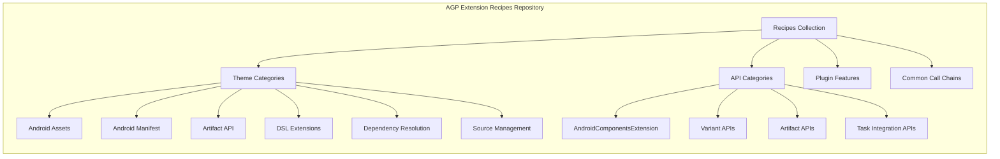
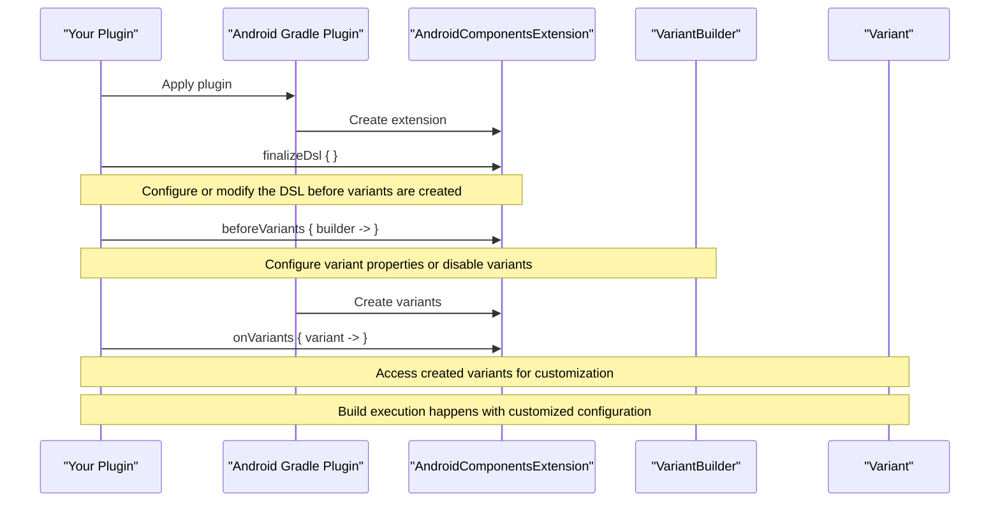
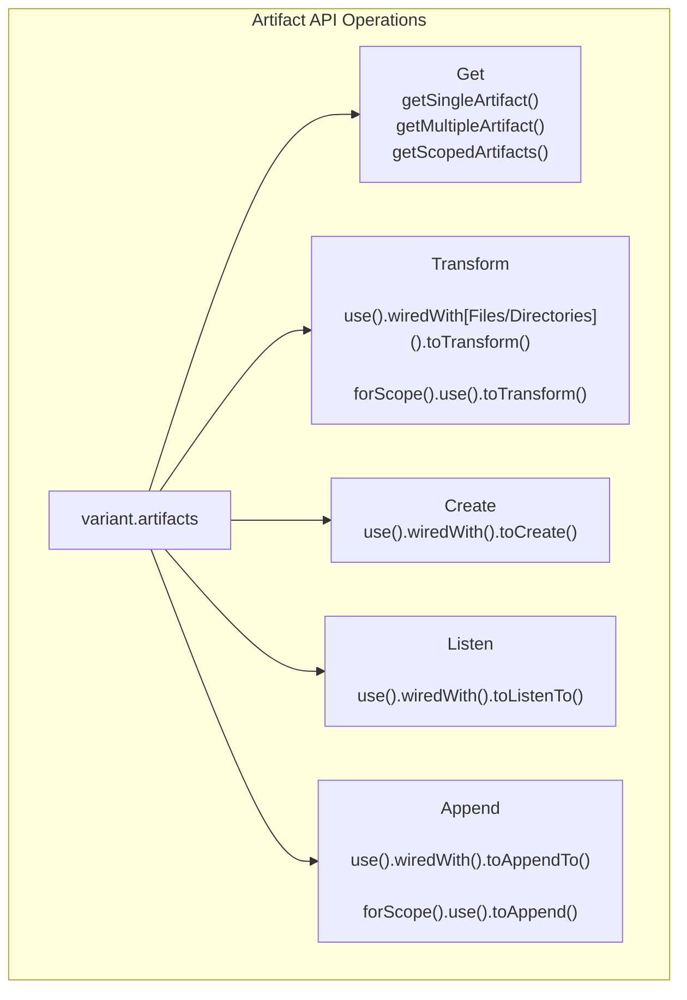
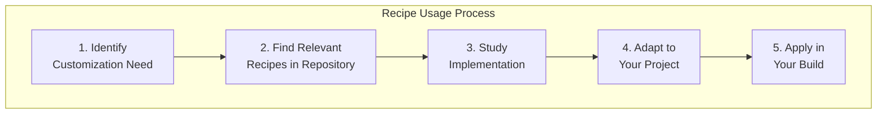

<!-- source: DeepWiki mcp.deepwiki.com · repo android/gradle-recipes · page 1 AGP Extension Recipes Overview · fetched 2026-10-23 -->

# AGP Extension Recipes Overview

<details>
<summary>Relevant source files</summary>

The following files were used as context for generating this wiki page:

- [README.md](README.md)

</details>


## Purpose and Scope

The Android Gradle Plugin (AGP) Recipes repository provides a comprehensive collection of examples that demonstrate how to extend and customize the Android build system. These recipes showcase practical implementations of the AGP extension APIs, allowing developers to modify, enhance, and customize their Android builds in various ways.

This overview page introduces the repository's purpose, organization, and provides guidance on how to navigate and utilize these recipes effectively. For detailed information about the underlying extension architecture, see [Extension Architecture](#2).

Sources: [README.md:1-6]()

## What Are AGP Extension Recipes?

AGP Extension Recipes are ready-to-use code examples that demonstrate how to customize Android builds using the Android Gradle Plugin extension points. Each recipe focuses on a specific customization scenario and provides a complete, working implementation that you can adapt to your own projects.

The recipes are compatible with AGP 8.9 and are organized in a modular way, making it easy to find examples that address specific customization needs.



Sources: [README.md:7-9](), [README.md:9-15]()

## Core Extension Mechanisms

The AGP extension recipes demonstrate several key mechanisms for customizing Android builds:

### 1. AndroidComponentsExtension

The most important entry point for AGP customization is the `AndroidComponentsExtension` interface, which provides methods for accessing and modifying the build throughout its lifecycle. Primary methods include:

- `finalizeDsl { }` - Configure the build before the DSL is finalized
- `beforeVariants { }` - Customize variants before they are created
- `onVariants { }` - Configure variants after they are created
- `registerExtension()` - Register custom DSL extensions



Sources: [README.md:20-24](), [README.md:113-120]()

### 2. Artifact API System

The Artifact API is central to many customizations, allowing you to access, transform, create, or listen to various build artifacts:

- **Get artifacts**: Access build outputs like APKs, bundles, or manifests
- **Transform artifacts**: Modify artifacts during the build process
- **Create artifacts**: Generate new artifacts
- **Listen to artifacts**: React to artifact creation events



Sources: [README.md:12](), [README.md:27-32](), [README.md:67-71](), [README.md:127-139]()

### 3. Variant System

Variants represent different build configurations of your app (like debug or release). The recipes demonstrate how to:

- Select specific variants to customize
- Add or customize sources in variants
- Configure variant-specific build properties
- Add custom BuildConfig fields
- Manipulate the manifest per variant

Sources: [README.md:23](), [README.md:102-105](), [README.md:117-120](), [README.md:140-142]()

## Recipe Categories

The repository organizes recipes in several different ways to help you find relevant examples:

### Theme-Based Categories

Recipes are grouped by functional themes that address specific customization areas:

| Theme | Purpose | Example Recipes |
|-------|---------|----------------|
| Android Assets | Working with app assets | addGeneratedSourceFolder, legacyTaskBridging |
| Android Manifest | Modifying the manifest | transformManifest, createSingleArtifact, perVariantManifestPlaceholder |
| Artifact API | Manipulating build artifacts | transformAllClasses, getSingleArtifact, listenToArtifacts |
| DSL | Extending the Gradle DSL | addBuildTypeUsingDslFinalize, extendingAgp |
| Dependency Resolution | Customizing dependencies | variantDependencySubstitutionTest |
| Sources | Managing source code | addGeneratedSourceFolder, addCustomSourceType |

Sources: [README.md:9-15]()

### API-Based Categories

Recipes are also categorized by the specific APIs they demonstrate:

| API Category | Purpose | 
|--------------|---------|
| AndroidComponentsExtension methods | Entry points for build customization |
| Variant and VariantBuilder APIs | Configuring build variants |
| Artifact APIs | Working with build outputs |
| Source management APIs | Adding or modifying source code |
| DSL extension APIs | Creating custom Gradle DSL elements |

Sources: [README.md:16-106]()

### Common Call Chains

The repository also indexes complete API call chains, showing how to combine multiple API calls to achieve specific outcomes:

```
variant.artifacts.use().wiredWith().toCreate()
variant.buildConfigFields.put()
variant.sources.*.addGeneratedSourceDirectory()
androidComponents.selector().withBuildType()
```

Sources: [README.md:107-146]()

## How To Use These Recipes

Follow these steps to effectively use the AGP extension recipes:

1. **Identify your customization need**: Determine what aspect of the build you want to customize.

2. **Find relevant recipes**: Use the categorization in the [README.md](README.md) to locate recipes that address your need.

3. **Study the implementation**: Examine the recipe's code to understand the approach and API usage.

4. **Adapt to your project**: Modify the recipe code to fit your specific requirements.

5. **Apply in your build**: Integrate the customized code into your project's Gradle build system.



Sources: [README.md:7-9]()

## Repository Structure

The repository is organized with each recipe in its own directory. The directory name typically reflects the recipe's primary purpose. Inside each directory, you'll find:

- A complete implementation of the customization
- Build files and necessary configurations
- Sample code that demonstrates the customization in action

The recipes are designed to be self-contained, making it easy to understand the specific customization without needing to examine the entire repository.

Sources: [README.md:7-9]()

## Related Resources

For more detailed information about specific aspects of AGP extension, refer to:

- [Extension Architecture](#2) - Explains the high-level architecture of the AGP extension system
- [AndroidComponentsExtension Lifecycle](#2.1) - Details the lifecycle and key entry points
- [Artifact API System](#2.2) - Comprehensive explanation of the Artifact API
- [Variant System](#2.3) - Explains how to work with variants
- [Task Integration](#2.4) - Details on integrating custom Gradle tasks

Sources: [README.md:159-174]()

---

