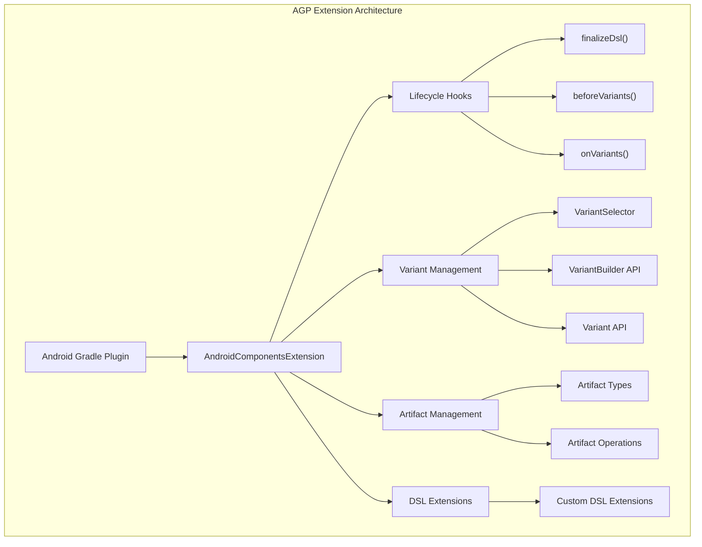
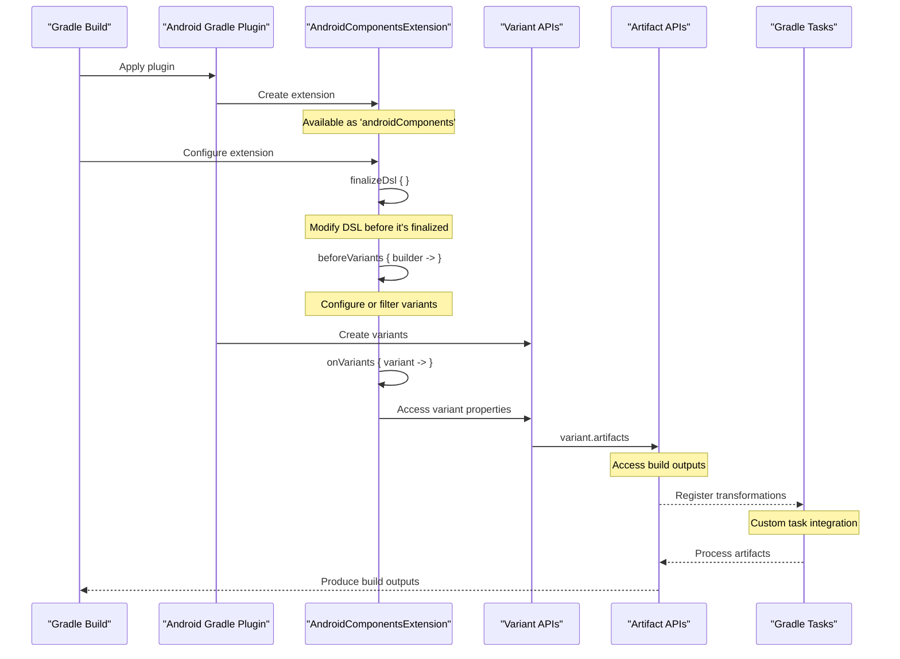
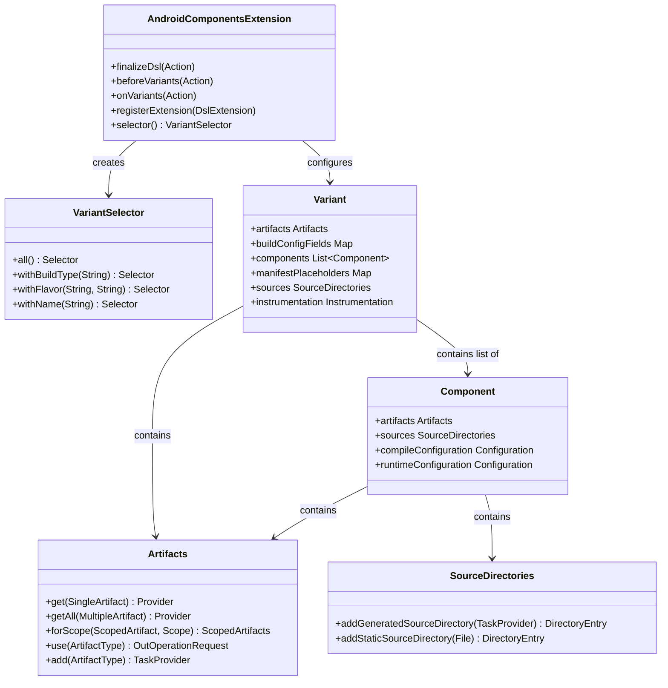

<!-- source: DeepWiki mcp.deepwiki.com · repo android/gradle-recipes · page 2 Extension Architecture · fetched 2026-10-23 -->

# Extension Architecture

Relevant source files

The following files were used as context for generating this wiki page:

- [README.md](README.md)

## Purpose and Scope

This page provides a comprehensive overview of the Android Gradle Plugin (AGP) extension architecture, explaining the core components and their relationships. It covers the high-level design of how AGP exposes extension points for build customization, the lifecycle of these extensions, and how they interact with the Android build system.

For more detailed information about specific components, see the following related pages:
- [AndroidComponentsExtension Lifecycle](#2.1)
- [Artifact API System](#2.2)
- [Variant System](#2.3)
- [Task Integration](#2.4)

## Core Architecture Overview

The Android Gradle Plugin extension system provides a structured way to customize and extend the Android build process. It's designed around a central extension object that provides access to variant configurations, artifacts, and build lifecycle hooks.

**Diagram: AGP Extension Architecture Overview**

Sources: [README.md:19-24]()

## Key Components

### AndroidComponentsExtension

The `AndroidComponentsExtension` is the primary entry point for interacting with the AGP extension system. It provides access to variant configuration, artifact manipulation, and build lifecycle hooks. This extension is available through the `androidComponents` property after applying an Android plugin.

The extension follows a specific lifecycle with three major phases:
1. **DSL Finalization**: Configure build types, product flavors, and other DSL elements
2. **Variant Creation**: Configure or filter variants before they are created
3. **Variant Customization**: Modify variants after they have been created

Sources: [README.md:19-24](), [README.md:114-116]()

### Variant System

The variant system represents the different build configurations of an Android project (combinations of build types and product flavors). It provides interfaces to configure and customize variants:

- **VariantBuilder**: Configures variants before creation (min SDK, test options, etc.)
- **Variant**: Represents a fully created variant, allowing post-creation customization
- **VariantSelector**: Allows selecting specific variants to apply customizations

Sources: [README.md:20-21](), [README.md:97-104]()

### Artifact API

The Artifact API provides access to build outputs and enables transformations on them. Key components include:

- **Artifact Types**: Different categories of artifacts (SingleArtifact, MultipleArtifact, ScopedArtifact)
- **Artifact Operations**: Actions performed on artifacts (get, transform, create, append, listen)
- **Transformation System**: Mechanism to modify artifacts during the build

Sources: [README.md:12](), [README.md:26-32]()

### DSL Extensions

AGP allows extending the Gradle DSL with custom configuration blocks, enabling plugin developers to add their own configuration options to the Android block.

Sources: [README.md:13](), [README.md:48-52](), [README.md:108]()

## Component Interaction Flow

The following diagram illustrates how components of the AGP extension system interact during the build process:

**Diagram: AGP Extension Component Interaction**

Sources: [README.md:114-123]()

## Extension Points and Code Entities

The diagram below maps extension points to specific code entities and APIs:

**Diagram: AGP Extension Code Entities**

Sources: [README.md:19-24](), [README.md:39-52](), [README.md:97-104](), [README.md:26-32](), [README.md:42-47](), [README.md:85-86]()

## Artifact Types and Operations

The Artifact API is a core part of the extension system, providing different artifact types that can be accessed and transformed:

| Artifact Type | Description | Examples |
|---------------|-------------|----------|
| SingleArtifact | Represents a single file or directory | MERGED_MANIFEST, ASSETS, APK, BUNDLE |
| MultipleArtifact | Represents multiple files | NATIVE_DEBUG_METADATA, MULTIDEX_KEEP_PROGUARD |
| ScopedArtifact | Artifacts with scope (project, module deps, etc.) | CLASSES |

| Operation | Description | Method Chain Example |
|-----------|-------------|---------------------|
| get | Retrieves an artifact | `variant.artifacts.get(SingleArtifact.MERGED_MANIFEST)` |
| getAll | Retrieves multiple artifacts | `variant.artifacts.getAll(MultipleArtifact.NATIVE_DEBUG_METADATA)` |
| use | Prepares an artifact for transformation | `variant.artifacts.use().wiredWith()...` |
| add | Adds a new artifact | `variant.artifacts.add(MultipleArtifact.NATIVE_DEBUG_METADATA)` |
| transform | Transforms an artifact | `variant.artifacts.use().wiredWithFiles().toTransform()` |
| append | Appends to an artifact | `variant.artifacts.use().wiredWith().toAppendTo()` |
| listen | Listens to artifact changes | `variant.artifacts.use().wiredWith().toListenTo()` |

Sources: [README.md:66-90](), [README.md:80-94](), [README.md:127-142]()

## Extension Lifecycle

The extension system follows a defined lifecycle that aligns with Gradle's build phases:

1. **Configuration Phase**:
   - DSL configuration & finalization (`finalizeDsl`)
   - Variant filtering & configuration (`beforeVariants`)
   - Variant creation (by AGP)
   - Variant customization (`onVariants`)
   - Task graph construction

2. **Execution Phase**:
   - Task execution
   - Artifact transformations
   - Build output generation

This lifecycle enables plugin developers to inject customizations at the appropriate points in the build process.

Sources: [README.md:114-120]()

## Common Extension Patterns

The repository demonstrates several common patterns for extending AGP:

1. **Artifact Transformations**: Modifying build outputs like manifests, classes, or resources
2. **Source Management**: Adding generated or static source directories
3. **BuildConfig Customization**: Adding custom fields to BuildConfig
4. **Manifest Manipulation**: Modifying the Android manifest
5. **DSL Extensions**: Creating custom DSL blocks for configuration
6. **Dependency Resolution**: Customizing how dependencies are resolved

These patterns form the basis for the recipe examples throughout the repository.

Sources: [README.md:8-15]()

---

