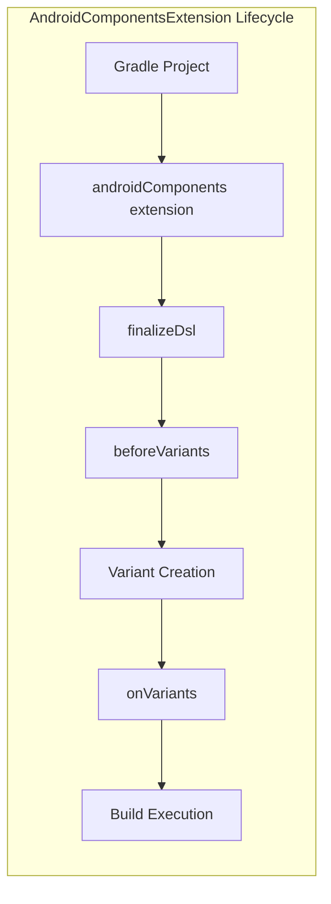
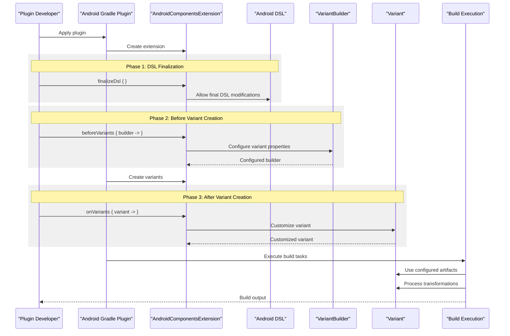
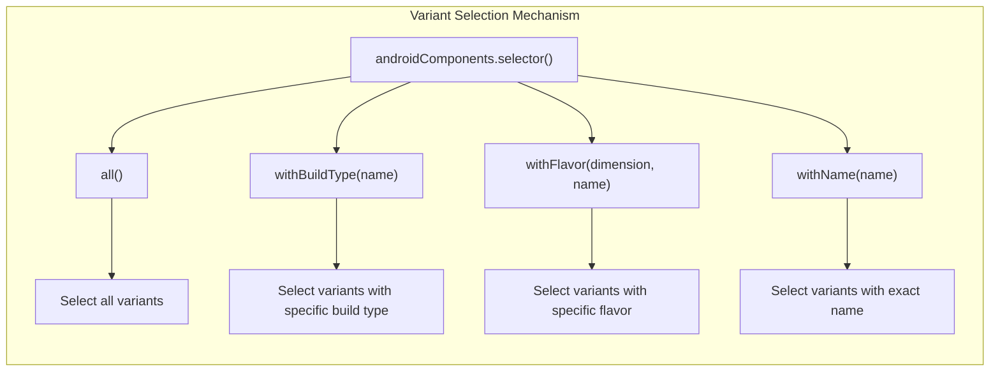
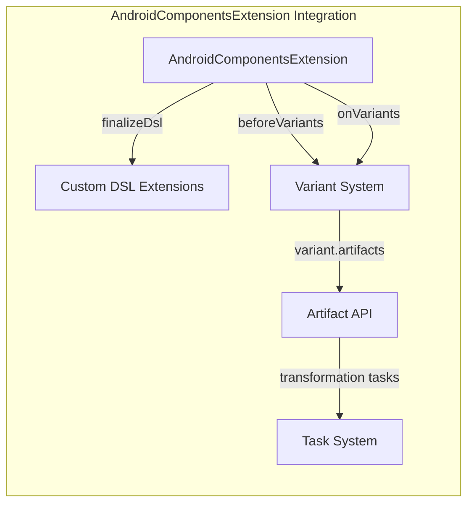

<!-- source: DeepWiki mcp.deepwiki.com · repo android/gradle-recipes · page 2.1 AndroidComponentsExtension Lifecycle · fetched 2026-10-23 -->

# AndroidComponentsExtension Lifecycle

<details>
<summary>Relevant source files</summary>

The following files were used as context for generating this wiki page:

- [README.md](README.md)

</details>


## Purpose and Scope

This document details the lifecycle and key entry points of the `AndroidComponentsExtension` interface, which serves as the primary access point for customizing the Android Gradle Plugin (AGP) build process. The lifecycle comprises three main phases that govern when and how you can modify the Android build. For information about the Artifact API system that you'll often use within these lifecycle phases, see [Artifact API System](#2.2).

## Overview

The `AndroidComponentsExtension` is the central interface for extending and customizing the AGP build system. It provides structured access to the variant system and enables you to interact with the build process at specific, well-defined points in the lifecycle.



Sources: README.md

## Lifecycle Phases

The `AndroidComponentsExtension` exposes three main lifecycle phases that occur in a specific order. Each phase has access to different capabilities and serves different purposes in the build customization process.



Sources: README.md

### 1. finalizeDsl Phase

The `finalizeDsl` phase occurs after the Android DSL has been evaluated but before it's locked. This is the last chance to modify the DSL (Domain-Specific Language) configuration.

**Purpose:**
- Add or modify build types, product flavors, or signing configs
- Add or modify default configuration properties
- Make final adjustments to DSL before it's locked for variant creation

**Example usage from recipes:**
- Adding build types using DSL finalization

**Limitations:**
- Cannot access variant information (variants don't exist yet)
- Cannot configure artifacts (artifacts are variant-specific)

**Code reference:**
```kotlin
androidComponents.finalizeDsl { extension ->
    // Modify DSL configuration here
    extension.buildTypes.create("customBuildType")
}
```

Sources: README.md:114, README.md:13

### 2. beforeVariants Phase

The `beforeVariants` phase occurs after the DSL is finalized but before variants are created. This phase provides access to the `VariantBuilder` interface, which allows you to configure how variants will be created.

**Purpose:**
- Filter or disable specific variants
- Configure variant properties before creation
- Disable certain test types
- Set minimum SDK levels for specific variants

**Example usage from recipes:**
- Disabling test components
- Selecting and configuring specific variants based on criteria

**Limitations:**
- Cannot access actual variant instances (not created yet)
- Cannot configure artifacts or transformations

**Code reference:**
```kotlin
androidComponents.beforeVariants { variantBuilder ->
    // Configure variant creation
    if (variantBuilder.minSdk < 21) {
        variantBuilder.enable = false
    }
}
```

Sources: README.md:113, README.md:20

### 3. onVariants Phase

The `onVariants` phase occurs after all variants have been created. This is the most powerful phase, providing full access to the created `Variant` instances and their associated capabilities.

**Purpose:**
- Configure and transform artifacts
- Add generated source directories
- Register pre-build tasks
- Modify build configuration fields
- Transform classes and other resources
- Configure manifests
- Substitute dependencies

**Example usage from recipes:**
- Transforming manifests
- Adding generated source folders
- Customizing build config fields
- Artifact transformations

**Code reference:**
```kotlin
androidComponents.onVariants { variant ->
    // Customize variant
    variant.buildConfigFields.put("CUSTOM_FIELD", "String", "\"customValue\"")
    
    // Access and transform artifacts
    val mergedManifest = variant.artifacts.get(SingleArtifact.MERGED_MANIFEST)
    // ...
}
```

Sources: README.md:115, README.md:21-22

## Variant Selection

Within both the `beforeVariants` and `onVariants` phases, you can use selectors to target specific variants rather than processing all variants.



Sources: README.md:102-105, README.md:117-120

### Common Selection Patterns

**Selecting all variants:**
```kotlin
androidComponents.onVariants(
    androidComponents.selector().all()
) { variant ->
    // Applied to all variants
}
```

**Selecting by build type:**
```kotlin
androidComponents.onVariants(
    androidComponents.selector().withBuildType("debug")
) { variant ->
    // Applied only to debug variants
}
```

**Selecting by flavor:**
```kotlin
androidComponents.onVariants(
    androidComponents.selector().withFlavor("dimension", "flavor")
) { variant ->
    // Applied only to variants with specific flavor
}
```

**Selecting by name:**
```kotlin
androidComponents.onVariants(
    androidComponents.selector().withName("debugFlavor")
) { variant ->
    // Applied only to variant with exact name
}
```

Sources: README.md:102-106, README.md:117-120

## Integration with Key AGP Systems

The `AndroidComponentsExtension` lifecycle is integrated with other key systems in the AGP extension ecosystem:



Sources: README.md

### Artifact API Integration

During the `onVariants` phase, you can access and manipulate artifacts through `variant.artifacts`:

```kotlin
androidComponents.onVariants { variant ->
    variant.artifacts.get(SingleArtifact.MERGED_MANIFEST)
    variant.artifacts.getAll(MultipleArtifact.NATIVE_DEBUG_METADATA)
    variant.artifacts.use(...)
}
```

Sources: README.md:130-132

### Task Integration

Custom tasks are typically registered and wired to artifact transformations during the `onVariants` phase:

```kotlin
androidComponents.onVariants { variant ->
    val taskProvider = project.tasks.register<CustomTask>("customTask")
    
    variant.artifacts.use(...)
        .wiredWith(taskProvider)
        .toTransform(...)
}
```

Sources: README.md:87-89

### Custom DSL Extensions

Custom DSL extensions are registered via the `registerExtension` method:

```kotlin
androidComponents.registerExtension(
    DslExtension.Builder()
        .extendProjectWith(...)
        .extendBuildTypeWith(...)
        .extendProductFlavorWith(...)
        .build()
)
```

Sources: README.md:22, README.md:108

## Common Practices and Recommendations

1. **Use the appropriate lifecycle phase:**
   - Use `finalizeDsl` for DSL modifications
   - Use `beforeVariants` for filtering and configuring variant creation
   - Use `onVariants` for artifact transformations and variant customization

2. **Leverage variant selectors to target specific variants** rather than processing all variants unnecessarily.

3. **Defer heavy operations to the execution phase** by using task providers and the Artifact API.

4. **Maintain clean separation of concerns** between different extension points.

5. **Design for configuration cache compatibility** by avoiding direct task instantiation and using the task registry.

Sources: README.md

## Conclusion

The `AndroidComponentsExtension` lifecycle provides a structured way to customize the Android build process at different stages. By understanding when each phase occurs and what capabilities are available in each, you can effectively extend AGP to suit your specific build requirements.

For more information about working with artifacts during the `onVariants` phase, see [Artifact API System](#2.2). For details about variants and their capabilities, see [Variant System](#2.3).

---

