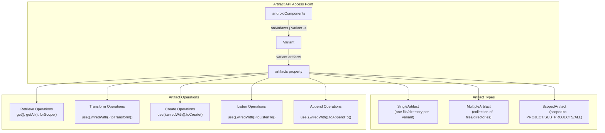
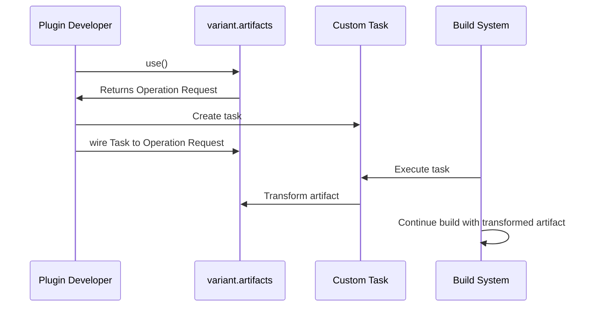
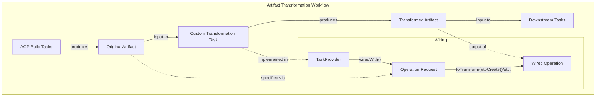

<!-- source: DeepWiki mcp.deepwiki.com · repo android/gradle-recipes · page 2.2 Artifact API System · fetched 2026-10-23 -->

# Artifact API System

<details>
<summary>Relevant source files</summary>

The following files were used as context for generating this wiki page:

- [README.md](README.md)

</details>


## Purpose and Scope

The Artifact API System is a core component of the Android Gradle Plugin (AGP) extension framework that enables plugin developers to interact with build artifacts during the Android application build process. This system allows for retrieving, creating, transforming, and monitoring the various files and directories generated during build execution.

This document covers the architecture of the Artifact API system, the different types of artifacts, available operations, and how these operations integrate with Gradle tasks. For information about the Android Components Extension lifecycle that provides access to the Artifact API, see [AndroidComponentsExtension Lifecycle](#2.1). For details on integrating custom Gradle tasks with the Artifact API, see [Task Integration](#2.4).

## Artifact API Overview

The Artifact API provides a structured way to interact with build outputs across different variants of your Android application. It serves as the interface between the build process and custom logic you want to apply to build artifacts.



Sources: README.md:10-43

## Artifact Types

The Artifact API supports three main types of artifacts, each representing different kinds of build outputs. Understanding these types is essential for working effectively with the API.

```mermaid
classDiagram
    class "Artifacts Interface" {
        +get(SingleArtifact): FileCollection
        +getAll(MultipleArtifact): FileCollection
        +forScope(ScopedArtifact): ScopedArtifacts
    }
    
    class "SingleArtifact" {
        <<enum>>
        +APK
        +MERGED_MANIFEST
        +BUNDLE
        +ASSETS
        ...
    }
    
    class "MultipleArtifact" {
        <<enum>>
        +NATIVE_DEBUG_METADATA
        +MULTIDEX_KEEP_PROGUARD
        ...
    }
    
    class "ScopedArtifact" {
        <<enum>>
        +CLASSES
        ...
    }
    
    class "ScopedArtifacts.Scope" {
        <<enum>>
        +PROJECT
        +SUB_PROJECTS
        +ALL
    }
    
    "Artifacts Interface" --> "SingleArtifact" : uses
    "Artifacts Interface" --> "MultipleArtifact" : uses
    "Artifacts Interface" --> "ScopedArtifact" : uses
    "ScopedArtifact" --> "ScopedArtifacts.Scope" : scoped by
```

Sources: README.md:64-83, README.md:74-77

### SingleArtifact

`SingleArtifact` represents a unique file or directory produced once per variant. Common examples include:

- `SingleArtifact.MERGED_MANIFEST`: The merged Android manifest file
- `SingleArtifact.APK`: The generated APK file
- `SingleArtifact.BUNDLE`: The Android App Bundle
- `SingleArtifact.ASSETS`: The assets directory

SingleArtifacts are accessed using the `get()` method:

```kotlin
// Get the merged manifest file for a variant
val mergedManifest = variant.artifacts.get(SingleArtifact.MERGED_MANIFEST)
```

Sources: README.md:81-84

### MultipleArtifact

`MultipleArtifact` represents a collection of files or directories. Examples include:

- `MultipleArtifact.NATIVE_DEBUG_METADATA`: Debug metadata for native code
- `MultipleArtifact.MULTIDEX_KEEP_PROGUARD`: ProGuard rules for multidex configurations

MultipleArtifacts are accessed using the `getAll()` method:

```kotlin
// Get all multidex ProGuard rules for a variant
val multidexRules = variant.artifacts.getAll(MultipleArtifact.MULTIDEX_KEEP_PROGUARD)
```

Sources: README.md:66-67, README.md:31

### ScopedArtifact

`ScopedArtifact` represents artifacts that can be scoped to different parts of the project hierarchy:

- `ScopedArtifacts.Scope.PROJECT`: Only project classes
- `ScopedArtifacts.Scope.SUB_PROJECTS`: Only classes from subprojects (dependencies)
- `ScopedArtifacts.Scope.ALL`: All classes (project + dependencies)

The most common ScopedArtifact is `ScopedArtifact.CLASSES`, which represents compiled classes organized by scope.

ScopedArtifacts are accessed using the `forScope()` method:

```kotlin
// Get access to the project's compiled classes
val projectClasses = variant.artifacts.forScope(ScopedArtifact.CLASSES)
                            .use(ScopedArtifacts.Scope.PROJECT)
```

Sources: README.md:74-79

## Artifact Operations

The Artifact API provides a set of operations that allow you to interact with artifacts throughout the build process. These operations can be grouped into several categories.

```mermaid
flowchart LR
    subgraph "Artifact API Operations"
        direction TB
        
        variant[/"variant"/] --> artifacts["variant.artifacts"]
        
        artifacts --> retrieveArtifacts[/"Retrieve
        Artifacts"/]
        
        artifacts --> transformArtifacts[/"Transform
        Artifacts"/]
        
        artifacts --> createArtifacts[/"Create
        Artifacts"/]
        
        artifacts --> listenArtifacts[/"Listen to
        Artifacts"/]
        
        artifacts --> appendArtifacts[/"Append to
        Artifacts"/]
        
        retrieveArtifacts --> get["get(SingleArtifact)"]
        retrieveArtifacts --> getAll["getAll(MultipleArtifact)"]
        retrieveArtifacts --> forScope["forScope(ScopedArtifact)"]
        
        transformArtifacts --> singleTransform["use().wiredWithFiles().toTransform()"]
        transformArtifacts --> dirTransform["use().wiredWithDirectories().toTransform()"]
        transformArtifacts --> multiTransform["use().wiredWith().toTransform()"]
        transformArtifacts --> scopedTransform["forScope().use().toTransform()"]
        
        createArtifacts --> createSingle["use().wiredWith().toCreate()"]
        
        listenArtifacts --> listenSingle["use().wiredWith().toListenTo()"]
        listenArtifacts --> listenMultiple["use().wiredWithMultiple().toListenTo()"]
        
        appendArtifacts --> appendMultiple["use().wiredWith().toAppendTo()"]
        appendArtifacts --> appendScoped["forScope().use().toAppend()"]
    end
```



Sources: README.md:27-42, README.md:63-90

### Retrieving Artifacts

The most basic operation is retrieving artifacts for inspection or use in custom tasks.

#### get() - Retrieving SingleArtifacts

```kotlin
// Get the merged manifest to use in a custom task
val mergedManifest = variant.artifacts.get(SingleArtifact.MERGED_MANIFEST)
```

Sources: README.md:30, README.md:81-84

#### getAll() - Retrieving MultipleArtifacts

```kotlin
// Get all native debug metadata files
val debugMetadata = variant.artifacts.getAll(MultipleArtifact.NATIVE_DEBUG_METADATA)
```

Sources: README.md:31, README.md:66-67

#### forScope() - Accessing ScopedArtifacts

```kotlin
// Get access to all compiled classes
val allClasses = variant.artifacts.forScope(ScopedArtifact.CLASSES)
```

Sources: README.md:28-29, README.md:74-76

### Transforming Artifacts

Transformation is a core operation that allows you to modify artifacts during the build process. The API provides several ways to transform artifacts, depending on their type.



Sources: README.md:87-90, README.md:133-139

#### Transforming Files (SingleArtifact)

For transforming single files like manifests:

```kotlin
// Transform a merged manifest file with a custom task
val taskProvider = project.tasks.register("transformManifest", ManifestTransformerTask::class.java)

variant.artifacts.use(taskProvider)
    .wiredWithFiles(
        inputArtifact = SingleArtifact.MERGED_MANIFEST,
        outputLocation = workingDirectory.resolve("transformed-manifest.xml")
    )
    .toTransform()
```

Sources: README.md:139, README.md:84

#### Transforming Directories (SingleArtifact)

For transforming directories:

```kotlin
// Transform the assets directory
val taskProvider = project.tasks.register("transformAssets", AssetTransformerTask::class.java)

variant.artifacts.use(taskProvider)
    .wiredWithDirectories(
        inputArtifact = SingleArtifact.ASSETS,
        outputDirectory = workingDirectory.resolve("transformed-assets")
    )
    .toTransform()
```

Sources: README.md:137-138, README.md:82-83

#### Transforming Multiple Files (MultipleArtifact)

For transforming collections of files:

```kotlin
// Transform native debug metadata files
val taskProvider = project.tasks.register("transformDebugMetadata", DebugMetadataTransformerTask::class.java)

variant.artifacts.use(taskProvider)
    .wiredWith(
        inputArtifacts = MultipleArtifact.NATIVE_DEBUG_METADATA,
        outputDirectory = workingDirectory.resolve("transformed-metadata")
    )
    .toTransform()
```

Sources: README.md:136, README.md:67

#### Transforming Scoped Artifacts

For transforming scoped artifacts like classes:

```kotlin
// Transform all project classes
val taskProvider = project.tasks.register("transformClasses", ClassTransformerTask::class.java)

variant.artifacts.forScope(ScopedArtifact.CLASSES)
    .use(ScopedArtifacts.Scope.PROJECT, taskProvider, 
        ClassTransformerTask::inputDirectories,
        ClassTransformerTask::outputDirectory
    )
    .toTransform()
```

Sources: README.md:130, README.md:74-76, README.md:80

### Creating Artifacts

You can also create entirely new artifacts during the build process:

```kotlin
// Create a custom manifest file
val taskProvider = project.tasks.register("createCustomManifest", ManifestCreatorTask::class.java)

variant.artifacts.use(taskProvider, ManifestCreatorTask::outputFile)
    .wiredWith(SingleArtifact.MERGED_MANIFEST)
    .toCreate()
```

Sources: README.md:70, README.md:133-134

### Listening to Artifacts

The API allows you to listen to artifacts and react when they are produced, without modifying them:

```kotlin
// Listen to APK creation to perform some action
val taskProvider = project.tasks.register("apkReporter", ApkReporterTask::class.java)

variant.artifacts.use(taskProvider, ApkReporterTask::apkFolder)
    .wiredWith(SingleArtifact.APK)
    .toListenTo()
```

Sources: README.md:70-71, README.md:135, README.md:81

### Appending to Artifacts

You can append additional content to multiple artifacts:

```kotlin
// Append to native debug metadata
val taskProvider = project.tasks.register("additionalDebugMetadata", DebugMetadataGeneratorTask::class.java)

variant.artifacts.use(taskProvider, DebugMetadataGeneratorTask::outputDirectory)
    .wiredWith(MultipleArtifact.NATIVE_DEBUG_METADATA)
    .toAppendTo()
```

Sources: README.md:69, README.md:133, README.md:67

## Artifact Transformation Flow

Understanding how artifacts move through the build system is crucial for properly integrating custom logic.



Sources: README.md:87-90, README.md:133-139

### Integration with Gradle Tasks

The Artifact API operations are tied to Gradle tasks through a "wiring" mechanism. This provides several benefits:

1. **Task Inputs/Outputs**: The system automatically sets up the proper Gradle task inputs and outputs
2. **Incremental Building**: Gradle's up-to-date checking works automatically
3. **Parallelization**: Tasks can run in parallel when dependencies are properly defined

```mermaid
classDiagram
    class "TaskProvider<T>" {
        <<Gradle>>
    }
    
    class "Operation Request" {
        +wiredWith()
        +wiredWithFiles()
        +wiredWithDirectories()
        +wiredWithMultiple()
    }
    
    class "Wired Operation" {
        +toTransform()
        +toCreate()
        +toListenTo()
        +toAppendTo()
    }
    
    class "T: Task" {
        <<Custom Task>>
        +inputProperty
        +outputProperty
    }
    
    "TaskProvider<T>" --> "T: Task" : provides
    "Operation Request" --> "TaskProvider<T>" : uses
    "Operation Request" --> "Wired Operation" : creates
    "T: Task" ..> "Wired Operation" : implements
```

Sources: README.md:87-92, README.md:133-139

### Task Output Up-to-Date Checks

The API respects Gradle's up-to-date checks to avoid unnecessary work:

```kotlin
// Example of customizing up-to-date checks
taskProvider.configure { task ->
    task.outputs.upToDateWhen { 
        // Custom logic to determine if the task should be considered up-to-date
        false // Always run the task in this example
    }
}
```

Sources: README.md:91-92, README.md:106

## Common Use Cases

Below are some common use cases for the Artifact API, illustrating its practical applications.

### Transforming an Android Manifest

```kotlin
// Register a task to transform the manifest
val taskProvider = project.tasks.register("transformManifest", ManifestTransformerTask::class.java)

// Wire the task to the manifest artifact
variant.artifacts.use(taskProvider)
    .wiredWithFiles(
        inputArtifact = SingleArtifact.MERGED_MANIFEST,
        outputLocation = workingDirectory.resolve("transformed-manifest.xml")
    )
    .toTransform()
```

Sources: README.md:139, README.md:84, README.md:11

### Working with App Bundles and APKs

```kotlin
// Get the app bundle for a variant
val bundle = variant.artifacts.get(SingleArtifact.BUNDLE)

// Listen to APK creation
val taskProvider = project.tasks.register("apkReporter", ApkReporterTask::class.java)
variant.artifacts.use(taskProvider, ApkReporterTask::apkFolder)
    .wiredWith(SingleArtifact.APK)
    .toListenTo()
```

Sources: README.md:83, README.md:135, README.md:81

### Transforming Classes

```kotlin
// Transform all project classes
val taskProvider = project.tasks.register("transformClasses", ClassTransformerTask::class.java)

variant.artifacts.forScope(ScopedArtifact.CLASSES)
    .use(ScopedArtifacts.Scope.PROJECT, taskProvider, 
        ClassTransformerTask::inputDirectories,
        ClassTransformerTask::outputDirectory
    )
    .toTransform()
```

Sources: README.md:130, README.md:74-76, README.md:80

### Working with Assets Directory

```kotlin
// Get the assets directory
val assetsDir = variant.artifacts.get(SingleArtifact.ASSETS)

// Transform the assets directory
val taskProvider = project.tasks.register("transformAssets", AssetTransformerTask::class.java)
variant.artifacts.use(taskProvider)
    .wiredWithDirectories(
        inputArtifact = SingleArtifact.ASSETS,
        outputDirectory = workingDirectory.resolve("transformed-assets")
    )
    .toTransform()
```

Sources: README.md:137-138, README.md:82-83

## Conclusion

The Artifact API System provides a powerful and flexible way to interact with build artifacts in the Android Gradle Plugin. By understanding the different artifact types and the operations available, developers can create sophisticated build customizations that integrate smoothly with the build process.

For more information on how this system integrates with the larger AGP extension architecture, see [Extension Architecture](#2) and for specifics on implementing custom tasks that work with artifacts, see [Task Integration](#2.4).

---

