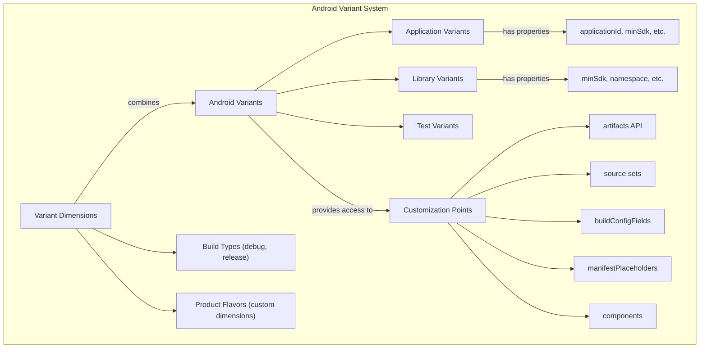
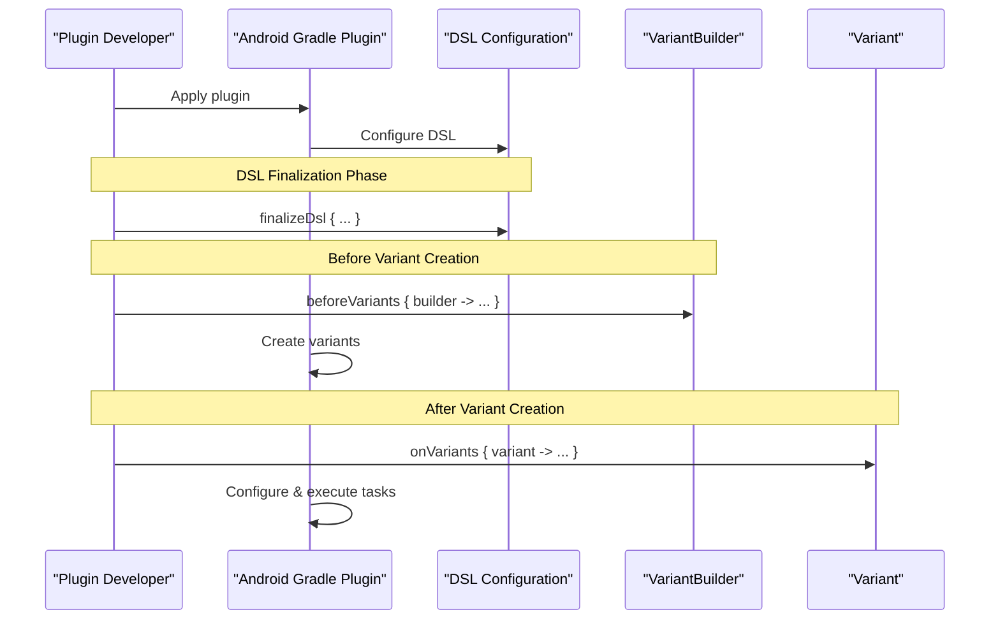
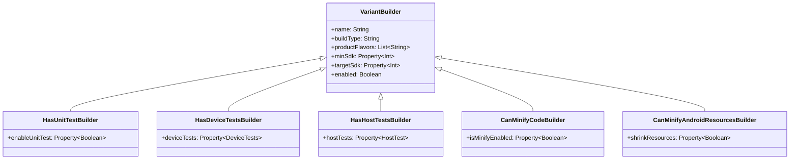
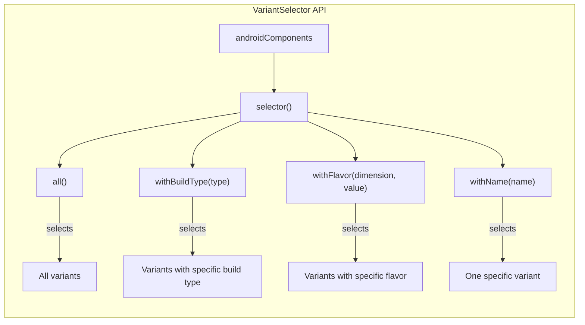
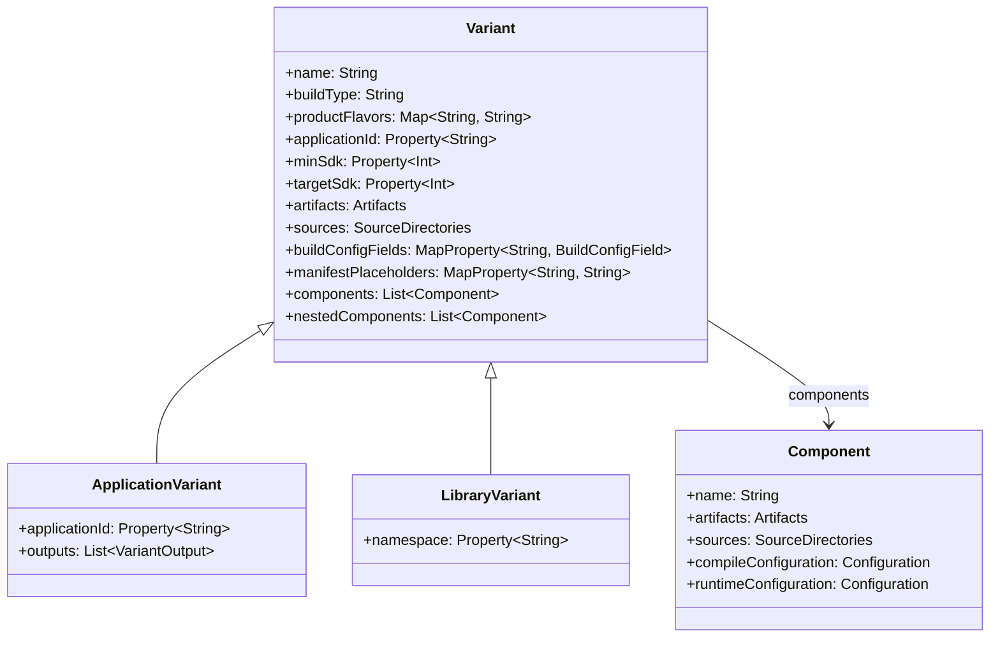
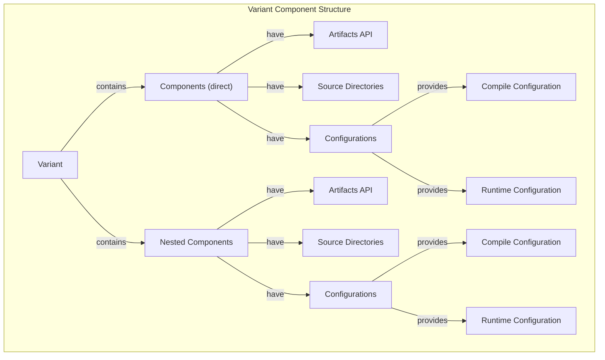

<!-- source: DeepWiki mcp.deepwiki.com · repo android/gradle-recipes · page 2.3 Variant System · fetched 2026-10-23 -->

# Variant System

<details>
<summary>Relevant source files</summary>

The following files were used as context for generating this wiki page:

- [README.md](README.md)

</details>


## Purpose and Scope

This document explains the Android Gradle Plugin (AGP) variant system, which is responsible for managing build variants in Android projects. It covers variant builders, selectors, and customization points that enable you to configure and manipulate variants programmatically. For information about the artifact system that variants interact with, see [Artifact API System](#2.2). For details on the overall extension lifecycle, see [AndroidComponentsExtension Lifecycle](#2.1).

## What are Variants?

In Android builds, variants represent different versions of your app or library that can be built from the same codebase. Variants are created by combining build types (like debug, release) with product flavors (like free, paid) to create distinct configurations like "debugFree" or "releasePaid".

The variant system provides programmatic access to these configurations through the AGP extension APIs. This allows plugin developers to inspect, customize, and transform these variant configurations during the build process.



Diagram: Overview of the Variant System

Sources: README.md

## Variant Lifecycle

Variants in AGP follow a specific lifecycle, with different hooks available for customization at each stage:



Diagram: Variant Lifecycle and Configuration Points

Sources: README.md

## Key Components

### Variant Builders

Variant builders are accessible through the `beforeVariants` hook and allow you to configure properties before variants are created, or even disable specific variants entirely.



Diagram: Variant Builder Hierarchy

Sources: README.md

### Variant Selectors

Variant selectors provide a way to target specific variants for configuration:



Diagram: Variant Selector Methods

Sources: README.md

## Variant Customization

Once variants are created, the `onVariants` hook provides access to the variants themselves. This is where you can customize many aspects of the variant:

### Properties and Methods

Variants provide access to various properties and operations:

- **Artifacts API**: Access and transform build artifacts
- **Source Management**: Add or modify source directories
- **BuildConfig Customization**: Add custom fields to BuildConfig
- **Manifest Manipulation**: Modify manifest placeholders
- **Dependency Resolution**: Configure component dependencies



Diagram: Variant Interface Structure

Sources: README.md

## Common Use Cases

### Selecting Specific Variants

You can select specific variants to apply customizations to:

```kotlin
// Select all release variants
androidComponents.selector().withBuildType("release")

// Select variants with a specific flavor
androidComponents.selector().withFlavor("dimension", "value")

// Select a specific variant by name
androidComponents.selector().withName("releaseDemo")
```

Sources: README.md

### Disabling Variants

You can disable variants that you don't want to build:

```kotlin
androidComponents.beforeVariants { builder ->
    // Disable debug variants
    if (builder.buildType == "debug") {
        builder.enable = false
    }
    
    // Disable unit tests for specific variants
    if (builder.buildType == "release") {
        if (builder is HasUnitTestBuilder) {
            builder.enableUnitTest = false
        }
    }
}
```

Sources: README.md

### Modifying Variant Properties

You can modify properties of variants after they are created:

```kotlin
androidComponents.onVariants { variant ->
    // Add custom build config field
    variant.buildConfigFields.put(
        "STRING_VALUE",
        BuildConfigField(
            "String",
            "\"customValue\"",
            "Comment"
        )
    )
    
    // Set manifest placeholders
    variant.manifestPlaceholders.put("customPlaceholder", "value")
}
```

Sources: README.md

### Dependency Substitution

You can customize the dependency resolution for specific variants:

```kotlin
androidComponents.onVariants(selector) { variant ->
    variant.components.forEach { component ->
        component.compileConfiguration.resolutionStrategy.dependencySubstitution {
            // Substitute dependencies
        }
        component.runtimeConfiguration.resolutionStrategy.dependencySubstitution {
            // Substitute dependencies
        }
    }
}
```

Sources: README.md

## Integration with Other Systems

### Artifact API Integration

Variants provide access to the Artifact API, allowing you to manipulate build artifacts:

```kotlin
androidComponents.onVariants { variant ->
    // Get an artifact
    val mergedManifest = variant.artifacts.get(SingleArtifact.MERGED_MANIFEST)
    
    // Transform an artifact
    variant.artifacts.use(...)
        .wiredWithFiles(taskProvider)
        .toTransform(SingleArtifact.MERGED_MANIFEST)
}
```

For detailed information about artifact operations, see [Artifact API System](#2.2).

Sources: README.md

### Source Management

Variants provide access to source directories, allowing you to add or modify source sets:

```kotlin
androidComponents.onVariants { variant ->
    // Add generated source directory
    variant.sources.java?.addGeneratedSourceDirectory(
        taskProvider, "outputDir"
    )
    
    // Add custom source type
    variant.sources.customSourceType?.addStaticSourceDirectory(
        project.layout.projectDirectory.dir("src/custom")
    )
}
```

Sources: README.md

## Components vs. Nested Components

A variant can have both direct components and nested components:



Diagram: Component Structure in Variants

Sources: README.md

## Related APIs

The variant system interacts closely with other AGP extension APIs:

1. **AndroidComponentsExtension**: Provides access to variants through `beforeVariants` and `onVariants` hooks
2. **Artifacts API**: Accessed through `variant.artifacts` for manipulating build artifacts
3. **Source Management**: Accessed through `variant.sources` for configuring source sets
4. **Task Integration**: Used to register tasks that modify variant outputs

For more information on these related systems, see:
- [AndroidComponentsExtension Lifecycle](#2.1)
- [Artifact API System](#2.2)
- [Task Integration](#2.4)

Sources: README.md

## Common Examples

### Building Specific Variants

```kotlin
// Only build release variants
androidComponents.beforeVariants { builder ->
    if (builder.buildType != "release") {
        builder.enable = false
    }
}
```

Sources: README.md

### Configuring Variant Properties

```kotlin
// Configure minSdk for specific variants
androidComponents.beforeVariants(
    androidComponents.selector().withName("demoRelease")
) { builder ->
    builder.minSdk.set(23)
}
```

Sources: README.md

### Applying Actions to Specific Variants

```kotlin
// Apply actions only to variants with specific build type
androidComponents.onVariants(
    androidComponents.selector().withBuildType("release")
) { variant ->
    // Custom actions for release variants
}
```

Sources: README.md

## Conclusion

The variant system is a core part of the AGP extension architecture, allowing plugin developers to customize Android builds at a granular level. By understanding the variant lifecycle and available customization points, you can create powerful and flexible build plugins that manipulate the build process to meet your specific requirements.

---

