<!-- source: DeepWiki mcp.deepwiki.com · repo android/gradle-recipes · page 2.4 Task Integration · fetched 2026-10-23 -->

# Task Integration

<details>
<summary>Relevant source files</summary>

The following files were used as context for generating this wiki page:

- [README.md](README.md)

</details>


## Purpose and Scope

This page details the integration of custom Gradle tasks with the Android Gradle Plugin (AGP) artifact system using wired operations. It explains how to properly connect your custom tasks to AGP's build pipeline, ensuring they run at the appropriate time and have access to the right input files, while delivering their outputs to the correct locations for subsequent build phases.

For information about the broader Artifact API system that these task integrations utilize, see [Artifact API System](#2.2). For details on variant customization, see [Variant System](#2.3).

Sources: [README.md:87-91]()

## Task Integration Overview

Task integration in AGP involves connecting custom Gradle tasks to the AGP build pipeline through a pattern called "wired operations." These operations link your tasks to specific artifacts within the build system, defining what inputs your task consumes and where its outputs should be placed.

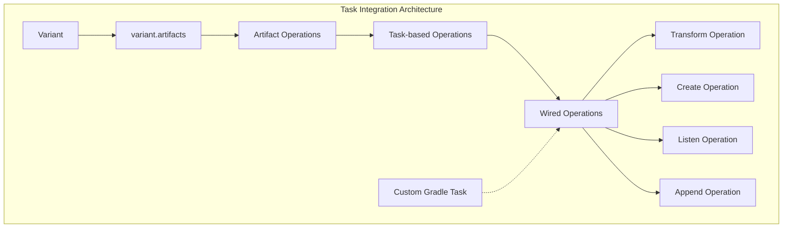

Task integration allows you to:
1. Transform existing artifacts (e.g., modify manifest files or transform compiled classes)
2. Create new artifacts from scratch
3. Listen to artifact creation events
4. Append files to existing multi-file artifacts

Sources: [README.md:27-36](), [README.md:87-90]()

## The Wiring Mechanism

The "wiring" mechanism connects your custom task to the AGP build system through a well-defined interface. This ensures your task receives the correct inputs and its outputs are properly integrated into the build pipeline.

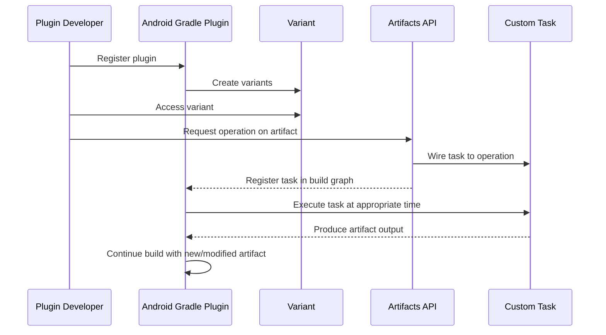

Sources: [README.md:87-90]()

## Wired Operations Types

AGP provides several types of wired operations, each designed for specific task integration scenarios:

### 1. Standard Wired Operations

Used for tasks that process single artifacts or produce single outputs.

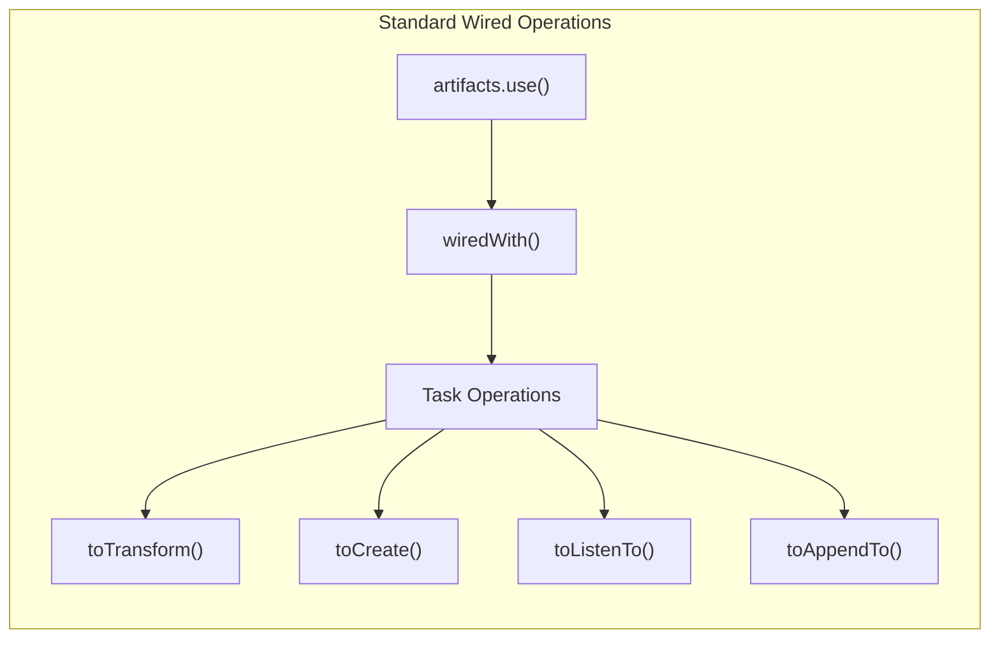

Source files that demonstrate this pattern include recipes for standard artifact transformations.

Sources: [README.md:87](), [README.md:133-137]()

### 2. Directory-Based Wired Operations

Specialized for tasks that work with directories rather than individual files.

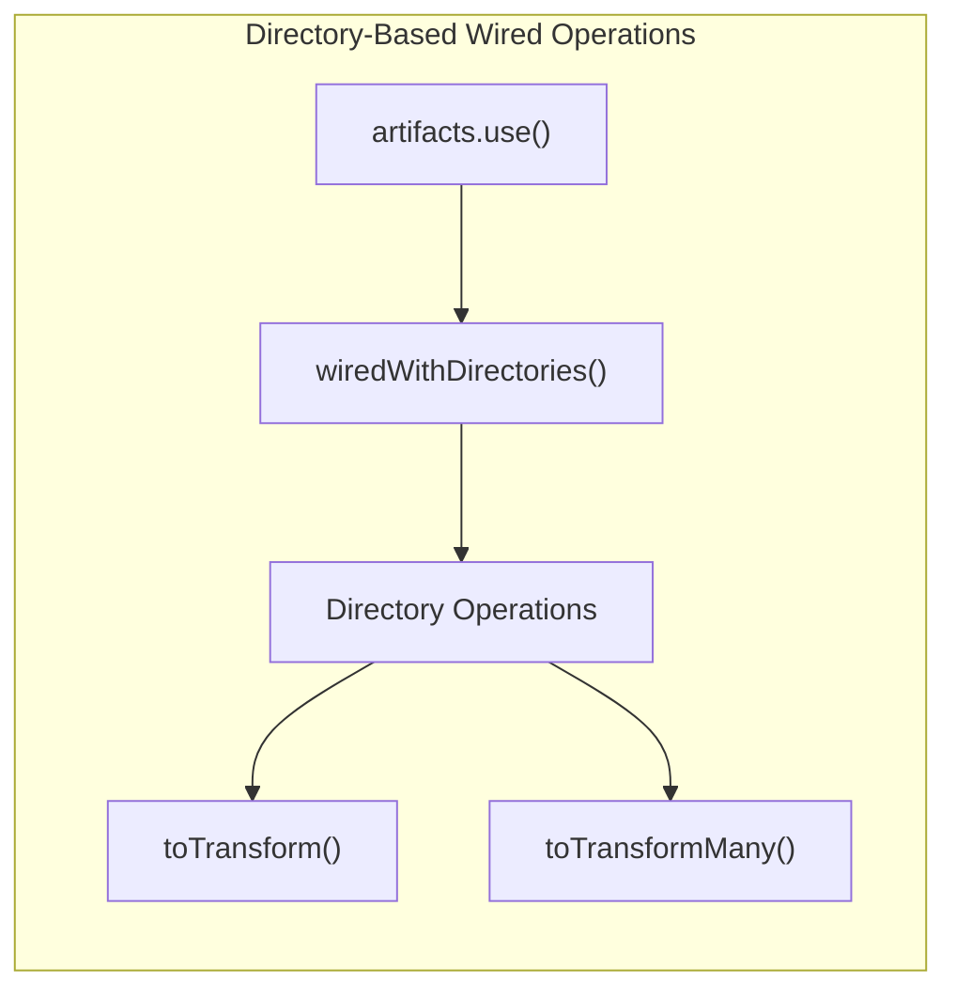

These operations are commonly used for asset transformations or directory-based manipulations.

Sources: [README.md:88](), [README.md:137-138]()

### 3. File-Based Wired Operations

Specialized for tasks that work with individual files.

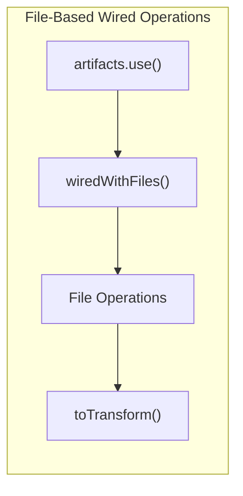

These operations are particularly useful for transforming manifest files and other individual configuration files.

Sources: [README.md:89](), [README.md:139]()

### 4. Multiple-Artifact Wired Operations

For tasks that need to work with collections of artifacts.

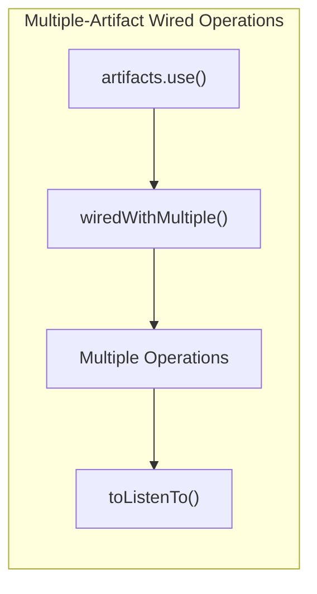

This type is used when tasks need to monitor or process multiple related artifacts together.

Sources: [README.md:90](), [README.md:135]()

## Operation Types

The AGP Artifact API supports four main types of operations that can be performed through task integration:

### Transform Operations

Transform operations modify existing artifacts and replace them with the modified version. They form the foundation of most custom build logic.

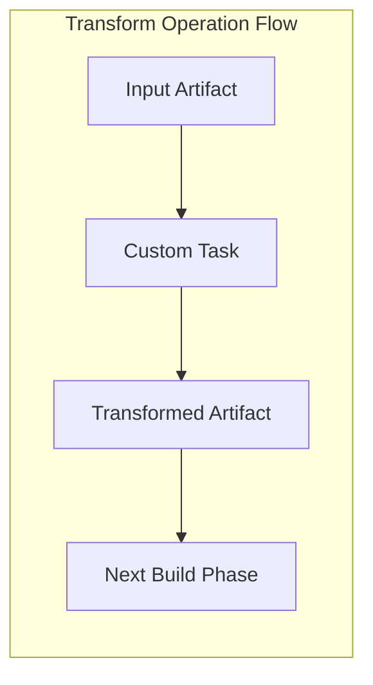

Transform operations are available in several variants:
- `toTransform()` - Transform a single artifact
- `toTransformMany()` - Transform multiple artifacts in a directory structure
- `forScope().use().toTransform()` - Transform scoped artifacts like compiled classes

Sources: [README.md:28](), [README.md:60-62](), [README.md:80](), [README.md:130-131](), [README.md:137-139]()

### Create Operations

Create operations generate entirely new artifacts that didn't exist before. These are useful when your task needs to produce outputs that should be available to later build phases.

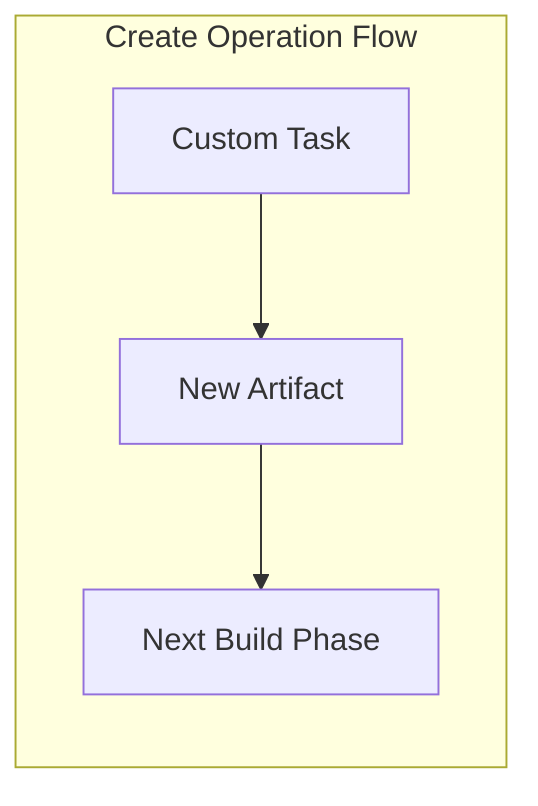

Create operations are defined using:
- `toCreate()` - Create a new single artifact

Sources: [README.md:70](), [README.md:134]()

### Listen Operations

Listen operations let a task observe artifacts without modifying them. This is useful for tasks that need to take some action when certain artifacts are available but don't need to modify those artifacts.

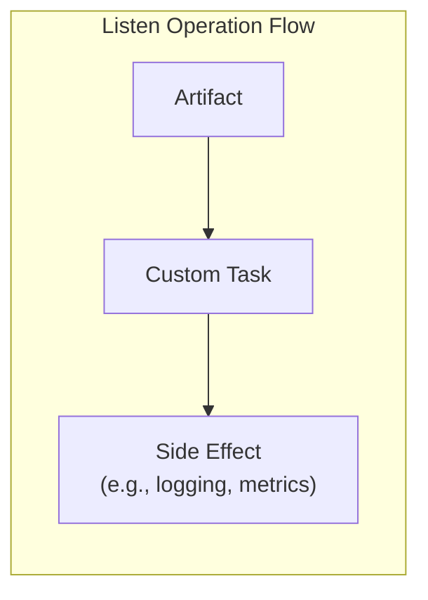

Listen operations come in several forms:
- `toListenTo()` - Listen to a single artifact
- `wiredWithMultiple().toListenTo()` - Listen to multiple artifacts

Sources: [README.md:71](), [README.md:68](), [README.md:135]()

### Append Operations

Append operations add files to existing artifacts without replacing the entire artifact. This is especially useful for multi-file artifacts where you want to contribute additional files.

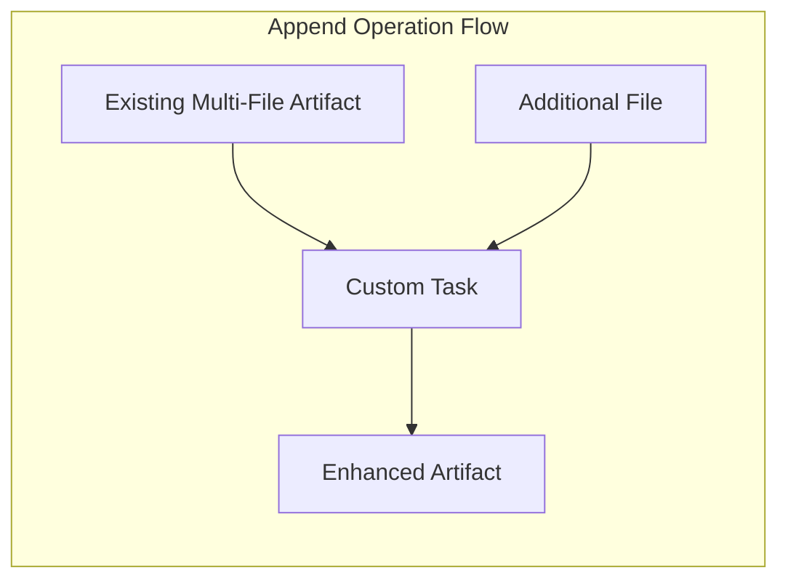

Append operations are used through:
- `toAppendTo()` - Append to a multiple artifact
- `forScope().use().toAppend()` - Append to scoped artifacts

Sources: [README.md:69](), [README.md:78](), [README.md:128](), [README.md:133]()

## Task Integration Implementation

When implementing task integration, you need to consider three key elements:

1. **Task Definition**: Creating your custom Gradle task
2. **Task Wiring**: Connecting your task to the AGP artifact system
3. **Task Execution**: Ensuring your task runs at the correct time

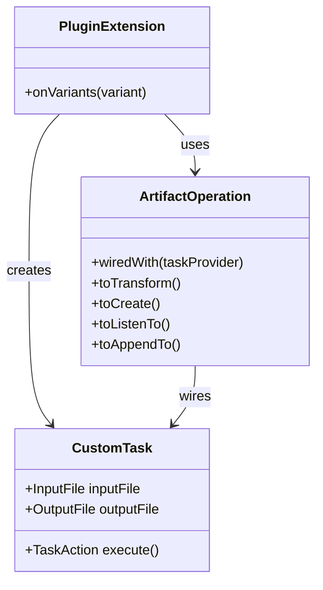

### Task Definition Example

To implement task integration, first define your custom task:

1. Create a task class that extends Gradle's `DefaultTask` or another appropriate base class
2. Define inputs and outputs using Gradle's input/output annotations
3. Implement the task action that will process the inputs and generate outputs

### Task Wiring Example

The key to proper task integration is wiring your task to the appropriate artifacts:

```
// Within onVariants block
variant.artifacts.use(taskProvider)
    .wiredWith(taskProvider)
    .toTransform()
```

For directory-based operations:

```
variant.artifacts.use(taskProvider)
    .wiredWithDirectories()
    .toTransform()
```

For file-based operations:

```
variant.artifacts.use(taskProvider)
    .wiredWithFiles()
    .toTransform()
```

Sources: [README.md:87-90](), [README.md:133-139]()

## Artifact Types and Task Integration

Different types of artifacts require different approaches to task integration. The AGP Artifact API supports three main types of artifacts:

### Single Artifacts

Single artifacts represent individual files, such as the merged manifest, APK, or bundle file.

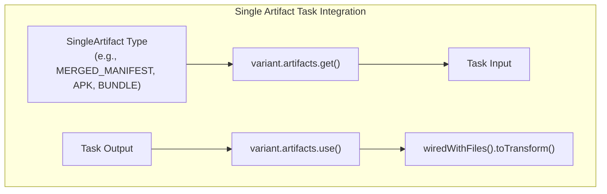

Common SingleArtifact types include:
- `SingleArtifact.MERGED_MANIFEST` - The merged Android manifest
- `SingleArtifact.APK` - The application package
- `SingleArtifact.BUNDLE` - The Android App Bundle
- `SingleArtifact.ASSETS` - The assets directory

Sources: [README.md:81-84](), [README.md:129-130](), [README.md:139]()

### Multiple Artifacts

Multiple artifacts represent collections of files, such as native debug metadata or multidex keep files.

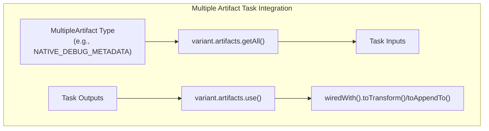

Common MultipleArtifact types include:
- `MultipleArtifact.NATIVE_DEBUG_METADATA` - Native debug metadata files
- `MultipleArtifact.MULTIDEX_KEEP_PROGUARD` - Multidex keep rules

Sources: [README.md:66-67](), [README.md:132-133](), [README.md:135-136]()

### Scoped Artifacts

Scoped artifacts represent files within specific scopes, such as compiled classes from the project or its dependencies.

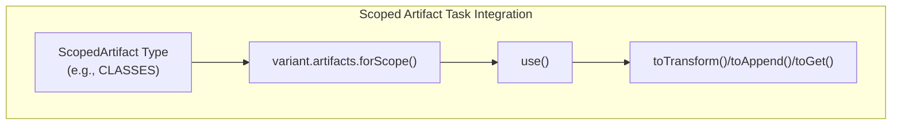

Common ScopedArtifact types include:
- `ScopedArtifact.CLASSES` - Compiled class files
- With scopes like `ScopedArtifacts.Scope.PROJECT` or `ScopedArtifacts.Scope.ALL`

Sources: [README.md:73-77](), [README.md:128-130]()

## Best Practices

### Task Configuration vs. Execution

When integrating tasks with AGP, it's important to understand the distinction between configuration time and execution time:

1. **Configuration Time**: When the build script is evaluated and tasks are created and wired
2. **Execution Time**: When tasks are actually executed according to the build graph

Keep task configuration logic lightweight and defer heavy work to execution time.

### Proper Input/Output Declaration

For optimal build performance:

1. Declare all inputs and outputs using Gradle's input/output annotations
2. Use incremental task support when appropriate
3. Implement `upToDateWhen` predicates for fine-grained control of task execution

```
task.outputs.upToDateWhen { /* condition for determining if task should run */ }
```

Sources: [README.md:91](), [README.md:124]()

### Worker API Integration

For computationally intensive tasks, consider using Gradle's Worker API to enable parallel processing:

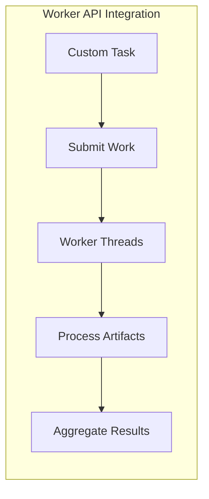

The `workerEnabledTransformation` recipe demonstrates how to use the Worker API with task integration.

Sources: [README.md:13](), [README.md:61](), [README.md:138]()

## Common Task Integration Patterns

### Transform Files Pattern

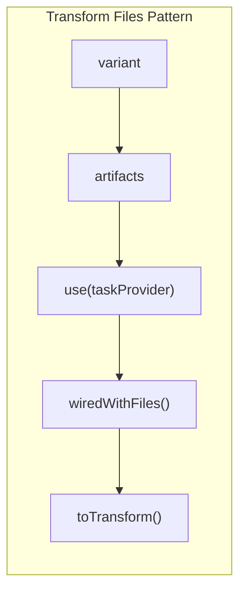

Used for transforming individual files like the Android manifest.

Sources: [README.md:89](), [README.md:139]()

### Transform Directories Pattern

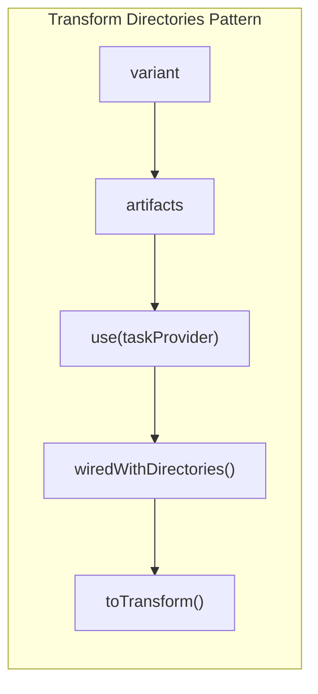

Used for transforming entire directories like the assets folder.

Sources: [README.md:88](), [README.md:137]()

### Listen to Artifacts Pattern

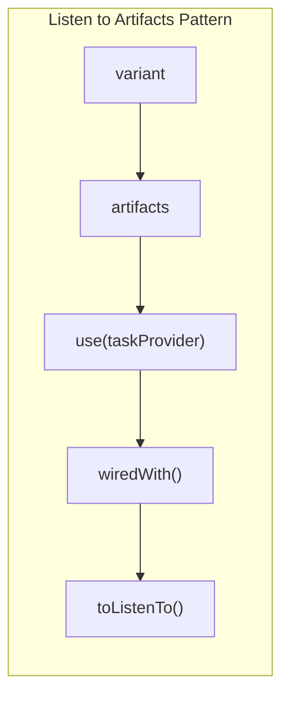

Used for observing artifacts without modifying them, like renaming APKs or collecting metrics.

Sources: [README.md:71](), [README.md:135]()

### Create Artifacts Pattern

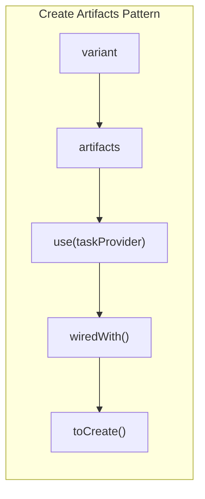

Used for generating new artifacts from scratch.

Sources: [README.md:70](), [README.md:134]()

## Conclusion

Task integration is the foundation for extending AGP with custom build logic. By properly wiring your tasks to the artifact system, you ensure that your custom build steps are executed at the right time, with the right inputs, and that their outputs are correctly integrated into the build pipeline.

For practical examples of task integration, refer to the recipes in the repository, such as `transformManifest`, `listenToArtifacts`, and `workerEnabledTransformation`.

Sources: [README.md:12-13]()

---

