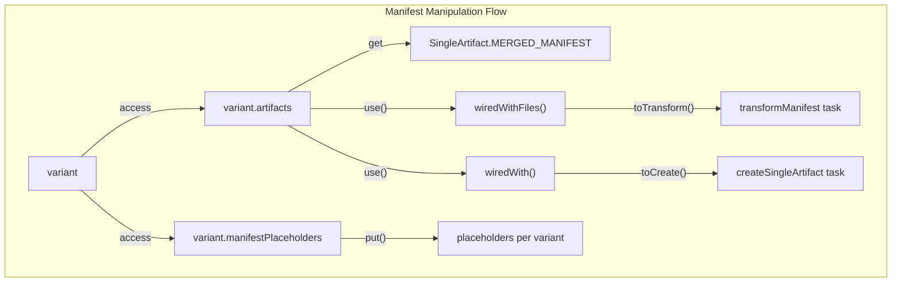
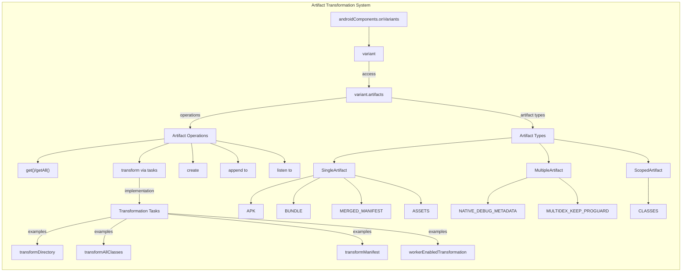
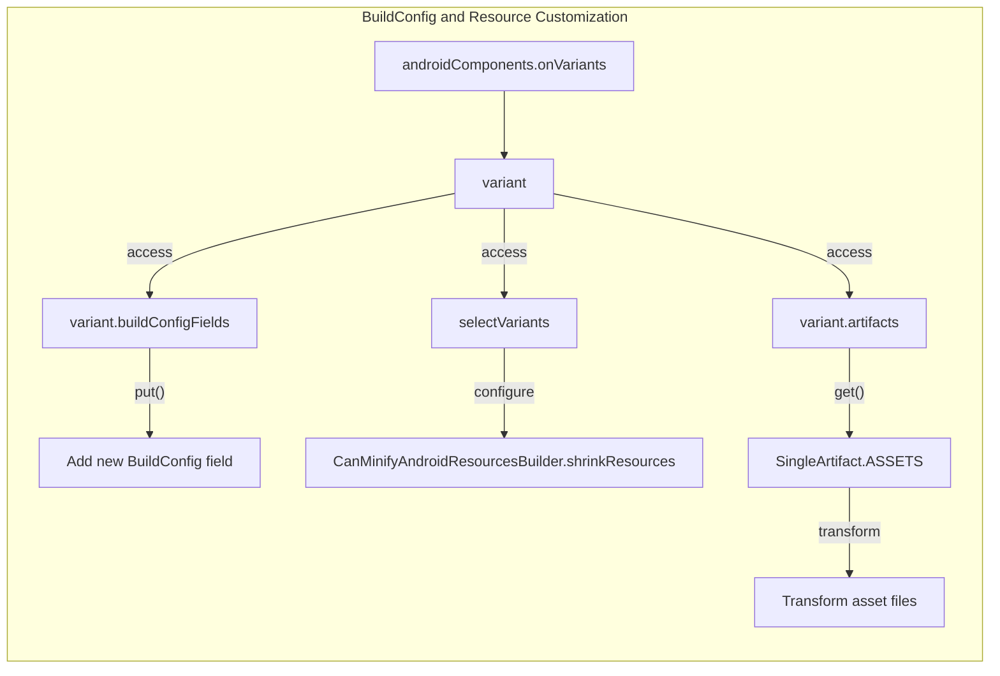
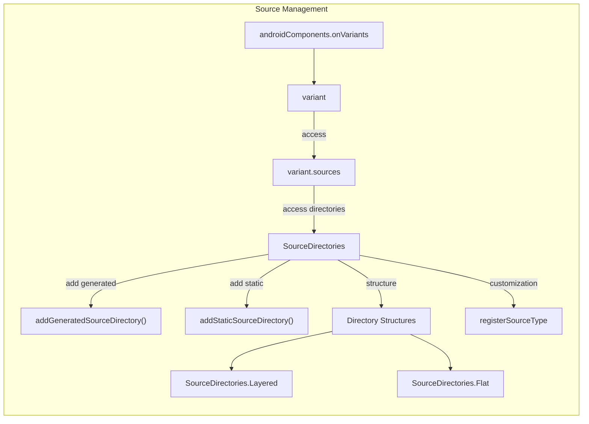
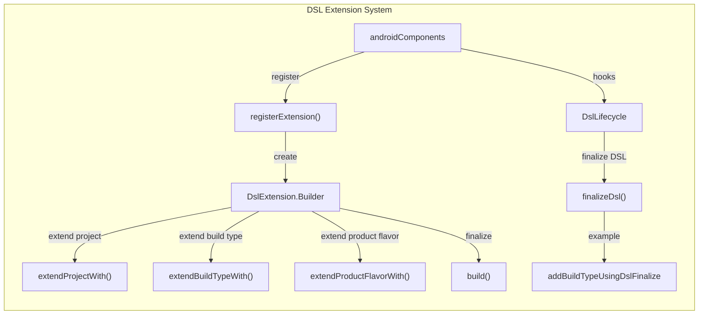
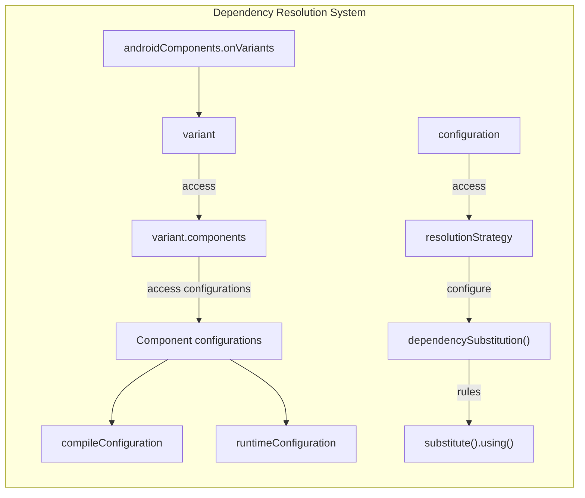
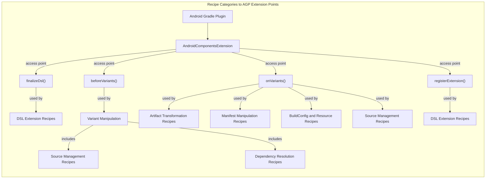

<!-- source: DeepWiki mcp.deepwiki.com · repo android/gradle-recipes · page 3 Recipe Categories · fetched 2026-10-23 -->

# Recipe Categories

Relevant source files

The following files were used as context for generating this wiki page:

- [README.md](README.md)

## Purpose and Scope

This document provides an overview of the functional categories of recipes in the Android Gradle Plugin (AGP) Recipes repository. It classifies recipes based on their purpose and manipulation targets within the Android build system, helping developers quickly identify relevant examples for their specific customization needs. For detailed implementation of individual recipes, refer to their respective wiki pages in sections [3.1](#3.1) through [3.6](#3.6). For understanding the underlying architecture that enables these recipes, see [Extension Architecture](#2).

## Recipe Categories Overview

The AGP recipes are organized into functional categories that represent common customization scenarios in Android app and library development. Each category demonstrates techniques for manipulating different aspects of the build process.

```mermaid
flowchart TD
    subgraph "AGP Recipe Categories"
        direction TB
        Root["AGP Recipes"]
        Root --> ManifestRecipes["Manifest Manipulation Recipes"]
        Root --> ArtifactRecipes["Artifact Transformation Recipes"]
        Root --> BuildConfigRecipes["BuildConfig and Resource Recipes"]
        Root --> SourceRecipes["Source Management Recipes"]
        Root --> DslRecipes["DSL Extension Recipes"]
        Root --> DependencyRecipes["Dependency Resolution Recipes"]
        
        ManifestRecipes --> |"examples"| M1["transformManifest"]
        ManifestRecipes --> |"examples"| M2["createSingleArtifact"]
        ManifestRecipes --> |"examples"| M3["perVariantManifestPlaceholder"]
        
        ArtifactRecipes --> |"examples"| A1["getSingleArtifact"]
        ArtifactRecipes --> |"examples"| A2["getMultipleArtifact"]
        ArtifactRecipes --> |"examples"| A3["transformDirectory"]
        ArtifactRecipes --> |"examples"| A4["transformAllClasses"]
        
        BuildConfigRecipes --> |"examples"| B1["addCustomBuildConfigFields"]
        
        SourceRecipes --> |"examples"| S1["addGeneratedSourceFolder"]
        SourceRecipes --> |"examples"| S2["addCustomSourceType"]
        
        DslRecipes --> |"examples"| D1["extendingAgp"]
        DslRecipes --> |"examples"| D2["addBuildTypeUsingDslFinalize"]
        
        DependencyRecipes --> |"examples"| DR1["variantDependencySubstitutionTest"]
    end
```

Sources: [README.md:8-15]()

## Manifest Manipulation Recipes

Manifest manipulation recipes demonstrate techniques for modifying the AndroidManifest.xml files during the build process. These recipes help developers inject dynamic values, merge manifest fragments, or transform manifest content before packaging.

Key manipulation techniques include:
- Transforming manifest content using the `SingleArtifact.MERGED_MANIFEST` artifact
- Creating custom manifests using artifact creation operations
- Setting manifest placeholders per variant

Sources: [README.md:11](), [README.md:84](), [README.md:96](), [README.md:139]()

## Artifact Transformation Recipes

Artifact transformation recipes demonstrate how to access and modify various build artifacts produced during the AGP build lifecycle. These recipes show how to intercept, transform, and extend artifacts such as compiled code, resource files, manifest files, and packaged outputs.

The recipes in this category utilize different artifact types:
- **SingleArtifact**: Individual files like APK, Bundle, merged manifest
- **MultipleArtifact**: Collections of files like native debug metadata
- **ScopedArtifact**: Scoped collections like compiled classes

Common operations on artifacts include:
- Getting artifacts using `get()` or `getAll()`
- Transforming artifacts with custom tasks
- Creating new artifacts
- Appending to existing artifacts
- Listening to artifact changes

Sources: [README.md:12](), [README.md:27-32](), [README.md:66-80](), [README.md:81-84]()

## BuildConfig and Resource Recipes

BuildConfig and Resource recipes demonstrate how to customize BuildConfig fields and manipulate resource files. These recipes help add custom constants, modify resource values, or inject placeholders at build time.

Key techniques include:
- Adding custom BuildConfig fields through the variant API
- Working with resource values and assets
- Managing resource shrinking configurations

Sources: [README.md:33-34](), [README.md:82-83](), [README.md:140]()

## Source Management Recipes

Source management recipes show how to add custom source directories, generate source code at build time, and manage source sets. These recipes are useful for code generation, customizing source organization, or adding preprocessing steps.

Key techniques include:
- Adding generated source directories to the build
- Creating custom source types
- Bridging between legacy source management APIs and the new AGP API
- Managing layered and flat source directory structures

Sources: [README.md:15](), [README.md:85-86](), [README.md:144-158]()

## DSL Extension Recipes

DSL Extension recipes demonstrate how to extend the Gradle DSL to provide custom configuration options for your build plugin. These recipes help create clean, type-safe configuration interfaces for your build customizations.

Key techniques include:
- Extending the AGP DSL with custom extension classes
- Adding custom build types using DSL finalization hooks
- Creating type-safe configuration options for variants, build types, and flavors

Sources: [README.md:13](), [README.md:48-52](), [README.md:99](), [README.md:108](), [README.md:114](), [README.md:150]()

## Dependency Resolution Recipes

Dependency resolution recipes demonstrate how to customize the dependency resolution process during the Android build. These recipes help implement version substitution, conditional dependencies, or custom resolution strategies.

Key techniques include:
- Implementing dependency substitution rules
- Working with variant-specific dependency configurations
- Accessing component configurations

Sources: [README.md:14](), [README.md:44-47](), [README.md:121-123]()

## Relationship to AGP Extension Architecture

Each recipe category leverages specific parts of the AGP Extension Architecture and API. The diagram below illustrates how the recipe categories map to the AGP extension points.

Sources: [README.md:20-24](), [README.md:113-116]()

## Recipe Selection Guide

When selecting a recipe to solve a specific build customization problem, consider the following:

| If you need to... | Look at recipe category | Example recipes |
|-------------------|-------------------------|-----------------|
| Modify the Android manifest | Manifest Manipulation | `transformManifest`, `perVariantManifestPlaceholder` |
| Transform build outputs | Artifact Transformation | `transformAllClasses`, `getSingleArtifact` |
| Add custom constants to BuildConfig | BuildConfig and Resource | `addCustomBuildConfigFields` |
| Generate code during the build | Source Management | `addGeneratedSourceFolder` |
| Create custom configuration options | DSL Extension | `extendingAgp` |
| Customize dependency resolution | Dependency Resolution | `variantDependencySubstitutionTest` |
| Control which variants are built | Variant Selection | `selectVariants` |

Sources: [README.md:7-15]()

## Cross-Cutting APIs

Several AGP APIs are used across multiple recipe categories:

| API | Used In | Purpose |
|-----|---------|---------|
| `androidComponents.onVariants()` | All categories | Main entry point to access variants |
| `variant.artifacts` | Artifact, Manifest, Sources | Access build artifacts |
| `variant.sources` | Source Management | Manage source directories |
| `variant.buildConfigFields` | BuildConfig | Add custom fields |
| `variant.manifestPlaceholders` | Manifest Manipulation | Set manifest placeholders |
| `variant.components` | Dependency Resolution | Access configurations |

Sources: [README.md:115](), [README.md:127-146]()

---

