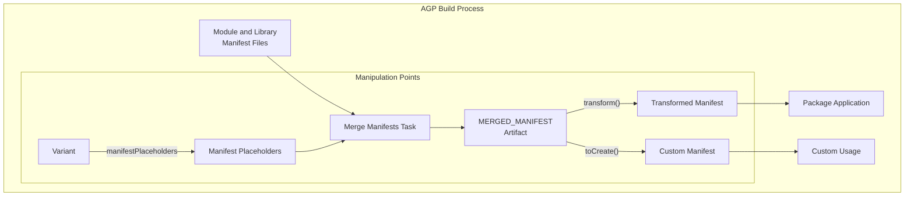
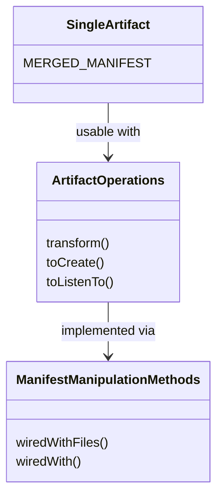
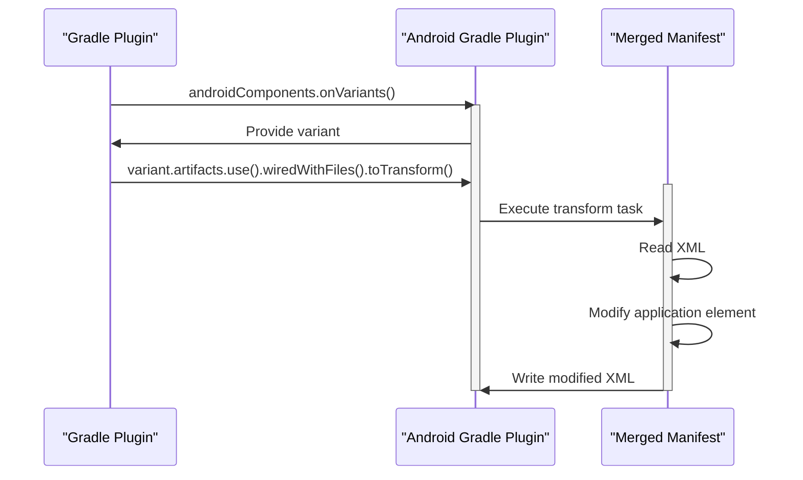
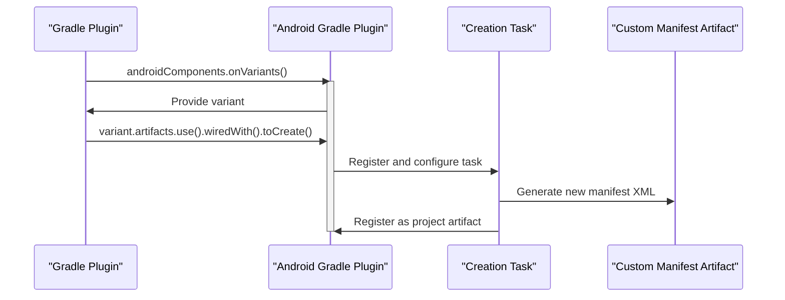
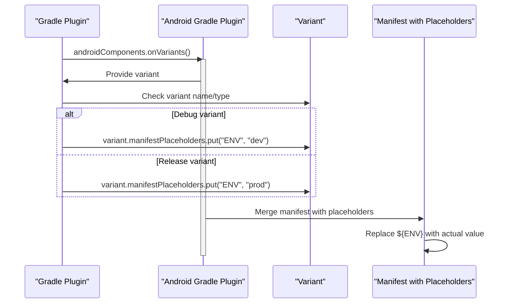
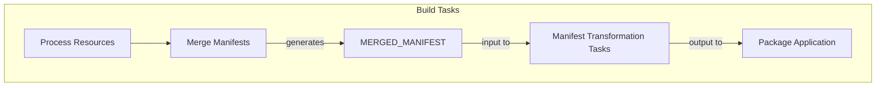

<!-- source: DeepWiki mcp.deepwiki.com · repo android/gradle-recipes · page 3.1 Manifest Manipulation Recipes · fetched 2026-10-23 -->

# Manifest Manipulation Recipes

Relevant source files

The following files were used as context for generating this wiki page:

- [README.md](README.md)

## Purpose and Scope

This document details methods for manipulating the Android Manifest during the build process using the Android Gradle Plugin (AGP) API. It covers techniques for transforming existing manifests, creating new manifest artifacts, and managing manifest placeholders on a per-variant basis. For information about artifact transformations in general, see [Artifact Transformation Recipes](#3.2).

## Android Manifest Overview

The Android Manifest (`AndroidManifest.xml`) is a critical file that provides essential information about your app to the Android system. During the build process, multiple manifest files from different modules and build variants are merged into a single manifest. AGP offers several ways to manipulate this manifest during the build process.

**Key Manifest Manipulation Scenarios:**
- Dynamically inserting values (e.g., version codes, application IDs)
- Adding or modifying components (activities, services, permissions)
- Creating specialized manifests for different build variants
- Post-processing the merged manifest for custom logic

## Manifest Manipulation Architecture

The following diagram illustrates how manifest manipulation fits into the AGP build process:

Sources: [README.md:11-12]()

## Manifest Artifact Types and Operations

The AGP Artifacts API provides specific artifact types and operations for manifest manipulation:

Sources: [README.md:84]()

## Manifest Transformation Techniques

### 1. Transforming the Merged Manifest

The most common approach is to transform the merged manifest using the `artifacts.use()` API with `wiredWithFiles()`. This allows you to read the merged manifest file, modify its contents, and write the modified version.

**Implementation pattern:**
1. Access the variant's artifacts through `onVariants()` hook
2. Use `variant.artifacts.use().wiredWithFiles().toTransform()` to set up the transformation
3. Define a task that reads the manifest, modifies it, and writes the result

Sources: [README.md:84-89](), [README.md:131-139]()

### 2. Creating a Custom Manifest Artifact

For cases where you need to generate a completely new manifest file rather than modifying the existing one, you can use `toCreate()` to register a task that will create a new manifest artifact.

**Implementation pattern:**
1. Access the variant's artifacts through `onVariants()` hook
2. Use `variant.artifacts.use().wiredWith().toCreate()` to register a creation task
3. Define a task that generates a new manifest file from scratch

Sources: [README.md:70](), [README.md:84](), [README.md:134]()

### 3. Per-Variant Manifest Placeholders

AGP allows for defining manifest placeholders on a per-variant basis. These placeholders can be used within the manifest file and will be replaced with actual values during the build process.

**Implementation pattern:**
1. Access the variant through `onVariants()` hook
2. Use `variant.manifestPlaceholders.put()` to add or modify placeholders
3. Reference these placeholders in the manifest file using `${placeholderName}` syntax

Sources: [README.md:96](), [README.md:142](), [README.md:153]()

## Recipe Examples

### Example 1: Transforming a Manifest File

This example demonstrates how to transform the merged manifest to add a custom attribute to the application element:

Key implementation points:
- Access variant.artifacts through the `onVariants` callback
- Use `wiredWithFiles()` since we're dealing with a single XML file
- Implement a task that reads XML, modifies it, and writes back the result

Sources: [README.md:21-31](), [README.md:84](), [README.md:139]()

### Example 2: Creating a Custom Manifest

This example shows how to create a completely new manifest file and register it as a project artifact:

Key implementation points:
- Register a task that will generate a new manifest file
- Use `toCreate()` to register this file as a project artifact
- The created manifest becomes available to other build tasks

Sources: [README.md:70](), [README.md:84](), [README.md:134]()

### Example 3: Per-Variant Manifest Placeholders

This example illustrates how to set different manifest placeholders for different build variants:

Key implementation points:
- Access variant's manifestPlaceholders property
- Use `put()` method to add or modify placeholders
- In manifest, use `${placeholderName}` syntax to reference placeholders

Sources: [README.md:96](), [README.md:142](), [README.md:153]()

## Integration with Build System

The manifest manipulation operations integrate with the AGP build system through task dependencies:

Sources: [README.md:84-89]()

## Best Practices

1. **Use Up-to-Date Checks**: Implement proper up-to-date checks in your transformation tasks using `task.outputs.upToDateWhen {}` to avoid unnecessary re-execution.

2. **Error Handling**: Implement robust error handling in manifest transformations, as malformed manifests can cause cryptic build failures.

3. **Performance Considerations**: For large projects with many variants, minimize heavy manifest transformations to keep build times reasonable.

4. **Testing**: Test manifest transformations across different build variants to ensure they behave as expected.

5. **Documentation**: Document custom manifest modifications, especially when they affect how the application behaves at runtime.

Sources: [README.md:91]()

## Common Pitfalls

1. **XML Namespace Handling**: Failing to preserve XML namespaces when transforming the manifest can lead to runtime issues.

2. **Task Order Dependencies**: Ensure proper task ordering by using the AGP task dependency mechanisms rather than manually setting dependencies.

3. **Overwriting Critical Elements**: Be cautious when modifying essential manifest elements like permissions, as removing or changing them can cause runtime failures.

4. **Variant-Specific Logic**: Remember that manifest transformations may need to behave differently based on the build variant.

Sources: [README.md:84-89](), [README.md:91]()

## Related AGP APIs

The following AGP APIs are commonly used for manifest manipulation:

| API | Purpose |
|-----|---------|
| `SingleArtifact.MERGED_MANIFEST` | References the merged manifest artifact |
| `variant.artifacts.use().wiredWithFiles().toTransform()` | Transforms the manifest file |
| `variant.artifacts.use().wiredWith().toCreate()` | Creates a new manifest artifact |
| `variant.manifestPlaceholders.put()` | Sets manifest placeholders |
| `task.outputs.upToDateWhen {}` | Controls task up-to-date behavior |

Sources: [README.md:84-91](), [README.md:96](), [README.md:139-142]()

---

