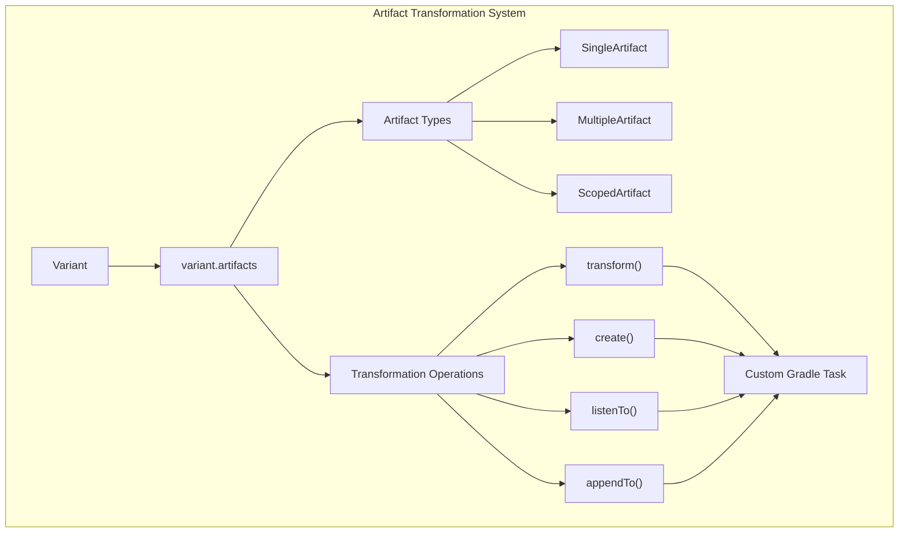
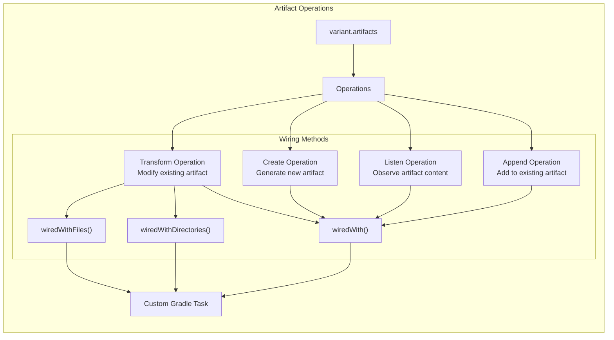
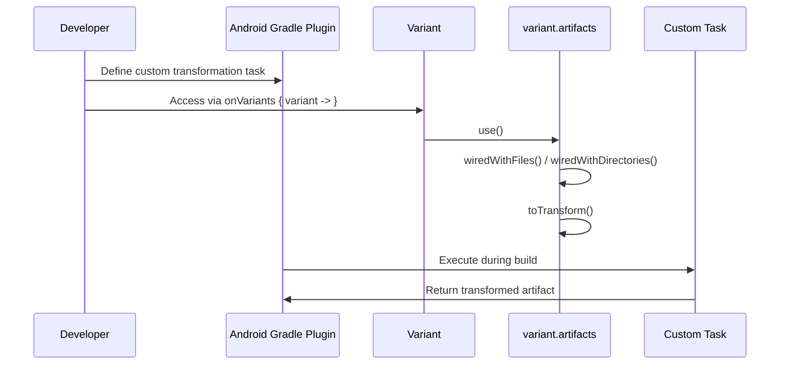
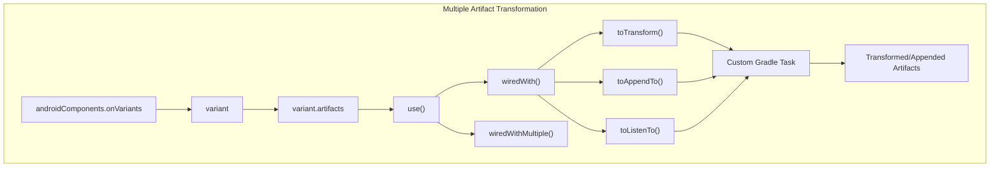
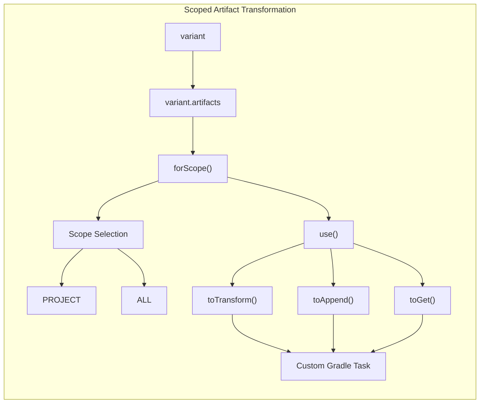
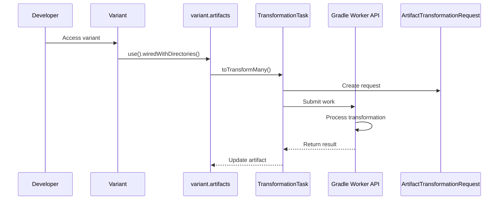
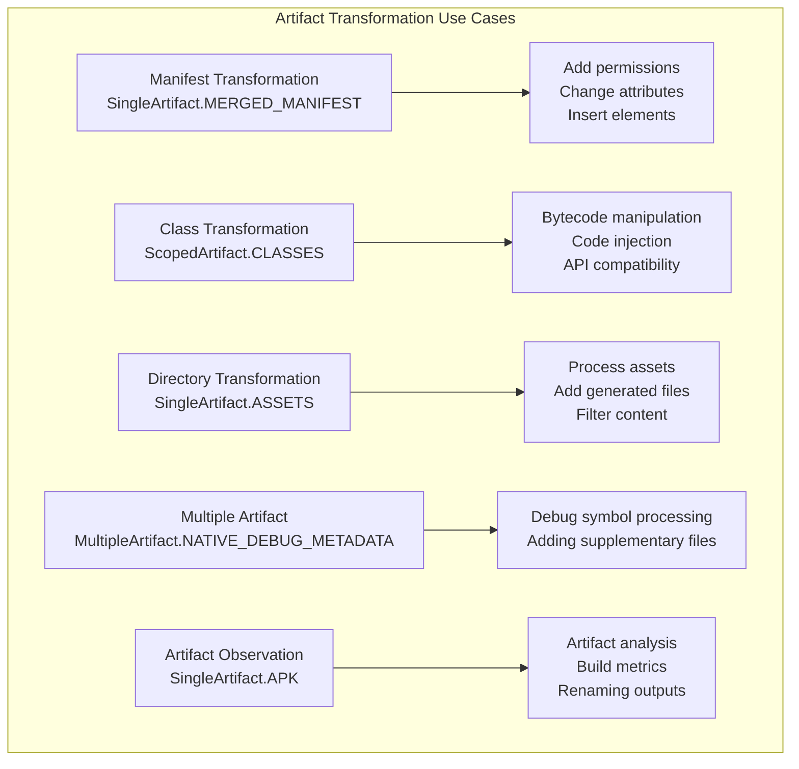
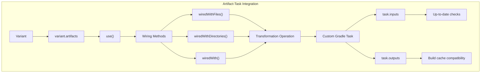

<!-- source: DeepWiki mcp.deepwiki.com · repo android/gradle-recipes · page 3.2 Artifact Transformation Recipes · fetched 2026-10-23 -->

# Artifact Transformation Recipes

Relevant source files

The following files were used as context for generating this wiki page:

- [README.md](README.md)

## Purpose and Scope

This document provides a comprehensive guide to the artifact transformation recipes in the Android Gradle Plugin (AGP) extension system. These recipes demonstrate how to manipulate build artifacts during the Android build process using AGP's Artifact API. 

For information about the overall Artifact API system architecture, please refer to [Artifact API System](#2.2). For manifest-specific transformations, see [Manifest Manipulation Recipes](#3.1).

## Understanding Artifact Transformations

Artifact transformations are operations that modify, create, or observe build outputs during the Android build process. These operations integrate with Gradle's task system to ensure proper task dependencies and incremental builds.

**Diagram: Artifact Transformation System Overview**

Sources: README.md

### Artifact Types

AGP defines three main types of artifacts that can be transformed:

| Artifact Type | Description | Common Examples | Access Method |
|---------------|-------------|-----------------|---------------|
| SingleArtifact | Represents a single file or directory | MERGED_MANIFEST, ASSETS | `variant.artifacts.get()` |
| MultipleArtifact | Represents a collection of files | NATIVE_DEBUG_METADATA | `variant.artifacts.getAll()` |
| ScopedArtifact | Files scoped to a specific context (project, module dependencies, or both) | CLASSES | `variant.artifacts.forScope()` |

Sources: README.md

## Transformation Operations

The Artifact API offers four primary operations that can be performed on artifacts:

**Diagram: Artifact Operations and Wiring Methods**

Sources: README.md

## Common Transformation Patterns

### Single Artifact Transformations

This pattern is used to transform a single file or directory artifact.

**Diagram: Single Artifact Transformation Flow**

Sources: README.md

#### Example Use Cases:

1. **Transform an Android Manifest**
   - Customize AndroidManifest.xml content
   - Access using `SingleArtifact.MERGED_MANIFEST`
   - Relevant recipe: `transformManifest`

2. **Transform Assets Directory**
   - Process assets during build time
   - Access using `SingleArtifact.ASSETS`
   - Relevant recipe: `transformDirectory`

### Multiple Artifact Transformations

For transforming collections of files represented as multiple artifacts.

**Diagram: Multiple Artifact Transformation System**

Sources: README.md

#### Example Use Cases:

1. **Transform Native Debug Metadata**
   - Process debug symbols
   - Access using `MultipleArtifact.NATIVE_DEBUG_METADATA`
   - Relevant recipes: `transformMultiple`, `appendToMultipleArtifact`

2. **Listen to Multiple Artifacts**
   - Monitor artifact changes
   - Relevant recipe: `listenToMultipleArtifact`

### Scoped Artifact Transformations

For transforming artifacts that are scoped to specific contexts.

**Diagram: Scoped Artifact Transformation System**

Sources: README.md

#### Example Use Cases:

1. **Transform All Classes**
   - Modify compiled classes
   - Access using `ScopedArtifact.CLASSES` with `ScopedArtifacts.Scope.PROJECT`
   - Relevant recipe: `transformAllClasses`

2. **ASM Class Transformation**
   - Bytecode manipulation
   - Relevant recipe: `asmTransformClasses`

### Worker-enabled Transformations

For performance-optimized transformations using Gradle's worker API.

**Diagram: Worker-enabled Transformation Flow**

Sources: README.md

## Recipe Implementation Examples

### 1. Transform a Single File (Manifest)

This pattern uses `wiredWithFiles()` to transform a single file artifact like the AndroidManifest.xml.

Key API calls:
- `variant.artifacts.use()`
- `wiredWithFiles()`
- `toTransform()`

Sources: README.md

### 2. Transform a Directory

This pattern uses `wiredWithDirectories()` to transform a directory artifact like assets.

Key API calls:
- `variant.artifacts.use()`
- `wiredWithDirectories()`
- `toTransform()`

Sources: README.md

### 3. Transform Multiple Files

This pattern uses `wiredWith()` and collection-based APIs to transform multiple files.

Key API calls:
- `variant.artifacts.use()`
- `wiredWith()`
- `toTransform()`
- `addMultipleArtifact()`

Sources: README.md

### 4. Append to Artifacts

This pattern allows adding new files to existing artifacts.

Key API calls:
- `variant.artifacts.use()`
- `wiredWith()`
- `toAppendTo()`
- `appendToMultipleArtifact()`
- `appendToScopedArtifacts()`

Sources: README.md

### 5. Listen to Artifacts

This pattern allows observing artifacts without modifying them.

Key API calls:
- `variant.artifacts.use()`
- `wiredWith()`
- `toListenTo()`
- `listenToMultipleArtifact()`
- `listenToArtifacts()`

Sources: README.md

## Common Use Cases

**Diagram: Common Artifact Transformation Use Cases**

Sources: README.md

## Integration with Gradle Task System

Artifact transformations are tightly integrated with Gradle's task system, ensuring proper task dependencies, incremental builds, and build cache compatibility.

**Diagram: Artifact and Gradle Task Integration**

Sources: README.md

## Summary and Best Practices

When implementing artifact transformations, consider the following best practices:

1. **Choose the right artifact type**:
   - SingleArtifact for individual files or directories
   - MultipleArtifact for collections of files
   - ScopedArtifact for context-specific artifacts

2. **Select the appropriate operation**:
   - Transform to modify existing artifacts
   - Create to generate new artifacts
   - Listen to observe without modification
   - Append to add to existing artifacts

3. **Ensure task efficiency**:
   - Use proper up-to-date checks
   - Consider using worker API for parallelization
   - Implement incremental build support where appropriate

4. **Follow dependency ordering**:
   - Transformations should properly declare their inputs and outputs
   - Tasks should be properly wired to ensure correct execution order

By following these guidelines and leveraging the recipes in this repository, you can effectively customize the Android build process to meet your specific requirements.

Sources: README.md

---

