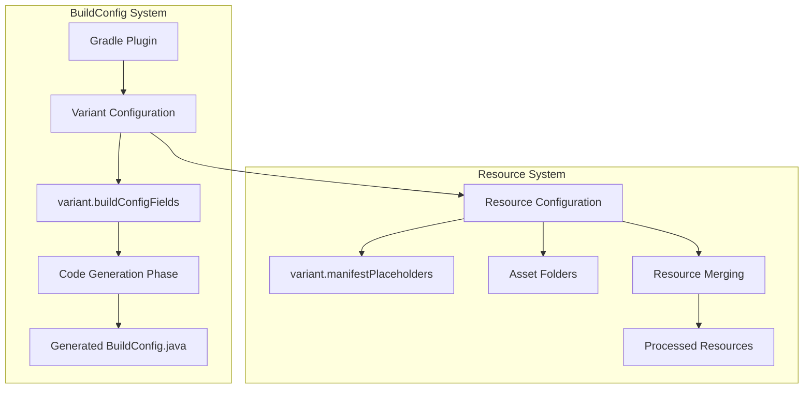
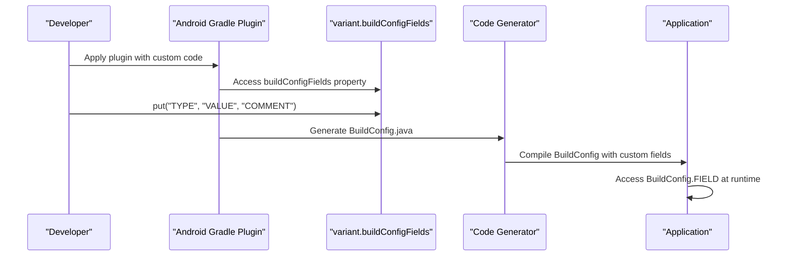
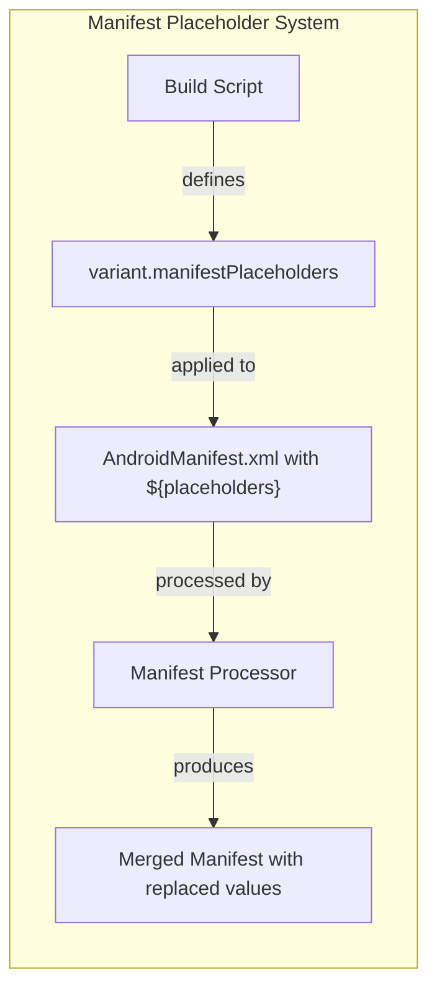
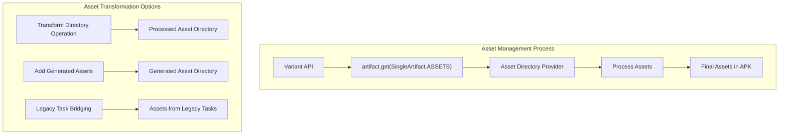
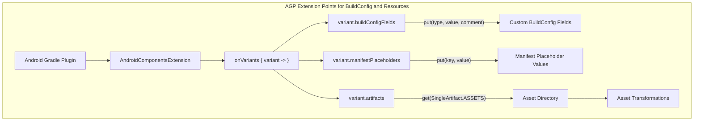

<!-- source: DeepWiki mcp.deepwiki.com · repo android/gradle-recipes · page 3.3 BuildConfig and Resource Recipes · fetched 2026-10-23 -->

# BuildConfig and Resource Recipes

<details>
<summary>Relevant source files</summary>

The following files were used as context for generating this wiki page:

- [README.md](README.md)

</details>


## Purpose and Scope

This document covers recipes for customizing the BuildConfig class and working with Android resources using the Android Gradle Plugin (AGP) APIs. These recipes demonstrate how to add custom build configuration fields to the BuildConfig class and how to work with various Android resources including manifest placeholders and assets. For information about source management, including generated source code, see [Source Management Recipes](#3.4).

## Understanding BuildConfig and Resources



The Android build system generates a `BuildConfig` class for each build variant of your app, containing constants that you can access at runtime. This includes standard fields like `DEBUG`, `APPLICATION_ID`, `BUILD_TYPE`, and `FLAVOR`. You can add custom fields to provide additional build-specific information.

Resources in Android include strings, layouts, drawables, and other files organized in the `res` directory. Additionally, the Android asset system manages files in the `assets` directory. The manifest file can include placeholders that are replaced with actual values during the build process.

Sources:
[README.md:33-34]()
[README.md:82-83]()
[README.md:96]()
[README.md:140-142]()
[README.md:153]()

## Adding Custom BuildConfig Fields



The AGP exposes the `buildConfigFields` property on each variant, allowing you to add custom fields of different types (String, int, boolean, etc.) to the generated BuildConfig class. This is useful for storing configuration values that should be available at runtime but determined at build time.

### Using the addCustomBuildConfigFields Recipe

To add custom BuildConfig fields, you use the `buildConfigFields.put()` method with three parameters:
1. The type of the field (e.g., "String", "boolean", "int")
2. The value for the field
3. An optional comment for the generated code

Example usage pattern:

```
androidComponents.onVariants { variant ->
    variant.buildConfigFields.put("STRING_VALUE", "\"myValue\"", "Comment for the field")
    variant.buildConfigFields.put("BOOLEAN_VALUE", "true", "Boolean flag")
    variant.buildConfigFields.put("INTEGER_VALUE", "42", "The answer")
}
```

The fields are added to the generated BuildConfig class and can be accessed at runtime via `BuildConfig.STRING_VALUE`, `BuildConfig.BOOLEAN_VALUE`, etc.

Sources:
[README.md:33]()
[README.md:140]()

## Working with Manifest Placeholders



Android manifest files can include placeholders in the format `${placeholder_name}` that are replaced with actual values during the build process. The AGP provides APIs to set these placeholder values for each build variant.

### Using the perVariantManifestPlaceholder Recipe

You can set manifest placeholders using the `manifestPlaceholders.put()` method on a variant:

```
androidComponents.onVariants { variant ->
    variant.manifestPlaceholders.put("hostName", "example.com")
    variant.manifestPlaceholders.put("deepLinkScheme", "myapp")
}
```

These placeholders can be used in your AndroidManifest.xml:

```xml
<intent-filter>
    <data android:scheme="${deepLinkScheme}" android:host="${hostName}" />
</intent-filter>
```

This allows you to specify different values for different build variants, such as using different deep link schemes for debug and release builds.

Sources:
[README.md:96]()
[README.md:142]()
[README.md:153]()

## Working with Asset Folders



The AGP Artifact API provides access to the assets directory through `SingleArtifact.ASSETS`. This allows you to:

1. Transform the assets directory to modify, add, or remove assets
2. Add generated assets from custom tasks
3. Bridge between legacy Gradle tasks and the modern AGP Artifact API

### Asset Directory Transformation

You can transform the asset directory using the `artifacts.use().wiredWithDirectories().toTransform()` pattern, which allows you to process all assets in a custom task before they are packaged into the APK.

### Adding Generated Assets

You can add generated assets to the build by creating tasks that generate files and then registering those directories as asset sources using the Artifact API.

### Legacy Task Bridging

If you have existing tasks that produce assets, you can integrate them with the modern AGP Artifact API using the pattern demonstrated in the legacyTaskBridging recipe.

Sources:
[README.md:82]()

## Common Use Cases and Best Practices

### BuildConfig Use Cases

- **Environment Configuration**: Define different API endpoints, keys, or behaviors for debug vs. release builds
- **Feature Flags**: Control feature availability based on build configuration
- **Version Information**: Add custom version information beyond what's provided by default
- **Build-Time Decisions**: Store decisions made at build time that need to be available at runtime

### Resource Use Cases

- **Branding Variants**: Use different assets and resources for different product flavors
- **Environment Indicators**: Visual indicators for debug builds
- **Dynamic Configuration**: Use placeholders to inject configuration into the manifest

### Best Practices

1. **Avoid Overuse of BuildConfig**: 
   - BuildConfig fields increase the size of your app
   - Consider alternative approaches for large or sensitive data

2. **Resource Management**:
   - Organize resources by flavor or dimension when appropriate
   - Use resource qualifiers rather than build variants when the differentiation is based on device characteristics

3. **Asset Optimization**:
   - Large assets should be compressed or delivered via alternative mechanisms
   - Consider on-demand delivery for non-essential assets

4. **Build Performance**:
   - Asset transformation operations can impact build time
   - Ensure transformations are incremental when possible

Sources:
[README.md:33-34]()
[README.md:82-83]()
[README.md:96]()
[README.md:140-142]()
[README.md:153]()

## Integration with AGP Extension System



The BuildConfig and resource customization recipes integrate with the broader AGP extension system primarily through the `AndroidComponentsExtension.onVariants()` callback. This gives you access to each build variant, where you can customize build configuration fields, manifest placeholders, and asset processing.

The API design follows the general pattern of the AGP extension system, where you register callbacks to be executed at specific points in the build lifecycle, and then use the provided API objects to customize the build behavior.

Sources:
[README.md:15]()
[README.md:20-21]()
[README.md:115]()
[README.md:140-142]()

## Summary

The BuildConfig and Resource Recipes demonstrate how to use the Android Gradle Plugin's APIs to customize build-time configuration and resource processing. By using the `buildConfigFields` and `manifestPlaceholders` properties, as well as the Artifact API for assets, you can adapt your app's behavior and content based on the build variant.

These capabilities are particularly useful for:
- Supporting multiple environments (development, staging, production)
- Creating white-label applications with different branding
- Implementing feature flags and conditional behaviors
- Optimizing resource usage for different build types

The APIs follow the AGP extension patterns, primarily leveraging the `onVariants` callback to access and modify variant-specific configuration.

Sources:
[README.md:33-34]()
[README.md:82-83]()
[README.md:96]()
[README.md:140-142]()
[README.md:153]()

---

