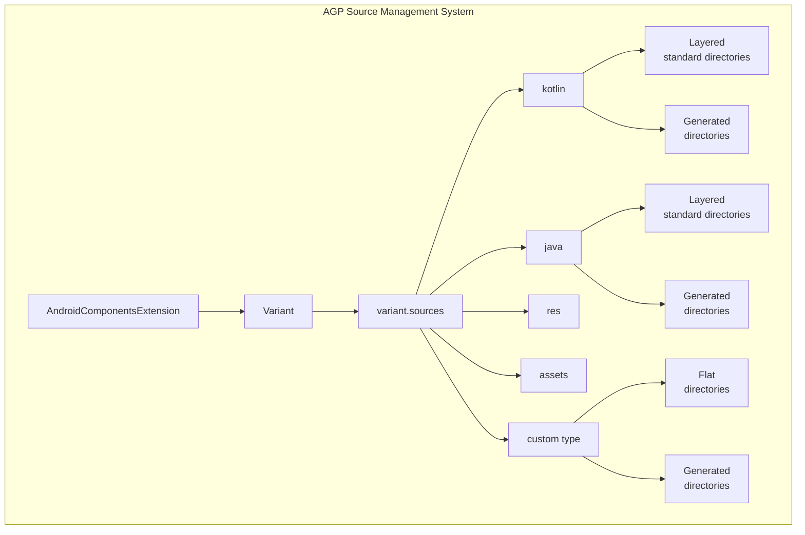
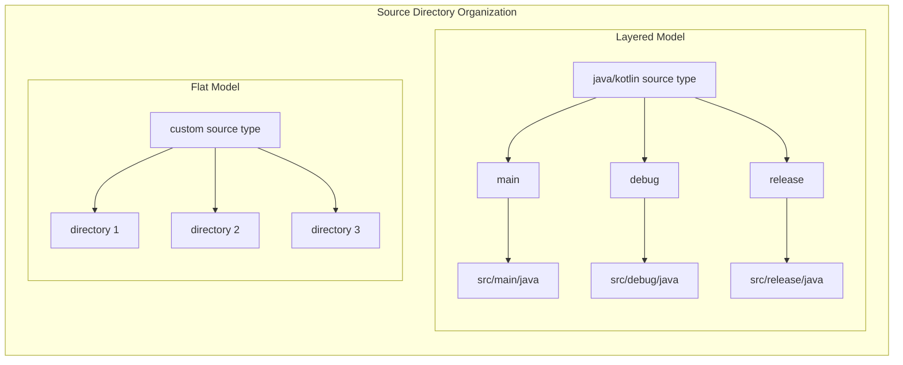
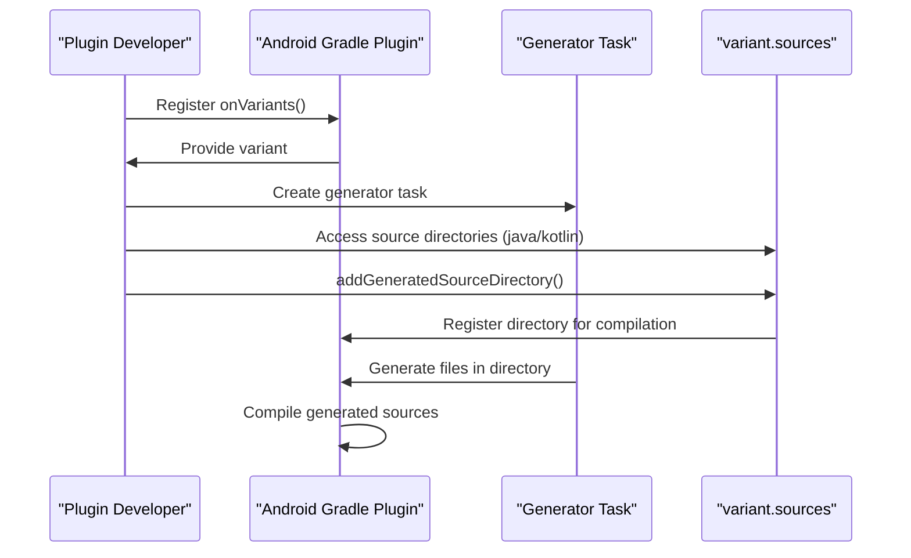
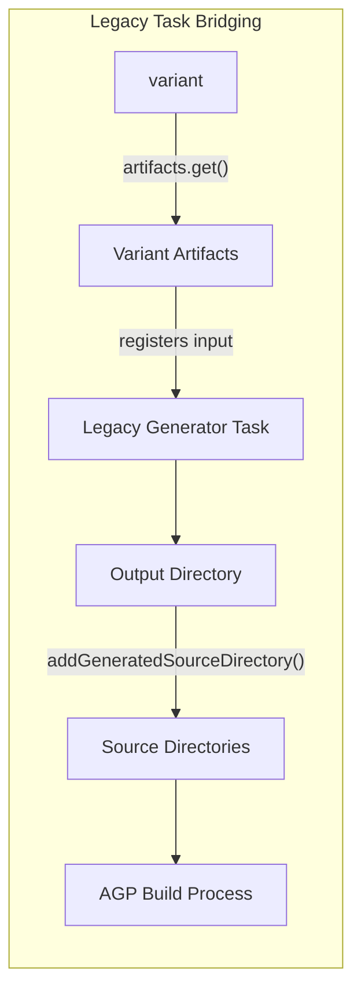
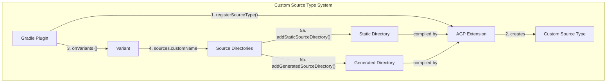
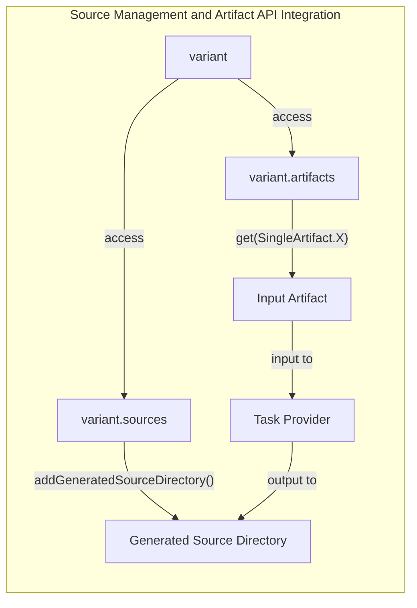

<!-- source: DeepWiki mcp.deepwiki.com · repo android/gradle-recipes · page 3.4 Source Management Recipes · fetched 2026-10-23 -->

# Source Management Recipes

Relevant source files

The following files were used as context for generating this wiki page:

- [README.md](README.md)

## Purpose and Scope

This page documents recipes for managing source code in Android Gradle Plugin (AGP) projects. It covers adding generated source folders, bridging legacy tasks with the new AGP API, and creating custom source types. These recipes demonstrate how to extend AGP's source management capabilities using the Android Components Extension API.

For artifact manipulation, see [Artifact Transformation Recipes](#3.2). For BuildConfig customization, see [BuildConfig and Resource Recipes](#3.3).

## Source Management in AGP Overview

AGP organizes source code into source sets that are organized by language type (Java, Kotlin, etc.) and variant (debug, release, etc.). The source management system provides APIs for:

1. Adding generated source folders to existing source types
2. Adding static source directories to existing source types
3. Creating custom source types beyond the standard ones
4. Connecting Gradle tasks to source generation processes

Sources: README.md

## Source Directory Organization

AGP supports two models for organizing source directories:

1. **Layered** - Used by standard source types (java, kotlin, etc.) with hierarchical organization
2. **Flat** - Used by custom source types with a simpler, non-hierarchical structure

Sources: README.md:155-157

## Recipe: Adding Generated Source Folders

This recipe demonstrates how to add a dynamically generated source folder to an Android project's source sets. This is particularly useful when you have code generation tasks that need to integrate with the AGP build system.

### Implementation Process

### Key API Usage

1. Access source directories through `variant.sources`
2. Call `addGeneratedSourceDirectory()` with:
   - Source directory to add
   - Task provider that generates the sources
   - Language-specific source type (java, kotlin, etc.)

Sources: README.md:10, README.md:15, README.md:44, README.md:47, README.md:85, README.md:144, README.md:146, README.md:156

## Recipe: Bridging Legacy Tasks with AGP

This recipe shows how to connect legacy Gradle tasks with the new AGP Artifacts API for source management. This is useful when migrating from older Gradle configurations to the modern AGP extension system.

### Legacy Task Bridging Process

### Implementation Details

The legacy task bridging pattern involves:

1. Getting an existing artifact from `variant.artifacts.get()`
2. Using it as input to a legacy task
3. Adding the task's output directory to source directories using `addGeneratedSourceDirectory()`
4. Ensuring proper task dependencies are established

Sources: README.md:10, README.md:15, README.md:44, README.md:47, README.md:85, README.md:130, README.md:144, README.md:152

## Recipe: Adding Custom Source Types

This recipe demonstrates how to create and register custom source types beyond the standard ones provided by AGP (java, kotlin, resources, etc.). Custom source types are useful for specialized code generation or when working with non-standard languages.

### Custom Source Type Registration and Usage

### Implementation Steps

1. Register a custom source type with a unique name
2. Configure whether it uses a flat or layered directory structure
3. Access the source type through `variant.sources.[customName]`
4. Add static directories with `addStaticSourceDirectory()`
5. Add generated directories with `addGeneratedSourceDirectory()`

### Usage Differences from Standard Types

Custom source types differ from standard ones in:

| Feature | Standard Types (java, kotlin) | Custom Types |
|---------|-------------------------------|--------------|
| Directory Structure | Layered (main, debug, etc.) | Typically Flat |
| Registration | Pre-registered by AGP | Must be registered explicitly |
| Compilation | Automatic for recognized languages | May require custom task configuration |
| Source Sets | Follows AGP source set conventions | Custom organization possible |

Sources: README.md:15, README.md:47, README.md:85-86, README.md:144-145, README.md:146, README.md:155, README.md:157-158

## Best Practices

1. **Task Dependencies**: When adding generated source directories, always provide the task that generates the content to ensure proper build sequencing.

2. **Directory Naming**: Use clear, descriptive names for custom source types and generated directories to maintain readability.

3. **Layered vs. Flat**: Choose the appropriate directory structure based on your needs:
   - Use Layered for languages that benefit from variant-specific source sets
   - Use Flat for simpler, variant-agnostic source types

4. **Generated vs. Static**: Understand the difference between:
   - `addGeneratedSourceDirectory()` - For directories created during the build
   - `addStaticSourceDirectory()` - For pre-existing directories

Sources: README.md:85-86, README.md:144-145, README.md:155-158

## Advanced Source Management Techniques

### Source Registration Timing

The timing of source registration is important:

1. Register custom source types before variants are created
2. Add generated/static directories in the `onVariants` callback
3. Ensure generator tasks are properly configured before registering their output directories

### Integration with Artifact API

Source management often works alongside the Artifact API:

The pattern typically involves:
1. Getting an input artifact using `variant.artifacts.get()`
2. Using it as input to a generator task
3. Adding the task's output as a generated source directory

Sources: README.md:42-47, README.md:85, README.md:130, README.md:144

## Conclusion

Source management recipes enable you to extend AGP's source handling capabilities with generated code, custom source types, and integration with legacy tasks. These patterns are essential for build customization and code generation workflows in Android projects.

When implementing these recipes, remember to properly manage task dependencies and artifact flows to ensure correct build ordering and efficient incremental builds.

---

