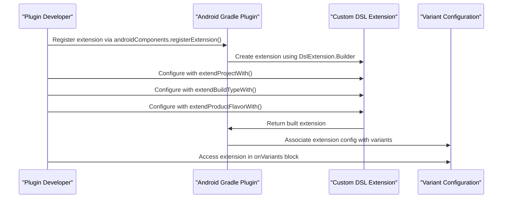
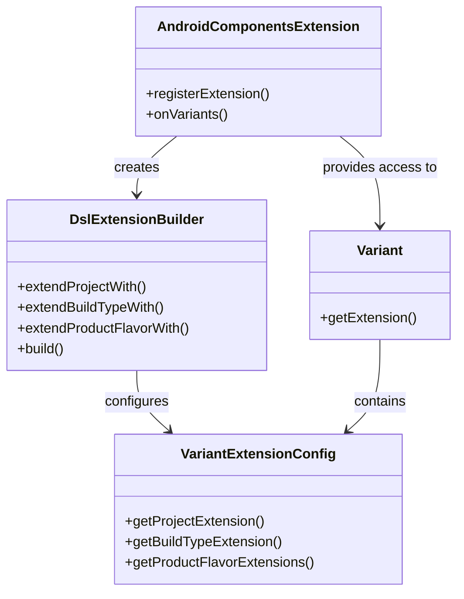
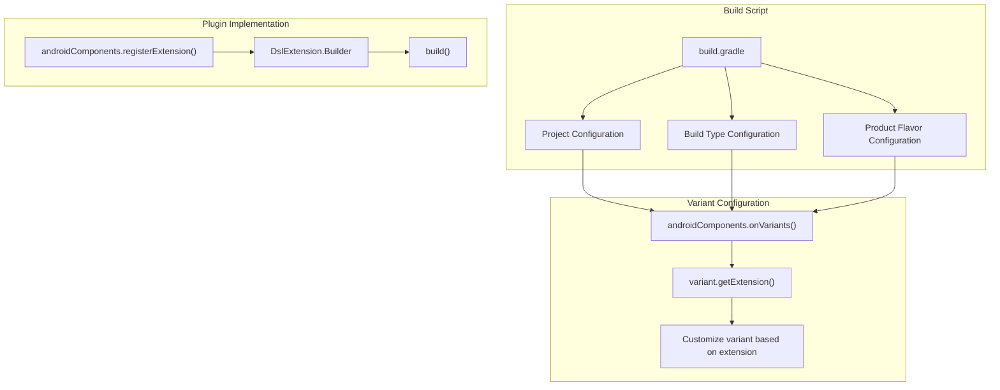

<!-- source: DeepWiki mcp.deepwiki.com · repo android/gradle-recipes · page 3.5 DSL Extension Recipes · fetched 2026-10-23 -->

# DSL Extension Recipes

<details>
<summary>Relevant source files</summary>

The following files were used as context for generating this wiki page:

- [README.md](README.md)

</details>


## Purpose and Scope

This document provides recipes and best practices for extending the Android Gradle Plugin (AGP) Domain Specific Language (DSL) with custom configuration options. It explains how to create extensions that add new configuration options at the project, build type, and product flavor levels. For information about other AGP customization approaches, see [Extension Architecture](#2) and [Artifact Transformation Recipes](#3.2).

## Understanding DSL Extensions in AGP

DSL extensions allow you to augment the AGP build system with custom configuration options that plugin users can define in their build files. These extensions can then be accessed during variant configuration to influence the build process.

### DSL Extension Lifecycle



Sources: README.md:22, README.md:48-51, README.md:108, README.md:116

## DSL Extension Components

The DSL extension system consists of several key components that work together to extend the AGP build system.



Sources: README.md:22, README.md:48-51, README.md:99, README.md:108

### Key Components

1. **AndroidComponentsExtension.registerExtension()**: The entry point for registering a new DSL extension.

2. **DslExtension.Builder**: Used to configure the extension, including:
   - `extendProjectWith()`: Define project-level extension properties
   - `extendBuildTypeWith()`: Define build type-level extension properties
   - `extendProductFlavorWith()`: Define product flavor-level extension properties
   - `build()`: Create the extension

3. **VariantExtensionConfig**: Interface through which extensions are accessed in variant configuration.

Sources: README.md:48-51, README.md:99

## Implementation Steps

### 1. Creating and Registering an Extension

To create a DSL extension, you need to define your extension interfaces and register them with AGP.

#### Extension Interfaces

First, define interfaces for your extension properties at each level:

- **Project-level extension**: Properties applicable to the entire project
- **Build type-level extension**: Properties configurable per build type (debug, release, etc.)
- **Product flavor-level extension**: Properties configurable per product flavor

#### Registration Process

The extension is registered using the `registerExtension()` method on `AndroidComponentsExtension`:

```
androidComponents.registerExtension(MyExtension::class.java, 
    DslExtension.Builder<MyExtension>()
        .extendProjectWith(MyProjectExtension::class.java)
        .extendBuildTypeWith(MyBuildTypeExtension::class.java)
        .extendProductFlavorWith(MyFlavorExtension::class.java)
        .build()
)
```

Sources: README.md:22, README.md:108, README.md:116

### 2. Using the Extension in Build Configuration

Once registered, your extension can be used in the build configuration:

```
// In build.gradle file
android {
    // Project-level configuration
    myExtension {
        projectProperty = "value"
    }
    
    // Build type-level configuration
    buildTypes {
        debug {
            myExtension {
                buildTypeProperty = true
            }
        }
    }
    
    // Product flavor-level configuration
    productFlavors {
        free {
            myExtension {
                flavorProperty = 42
            }
        }
    }
}
```

Sources: README.md:48-51

### 3. Accessing Extension Configuration in Variants

After registration, you can access the extension configuration in the `onVariants` block:

```
androidComponents.onVariants { variant ->
    // Access project-level extension
    val projectConfig = variant.getExtension(MyProjectExtension::class.java)
    
    // Access build type-level extension
    val buildTypeConfig = variant.getExtension(MyBuildTypeExtension::class.java)
    
    // Access product flavor-level extension
    val flavorConfig = variant.getExtension(MyFlavorExtension::class.java)
    
    // Use the configuration to customize the build
    // ...
}
```

Sources: README.md:22, README.md:115

## Extension Configuration Flow

The flow of extension configuration from build script to variant is illustrated below:



Sources: README.md:22, README.md:108, README.md:115, README.md:116

## Example Use Cases

### Feature Flags

Use DSL extensions to define feature flags that can vary by build type or flavor:

```
android {
    featureFlags {
        enableNewFeature = true
    }
    
    buildTypes {
        debug {
            featureFlags {
                enableDebugTools = true
            }
        }
        release {
            featureFlags {
                enableDebugTools = false
            }
        }
    }
}
```

### Custom Packaging Options

Define custom packaging options that affect how your app is packaged:

```
android {
    packaging {
        excludeResources = ["**/unused_resource.xml"]
    }
    
    productFlavors {
        free {
            packaging {
                excludePremiumAssets = true
            }
        }
        premium {
            packaging {
                excludePremiumAssets = false
            }
        }
    }
}
```

Sources: README.md:48-51, README.md:99, README.md:150

## Best Practices

1. **Coherent Scope**: Define extensions at the appropriate level (project, build type, or flavor) based on their scope.

2. **Default Values**: Provide sensible default values for all extension properties.

3. **Documentation**: Document your extension's properties and how they affect the build process.

4. **Type Safety**: Use strongly typed interfaces for extension properties to enable IDE code completion.

5. **Validation**: Validate extension values during variant configuration to provide clear error messages.

6. **Avoid Duplication**: Don't duplicate existing AGP DSL properties; extend functionality instead.

## Common Pitfalls

1. **Extension Timing**: Extensions are configured during the evaluation phase but accessed during variant configuration. Keep this timing in mind.

2. **Conflicts**: Be careful not to conflict with other plugins' extensions.

3. **Performance**: Avoid computationally expensive operations during extension configuration.

4. **Isolation**: Ensure that extensions at different levels don't unintentionally affect each other.

Sources: README.md:48-51, README.md:108, README.md:150

## DSL Extension vs. Artifact API

While DSL extensions provide configuration points, they often work alongside the Artifact API to implement functionality:

| Feature | DSL Extensions | Artifact API |
|---------|---------------|--------------|
| Purpose | Define configuration options | Modify build artifacts |
| When used | Configuration phase | Variant configuration phase |
| User facing | Directly in build scripts | Used by plugin developers |
| Example | `android.myExtension { ... }` | `variant.artifacts.get(...)` |

Sources: README.md:12, README.md:22, README.md:48-51

## Summary

DSL Extensions allow you to extend AGP's build configuration with custom options at the project, build type, and product flavor levels. By registering an extension with appropriate interfaces, you can provide users with a clean, native-feeling configuration DSL that can be accessed during variant configuration to customize the build process.

---

