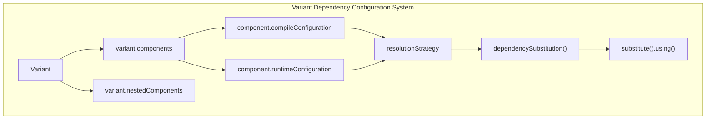
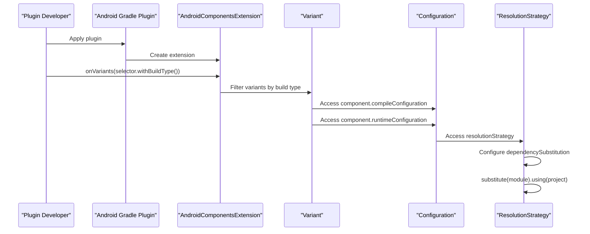
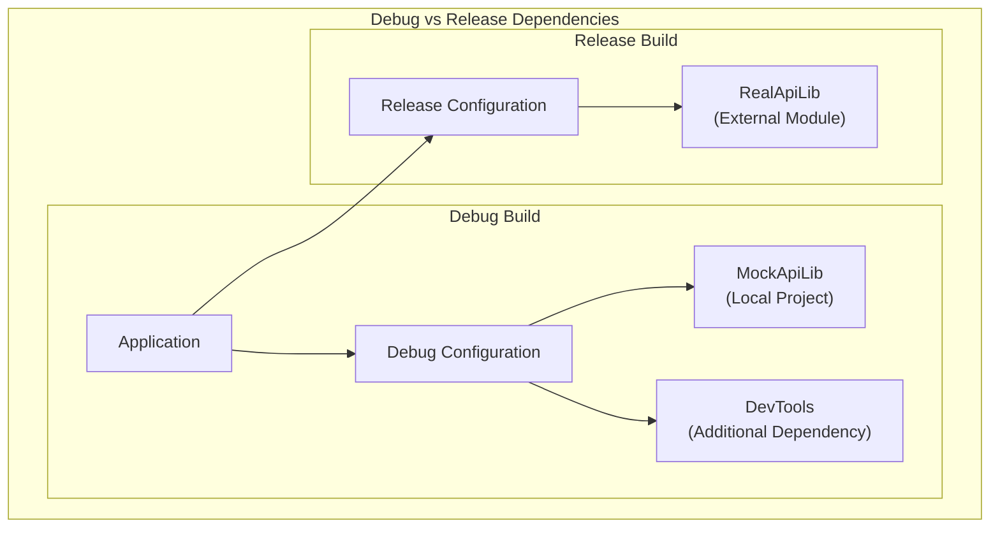

<!-- source: DeepWiki mcp.deepwiki.com · repo android/gradle-recipes · page 3.6 Dependency Resolution Recipes · fetched 2026-10-23 -->

# Dependency Resolution Recipes

<details>
<summary>Relevant source files</summary>

The following files were used as context for generating this wiki page:

- [README.md](README.md)

</details>


## Purpose and Scope

This document covers recipes for customizing dependency resolution in Android Gradle Plugin (AGP) using the variants API. These recipes demonstrate how to implement variant-specific dependency substitution rules, allowing for different dependency implementations based on build variants. This is particularly useful for testing alternative implementations or switching dependencies based on build types.

For information about general artifact manipulation, see [Artifact Transformation Recipes](#3.2).

## Dependency Resolution in AGP

Android Gradle Plugin organizes dependencies through variant-specific configurations. Each variant (combination of build type and product flavors) has its own set of configurations for compile-time and runtime dependencies. The Variant API provides access to these configurations, allowing targeted dependency substitution rules.



**Diagram: Variant dependency configuration flow**

Sources: README.md

## Variant-Specific Dependency Substitution Recipe

This recipe demonstrates how to implement build-type specific dependency substitution. The typical use case is swapping in different implementations of a dependency based on build type (debug vs release).



**Diagram: Dependency substitution flow sequence**

Sources: README.md

### Implementation Steps

1. **Select specific variants**: Use the `withBuildType()` selector to target specific build types
2. **Access configurations**: From each variant, access the compile and runtime configurations
3. **Configure substitution rules**: Apply dependency substitution rules using the Gradle Resolution Strategy API

### Example Usage Pattern

The following pattern demonstrates how to substitute dependencies for debug build variants:

```kotlin
// Select variants with 'debug' build type and apply substitution
androidComponents.onVariants(androidComponents.selector().withBuildType("debug")) { variant ->
    // Access component configurations
    variant.components.forEach { component ->
        // Configure compile-time dependencies
        component.compileConfiguration.resolutionStrategy.dependencySubstitution {
            // Substitute a module dependency with a project dependency
            substitute(module("com.example:library")).using(project(":debugLibrary"))
        }
        
        // Configure runtime dependencies
        component.runtimeConfiguration.resolutionStrategy.dependencySubstitution {
            substitute(module("com.example:library")).using(project(":debugLibrary"))
        }
    }
    
    // Handle nested components (like test configurations) if needed
    variant.nestedComponents.forEach { nestedComponent ->
        // Apply substitution rules to nested component configurations
    }
}
```

Sources: README.md

## Key API Components

The recipe utilizes several key API components:

| API Component | Description |
|--------------|-------------|
| `AndroidComponentsExtension.onVariants()` | Entry point to configure variants after creation |
| `AndroidComponentsExtension.selector().withBuildType()` | Filter variants by build type name |
| `Variant.components` | Access the components (main source set) for the variant |
| `Variant.nestedComponents` | Access nested components (e.g., test source sets) |
| `Component.compileConfiguration` | Access the compile-time dependency configuration |
| `Component.runtimeConfiguration` | Access the runtime dependency configuration |
| `Configuration.resolutionStrategy` | Access the resolution strategy for a configuration |
| `ResolutionStrategy.dependencySubstitution()` | Configure dependency substitution rules |
| `substitute().using()` | Replace one dependency with another |

Sources: README.md

## Common Use Cases

### Different Implementations for Debug Builds

One common use case is to use mock or debug implementations during development:



**Diagram: Debug vs release dependency paths**

Sources: README.md

### Testing Alternative Implementations

Another common use case is to test alternative implementations of a dependency:

- Substituting a stable release dependency with a development version
- Using a local fork of a third-party library during development
- Redirecting to an instrumented version of a library for testing

## Best Practices

1. **Target specific variants**: Use selectors to precisely target variants where substitution is needed
2. **Consider all configurations**: Apply substitution to both compile and runtime configurations when needed
3. **Maintain compatibility**: Ensure substituted dependencies have compatible APIs
4. **Document substitutions**: Make substitution rules clear to other developers
5. **Be cautious with nested components**: Remember that test configurations may require separate substitution rules

## Related Resources

For more information on Android Gradle Plugin extension capabilities:
- See [Extension Architecture](#2) for details on the overall AGP extension system
- See [Variant System](#2.3) for more information about working with variants
- See [AndroidComponentsExtension API](#4.1) for API reference

Sources: README.md

---

