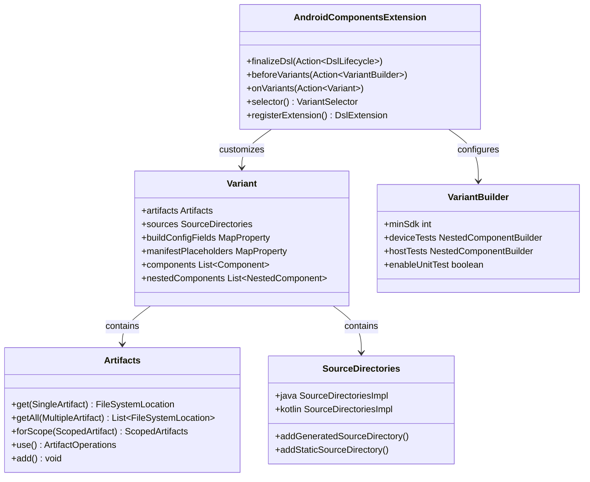
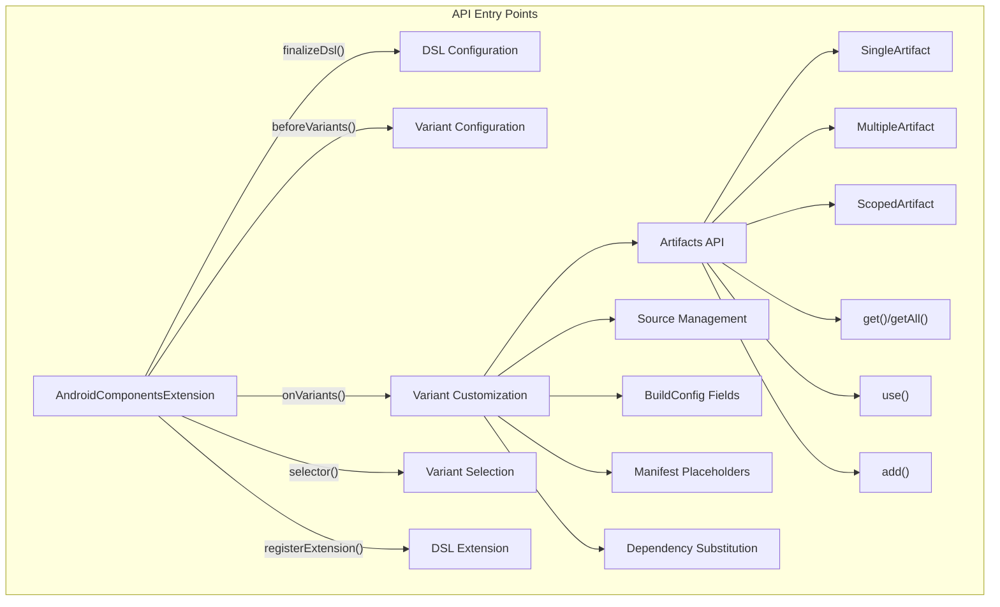
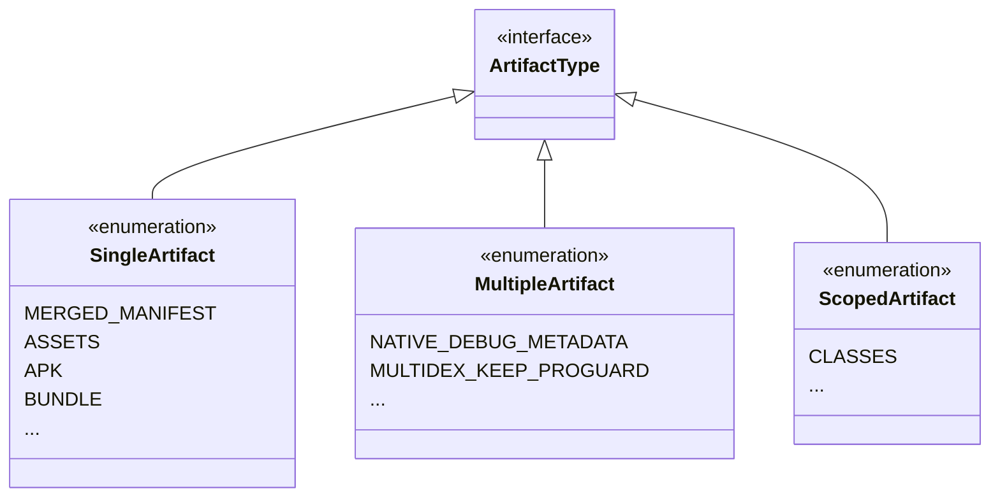
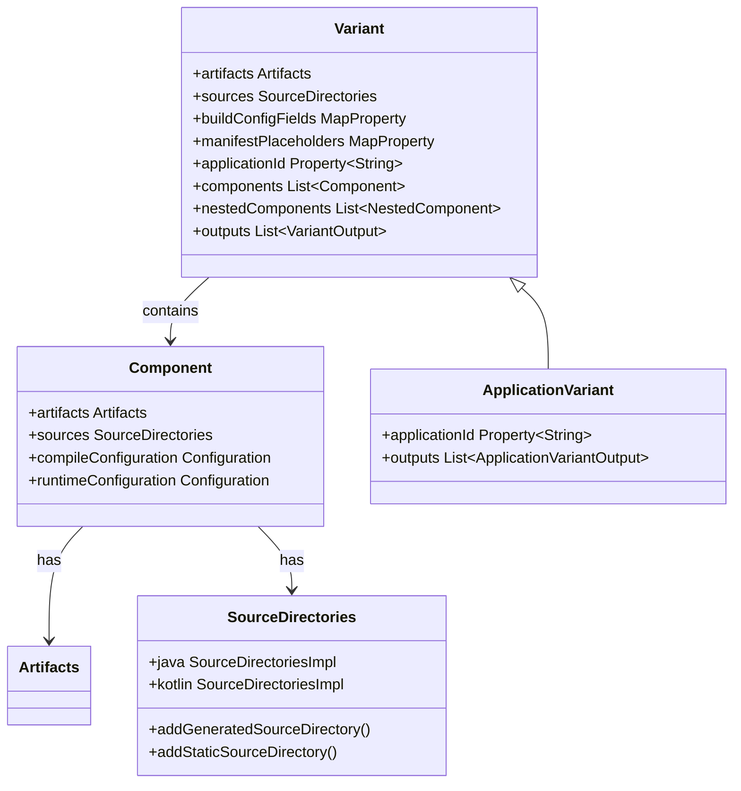
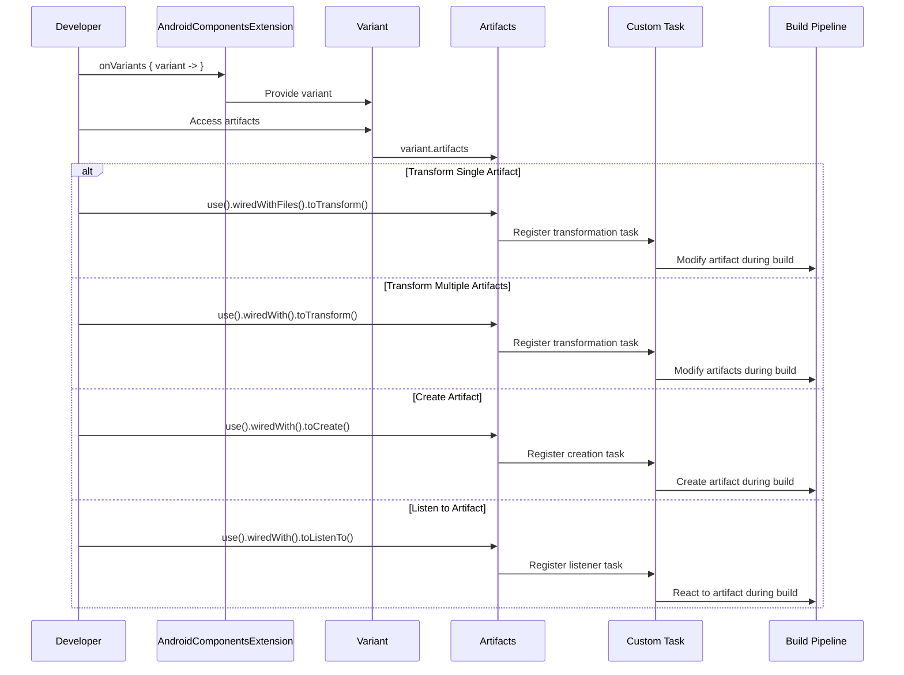
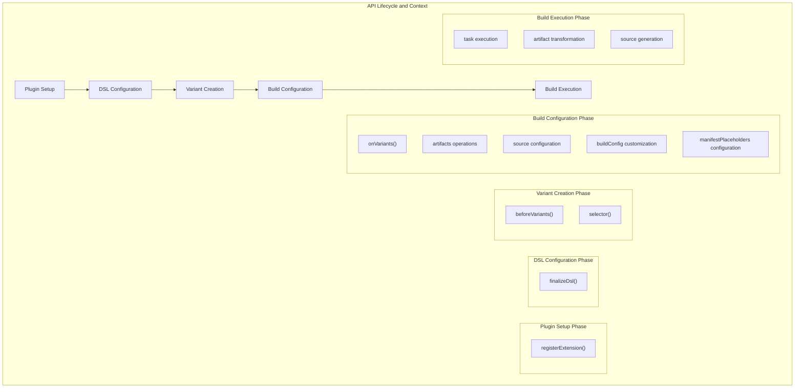

<!-- source: DeepWiki mcp.deepwiki.com · repo android/gradle-recipes · page 4 API Reference · fetched 2026-10-23 -->

# API Reference

<details>
<summary>Relevant source files</summary>

The following files were used as context for generating this wiki page:

- [README.md](README.md)

</details>


## Purpose and Scope

This document provides a comprehensive reference for the key APIs used in extending and customizing the Android Gradle Plugin (AGP). It covers the primary interfaces, classes, and methods that form the foundation of AGP's extensibility system. This reference serves as a technical resource for developers implementing custom build logic using the AGP extension mechanisms.

For an overview of the extension architecture, see [Extension Architecture](#2). For practical recipes demonstrating these APIs in use, see [Recipe Categories](#3).

## API Hierarchy Overview

The Android Gradle Plugin extension system is built around several core API components that work together to provide comprehensive build customization capabilities.



Sources: README.md:19-24, README.md:42-104

## Key API Entry Points

The AGP extension system offers several entry points for customizing the build process, with the primary interface being `AndroidComponentsExtension`.



Sources: README.md:20-23, README.md:114-120

## AndroidComponentsExtension API

The `AndroidComponentsExtension` interface is the main entry point for AGP extension. It provides methods for configuring and customizing Android build variants at different stages of the build lifecycle.

### Key Methods

| Method | Purpose | Usage Timing |
|--------|---------|--------------|
| `finalizeDsl { }` | Finalizes the DSL configuration before variant creation | After DSL processing, before variant creation |
| `beforeVariants { builder -> }` | Configures variant properties before creation | Before variants are created |
| `onVariants { variant -> }` | Customizes variants after creation | After variants are created |
| `selector()` | Creates a selector for filtering variants | Used with `beforeVariants` and `onVariants` |
| `registerExtension()` | Registers custom DSL extension | During plugin application |

### VariantSelector

Used to select specific variants for configuration:

| Method | Purpose |
|--------|---------|
| `all()` | Selects all variants |
| `withBuildType(name)` | Selects variants with specified build type |
| `withFlavor(dimension, name)` | Selects variants with specified flavor |
| `withName(name)` | Selects variants with exact name |

Sources: README.md:20-23, README.md:102-104, README.md:117-120

## Artifacts API

The Artifacts API provides access to build outputs and intermediate files, enabling their inspection, transformation, and creation.

### Artifact Types



### Artifact Operations

The following operations can be performed on artifacts:

| Operation | Method | Purpose |
|-----------|--------|---------|
| Get | `get(SingleArtifact)` | Retrieves a file/directory artifact |
| Get Multiple | `getAll(MultipleArtifact)` | Retrieves multiple file/directory artifacts |
| Get Scoped | `forScope(ScopedArtifact)` | Retrieves artifacts for a specific scope |
| Transform | `use().wiredWithFiles/Directories().toTransform()` | Transforms an artifact using a task |
| Create | `use().wiredWith().toCreate()` | Creates a new artifact using a task |
| Listen | `use().wiredWith().toListenTo()` | Reacts to artifact creation/modification |
| Append | `use().wiredWith().toAppendTo()` | Adds to an existing artifact |

Sources: README.md:12, README.md:27-32, README.md:66-90

## Variant API

The Variant API allows access to and modification of Android build variants.



### Variant Properties

| Property | Type | Purpose |
|----------|------|---------|
| `artifacts` | Artifacts | Access to build artifacts |
| `sources` | SourceDirectories | Management of source directories |
| `buildConfigFields` | MapProperty<String, BuildConfigField> | Custom BuildConfig fields |
| `manifestPlaceholders` | MapProperty<String, String> | Manifest placeholder values |
| `applicationId` | Property<String> | Application ID (for app variants) |
| `components` | List<Component> | Direct components of the variant |
| `nestedComponents` | List<NestedComponent> | Nested components of the variant |

Sources: README.md:93-97, README.md:126-146

## Common API Usage Patterns

### Artifact Transformation Flow



### Common Call Chains

Here are some of the most frequently used API call chains:

1. **Variant Selection and Configuration**:
   ```
   androidComponents.selector().withBuildType("release").onVariants { variant -> ... }
   ```

2. **Artifact Transformation**:
   ```
   variant.artifacts.use().wiredWithFiles().toTransform(
       taskProvider, SingleArtifact.MERGED_MANIFEST
   )
   ```

3. **Adding Generated Sources**:
   ```
   variant.sources.java.addGeneratedSourceDirectory(
       taskProvider, taskOutput
   )
   ```

4. **Custom BuildConfig Fields**:
   ```
   variant.buildConfigFields.put("FIELD_NAME", value)
   ```

5. **Artifact Access**:
   ```
   variant.artifacts.get(SingleArtifact.MERGED_MANIFEST)
   ```

Sources: README.md:107-145

## API Scope and Context

Understanding the scope and context in which different APIs operate is crucial for effective implementation.



Sources: README.md:114-125

## API Usage Tips

1. **Use `finalizeDsl` for modifying the DSL after it's been configured** but before variants are created.

2. **Use `beforeVariants` for disabling tests or configuring variant properties** before variants are created.

3. **Use `onVariants` for most customizations**, as it gives access to the fully created variant.

4. **Prefer the Artifacts API for manipulating build outputs** rather than directly accessing task outputs.

5. **Use appropriate artifact types**: 
   - `SingleArtifact` for individual files/directories
   - `MultipleArtifact` for collections of files/directories
   - `ScopedArtifact` for artifacts that vary by scope (e.g., project vs. dependencies)

6. **Use variant selectors to target specific variants** instead of checking variant properties in callbacks.

Sources: README.md:114-125, README.md:126-146

## Related Pages

- For implementation examples, see [Recipe Categories](#3)
- For specific API details, see:
  - [AndroidComponentsExtension API](#4.1)
  - [Artifacts API](#4.2)
  - [Variant API](#4.3)

---

