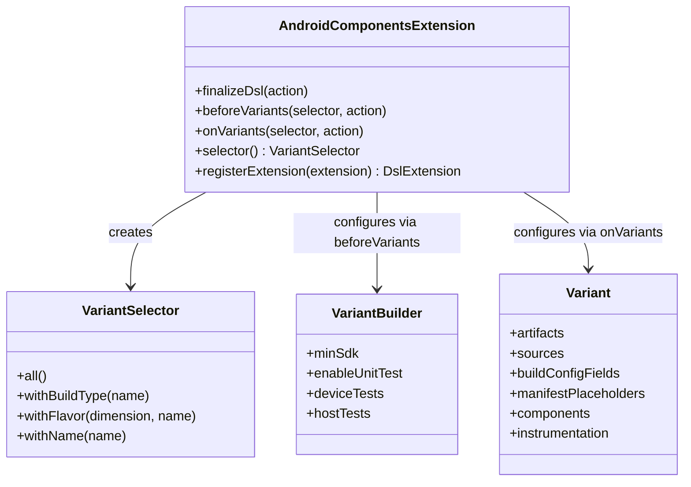
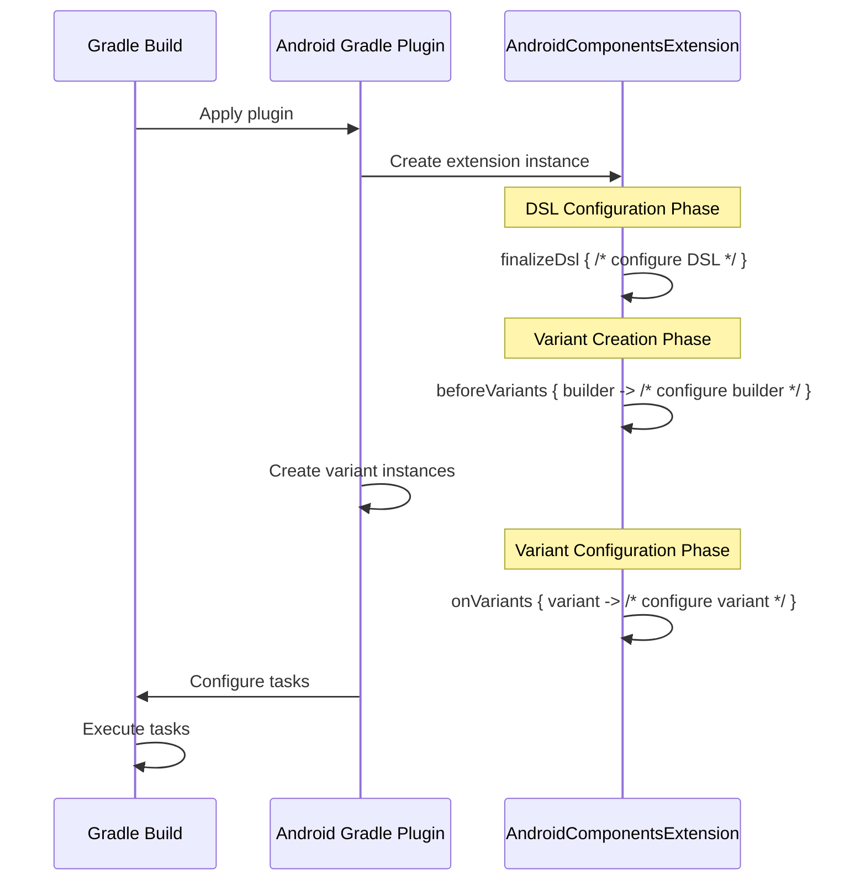
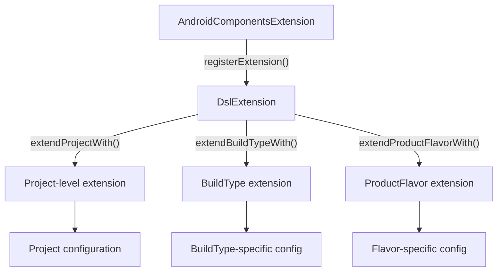
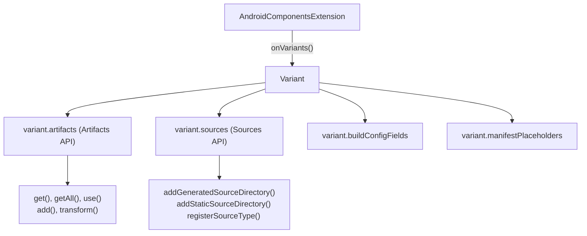

<!-- source: DeepWiki mcp.deepwiki.com · repo android/gradle-recipes · page 4.1 AndroidComponentsExtension API · fetched 2026-10-23 -->

# AndroidComponentsExtension API

<details>
<summary>Relevant source files</summary>

The following files were used as context for generating this wiki page:

- [README.md](README.md)

</details>


## Purpose and Scope

This document provides a comprehensive reference for the `AndroidComponentsExtension` API, which serves as the primary entry point for extending and customizing the Android Gradle Plugin (AGP). For information about the overall extension architecture, see [Extension Architecture](#2), and for details about the artifact system that is frequently used with this API, see [Artifact API System](#2.2).

The `AndroidComponentsExtension` API enables plugin developers to:
- Hook into the AGP build lifecycle
- Configure variants before and after creation
- Target specific variants using selectors
- Register custom DSL extensions

## API Overview

The `AndroidComponentsExtension` interface is the central component for AGP extension, offering access to key build phases and variant configuration.



Sources: README.md:20-23, README.md:112-120

## Lifecycle Hooks

The `AndroidComponentsExtension` provides three main lifecycle hooks that allow plugin developers to integrate with the AGP build process at different stages.



Sources: README.md:112-115

### finalizeDsl

The `finalizeDsl` hook is called after the DSL is configured but before variants are created. This is the appropriate time to make final adjustments to the DSL configuration, such as adding build types.

```kotlin
androidComponents.finalizeDsl { extension ->
    // Make final adjustments to the DSL
    // For example, add a new build type
    extension.buildTypes.create("customBuildType")
}
```

Sources: README.md:52, README.md:114

### beforeVariants

The `beforeVariants` hook is called for each variant before it's actually created. This allows you to configure the variant builder to customize how variants are created.

```kotlin
androidComponents.beforeVariants(
    androidComponents.selector().all()
) { builder ->
    // Configure the variant builder
    builder.minSdk = 23
    builder.enableUnitTest = false
    builder.deviceTests.get().enable = false
}
```

Sources: README.md:20, README.md:113

### onVariants

The `onVariants` hook is called after variants are created, allowing you to configure the created variants and access their properties.

```kotlin
androidComponents.onVariants(
    androidComponents.selector().all()
) { variant ->
    // Configure the variant
    variant.buildConfigFields.put("API_KEY", "String", "\"abcdef123456\"")
    
    // Access the variant's artifacts
    variant.artifacts.get(SingleArtifact.MERGED_MANIFEST)
    
    // Register tasks that operate on the variant
    val task = project.tasks.register("customTask", CustomTask::class.java)
    variant.artifacts.use(task)
        .wiredWithFiles(CustomTask::inputFile, CustomTask::outputFile)
        .toTransform(SingleArtifact.MERGED_MANIFEST)
}
```

Sources: README.md:21, README.md:115, README.md:127-142

## Variant Selection API

The `selector()` method provides a fluent API for targeting specific variants with the `beforeVariants` and `onVariants` hooks.

### Selector Methods

| Method | Description |
|--------|-------------|
| `all()` | Selects all variants |
| `withBuildType(name)` | Selects variants with the specified build type |
| `withFlavor(dimension, name)` | Selects variants with the specified flavor in the given dimension |
| `withName(name)` | Selects a variant with the exact name |

```kotlin
// Select all variants
androidComponents.selector().all()

// Select variants with a specific build type
androidComponents.selector().withBuildType("debug")

// Select variants with a specific flavor
androidComponents.selector().withFlavor("dimension1", "flavor1")

// Select a specific variant by name
androidComponents.selector().withName("flavor1Debug")
```

Sources: README.md:102-105, README.md:117-120

## Registering Custom DSL Extensions

The `registerExtension` method allows you to extend the AGP DSL with custom configuration options at different levels:



Sources: README.md:22, README.md:48-51, README.md:108, README.md:116

Example of registering a custom DSL extension:

```kotlin
// Create a DSL extension
val extension = DslExtension.Builder("myExtension")
    .extendProjectWith(MyProjectExtension::class.java)
    .extendBuildTypeWith(MyBuildTypeExtension::class.java)
    .extendProductFlavorWith(MyFlavorExtension::class.java)
    .build()

// Register the extension
androidComponents.registerExtension(extension)
```

Sources: README.md:108, README.md:116

## Common Usage Patterns

### Configuring Variants Based on Properties

```kotlin
androidComponents.beforeVariants { builder ->
    if (builder.minSdk < 23) {
        // Modify variant configuration based on properties
        builder.enableUnitTest = false
    }
}
```

Sources: README.md:20, README.md:98

### Disabling Tests for Specific Variants

```kotlin
androidComponents.beforeVariants(
    androidComponents.selector().withBuildType("release")
) { builder ->
    // Disable device tests
    builder.deviceTests.get().enable = false
    
    // Disable host tests
    builder.hostTests.get().enable = false
}
```

Sources: README.md:55-58, README.md:109-112

### Customizing BuildConfig Fields

```kotlin
androidComponents.onVariants { variant ->
    // Add custom BuildConfig fields
    variant.buildConfigFields.put(
        "DEBUG_MODE", 
        "boolean", 
        "true"
    )
}
```

Sources: README.md:33, README.md:140

### Manipulating Manifest Placeholders

```kotlin
androidComponents.onVariants { variant ->
    // Set manifest placeholders
    variant.manifestPlaceholders.put("hostName", "example.com")
}
```

Sources: README.md:65, README.md:96, README.md:142

## Integration with Other APIs

The `AndroidComponentsExtension` API typically works in conjunction with other AGP APIs:



Sources: README.md:42-47, README.md:127-146

### Artifact API Integration

Using the `AndroidComponentsExtension` to access the Artifact API:

```kotlin
androidComponents.onVariants { variant ->
    variant.artifacts.get(SingleArtifact.MERGED_MANIFEST)
    variant.artifacts.getAll(MultipleArtifact.NATIVE_DEBUG_METADATA)
    
    val task = project.tasks.register(...)
    variant.artifacts.use(task)
        .wiredWithFiles(...)
        .toTransform(SingleArtifact.MERGED_MANIFEST)
}
```

Sources: README.md:29-32, README.md:130-136

### Source Management Integration

Working with sources through the `AndroidComponentsExtension`:

```kotlin
androidComponents.onVariants { variant ->
    // Add generated source directory
    variant.sources.java.addGeneratedSourceDirectory(
        taskProvider,
        TaskOutputs::getSourceOutputDir
    )
    
    // Add static source directory
    variant.sources.res.addStaticSourceDirectory(project.layout.projectDirectory.dir("extraRes"))
}
```

Sources: README.md:47, README.md:144-146

## API Reference

### AndroidComponentsExtension Methods

| Method | Description |
|--------|-------------|
| `finalizeDsl(action)` | Registers an action to be executed after the DSL is configured but before variants are created |
| `beforeVariants(selector, action)` | Registers an action to be executed for each selected variant before it's created |
| `onVariants(selector, action)` | Registers an action to be executed for each selected variant after it's created |
| `selector()` | Returns a VariantSelector for targeting specific variants |
| `registerExtension(extension)` | Registers a custom DSL extension |

Sources: README.md:20-23, README.md:112-120

### Key Interfaces Accessible through AndroidComponentsExtension

| Interface | Purpose |
|-----------|---------|
| `VariantSelector` | Provides methods for selecting variants |
| `VariantBuilder` | Configures how variants are created |
| `Variant` | Represents a created variant with various configuration options |
| `Component` | Represents a component (module) within a variant |
| `Artifacts` | Provides access to build artifacts for transformation |
| `SourceDirectories` | Manages source directories for different source types |

Sources: README.md:98-101, README.md:42-47

## Conclusion

The `AndroidComponentsExtension` API provides a comprehensive set of tools for extending and customizing the Android Gradle Plugin. By using the lifecycle hooks, variant selectors, and integration with other APIs, plugin developers can deeply customize the Android build process to meet specific requirements.

For more detailed information about specific aspects of the system, refer to:
- [Extension Architecture](#2) for an overview of the entire extension system
- [Variant System](#2.3) for details about variants and variant builders
- [Artifact API System](#2.2) for working with build artifacts
- [Recipe Categories](#3) for practical examples of using these APIs

---

