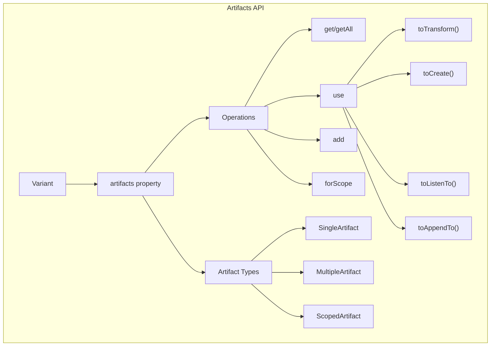
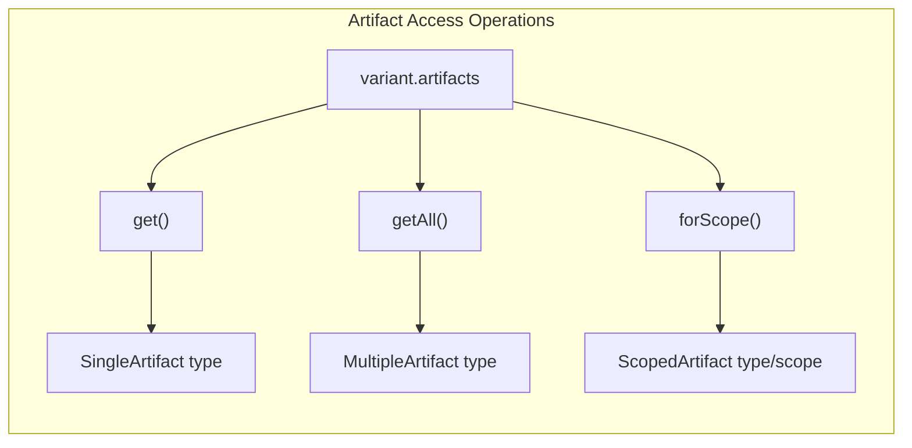
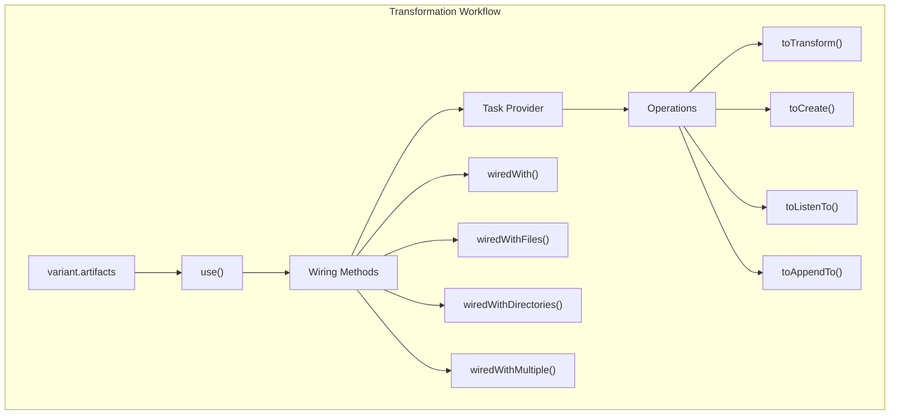
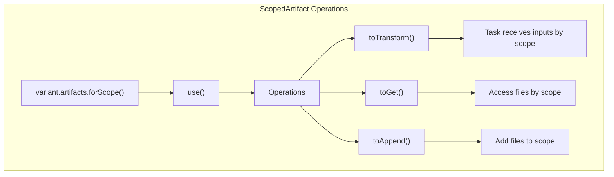
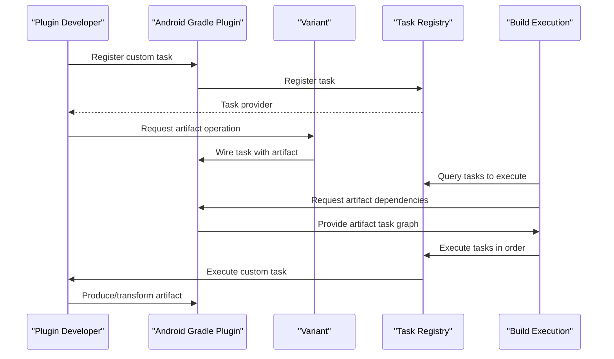
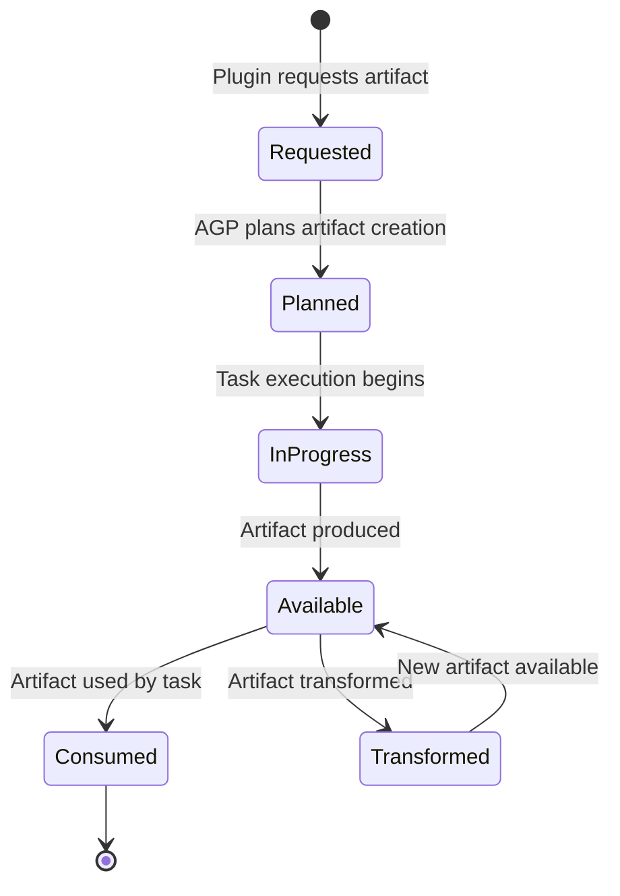

<!-- source: DeepWiki mcp.deepwiki.com · repo android/gradle-recipes · page 4.2 Artifacts API · fetched 2026-10-23 -->

# Artifacts API

<details>
<summary>Relevant source files</summary>

The following files were used as context for generating this wiki page:

- [README.md](README.md)

</details>


The Artifacts API is a core interface within the Android Gradle Plugin (AGP) extension ecosystem that allows plugin developers to access, transform, create, and monitor Android build artifacts. This document provides a comprehensive reference for working with the Artifacts API, including artifact types, available operations, and transformation workflows.

For information on the broader extension architecture, see [Extension Architecture](#2), and for details on how to integrate tasks with the Artifacts API, see [Task Integration](#2.4).

## Overview

The Artifacts API provides a structured interface for interacting with build artifacts, allowing plugin developers to:

1. Access artifacts produced during the build process
2. Transform existing artifacts through custom processing
3. Create new artifacts to be consumed by other build steps
4. Append to existing collections of artifacts
5. Listen to artifact creation/modification events

This API is accessed through the `artifacts` property of a variant object, typically within an `onVariants` or `beforeVariants` callback.



Sources: README.md:12, README.md:27-32

## Artifact Types

The Artifacts API works with three main types of artifacts, each serving a different purpose in the build process:

```mermaid
classDiagram
    class "Artifact Types" {
        Interface for accessing build outputs
    }
    
    class "SingleArtifact" {
        +APK
        +BUNDLE
        +MERGED_MANIFEST
        +ASSETS
        Represents a single file/directory
    }
    
    class "MultipleArtifact" {
        +NATIVE_DEBUG_METADATA
        +MULTIDEX_KEEP_PROGUARD
        Represents multiple files
    }
    
    class "ScopedArtifact" {
        +CLASSES
        File collections separated by scope
    }
    
    "Artifact Types" <|-- "SingleArtifact"
    "Artifact Types" <|-- "MultipleArtifact"
    "Artifact Types" <|-- "ScopedArtifact"
    
    class "ScopedArtifacts.Scope" {
        +PROJECT
        +SUB_PROJECTS
        +EXTERNAL_LIBS
        +ALL
    }
    
    "ScopedArtifact" --> "ScopedArtifacts.Scope"
```

### SingleArtifact

Represents a single file or directory output by the build system. Common examples include:

- `SingleArtifact.APK` - The built APK file
- `SingleArtifact.MERGED_MANIFEST` - The merged Android manifest file
- `SingleArtifact.ASSETS` - The assets directory
- `SingleArtifact.BUNDLE` - The Android App Bundle (.aab file)

### MultipleArtifact

Represents a collection of files produced by the build system. Examples include:

- `MultipleArtifact.NATIVE_DEBUG_METADATA` - Debug metadata for native code
- `MultipleArtifact.MULTIDEX_KEEP_PROGUARD` - Multidex keep rules

### ScopedArtifact

Represents collections of files separated by their source scope. The most common example is:

- `ScopedArtifact.CLASSES` - Java/Kotlin class files

ScopedArtifacts can be filtered by scope:
- `ScopedArtifacts.Scope.PROJECT` - From the current project
- `ScopedArtifacts.Scope.SUB_PROJECTS` - From sub-projects
- `ScopedArtifacts.Scope.EXTERNAL_LIBS` - From external libraries
- `ScopedArtifacts.Scope.ALL` - All scopes combined

Sources: README.md:66-67, README.md:74-76, README.md:81-84

## Core Operations

The Artifacts API provides several primary operations for working with artifacts:

### Accessing Artifacts



#### get()

Retrieves a single artifact file or directory:

```
variant.artifacts.get(SingleArtifact.MERGED_MANIFEST)
```

#### getAll()

Retrieves all files associated with a multiple artifact type:

```
variant.artifacts.getAll(MultipleArtifact.NATIVE_DEBUG_METADATA)
```

#### forScope()

Accesses scoped artifacts, allowing operations on specific scopes:

```
variant.artifacts.forScope(ScopedArtifact.CLASSES)
```

Sources: README.md:29-31, README.md:66-76, README.md:132-133

### Transforming Artifacts

The Artifacts API provides a powerful transformation system that allows plugin developers to modify artifacts during the build process. Transformations are typically connected to custom Gradle tasks.



#### Transformation Types

The API offers different transformation operations depending on the artifact type:

1. **Transform**: Modify an existing artifact and produce a new one
   ```
   variant.artifacts.use()
       .wiredWithFiles(taskProvider)
       .toTransform(input, output)
   ```

2. **Create**: Generate a new artifact from scratch
   ```
   variant.artifacts.use()
       .wiredWith(taskProvider)
       .toCreate(output)
   ```

3. **Listen**: Register a task to be notified when an artifact is produced
   ```
   variant.artifacts.use()
       .wiredWith(taskProvider)
       .toListenTo(input)
   ```

4. **Append**: Add files to an existing collection of artifacts
   ```
   variant.artifacts.use()
       .wiredWith(taskProvider)
       .toAppendTo(output)
   ```

#### Wiring Methods

Different wiring methods are used based on the artifact type:

- `wiredWith()`: General purpose wiring for operations not specific to file types
- `wiredWithFiles()`: For operations on individual files
- `wiredWithDirectories()`: For operations on directory artifacts
- `wiredWithMultiple()`: For operations on multiple artifacts

Sources: README.md:32, README.md:87-90, README.md:134-139

### Adding Artifacts

The `add()` method allows adding new files to the build system as artifacts:

```
variant.artifacts.add(
    MultipleArtifact.NATIVE_DEBUG_METADATA,
    myFileCollection
)
```

Sources: README.md:28, README.md:131-132

## Working with ScopedArtifacts

ScopedArtifacts provide special operations for working with class files and other scope-aware artifacts:



ScopedArtifacts operations provide inputs by scope:

```
variant.artifacts.forScope(ScopedArtifact.CLASSES).use(
    taskProvider,
    ScopedArtifacts.Scope.PROJECT,
    ScopedArtifacts.Scope.EXTERNAL_LIBS
).toTransform(...)
```

The available operations are:
- `toTransform()`: Transform artifacts in specific scopes
- `toGet()`: Access artifacts from specific scopes
- `toAppend()`: Add files to artifacts in specific scopes

Sources: README.md:78-80, README.md:128-130

## Common Use Cases

### Transforming Manifest Files

```
variant.artifacts.use()
    .wiredWithFiles(manifestTransformerTask)
    .toTransform(
        variant.artifacts.get(SingleArtifact.MERGED_MANIFEST),
        output
    )
```

### Creating New Artifacts

```
variant.artifacts.use()
    .wiredWith(newArtifactTask)
    .toCreate(outputLocation)
```

### Transforming Classes

```
variant.artifacts
    .forScope(ScopedArtifact.CLASSES)
    .use(
        transformClassesTask,
        ScopedArtifacts.Scope.PROJECT
    )
    .toTransform(...)
```

### Monitoring APK Generation

```
variant.artifacts.use()
    .wiredWith(apkMonitorTask)
    .toListenTo(SingleArtifact.APK)
```

### Appending to Multiple Artifacts

```
variant.artifacts.use()
    .wiredWith(appendTask)
    .toAppendTo(MultipleArtifact.NATIVE_DEBUG_METADATA)
```

Sources: README.md:134-139

## Integration with Build Tasks

The Artifacts API integrates with Gradle tasks through "wired operations," which connect the task's inputs and outputs with artifact operations.



When a task is wired with an artifact operation:

1. The task's inputs are automatically connected to the artifact's source
2. The task's outputs are automatically connected to the artifact's destination
3. The task is inserted into the build graph at the appropriate point
4. The task is executed when its inputs change or outputs are needed

For more detailed information on task integration, see [Task Integration](#2.4).

Sources: README.md:87-90

## Artifact Lifecycle

Throughout the build process, artifacts move through several states as they are produced, transformed, and consumed:



Understanding this lifecycle is important when designing plugins that interact with artifacts, especially when dependencies exist between different artifact operations.

## Best Practices

When working with the Artifacts API, follow these best practices:

1. **Use the right artifact type**:
   - `SingleArtifact` for individual files/directories
   - `MultipleArtifact` for collections of files
   - `ScopedArtifact` for code-related transformations

2. **Choose the right operation**:
   - `get()/getAll()` for simple access
   - `use().toTransform()` for modifying existing artifacts
   - `use().toCreate()` for generating new artifacts
   - `use().toListenTo()` for post-processing
   - `use().toAppendTo()` for adding to collections

3. **Use appropriate wiring methods**:
   - `wiredWithFiles()` for file operations
   - `wiredWithDirectories()` for directory operations
   - `wiredWithMultiple()` for multiple file operations

4. **Make transformations incremental** where possible by using Gradle's incremental task API to avoid unnecessary work during builds.

5. **Consider artifact finality**: Once an artifact is produced, it should be treated as immutable. Use transformations to create new artifacts rather than modifying existing ones directly.

## Common Artifact References

This table lists commonly used artifact types in the AGP extension system:

| Type | Constant | Description |
|------|----------|-------------|
| Single | `SingleArtifact.APK` | The APK file output |
| Single | `SingleArtifact.BUNDLE` | The Android App Bundle (.aab) output |
| Single | `SingleArtifact.MERGED_MANIFEST` | The merged AndroidManifest.xml |
| Single | `SingleArtifact.ASSETS` | The assets directory |
| Multiple | `MultipleArtifact.NATIVE_DEBUG_METADATA` | Native code debug metadata |
| Multiple | `MultipleArtifact.MULTIDEX_KEEP_PROGUARD` | Multidex keep rules |
| Scoped | `ScopedArtifact.CLASSES` | Java/Kotlin class files |

Sources: README.md:66-67, README.md:74, README.md:81-84

## Example Recipes

The following recipes demonstrate common uses of the Artifacts API:

- `getSingleArtifact`: Accessing single artifacts
- `getMultipleArtifact`: Accessing multiple artifacts
- `transformManifest`: Transforming manifest files
- `transformDirectory`: Transforming directories
- `transformMultiple`: Transforming multiple artifacts
- `transformAllClasses`: Transforming class files
- `createSingleArtifact`: Creating new artifacts
- `listenToArtifacts`: Listening for artifact changes
- `appendToMultipleArtifact`: Appending to collections
- `appendToScopedArtifacts`: Appending to scoped artifacts
- `getScopedArtifacts`: Accessing scoped artifacts
- `workerEnabledTransformation`: Transforming with worker API

These recipes can be found in the repository and serve as practical examples of Artifacts API usage.

Sources: README.md:12-13

## Conclusion

The Artifacts API is a powerful system that enables plugin developers to interact with and modify Android build artifacts. By understanding the different artifact types, operations, and best practices, developers can create sophisticated plugins that extend the Android build process to meet specific requirements.

For more information on the overall AGP extension system, see [Extension Architecture](#2), and for specific integration with Gradle tasks, see [Task Integration](#2.4).

---

