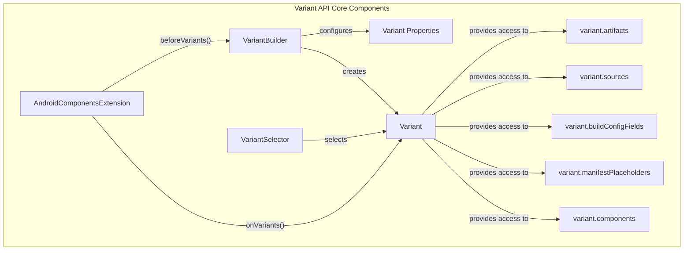
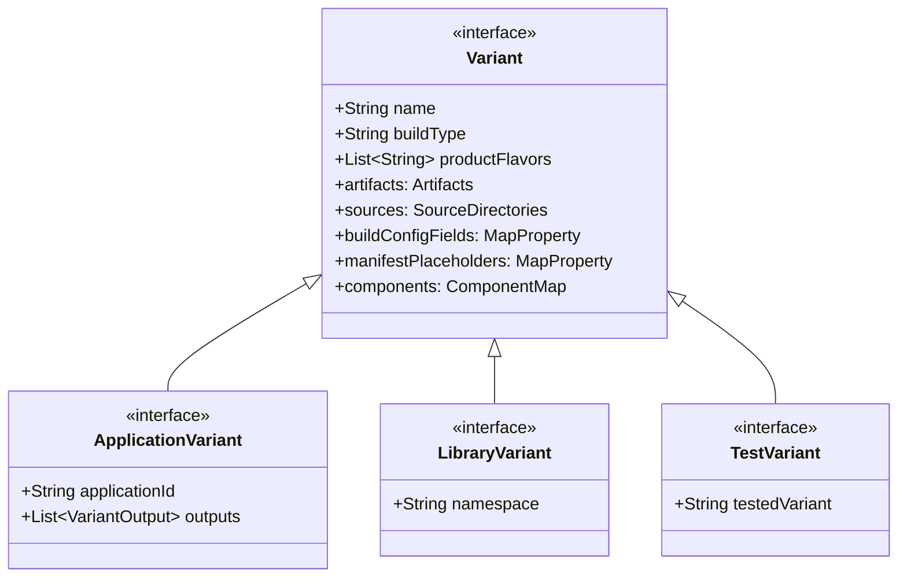
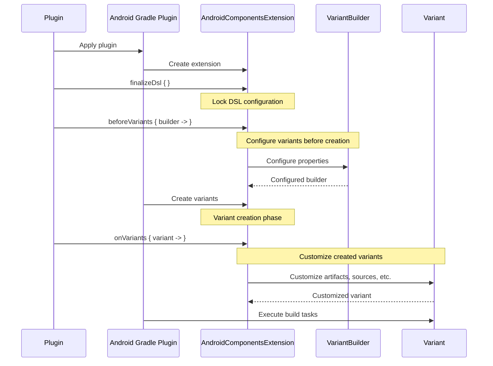
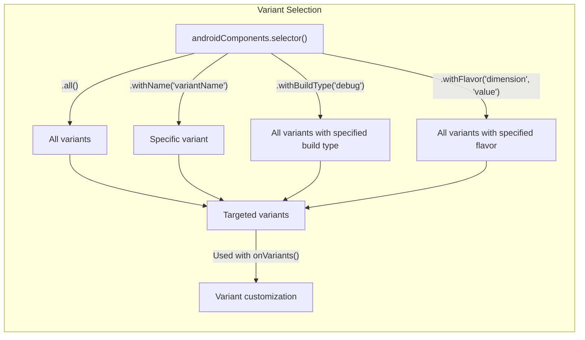
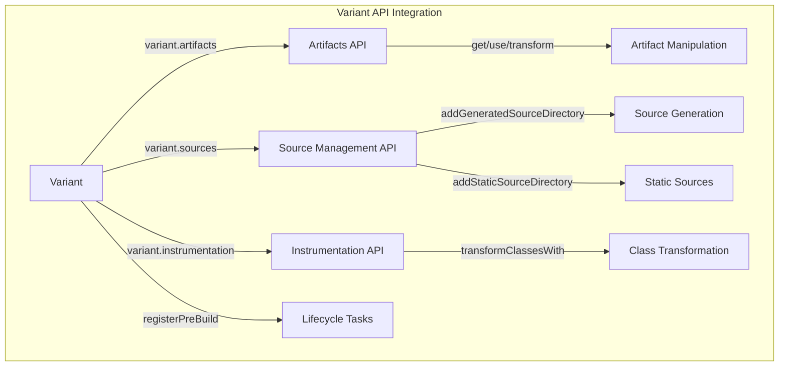

<!-- source: DeepWiki mcp.deepwiki.com · repo android/gradle-recipes · page 4.3 Variant API · fetched 2026-10-23 -->

# Variant API

<details>
<summary>Relevant source files</summary>

The following files were used as context for generating this wiki page:

- [README.md](README.md)

</details>


The Variant API provides interfaces and classes for working with Android build variants in the Android Gradle Plugin (AGP). This document covers the core components of the Variant API, including the Variant interface, VariantBuilder, and variant selection mechanisms. For information about accessing and manipulating artifacts within variants, see [Artifact API System](#2.2).

## Introduction to the Variant API

In Android builds, a **variant** represents a specific build configuration resulting from the combination of build types (like debug or release) and product flavors. The Variant API enables you to interact with these variants programmatically, allowing customization of the build process.



**Diagram: Variant API Core Components**

Sources: README.md:94-97, README.md:102-105, README.md:114-115

## Variant Interface Hierarchy

The Variant API consists of several interfaces that represent different types of variants based on the Android project type.



**Diagram: Variant Interface Hierarchy**

Sources: README.md:24-25, README.md:94-97

## Variant Lifecycle

Variants in AGP follow a specific lifecycle, from configuration to creation to usage in the build process.



**Diagram: Variant Lifecycle**

Sources: README.md:114-115

## Variant Builder API

The VariantBuilder interface allows configuration of variant properties before the variants are created. It's accessible through the `beforeVariants` hook of the AndroidComponentsExtension.

### Key VariantBuilder Properties

| Property | Description | Example Usage |
|----------|-------------|---------------|
| `minSdk` | Sets the minimum SDK version | `builder.minSdk = 23` |
| `enableUnitTest` | Controls whether unit tests are enabled | `builder.enableUnitTest = false` |
| `deviceTests` | Configuration for device tests | `builder.deviceTests.get().enable = false` |
| `hostTests` | Configuration for host tests | `builder.hostTests.get().enable = false` |
| `isMinifyEnabled` | Controls code minification | `builder.isMinifyEnabled = true` |
| `shrinkResources` | Controls resource shrinking | `builder.shrinkResources = true` |

Sources: README.md:40-41, README.md:56-57, README.md:58-59, README.md:98, README.md:109-113

## Variant Selection

The VariantSelector API allows targeting specific variants for customization. It's accessed through `androidComponents.selector()`.



**Diagram: Variant Selection Mechanisms**

Sources: README.md:102-105, README.md:117-120

### Selection Examples

- Select all variants:
  ```kotlin
  androidComponents.selector().all()
  ```

- Select a specific variant by name:
  ```kotlin
  androidComponents.selector().withName("demoDebug")
  ```

- Select variants with a specific build type:
  ```kotlin
  androidComponents.selector().withBuildType("debug")
  ```

- Select variants with a specific product flavor:
  ```kotlin
  androidComponents.selector().withFlavor("tier", "free")
  ```

Sources: README.md:102-105, README.md:117-120

## Common Customization Points

### BuildConfig Fields

You can add custom fields to the generated BuildConfig class:

```kotlin
androidComponents.onVariants { variant ->
    variant.buildConfigFields.put(
        "STRING_VALUE",
        BuildConfigField(
            type = "String",
            value = "\"custom value\"",
            comment = "A custom build config field"
        )
    )
}
```

Sources: README.md:94, README.md:140-141

### Manifest Placeholders

Add or modify manifest placeholders for variable substitution in the AndroidManifest.xml:

```kotlin
androidComponents.onVariants { variant ->
    variant.manifestPlaceholders.put("customPlaceholder", "placeholderValue")
}
```

Sources: README.md:96, README.md:142

### Accessing Components for Dependency Management

Variants provide access to component configurations for managing dependencies:

```kotlin
androidComponents.onVariants { variant ->
    variant.components.forEach { component ->
        // Access compile configuration
        component.compileConfiguration.resolutionStrategy.dependencySubstitution {
            // Substitute dependencies
        }
        
        // Access runtime configuration
        component.runtimeConfiguration.resolutionStrategy.dependencySubstitution {
            // Substitute dependencies
        }
    }
}
```

Sources: README.md:44-45, README.md:95, README.md:97, README.md:121-122

## ApplicationVariant-specific Properties

The ApplicationVariant interface extends the base Variant interface with additional application-specific properties:

### Application ID

```kotlin
androidComponents.onVariants { variant ->
    if (variant is ApplicationVariant) {
        println("Application ID: ${variant.applicationId.get()}")
    }
}
```

Sources: README.md:24, README.md:53, README.md:126

### Variant Outputs

```kotlin
androidComponents.onVariants { variant ->
    if (variant is ApplicationVariant) {
        variant.outputs.forEach { output ->
            // Access output type
            val isMain = output.outputType == VariantOutputConfiguration.OutputType.SINGLE
            // Customize outputs
        }
    }
}
```

Sources: README.md:25, README.md:100-101

## Integration with Other AGP APIs

The Variant API integrates closely with other AGP APIs to provide a comprehensive build customization system.



**Diagram: Variant API Integration**

Sources: README.md:42-43, README.md:64, README.md:85-86, README.md:131-139, README.md:143, README.md:144-146

### Artifacts API Integration

Variants provide access to the Artifacts API for retrieving and manipulating build artifacts:

```kotlin
androidComponents.onVariants { variant ->
    // Get a single artifact
    val mergedManifest = variant.artifacts.get(SingleArtifact.MERGED_MANIFEST)
    
    // Get multiple artifacts
    val nativeDebugMetadata = variant.artifacts.getAll(MultipleArtifact.NATIVE_DEBUG_METADATA)
    
    // Transform an artifact
    variant.artifacts.use(...)
        .wiredWithFiles(...)
        .toTransform(...)
}
```

Sources: README.md:42-43, README.md:129-138

### Source Management Integration

Variants provide access to source directories for adding generated or static source code:

```kotlin
androidComponents.onVariants { variant ->
    // Add generated source directory
    variant.sources.java?.addGeneratedSourceDirectory(
        taskProvider,
        TaskOutputType.JAVA_SOURCES
    )
    
    // Add static source directory
    variant.sources.java?.addStaticSourceDirectory(sourceDir)
}
```

Sources: README.md:85-86, README.md:144-146

## Summary

The Variant API provides a powerful way to interact with Android build variants, allowing for customization of various aspects of the build process. Through this API, you can:

1. Configure variants before they are created using the VariantBuilder
2. Select specific variants using the VariantSelector
3. Customize created variants through the Variant interface
4. Access and modify artifacts, sources, BuildConfig fields, and manifest placeholders
5. Manage dependencies through component configurations

This API forms a core part of the AGP extension system and integrates closely with other APIs like the Artifacts API and Source Management API to provide comprehensive build customization capabilities.

Sources: README.md:94-97, README.md:102-105, README.md:114-115

---

