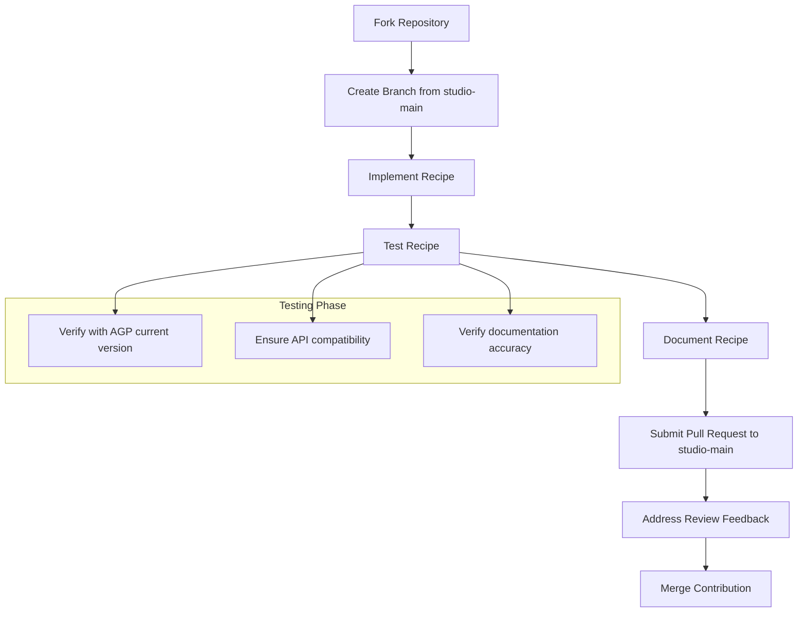
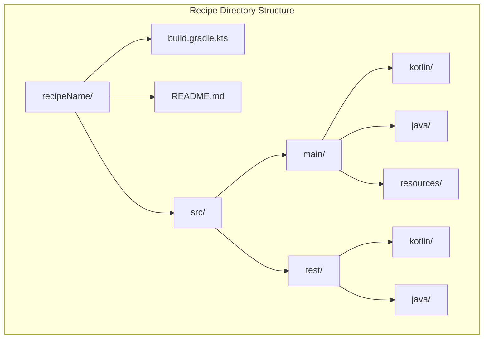
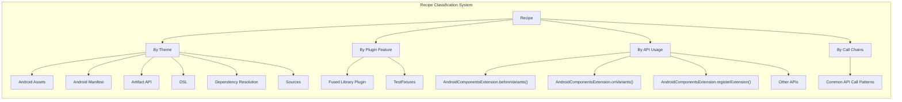
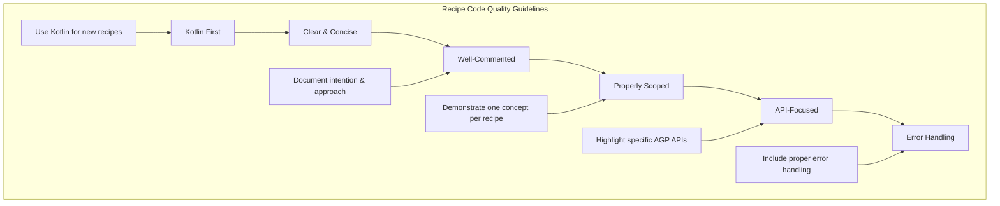
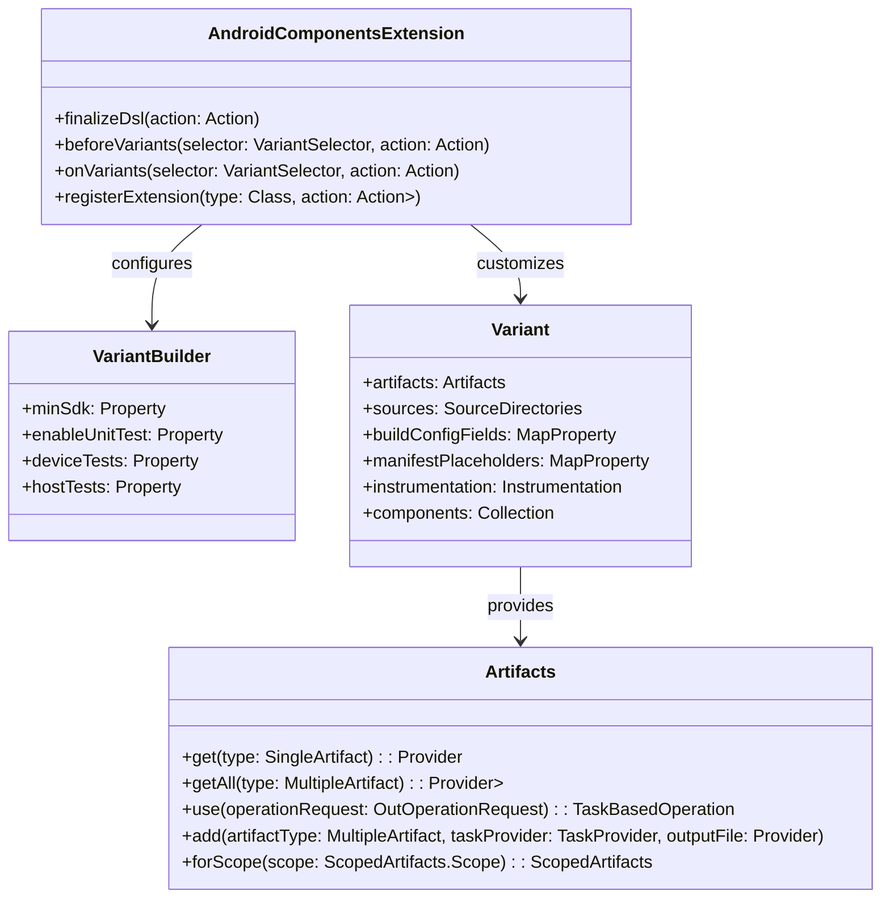
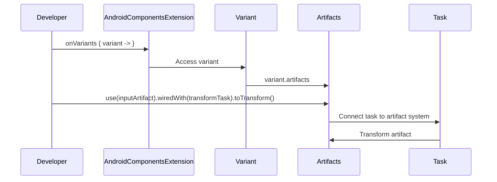
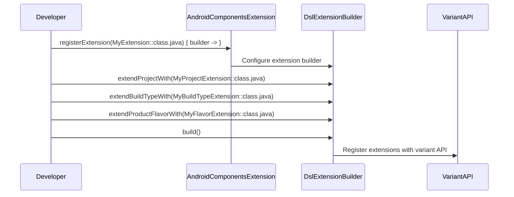

<!-- source: DeepWiki mcp.deepwiki.com · repo android/gradle-recipes · page 5 Contributing to Recipes · fetched 2026-10-23 -->

# Contributing to Recipes

Relevant source files

The following files were used as context for generating this wiki page:

- [README.md](README.md)

This document provides comprehensive guidelines for contributing new recipes to the Android Gradle Plugin (AGP) Recipes repository. It covers the contribution workflow, recipe structure, creation process, best practices, and submission guidelines to ensure your contributions meet the repository standards.

## Purpose and Scope

The Android Gradle Plugin Recipes repository is designed to demonstrate how to extend and customize the Android build process using the AGP extension APIs. This guide focuses specifically on how to contribute new recipes to the repository, including the required structure, documentation standards, and submission process. For information about the overall AGP extension architecture, see [Extension Architecture](#2).

## Contribution Workflow

All contributions to the AGP Recipes repository follow a specific workflow to maintain quality and consistency.

**Diagram: Contribution Workflow**

The key points to note in the contribution workflow:
- All contributions must be made to the `studio-main` branch
- The recipe must be tested with the current AGP version
- Documentation is a required component of any recipe contribution

Sources: [README.md:5-6]()

## Recipe Structure

Each recipe in the repository follows a standard structure to ensure consistency and ease of understanding.

**Diagram: Standard Recipe Directory Structure**

Each component serves a specific purpose:
- `build.gradle.kts`: Contains the recipe implementation using AGP extension APIs
- `README.md`: Documents the recipe purpose, implementation details, and usage examples
- Source directories: Contain any custom classes required for the recipe

Sources: [README.md:7-158]()

## Recipe Classification System

Recipes in the repository are classified according to multiple dimensions to help users find relevant examples.

**Diagram: Recipe Classification System**

When contributing a new recipe, you should identify which categories it belongs to for proper indexing in the README.

Sources: [README.md:7-147]()

## Creating a New Recipe

The process of creating a new recipe involves several steps to ensure it meets the repository standards.

### Step 1: Identify the Recipe Purpose

Before creating a recipe, clearly identify what Android build customization it will demonstrate. Recipes should focus on a single, well-defined customization technique.

### Step 2: Creating the Recipe Structure

Create a new directory with the recipe name following these guidelines:

1. Use camelCase naming convention (e.g., `transformManifest`, `addGeneratedSourceFolder`)
2. Name should clearly indicate the recipe's purpose
3. Follow the standard directory structure outlined above

### Step 3: Implementing the Recipe

When implementing your recipe, follow these best practices:

- Focus on demonstrating a single AGP extension feature
- Use Kotlin for new recipes
- Include detailed comments explaining the implementation
- Keep the recipe simple and focused on the specific customization
- Ensure compatibility with the current AGP version

### Step 4: Recipe Documentation

Every recipe must include comprehensive documentation:

1. A README.md file explaining:
   - The recipe's purpose
   - Implementation details
   - Usage examples
   - Expected outcome
   - Any limitations or caveats

2. Inline code comments explaining complex logic

3. Test cases demonstrating the recipe's functionality

## Best Practices for Recipe Contributions

To ensure your recipe contribution meets the repository standards, follow these best practices:

### Code Quality

**Diagram: Recipe Code Quality Guidelines**

### Documentation Requirements

Each recipe should include:

1. Clear explanation of the AGP APIs being demonstrated
2. Step-by-step explanation of how the recipe works
3. Usage examples showing how to apply the recipe
4. References to relevant AGP documentation

### Recipe Categorization

When submitting your recipe, identify which categories it belongs to for proper indexing in the README:

1. Themes (e.g., Android Assets, Android Manifest, Artifact API)
2. Plugin Features (if applicable)
3. APIs used
4. Call chains demonstrated

Sources: [README.md:8-147]()

## Testing Guidelines

Before submitting your recipe, ensure it has been thoroughly tested.

### Compatibility Testing

Test your recipe with:
- The current AGP version specified in the branch
- Different Android project types (app, library) if applicable
- Various configuration scenarios

### Functional Testing

Write test cases that verify:
- The recipe accomplishes its intended purpose
- Error cases are handled appropriately
- The recipe doesn't interfere with other aspects of the build

## Submission Process

When you're ready to submit your recipe, follow these steps:

1. Ensure your code is on the `studio-main` branch
2. Create a pull request with a clear description of your recipe
3. Reference any related issues or documentation
4. Be responsive to review feedback

Sources: [README.md:5-6]()

## AGP API Extension Points

Understanding the key extension points in the AGP API will help you identify where your recipe fits in the overall architecture.

**Diagram: Key AGP Extension Points**

When creating your recipe, identify which of these extension points you're targeting and ensure your documentation explicitly mentions the APIs being used.

Sources: [README.md:20-39](), [README.md:113-119]()

## Common Recipe Patterns

Based on existing recipes, several common patterns have emerged that you can follow:

### Artifact Transformation Pattern

**Diagram: Artifact Transformation Pattern**

This pattern is common for recipes that modify existing build artifacts like manifests, assets, or compiled code.

Sources: [README.md:12](), [README.md:129-139]()

### DSL Extension Pattern

**Diagram: DSL Extension Pattern**

This pattern is used when recipes need to extend the Gradle DSL with custom configuration options.

Sources: [README.md:13](), [README.md:108](), [README.md:150]()

## Conclusion

Contributing recipes to the AGP Recipes repository is a valuable way to share build customization techniques with the Android developer community. By following these guidelines, you can ensure your contributions meet the quality standards of the repository and provide maximum value to other developers.

Remember that all contributions are accepted only on the `studio-main` branch, and you should ensure compatibility with the current AGP version specified in that branch.

Sources: [README.md:1-6]()