# Page: AGP Extension Recipes Overview

# AGP Extension Recipes Overview

<details>
<summary>Relevant source files</summary>

The following files were used as context for generating this wiki page:

- [README.md](README.md)

</details>


## Purpose and Scope

The Android Gradle Plugin (AGP) Recipes repository provides a comprehensive collection of examples that demonstrate how to extend and customize the Android build system. These recipes showcase practical implementations of the AGP extension APIs, allowing developers to modify, enhance, and customize their Android builds in various ways.

This overview page introduces the repository's purpose, organization, and provides guidance on how to navigate and utilize these recipes effectively. For detailed information about the underlying extension architecture, see [Extension Architecture](#2).

Sources: [README.md:1-6]()

## What Are AGP Extension Recipes?

AGP Extension Recipes are ready-to-use code examples that demonstrate how to customize Android builds using the Android Gradle Plugin extension points. Each recipe focuses on a specific customization scenario and provides a complete, working implementation that you can adapt to your own projects.

The recipes are compatible with AGP 8.9 and are organized in a modular way, making it easy to find examples that address specific customization needs.

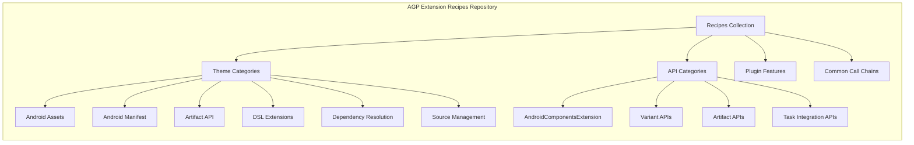

Sources: [README.md:7-9](), [README.md:9-15]()

## Core Extension Mechanisms

The AGP extension recipes demonstrate several key mechanisms for customizing Android builds:

### 1. AndroidComponentsExtension

The most important entry point for AGP customization is the `AndroidComponentsExtension` interface, which provides methods for accessing and modifying the build throughout its lifecycle. Primary methods include:

- `finalizeDsl { }` - Configure the build before the DSL is finalized
- `beforeVariants { }` - Customize variants before they are created
- `onVariants { }` - Configure variants after they are created
- `registerExtension()` - Register custom DSL extensions

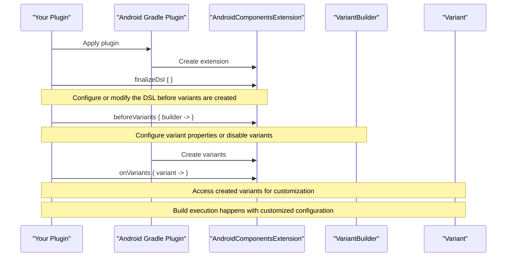

Sources: [README.md:20-24](), [README.md:113-120]()

### 2. Artifact API System

The Artifact API is central to many customizations, allowing you to access, transform, create, or listen to various build artifacts:

- **Get artifacts**: Access build outputs like APKs, bundles, or manifests
- **Transform artifacts**: Modify artifacts during the build process
- **Create artifacts**: Generate new artifacts
- **Listen to artifacts**: React to artifact creation events

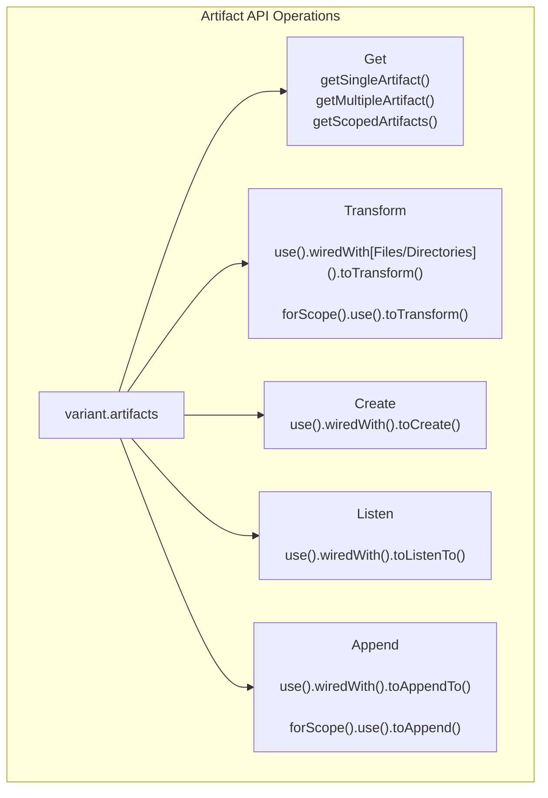

Sources: [README.md:12](), [README.md:27-32](), [README.md:67-71](), [README.md:127-139]()

### 3. Variant System

Variants represent different build configurations of your app (like debug or release). The recipes demonstrate how to:

- Select specific variants to customize
- Add or customize sources in variants
- Configure variant-specific build properties
- Add custom BuildConfig fields
- Manipulate the manifest per variant

Sources: [README.md:23](), [README.md:102-105](), [README.md:117-120](), [README.md:140-142]()

## Recipe Categories

The repository organizes recipes in several different ways to help you find relevant examples:

### Theme-Based Categories

Recipes are grouped by functional themes that address specific customization areas:

| Theme | Purpose | Example Recipes |
|-------|---------|----------------|
| Android Assets | Working with app assets | addGeneratedSourceFolder, legacyTaskBridging |
| Android Manifest | Modifying the manifest | transformManifest, createSingleArtifact, perVariantManifestPlaceholder |
| Artifact API | Manipulating build artifacts | transformAllClasses, getSingleArtifact, listenToArtifacts |
| DSL | Extending the Gradle DSL | addBuildTypeUsingDslFinalize, extendingAgp |
| Dependency Resolution | Customizing dependencies | variantDependencySubstitutionTest |
| Sources | Managing source code | addGeneratedSourceFolder, addCustomSourceType |

Sources: [README.md:9-15]()

### API-Based Categories

Recipes are also categorized by the specific APIs they demonstrate:

| API Category | Purpose | 
|--------------|---------|
| AndroidComponentsExtension methods | Entry points for build customization |
| Variant and VariantBuilder APIs | Configuring build variants |
| Artifact APIs | Working with build outputs |
| Source management APIs | Adding or modifying source code |
| DSL extension APIs | Creating custom Gradle DSL elements |

Sources: [README.md:16-106]()

### Common Call Chains

The repository also indexes complete API call chains, showing how to combine multiple API calls to achieve specific outcomes:

```
variant.artifacts.use().wiredWith().toCreate()
variant.buildConfigFields.put()
variant.sources.*.addGeneratedSourceDirectory()
androidComponents.selector().withBuildType()
```

Sources: [README.md:107-146]()

## How To Use These Recipes

Follow these steps to effectively use the AGP extension recipes:

1. **Identify your customization need**: Determine what aspect of the build you want to customize.

2. **Find relevant recipes**: Use the categorization in the [README.md](README.md) to locate recipes that address your need.

3. **Study the implementation**: Examine the recipe's code to understand the approach and API usage.

4. **Adapt to your project**: Modify the recipe code to fit your specific requirements.

5. **Apply in your build**: Integrate the customized code into your project's Gradle build system.

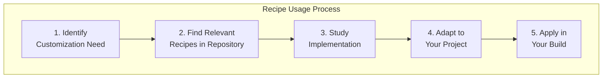

Sources: [README.md:7-9]()

## Repository Structure

The repository is organized with each recipe in its own directory. The directory name typically reflects the recipe's primary purpose. Inside each directory, you'll find:

- A complete implementation of the customization
- Build files and necessary configurations
- Sample code that demonstrates the customization in action

The recipes are designed to be self-contained, making it easy to understand the specific customization without needing to examine the entire repository.

Sources: [README.md:7-9]()

## Related Resources

For more detailed information about specific aspects of AGP extension, refer to:

- [Extension Architecture](#2) - Explains the high-level architecture of the AGP extension system
- [AndroidComponentsExtension Lifecycle](#2.1) - Details the lifecycle and key entry points
- [Artifact API System](#2.2) - Comprehensive explanation of the Artifact API
- [Variant System](#2.3) - Explains how to work with variants
- [Task Integration](#2.4) - Details on integrating custom Gradle tasks

Sources: [README.md:159-174]()

---

# Page: Extension Architecture

# Extension Architecture

<details>
<summary>Relevant source files</summary>

The following files were used as context for generating this wiki page:

- [README.md](README.md)

</details>


## Purpose and Scope

This page provides a comprehensive overview of the Android Gradle Plugin (AGP) extension architecture, explaining the core components and their relationships. It covers the high-level design of how AGP exposes extension points for build customization, the lifecycle of these extensions, and how they interact with the Android build system.

For more detailed information about specific components, see the following related pages:
- [AndroidComponentsExtension Lifecycle](#2.1)
- [Artifact API System](#2.2)
- [Variant System](#2.3)
- [Task Integration](#2.4)

## Core Architecture Overview

The Android Gradle Plugin extension system provides a structured way to customize and extend the Android build process. It's designed around a central extension object that provides access to variant configurations, artifacts, and build lifecycle hooks.

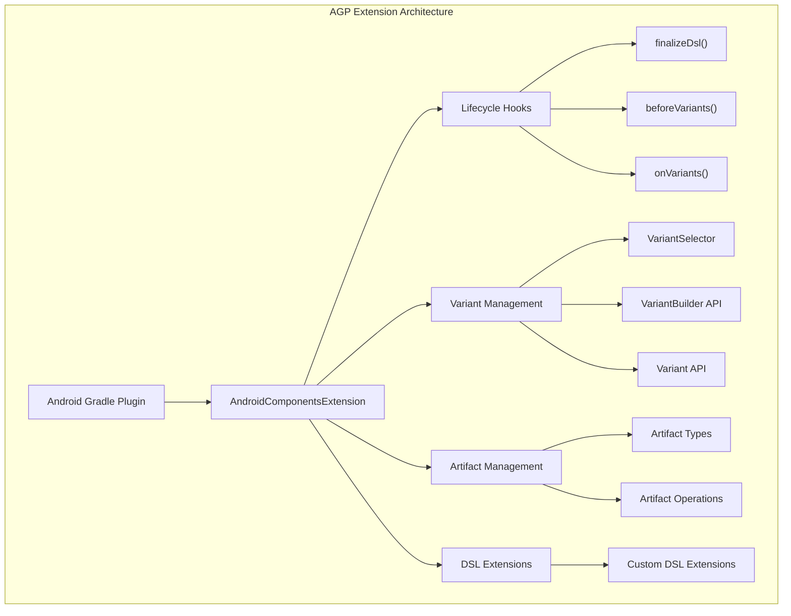

**Diagram: AGP Extension Architecture Overview**

Sources: [README.md:19-24]()

## Key Components

### AndroidComponentsExtension

The `AndroidComponentsExtension` is the primary entry point for interacting with the AGP extension system. It provides access to variant configuration, artifact manipulation, and build lifecycle hooks. This extension is available through the `androidComponents` property after applying an Android plugin.

The extension follows a specific lifecycle with three major phases:
1. **DSL Finalization**: Configure build types, product flavors, and other DSL elements
2. **Variant Creation**: Configure or filter variants before they are created
3. **Variant Customization**: Modify variants after they have been created

Sources: [README.md:19-24](), [README.md:114-116]()

### Variant System

The variant system represents the different build configurations of an Android project (combinations of build types and product flavors). It provides interfaces to configure and customize variants:

- **VariantBuilder**: Configures variants before creation (min SDK, test options, etc.)
- **Variant**: Represents a fully created variant, allowing post-creation customization
- **VariantSelector**: Allows selecting specific variants to apply customizations

Sources: [README.md:20-21](), [README.md:97-104]()

### Artifact API

The Artifact API provides access to build outputs and enables transformations on them. Key components include:

- **Artifact Types**: Different categories of artifacts (SingleArtifact, MultipleArtifact, ScopedArtifact)
- **Artifact Operations**: Actions performed on artifacts (get, transform, create, append, listen)
- **Transformation System**: Mechanism to modify artifacts during the build

Sources: [README.md:12](), [README.md:26-32]()

### DSL Extensions

AGP allows extending the Gradle DSL with custom configuration blocks, enabling plugin developers to add their own configuration options to the Android block.

Sources: [README.md:13](), [README.md:48-52](), [README.md:108]()

## Component Interaction Flow

The following diagram illustrates how components of the AGP extension system interact during the build process:

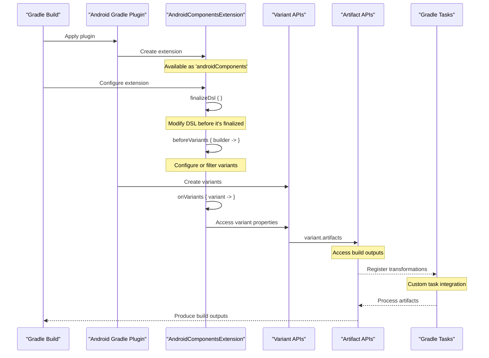

**Diagram: AGP Extension Component Interaction**

Sources: [README.md:114-123]()

## Extension Points and Code Entities

The diagram below maps extension points to specific code entities and APIs:

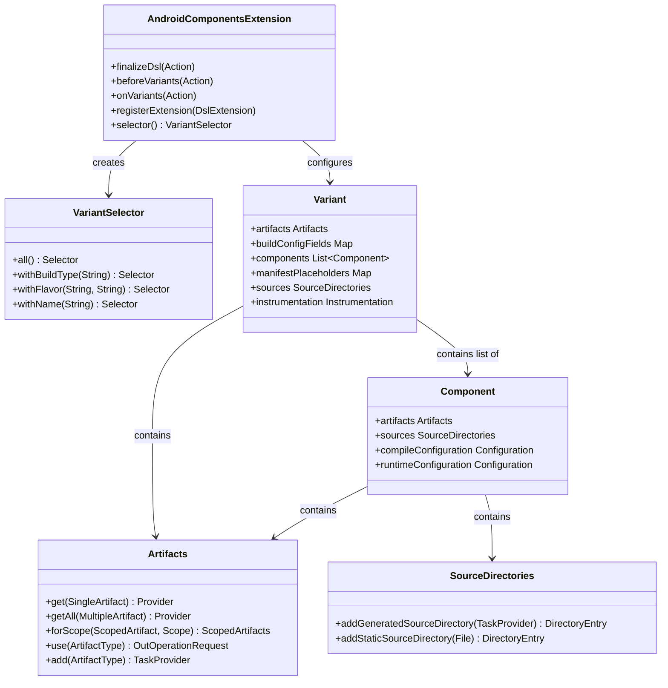

**Diagram: AGP Extension Code Entities**

Sources: [README.md:19-24](), [README.md:39-52](), [README.md:97-104](), [README.md:26-32](), [README.md:42-47](), [README.md:85-86]()

## Artifact Types and Operations

The Artifact API is a core part of the extension system, providing different artifact types that can be accessed and transformed:

| Artifact Type | Description | Examples |
|---------------|-------------|----------|
| SingleArtifact | Represents a single file or directory | MERGED_MANIFEST, ASSETS, APK, BUNDLE |
| MultipleArtifact | Represents multiple files | NATIVE_DEBUG_METADATA, MULTIDEX_KEEP_PROGUARD |
| ScopedArtifact | Artifacts with scope (project, module deps, etc.) | CLASSES |

| Operation | Description | Method Chain Example |
|-----------|-------------|---------------------|
| get | Retrieves an artifact | `variant.artifacts.get(SingleArtifact.MERGED_MANIFEST)` |
| getAll | Retrieves multiple artifacts | `variant.artifacts.getAll(MultipleArtifact.NATIVE_DEBUG_METADATA)` |
| use | Prepares an artifact for transformation | `variant.artifacts.use().wiredWith()...` |
| add | Adds a new artifact | `variant.artifacts.add(MultipleArtifact.NATIVE_DEBUG_METADATA)` |
| transform | Transforms an artifact | `variant.artifacts.use().wiredWithFiles().toTransform()` |
| append | Appends to an artifact | `variant.artifacts.use().wiredWith().toAppendTo()` |
| listen | Listens to artifact changes | `variant.artifacts.use().wiredWith().toListenTo()` |

Sources: [README.md:66-90](), [README.md:80-94](), [README.md:127-142]()

## Extension Lifecycle

The extension system follows a defined lifecycle that aligns with Gradle's build phases:

1. **Configuration Phase**:
   - DSL configuration & finalization (`finalizeDsl`)
   - Variant filtering & configuration (`beforeVariants`)
   - Variant creation (by AGP)
   - Variant customization (`onVariants`)
   - Task graph construction

2. **Execution Phase**:
   - Task execution
   - Artifact transformations
   - Build output generation

This lifecycle enables plugin developers to inject customizations at the appropriate points in the build process.

Sources: [README.md:114-120]()

## Common Extension Patterns

The repository demonstrates several common patterns for extending AGP:

1. **Artifact Transformations**: Modifying build outputs like manifests, classes, or resources
2. **Source Management**: Adding generated or static source directories
3. **BuildConfig Customization**: Adding custom fields to BuildConfig
4. **Manifest Manipulation**: Modifying the Android manifest
5. **DSL Extensions**: Creating custom DSL blocks for configuration
6. **Dependency Resolution**: Customizing how dependencies are resolved

These patterns form the basis for the recipe examples throughout the repository.

Sources: [README.md:8-15]()

---

# Page: AndroidComponentsExtension Lifecycle

# AndroidComponentsExtension Lifecycle

<details>
<summary>Relevant source files</summary>

The following files were used as context for generating this wiki page:

- [README.md](README.md)

</details>


## Purpose and Scope

This document details the lifecycle and key entry points of the `AndroidComponentsExtension` interface, which serves as the primary access point for customizing the Android Gradle Plugin (AGP) build process. The lifecycle comprises three main phases that govern when and how you can modify the Android build. For information about the Artifact API system that you'll often use within these lifecycle phases, see [Artifact API System](#2.2).

## Overview

The `AndroidComponentsExtension` is the central interface for extending and customizing the AGP build system. It provides structured access to the variant system and enables you to interact with the build process at specific, well-defined points in the lifecycle.

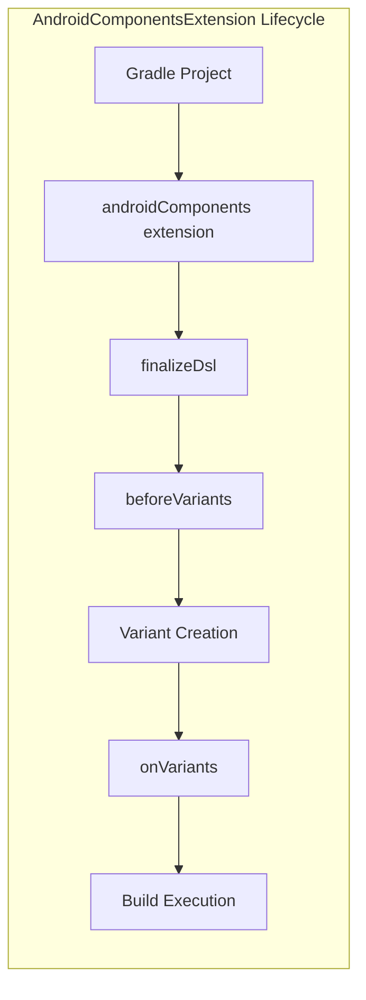

Sources: README.md

## Lifecycle Phases

The `AndroidComponentsExtension` exposes three main lifecycle phases that occur in a specific order. Each phase has access to different capabilities and serves different purposes in the build customization process.

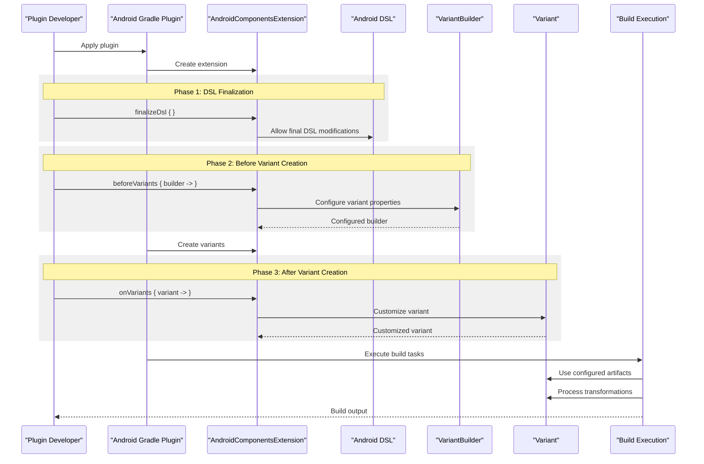

Sources: README.md

### 1. finalizeDsl Phase

The `finalizeDsl` phase occurs after the Android DSL has been evaluated but before it's locked. This is the last chance to modify the DSL (Domain-Specific Language) configuration.

**Purpose:**
- Add or modify build types, product flavors, or signing configs
- Add or modify default configuration properties
- Make final adjustments to DSL before it's locked for variant creation

**Example usage from recipes:**
- Adding build types using DSL finalization

**Limitations:**
- Cannot access variant information (variants don't exist yet)
- Cannot configure artifacts (artifacts are variant-specific)

**Code reference:**
```kotlin
androidComponents.finalizeDsl { extension ->
    // Modify DSL configuration here
    extension.buildTypes.create("customBuildType")
}
```

Sources: README.md:114, README.md:13

### 2. beforeVariants Phase

The `beforeVariants` phase occurs after the DSL is finalized but before variants are created. This phase provides access to the `VariantBuilder` interface, which allows you to configure how variants will be created.

**Purpose:**
- Filter or disable specific variants
- Configure variant properties before creation
- Disable certain test types
- Set minimum SDK levels for specific variants

**Example usage from recipes:**
- Disabling test components
- Selecting and configuring specific variants based on criteria

**Limitations:**
- Cannot access actual variant instances (not created yet)
- Cannot configure artifacts or transformations

**Code reference:**
```kotlin
androidComponents.beforeVariants { variantBuilder ->
    // Configure variant creation
    if (variantBuilder.minSdk < 21) {
        variantBuilder.enable = false
    }
}
```

Sources: README.md:113, README.md:20

### 3. onVariants Phase

The `onVariants` phase occurs after all variants have been created. This is the most powerful phase, providing full access to the created `Variant` instances and their associated capabilities.

**Purpose:**
- Configure and transform artifacts
- Add generated source directories
- Register pre-build tasks
- Modify build configuration fields
- Transform classes and other resources
- Configure manifests
- Substitute dependencies

**Example usage from recipes:**
- Transforming manifests
- Adding generated source folders
- Customizing build config fields
- Artifact transformations

**Code reference:**
```kotlin
androidComponents.onVariants { variant ->
    // Customize variant
    variant.buildConfigFields.put("CUSTOM_FIELD", "String", "\"customValue\"")
    
    // Access and transform artifacts
    val mergedManifest = variant.artifacts.get(SingleArtifact.MERGED_MANIFEST)
    // ...
}
```

Sources: README.md:115, README.md:21-22

## Variant Selection

Within both the `beforeVariants` and `onVariants` phases, you can use selectors to target specific variants rather than processing all variants.

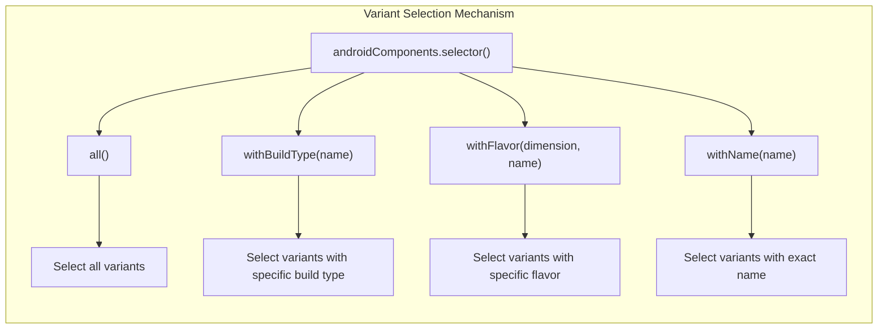

Sources: README.md:102-105, README.md:117-120

### Common Selection Patterns

**Selecting all variants:**
```kotlin
androidComponents.onVariants(
    androidComponents.selector().all()
) { variant ->
    // Applied to all variants
}
```

**Selecting by build type:**
```kotlin
androidComponents.onVariants(
    androidComponents.selector().withBuildType("debug")
) { variant ->
    // Applied only to debug variants
}
```

**Selecting by flavor:**
```kotlin
androidComponents.onVariants(
    androidComponents.selector().withFlavor("dimension", "flavor")
) { variant ->
    // Applied only to variants with specific flavor
}
```

**Selecting by name:**
```kotlin
androidComponents.onVariants(
    androidComponents.selector().withName("debugFlavor")
) { variant ->
    // Applied only to variant with exact name
}
```

Sources: README.md:102-106, README.md:117-120

## Integration with Key AGP Systems

The `AndroidComponentsExtension` lifecycle is integrated with other key systems in the AGP extension ecosystem:

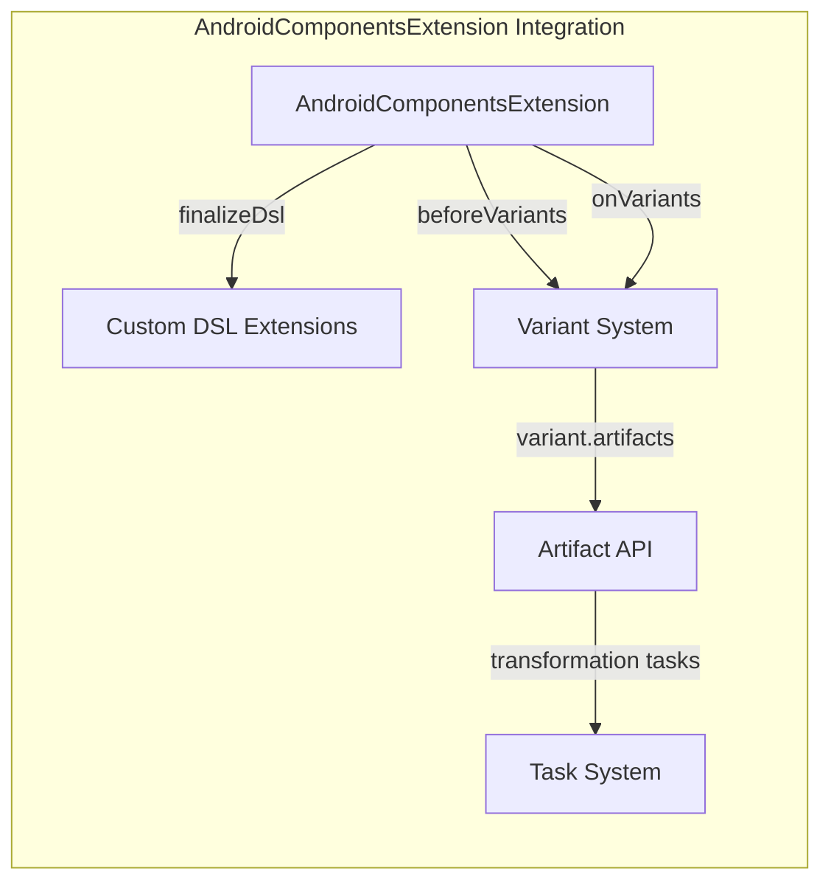

Sources: README.md

### Artifact API Integration

During the `onVariants` phase, you can access and manipulate artifacts through `variant.artifacts`:

```kotlin
androidComponents.onVariants { variant ->
    variant.artifacts.get(SingleArtifact.MERGED_MANIFEST)
    variant.artifacts.getAll(MultipleArtifact.NATIVE_DEBUG_METADATA)
    variant.artifacts.use(...)
}
```

Sources: README.md:130-132

### Task Integration

Custom tasks are typically registered and wired to artifact transformations during the `onVariants` phase:

```kotlin
androidComponents.onVariants { variant ->
    val taskProvider = project.tasks.register<CustomTask>("customTask")
    
    variant.artifacts.use(...)
        .wiredWith(taskProvider)
        .toTransform(...)
}
```

Sources: README.md:87-89

### Custom DSL Extensions

Custom DSL extensions are registered via the `registerExtension` method:

```kotlin
androidComponents.registerExtension(
    DslExtension.Builder()
        .extendProjectWith(...)
        .extendBuildTypeWith(...)
        .extendProductFlavorWith(...)
        .build()
)
```

Sources: README.md:22, README.md:108

## Common Practices and Recommendations

1. **Use the appropriate lifecycle phase:**
   - Use `finalizeDsl` for DSL modifications
   - Use `beforeVariants` for filtering and configuring variant creation
   - Use `onVariants` for artifact transformations and variant customization

2. **Leverage variant selectors to target specific variants** rather than processing all variants unnecessarily.

3. **Defer heavy operations to the execution phase** by using task providers and the Artifact API.

4. **Maintain clean separation of concerns** between different extension points.

5. **Design for configuration cache compatibility** by avoiding direct task instantiation and using the task registry.

Sources: README.md

## Conclusion

The `AndroidComponentsExtension` lifecycle provides a structured way to customize the Android build process at different stages. By understanding when each phase occurs and what capabilities are available in each, you can effectively extend AGP to suit your specific build requirements.

For more information about working with artifacts during the `onVariants` phase, see [Artifact API System](#2.2). For details about variants and their capabilities, see [Variant System](#2.3).

---

# Page: Artifact API System

# Artifact API System

<details>
<summary>Relevant source files</summary>

The following files were used as context for generating this wiki page:

- [README.md](README.md)

</details>


## Purpose and Scope

The Artifact API System is a core component of the Android Gradle Plugin (AGP) extension framework that enables plugin developers to interact with build artifacts during the Android application build process. This system allows for retrieving, creating, transforming, and monitoring the various files and directories generated during build execution.

This document covers the architecture of the Artifact API system, the different types of artifacts, available operations, and how these operations integrate with Gradle tasks. For information about the Android Components Extension lifecycle that provides access to the Artifact API, see [AndroidComponentsExtension Lifecycle](#2.1). For details on integrating custom Gradle tasks with the Artifact API, see [Task Integration](#2.4).

## Artifact API Overview

The Artifact API provides a structured way to interact with build outputs across different variants of your Android application. It serves as the interface between the build process and custom logic you want to apply to build artifacts.

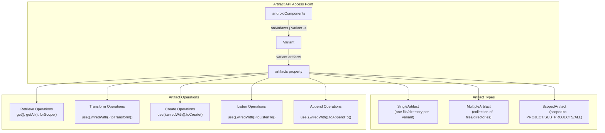

Sources: README.md:10-43

## Artifact Types

The Artifact API supports three main types of artifacts, each representing different kinds of build outputs. Understanding these types is essential for working effectively with the API.

```mermaid
classDiagram
    class "Artifacts Interface" {
        +get(SingleArtifact): FileCollection
        +getAll(MultipleArtifact): FileCollection
        +forScope(ScopedArtifact): ScopedArtifacts
    }
    
    class "SingleArtifact" {
        <<enum>>
        +APK
        +MERGED_MANIFEST
        +BUNDLE
        +ASSETS
        ...
    }
    
    class "MultipleArtifact" {
        <<enum>>
        +NATIVE_DEBUG_METADATA
        +MULTIDEX_KEEP_PROGUARD
        ...
    }
    
    class "ScopedArtifact" {
        <<enum>>
        +CLASSES
        ...
    }
    
    class "ScopedArtifacts.Scope" {
        <<enum>>
        +PROJECT
        +SUB_PROJECTS
        +ALL
    }
    
    "Artifacts Interface" --> "SingleArtifact" : uses
    "Artifacts Interface" --> "MultipleArtifact" : uses
    "Artifacts Interface" --> "ScopedArtifact" : uses
    "ScopedArtifact" --> "ScopedArtifacts.Scope" : scoped by
```

Sources: README.md:64-83, README.md:74-77

### SingleArtifact

`SingleArtifact` represents a unique file or directory produced once per variant. Common examples include:

- `SingleArtifact.MERGED_MANIFEST`: The merged Android manifest file
- `SingleArtifact.APK`: The generated APK file
- `SingleArtifact.BUNDLE`: The Android App Bundle
- `SingleArtifact.ASSETS`: The assets directory

SingleArtifacts are accessed using the `get()` method:

```kotlin
// Get the merged manifest file for a variant
val mergedManifest = variant.artifacts.get(SingleArtifact.MERGED_MANIFEST)
```

Sources: README.md:81-84

### MultipleArtifact

`MultipleArtifact` represents a collection of files or directories. Examples include:

- `MultipleArtifact.NATIVE_DEBUG_METADATA`: Debug metadata for native code
- `MultipleArtifact.MULTIDEX_KEEP_PROGUARD`: ProGuard rules for multidex configurations

MultipleArtifacts are accessed using the `getAll()` method:

```kotlin
// Get all multidex ProGuard rules for a variant
val multidexRules = variant.artifacts.getAll(MultipleArtifact.MULTIDEX_KEEP_PROGUARD)
```

Sources: README.md:66-67, README.md:31

### ScopedArtifact

`ScopedArtifact` represents artifacts that can be scoped to different parts of the project hierarchy:

- `ScopedArtifacts.Scope.PROJECT`: Only project classes
- `ScopedArtifacts.Scope.SUB_PROJECTS`: Only classes from subprojects (dependencies)
- `ScopedArtifacts.Scope.ALL`: All classes (project + dependencies)

The most common ScopedArtifact is `ScopedArtifact.CLASSES`, which represents compiled classes organized by scope.

ScopedArtifacts are accessed using the `forScope()` method:

```kotlin
// Get access to the project's compiled classes
val projectClasses = variant.artifacts.forScope(ScopedArtifact.CLASSES)
                            .use(ScopedArtifacts.Scope.PROJECT)
```

Sources: README.md:74-79

## Artifact Operations

The Artifact API provides a set of operations that allow you to interact with artifacts throughout the build process. These operations can be grouped into several categories.

```mermaid
flowchart LR
    subgraph "Artifact API Operations"
        direction TB
        
        variant[/"variant"/] --> artifacts["variant.artifacts"]
        
        artifacts --> retrieveArtifacts[/"Retrieve
        Artifacts"/]
        
        artifacts --> transformArtifacts[/"Transform
        Artifacts"/]
        
        artifacts --> createArtifacts[/"Create
        Artifacts"/]
        
        artifacts --> listenArtifacts[/"Listen to
        Artifacts"/]
        
        artifacts --> appendArtifacts[/"Append to
        Artifacts"/]
        
        retrieveArtifacts --> get["get(SingleArtifact)"]
        retrieveArtifacts --> getAll["getAll(MultipleArtifact)"]
        retrieveArtifacts --> forScope["forScope(ScopedArtifact)"]
        
        transformArtifacts --> singleTransform["use().wiredWithFiles().toTransform()"]
        transformArtifacts --> dirTransform["use().wiredWithDirectories().toTransform()"]
        transformArtifacts --> multiTransform["use().wiredWith().toTransform()"]
        transformArtifacts --> scopedTransform["forScope().use().toTransform()"]
        
        createArtifacts --> createSingle["use().wiredWith().toCreate()"]
        
        listenArtifacts --> listenSingle["use().wiredWith().toListenTo()"]
        listenArtifacts --> listenMultiple["use().wiredWithMultiple().toListenTo()"]
        
        appendArtifacts --> appendMultiple["use().wiredWith().toAppendTo()"]
        appendArtifacts --> appendScoped["forScope().use().toAppend()"]
    end
```

Sources: README.md:27-42, README.md:63-90

### Retrieving Artifacts

The most basic operation is retrieving artifacts for inspection or use in custom tasks.

#### get() - Retrieving SingleArtifacts

```kotlin
// Get the merged manifest to use in a custom task
val mergedManifest = variant.artifacts.get(SingleArtifact.MERGED_MANIFEST)
```

Sources: README.md:30, README.md:81-84

#### getAll() - Retrieving MultipleArtifacts

```kotlin
// Get all native debug metadata files
val debugMetadata = variant.artifacts.getAll(MultipleArtifact.NATIVE_DEBUG_METADATA)
```

Sources: README.md:31, README.md:66-67

#### forScope() - Accessing ScopedArtifacts

```kotlin
// Get access to all compiled classes
val allClasses = variant.artifacts.forScope(ScopedArtifact.CLASSES)
```

Sources: README.md:28-29, README.md:74-76

### Transforming Artifacts

Transformation is a core operation that allows you to modify artifacts during the build process. The API provides several ways to transform artifacts, depending on their type.

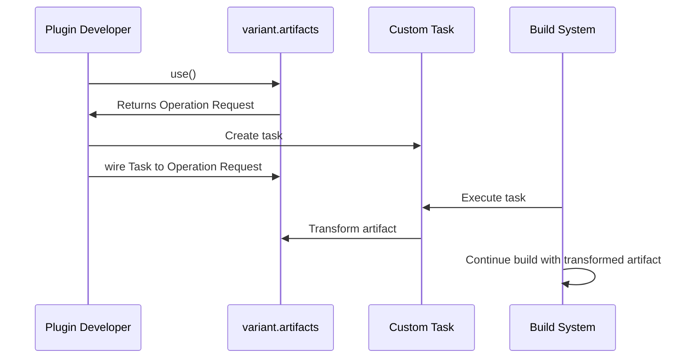

Sources: README.md:87-90, README.md:133-139

#### Transforming Files (SingleArtifact)

For transforming single files like manifests:

```kotlin
// Transform a merged manifest file with a custom task
val taskProvider = project.tasks.register("transformManifest", ManifestTransformerTask::class.java)

variant.artifacts.use(taskProvider)
    .wiredWithFiles(
        inputArtifact = SingleArtifact.MERGED_MANIFEST,
        outputLocation = workingDirectory.resolve("transformed-manifest.xml")
    )
    .toTransform()
```

Sources: README.md:139, README.md:84

#### Transforming Directories (SingleArtifact)

For transforming directories:

```kotlin
// Transform the assets directory
val taskProvider = project.tasks.register("transformAssets", AssetTransformerTask::class.java)

variant.artifacts.use(taskProvider)
    .wiredWithDirectories(
        inputArtifact = SingleArtifact.ASSETS,
        outputDirectory = workingDirectory.resolve("transformed-assets")
    )
    .toTransform()
```

Sources: README.md:137-138, README.md:82-83

#### Transforming Multiple Files (MultipleArtifact)

For transforming collections of files:

```kotlin
// Transform native debug metadata files
val taskProvider = project.tasks.register("transformDebugMetadata", DebugMetadataTransformerTask::class.java)

variant.artifacts.use(taskProvider)
    .wiredWith(
        inputArtifacts = MultipleArtifact.NATIVE_DEBUG_METADATA,
        outputDirectory = workingDirectory.resolve("transformed-metadata")
    )
    .toTransform()
```

Sources: README.md:136, README.md:67

#### Transforming Scoped Artifacts

For transforming scoped artifacts like classes:

```kotlin
// Transform all project classes
val taskProvider = project.tasks.register("transformClasses", ClassTransformerTask::class.java)

variant.artifacts.forScope(ScopedArtifact.CLASSES)
    .use(ScopedArtifacts.Scope.PROJECT, taskProvider, 
        ClassTransformerTask::inputDirectories,
        ClassTransformerTask::outputDirectory
    )
    .toTransform()
```

Sources: README.md:130, README.md:74-76, README.md:80

### Creating Artifacts

You can also create entirely new artifacts during the build process:

```kotlin
// Create a custom manifest file
val taskProvider = project.tasks.register("createCustomManifest", ManifestCreatorTask::class.java)

variant.artifacts.use(taskProvider, ManifestCreatorTask::outputFile)
    .wiredWith(SingleArtifact.MERGED_MANIFEST)
    .toCreate()
```

Sources: README.md:70, README.md:133-134

### Listening to Artifacts

The API allows you to listen to artifacts and react when they are produced, without modifying them:

```kotlin
// Listen to APK creation to perform some action
val taskProvider = project.tasks.register("apkReporter", ApkReporterTask::class.java)

variant.artifacts.use(taskProvider, ApkReporterTask::apkFolder)
    .wiredWith(SingleArtifact.APK)
    .toListenTo()
```

Sources: README.md:70-71, README.md:135, README.md:81

### Appending to Artifacts

You can append additional content to multiple artifacts:

```kotlin
// Append to native debug metadata
val taskProvider = project.tasks.register("additionalDebugMetadata", DebugMetadataGeneratorTask::class.java)

variant.artifacts.use(taskProvider, DebugMetadataGeneratorTask::outputDirectory)
    .wiredWith(MultipleArtifact.NATIVE_DEBUG_METADATA)
    .toAppendTo()
```

Sources: README.md:69, README.md:133, README.md:67

## Artifact Transformation Flow

Understanding how artifacts move through the build system is crucial for properly integrating custom logic.

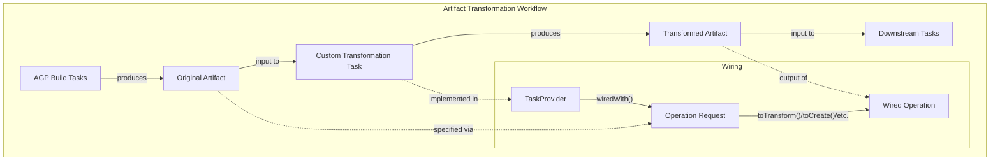

Sources: README.md:87-90, README.md:133-139

### Integration with Gradle Tasks

The Artifact API operations are tied to Gradle tasks through a "wiring" mechanism. This provides several benefits:

1. **Task Inputs/Outputs**: The system automatically sets up the proper Gradle task inputs and outputs
2. **Incremental Building**: Gradle's up-to-date checking works automatically
3. **Parallelization**: Tasks can run in parallel when dependencies are properly defined

```mermaid
classDiagram
    class "TaskProvider<T>" {
        <<Gradle>>
    }
    
    class "Operation Request" {
        +wiredWith()
        +wiredWithFiles()
        +wiredWithDirectories()
        +wiredWithMultiple()
    }
    
    class "Wired Operation" {
        +toTransform()
        +toCreate()
        +toListenTo()
        +toAppendTo()
    }
    
    class "T: Task" {
        <<Custom Task>>
        +inputProperty
        +outputProperty
    }
    
    "TaskProvider<T>" --> "T: Task" : provides
    "Operation Request" --> "TaskProvider<T>" : uses
    "Operation Request" --> "Wired Operation" : creates
    "T: Task" ..> "Wired Operation" : implements
```

Sources: README.md:87-92, README.md:133-139

### Task Output Up-to-Date Checks

The API respects Gradle's up-to-date checks to avoid unnecessary work:

```kotlin
// Example of customizing up-to-date checks
taskProvider.configure { task ->
    task.outputs.upToDateWhen { 
        // Custom logic to determine if the task should be considered up-to-date
        false // Always run the task in this example
    }
}
```

Sources: README.md:91-92, README.md:106

## Common Use Cases

Below are some common use cases for the Artifact API, illustrating its practical applications.

### Transforming an Android Manifest

```kotlin
// Register a task to transform the manifest
val taskProvider = project.tasks.register("transformManifest", ManifestTransformerTask::class.java)

// Wire the task to the manifest artifact
variant.artifacts.use(taskProvider)
    .wiredWithFiles(
        inputArtifact = SingleArtifact.MERGED_MANIFEST,
        outputLocation = workingDirectory.resolve("transformed-manifest.xml")
    )
    .toTransform()
```

Sources: README.md:139, README.md:84, README.md:11

### Working with App Bundles and APKs

```kotlin
// Get the app bundle for a variant
val bundle = variant.artifacts.get(SingleArtifact.BUNDLE)

// Listen to APK creation
val taskProvider = project.tasks.register("apkReporter", ApkReporterTask::class.java)
variant.artifacts.use(taskProvider, ApkReporterTask::apkFolder)
    .wiredWith(SingleArtifact.APK)
    .toListenTo()
```

Sources: README.md:83, README.md:135, README.md:81

### Transforming Classes

```kotlin
// Transform all project classes
val taskProvider = project.tasks.register("transformClasses", ClassTransformerTask::class.java)

variant.artifacts.forScope(ScopedArtifact.CLASSES)
    .use(ScopedArtifacts.Scope.PROJECT, taskProvider, 
        ClassTransformerTask::inputDirectories,
        ClassTransformerTask::outputDirectory
    )
    .toTransform()
```

Sources: README.md:130, README.md:74-76, README.md:80

### Working with Assets Directory

```kotlin
// Get the assets directory
val assetsDir = variant.artifacts.get(SingleArtifact.ASSETS)

// Transform the assets directory
val taskProvider = project.tasks.register("transformAssets", AssetTransformerTask::class.java)
variant.artifacts.use(taskProvider)
    .wiredWithDirectories(
        inputArtifact = SingleArtifact.ASSETS,
        outputDirectory = workingDirectory.resolve("transformed-assets")
    )
    .toTransform()
```

Sources: README.md:137-138, README.md:82-83

## Conclusion

The Artifact API System provides a powerful and flexible way to interact with build artifacts in the Android Gradle Plugin. By understanding the different artifact types and the operations available, developers can create sophisticated build customizations that integrate smoothly with the build process.

For more information on how this system integrates with the larger AGP extension architecture, see [Extension Architecture](#2) and for specifics on implementing custom tasks that work with artifacts, see [Task Integration](#2.4).

---

# Page: Variant System

# Variant System

<details>
<summary>Relevant source files</summary>

The following files were used as context for generating this wiki page:

- [README.md](README.md)

</details>


## Purpose and Scope

This document explains the Android Gradle Plugin (AGP) variant system, which is responsible for managing build variants in Android projects. It covers variant builders, selectors, and customization points that enable you to configure and manipulate variants programmatically. For information about the artifact system that variants interact with, see [Artifact API System](#2.2). For details on the overall extension lifecycle, see [AndroidComponentsExtension Lifecycle](#2.1).

## What are Variants?

In Android builds, variants represent different versions of your app or library that can be built from the same codebase. Variants are created by combining build types (like debug, release) with product flavors (like free, paid) to create distinct configurations like "debugFree" or "releasePaid".

The variant system provides programmatic access to these configurations through the AGP extension APIs. This allows plugin developers to inspect, customize, and transform these variant configurations during the build process.

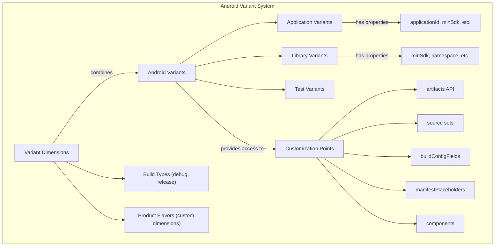

Diagram: Overview of the Variant System

Sources: README.md

## Variant Lifecycle

Variants in AGP follow a specific lifecycle, with different hooks available for customization at each stage:

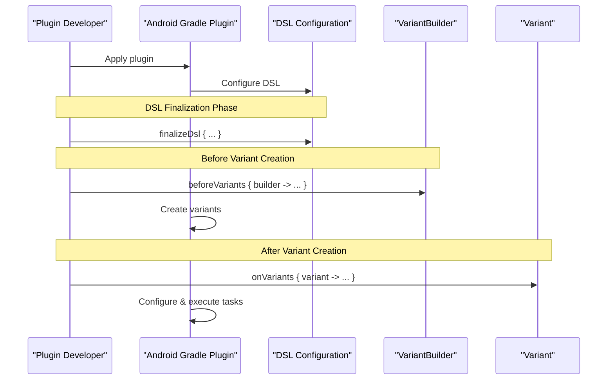

Diagram: Variant Lifecycle and Configuration Points

Sources: README.md

## Key Components

### Variant Builders

Variant builders are accessible through the `beforeVariants` hook and allow you to configure properties before variants are created, or even disable specific variants entirely.

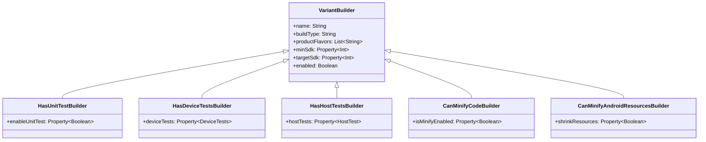

Diagram: Variant Builder Hierarchy

Sources: README.md

### Variant Selectors

Variant selectors provide a way to target specific variants for configuration:

```mermaid
flowchart LR
    subgraph "VariantSelector API"
        AndroidComponents["androidComponents"] --> Selector["selector()"]
        
        Selector --> All["all()"]
        Selector --> WithBuildType["withBuildType(type)"]
        Selector --> WithFlavor["withFlavor(dimension, value)"]
        Selector --> WithName["withName(name)"]
        
        All --> |selects| AllVars["All variants"]
        WithBuildType --> |selects| BTVars["Variants with specific build type"]
        WithFlavor --> |selects| FlavorVars["Variants with specific flavor"]
        WithName --> |selects| NamedVar["One specific variant"]
    end
```

Diagram: Variant Selector Methods

Sources: README.md

## Variant Customization

Once variants are created, the `onVariants` hook provides access to the variants themselves. This is where you can customize many aspects of the variant:

### Properties and Methods

Variants provide access to various properties and operations:

- **Artifacts API**: Access and transform build artifacts
- **Source Management**: Add or modify source directories
- **BuildConfig Customization**: Add custom fields to BuildConfig
- **Manifest Manipulation**: Modify manifest placeholders
- **Dependency Resolution**: Configure component dependencies

```mermaid
classDiagram
    class Variant {
        +name: String
        +buildType: String
        +productFlavors: Map~String, String~
        +applicationId: Property~String~
        +minSdk: Property~Int~
        +targetSdk: Property~Int~
        +artifacts: Artifacts
        +sources: SourceDirectories
        +buildConfigFields: MapProperty~String, BuildConfigField~
        +manifestPlaceholders: MapProperty~String, String~
        +components: List~Component~
        +nestedComponents: List~Component~
    }
    
    class ApplicationVariant {
        +applicationId: Property~String~
        +outputs: List~VariantOutput~
    }
    
    class LibraryVariant {
        +namespace: Property~String~
    }
    
    Variant <|-- ApplicationVariant
    Variant <|-- LibraryVariant
    
    class Component {
        +name: String
        +artifacts: Artifacts
        +sources: SourceDirectories
        +compileConfiguration: Configuration
        +runtimeConfiguration: Configuration
    }
    
    Variant --> Component: components
```

Diagram: Variant Interface Structure

Sources: README.md

## Common Use Cases

### Selecting Specific Variants

You can select specific variants to apply customizations to:

```kotlin
// Select all release variants
androidComponents.selector().withBuildType("release")

// Select variants with a specific flavor
androidComponents.selector().withFlavor("dimension", "value")

// Select a specific variant by name
androidComponents.selector().withName("releaseDemo")
```

Sources: README.md

### Disabling Variants

You can disable variants that you don't want to build:

```kotlin
androidComponents.beforeVariants { builder ->
    // Disable debug variants
    if (builder.buildType == "debug") {
        builder.enable = false
    }
    
    // Disable unit tests for specific variants
    if (builder.buildType == "release") {
        if (builder is HasUnitTestBuilder) {
            builder.enableUnitTest = false
        }
    }
}
```

Sources: README.md

### Modifying Variant Properties

You can modify properties of variants after they are created:

```kotlin
androidComponents.onVariants { variant ->
    // Add custom build config field
    variant.buildConfigFields.put(
        "STRING_VALUE",
        BuildConfigField(
            "String",
            "\"customValue\"",
            "Comment"
        )
    )
    
    // Set manifest placeholders
    variant.manifestPlaceholders.put("customPlaceholder", "value")
}
```

Sources: README.md

### Dependency Substitution

You can customize the dependency resolution for specific variants:

```kotlin
androidComponents.onVariants(selector) { variant ->
    variant.components.forEach { component ->
        component.compileConfiguration.resolutionStrategy.dependencySubstitution {
            // Substitute dependencies
        }
        component.runtimeConfiguration.resolutionStrategy.dependencySubstitution {
            // Substitute dependencies
        }
    }
}
```

Sources: README.md

## Integration with Other Systems

### Artifact API Integration

Variants provide access to the Artifact API, allowing you to manipulate build artifacts:

```kotlin
androidComponents.onVariants { variant ->
    // Get an artifact
    val mergedManifest = variant.artifacts.get(SingleArtifact.MERGED_MANIFEST)
    
    // Transform an artifact
    variant.artifacts.use(...)
        .wiredWithFiles(taskProvider)
        .toTransform(SingleArtifact.MERGED_MANIFEST)
}
```

For detailed information about artifact operations, see [Artifact API System](#2.2).

Sources: README.md

### Source Management

Variants provide access to source directories, allowing you to add or modify source sets:

```kotlin
androidComponents.onVariants { variant ->
    // Add generated source directory
    variant.sources.java?.addGeneratedSourceDirectory(
        taskProvider, "outputDir"
    )
    
    // Add custom source type
    variant.sources.customSourceType?.addStaticSourceDirectory(
        project.layout.projectDirectory.dir("src/custom")
    )
}
```

Sources: README.md

## Components vs. Nested Components

A variant can have both direct components and nested components:

```mermaid
flowchart TD
    subgraph "Variant Component Structure"
        Variant["Variant"] --> |contains| Components["Components (direct)"]
        Variant --> |contains| NestedComponents["Nested Components"]
        
        Components --> |have| Artifacts1["Artifacts API"]
        Components --> |have| Sources1["Source Directories"]
        Components --> |have| Configurations1["Configurations"]
        
        NestedComponents --> |have| Artifacts2["Artifacts API"]
        NestedComponents --> |have| Sources2["Source Directories"]
        NestedComponents --> |have| Configurations2["Configurations"]
        
        Configurations1 --> |provides| CompileConfiguration1["Compile Configuration"]
        Configurations1 --> |provides| RuntimeConfiguration1["Runtime Configuration"]
        
        Configurations2 --> |provides| CompileConfiguration2["Compile Configuration"]
        Configurations2 --> |provides| RuntimeConfiguration2["Runtime Configuration"]
    end
```

Diagram: Component Structure in Variants

Sources: README.md

## Related APIs

The variant system interacts closely with other AGP extension APIs:

1. **AndroidComponentsExtension**: Provides access to variants through `beforeVariants` and `onVariants` hooks
2. **Artifacts API**: Accessed through `variant.artifacts` for manipulating build artifacts
3. **Source Management**: Accessed through `variant.sources` for configuring source sets
4. **Task Integration**: Used to register tasks that modify variant outputs

For more information on these related systems, see:
- [AndroidComponentsExtension Lifecycle](#2.1)
- [Artifact API System](#2.2)
- [Task Integration](#2.4)

Sources: README.md

## Common Examples

### Building Specific Variants

```kotlin
// Only build release variants
androidComponents.beforeVariants { builder ->
    if (builder.buildType != "release") {
        builder.enable = false
    }
}
```

Sources: README.md

### Configuring Variant Properties

```kotlin
// Configure minSdk for specific variants
androidComponents.beforeVariants(
    androidComponents.selector().withName("demoRelease")
) { builder ->
    builder.minSdk.set(23)
}
```

Sources: README.md

### Applying Actions to Specific Variants

```kotlin
// Apply actions only to variants with specific build type
androidComponents.onVariants(
    androidComponents.selector().withBuildType("release")
) { variant ->
    // Custom actions for release variants
}
```

Sources: README.md

## Conclusion

The variant system is a core part of the AGP extension architecture, allowing plugin developers to customize Android builds at a granular level. By understanding the variant lifecycle and available customization points, you can create powerful and flexible build plugins that manipulate the build process to meet your specific requirements.

---

# Page: Task Integration

# Task Integration

<details>
<summary>Relevant source files</summary>

The following files were used as context for generating this wiki page:

- [README.md](README.md)

</details>


## Purpose and Scope

This page details the integration of custom Gradle tasks with the Android Gradle Plugin (AGP) artifact system using wired operations. It explains how to properly connect your custom tasks to AGP's build pipeline, ensuring they run at the appropriate time and have access to the right input files, while delivering their outputs to the correct locations for subsequent build phases.

For information about the broader Artifact API system that these task integrations utilize, see [Artifact API System](#2.2). For details on variant customization, see [Variant System](#2.3).

Sources: [README.md:87-91]()

## Task Integration Overview

Task integration in AGP involves connecting custom Gradle tasks to the AGP build pipeline through a pattern called "wired operations." These operations link your tasks to specific artifacts within the build system, defining what inputs your task consumes and where its outputs should be placed.

```mermaid
flowchart TD
    subgraph "Task Integration Architecture"
        Variant["Variant"] --> Artifacts["variant.artifacts"]
        Artifacts --> Operations["Artifact Operations"]
        Operations --> TaskOp["Task-based Operations"]
        
        TaskOp --> WiredOp["Wired Operations"]
        WiredOp --> Transform["Transform Operation"]
        WiredOp --> Create["Create Operation"]
        WiredOp --> Listen["Listen Operation"]
        WiredOp --> Append["Append Operation"]
        
        CustomTask["Custom Gradle Task"] -.-> WiredOp
    end
```

Task integration allows you to:
1. Transform existing artifacts (e.g., modify manifest files or transform compiled classes)
2. Create new artifacts from scratch
3. Listen to artifact creation events
4. Append files to existing multi-file artifacts

Sources: [README.md:27-36](), [README.md:87-90]()

## The Wiring Mechanism

The "wiring" mechanism connects your custom task to the AGP build system through a well-defined interface. This ensures your task receives the correct inputs and its outputs are properly integrated into the build pipeline.

```mermaid
sequenceDiagram
    participant Plugin as Plugin Developer
    participant AGP as Android Gradle Plugin
    participant Variant as Variant
    participant Artifacts as Artifacts API
    participant Task as Custom Task
    
    Plugin->>AGP: Register plugin
    AGP->>Variant: Create variants
    Plugin->>Variant: Access variant
    Plugin->>Artifacts: Request operation on artifact
    Artifacts->>Task: Wire task to operation
    Artifacts-->>AGP: Register task in build graph
    AGP->>Task: Execute task at appropriate time
    Task-->>AGP: Produce artifact output
    AGP->>AGP: Continue build with new/modified artifact
```

Sources: [README.md:87-90]()

## Wired Operations Types

AGP provides several types of wired operations, each designed for specific task integration scenarios:

### 1. Standard Wired Operations

Used for tasks that process single artifacts or produce single outputs.

```mermaid
flowchart LR
    subgraph "Standard Wired Operations"
        ArtifactsUse["artifacts.use()"] --> WiredOp["wiredWith()"]
        WiredOp --> Operations["Task Operations"]
        
        Operations --> toTransform["toTransform()"]
        Operations --> toCreate["toCreate()"]
        Operations --> toListenTo["toListenTo()"]
        Operations --> toAppendTo["toAppendTo()"]
    end
```

Source files that demonstrate this pattern include recipes for standard artifact transformations.

Sources: [README.md:87](), [README.md:133-137]()

### 2. Directory-Based Wired Operations

Specialized for tasks that work with directories rather than individual files.

```mermaid
flowchart LR
    subgraph "Directory-Based Wired Operations"
        ArtifactsUse["artifacts.use()"] --> WiredDir["wiredWithDirectories()"]
        WiredDir --> Operations["Directory Operations"]
        
        Operations --> toTransform["toTransform()"]
        Operations --> toTransformMany["toTransformMany()"]
    end
```

These operations are commonly used for asset transformations or directory-based manipulations.

Sources: [README.md:88](), [README.md:137-138]()

### 3. File-Based Wired Operations

Specialized for tasks that work with individual files.

```mermaid
flowchart LR
    subgraph "File-Based Wired Operations"
        ArtifactsUse["artifacts.use()"] --> WiredFile["wiredWithFiles()"]
        WiredFile --> Operations["File Operations"]
        
        Operations --> toTransform["toTransform()"]
    end
```

These operations are particularly useful for transforming manifest files and other individual configuration files.

Sources: [README.md:89](), [README.md:139]()

### 4. Multiple-Artifact Wired Operations

For tasks that need to work with collections of artifacts.

```mermaid
flowchart LR
    subgraph "Multiple-Artifact Wired Operations"
        ArtifactsUse["artifacts.use()"] --> WiredMultiple["wiredWithMultiple()"]
        WiredMultiple --> Operations["Multiple Operations"]
        
        Operations --> toListenTo["toListenTo()"]
    end
```

This type is used when tasks need to monitor or process multiple related artifacts together.

Sources: [README.md:90](), [README.md:135]()

## Operation Types

The AGP Artifact API supports four main types of operations that can be performed through task integration:

### Transform Operations

Transform operations modify existing artifacts and replace them with the modified version. They form the foundation of most custom build logic.

```mermaid
flowchart LR
    subgraph "Transform Operation Flow"
        Input["Input Artifact"] --> CustomTask["Custom Task"]
        CustomTask --> Output["Transformed Artifact"]
        Output --> NextPhase["Next Build Phase"]
    end
```

Transform operations are available in several variants:
- `toTransform()` - Transform a single artifact
- `toTransformMany()` - Transform multiple artifacts in a directory structure
- `forScope().use().toTransform()` - Transform scoped artifacts like compiled classes

Sources: [README.md:28](), [README.md:60-62](), [README.md:80](), [README.md:130-131](), [README.md:137-139]()

### Create Operations

Create operations generate entirely new artifacts that didn't exist before. These are useful when your task needs to produce outputs that should be available to later build phases.

```mermaid
flowchart LR
    subgraph "Create Operation Flow"
        CustomTask["Custom Task"] --> NewArtifact["New Artifact"]
        NewArtifact --> NextPhase["Next Build Phase"]
    end
```

Create operations are defined using:
- `toCreate()` - Create a new single artifact

Sources: [README.md:70](), [README.md:134]()

### Listen Operations

Listen operations let a task observe artifacts without modifying them. This is useful for tasks that need to take some action when certain artifacts are available but don't need to modify those artifacts.

```mermaid
flowchart LR
    subgraph "Listen Operation Flow"
        Artifact["Artifact"] --> CustomTask["Custom Task"]
        CustomTask --> SideEffect["Side Effect\n(e.g., logging, metrics)"]
    end
```

Listen operations come in several forms:
- `toListenTo()` - Listen to a single artifact
- `wiredWithMultiple().toListenTo()` - Listen to multiple artifacts

Sources: [README.md:71](), [README.md:68](), [README.md:135]()

### Append Operations

Append operations add files to existing artifacts without replacing the entire artifact. This is especially useful for multi-file artifacts where you want to contribute additional files.

```mermaid
flowchart LR
    subgraph "Append Operation Flow"
        ExistingArtifact["Existing Multi-File Artifact"] --> CustomTask["Custom Task"]
        AdditionalFile["Additional File"] --> CustomTask
        CustomTask --> EnhancedArtifact["Enhanced Artifact"]
    end
```

Append operations are used through:
- `toAppendTo()` - Append to a multiple artifact
- `forScope().use().toAppend()` - Append to scoped artifacts

Sources: [README.md:69](), [README.md:78](), [README.md:128](), [README.md:133]()

## Task Integration Implementation

When implementing task integration, you need to consider three key elements:

1. **Task Definition**: Creating your custom Gradle task
2. **Task Wiring**: Connecting your task to the AGP artifact system
3. **Task Execution**: Ensuring your task runs at the correct time

```mermaid
classDiagram
    class CustomTask {
        +InputFile inputFile
        +OutputFile outputFile
        +TaskAction execute()
    }
    
    class PluginExtension {
        +onVariants(variant)
    }
    
    class ArtifactOperation {
        +wiredWith(taskProvider)
        +toTransform()
        +toCreate()
        +toListenTo()
        +toAppendTo()
    }
    
    PluginExtension --> CustomTask: creates
    PluginExtension --> ArtifactOperation: uses
    ArtifactOperation --> CustomTask: wires
```

### Task Definition Example

To implement task integration, first define your custom task:

1. Create a task class that extends Gradle's `DefaultTask` or another appropriate base class
2. Define inputs and outputs using Gradle's input/output annotations
3. Implement the task action that will process the inputs and generate outputs

### Task Wiring Example

The key to proper task integration is wiring your task to the appropriate artifacts:

```
// Within onVariants block
variant.artifacts.use(taskProvider)
    .wiredWith(taskProvider)
    .toTransform()
```

For directory-based operations:

```
variant.artifacts.use(taskProvider)
    .wiredWithDirectories()
    .toTransform()
```

For file-based operations:

```
variant.artifacts.use(taskProvider)
    .wiredWithFiles()
    .toTransform()
```

Sources: [README.md:87-90](), [README.md:133-139]()

## Artifact Types and Task Integration

Different types of artifacts require different approaches to task integration. The AGP Artifact API supports three main types of artifacts:

### Single Artifacts

Single artifacts represent individual files, such as the merged manifest, APK, or bundle file.

```mermaid
flowchart TD
    subgraph "Single Artifact Task Integration"
        SingleArtifact["SingleArtifact Type\n(e.g., MERGED_MANIFEST, APK, BUNDLE)"] --> ArtifactGet["variant.artifacts.get()"]
        ArtifactGet --> TaskInput["Task Input"]
        
        TaskOutput["Task Output"] --> ArtifactUse["variant.artifacts.use()"]
        ArtifactUse --> WiredOp["wiredWithFiles().toTransform()"]
    end
```

Common SingleArtifact types include:
- `SingleArtifact.MERGED_MANIFEST` - The merged Android manifest
- `SingleArtifact.APK` - The application package
- `SingleArtifact.BUNDLE` - The Android App Bundle
- `SingleArtifact.ASSETS` - The assets directory

Sources: [README.md:81-84](), [README.md:129-130](), [README.md:139]()

### Multiple Artifacts

Multiple artifacts represent collections of files, such as native debug metadata or multidex keep files.

```mermaid
flowchart TD
    subgraph "Multiple Artifact Task Integration"
        MultipleArtifact["MultipleArtifact Type\n(e.g., NATIVE_DEBUG_METADATA)"] --> ArtifactGetAll["variant.artifacts.getAll()"]
        ArtifactGetAll --> TaskInputs["Task Inputs"]
        
        TaskOutputs["Task Outputs"] --> ArtifactUse["variant.artifacts.use()"]
        ArtifactUse --> WiredOp["wiredWith().toTransform()/toAppendTo()"]
    end
```

Common MultipleArtifact types include:
- `MultipleArtifact.NATIVE_DEBUG_METADATA` - Native debug metadata files
- `MultipleArtifact.MULTIDEX_KEEP_PROGUARD` - Multidex keep rules

Sources: [README.md:66-67](), [README.md:132-133](), [README.md:135-136]()

### Scoped Artifacts

Scoped artifacts represent files within specific scopes, such as compiled classes from the project or its dependencies.

```mermaid
flowchart TD
    subgraph "Scoped Artifact Task Integration"
        ScopedArtifact["ScopedArtifact Type\n(e.g., CLASSES)"] --> ForScope["variant.artifacts.forScope()"]
        ForScope --> Use["use()"]
        Use --> TaskOp["toTransform()/toAppend()/toGet()"]
    end
```

Common ScopedArtifact types include:
- `ScopedArtifact.CLASSES` - Compiled class files
- With scopes like `ScopedArtifacts.Scope.PROJECT` or `ScopedArtifacts.Scope.ALL`

Sources: [README.md:73-77](), [README.md:128-130]()

## Best Practices

### Task Configuration vs. Execution

When integrating tasks with AGP, it's important to understand the distinction between configuration time and execution time:

1. **Configuration Time**: When the build script is evaluated and tasks are created and wired
2. **Execution Time**: When tasks are actually executed according to the build graph

Keep task configuration logic lightweight and defer heavy work to execution time.

### Proper Input/Output Declaration

For optimal build performance:

1. Declare all inputs and outputs using Gradle's input/output annotations
2. Use incremental task support when appropriate
3. Implement `upToDateWhen` predicates for fine-grained control of task execution

```
task.outputs.upToDateWhen { /* condition for determining if task should run */ }
```

Sources: [README.md:91](), [README.md:124]()

### Worker API Integration

For computationally intensive tasks, consider using Gradle's Worker API to enable parallel processing:

```mermaid
flowchart LR
    subgraph "Worker API Integration"
        Task["Custom Task"] --> SubmitWork["Submit Work"]
        SubmitWork --> Workers["Worker Threads"]
        Workers --> ProcessArtifacts["Process Artifacts"]
        ProcessArtifacts --> AggregateResults["Aggregate Results"]
    end
```

The `workerEnabledTransformation` recipe demonstrates how to use the Worker API with task integration.

Sources: [README.md:13](), [README.md:61](), [README.md:138]()

## Common Task Integration Patterns

### Transform Files Pattern

```mermaid
flowchart LR
    subgraph "Transform Files Pattern"
        variant["variant"] --> artifacts["artifacts"]
        artifacts --> use["use(taskProvider)"]
        use --> wiredFiles["wiredWithFiles()"]
        wiredFiles --> transform["toTransform()"]
    end
```

Used for transforming individual files like the Android manifest.

Sources: [README.md:89](), [README.md:139]()

### Transform Directories Pattern

```mermaid
flowchart LR
    subgraph "Transform Directories Pattern"
        variant["variant"] --> artifacts["artifacts"]
        artifacts --> use["use(taskProvider)"]
        use --> wiredDirs["wiredWithDirectories()"]
        wiredDirs --> transform["toTransform()"]
    end
```

Used for transforming entire directories like the assets folder.

Sources: [README.md:88](), [README.md:137]()

### Listen to Artifacts Pattern

```mermaid
flowchart LR
    subgraph "Listen to Artifacts Pattern"
        variant["variant"] --> artifacts["artifacts"]
        artifacts --> use["use(taskProvider)"]
        use --> wired["wiredWith()"]
        wired --> listen["toListenTo()"]
    end
```

Used for observing artifacts without modifying them, like renaming APKs or collecting metrics.

Sources: [README.md:71](), [README.md:135]()

### Create Artifacts Pattern

```mermaid
flowchart LR
    subgraph "Create Artifacts Pattern"
        variant["variant"] --> artifacts["artifacts"]
        artifacts --> use["use(taskProvider)"]
        use --> wired["wiredWith()"]
        wired --> create["toCreate()"]
    end
```

Used for generating new artifacts from scratch.

Sources: [README.md:70](), [README.md:134]()

## Conclusion

Task integration is the foundation for extending AGP with custom build logic. By properly wiring your tasks to the artifact system, you ensure that your custom build steps are executed at the right time, with the right inputs, and that their outputs are correctly integrated into the build pipeline.

For practical examples of task integration, refer to the recipes in the repository, such as `transformManifest`, `listenToArtifacts`, and `workerEnabledTransformation`.

Sources: [README.md:12-13]()

---

# Page: Recipe Categories

# Recipe Categories

<details>
<summary>Relevant source files</summary>

The following files were used as context for generating this wiki page:

- [README.md](README.md)

</details>


## Purpose and Scope

This document provides an overview of the functional categories of recipes in the Android Gradle Plugin (AGP) Recipes repository. It classifies recipes based on their purpose and manipulation targets within the Android build system, helping developers quickly identify relevant examples for their specific customization needs. For detailed implementation of individual recipes, refer to their respective wiki pages in sections [3.1](#3.1) through [3.6](#3.6). For understanding the underlying architecture that enables these recipes, see [Extension Architecture](#2).

## Recipe Categories Overview

The AGP recipes are organized into functional categories that represent common customization scenarios in Android app and library development. Each category demonstrates techniques for manipulating different aspects of the build process.

```mermaid
flowchart TD
    subgraph "AGP Recipe Categories"
        direction TB
        Root["AGP Recipes"]
        Root --> ManifestRecipes["Manifest Manipulation Recipes"]
        Root --> ArtifactRecipes["Artifact Transformation Recipes"]
        Root --> BuildConfigRecipes["BuildConfig and Resource Recipes"]
        Root --> SourceRecipes["Source Management Recipes"]
        Root --> DslRecipes["DSL Extension Recipes"]
        Root --> DependencyRecipes["Dependency Resolution Recipes"]
        
        ManifestRecipes --> |"examples"| M1["transformManifest"]
        ManifestRecipes --> |"examples"| M2["createSingleArtifact"]
        ManifestRecipes --> |"examples"| M3["perVariantManifestPlaceholder"]
        
        ArtifactRecipes --> |"examples"| A1["getSingleArtifact"]
        ArtifactRecipes --> |"examples"| A2["getMultipleArtifact"]
        ArtifactRecipes --> |"examples"| A3["transformDirectory"]
        ArtifactRecipes --> |"examples"| A4["transformAllClasses"]
        
        BuildConfigRecipes --> |"examples"| B1["addCustomBuildConfigFields"]
        
        SourceRecipes --> |"examples"| S1["addGeneratedSourceFolder"]
        SourceRecipes --> |"examples"| S2["addCustomSourceType"]
        
        DslRecipes --> |"examples"| D1["extendingAgp"]
        DslRecipes --> |"examples"| D2["addBuildTypeUsingDslFinalize"]
        
        DependencyRecipes --> |"examples"| DR1["variantDependencySubstitutionTest"]
    end
```

Sources: [README.md:8-15]()

## Manifest Manipulation Recipes

Manifest manipulation recipes demonstrate techniques for modifying the AndroidManifest.xml files during the build process. These recipes help developers inject dynamic values, merge manifest fragments, or transform manifest content before packaging.

Key manipulation techniques include:
- Transforming manifest content using the `SingleArtifact.MERGED_MANIFEST` artifact
- Creating custom manifests using artifact creation operations
- Setting manifest placeholders per variant

```mermaid
graph TD
    subgraph "Manifest Manipulation Flow"
        direction LR
        V["variant"] --> |"access"| A["variant.artifacts"]
        A --> |"get"| MM["SingleArtifact.MERGED_MANIFEST"]
        A --> |"use()"| WOF["wiredWithFiles()"]
        WOF --> |"toTransform()"| TF["transformManifest task"]
        
        A --> |"use()"| WO["wiredWith()"]
        WO --> |"toCreate()"| TC["createSingleArtifact task"]
        
        V --> |"access"| MP["variant.manifestPlaceholders"] 
        MP --> |"put()"| PH["placeholders per variant"]
    end
```

Sources: [README.md:11](), [README.md:84](), [README.md:96](), [README.md:139]()

## Artifact Transformation Recipes

Artifact transformation recipes demonstrate how to access and modify various build artifacts produced during the AGP build lifecycle. These recipes show how to intercept, transform, and extend artifacts such as compiled code, resource files, manifest files, and packaged outputs.

The recipes in this category utilize different artifact types:
- **SingleArtifact**: Individual files like APK, Bundle, merged manifest
- **MultipleArtifact**: Collections of files like native debug metadata
- **ScopedArtifact**: Scoped collections like compiled classes

Common operations on artifacts include:
- Getting artifacts using `get()` or `getAll()`
- Transforming artifacts with custom tasks
- Creating new artifacts
- Appending to existing artifacts
- Listening to artifact changes

```mermaid
graph LR
    subgraph "Artifact Transformation System"
        direction TB
        AC["androidComponents.onVariants"] --> V["variant"]
        V --> |"access"| VA["variant.artifacts"]
        
        VA --> |"operations"| OPS["Artifact Operations"]
        
        OPS --> Get["get()/getAll()"]
        OPS --> Transform["transform via tasks"]
        OPS --> Create["create"]
        OPS --> Append["append to"]
        OPS --> Listen["listen to"]
        
        VA --> |"artifact types"| TYPES["Artifact Types"]
        
        TYPES --> Single["SingleArtifact"]
        TYPES --> Multiple["MultipleArtifact"]
        TYPES --> Scoped["ScopedArtifact"]
        
        Single --> SAPK["APK"]
        Single --> SBUNDLE["BUNDLE"]
        Single --> SMANIFEST["MERGED_MANIFEST"]
        Single --> SASSETS["ASSETS"]
        
        Multiple --> MDEBUG["NATIVE_DEBUG_METADATA"]
        Multiple --> MKEEP["MULTIDEX_KEEP_PROGUARD"]
        
        Scoped --> SCLASSES["CLASSES"]
        
        Transform --> |"implementation"| TASKS["Transformation Tasks"]
        TASKS --> |"examples"| T1["transformDirectory"]
        TASKS --> |"examples"| T2["transformAllClasses"]
        TASKS --> |"examples"| T3["transformManifest"]
        TASKS --> |"examples"| T4["workerEnabledTransformation"]
    end
```

Sources: [README.md:12](), [README.md:27-32](), [README.md:66-80](), [README.md:81-84]()

## BuildConfig and Resource Recipes

BuildConfig and Resource recipes demonstrate how to customize BuildConfig fields and manipulate resource files. These recipes help add custom constants, modify resource values, or inject placeholders at build time.

Key techniques include:
- Adding custom BuildConfig fields through the variant API
- Working with resource values and assets
- Managing resource shrinking configurations

```mermaid
graph TD
    subgraph "BuildConfig and Resource Customization"
        direction TB
        AC["androidComponents.onVariants"] --> V["variant"]
        V --> |"access"| BCF["variant.buildConfigFields"]
        BCF --> |"put()"| NewField["Add new BuildConfig field"]
        
        V --> |"access"| SR["selectVariants"]
        SR --> |"configure"| RS["CanMinifyAndroidResourcesBuilder.shrinkResources"]
        
        V --> |"access"| VA["variant.artifacts"]
        VA --> |"get()"| ASSETS["SingleArtifact.ASSETS"]
        ASSETS --> |"transform"| AssetTransform["Transform asset files"]
    end
```

Sources: [README.md:33-34](), [README.md:82-83](), [README.md:140]()

## Source Management Recipes

Source management recipes show how to add custom source directories, generate source code at build time, and manage source sets. These recipes are useful for code generation, customizing source organization, or adding preprocessing steps.

Key techniques include:
- Adding generated source directories to the build
- Creating custom source types
- Bridging between legacy source management APIs and the new AGP API
- Managing layered and flat source directory structures

```mermaid
graph TD
    subgraph "Source Management"
        direction TB
        AC["androidComponents.onVariants"] --> V["variant"]
        V --> |"access"| VS["variant.sources"]
        
        VS --> |"access directories"| ST["SourceDirectories"]
        ST --> |"add generated"| GS["addGeneratedSourceDirectory()"]
        ST --> |"add static"| SS["addStaticSourceDirectory()"]
        
        ST --> |"structure"| DS["Directory Structures"]
        DS --> Layered["SourceDirectories.Layered"]
        DS --> Flat["SourceDirectories.Flat"]
        
        ST --> |"customization"| CST["registerSourceType"]
    end
```

Sources: [README.md:15](), [README.md:85-86](), [README.md:144-158]()

## DSL Extension Recipes

DSL Extension recipes demonstrate how to extend the Gradle DSL to provide custom configuration options for your build plugin. These recipes help create clean, type-safe configuration interfaces for your build customizations.

Key techniques include:
- Extending the AGP DSL with custom extension classes
- Adding custom build types using DSL finalization hooks
- Creating type-safe configuration options for variants, build types, and flavors

```mermaid
graph TD
    subgraph "DSL Extension System"
        direction TB
        AC["androidComponents"] --> |"register"| RE["registerExtension()"]
        RE --> |"create"| DB["DslExtension.Builder"]
        
        DB --> |"extend project"| EP["extendProjectWith()"]
        DB --> |"extend build type"| EBT["extendBuildTypeWith()"] 
        DB --> |"extend product flavor"| EPF["extendProductFlavorWith()"]
        DB --> |"finalize"| B["build()"]
        
        AC --> |"hooks"| DLC["DslLifecycle"]
        DLC --> |"finalize DSL"| FD["finalizeDsl()"]
        FD --> |"example"| ABT["addBuildTypeUsingDslFinalize"]
    end
```

Sources: [README.md:13](), [README.md:48-52](), [README.md:99](), [README.md:108](), [README.md:114](), [README.md:150]()

## Dependency Resolution Recipes

Dependency resolution recipes demonstrate how to customize the dependency resolution process during the Android build. These recipes help implement version substitution, conditional dependencies, or custom resolution strategies.

Key techniques include:
- Implementing dependency substitution rules
- Working with variant-specific dependency configurations
- Accessing component configurations

```mermaid
graph TD
    subgraph "Dependency Resolution System"
        direction TB
        AC["androidComponents.onVariants"] --> V["variant"]
        V --> |"access"| VC["variant.components"]
        VC --> |"access configurations"| CC["Component configurations"]
        
        CC --> CompileConfig["compileConfiguration"]
        CC --> RuntimeConfig["runtimeConfiguration"]
        
        Config["configuration"] --> |"access"| RS["resolutionStrategy"]
        RS --> |"configure"| DS["dependencySubstitution()"]
        DS --> |"rules"| SR["substitute().using()"]
    end
```

Sources: [README.md:14](), [README.md:44-47](), [README.md:121-123]()

## Relationship to AGP Extension Architecture

Each recipe category leverages specific parts of the AGP Extension Architecture and API. The diagram below illustrates how the recipe categories map to the AGP extension points.

```mermaid
graph TD
    subgraph "Recipe Categories to AGP Extension Points"
        direction TB
        AGP["Android Gradle Plugin"] --> ACE["AndroidComponentsExtension"]
        
        ACE --> |"access point"| FDA["finalizeDsl()"]
        ACE --> |"access point"| BV["beforeVariants()"]
        ACE --> |"access point"| OV["onVariants()"]
        ACE --> |"access point"| RE["registerExtension()"]
        
        FDA --> |"used by"| DSL["DSL Extension Recipes"]
        BV --> |"used by"| VM["Variant Manipulation"]
        VM --> |"includes"| SR["Source Management Recipes"]
        VM --> |"includes"| DR["Dependency Resolution Recipes"]
        
        OV --> |"used by"| ATR["Artifact Transformation Recipes"]
        OV --> |"used by"| MR["Manifest Manipulation Recipes"]
        OV --> |"used by"| BCR["BuildConfig and Resource Recipes"]
        OV --> |"used by"| SMR["Source Management Recipes"]
        
        RE --> |"used by"| DSLR["DSL Extension Recipes"]
    end
```

Sources: [README.md:20-24](), [README.md:113-116]()

## Recipe Selection Guide

When selecting a recipe to solve a specific build customization problem, consider the following:

| If you need to... | Look at recipe category | Example recipes |
|-------------------|-------------------------|-----------------|
| Modify the Android manifest | Manifest Manipulation | `transformManifest`, `perVariantManifestPlaceholder` |
| Transform build outputs | Artifact Transformation | `transformAllClasses`, `getSingleArtifact` |
| Add custom constants to BuildConfig | BuildConfig and Resource | `addCustomBuildConfigFields` |
| Generate code during the build | Source Management | `addGeneratedSourceFolder` |
| Create custom configuration options | DSL Extension | `extendingAgp` |
| Customize dependency resolution | Dependency Resolution | `variantDependencySubstitutionTest` |
| Control which variants are built | Variant Selection | `selectVariants` |

Sources: [README.md:7-15]()

## Cross-Cutting APIs

Several AGP APIs are used across multiple recipe categories:

| API | Used In | Purpose |
|-----|---------|---------|
| `androidComponents.onVariants()` | All categories | Main entry point to access variants |
| `variant.artifacts` | Artifact, Manifest, Sources | Access build artifacts |
| `variant.sources` | Source Management | Manage source directories |
| `variant.buildConfigFields` | BuildConfig | Add custom fields |
| `variant.manifestPlaceholders` | Manifest Manipulation | Set manifest placeholders |
| `variant.components` | Dependency Resolution | Access configurations |

Sources: [README.md:115](), [README.md:127-146]()

---

# Page: Manifest Manipulation Recipes

# Manifest Manipulation Recipes

<details>
<summary>Relevant source files</summary>

The following files were used as context for generating this wiki page:

- [README.md](README.md)

</details>


## Purpose and Scope

This document details methods for manipulating the Android Manifest during the build process using the Android Gradle Plugin (AGP) API. It covers techniques for transforming existing manifests, creating new manifest artifacts, and managing manifest placeholders on a per-variant basis. For information about artifact transformations in general, see [Artifact Transformation Recipes](#3.2).

## Android Manifest Overview

The Android Manifest (`AndroidManifest.xml`) is a critical file that provides essential information about your app to the Android system. During the build process, multiple manifest files from different modules and build variants are merged into a single manifest. AGP offers several ways to manipulate this manifest during the build process.

**Key Manifest Manipulation Scenarios:**
- Dynamically inserting values (e.g., version codes, application IDs)
- Adding or modifying components (activities, services, permissions)
- Creating specialized manifests for different build variants
- Post-processing the merged manifest for custom logic

## Manifest Manipulation Architecture

The following diagram illustrates how manifest manipulation fits into the AGP build process:

```mermaid
flowchart TD
    subgraph "AGP Build Process"
        direction LR
        ManifestFiles["Module and Library\nManifest Files"] --> MergeManifests["Merge Manifests Task"]
        MergeManifests --> MergedManifest["MERGED_MANIFEST\nArtifact"]
        
        subgraph "Manipulation Points"
            MergedManifest --> |"transform()"| TransformedManifest["Transformed Manifest"]
            MergedManifest --> |"toCreate()"| CustomManifest["Custom Manifest"]
            Variant["Variant"] --> |"manifestPlaceholders"| Placeholders["Manifest Placeholders"]
            Placeholders --> MergeManifests
        end
        
        TransformedManifest --> PackageApp["Package Application"]
        CustomManifest --> CustomUse["Custom Usage"]
    end
```

Sources: [README.md:11-12]()

## Manifest Artifact Types and Operations

The AGP Artifacts API provides specific artifact types and operations for manifest manipulation:

```mermaid
classDiagram
    class SingleArtifact {
        MERGED_MANIFEST
    }
    
    class ArtifactOperations {
        transform()
        toCreate()
        toListenTo()
    }
    
    class ManifestManipulationMethods {
        wiredWithFiles()
        wiredWith()
    }
    
    SingleArtifact --> ArtifactOperations: usable with
    ArtifactOperations --> ManifestManipulationMethods: implemented via
```

Sources: [README.md:84]()

## Manifest Transformation Techniques

### 1. Transforming the Merged Manifest

The most common approach is to transform the merged manifest using the `artifacts.use()` API with `wiredWithFiles()`. This allows you to read the merged manifest file, modify its contents, and write the modified version.

**Implementation pattern:**
1. Access the variant's artifacts through `onVariants()` hook
2. Use `variant.artifacts.use().wiredWithFiles().toTransform()` to set up the transformation
3. Define a task that reads the manifest, modifies it, and writes the result

Sources: [README.md:84-89](), [README.md:131-139]()

### 2. Creating a Custom Manifest Artifact

For cases where you need to generate a completely new manifest file rather than modifying the existing one, you can use `toCreate()` to register a task that will create a new manifest artifact.

**Implementation pattern:**
1. Access the variant's artifacts through `onVariants()` hook
2. Use `variant.artifacts.use().wiredWith().toCreate()` to register a creation task
3. Define a task that generates a new manifest file from scratch

Sources: [README.md:70](), [README.md:84](), [README.md:134]()

### 3. Per-Variant Manifest Placeholders

AGP allows for defining manifest placeholders on a per-variant basis. These placeholders can be used within the manifest file and will be replaced with actual values during the build process.

**Implementation pattern:**
1. Access the variant through `onVariants()` hook
2. Use `variant.manifestPlaceholders.put()` to add or modify placeholders
3. Reference these placeholders in the manifest file using `${placeholderName}` syntax

Sources: [README.md:96](), [README.md:142](), [README.md:153]()

## Recipe Examples

### Example 1: Transforming a Manifest File

This example demonstrates how to transform the merged manifest to add a custom attribute to the application element:

```mermaid
sequenceDiagram
    participant Plugin as "Gradle Plugin"
    participant AGP as "Android Gradle Plugin"
    participant Manifest as "Merged Manifest"
    
    Plugin->>AGP: androidComponents.onVariants()
    activate AGP
    AGP->>Plugin: Provide variant
    Plugin->>AGP: variant.artifacts.use().wiredWithFiles().toTransform()
    activate Manifest
    AGP->>Manifest: Execute transform task
    Manifest->>Manifest: Read XML
    Manifest->>Manifest: Modify application element
    Manifest->>AGP: Write modified XML
    deactivate Manifest
    deactivate AGP
```

Key implementation points:
- Access variant.artifacts through the `onVariants` callback
- Use `wiredWithFiles()` since we're dealing with a single XML file
- Implement a task that reads XML, modifies it, and writes back the result

Sources: [README.md:21-31](), [README.md:84](), [README.md:139]()

### Example 2: Creating a Custom Manifest

This example shows how to create a completely new manifest file and register it as a project artifact:

```mermaid
sequenceDiagram
    participant Plugin as "Gradle Plugin"
    participant AGP as "Android Gradle Plugin"
    participant Task as "Creation Task"
    participant Artifact as "Custom Manifest Artifact"
    
    Plugin->>AGP: androidComponents.onVariants()
    activate AGP
    AGP->>Plugin: Provide variant
    Plugin->>AGP: variant.artifacts.use().wiredWith().toCreate()
    AGP->>Task: Register and configure task
    Task->>Artifact: Generate new manifest XML
    Task->>AGP: Register as project artifact
    deactivate AGP
```

Key implementation points:
- Register a task that will generate a new manifest file
- Use `toCreate()` to register this file as a project artifact
- The created manifest becomes available to other build tasks

Sources: [README.md:70](), [README.md:84](), [README.md:134]()

### Example 3: Per-Variant Manifest Placeholders

This example illustrates how to set different manifest placeholders for different build variants:

```mermaid
sequenceDiagram
    participant Plugin as "Gradle Plugin"
    participant AGP as "Android Gradle Plugin"
    participant Variant as "Variant"
    participant Manifest as "Manifest with Placeholders"
    
    Plugin->>AGP: androidComponents.onVariants()
    activate AGP
    AGP->>Plugin: Provide variant
    Plugin->>Variant: Check variant name/type
    alt Debug variant
        Plugin->>Variant: variant.manifestPlaceholders.put("ENV", "dev")
    else Release variant
        Plugin->>Variant: variant.manifestPlaceholders.put("ENV", "prod")
    end
    AGP->>Manifest: Merge manifest with placeholders
    Manifest->>Manifest: Replace ${ENV} with actual value
    deactivate AGP
```

Key implementation points:
- Access variant's manifestPlaceholders property
- Use `put()` method to add or modify placeholders
- In manifest, use `${placeholderName}` syntax to reference placeholders

Sources: [README.md:96](), [README.md:142](), [README.md:153]()

## Integration with Build System

The manifest manipulation operations integrate with the AGP build system through task dependencies:

```mermaid
flowchart TD
    subgraph "Build Tasks"
        ProcessResources["Process Resources"] --> MergeManifests["Merge Manifests"]
        MergeManifests --> |generates| MergedManifest["MERGED_MANIFEST"]
        MergedManifest --> |input to| ManifestTasks["Manifest Transformation Tasks"]
        ManifestTasks --> |output to| PackageApp["Package Application"]
    end
```

Sources: [README.md:84-89]()

## Best Practices

1. **Use Up-to-Date Checks**: Implement proper up-to-date checks in your transformation tasks using `task.outputs.upToDateWhen {}` to avoid unnecessary re-execution.

2. **Error Handling**: Implement robust error handling in manifest transformations, as malformed manifests can cause cryptic build failures.

3. **Performance Considerations**: For large projects with many variants, minimize heavy manifest transformations to keep build times reasonable.

4. **Testing**: Test manifest transformations across different build variants to ensure they behave as expected.

5. **Documentation**: Document custom manifest modifications, especially when they affect how the application behaves at runtime.

Sources: [README.md:91]()

## Common Pitfalls

1. **XML Namespace Handling**: Failing to preserve XML namespaces when transforming the manifest can lead to runtime issues.

2. **Task Order Dependencies**: Ensure proper task ordering by using the AGP task dependency mechanisms rather than manually setting dependencies.

3. **Overwriting Critical Elements**: Be cautious when modifying essential manifest elements like permissions, as removing or changing them can cause runtime failures.

4. **Variant-Specific Logic**: Remember that manifest transformations may need to behave differently based on the build variant.

Sources: [README.md:84-89](), [README.md:91]()

## Related AGP APIs

The following AGP APIs are commonly used for manifest manipulation:

| API | Purpose |
|-----|---------|
| `SingleArtifact.MERGED_MANIFEST` | References the merged manifest artifact |
| `variant.artifacts.use().wiredWithFiles().toTransform()` | Transforms the manifest file |
| `variant.artifacts.use().wiredWith().toCreate()` | Creates a new manifest artifact |
| `variant.manifestPlaceholders.put()` | Sets manifest placeholders |
| `task.outputs.upToDateWhen {}` | Controls task up-to-date behavior |

Sources: [README.md:84-91](), [README.md:96](), [README.md:139-142]()

---

# Page: Artifact Transformation Recipes

# Artifact Transformation Recipes

<details>
<summary>Relevant source files</summary>

The following files were used as context for generating this wiki page:

- [README.md](README.md)

</details>


## Purpose and Scope

This document provides a comprehensive guide to the artifact transformation recipes in the Android Gradle Plugin (AGP) extension system. These recipes demonstrate how to manipulate build artifacts during the Android build process using AGP's Artifact API. 

For information about the overall Artifact API system architecture, please refer to [Artifact API System](#2.2). For manifest-specific transformations, see [Manifest Manipulation Recipes](#3.1).

## Understanding Artifact Transformations

Artifact transformations are operations that modify, create, or observe build outputs during the Android build process. These operations integrate with Gradle's task system to ensure proper task dependencies and incremental builds.

```mermaid
flowchart TD
    subgraph "Artifact Transformation System"
        variant["Variant"] --> artifacts["variant.artifacts"]
        
        artifacts --> artifactTypes["Artifact Types"]
        artifacts --> operations["Transformation Operations"]
        
        artifactTypes --> single["SingleArtifact"]
        artifactTypes --> multiple["MultipleArtifact"]
        artifactTypes --> scoped["ScopedArtifact"]
        
        operations --> transform["transform()"]
        operations --> create["create()"]
        operations --> listen["listenTo()"]
        operations --> append["appendTo()"]
        
        transform --> task["Custom Gradle Task"]
        create --> task
        listen --> task
        append --> task
    end
```

**Diagram: Artifact Transformation System Overview**

Sources: README.md

### Artifact Types

AGP defines three main types of artifacts that can be transformed:

| Artifact Type | Description | Common Examples | Access Method |
|---------------|-------------|-----------------|---------------|
| SingleArtifact | Represents a single file or directory | MERGED_MANIFEST, ASSETS | `variant.artifacts.get()` |
| MultipleArtifact | Represents a collection of files | NATIVE_DEBUG_METADATA | `variant.artifacts.getAll()` |
| ScopedArtifact | Files scoped to a specific context (project, module dependencies, or both) | CLASSES | `variant.artifacts.forScope()` |

Sources: README.md

## Transformation Operations

The Artifact API offers four primary operations that can be performed on artifacts:

```mermaid
flowchart LR
    subgraph "Artifact Operations"
        artifacts["variant.artifacts"] --> operations["Operations"]
        
        operations --> transform["Transform Operation<br>Modify existing artifact"]
        operations --> create["Create Operation<br>Generate new artifact"]
        operations --> listen["Listen Operation<br>Observe artifact content"]
        operations --> append["Append Operation<br>Add to existing artifact"]
        
        subgraph "Wiring Methods"
            transform --> wiredWithFiles["wiredWithFiles()"]
            transform --> wiredWithDirectories["wiredWithDirectories()"]
            transform --> wiredWith["wiredWith()"]
            create --> wiredWith
            listen --> wiredWith
            append --> wiredWith
        end
        
        wiredWithFiles --> task["Custom Gradle Task"]
        wiredWithDirectories --> task
        wiredWith --> task
    end
```

**Diagram: Artifact Operations and Wiring Methods**

Sources: README.md

## Common Transformation Patterns

### Single Artifact Transformations

This pattern is used to transform a single file or directory artifact.

```mermaid
sequenceDiagram
    participant Dev as Developer
    participant AGP as Android Gradle Plugin
    participant Variant as Variant
    participant Artifacts as variant.artifacts
    participant Task as Custom Task

    Dev->>AGP: Define custom transformation task
    Dev->>Variant: Access via onVariants { variant -> }
    Variant->>Artifacts: use()
    Artifacts->>Artifacts: wiredWithFiles() / wiredWithDirectories()
    Artifacts->>Artifacts: toTransform()
    AGP->>Task: Execute during build
    Task->>AGP: Return transformed artifact
```

**Diagram: Single Artifact Transformation Flow**

Sources: README.md

#### Example Use Cases:

1. **Transform an Android Manifest**
   - Customize AndroidManifest.xml content
   - Access using `SingleArtifact.MERGED_MANIFEST`
   - Relevant recipe: `transformManifest`

2. **Transform Assets Directory**
   - Process assets during build time
   - Access using `SingleArtifact.ASSETS`
   - Relevant recipe: `transformDirectory`

### Multiple Artifact Transformations

For transforming collections of files represented as multiple artifacts.

```mermaid
flowchart TD
    subgraph "Multiple Artifact Transformation"
        onVariants["androidComponents.onVariants"] --> variant["variant"]
        variant --> artifacts["variant.artifacts"]
        
        artifacts --> useMethod["use()"]
        useMethod --> wiredWith["wiredWith()"]
        useMethod --> wiredWithMultiple["wiredWithMultiple()"]
        
        wiredWith --> transformOp["toTransform()"]
        wiredWith --> appendOp["toAppendTo()"]
        wiredWith --> listenOp["toListenTo()"]
        
        transformOp --> task["Custom Gradle Task"]
        appendOp --> task
        listenOp --> task
        
        task --> result["Transformed/Appended Artifacts"]
    end
```

**Diagram: Multiple Artifact Transformation System**

Sources: README.md

#### Example Use Cases:

1. **Transform Native Debug Metadata**
   - Process debug symbols
   - Access using `MultipleArtifact.NATIVE_DEBUG_METADATA`
   - Relevant recipes: `transformMultiple`, `appendToMultipleArtifact`

2. **Listen to Multiple Artifacts**
   - Monitor artifact changes
   - Relevant recipe: `listenToMultipleArtifact`

### Scoped Artifact Transformations

For transforming artifacts that are scoped to specific contexts.

```mermaid
flowchart LR
    subgraph "Scoped Artifact Transformation"
        variant["variant"] --> artifacts["variant.artifacts"]
        artifacts --> forScope["forScope()"]
        
        forScope --> scope["Scope Selection"]
        scope --> project["PROJECT"]
        scope --> all["ALL"]
        
        forScope --> useMethod["use()"]
        useMethod --> toTransform["toTransform()"]
        useMethod --> toAppend["toAppend()"]
        useMethod --> toGet["toGet()"]
        
        toTransform --> task["Custom Gradle Task"]
        toAppend --> task
        toGet --> task
    end
```

**Diagram: Scoped Artifact Transformation System**

Sources: README.md

#### Example Use Cases:

1. **Transform All Classes**
   - Modify compiled classes
   - Access using `ScopedArtifact.CLASSES` with `ScopedArtifacts.Scope.PROJECT`
   - Relevant recipe: `transformAllClasses`

2. **ASM Class Transformation**
   - Bytecode manipulation
   - Relevant recipe: `asmTransformClasses`

### Worker-enabled Transformations

For performance-optimized transformations using Gradle's worker API.

```mermaid
sequenceDiagram
    participant Developer
    participant Variant
    participant Artifacts as variant.artifacts
    participant Task as TransformationTask
    participant WorkerAPI as Gradle Worker API
    participant ArtifactTransformationRequest

    Developer->>Variant: Access variant
    Variant->>Artifacts: use().wiredWithDirectories()
    Artifacts->>Task: toTransformMany()
    Task->>ArtifactTransformationRequest: Create request
    Task->>WorkerAPI: Submit work
    WorkerAPI->>WorkerAPI: Process transformation
    WorkerAPI-->>Task: Return result
    Task-->>Artifacts: Update artifact
```

**Diagram: Worker-enabled Transformation Flow**

Sources: README.md

## Recipe Implementation Examples

### 1. Transform a Single File (Manifest)

This pattern uses `wiredWithFiles()` to transform a single file artifact like the AndroidManifest.xml.

Key API calls:
- `variant.artifacts.use()`
- `wiredWithFiles()`
- `toTransform()`

Sources: README.md

### 2. Transform a Directory

This pattern uses `wiredWithDirectories()` to transform a directory artifact like assets.

Key API calls:
- `variant.artifacts.use()`
- `wiredWithDirectories()`
- `toTransform()`

Sources: README.md

### 3. Transform Multiple Files

This pattern uses `wiredWith()` and collection-based APIs to transform multiple files.

Key API calls:
- `variant.artifacts.use()`
- `wiredWith()`
- `toTransform()`
- `addMultipleArtifact()`

Sources: README.md

### 4. Append to Artifacts

This pattern allows adding new files to existing artifacts.

Key API calls:
- `variant.artifacts.use()`
- `wiredWith()`
- `toAppendTo()`
- `appendToMultipleArtifact()`
- `appendToScopedArtifacts()`

Sources: README.md

### 5. Listen to Artifacts

This pattern allows observing artifacts without modifying them.

Key API calls:
- `variant.artifacts.use()`
- `wiredWith()`
- `toListenTo()`
- `listenToMultipleArtifact()`
- `listenToArtifacts()`

Sources: README.md

## Common Use Cases

```mermaid
graph TD
    subgraph "Artifact Transformation Use Cases"
        manifest["Manifest Transformation<br>SingleArtifact.MERGED_MANIFEST"] --> manifestUse["Add permissions<br>Change attributes<br>Insert elements"]
        
        classes["Class Transformation<br>ScopedArtifact.CLASSES"] --> classUse["Bytecode manipulation<br>Code injection<br>API compatibility"]
        
        directory["Directory Transformation<br>SingleArtifact.ASSETS"] --> dirUse["Process assets<br>Add generated files<br>Filter content"]
        
        multiple["Multiple Artifact<br>MultipleArtifact.NATIVE_DEBUG_METADATA"] --> multiUse["Debug symbol processing<br>Adding supplementary files"]
        
        listen["Artifact Observation<br>SingleArtifact.APK"] --> listenUse["Artifact analysis<br>Build metrics<br>Renaming outputs"]
    end
```

**Diagram: Common Artifact Transformation Use Cases**

Sources: README.md

## Integration with Gradle Task System

Artifact transformations are tightly integrated with Gradle's task system, ensuring proper task dependencies, incremental builds, and build cache compatibility.

```mermaid
flowchart TD
    subgraph "Artifact-Task Integration"
        variant["Variant"] --> artifacts["variant.artifacts"]
        
        artifacts --> use["use()"]
        use --> wiring["Wiring Methods"]
        
        wiring --> wiredWithFiles["wiredWithFiles()"]
        wiring --> wiredWithDirectories["wiredWithDirectories()"]
        wiring --> wiredWith["wiredWith()"]
        
        wiredWithFiles --> transformation["Transformation Operation"]
        wiredWithDirectories --> transformation
        wiredWith --> transformation
        
        transformation --> task["Custom Gradle Task"]
        
        task --> inputs["task.inputs"]
        task --> outputs["task.outputs"]
        
        inputs --> upToDate["Up-to-date checks"]
        outputs --> buildCache["Build cache compatibility"]
    end
```

**Diagram: Artifact and Gradle Task Integration**

Sources: README.md

## Summary and Best Practices

When implementing artifact transformations, consider the following best practices:

1. **Choose the right artifact type**:
   - SingleArtifact for individual files or directories
   - MultipleArtifact for collections of files
   - ScopedArtifact for context-specific artifacts

2. **Select the appropriate operation**:
   - Transform to modify existing artifacts
   - Create to generate new artifacts
   - Listen to observe without modification
   - Append to add to existing artifacts

3. **Ensure task efficiency**:
   - Use proper up-to-date checks
   - Consider using worker API for parallelization
   - Implement incremental build support where appropriate

4. **Follow dependency ordering**:
   - Transformations should properly declare their inputs and outputs
   - Tasks should be properly wired to ensure correct execution order

By following these guidelines and leveraging the recipes in this repository, you can effectively customize the Android build process to meet your specific requirements.

Sources: README.md

---

# Page: BuildConfig and Resource Recipes

# BuildConfig and Resource Recipes

<details>
<summary>Relevant source files</summary>

The following files were used as context for generating this wiki page:

- [README.md](README.md)

</details>


## Purpose and Scope

This document covers recipes for customizing the BuildConfig class and working with Android resources using the Android Gradle Plugin (AGP) APIs. These recipes demonstrate how to add custom build configuration fields to the BuildConfig class and how to work with various Android resources including manifest placeholders and assets. For information about source management, including generated source code, see [Source Management Recipes](#3.4).

## Understanding BuildConfig and Resources

```mermaid
flowchart TD
    subgraph "BuildConfig System"
        GradlePlugin["Gradle Plugin"] --> VariantConfig["Variant Configuration"]
        VariantConfig --> BuildConfigFields["variant.buildConfigFields"]
        BuildConfigFields --> CodeGeneration["Code Generation Phase"]
        CodeGeneration --> BuildConfigClass["Generated BuildConfig.java"]
    end

    subgraph "Resource System"
        VariantConfig --> ResourceConfig["Resource Configuration"]
        ResourceConfig --> ManifestPlaceholders["variant.manifestPlaceholders"]
        ResourceConfig --> AssetFolders["Asset Folders"]
        ResourceConfig --> ResourceMerging["Resource Merging"]
        ResourceMerging --> ProcessedResources["Processed Resources"]
    end
```

The Android build system generates a `BuildConfig` class for each build variant of your app, containing constants that you can access at runtime. This includes standard fields like `DEBUG`, `APPLICATION_ID`, `BUILD_TYPE`, and `FLAVOR`. You can add custom fields to provide additional build-specific information.

Resources in Android include strings, layouts, drawables, and other files organized in the `res` directory. Additionally, the Android asset system manages files in the `assets` directory. The manifest file can include placeholders that are replaced with actual values during the build process.

Sources:
[README.md:33-34]()
[README.md:82-83]()
[README.md:96]()
[README.md:140-142]()
[README.md:153]()

## Adding Custom BuildConfig Fields

```mermaid
sequenceDiagram
    participant Dev as "Developer"
    participant AGP as "Android Gradle Plugin"
    participant BC as "variant.buildConfigFields"
    participant Gen as "Code Generator"
    participant App as "Application"
    
    Dev->>AGP: Apply plugin with custom code
    AGP->>BC: Access buildConfigFields property
    Dev->>BC: put("TYPE", "VALUE", "COMMENT")
    AGP->>Gen: Generate BuildConfig.java
    Gen->>App: Compile BuildConfig with custom fields
    App->>App: Access BuildConfig.FIELD at runtime
```

The AGP exposes the `buildConfigFields` property on each variant, allowing you to add custom fields of different types (String, int, boolean, etc.) to the generated BuildConfig class. This is useful for storing configuration values that should be available at runtime but determined at build time.

### Using the addCustomBuildConfigFields Recipe

To add custom BuildConfig fields, you use the `buildConfigFields.put()` method with three parameters:
1. The type of the field (e.g., "String", "boolean", "int")
2. The value for the field
3. An optional comment for the generated code

Example usage pattern:

```
androidComponents.onVariants { variant ->
    variant.buildConfigFields.put("STRING_VALUE", "\"myValue\"", "Comment for the field")
    variant.buildConfigFields.put("BOOLEAN_VALUE", "true", "Boolean flag")
    variant.buildConfigFields.put("INTEGER_VALUE", "42", "The answer")
}
```

The fields are added to the generated BuildConfig class and can be accessed at runtime via `BuildConfig.STRING_VALUE`, `BuildConfig.BOOLEAN_VALUE`, etc.

Sources:
[README.md:33]()
[README.md:140]()

## Working with Manifest Placeholders

```mermaid
flowchart LR
    subgraph "Manifest Placeholder System"
        Build["Build Script"] -->|"defines"| Placeholders["variant.manifestPlaceholders"]
        Placeholders -->|"applied to"| ManifestXml["AndroidManifest.xml with ${placeholders}"]
        ManifestXml -->|"processed by"| ManifestProcessor["Manifest Processor"]
        ManifestProcessor -->|"produces"| MergedManifest["Merged Manifest with replaced values"]
    end
```

Android manifest files can include placeholders in the format `${placeholder_name}` that are replaced with actual values during the build process. The AGP provides APIs to set these placeholder values for each build variant.

### Using the perVariantManifestPlaceholder Recipe

You can set manifest placeholders using the `manifestPlaceholders.put()` method on a variant:

```
androidComponents.onVariants { variant ->
    variant.manifestPlaceholders.put("hostName", "example.com")
    variant.manifestPlaceholders.put("deepLinkScheme", "myapp")
}
```

These placeholders can be used in your AndroidManifest.xml:

```xml
<intent-filter>
    <data android:scheme="${deepLinkScheme}" android:host="${hostName}" />
</intent-filter>
```

This allows you to specify different values for different build variants, such as using different deep link schemes for debug and release builds.

Sources:
[README.md:96]()
[README.md:142]()
[README.md:153]()

## Working with Asset Folders

```mermaid
flowchart TD
    subgraph "Asset Management Process"
        VariantAPI["Variant API"] --> ArtifactAccess["artifact.get(SingleArtifact.ASSETS)"]
        ArtifactAccess --> AssetDirectory["Asset Directory Provider"]
        AssetDirectory --> ProcessAssets["Process Assets"]
        ProcessAssets --> FinalAssets["Final Assets in APK"]
    end
    
    subgraph "Asset Transformation Options"
        TransformDirectory["Transform Directory Operation"] --> ProcessedAssetDir["Processed Asset Directory"]
        AddGenerated["Add Generated Assets"] --> GeneratedAssetDir["Generated Asset Directory"]
        LegacyBridge["Legacy Task Bridging"] --> OldTaskAssets["Assets from Legacy Tasks"]
    end
```

The AGP Artifact API provides access to the assets directory through `SingleArtifact.ASSETS`. This allows you to:

1. Transform the assets directory to modify, add, or remove assets
2. Add generated assets from custom tasks
3. Bridge between legacy Gradle tasks and the modern AGP Artifact API

### Asset Directory Transformation

You can transform the asset directory using the `artifacts.use().wiredWithDirectories().toTransform()` pattern, which allows you to process all assets in a custom task before they are packaged into the APK.

### Adding Generated Assets

You can add generated assets to the build by creating tasks that generate files and then registering those directories as asset sources using the Artifact API.

### Legacy Task Bridging

If you have existing tasks that produce assets, you can integrate them with the modern AGP Artifact API using the pattern demonstrated in the legacyTaskBridging recipe.

Sources:
[README.md:82]()

## Common Use Cases and Best Practices

### BuildConfig Use Cases

- **Environment Configuration**: Define different API endpoints, keys, or behaviors for debug vs. release builds
- **Feature Flags**: Control feature availability based on build configuration
- **Version Information**: Add custom version information beyond what's provided by default
- **Build-Time Decisions**: Store decisions made at build time that need to be available at runtime

### Resource Use Cases

- **Branding Variants**: Use different assets and resources for different product flavors
- **Environment Indicators**: Visual indicators for debug builds
- **Dynamic Configuration**: Use placeholders to inject configuration into the manifest

### Best Practices

1. **Avoid Overuse of BuildConfig**: 
   - BuildConfig fields increase the size of your app
   - Consider alternative approaches for large or sensitive data

2. **Resource Management**:
   - Organize resources by flavor or dimension when appropriate
   - Use resource qualifiers rather than build variants when the differentiation is based on device characteristics

3. **Asset Optimization**:
   - Large assets should be compressed or delivered via alternative mechanisms
   - Consider on-demand delivery for non-essential assets

4. **Build Performance**:
   - Asset transformation operations can impact build time
   - Ensure transformations are incremental when possible

Sources:
[README.md:33-34]()
[README.md:82-83]()
[README.md:96]()
[README.md:140-142]()
[README.md:153]()

## Integration with AGP Extension System

```mermaid
flowchart TD
    subgraph "AGP Extension Points for BuildConfig and Resources"
        AGP["Android Gradle Plugin"] --> ComponentsExt["AndroidComponentsExtension"]
        
        ComponentsExt --> OnVariants["onVariants { variant -> }"]
        
        OnVariants --> BuildConfigAPI["variant.buildConfigFields"]
        OnVariants --> ResourceAPI["variant.manifestPlaceholders"]
        OnVariants --> ArtifactAPI["variant.artifacts"]
        
        BuildConfigAPI -->|"put(type, value, comment)"| CustomFields["Custom BuildConfig Fields"]
        ResourceAPI -->|"put(key, value)"| PlaceholderValues["Manifest Placeholder Values"]
        ArtifactAPI -->|"get(SingleArtifact.ASSETS)"| AssetDir["Asset Directory"]
        
        AssetDir --> AssetTransform["Asset Transformations"]
    end
```

The BuildConfig and resource customization recipes integrate with the broader AGP extension system primarily through the `AndroidComponentsExtension.onVariants()` callback. This gives you access to each build variant, where you can customize build configuration fields, manifest placeholders, and asset processing.

The API design follows the general pattern of the AGP extension system, where you register callbacks to be executed at specific points in the build lifecycle, and then use the provided API objects to customize the build behavior.

Sources:
[README.md:15]()
[README.md:20-21]()
[README.md:115]()
[README.md:140-142]()

## Summary

The BuildConfig and Resource Recipes demonstrate how to use the Android Gradle Plugin's APIs to customize build-time configuration and resource processing. By using the `buildConfigFields` and `manifestPlaceholders` properties, as well as the Artifact API for assets, you can adapt your app's behavior and content based on the build variant.

These capabilities are particularly useful for:
- Supporting multiple environments (development, staging, production)
- Creating white-label applications with different branding
- Implementing feature flags and conditional behaviors
- Optimizing resource usage for different build types

The APIs follow the AGP extension patterns, primarily leveraging the `onVariants` callback to access and modify variant-specific configuration.

Sources:
[README.md:33-34]()
[README.md:82-83]()
[README.md:96]()
[README.md:140-142]()
[README.md:153]()

---

# Page: Source Management Recipes

# Source Management Recipes

<details>
<summary>Relevant source files</summary>

The following files were used as context for generating this wiki page:

- [README.md](README.md)

</details>


## Purpose and Scope

This page documents recipes for managing source code in Android Gradle Plugin (AGP) projects. It covers adding generated source folders, bridging legacy tasks with the new AGP API, and creating custom source types. These recipes demonstrate how to extend AGP's source management capabilities using the Android Components Extension API.

For artifact manipulation, see [Artifact Transformation Recipes](#3.2). For BuildConfig customization, see [BuildConfig and Resource Recipes](#3.3).

## Source Management in AGP Overview

AGP organizes source code into source sets that are organized by language type (Java, Kotlin, etc.) and variant (debug, release, etc.). The source management system provides APIs for:

1. Adding generated source folders to existing source types
2. Adding static source directories to existing source types
3. Creating custom source types beyond the standard ones
4. Connecting Gradle tasks to source generation processes

```mermaid
flowchart TD
    subgraph "AGP Source Management System"
        direction LR
        AndroidComponentsExtension --> Variant
        Variant --> SourceDirectories["variant.sources"]
        
        SourceDirectories --> KotlinSourceDir["kotlin"]
        SourceDirectories --> JavaSourceDir["java"]
        SourceDirectories --> ResSourceDir["res"]
        SourceDirectories --> AssetsSourceDir["assets"]
        SourceDirectories --> CustomSourceDir["custom type"]
        
        KotlinSourceDir --> LayeredKotlin["Layered\nstandard directories"]
        KotlinSourceDir --> GeneratedKotlin["Generated\ndirectories"]
        
        JavaSourceDir --> LayeredJava["Layered\nstandard directories"]
        JavaSourceDir --> GeneratedJava["Generated\ndirectories"]
        
        CustomSourceDir --> FlatCustom["Flat\ndirectories"]
        CustomSourceDir --> GeneratedCustom["Generated\ndirectories"]
    end
```

Sources: README.md

## Source Directory Organization

AGP supports two models for organizing source directories:

1. **Layered** - Used by standard source types (java, kotlin, etc.) with hierarchical organization
2. **Flat** - Used by custom source types with a simpler, non-hierarchical structure

```mermaid
flowchart LR
    subgraph "Source Directory Organization"
        direction TB
        
        subgraph "Layered Model"
            direction TB
            SourceType["java/kotlin source type"] --> Main["main"]
            SourceType --> Debug["debug"]
            SourceType --> Release["release"]
            
            Main --> Main_Src["src/main/java"]
            Debug --> Debug_Src["src/debug/java"]
            Release --> Release_Src["src/release/java"]
        end
        
        subgraph "Flat Model"
            direction TB
            CustomType["custom source type"] --> CustomDir1["directory 1"]
            CustomType --> CustomDir2["directory 2"]
            CustomType --> CustomDir3["directory 3"]
        end
    end
```

Sources: README.md:155-157

## Recipe: Adding Generated Source Folders

This recipe demonstrates how to add a dynamically generated source folder to an Android project's source sets. This is particularly useful when you have code generation tasks that need to integrate with the AGP build system.

### Implementation Process

```mermaid
sequenceDiagram
    participant Plugin as "Plugin Developer"
    participant AGP as "Android Gradle Plugin"
    participant Task as "Generator Task"
    participant Sources as "variant.sources"
    
    Plugin->>AGP: Register onVariants()
    AGP->>Plugin: Provide variant
    Plugin->>Task: Create generator task
    Plugin->>Sources: Access source directories (java/kotlin)
    Plugin->>Sources: addGeneratedSourceDirectory()
    Sources->>AGP: Register directory for compilation
    Task->>AGP: Generate files in directory
    AGP->>AGP: Compile generated sources
```

### Key API Usage

1. Access source directories through `variant.sources`
2. Call `addGeneratedSourceDirectory()` with:
   - Source directory to add
   - Task provider that generates the sources
   - Language-specific source type (java, kotlin, etc.)

Sources: README.md:10, README.md:15, README.md:44, README.md:47, README.md:85, README.md:144, README.md:146, README.md:156

## Recipe: Bridging Legacy Tasks with AGP

This recipe shows how to connect legacy Gradle tasks with the new AGP Artifacts API for source management. This is useful when migrating from older Gradle configurations to the modern AGP extension system.

### Legacy Task Bridging Process

```mermaid
flowchart LR
    subgraph "Legacy Task Bridging"
        direction TB
        LegacyTask["Legacy Generator Task"] --> OutputDir["Output Directory"]
        OutputDir --> |"addGeneratedSourceDirectory()"| SourceDirs["Source Directories"]
        variant --> |"artifacts.get()"| Artifacts["Variant Artifacts"]
        Artifacts --> |"registers input"| LegacyTask
        SourceDirs --> AGP["AGP Build Process"]
    end
```

### Implementation Details

The legacy task bridging pattern involves:

1. Getting an existing artifact from `variant.artifacts.get()`
2. Using it as input to a legacy task
3. Adding the task's output directory to source directories using `addGeneratedSourceDirectory()`
4. Ensuring proper task dependencies are established

Sources: README.md:10, README.md:15, README.md:44, README.md:47, README.md:85, README.md:130, README.md:144, README.md:152

## Recipe: Adding Custom Source Types

This recipe demonstrates how to create and register custom source types beyond the standard ones provided by AGP (java, kotlin, resources, etc.). Custom source types are useful for specialized code generation or when working with non-standard languages.

### Custom Source Type Registration and Usage

```mermaid
flowchart TD
    subgraph "Custom Source Type System"
        Plugin["Gradle Plugin"] -->|"1. registerSourceType()"| AGP["AGP Extension"]
        AGP -->|"2. creates"| CustomType["Custom Source Type"]
        Plugin -->|"3. onVariants {}"| Variant["Variant"]
        Variant -->|"4. sources.customName"| SourceDirs["Source Directories"]
        SourceDirs -->|"5a. addStaticSourceDirectory()"| StaticDir["Static Directory"]
        SourceDirs -->|"5b. addGeneratedSourceDirectory()"| GenDir["Generated Directory"]
        StaticDir --> |"compiled by"| AGP
        GenDir --> |"compiled by"| AGP
    end
```

### Implementation Steps

1. Register a custom source type with a unique name
2. Configure whether it uses a flat or layered directory structure
3. Access the source type through `variant.sources.[customName]`
4. Add static directories with `addStaticSourceDirectory()`
5. Add generated directories with `addGeneratedSourceDirectory()`

### Usage Differences from Standard Types

Custom source types differ from standard ones in:

| Feature | Standard Types (java, kotlin) | Custom Types |
|---------|-------------------------------|--------------|
| Directory Structure | Layered (main, debug, etc.) | Typically Flat |
| Registration | Pre-registered by AGP | Must be registered explicitly |
| Compilation | Automatic for recognized languages | May require custom task configuration |
| Source Sets | Follows AGP source set conventions | Custom organization possible |

Sources: README.md:15, README.md:47, README.md:85-86, README.md:144-145, README.md:146, README.md:155, README.md:157-158

## Best Practices

1. **Task Dependencies**: When adding generated source directories, always provide the task that generates the content to ensure proper build sequencing.

2. **Directory Naming**: Use clear, descriptive names for custom source types and generated directories to maintain readability.

3. **Layered vs. Flat**: Choose the appropriate directory structure based on your needs:
   - Use Layered for languages that benefit from variant-specific source sets
   - Use Flat for simpler, variant-agnostic source types

4. **Generated vs. Static**: Understand the difference between:
   - `addGeneratedSourceDirectory()` - For directories created during the build
   - `addStaticSourceDirectory()` - For pre-existing directories

Sources: README.md:85-86, README.md:144-145, README.md:155-158

## Advanced Source Management Techniques

### Source Registration Timing

The timing of source registration is important:

1. Register custom source types before variants are created
2. Add generated/static directories in the `onVariants` callback
3. Ensure generator tasks are properly configured before registering their output directories

### Integration with Artifact API

Source management often works alongside the Artifact API:

```mermaid
flowchart LR
    subgraph "Source Management and Artifact API Integration"
        direction TB
        
        variant -->|access| Sources["variant.sources"]
        variant -->|access| Artifacts["variant.artifacts"]
        
        Sources -->|"addGeneratedSourceDirectory()"| GenDir["Generated Source Directory"]
        TaskProvider["Task Provider"] -->|output to| GenDir
        
        Artifacts -->|"get(SingleArtifact.X)"| InputArtifact["Input Artifact"]
        InputArtifact -->|input to| TaskProvider
    end
```

The pattern typically involves:
1. Getting an input artifact using `variant.artifacts.get()`
2. Using it as input to a generator task
3. Adding the task's output as a generated source directory

Sources: README.md:42-47, README.md:85, README.md:130, README.md:144

## Conclusion

Source management recipes enable you to extend AGP's source handling capabilities with generated code, custom source types, and integration with legacy tasks. These patterns are essential for build customization and code generation workflows in Android projects.

When implementing these recipes, remember to properly manage task dependencies and artifact flows to ensure correct build ordering and efficient incremental builds.

---

# Page: DSL Extension Recipes

# DSL Extension Recipes

<details>
<summary>Relevant source files</summary>

The following files were used as context for generating this wiki page:

- [README.md](README.md)

</details>


## Purpose and Scope

This document provides recipes and best practices for extending the Android Gradle Plugin (AGP) Domain Specific Language (DSL) with custom configuration options. It explains how to create extensions that add new configuration options at the project, build type, and product flavor levels. For information about other AGP customization approaches, see [Extension Architecture](#2) and [Artifact Transformation Recipes](#3.2).

## Understanding DSL Extensions in AGP

DSL extensions allow you to augment the AGP build system with custom configuration options that plugin users can define in their build files. These extensions can then be accessed during variant configuration to influence the build process.

### DSL Extension Lifecycle

```mermaid
sequenceDiagram
    participant Plugin as "Plugin Developer"
    participant AGP as "Android Gradle Plugin"
    participant Extension as "Custom DSL Extension"
    participant Variant as "Variant Configuration"
    
    Plugin->>AGP: Register extension via androidComponents.registerExtension()
    AGP->>Extension: Create extension using DslExtension.Builder
    Plugin->>Extension: Configure with extendProjectWith()
    Plugin->>Extension: Configure with extendBuildTypeWith()
    Plugin->>Extension: Configure with extendProductFlavorWith()
    Extension->>AGP: Return built extension
    AGP->>Variant: Associate extension config with variants
    Plugin->>Variant: Access extension in onVariants block
```

Sources: README.md:22, README.md:48-51, README.md:108, README.md:116

## DSL Extension Components

The DSL extension system consists of several key components that work together to extend the AGP build system.

```mermaid
classDiagram
    class AndroidComponentsExtension {
        +registerExtension()
        +onVariants()
    }
    
    class DslExtensionBuilder {
        +extendProjectWith()
        +extendBuildTypeWith()
        +extendProductFlavorWith()
        +build()
    }
    
    class VariantExtensionConfig {
        +getProjectExtension()
        +getBuildTypeExtension()
        +getProductFlavorExtensions()
    }
    
    class Variant {
        +getExtension()
    }
    
    AndroidComponentsExtension --> DslExtensionBuilder : creates
    DslExtensionBuilder --> VariantExtensionConfig : configures
    AndroidComponentsExtension --> Variant : provides access to
    Variant --> VariantExtensionConfig : contains
```

Sources: README.md:22, README.md:48-51, README.md:99, README.md:108

### Key Components

1. **AndroidComponentsExtension.registerExtension()**: The entry point for registering a new DSL extension.

2. **DslExtension.Builder**: Used to configure the extension, including:
   - `extendProjectWith()`: Define project-level extension properties
   - `extendBuildTypeWith()`: Define build type-level extension properties
   - `extendProductFlavorWith()`: Define product flavor-level extension properties
   - `build()`: Create the extension

3. **VariantExtensionConfig**: Interface through which extensions are accessed in variant configuration.

Sources: README.md:48-51, README.md:99

## Implementation Steps

### 1. Creating and Registering an Extension

To create a DSL extension, you need to define your extension interfaces and register them with AGP.

#### Extension Interfaces

First, define interfaces for your extension properties at each level:

- **Project-level extension**: Properties applicable to the entire project
- **Build type-level extension**: Properties configurable per build type (debug, release, etc.)
- **Product flavor-level extension**: Properties configurable per product flavor

#### Registration Process

The extension is registered using the `registerExtension()` method on `AndroidComponentsExtension`:

```
androidComponents.registerExtension(MyExtension::class.java, 
    DslExtension.Builder<MyExtension>()
        .extendProjectWith(MyProjectExtension::class.java)
        .extendBuildTypeWith(MyBuildTypeExtension::class.java)
        .extendProductFlavorWith(MyFlavorExtension::class.java)
        .build()
)
```

Sources: README.md:22, README.md:108, README.md:116

### 2. Using the Extension in Build Configuration

Once registered, your extension can be used in the build configuration:

```
// In build.gradle file
android {
    // Project-level configuration
    myExtension {
        projectProperty = "value"
    }
    
    // Build type-level configuration
    buildTypes {
        debug {
            myExtension {
                buildTypeProperty = true
            }
        }
    }
    
    // Product flavor-level configuration
    productFlavors {
        free {
            myExtension {
                flavorProperty = 42
            }
        }
    }
}
```

Sources: README.md:48-51

### 3. Accessing Extension Configuration in Variants

After registration, you can access the extension configuration in the `onVariants` block:

```
androidComponents.onVariants { variant ->
    // Access project-level extension
    val projectConfig = variant.getExtension(MyProjectExtension::class.java)
    
    // Access build type-level extension
    val buildTypeConfig = variant.getExtension(MyBuildTypeExtension::class.java)
    
    // Access product flavor-level extension
    val flavorConfig = variant.getExtension(MyFlavorExtension::class.java)
    
    // Use the configuration to customize the build
    // ...
}
```

Sources: README.md:22, README.md:115

## Extension Configuration Flow

The flow of extension configuration from build script to variant is illustrated below:

```mermaid
flowchart TD
    subgraph "Build Script"
        BuildScript["build.gradle"]
        ProjectConfig["Project Configuration"]
        BuildTypeConfig["Build Type Configuration"]
        FlavorConfig["Product Flavor Configuration"]
    end
    
    subgraph "Plugin Implementation"
        Register["androidComponents.registerExtension()"]
        Builder["DslExtension.Builder"]
        BuildExt["build()"]
    end
    
    subgraph "Variant Configuration"
        OnVariants["androidComponents.onVariants()"]
        VarExt["variant.getExtension()"]
        CustomizeVariant["Customize variant based on extension"]
    end
    
    BuildScript --> ProjectConfig
    BuildScript --> BuildTypeConfig
    BuildScript --> FlavorConfig
    
    Register --> Builder
    Builder --> BuildExt
    
    ProjectConfig --> OnVariants
    BuildTypeConfig --> OnVariants
    FlavorConfig --> OnVariants
    
    OnVariants --> VarExt
    VarExt --> CustomizeVariant
```

Sources: README.md:22, README.md:108, README.md:115, README.md:116

## Example Use Cases

### Feature Flags

Use DSL extensions to define feature flags that can vary by build type or flavor:

```
android {
    featureFlags {
        enableNewFeature = true
    }
    
    buildTypes {
        debug {
            featureFlags {
                enableDebugTools = true
            }
        }
        release {
            featureFlags {
                enableDebugTools = false
            }
        }
    }
}
```

### Custom Packaging Options

Define custom packaging options that affect how your app is packaged:

```
android {
    packaging {
        excludeResources = ["**/unused_resource.xml"]
    }
    
    productFlavors {
        free {
            packaging {
                excludePremiumAssets = true
            }
        }
        premium {
            packaging {
                excludePremiumAssets = false
            }
        }
    }
}
```

Sources: README.md:48-51, README.md:99, README.md:150

## Best Practices

1. **Coherent Scope**: Define extensions at the appropriate level (project, build type, or flavor) based on their scope.

2. **Default Values**: Provide sensible default values for all extension properties.

3. **Documentation**: Document your extension's properties and how they affect the build process.

4. **Type Safety**: Use strongly typed interfaces for extension properties to enable IDE code completion.

5. **Validation**: Validate extension values during variant configuration to provide clear error messages.

6. **Avoid Duplication**: Don't duplicate existing AGP DSL properties; extend functionality instead.

## Common Pitfalls

1. **Extension Timing**: Extensions are configured during the evaluation phase but accessed during variant configuration. Keep this timing in mind.

2. **Conflicts**: Be careful not to conflict with other plugins' extensions.

3. **Performance**: Avoid computationally expensive operations during extension configuration.

4. **Isolation**: Ensure that extensions at different levels don't unintentionally affect each other.

Sources: README.md:48-51, README.md:108, README.md:150

## DSL Extension vs. Artifact API

While DSL extensions provide configuration points, they often work alongside the Artifact API to implement functionality:

| Feature | DSL Extensions | Artifact API |
|---------|---------------|--------------|
| Purpose | Define configuration options | Modify build artifacts |
| When used | Configuration phase | Variant configuration phase |
| User facing | Directly in build scripts | Used by plugin developers |
| Example | `android.myExtension { ... }` | `variant.artifacts.get(...)` |

Sources: README.md:12, README.md:22, README.md:48-51

## Summary

DSL Extensions allow you to extend AGP's build configuration with custom options at the project, build type, and product flavor levels. By registering an extension with appropriate interfaces, you can provide users with a clean, native-feeling configuration DSL that can be accessed during variant configuration to customize the build process.

---

# Page: Dependency Resolution Recipes

# Dependency Resolution Recipes

<details>
<summary>Relevant source files</summary>

The following files were used as context for generating this wiki page:

- [README.md](README.md)

</details>


## Purpose and Scope

This document covers recipes for customizing dependency resolution in Android Gradle Plugin (AGP) using the variants API. These recipes demonstrate how to implement variant-specific dependency substitution rules, allowing for different dependency implementations based on build variants. This is particularly useful for testing alternative implementations or switching dependencies based on build types.

For information about general artifact manipulation, see [Artifact Transformation Recipes](#3.2).

## Dependency Resolution in AGP

Android Gradle Plugin organizes dependencies through variant-specific configurations. Each variant (combination of build type and product flavors) has its own set of configurations for compile-time and runtime dependencies. The Variant API provides access to these configurations, allowing targeted dependency substitution rules.

```mermaid
flowchart TD
    subgraph "Variant Dependency Configuration System"
        Variant --> Components["variant.components"]
        Variant --> NestedComponents["variant.nestedComponents"]
        
        Components --> CompileConfiguration["component.compileConfiguration"]
        Components --> RuntimeConfiguration["component.runtimeConfiguration"]
        
        CompileConfiguration --> ResolutionStrategy["resolutionStrategy"]
        RuntimeConfiguration --> ResolutionStrategy
        
        ResolutionStrategy --> DependencySubstitution["dependencySubstitution()"]
        DependencySubstitution --> SubstituteMethod["substitute().using()"]
    end
```

**Diagram: Variant dependency configuration flow**

Sources: README.md

## Variant-Specific Dependency Substitution Recipe

This recipe demonstrates how to implement build-type specific dependency substitution. The typical use case is swapping in different implementations of a dependency based on build type (debug vs release).

```mermaid
sequenceDiagram
    participant Plugin as "Plugin Developer"
    participant AGP as "Android Gradle Plugin"
    participant Components as "AndroidComponentsExtension"
    participant Variant as "Variant"
    participant Config as "Configuration"
    participant Resolution as "ResolutionStrategy"
    
    Plugin->>AGP: Apply plugin
    AGP->>Components: Create extension
    
    Plugin->>Components: onVariants(selector.withBuildType())
    Components->>Variant: Filter variants by build type
    
    Variant->>Config: Access component.compileConfiguration
    Variant->>Config: Access component.runtimeConfiguration
    
    Config->>Resolution: Access resolutionStrategy
    Resolution->>Resolution: Configure dependencySubstitution
    Resolution->>Resolution: substitute(module).using(project)
```

**Diagram: Dependency substitution flow sequence**

Sources: README.md

### Implementation Steps

1. **Select specific variants**: Use the `withBuildType()` selector to target specific build types
2. **Access configurations**: From each variant, access the compile and runtime configurations
3. **Configure substitution rules**: Apply dependency substitution rules using the Gradle Resolution Strategy API

### Example Usage Pattern

The following pattern demonstrates how to substitute dependencies for debug build variants:

```kotlin
// Select variants with 'debug' build type and apply substitution
androidComponents.onVariants(androidComponents.selector().withBuildType("debug")) { variant ->
    // Access component configurations
    variant.components.forEach { component ->
        // Configure compile-time dependencies
        component.compileConfiguration.resolutionStrategy.dependencySubstitution {
            // Substitute a module dependency with a project dependency
            substitute(module("com.example:library")).using(project(":debugLibrary"))
        }
        
        // Configure runtime dependencies
        component.runtimeConfiguration.resolutionStrategy.dependencySubstitution {
            substitute(module("com.example:library")).using(project(":debugLibrary"))
        }
    }
    
    // Handle nested components (like test configurations) if needed
    variant.nestedComponents.forEach { nestedComponent ->
        // Apply substitution rules to nested component configurations
    }
}
```

Sources: README.md

## Key API Components

The recipe utilizes several key API components:

| API Component | Description |
|--------------|-------------|
| `AndroidComponentsExtension.onVariants()` | Entry point to configure variants after creation |
| `AndroidComponentsExtension.selector().withBuildType()` | Filter variants by build type name |
| `Variant.components` | Access the components (main source set) for the variant |
| `Variant.nestedComponents` | Access nested components (e.g., test source sets) |
| `Component.compileConfiguration` | Access the compile-time dependency configuration |
| `Component.runtimeConfiguration` | Access the runtime dependency configuration |
| `Configuration.resolutionStrategy` | Access the resolution strategy for a configuration |
| `ResolutionStrategy.dependencySubstitution()` | Configure dependency substitution rules |
| `substitute().using()` | Replace one dependency with another |

Sources: README.md

## Common Use Cases

### Different Implementations for Debug Builds

One common use case is to use mock or debug implementations during development:

```mermaid
flowchart TD
    subgraph "Debug vs Release Dependencies"
        App["Application"]
        
        subgraph "Debug Build"
            App --> DebugConfig["Debug Configuration"]
            DebugConfig --> MockAPI["MockApiLib\n(Local Project)"]
            DebugConfig --> DevTools["DevTools\n(Additional Dependency)"]
        end
        
        subgraph "Release Build"
            App --> ReleaseConfig["Release Configuration"]
            ReleaseConfig --> RealAPI["RealApiLib\n(External Module)"]
        end
    end
```

**Diagram: Debug vs release dependency paths**

Sources: README.md

### Testing Alternative Implementations

Another common use case is to test alternative implementations of a dependency:

- Substituting a stable release dependency with a development version
- Using a local fork of a third-party library during development
- Redirecting to an instrumented version of a library for testing

## Best Practices

1. **Target specific variants**: Use selectors to precisely target variants where substitution is needed
2. **Consider all configurations**: Apply substitution to both compile and runtime configurations when needed
3. **Maintain compatibility**: Ensure substituted dependencies have compatible APIs
4. **Document substitutions**: Make substitution rules clear to other developers
5. **Be cautious with nested components**: Remember that test configurations may require separate substitution rules

## Related Resources

For more information on Android Gradle Plugin extension capabilities:
- See [Extension Architecture](#2) for details on the overall AGP extension system
- See [Variant System](#2.3) for more information about working with variants
- See [AndroidComponentsExtension API](#4.1) for API reference

Sources: README.md

---

# Page: API Reference

# API Reference

<details>
<summary>Relevant source files</summary>

The following files were used as context for generating this wiki page:

- [README.md](README.md)

</details>


## Purpose and Scope

This document provides a comprehensive reference for the key APIs used in extending and customizing the Android Gradle Plugin (AGP). It covers the primary interfaces, classes, and methods that form the foundation of AGP's extensibility system. This reference serves as a technical resource for developers implementing custom build logic using the AGP extension mechanisms.

For an overview of the extension architecture, see [Extension Architecture](#2). For practical recipes demonstrating these APIs in use, see [Recipe Categories](#3).

## API Hierarchy Overview

The Android Gradle Plugin extension system is built around several core API components that work together to provide comprehensive build customization capabilities.

```mermaid
classDiagram
    class AndroidComponentsExtension {
        +finalizeDsl(Action~DslLifecycle~)
        +beforeVariants(Action~VariantBuilder~)
        +onVariants(Action~Variant~)
        +selector() VariantSelector
        +registerExtension() DslExtension
    }
    
    class Variant {
        +artifacts Artifacts
        +sources SourceDirectories
        +buildConfigFields MapProperty
        +manifestPlaceholders MapProperty
        +components List~Component~
        +nestedComponents List~NestedComponent~
    }
    
    class VariantBuilder {
        +minSdk int
        +deviceTests NestedComponentBuilder
        +hostTests NestedComponentBuilder
        +enableUnitTest boolean
    }
    
    class Artifacts {
        +get(SingleArtifact) FileSystemLocation
        +getAll(MultipleArtifact) List~FileSystemLocation~
        +forScope(ScopedArtifact) ScopedArtifacts
        +use() ArtifactOperations
        +add() void
    }
    
    class SourceDirectories {
        +java SourceDirectoriesImpl
        +kotlin SourceDirectoriesImpl
        +addGeneratedSourceDirectory()
        +addStaticSourceDirectory()
    }
    
    AndroidComponentsExtension --> VariantBuilder: configures
    AndroidComponentsExtension --> Variant: customizes
    Variant --> Artifacts: contains
    Variant --> SourceDirectories: contains
```

Sources: README.md:19-24, README.md:42-104

## Key API Entry Points

The AGP extension system offers several entry points for customizing the build process, with the primary interface being `AndroidComponentsExtension`.

```mermaid
flowchart TD
    subgraph "API Entry Points"
        AndroidComponentsExtension["AndroidComponentsExtension"]
        
        AndroidComponentsExtension -->|"finalizeDsl()"| DslConfiguration["DSL Configuration"]
        AndroidComponentsExtension -->|"beforeVariants()"| VariantConfiguration["Variant Configuration"]
        AndroidComponentsExtension -->|"onVariants()"| VariantCustomization["Variant Customization"]
        AndroidComponentsExtension -->|"selector()"| VariantSelection["Variant Selection"]
        AndroidComponentsExtension -->|"registerExtension()"| DslExtension["DSL Extension"]
        
        VariantCustomization --> Artifacts["Artifacts API"]
        VariantCustomization --> Sources["Source Management"]
        VariantCustomization --> BuildConfig["BuildConfig Fields"]
        VariantCustomization --> ManifestPlaceholders["Manifest Placeholders"]
        VariantCustomization --> DependencySubstitution["Dependency Substitution"]
        
        Artifacts --> SingleArtifact["SingleArtifact"]
        Artifacts --> MultipleArtifact["MultipleArtifact"] 
        Artifacts --> ScopedArtifact["ScopedArtifact"]
        
        Artifacts --> GetOperation["get()/getAll()"]
        Artifacts --> UseOperation["use()"]
        Artifacts --> AddOperation["add()"]
    end
```

Sources: README.md:20-23, README.md:114-120

## AndroidComponentsExtension API

The `AndroidComponentsExtension` interface is the main entry point for AGP extension. It provides methods for configuring and customizing Android build variants at different stages of the build lifecycle.

### Key Methods

| Method | Purpose | Usage Timing |
|--------|---------|--------------|
| `finalizeDsl { }` | Finalizes the DSL configuration before variant creation | After DSL processing, before variant creation |
| `beforeVariants { builder -> }` | Configures variant properties before creation | Before variants are created |
| `onVariants { variant -> }` | Customizes variants after creation | After variants are created |
| `selector()` | Creates a selector for filtering variants | Used with `beforeVariants` and `onVariants` |
| `registerExtension()` | Registers custom DSL extension | During plugin application |

### VariantSelector

Used to select specific variants for configuration:

| Method | Purpose |
|--------|---------|
| `all()` | Selects all variants |
| `withBuildType(name)` | Selects variants with specified build type |
| `withFlavor(dimension, name)` | Selects variants with specified flavor |
| `withName(name)` | Selects variants with exact name |

Sources: README.md:20-23, README.md:102-104, README.md:117-120

## Artifacts API

The Artifacts API provides access to build outputs and intermediate files, enabling their inspection, transformation, and creation.

### Artifact Types

```mermaid
classDiagram
    class ArtifactType {
        <<interface>>
    }
    
    class SingleArtifact {
        <<enumeration>>
        MERGED_MANIFEST
        ASSETS
        APK
        BUNDLE
        ...
    }
    
    class MultipleArtifact {
        <<enumeration>>
        NATIVE_DEBUG_METADATA
        MULTIDEX_KEEP_PROGUARD
        ...
    }
    
    class ScopedArtifact {
        <<enumeration>>
        CLASSES
        ...
    }
    
    ArtifactType <|-- SingleArtifact
    ArtifactType <|-- MultipleArtifact
    ArtifactType <|-- ScopedArtifact
```

### Artifact Operations

The following operations can be performed on artifacts:

| Operation | Method | Purpose |
|-----------|--------|---------|
| Get | `get(SingleArtifact)` | Retrieves a file/directory artifact |
| Get Multiple | `getAll(MultipleArtifact)` | Retrieves multiple file/directory artifacts |
| Get Scoped | `forScope(ScopedArtifact)` | Retrieves artifacts for a specific scope |
| Transform | `use().wiredWithFiles/Directories().toTransform()` | Transforms an artifact using a task |
| Create | `use().wiredWith().toCreate()` | Creates a new artifact using a task |
| Listen | `use().wiredWith().toListenTo()` | Reacts to artifact creation/modification |
| Append | `use().wiredWith().toAppendTo()` | Adds to an existing artifact |

Sources: README.md:12, README.md:27-32, README.md:66-90

## Variant API

The Variant API allows access to and modification of Android build variants.

```mermaid
classDiagram
    class Variant {
        +artifacts Artifacts
        +sources SourceDirectories
        +buildConfigFields MapProperty
        +manifestPlaceholders MapProperty
        +applicationId Property~String~
        +components List~Component~
        +nestedComponents List~NestedComponent~
        +outputs List~VariantOutput~
    }
    
    class Component {
        +artifacts Artifacts
        +sources SourceDirectories
        +compileConfiguration Configuration
        +runtimeConfiguration Configuration
    }
    
    class SourceDirectories {
        +java SourceDirectoriesImpl
        +kotlin SourceDirectoriesImpl
        +addGeneratedSourceDirectory()
        +addStaticSourceDirectory()
    }
    
    class ApplicationVariant {
        +applicationId Property~String~
        +outputs List~ApplicationVariantOutput~
    }
    
    Variant <|-- ApplicationVariant
    Variant --> Component: contains
    Component --> Artifacts: has
    Component --> SourceDirectories: has
```

### Variant Properties

| Property | Type | Purpose |
|----------|------|---------|
| `artifacts` | Artifacts | Access to build artifacts |
| `sources` | SourceDirectories | Management of source directories |
| `buildConfigFields` | MapProperty<String, BuildConfigField> | Custom BuildConfig fields |
| `manifestPlaceholders` | MapProperty<String, String> | Manifest placeholder values |
| `applicationId` | Property<String> | Application ID (for app variants) |
| `components` | List<Component> | Direct components of the variant |
| `nestedComponents` | List<NestedComponent> | Nested components of the variant |

Sources: README.md:93-97, README.md:126-146

## Common API Usage Patterns

### Artifact Transformation Flow

```mermaid
sequenceDiagram
    participant Dev as Developer
    participant AGP as AndroidComponentsExtension
    participant Variant as Variant
    participant Artifacts as Artifacts
    participant Task as Custom Task
    participant Build as Build Pipeline
    
    Dev->>AGP: onVariants { variant -> }
    AGP->>Variant: Provide variant
    Dev->>Variant: Access artifacts
    Variant->>Artifacts: variant.artifacts
    
    alt Transform Single Artifact
        Dev->>Artifacts: use().wiredWithFiles().toTransform()
        Artifacts->>Task: Register transformation task
        Task->>Build: Modify artifact during build
    else Transform Multiple Artifacts
        Dev->>Artifacts: use().wiredWith().toTransform()
        Artifacts->>Task: Register transformation task
        Task->>Build: Modify artifacts during build
    else Create Artifact
        Dev->>Artifacts: use().wiredWith().toCreate()
        Artifacts->>Task: Register creation task
        Task->>Build: Create artifact during build
    else Listen to Artifact
        Dev->>Artifacts: use().wiredWith().toListenTo()
        Artifacts->>Task: Register listener task
        Task->>Build: React to artifact during build
    end
```

### Common Call Chains

Here are some of the most frequently used API call chains:

1. **Variant Selection and Configuration**:
   ```
   androidComponents.selector().withBuildType("release").onVariants { variant -> ... }
   ```

2. **Artifact Transformation**:
   ```
   variant.artifacts.use().wiredWithFiles().toTransform(
       taskProvider, SingleArtifact.MERGED_MANIFEST
   )
   ```

3. **Adding Generated Sources**:
   ```
   variant.sources.java.addGeneratedSourceDirectory(
       taskProvider, taskOutput
   )
   ```

4. **Custom BuildConfig Fields**:
   ```
   variant.buildConfigFields.put("FIELD_NAME", value)
   ```

5. **Artifact Access**:
   ```
   variant.artifacts.get(SingleArtifact.MERGED_MANIFEST)
   ```

Sources: README.md:107-145

## API Scope and Context

Understanding the scope and context in which different APIs operate is crucial for effective implementation.

```mermaid
flowchart TD
    subgraph "API Lifecycle and Context"
        PS["Plugin Setup"] --> DSL["DSL Configuration"]
        DSL --> VC["Variant Creation"]
        VC --> BC["Build Configuration"]
        BC --> BE["Build Execution"]
        
        subgraph "Plugin Setup Phase"
            registerExtension["registerExtension()"]
        end
        
        subgraph "DSL Configuration Phase"
            finalizeDsl["finalizeDsl()"]
        end
        
        subgraph "Variant Creation Phase"
            beforeVariants["beforeVariants()"]
            selector["selector()"]
        end
        
        subgraph "Build Configuration Phase"
            onVariants["onVariants()"]
            artifacts["artifacts operations"]
            sources["source configuration"]
            buildConfig["buildConfig customization"]
            manifestPlaceholders["manifestPlaceholders configuration"]
        end
        
        subgraph "Build Execution Phase"
            taskExecution["task execution"]
            artifactTransformation["artifact transformation"]
            sourceGeneration["source generation"]
        end
    end
```

Sources: README.md:114-125

## API Usage Tips

1. **Use `finalizeDsl` for modifying the DSL after it's been configured** but before variants are created.

2. **Use `beforeVariants` for disabling tests or configuring variant properties** before variants are created.

3. **Use `onVariants` for most customizations**, as it gives access to the fully created variant.

4. **Prefer the Artifacts API for manipulating build outputs** rather than directly accessing task outputs.

5. **Use appropriate artifact types**: 
   - `SingleArtifact` for individual files/directories
   - `MultipleArtifact` for collections of files/directories
   - `ScopedArtifact` for artifacts that vary by scope (e.g., project vs. dependencies)

6. **Use variant selectors to target specific variants** instead of checking variant properties in callbacks.

Sources: README.md:114-125, README.md:126-146

## Related Pages

- For implementation examples, see [Recipe Categories](#3)
- For specific API details, see:
  - [AndroidComponentsExtension API](#4.1)
  - [Artifacts API](#4.2)
  - [Variant API](#4.3)

---

# Page: AndroidComponentsExtension API

# AndroidComponentsExtension API

<details>
<summary>Relevant source files</summary>

The following files were used as context for generating this wiki page:

- [README.md](README.md)

</details>


## Purpose and Scope

This document provides a comprehensive reference for the `AndroidComponentsExtension` API, which serves as the primary entry point for extending and customizing the Android Gradle Plugin (AGP). For information about the overall extension architecture, see [Extension Architecture](#2), and for details about the artifact system that is frequently used with this API, see [Artifact API System](#2.2).

The `AndroidComponentsExtension` API enables plugin developers to:
- Hook into the AGP build lifecycle
- Configure variants before and after creation
- Target specific variants using selectors
- Register custom DSL extensions

## API Overview

The `AndroidComponentsExtension` interface is the central component for AGP extension, offering access to key build phases and variant configuration.

```mermaid
classDiagram
    class AndroidComponentsExtension {
        +finalizeDsl(action)
        +beforeVariants(selector, action)
        +onVariants(selector, action)
        +selector() VariantSelector
        +registerExtension(extension) DslExtension
    }
    
    class VariantSelector {
        +all()
        +withBuildType(name)
        +withFlavor(dimension, name)
        +withName(name)
    }
    
    class VariantBuilder {
        +minSdk
        +enableUnitTest
        +deviceTests
        +hostTests
    }
    
    class Variant {
        +artifacts
        +sources
        +buildConfigFields
        +manifestPlaceholders
        +components
        +instrumentation
    }
    
    AndroidComponentsExtension --> VariantSelector : creates
    AndroidComponentsExtension --> VariantBuilder : configures via beforeVariants
    AndroidComponentsExtension --> Variant : configures via onVariants
```

Sources: README.md:20-23, README.md:112-120

## Lifecycle Hooks

The `AndroidComponentsExtension` provides three main lifecycle hooks that allow plugin developers to integrate with the AGP build process at different stages.

```mermaid
sequenceDiagram
    participant Gradle as Gradle Build
    participant AGP as Android Gradle Plugin
    participant Extension as AndroidComponentsExtension
    
    Gradle->>AGP: Apply plugin
    AGP->>Extension: Create extension instance
    
    Note over Extension: DSL Configuration Phase
    Extension->>Extension: finalizeDsl { /* configure DSL */ }
    
    Note over Extension: Variant Creation Phase
    Extension->>Extension: beforeVariants { builder -> /* configure builder */ }
    AGP->>AGP: Create variant instances
    
    Note over Extension: Variant Configuration Phase
    Extension->>Extension: onVariants { variant -> /* configure variant */ }
    
    AGP->>Gradle: Configure tasks
    Gradle->>Gradle: Execute tasks
```

Sources: README.md:112-115

### finalizeDsl

The `finalizeDsl` hook is called after the DSL is configured but before variants are created. This is the appropriate time to make final adjustments to the DSL configuration, such as adding build types.

```kotlin
androidComponents.finalizeDsl { extension ->
    // Make final adjustments to the DSL
    // For example, add a new build type
    extension.buildTypes.create("customBuildType")
}
```

Sources: README.md:52, README.md:114

### beforeVariants

The `beforeVariants` hook is called for each variant before it's actually created. This allows you to configure the variant builder to customize how variants are created.

```kotlin
androidComponents.beforeVariants(
    androidComponents.selector().all()
) { builder ->
    // Configure the variant builder
    builder.minSdk = 23
    builder.enableUnitTest = false
    builder.deviceTests.get().enable = false
}
```

Sources: README.md:20, README.md:113

### onVariants

The `onVariants` hook is called after variants are created, allowing you to configure the created variants and access their properties.

```kotlin
androidComponents.onVariants(
    androidComponents.selector().all()
) { variant ->
    // Configure the variant
    variant.buildConfigFields.put("API_KEY", "String", "\"abcdef123456\"")
    
    // Access the variant's artifacts
    variant.artifacts.get(SingleArtifact.MERGED_MANIFEST)
    
    // Register tasks that operate on the variant
    val task = project.tasks.register("customTask", CustomTask::class.java)
    variant.artifacts.use(task)
        .wiredWithFiles(CustomTask::inputFile, CustomTask::outputFile)
        .toTransform(SingleArtifact.MERGED_MANIFEST)
}
```

Sources: README.md:21, README.md:115, README.md:127-142

## Variant Selection API

The `selector()` method provides a fluent API for targeting specific variants with the `beforeVariants` and `onVariants` hooks.

### Selector Methods

| Method | Description |
|--------|-------------|
| `all()` | Selects all variants |
| `withBuildType(name)` | Selects variants with the specified build type |
| `withFlavor(dimension, name)` | Selects variants with the specified flavor in the given dimension |
| `withName(name)` | Selects a variant with the exact name |

```kotlin
// Select all variants
androidComponents.selector().all()

// Select variants with a specific build type
androidComponents.selector().withBuildType("debug")

// Select variants with a specific flavor
androidComponents.selector().withFlavor("dimension1", "flavor1")

// Select a specific variant by name
androidComponents.selector().withName("flavor1Debug")
```

Sources: README.md:102-105, README.md:117-120

## Registering Custom DSL Extensions

The `registerExtension` method allows you to extend the AGP DSL with custom configuration options at different levels:

```mermaid
flowchart TD
    AndroidComponentsExtension -->|"registerExtension()"| DslExtension
    
    DslExtension -->|"extendProjectWith()"| ProjectExtension["Project-level extension"]
    DslExtension -->|"extendBuildTypeWith()"| BuildTypeExtension["BuildType extension"]
    DslExtension -->|"extendProductFlavorWith()"| FlavorExtension["ProductFlavor extension"]
    
    ProjectExtension --> Project["Project configuration"]
    BuildTypeExtension --> BuildType["BuildType-specific config"]
    FlavorExtension --> ProductFlavor["Flavor-specific config"]
```

Sources: README.md:22, README.md:48-51, README.md:108, README.md:116

Example of registering a custom DSL extension:

```kotlin
// Create a DSL extension
val extension = DslExtension.Builder("myExtension")
    .extendProjectWith(MyProjectExtension::class.java)
    .extendBuildTypeWith(MyBuildTypeExtension::class.java)
    .extendProductFlavorWith(MyFlavorExtension::class.java)
    .build()

// Register the extension
androidComponents.registerExtension(extension)
```

Sources: README.md:108, README.md:116

## Common Usage Patterns

### Configuring Variants Based on Properties

```kotlin
androidComponents.beforeVariants { builder ->
    if (builder.minSdk < 23) {
        // Modify variant configuration based on properties
        builder.enableUnitTest = false
    }
}
```

Sources: README.md:20, README.md:98

### Disabling Tests for Specific Variants

```kotlin
androidComponents.beforeVariants(
    androidComponents.selector().withBuildType("release")
) { builder ->
    // Disable device tests
    builder.deviceTests.get().enable = false
    
    // Disable host tests
    builder.hostTests.get().enable = false
}
```

Sources: README.md:55-58, README.md:109-112

### Customizing BuildConfig Fields

```kotlin
androidComponents.onVariants { variant ->
    // Add custom BuildConfig fields
    variant.buildConfigFields.put(
        "DEBUG_MODE", 
        "boolean", 
        "true"
    )
}
```

Sources: README.md:33, README.md:140

### Manipulating Manifest Placeholders

```kotlin
androidComponents.onVariants { variant ->
    // Set manifest placeholders
    variant.manifestPlaceholders.put("hostName", "example.com")
}
```

Sources: README.md:65, README.md:96, README.md:142

## Integration with Other APIs

The `AndroidComponentsExtension` API typically works in conjunction with other AGP APIs:

```mermaid
flowchart TD
    AndroidComponentsExtension -->|"onVariants()"| Variant
    
    Variant --> ArtifactsAPI["variant.artifacts (Artifacts API)"]
    Variant --> SourcesAPI["variant.sources (Sources API)"]
    Variant --> BuildConfigAPI["variant.buildConfigFields"]
    Variant --> ManifestAPI["variant.manifestPlaceholders"]
    
    ArtifactsAPI --> ArtifactOperations["get(), getAll(), use()
    add(), transform()"]
    
    SourcesAPI --> SourceOperations["addGeneratedSourceDirectory()
    addStaticSourceDirectory()
    registerSourceType()"]
```

Sources: README.md:42-47, README.md:127-146

### Artifact API Integration

Using the `AndroidComponentsExtension` to access the Artifact API:

```kotlin
androidComponents.onVariants { variant ->
    variant.artifacts.get(SingleArtifact.MERGED_MANIFEST)
    variant.artifacts.getAll(MultipleArtifact.NATIVE_DEBUG_METADATA)
    
    val task = project.tasks.register(...)
    variant.artifacts.use(task)
        .wiredWithFiles(...)
        .toTransform(SingleArtifact.MERGED_MANIFEST)
}
```

Sources: README.md:29-32, README.md:130-136

### Source Management Integration

Working with sources through the `AndroidComponentsExtension`:

```kotlin
androidComponents.onVariants { variant ->
    // Add generated source directory
    variant.sources.java.addGeneratedSourceDirectory(
        taskProvider,
        TaskOutputs::getSourceOutputDir
    )
    
    // Add static source directory
    variant.sources.res.addStaticSourceDirectory(project.layout.projectDirectory.dir("extraRes"))
}
```

Sources: README.md:47, README.md:144-146

## API Reference

### AndroidComponentsExtension Methods

| Method | Description |
|--------|-------------|
| `finalizeDsl(action)` | Registers an action to be executed after the DSL is configured but before variants are created |
| `beforeVariants(selector, action)` | Registers an action to be executed for each selected variant before it's created |
| `onVariants(selector, action)` | Registers an action to be executed for each selected variant after it's created |
| `selector()` | Returns a VariantSelector for targeting specific variants |
| `registerExtension(extension)` | Registers a custom DSL extension |

Sources: README.md:20-23, README.md:112-120

### Key Interfaces Accessible through AndroidComponentsExtension

| Interface | Purpose |
|-----------|---------|
| `VariantSelector` | Provides methods for selecting variants |
| `VariantBuilder` | Configures how variants are created |
| `Variant` | Represents a created variant with various configuration options |
| `Component` | Represents a component (module) within a variant |
| `Artifacts` | Provides access to build artifacts for transformation |
| `SourceDirectories` | Manages source directories for different source types |

Sources: README.md:98-101, README.md:42-47

## Conclusion

The `AndroidComponentsExtension` API provides a comprehensive set of tools for extending and customizing the Android Gradle Plugin. By using the lifecycle hooks, variant selectors, and integration with other APIs, plugin developers can deeply customize the Android build process to meet specific requirements.

For more detailed information about specific aspects of the system, refer to:
- [Extension Architecture](#2) for an overview of the entire extension system
- [Variant System](#2.3) for details about variants and variant builders
- [Artifact API System](#2.2) for working with build artifacts
- [Recipe Categories](#3) for practical examples of using these APIs

---

# Page: Artifacts API

# Artifacts API

<details>
<summary>Relevant source files</summary>

The following files were used as context for generating this wiki page:

- [README.md](README.md)

</details>


The Artifacts API is a core interface within the Android Gradle Plugin (AGP) extension ecosystem that allows plugin developers to access, transform, create, and monitor Android build artifacts. This document provides a comprehensive reference for working with the Artifacts API, including artifact types, available operations, and transformation workflows.

For information on the broader extension architecture, see [Extension Architecture](#2), and for details on how to integrate tasks with the Artifacts API, see [Task Integration](#2.4).

## Overview

The Artifacts API provides a structured interface for interacting with build artifacts, allowing plugin developers to:

1. Access artifacts produced during the build process
2. Transform existing artifacts through custom processing
3. Create new artifacts to be consumed by other build steps
4. Append to existing collections of artifacts
5. Listen to artifact creation/modification events

This API is accessed through the `artifacts` property of a variant object, typically within an `onVariants` or `beforeVariants` callback.

```mermaid
flowchart TD
    subgraph "Artifacts API"
        Variant["Variant"] --> Artifacts["artifacts property"]
        
        Artifacts --> Operations["Operations"]
        Artifacts --> Types["Artifact Types"]
        
        Operations --> Get["get/getAll"]
        Operations --> Use["use"]
        Operations --> Add["add"]
        Operations --> ForScope["forScope"]
        
        Types --> Single["SingleArtifact"]
        Types --> Multiple["MultipleArtifact"]
        Types --> Scoped["ScopedArtifact"]
        
        Use --> Transform["toTransform()"]
        Use --> Create["toCreate()"]
        Use --> Listen["toListenTo()"]
        Use --> Append["toAppendTo()"]
    end
```

Sources: README.md:12, README.md:27-32

## Artifact Types

The Artifacts API works with three main types of artifacts, each serving a different purpose in the build process:

```mermaid
classDiagram
    class "Artifact Types" {
        Interface for accessing build outputs
    }
    
    class "SingleArtifact" {
        +APK
        +BUNDLE
        +MERGED_MANIFEST
        +ASSETS
        Represents a single file/directory
    }
    
    class "MultipleArtifact" {
        +NATIVE_DEBUG_METADATA
        +MULTIDEX_KEEP_PROGUARD
        Represents multiple files
    }
    
    class "ScopedArtifact" {
        +CLASSES
        File collections separated by scope
    }
    
    "Artifact Types" <|-- "SingleArtifact"
    "Artifact Types" <|-- "MultipleArtifact"
    "Artifact Types" <|-- "ScopedArtifact"
    
    class "ScopedArtifacts.Scope" {
        +PROJECT
        +SUB_PROJECTS
        +EXTERNAL_LIBS
        +ALL
    }
    
    "ScopedArtifact" --> "ScopedArtifacts.Scope"
```

### SingleArtifact

Represents a single file or directory output by the build system. Common examples include:

- `SingleArtifact.APK` - The built APK file
- `SingleArtifact.MERGED_MANIFEST` - The merged Android manifest file
- `SingleArtifact.ASSETS` - The assets directory
- `SingleArtifact.BUNDLE` - The Android App Bundle (.aab file)

### MultipleArtifact

Represents a collection of files produced by the build system. Examples include:

- `MultipleArtifact.NATIVE_DEBUG_METADATA` - Debug metadata for native code
- `MultipleArtifact.MULTIDEX_KEEP_PROGUARD` - Multidex keep rules

### ScopedArtifact

Represents collections of files separated by their source scope. The most common example is:

- `ScopedArtifact.CLASSES` - Java/Kotlin class files

ScopedArtifacts can be filtered by scope:
- `ScopedArtifacts.Scope.PROJECT` - From the current project
- `ScopedArtifacts.Scope.SUB_PROJECTS` - From sub-projects
- `ScopedArtifacts.Scope.EXTERNAL_LIBS` - From external libraries
- `ScopedArtifacts.Scope.ALL` - All scopes combined

Sources: README.md:66-67, README.md:74-76, README.md:81-84

## Core Operations

The Artifacts API provides several primary operations for working with artifacts:

### Accessing Artifacts

```mermaid
flowchart LR
    subgraph "Artifact Access Operations"
        Artifacts["variant.artifacts"] --> Get["get()"]
        Artifacts --> GetAll["getAll()"]
        Artifacts --> ForScope["forScope()"]
        
        Get --> SingleArtifact["SingleArtifact type"]
        GetAll --> MultipleArtifact["MultipleArtifact type"]
        ForScope --> ScopedArtifact["ScopedArtifact type/scope"]
    end
```

#### get()

Retrieves a single artifact file or directory:

```
variant.artifacts.get(SingleArtifact.MERGED_MANIFEST)
```

#### getAll()

Retrieves all files associated with a multiple artifact type:

```
variant.artifacts.getAll(MultipleArtifact.NATIVE_DEBUG_METADATA)
```

#### forScope()

Accesses scoped artifacts, allowing operations on specific scopes:

```
variant.artifacts.forScope(ScopedArtifact.CLASSES)
```

Sources: README.md:29-31, README.md:66-76, README.md:132-133

### Transforming Artifacts

The Artifacts API provides a powerful transformation system that allows plugin developers to modify artifacts during the build process. Transformations are typically connected to custom Gradle tasks.

```mermaid
flowchart TB
    subgraph "Transformation Workflow"
        Artifacts["variant.artifacts"] --> Use["use()"]
        
        Use --> Wire["Wiring Methods"]
        Wire --> TaskProvider["Task Provider"]
        
        Wire --> WiredWith["wiredWith()"]
        Wire --> WiredWithFiles["wiredWithFiles()"]
        Wire --> WiredWithDirectories["wiredWithDirectories()"]
        Wire --> WiredWithMultiple["wiredWithMultiple()"]
        
        TaskProvider --> Operations["Operations"]
        
        Operations --> Transform["toTransform()"]
        Operations --> Create["toCreate()"]
        Operations --> ListenTo["toListenTo()"]
        Operations --> AppendTo["toAppendTo()"]
    end
```

#### Transformation Types

The API offers different transformation operations depending on the artifact type:

1. **Transform**: Modify an existing artifact and produce a new one
   ```
   variant.artifacts.use()
       .wiredWithFiles(taskProvider)
       .toTransform(input, output)
   ```

2. **Create**: Generate a new artifact from scratch
   ```
   variant.artifacts.use()
       .wiredWith(taskProvider)
       .toCreate(output)
   ```

3. **Listen**: Register a task to be notified when an artifact is produced
   ```
   variant.artifacts.use()
       .wiredWith(taskProvider)
       .toListenTo(input)
   ```

4. **Append**: Add files to an existing collection of artifacts
   ```
   variant.artifacts.use()
       .wiredWith(taskProvider)
       .toAppendTo(output)
   ```

#### Wiring Methods

Different wiring methods are used based on the artifact type:

- `wiredWith()`: General purpose wiring for operations not specific to file types
- `wiredWithFiles()`: For operations on individual files
- `wiredWithDirectories()`: For operations on directory artifacts
- `wiredWithMultiple()`: For operations on multiple artifacts

Sources: README.md:32, README.md:87-90, README.md:134-139

### Adding Artifacts

The `add()` method allows adding new files to the build system as artifacts:

```
variant.artifacts.add(
    MultipleArtifact.NATIVE_DEBUG_METADATA,
    myFileCollection
)
```

Sources: README.md:28, README.md:131-132

## Working with ScopedArtifacts

ScopedArtifacts provide special operations for working with class files and other scope-aware artifacts:

```mermaid
flowchart TB
    subgraph "ScopedArtifact Operations"
        ForScope["variant.artifacts.forScope()"] --> Use["use()"]
        Use --> Operations["Operations"]
        
        Operations --> ToTransform["toTransform()"]
        Operations --> ToGet["toGet()"]
        Operations --> ToAppend["toAppend()"]
        
        ToTransform --> ScopedTasks["Task receives inputs by scope"]
        ToGet --> ScopedInputs["Access files by scope"]
        ToAppend --> AddToScope["Add files to scope"]
    end
```

ScopedArtifacts operations provide inputs by scope:

```
variant.artifacts.forScope(ScopedArtifact.CLASSES).use(
    taskProvider,
    ScopedArtifacts.Scope.PROJECT,
    ScopedArtifacts.Scope.EXTERNAL_LIBS
).toTransform(...)
```

The available operations are:
- `toTransform()`: Transform artifacts in specific scopes
- `toGet()`: Access artifacts from specific scopes
- `toAppend()`: Add files to artifacts in specific scopes

Sources: README.md:78-80, README.md:128-130

## Common Use Cases

### Transforming Manifest Files

```
variant.artifacts.use()
    .wiredWithFiles(manifestTransformerTask)
    .toTransform(
        variant.artifacts.get(SingleArtifact.MERGED_MANIFEST),
        output
    )
```

### Creating New Artifacts

```
variant.artifacts.use()
    .wiredWith(newArtifactTask)
    .toCreate(outputLocation)
```

### Transforming Classes

```
variant.artifacts
    .forScope(ScopedArtifact.CLASSES)
    .use(
        transformClassesTask,
        ScopedArtifacts.Scope.PROJECT
    )
    .toTransform(...)
```

### Monitoring APK Generation

```
variant.artifacts.use()
    .wiredWith(apkMonitorTask)
    .toListenTo(SingleArtifact.APK)
```

### Appending to Multiple Artifacts

```
variant.artifacts.use()
    .wiredWith(appendTask)
    .toAppendTo(MultipleArtifact.NATIVE_DEBUG_METADATA)
```

Sources: README.md:134-139

## Integration with Build Tasks

The Artifacts API integrates with Gradle tasks through "wired operations," which connect the task's inputs and outputs with artifact operations.

```mermaid
sequenceDiagram
    participant Plugin as "Plugin Developer"
    participant AGP as "Android Gradle Plugin"
    participant Variant as "Variant"
    participant TaskRegistry as "Task Registry"
    participant BuildExecution as "Build Execution"
    
    Plugin->>AGP: Register custom task
    AGP->>TaskRegistry: Register task
    TaskRegistry-->>Plugin: Task provider
    
    Plugin->>Variant: Request artifact operation
    Variant->>AGP: Wire task with artifact
    
    BuildExecution->>TaskRegistry: Query tasks to execute
    BuildExecution->>AGP: Request artifact dependencies
    AGP->>BuildExecution: Provide artifact task graph
    
    BuildExecution->>TaskRegistry: Execute tasks in order
    TaskRegistry->>Plugin: Execute custom task
    Plugin->>AGP: Produce/transform artifact
```

When a task is wired with an artifact operation:

1. The task's inputs are automatically connected to the artifact's source
2. The task's outputs are automatically connected to the artifact's destination
3. The task is inserted into the build graph at the appropriate point
4. The task is executed when its inputs change or outputs are needed

For more detailed information on task integration, see [Task Integration](#2.4).

Sources: README.md:87-90

## Artifact Lifecycle

Throughout the build process, artifacts move through several states as they are produced, transformed, and consumed:

```mermaid
stateDiagram-v2
    [*] --> Requested: Plugin requests artifact
    Requested --> Planned: AGP plans artifact creation
    Planned --> InProgress: Task execution begins
    InProgress --> Available: Artifact produced
    Available --> Consumed: Artifact used by task
    Available --> Transformed: Artifact transformed
    Transformed --> Available: New artifact available
    Consumed --> [*]
```

Understanding this lifecycle is important when designing plugins that interact with artifacts, especially when dependencies exist between different artifact operations.

## Best Practices

When working with the Artifacts API, follow these best practices:

1. **Use the right artifact type**:
   - `SingleArtifact` for individual files/directories
   - `MultipleArtifact` for collections of files
   - `ScopedArtifact` for code-related transformations

2. **Choose the right operation**:
   - `get()/getAll()` for simple access
   - `use().toTransform()` for modifying existing artifacts
   - `use().toCreate()` for generating new artifacts
   - `use().toListenTo()` for post-processing
   - `use().toAppendTo()` for adding to collections

3. **Use appropriate wiring methods**:
   - `wiredWithFiles()` for file operations
   - `wiredWithDirectories()` for directory operations
   - `wiredWithMultiple()` for multiple file operations

4. **Make transformations incremental** where possible by using Gradle's incremental task API to avoid unnecessary work during builds.

5. **Consider artifact finality**: Once an artifact is produced, it should be treated as immutable. Use transformations to create new artifacts rather than modifying existing ones directly.

## Common Artifact References

This table lists commonly used artifact types in the AGP extension system:

| Type | Constant | Description |
|------|----------|-------------|
| Single | `SingleArtifact.APK` | The APK file output |
| Single | `SingleArtifact.BUNDLE` | The Android App Bundle (.aab) output |
| Single | `SingleArtifact.MERGED_MANIFEST` | The merged AndroidManifest.xml |
| Single | `SingleArtifact.ASSETS` | The assets directory |
| Multiple | `MultipleArtifact.NATIVE_DEBUG_METADATA` | Native code debug metadata |
| Multiple | `MultipleArtifact.MULTIDEX_KEEP_PROGUARD` | Multidex keep rules |
| Scoped | `ScopedArtifact.CLASSES` | Java/Kotlin class files |

Sources: README.md:66-67, README.md:74, README.md:81-84

## Example Recipes

The following recipes demonstrate common uses of the Artifacts API:

- `getSingleArtifact`: Accessing single artifacts
- `getMultipleArtifact`: Accessing multiple artifacts
- `transformManifest`: Transforming manifest files
- `transformDirectory`: Transforming directories
- `transformMultiple`: Transforming multiple artifacts
- `transformAllClasses`: Transforming class files
- `createSingleArtifact`: Creating new artifacts
- `listenToArtifacts`: Listening for artifact changes
- `appendToMultipleArtifact`: Appending to collections
- `appendToScopedArtifacts`: Appending to scoped artifacts
- `getScopedArtifacts`: Accessing scoped artifacts
- `workerEnabledTransformation`: Transforming with worker API

These recipes can be found in the repository and serve as practical examples of Artifacts API usage.

Sources: README.md:12-13

## Conclusion

The Artifacts API is a powerful system that enables plugin developers to interact with and modify Android build artifacts. By understanding the different artifact types, operations, and best practices, developers can create sophisticated plugins that extend the Android build process to meet specific requirements.

For more information on the overall AGP extension system, see [Extension Architecture](#2), and for specific integration with Gradle tasks, see [Task Integration](#2.4).

---

# Page: Variant API

# Variant API

<details>
<summary>Relevant source files</summary>

The following files were used as context for generating this wiki page:

- [README.md](README.md)

</details>


The Variant API provides interfaces and classes for working with Android build variants in the Android Gradle Plugin (AGP). This document covers the core components of the Variant API, including the Variant interface, VariantBuilder, and variant selection mechanisms. For information about accessing and manipulating artifacts within variants, see [Artifact API System](#2.2).

## Introduction to the Variant API

In Android builds, a **variant** represents a specific build configuration resulting from the combination of build types (like debug or release) and product flavors. The Variant API enables you to interact with these variants programmatically, allowing customization of the build process.

```mermaid
flowchart TD
    subgraph "Variant API Core Components"
        AndroidComponentsExt["AndroidComponentsExtension"] --> |"beforeVariants()"| VariantBuilder["VariantBuilder"]
        AndroidComponentsExt --> |"onVariants()"| Variant["Variant"]
        VariantBuilder --> |"configures"| VariantProperties["Variant Properties"]
        VariantBuilder --> |"creates"| Variant
        
        Selector["VariantSelector"] --> |"selects"| Variant
        
        Variant --> |"provides access to"| VariantArtifacts["variant.artifacts"]
        Variant --> |"provides access to"| VariantSources["variant.sources"]
        Variant --> |"provides access to"| VariantConfigs["variant.buildConfigFields"]
        Variant --> |"provides access to"| VariantManifest["variant.manifestPlaceholders"]
        Variant --> |"provides access to"| VariantComponents["variant.components"]
    end
```

**Diagram: Variant API Core Components**

Sources: README.md:94-97, README.md:102-105, README.md:114-115

## Variant Interface Hierarchy

The Variant API consists of several interfaces that represent different types of variants based on the Android project type.

```mermaid
classDiagram
    class Variant {
        <<interface>>
        +String name
        +String buildType
        +List~String~ productFlavors
        +artifacts: Artifacts
        +sources: SourceDirectories
        +buildConfigFields: MapProperty
        +manifestPlaceholders: MapProperty
        +components: ComponentMap
    }
    
    class ApplicationVariant {
        <<interface>>
        +String applicationId
        +List~VariantOutput~ outputs
    }
    
    class LibraryVariant {
        <<interface>>
        +String namespace
    }
    
    class TestVariant {
        <<interface>>
        +String testedVariant
    }
    
    Variant <|-- ApplicationVariant
    Variant <|-- LibraryVariant
    Variant <|-- TestVariant
```

**Diagram: Variant Interface Hierarchy**

Sources: README.md:24-25, README.md:94-97

## Variant Lifecycle

Variants in AGP follow a specific lifecycle, from configuration to creation to usage in the build process.

```mermaid
sequenceDiagram
    participant Plugin as Plugin
    participant AGP as Android Gradle Plugin
    participant Components as AndroidComponentsExtension
    participant Builder as VariantBuilder
    participant Variant as Variant
    
    Plugin->>AGP: Apply plugin
    AGP->>Components: Create extension
    
    Plugin->>Components: finalizeDsl { }
    Note over Components: Lock DSL configuration
    
    Plugin->>Components: beforeVariants { builder -> }
    Note over Components, Builder: Configure variants before creation
    Components->>Builder: Configure properties
    Builder-->>Components: Configured builder
    
    AGP->>Components: Create variants
    Note over Components: Variant creation phase
    
    Plugin->>Components: onVariants { variant -> }
    Note over Components, Variant: Customize created variants
    Components->>Variant: Customize artifacts, sources, etc.
    Variant-->>Components: Customized variant
    
    AGP->>Variant: Execute build tasks
```

**Diagram: Variant Lifecycle**

Sources: README.md:114-115

## Variant Builder API

The VariantBuilder interface allows configuration of variant properties before the variants are created. It's accessible through the `beforeVariants` hook of the AndroidComponentsExtension.

### Key VariantBuilder Properties

| Property | Description | Example Usage |
|----------|-------------|---------------|
| `minSdk` | Sets the minimum SDK version | `builder.minSdk = 23` |
| `enableUnitTest` | Controls whether unit tests are enabled | `builder.enableUnitTest = false` |
| `deviceTests` | Configuration for device tests | `builder.deviceTests.get().enable = false` |
| `hostTests` | Configuration for host tests | `builder.hostTests.get().enable = false` |
| `isMinifyEnabled` | Controls code minification | `builder.isMinifyEnabled = true` |
| `shrinkResources` | Controls resource shrinking | `builder.shrinkResources = true` |

Sources: README.md:40-41, README.md:56-57, README.md:58-59, README.md:98, README.md:109-113

## Variant Selection

The VariantSelector API allows targeting specific variants for customization. It's accessed through `androidComponents.selector()`.

```mermaid
flowchart LR
    subgraph "Variant Selection"
        Selector["androidComponents.selector()"]
        
        Selector --> |".all()"| AllVariants["All variants"]
        Selector --> |".withName('variantName')"| NamedVariant["Specific variant"]
        Selector --> |".withBuildType('debug')"| BuildTypeVariants["All variants with specified build type"]
        Selector --> |".withFlavor('dimension', 'value')"| FlavorVariants["All variants with specified flavor"]
        
        AllVariants --> Variants["Targeted variants"]
        NamedVariant --> Variants
        BuildTypeVariants --> Variants
        FlavorVariants --> Variants
        
        Variants --> |"Used with onVariants()"| Customization["Variant customization"]
    end
```

**Diagram: Variant Selection Mechanisms**

Sources: README.md:102-105, README.md:117-120

### Selection Examples

- Select all variants:
  ```kotlin
  androidComponents.selector().all()
  ```

- Select a specific variant by name:
  ```kotlin
  androidComponents.selector().withName("demoDebug")
  ```

- Select variants with a specific build type:
  ```kotlin
  androidComponents.selector().withBuildType("debug")
  ```

- Select variants with a specific product flavor:
  ```kotlin
  androidComponents.selector().withFlavor("tier", "free")
  ```

Sources: README.md:102-105, README.md:117-120

## Common Customization Points

### BuildConfig Fields

You can add custom fields to the generated BuildConfig class:

```kotlin
androidComponents.onVariants { variant ->
    variant.buildConfigFields.put(
        "STRING_VALUE",
        BuildConfigField(
            type = "String",
            value = "\"custom value\"",
            comment = "A custom build config field"
        )
    )
}
```

Sources: README.md:94, README.md:140-141

### Manifest Placeholders

Add or modify manifest placeholders for variable substitution in the AndroidManifest.xml:

```kotlin
androidComponents.onVariants { variant ->
    variant.manifestPlaceholders.put("customPlaceholder", "placeholderValue")
}
```

Sources: README.md:96, README.md:142

### Accessing Components for Dependency Management

Variants provide access to component configurations for managing dependencies:

```kotlin
androidComponents.onVariants { variant ->
    variant.components.forEach { component ->
        // Access compile configuration
        component.compileConfiguration.resolutionStrategy.dependencySubstitution {
            // Substitute dependencies
        }
        
        // Access runtime configuration
        component.runtimeConfiguration.resolutionStrategy.dependencySubstitution {
            // Substitute dependencies
        }
    }
}
```

Sources: README.md:44-45, README.md:95, README.md:97, README.md:121-122

## ApplicationVariant-specific Properties

The ApplicationVariant interface extends the base Variant interface with additional application-specific properties:

### Application ID

```kotlin
androidComponents.onVariants { variant ->
    if (variant is ApplicationVariant) {
        println("Application ID: ${variant.applicationId.get()}")
    }
}
```

Sources: README.md:24, README.md:53, README.md:126

### Variant Outputs

```kotlin
androidComponents.onVariants { variant ->
    if (variant is ApplicationVariant) {
        variant.outputs.forEach { output ->
            // Access output type
            val isMain = output.outputType == VariantOutputConfiguration.OutputType.SINGLE
            // Customize outputs
        }
    }
}
```

Sources: README.md:25, README.md:100-101

## Integration with Other AGP APIs

The Variant API integrates closely with other AGP APIs to provide a comprehensive build customization system.

```mermaid
flowchart TB
    subgraph "Variant API Integration"
        Variant["Variant"]
        
        Variant --> |"variant.artifacts"| ArtifactsAPI["Artifacts API"]
        Variant --> |"variant.sources"| SourcesAPI["Source Management API"]
        Variant --> |"variant.instrumentation"| InstrumentationAPI["Instrumentation API"]
        
        ArtifactsAPI --> |"get/use/transform"| ArtifactManipulation["Artifact Manipulation"]
        SourcesAPI --> |"addGeneratedSourceDirectory"| SourceGeneration["Source Generation"]
        SourcesAPI --> |"addStaticSourceDirectory"| StaticSources["Static Sources"]
        InstrumentationAPI --> |"transformClassesWith"| ClassTransformation["Class Transformation"]
        
        Variant --> |"registerPreBuild"| LifecycleTasks["Lifecycle Tasks"]
    end
```

**Diagram: Variant API Integration**

Sources: README.md:42-43, README.md:64, README.md:85-86, README.md:131-139, README.md:143, README.md:144-146

### Artifacts API Integration

Variants provide access to the Artifacts API for retrieving and manipulating build artifacts:

```kotlin
androidComponents.onVariants { variant ->
    // Get a single artifact
    val mergedManifest = variant.artifacts.get(SingleArtifact.MERGED_MANIFEST)
    
    // Get multiple artifacts
    val nativeDebugMetadata = variant.artifacts.getAll(MultipleArtifact.NATIVE_DEBUG_METADATA)
    
    // Transform an artifact
    variant.artifacts.use(...)
        .wiredWithFiles(...)
        .toTransform(...)
}
```

Sources: README.md:42-43, README.md:129-138

### Source Management Integration

Variants provide access to source directories for adding generated or static source code:

```kotlin
androidComponents.onVariants { variant ->
    // Add generated source directory
    variant.sources.java?.addGeneratedSourceDirectory(
        taskProvider,
        TaskOutputType.JAVA_SOURCES
    )
    
    // Add static source directory
    variant.sources.java?.addStaticSourceDirectory(sourceDir)
}
```

Sources: README.md:85-86, README.md:144-146

## Summary

The Variant API provides a powerful way to interact with Android build variants, allowing for customization of various aspects of the build process. Through this API, you can:

1. Configure variants before they are created using the VariantBuilder
2. Select specific variants using the VariantSelector
3. Customize created variants through the Variant interface
4. Access and modify artifacts, sources, BuildConfig fields, and manifest placeholders
5. Manage dependencies through component configurations

This API forms a core part of the AGP extension system and integrates closely with other APIs like the Artifacts API and Source Management API to provide comprehensive build customization capabilities.

Sources: README.md:94-97, README.md:102-105, README.md:114-115

---

# Page: Contributing to Recipes

# Contributing to Recipes

<details>
<summary>Relevant source files</summary>

The following files were used as context for generating this wiki page:

- [README.md](README.md)

</details>


This document provides comprehensive guidelines for contributing new recipes to the Android Gradle Plugin (AGP) Recipes repository. It covers the contribution workflow, recipe structure, creation process, best practices, and submission guidelines to ensure your contributions meet the repository standards.

## Purpose and Scope

The Android Gradle Plugin Recipes repository is designed to demonstrate how to extend and customize the Android build process using the AGP extension APIs. This guide focuses specifically on how to contribute new recipes to the repository, including the required structure, documentation standards, and submission process. For information about the overall AGP extension architecture, see [Extension Architecture](#2).

## Contribution Workflow

All contributions to the AGP Recipes repository follow a specific workflow to maintain quality and consistency.

```mermaid
flowchart TD
    A["Fork Repository"] --> B["Create Branch from studio-main"]
    B --> C["Implement Recipe"]
    C --> D["Test Recipe"]
    D --> E["Document Recipe"]
    E --> F["Submit Pull Request to studio-main"]
    F --> G["Address Review Feedback"]
    G --> H["Merge Contribution"]
    
    subgraph "Testing Phase"
        D1["Verify with AGP current version"]
        D2["Ensure API compatibility"]
        D3["Verify documentation accuracy"]
    end
    
    D --> D1
    D --> D2
    D --> D3
```

**Diagram: Contribution Workflow**

The key points to note in the contribution workflow:
- All contributions must be made to the `studio-main` branch
- The recipe must be tested with the current AGP version
- Documentation is a required component of any recipe contribution

Sources: [README.md:5-6]()

## Recipe Structure

Each recipe in the repository follows a standard structure to ensure consistency and ease of understanding.

```mermaid
flowchart TD
    subgraph "Recipe Directory Structure"
        A["recipeName/"] --> B["build.gradle.kts"]
        A --> C["README.md"]
        A --> D["src/"]
        D --> E["main/"]
        D --> F["test/"]
        E --> G["kotlin/"]
        E --> H["java/"]
        E --> I["resources/"]
        F --> J["kotlin/"]
        F --> K["java/"]
    end
```

**Diagram: Standard Recipe Directory Structure**

Each component serves a specific purpose:
- `build.gradle.kts`: Contains the recipe implementation using AGP extension APIs
- `README.md`: Documents the recipe purpose, implementation details, and usage examples
- Source directories: Contain any custom classes required for the recipe

Sources: [README.md:7-158]()

## Recipe Classification System

Recipes in the repository are classified according to multiple dimensions to help users find relevant examples.

```mermaid
flowchart LR
    subgraph "Recipe Classification System"
        A["Recipe"] --> B["By Theme"]
        A --> C["By Plugin Feature"]
        A --> D["By API Usage"]
        A --> E["By Call Chains"]
        
        B --> B1["Android Assets"]
        B --> B2["Android Manifest"]
        B --> B3["Artifact API"]
        B --> B4["DSL"]
        B --> B5["Dependency Resolution"]
        B --> B6["Sources"]
        
        C --> C1["Fused Library Plugin"]
        C --> C2["TestFixtures"]
        
        D --> D1["AndroidComponentsExtension.beforeVariants()"]
        D --> D2["AndroidComponentsExtension.onVariants()"]
        D --> D3["AndroidComponentsExtension.registerExtension()"]
        D --> D4["Other APIs"]
        
        E --> E1["Common API Call Patterns"]
    end
```

**Diagram: Recipe Classification System**

When contributing a new recipe, you should identify which categories it belongs to for proper indexing in the README.

Sources: [README.md:7-147]()

## Creating a New Recipe

The process of creating a new recipe involves several steps to ensure it meets the repository standards.

### Step 1: Identify the Recipe Purpose

Before creating a recipe, clearly identify what Android build customization it will demonstrate. Recipes should focus on a single, well-defined customization technique.

### Step 2: Creating the Recipe Structure

Create a new directory with the recipe name following these guidelines:

1. Use camelCase naming convention (e.g., `transformManifest`, `addGeneratedSourceFolder`)
2. Name should clearly indicate the recipe's purpose
3. Follow the standard directory structure outlined above

### Step 3: Implementing the Recipe

When implementing your recipe, follow these best practices:

- Focus on demonstrating a single AGP extension feature
- Use Kotlin for new recipes
- Include detailed comments explaining the implementation
- Keep the recipe simple and focused on the specific customization
- Ensure compatibility with the current AGP version

### Step 4: Recipe Documentation

Every recipe must include comprehensive documentation:

1. A README.md file explaining:
   - The recipe's purpose
   - Implementation details
   - Usage examples
   - Expected outcome
   - Any limitations or caveats

2. Inline code comments explaining complex logic

3. Test cases demonstrating the recipe's functionality

## Best Practices for Recipe Contributions

To ensure your recipe contribution meets the repository standards, follow these best practices:

### Code Quality

```mermaid
graph TD
    subgraph "Recipe Code Quality Guidelines"
        A["Kotlin First"] --> B["Clear & Concise"]
        B --> C["Well-Commented"]
        C --> D["Properly Scoped"]
        D --> E["API-Focused"]
        E --> F["Error Handling"]
        
        B1["Use Kotlin for new recipes"] --> A
        C1["Document intention & approach"] --> C
        D1["Demonstrate one concept per recipe"] --> D
        E1["Highlight specific AGP APIs"] --> E
        F1["Include proper error handling"] --> F
    end
```

**Diagram: Recipe Code Quality Guidelines**

### Documentation Requirements

Each recipe should include:

1. Clear explanation of the AGP APIs being demonstrated
2. Step-by-step explanation of how the recipe works
3. Usage examples showing how to apply the recipe
4. References to relevant AGP documentation

### Recipe Categorization

When submitting your recipe, identify which categories it belongs to for proper indexing in the README:

1. Themes (e.g., Android Assets, Android Manifest, Artifact API)
2. Plugin Features (if applicable)
3. APIs used
4. Call chains demonstrated

Sources: [README.md:8-147]()

## Testing Guidelines

Before submitting your recipe, ensure it has been thoroughly tested.

### Compatibility Testing

Test your recipe with:
- The current AGP version specified in the branch
- Different Android project types (app, library) if applicable
- Various configuration scenarios

### Functional Testing

Write test cases that verify:
- The recipe accomplishes its intended purpose
- Error cases are handled appropriately
- The recipe doesn't interfere with other aspects of the build

## Submission Process

When you're ready to submit your recipe, follow these steps:

1. Ensure your code is on the `studio-main` branch
2. Create a pull request with a clear description of your recipe
3. Reference any related issues or documentation
4. Be responsive to review feedback

Sources: [README.md:5-6]()

## AGP API Extension Points

Understanding the key extension points in the AGP API will help you identify where your recipe fits in the overall architecture.

```mermaid
classDiagram
    class AndroidComponentsExtension {
        +finalizeDsl(action: Action<DslLifecycle>)
        +beforeVariants(selector: VariantSelector, action: Action<VariantBuilder>)
        +onVariants(selector: VariantSelector, action: Action<Variant>)
        +registerExtension(type: Class<T>, action: Action<DslExtension.Builder<T>>)
    }
    
    class VariantBuilder {
        +minSdk: Property<Int>
        +enableUnitTest: Property<Boolean>
        +deviceTests: Property<DeviceTestBuilder>
        +hostTests: Property<HostTestBuilder>
    }
    
    class Variant {
        +artifacts: Artifacts
        +sources: SourceDirectories
        +buildConfigFields: MapProperty<String, BuildConfigField>
        +manifestPlaceholders: MapProperty<String, String>
        +instrumentation: Instrumentation
        +components: Collection<Component>
    }
    
    class Artifacts {
        +get(type: SingleArtifact): Provider<RegularFile>
        +getAll(type: MultipleArtifact): Provider<List<RegularFile>>
        +use(operationRequest: OutOperationRequest): TaskBasedOperation
        +add(artifactType: MultipleArtifact, taskProvider: TaskProvider<out Task>, outputFile: Provider<RegularFile>)
        +forScope(scope: ScopedArtifacts.Scope): ScopedArtifacts
    }
    
    AndroidComponentsExtension --> VariantBuilder: configures
    AndroidComponentsExtension --> Variant: customizes
    Variant --> Artifacts: provides
```

**Diagram: Key AGP Extension Points**

When creating your recipe, identify which of these extension points you're targeting and ensure your documentation explicitly mentions the APIs being used.

Sources: [README.md:20-39](), [README.md:113-119]()

## Common Recipe Patterns

Based on existing recipes, several common patterns have emerged that you can follow:

### Artifact Transformation Pattern

```mermaid
sequenceDiagram
    participant Developer
    participant AndroidComponentsExtension
    participant Variant
    participant Artifacts
    participant Task
    
    Developer->>AndroidComponentsExtension: onVariants { variant -> }
    AndroidComponentsExtension->>Variant: Access variant
    Variant->>Artifacts: variant.artifacts
    Developer->>Artifacts: use(inputArtifact).wiredWith(transformTask).toTransform()
    Artifacts->>Task: Connect task to artifact system
    Task->>Artifacts: Transform artifact
```

**Diagram: Artifact Transformation Pattern**

This pattern is common for recipes that modify existing build artifacts like manifests, assets, or compiled code.

Sources: [README.md:12](), [README.md:129-139]()

### DSL Extension Pattern

```mermaid
sequenceDiagram
    participant Developer
    participant AndroidComponentsExtension
    participant DslExtensionBuilder
    participant VariantAPI
    
    Developer->>AndroidComponentsExtension: registerExtension(MyExtension::class.java) { builder -> }
    AndroidComponentsExtension->>DslExtensionBuilder: Configure extension builder
    Developer->>DslExtensionBuilder: extendProjectWith(MyProjectExtension::class.java)
    Developer->>DslExtensionBuilder: extendBuildTypeWith(MyBuildTypeExtension::class.java)
    Developer->>DslExtensionBuilder: extendProductFlavorWith(MyFlavorExtension::class.java)
    Developer->>DslExtensionBuilder: build()
    DslExtensionBuilder->>VariantAPI: Register extensions with variant API
```

**Diagram: DSL Extension Pattern**

This pattern is used when recipes need to extend the Gradle DSL with custom configuration options.

Sources: [README.md:13](), [README.md:108](), [README.md:150]()

## Conclusion

Contributing recipes to the AGP Recipes repository is a valuable way to share build customization techniques with the Android developer community. By following these guidelines, you can ensure your contributions meet the quality standards of the repository and provide maximum value to other developers.

Remember that all contributions are accepted only on the `studio-main` branch, and you should ensure compatibility with the current AGP version specified in that branch.

Sources: [README.md:1-6]()