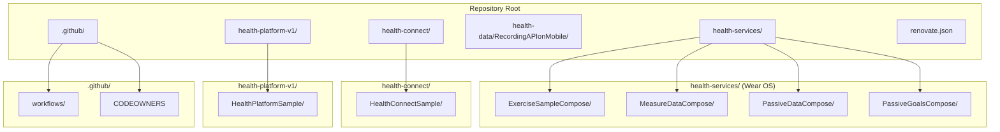
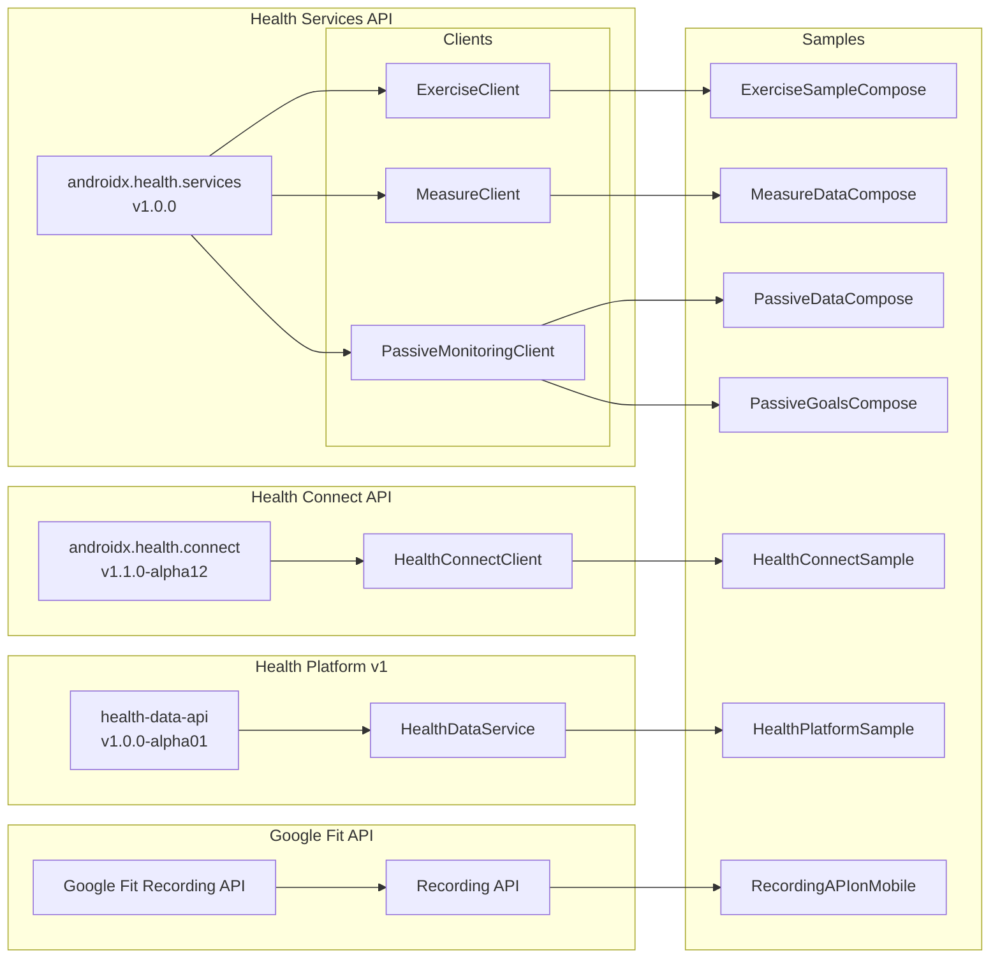
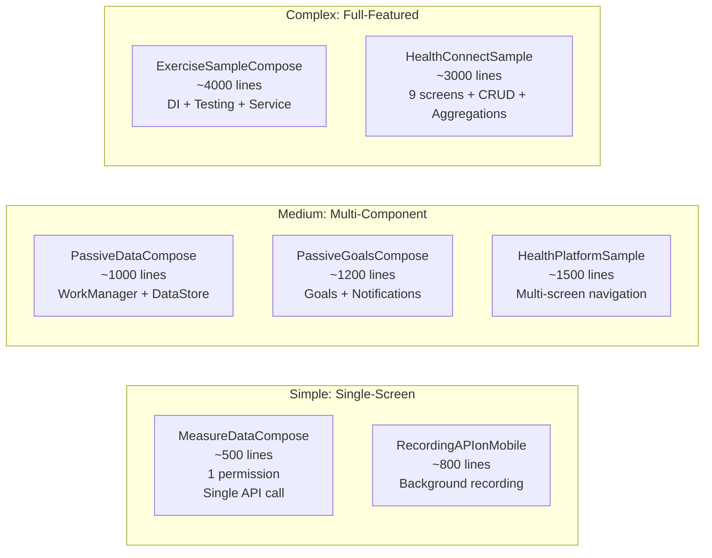
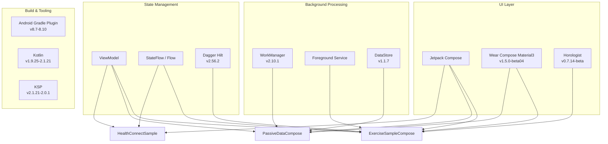
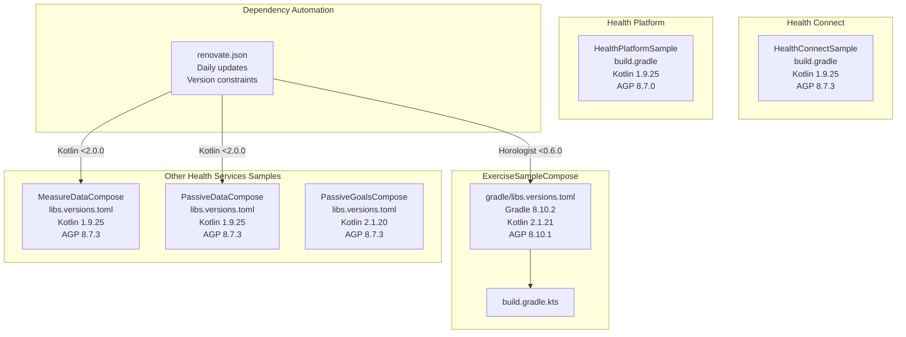
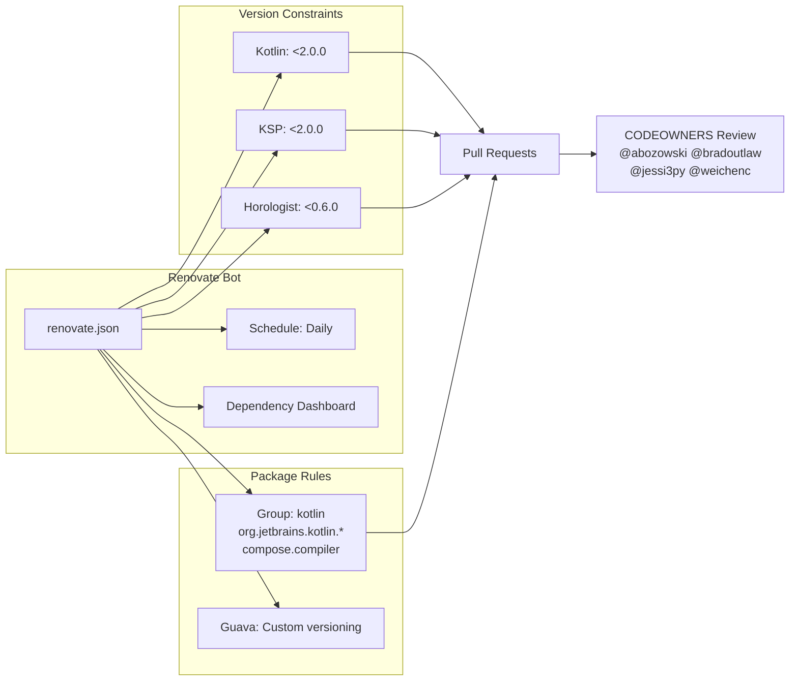
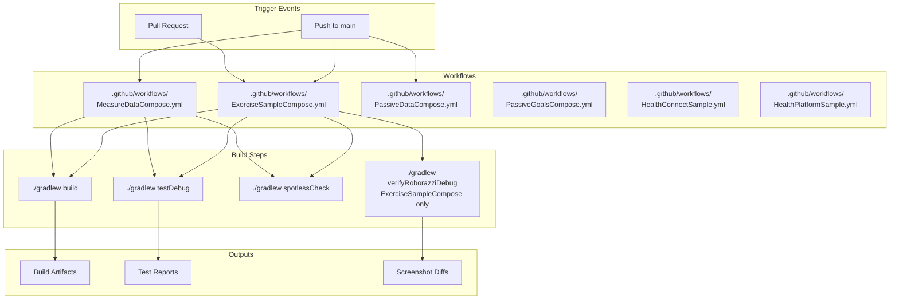

<!-- source: DeepWiki mcp.deepwiki.com · repo android/health-samples · page 1 Overview · fetched 2026-10-23 -->

# Overview

Relevant source files

The following files were used as context for generating this wiki page:

- [.github/CODEOWNERS](.github/CODEOWNERS)
- [health-connect/HealthConnectSample/app/build.gradle](health-connect/HealthConnectSample/app/build.gradle)
- [health-connect/HealthConnectSample/build.gradle](health-connect/HealthConnectSample/build.gradle)
- [health-platform-v1/HealthPlatformSample/app/build.gradle](health-platform-v1/HealthPlatformSample/app/build.gradle)
- [health-platform-v1/HealthPlatformSample/build.gradle](health-platform-v1/HealthPlatformSample/build.gradle)
- [health-services/ExerciseSampleCompose/gradle/libs.versions.toml](health-services/ExerciseSampleCompose/gradle/libs.versions.toml)
- [health-services/MeasureDataCompose/gradle/libs.versions.toml](health-services/MeasureDataCompose/gradle/libs.versions.toml)
- [health-services/PassiveDataCompose/gradle/libs.versions.toml](health-services/PassiveDataCompose/gradle/libs.versions.toml)
- [health-services/PassiveGoalsCompose/gradle/libs.versions.toml](health-services/PassiveGoalsCompose/gradle/libs.versions.toml)
- [renovate.json](renovate.json)

This document provides a comprehensive overview of the `android/health-samples` repository, a collection of sample applications demonstrating Android's health and fitness APIs. The repository contains seven distinct sample projects spanning four different API ecosystems: Health Services, Health Connect, Health Platform v1, and Google Fit Recording API.

For detailed information about specific samples, see:
- Health Services samples: [Section 2](#2)
- Health Connect sample: [Section 3](#3)
- Health Platform sample: [Section 4](#4)
- Recording API sample: [Section 5](#5)
- Build system configuration: [Section 6](#6)
- CI/CD infrastructure: [Section 7](#7)
- Common patterns and best practices: [Section 8](#8)

## Repository Structure

The repository is organized into four primary directories, each corresponding to a distinct health API ecosystem. Each sample is a self-contained Android application with its own build configuration, dependencies, and documentation.

**Directory Structure**

| Directory | Purpose | Sample Count | Target Platform |
|-----------|---------|--------------|-----------------|
| `health-services/` | Wear OS health and fitness tracking | 4 | Wear OS |
| `health-connect/` | Unified health data platform | 1 | Mobile |
| `health-platform-v1/` | Legacy health platform API | 1 | Mobile |
| `health-data/` | Google Fit Recording API | 1 | Mobile |
| `.github/` | CI/CD workflows and code ownership | - | Infrastructure |

Sources: [renovate.json:9](), [.github/CODEOWNERS:1-5]()

## API Ecosystem Coverage

The repository demonstrates four distinct Android health data API ecosystems, each serving different use cases and device capabilities.

**API Comparison**

| API | Package | Primary Use Case | Platform | Status |
|-----|---------|------------------|----------|--------|
| Health Services | `androidx.health.services` | Wear OS sensor access, active tracking | Wear OS | Active |
| Health Connect | `androidx.health.connect` | Multi-app health data sharing | Mobile | Active |
| Health Platform v1 | `com.google.android.libraries.healthdata` | Legacy health data access | Mobile | Deprecated |
| Google Fit Recording API | Google Fit SDK | Background passive collection | Mobile | Maintenance |

Sources: [health-services/ExerciseSampleCompose/gradle/libs.versions.toml:9](), [health-connect/HealthConnectSample/build.gradle:25](), [health-platform-v1/HealthPlatformSample/build.gradle:25]()

## Sample Applications Overview

Each sample demonstrates specific API capabilities with progressive complexity levels.

**Sample Feature Matrix**

| Sample | API | Lines of Code | Key Features | Architecture Components |
|--------|-----|---------------|--------------|------------------------|
| `ExerciseSampleCompose` | Health Services | ~4000 | Active exercise tracking, goals, ambient mode, foreground service | Hilt, Horologist, Repository pattern, ViewModel, Compose Navigation |
| `MeasureDataCompose` | Health Services | ~500 | On-demand heart rate measurement | ViewModel, Compose |
| `PassiveDataCompose` | Health Services | ~1000 | Background health data collection | WorkManager, DataStore, ViewModel |
| `PassiveGoalsCompose` | Health Services | ~1200 | Background goal tracking, notifications | WorkManager, DataStore, ViewModel |
| `HealthConnectSample` | Health Connect | ~3000 | CRUD operations, aggregations, differential changes | ViewModel, Compose Navigation, Repository pattern |
| `HealthPlatformSample` | Health Platform v1 | ~1500 | Multi-screen navigation, legacy API | ViewModel, Compose Navigation |
| `RecordingAPIonMobile` | Google Fit | ~800 | Background step/distance recording | Google Fit Recording API |

**Complexity Levels**

Sources: Files analyzed from the high-level diagrams provided

## Technology Stack

All samples converge on a modern Android architecture stack built around Jetpack libraries and Kotlin.

**Core Dependencies**

| Technology | Version Range | Usage | Samples |
|------------|---------------|-------|---------|
| Kotlin | 1.9.25 - 2.1.21 | Primary language | All |
| Android Gradle Plugin | 8.7.3 - 8.10.1 | Build system | All |
| Jetpack Compose | 1.7.5 - 1.8.1 | Declarative UI | All |
| Wear Compose Material3 | 1.4.1 - 1.5.0-beta04 | Wear OS UI | ExerciseSampleCompose, MeasureDataCompose, PassiveDataCompose, PassiveGoalsCompose |
| Dagger Hilt | 2.56.2 | Dependency injection | ExerciseSampleCompose |
| Horologist | 0.7.14-beta | Wear OS utilities | ExerciseSampleCompose, PassiveGoalsCompose |
| WorkManager | 2.10.1 | Background tasks | PassiveDataCompose, PassiveGoalsCompose |
| DataStore | 1.1.7 | Persistent storage | PassiveDataCompose, PassiveGoalsCompose |

Sources: [health-services/ExerciseSampleCompose/gradle/libs.versions.toml:1-18](), [health-services/MeasureDataCompose/gradle/libs.versions.toml:1-17](), [health-services/PassiveDataCompose/gradle/libs.versions.toml:1-17](), [health-services/PassiveGoalsCompose/gradle/libs.versions.toml:1-19]()

## Build System Architecture

The repository uses Gradle with version catalogs for centralized dependency management. Each sample maintains its own `libs.versions.toml` file with sample-specific dependencies.

**Version Catalog Structure**

Version catalogs ([health-services/ExerciseSampleCompose/gradle/libs.versions.toml:1-74]()) define:

1. **`[versions]`** section: Version variables for dependencies
2. **`[libraries]`** section: Library coordinates referencing version variables
3. **`[plugins]`** section: Gradle plugin definitions

Example from `ExerciseSampleCompose`:
- Line 11: `kotlin = "2.1.21"` - Kotlin version
- Line 10: `horologist = "0.7.14-beta"` - Horologist library version
- Line 8: `dagger = "2.56.2"` - Dagger Hilt version

Sources: [health-services/ExerciseSampleCompose/gradle/libs.versions.toml:1-74](), [health-services/MeasureDataCompose/gradle/libs.versions.toml:1-39](), [health-services/PassiveGoalsCompose/gradle/libs.versions.toml:1-44](), [health-services/PassiveDataCompose/gradle/libs.versions.toml:1-38]()

## Dependency Management Strategy

The repository implements automated dependency management using Renovate Bot with specific version constraints to maintain stability.

**Renovate Configuration**

**Key Configuration Details**

From [renovate.json:1-44]():

- Line 7: `"schedule:daily"` - Updates checked daily
- Line 9: `"includePaths": ["health-services"]` - Focuses on Health Services samples
- Lines 18-24: Kotlin versions constrained to `<2.0.0`
- Lines 32-41: Horologist versions constrained to `<0.6.0`
- Lines 12-17: Compose compiler grouped with Kotlin updates

**Code Ownership**

From [.github/CODEOWNERS:1-5]():
- Line 2: Health Connect samples reviewed by 4 maintainers
- Line 5: Health Platform samples reviewed by same 4 maintainers

Sources: [renovate.json:1-44](), [.github/CODEOWNERS:1-5]()

## CI/CD Infrastructure

The repository maintains six GitHub Actions workflows, one for each major sample application, providing continuous integration and quality assurance.

**Quality Gates**

| Check | Tool | Samples | Purpose |
|-------|------|---------|---------|
| Build | Gradle | All 6 samples | Compile-time verification |
| Unit Tests | JUnit | All 6 samples | Functional correctness |
| Code Formatting | Spotless + ktlint | All 6 samples | Style consistency |
| Screenshot Tests | Roborazzi | ExerciseSampleCompose only | Visual regression testing |

**ExerciseSampleCompose Enhanced Testing**

The flagship sample receives additional testing:
- Roborazzi screenshot testing with 8 device configurations
- Test artifact preservation with `if: always()` condition
- Reference screenshot comparison for UI regression detection

Sources: Information derived from the high-level diagrams indicating CI/CD structure

## Sample Application Descriptions

### Health Services Samples (Wear OS)

**ExerciseSampleCompose** - The most comprehensive sample demonstrating active exercise tracking with full lifecycle management, ambient mode support, and Horologist integration. Uses Foreground Service for continuous tracking, Dagger Hilt for dependency injection, and implements screenshot testing with Roborazzi. See [Section 2.1](#2.1) for details.

**MeasureDataCompose** - A simple demonstration of on-demand heart rate measurement using `MeasureClient`. Single-screen UI with minimal complexity. See [Section 2.2](#2.2) for details.

**PassiveDataCompose** - Demonstrates background health data collection using `PassiveMonitoringClient` with WorkManager for periodic syncing and DataStore for local persistence. See [Section 2.3](#2.3) for details.

**PassiveGoalsCompose** - Extends passive monitoring with goal tracking and achievement notifications. Uses WorkManager and DataStore similar to PassiveDataCompose. See [Section 2.4](#2.4) for details.

### Health Connect Sample (Mobile)

**HealthConnectSample** - Comprehensive mobile sample demonstrating the unified health data platform. Covers CRUD operations on various health record types (exercise sessions, sleep, weight), data aggregation, differential change tracking, and permission management across 9 screens. See [Section 3](#3) for details.

### Legacy Samples

**HealthPlatformSample** - Demonstrates the deprecated Health Platform v1 API for compatibility with older Android versions. Multi-screen navigation with basic CRUD operations. See [Section 4](#4) for details.

**RecordingAPIonMobile** - Simple demonstration of Google Fit's Recording API for passive background collection of steps, distance, and calories on mobile devices. See [Section 5](#5) for details.

## Common Architectural Patterns

All samples follow consistent architectural patterns:

**MVVM Architecture**
- `ViewModel` classes manage UI state and business logic
- `StateFlow` / `Flow` for reactive data streams
- Repository pattern for data access abstraction (in complex samples)

**Dependency Injection**
- Dagger Hilt in ExerciseSampleCompose for compile-time DI
- Manual dependency injection in simpler samples

**Jetpack Compose UI**
- Declarative UI with Material Design 3 (Wear samples use Wear Material3)
- Compose Navigation for multi-screen flows
- Horologist components for Wear OS-specific patterns

**Background Processing**
- Foreground Service for active tracking (ExerciseSampleCompose)
- WorkManager for passive periodic tasks (PassiveDataCompose, PassiveGoalsCompose)
- DataStore for persistent preferences and state

**Permission Handling**
- Runtime permission requests using Accompanist Permissions or native APIs
- User education screens explaining permission requirements
- Graceful degradation when permissions denied

See [Section 8](#8) for detailed documentation of common patterns and best practices.

Sources: [health-services/ExerciseSampleCompose/gradle/libs.versions.toml:1-74](), [health-connect/HealthConnectSample/build.gradle:17-60](), [health-connect/HealthConnectSample/app/build.gradle:17-101]()

---

