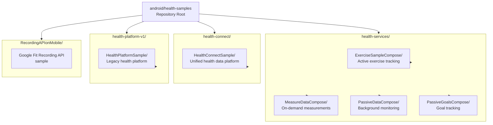
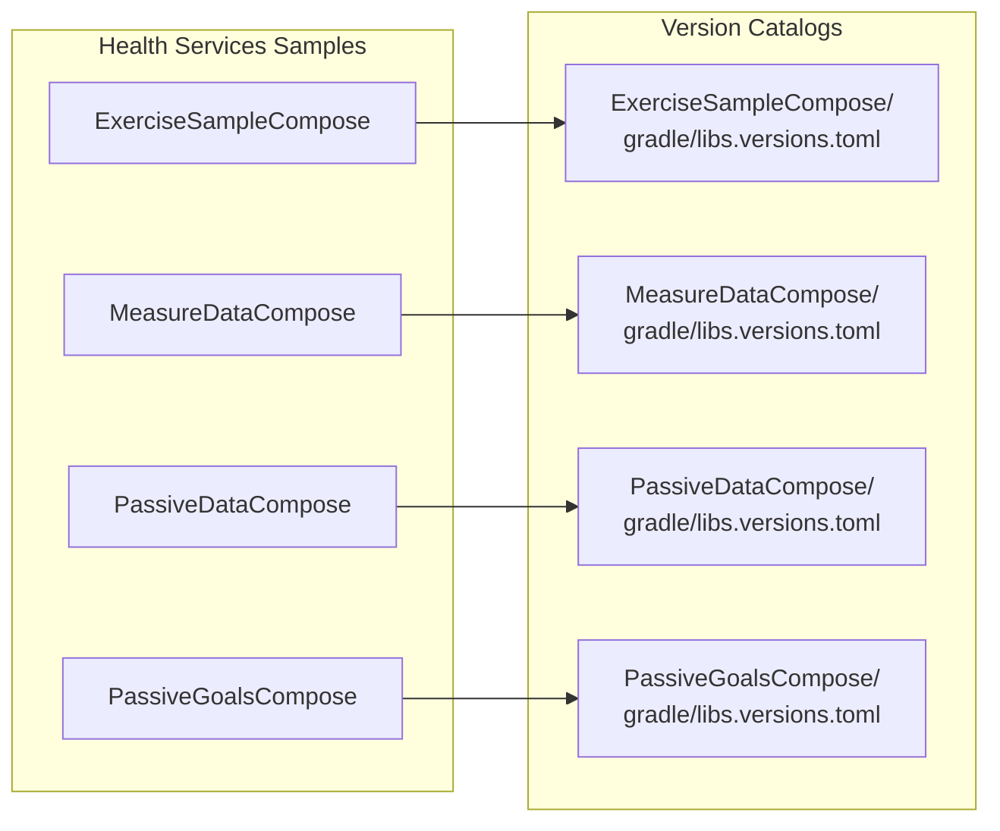
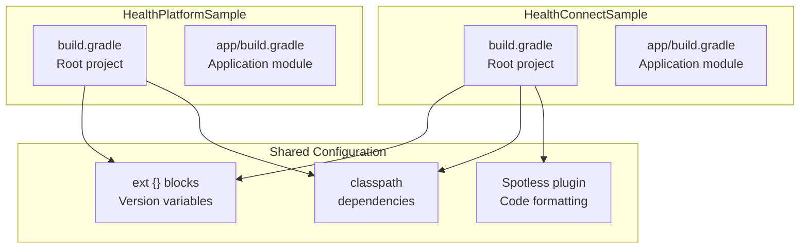
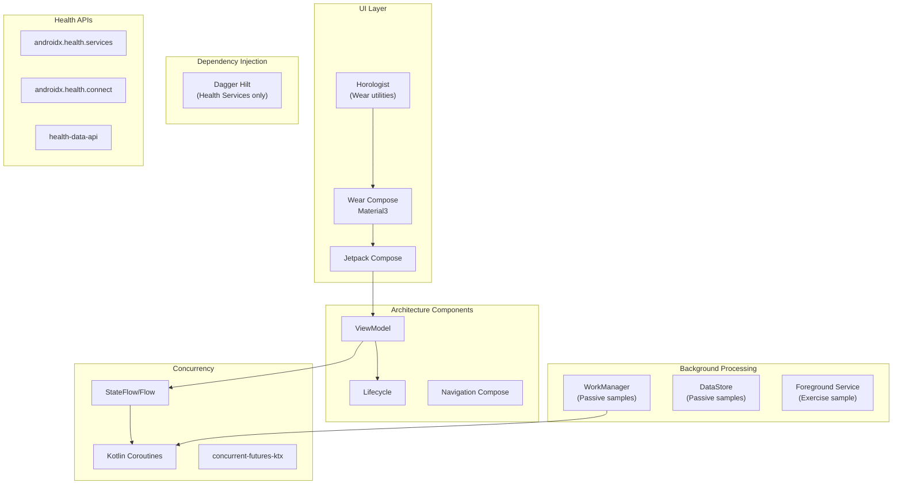
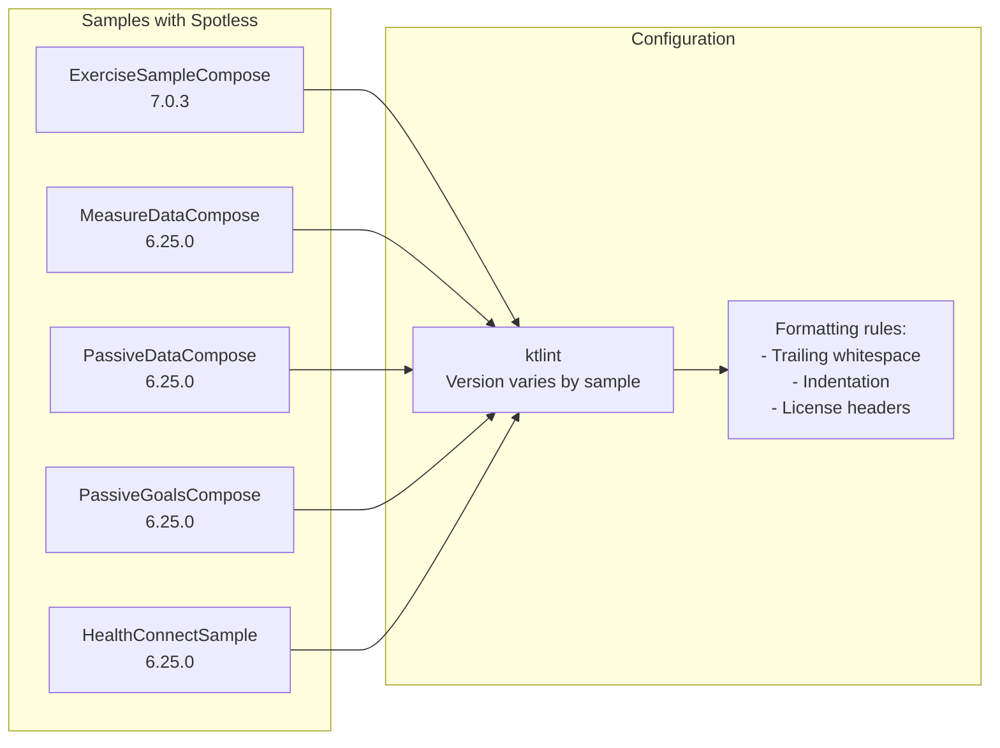
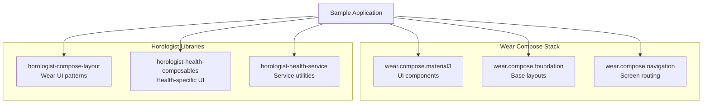
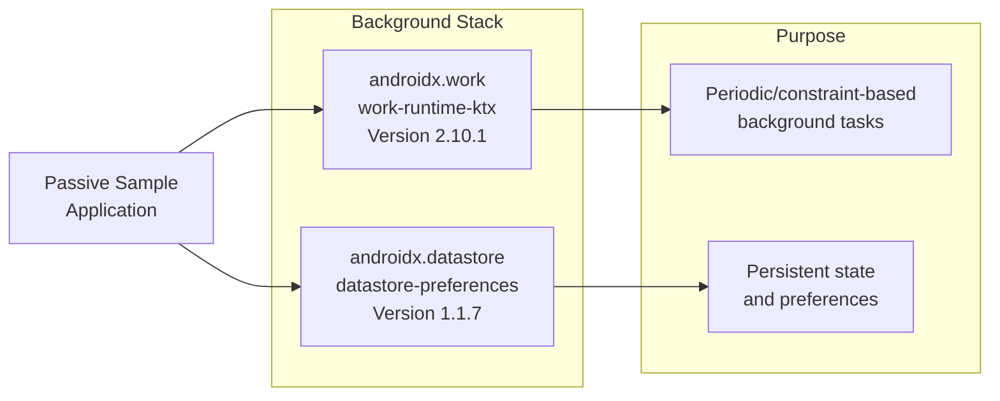

<!-- source: DeepWiki mcp.deepwiki.com · repo android/health-samples · page 1.1 Repository Architecture · fetched 2026-10-23 -->

# Repository Architecture

Relevant source files

The following files were used as context for generating this wiki page:

- [health-connect/HealthConnectSample/app/build.gradle](health-connect/HealthConnectSample/app/build.gradle)
- [health-connect/HealthConnectSample/build.gradle](health-connect/HealthConnectSample/build.gradle)
- [health-platform-v1/HealthPlatformSample/app/build.gradle](health-platform-v1/HealthPlatformSample/app/build.gradle)
- [health-platform-v1/HealthPlatformSample/build.gradle](health-platform-v1/HealthPlatformSample/build.gradle)
- [health-services/ExerciseSampleCompose/gradle/libs.versions.toml](health-services/ExerciseSampleCompose/gradle/libs.versions.toml)
- [health-services/MeasureDataCompose/gradle/libs.versions.toml](health-services/MeasureDataCompose/gradle/libs.versions.toml)
- [health-services/PassiveDataCompose/gradle/libs.versions.toml](health-services/PassiveDataCompose/gradle/libs.versions.toml)
- [health-services/PassiveGoalsCompose/gradle/libs.versions.toml](health-services/PassiveGoalsCompose/gradle/libs.versions.toml)

## Purpose and Scope

This document describes the high-level organization and architectural patterns of the android/health-samples repository. It covers:

- Physical directory structure and module organization
- Build system architecture using Gradle and version catalogs
- Common technology stack and dependency management patterns
- Shared architectural patterns across samples

For details about specific Android health APIs demonstrated by the samples, see [API Coverage](#1.2). For individual sample application architecture, see [Health Services Samples](#2), [Health Connect Sample](#3), [Health Platform Sample](#4), and [Recording API Sample](#5).

## Repository Structure

The repository is organized into four primary directories, each corresponding to a different Android health API ecosystem:

**Directory Organization**

| Directory | Purpose | API Used | Platform Target |
|-----------|---------|----------|-----------------|
| `health-services/` | Wear OS samples demonstrating sensor access and exercise tracking | `androidx.health.services` | Wear OS |
| `health-connect/` | Mobile sample for unified health data storage and sharing | `androidx.health.connect` | Android Mobile |
| `health-platform-v1/` | Legacy health data API sample | `health-data-api` | Android Mobile |
| `RecordingAPIonMobile/` | Background fitness data collection | Google Fit Recording API | Android Mobile |

Sources: Repository structure inferred from file paths in provided files

## Build System Architecture

The repository employs two different build configuration strategies across its samples, reflecting their development timelines and complexity requirements.

### Version Catalog Approach (Modern Samples)

The four Health Services samples use Gradle version catalogs ([gradle/libs.versions.toml]()) for centralized dependency management:

**Version Catalog Structure**

Each `libs.versions.toml` file contains three sections:

1. **[versions]** - Version strings for plugins and libraries [health-services/ExerciseSampleCompose/gradle/libs.versions.toml:1-18]()
2. **[libraries]** - Library dependency declarations with version references [health-services/ExerciseSampleCompose/gradle/libs.versions.toml:20-63]()
3. **[plugins]** - Gradle plugin declarations [health-services/ExerciseSampleCompose/gradle/libs.versions.toml:65-73]()

Example version definitions from ExerciseSampleCompose:
- `android-gradle-plugin = "8.10.1"` [health-services/ExerciseSampleCompose/gradle/libs.versions.toml:2]()
- `kotlin = "2.1.21"` [health-services/ExerciseSampleCompose/gradle/libs.versions.toml:11]()
- `dagger = "2.56.2"` [health-services/ExerciseSampleCompose/gradle/libs.versions.toml:8]()
- `horologist = "0.7.14-beta"` [health-services/ExerciseSampleCompose/gradle/libs.versions.toml:10]()

Sources: [health-services/ExerciseSampleCompose/gradle/libs.versions.toml:1-74](), [health-services/MeasureDataCompose/gradle/libs.versions.toml:1-39](), [health-services/PassiveDataCompose/gradle/libs.versions.toml:1-38](), [health-services/PassiveGoalsCompose/gradle/libs.versions.toml:1-44]()

### Traditional Build Script Approach (Mobile Samples)

HealthConnectSample and HealthPlatformSample use traditional `build.gradle` scripts with ext properties:

**Buildscript Configuration**

Both samples define versions in `ext {}` blocks in the root `build.gradle`:

HealthConnectSample version definitions [health-connect/HealthConnectSample/build.gradle:18-27]():
- `kotlin_version = '1.9.25'`
- `activity_compose_version = '1.9.2'`
- `health_connect_version = '1.1.0-alpha12'`
- `lifecycle_version = '2.8.6'`

HealthPlatformSample version definitions [health-platform-v1/HealthPlatformSample/build.gradle:18-27]():
- `kotlin_version = '1.9.25'`
- `health_platform_version = '1.0.0-alpha01'`
- `lifecycle_version = '2.8.6'`

Sources: [health-connect/HealthConnectSample/build.gradle:17-39](), [health-platform-v1/HealthPlatformSample/build.gradle:17-43](), [health-connect/HealthConnectSample/app/build.gradle:1-101](), [health-platform-v1/HealthPlatformSample/app/build.gradle:1-101]()

## Common Technology Stack

Despite different build approaches, all samples converge on a consistent modern Android technology stack:

### Core Dependencies by Sample Type

**Health Services Samples (Wear OS)**

| Dependency | Version Range | Purpose |
|------------|---------------|---------|
| `androidx.health:health-services-client` | 1.0.0 | Health Services API client |
| `androidx.wear.compose:compose-material3` | 1.4.1 - 1.5.0-beta04 | Wear OS UI components |
| `androidx.compose.ui:ui` | 1.7.8 - 1.8.1 | Compose UI toolkit |
| `androidx.lifecycle:lifecycle-viewmodel-compose` | 2.8.6 - 2.9.0 | ViewModel integration |
| `androidx.concurrent:concurrent-futures-ktx` | 1.2.0 | ListenableFuture bridges |
| `com.google.android.horologist` | 0.7.14-beta | Wear OS utilities (ExerciseSample only) |
| `com.google.dagger:hilt-android` | 2.56.2 | Dependency injection (ExerciseSample only) |

Sources: [health-services/ExerciseSampleCompose/gradle/libs.versions.toml:20-63](), [health-services/MeasureDataCompose/gradle/libs.versions.toml:19-33]()

**Mobile Samples (Health Connect & Health Platform)**

| Dependency | Version | Purpose |
|------------|---------|---------|
| `androidx.health.connect:connect-client` | 1.1.0-alpha12 | Health Connect API |
| `health-data-api` | 1.0.0-alpha01 | Legacy Health Platform API |
| `androidx.compose:compose-bom` | 2024.09.03 | Compose Bill of Materials |
| `androidx.lifecycle:lifecycle-viewmodel-compose` | 2.8.6 | ViewModel integration |
| `androidx.navigation:navigation-compose` | 2.8.2 | Navigation framework |
| `androidx.concurrent:concurrent-futures-ktx` | 1.2.0 | Async utilities |
| `com.android.tools:desugar_jdk_libs` | 2.1.2 | Java 8+ API desugaring |

Sources: [health-connect/HealthConnectSample/app/build.gradle:66-100](), [health-platform-v1/HealthPlatformSample/app/build.gradle:71-101]()

## Build Configuration Patterns

### Kotlin and Gradle Versions

The repository demonstrates version progression across samples:

**ExerciseSampleCompose (Most Modern)**
- Kotlin: 2.1.21 [health-services/ExerciseSampleCompose/gradle/libs.versions.toml:11]()
- Android Gradle Plugin: 8.10.1 [health-services/ExerciseSampleCompose/gradle/libs.versions.toml:2]()
- Uses Kotlin Compiler Plugin for Compose [health-services/ExerciseSampleCompose/gradle/libs.versions.toml:70]()

**Other Health Services Samples**
- Kotlin: 1.9.25 - 2.1.20
- Android Gradle Plugin: 8.7.3
- Traditional or new Compose compiler configuration

**Mobile Samples**
- Kotlin: 1.9.25 [health-connect/HealthConnectSample/build.gradle:18]()
- Android Gradle Plugin: 8.7.0 - 8.7.3
- Compose Compiler Extension: 1.5.15

Sources: [health-services/ExerciseSampleCompose/gradle/libs.versions.toml:1-18](), [health-services/MeasureDataCompose/gradle/libs.versions.toml:1-18](), [health-connect/HealthConnectSample/build.gradle:17-39]()

### Compilation and Target SDK Configuration

All samples follow modern Android SDK practices:

**Wear OS Samples (Inferred from dependencies)**
- Wear Compose Material3 targeting recent Wear OS versions
- Uses Wear-specific UI components and APIs

**Mobile Samples**

HealthConnectSample [health-connect/HealthConnectSample/app/build.gradle:23-35]():
- `compileSdk 35`
- `minSdk 26` (required for Health Connect)
- `targetSdk 34`

HealthPlatformSample [health-platform-v1/HealthPlatformSample/app/build.gradle:23-40]():
- `compileSdk 34`
- `minSdk 23` (backwards compatible)
- `targetSdk 33`
- Includes desugaring for Java 8+ APIs [health-platform-v1/HealthPlatformSample/app/build.gradle:52-53]()

Both mobile samples use Java 17 compatibility:
- `sourceCompatibility JavaVersion.VERSION_17`
- `targetCompatibility JavaVersion.VERSION_17`
- `jvmTarget = JavaVersion.VERSION_17.majorVersion`

Sources: [health-connect/HealthConnectSample/app/build.gradle:22-64](), [health-platform-v1/HealthPlatformSample/app/build.gradle:22-69]()

## Code Quality and Formatting

All samples implement consistent code formatting using the Spotless Gradle plugin:

**Spotless Configuration Examples**

ExerciseSampleCompose uses version 7.0.3 [health-services/ExerciseSampleCompose/gradle/libs.versions.toml:72]():
- ktlint version: 0.50.0 [health-services/ExerciseSampleCompose/gradle/libs.versions.toml:18]()

Other Health Services samples use version 6.25.0:
- MeasureDataCompose [health-services/MeasureDataCompose/gradle/libs.versions.toml:38]()
- PassiveDataCompose [health-services/PassiveDataCompose/gradle/libs.versions.toml:37]()
- PassiveGoalsCompose [health-services/PassiveGoalsCompose/gradle/libs.versions.toml:41]()

HealthConnectSample configuration [health-connect/HealthConnectSample/build.gradle:41-60]():
- Applied to all subprojects
- ktlint version: 0.41.0
- Max line length: 100 characters
- Enforces license headers from `spotless/copyright.txt`

Sources: [health-services/ExerciseSampleCompose/gradle/libs.versions.toml:72](), [health-services/MeasureDataCompose/gradle/libs.versions.toml:38](), [health-connect/HealthConnectSample/build.gradle:41-60]()

## Dependency Management Patterns

### Wear OS Dependencies

Health Services samples share a core set of Wear-specific dependencies:

**Essential Wear Libraries**

**ExerciseSampleCompose Horologist Integration** [health-services/ExerciseSampleCompose/gradle/libs.versions.toml:49-52]():
- `horologist-compose-layout`: Wear-optimized layouts
- `horologist-health-composables`: Pre-built health UI components  
- `horologist-health-service`: Foreground service utilities
- `horologist-roboscreenshots`: Screenshot testing support

**PassiveGoalsCompose Minimal Horologist** [health-services/PassiveGoalsCompose/gradle/libs.versions.toml:37]():
- Only includes `horologist-compose-layout` for basic Wear UI patterns

Sources: [health-services/ExerciseSampleCompose/gradle/libs.versions.toml:49-52](), [health-services/PassiveGoalsCompose/gradle/libs.versions.toml:37]()

### Async and Concurrency Libraries

All samples consistently use concurrent-futures-ktx for bridging callback-based APIs:

| Sample | Version | Usage Context |
|--------|---------|---------------|
| ExerciseSampleCompose | 1.2.0 | Health Services API callbacks |
| MeasureDataCompose | 1.2.0 | MeasureClient async operations |
| PassiveDataCompose | 1.2.0 | PassiveMonitoringClient callbacks |
| PassiveGoalsCompose | 1.2.0 | Background monitoring |
| HealthConnectSample | 1.2.0 | Health Connect API operations |
| HealthPlatformSample | 1.2.0 | Health Platform callbacks |

The library provides `await()` extension on `ListenableFuture<T>` to convert callback-based APIs to suspend functions compatible with Kotlin coroutines.

Sources: [health-services/ExerciseSampleCompose/gradle/libs.versions.toml:25](), [health-connect/HealthConnectSample/app/build.gradle:85](), [health-platform-v1/HealthPlatformSample/app/build.gradle:87]()

### Background Processing Dependencies

Passive monitoring samples require additional libraries for background operation:

**PassiveDataCompose & PassiveGoalsCompose Dependencies**

WorkManager configuration in PassiveDataCompose [health-services/PassiveDataCompose/gradle/libs.versions.toml:7]():
- `androidx-work = "2.10.1"`
- Both `work-runtime` and `work-runtime-ktx` variants

DataStore configuration in PassiveGoalsCompose [health-services/PassiveGoalsCompose/gradle/libs.versions.toml:5]():
- `androidx-datastore = "1.1.7"`
- Uses `datastore-preferences` for key-value storage

Sources: [health-services/PassiveDataCompose/gradle/libs.versions.toml:7,25-26](), [health-services/PassiveGoalsCompose/gradle/libs.versions.toml:5,24]()

## Architectural Patterns Summary

The repository demonstrates consistent architectural patterns that can be categorized by sample complexity:

**Simple Samples** (MeasureDataCompose, RecordingAPIonMobile)
- Single-screen Compose UI
- ViewModel for state management
- Direct API client usage
- Minimal background processing

**Intermediate Samples** (PassiveDataCompose, PassiveGoalsCompose, HealthPlatformSample)
- Multi-screen navigation
- Repository pattern for data access
- WorkManager for background tasks
- DataStore for persistent state
- ViewModels with StateFlow

**Advanced Samples** (ExerciseSampleCompose, HealthConnectSample)
- Full MVVM architecture
- Dependency injection (Hilt in ExerciseSampleCompose)
- Foreground services (ExerciseSampleCompose)
- Comprehensive error handling
- Advanced UI patterns (Horologist)
- Testing infrastructure (screenshot tests in ExerciseSampleCompose)

For detailed architectural breakdowns of individual samples, see:
- [ExerciseSampleCompose Architecture](#2.1.1)
- [Health Connect Data Management](#3.1)
- [Common Patterns and Best Practices](#8)

Sources: Analysis based on dependency configurations across [health-services/ExerciseSampleCompose/gradle/libs.versions.toml:1-74](), [health-services/MeasureDataCompose/gradle/libs.versions.toml:1-39](), [health-connect/HealthConnectSample/app/build.gradle:66-100]()

---

