<!-- source: DeepWiki mcp.deepwiki.com · repo android/health-samples · page 1.2 API Coverage · fetched 2026-10-23 -->

# API Coverage

Relevant source files

The following files were used as context for generating this wiki page:

- [health-connect/HealthConnectSample/app/src/main/AndroidManifest.xml](health-connect/HealthConnectSample/app/src/main/AndroidManifest.xml)
- [health-connect/HealthConnectSample/app/src/main/java/com/example/healthconnectsample/data/HealthConnectManager.kt](health-connect/HealthConnectSample/app/src/main/java/com/example/healthconnectsample/data/HealthConnectManager.kt)
- [health-connect/HealthConnectSample/app/src/main/java/com/example/healthconnectsample/presentation/component/Series.kt](health-connect/HealthConnectSample/app/src/main/java/com/example/healthconnectsample/presentation/component/Series.kt)
- [health-connect/HealthConnectSample/app/src/main/java/com/example/healthconnectsample/presentation/navigation/HealthConnectNavigation.kt](health-connect/HealthConnectSample/app/src/main/java/com/example/healthconnectsample/presentation/navigation/HealthConnectNavigation.kt)
- [health-connect/HealthConnectSample/app/src/main/java/com/example/healthconnectsample/presentation/navigation/Screen.kt](health-connect/HealthConnectSample/app/src/main/java/com/example/healthconnectsample/presentation/navigation/Screen.kt)
- [health-connect/HealthConnectSample/app/src/main/java/com/example/healthconnectsample/presentation/screen/WelcomeScreen.kt](health-connect/HealthConnectSample/app/src/main/java/com/example/healthconnectsample/presentation/screen/WelcomeScreen.kt)
- [health-connect/HealthConnectSample/app/src/main/java/com/example/healthconnectsample/presentation/screen/exercisesession/ExerciseSessionScreen.kt](health-connect/HealthConnectSample/app/src/main/java/com/example/healthconnectsample/presentation/screen/exercisesession/ExerciseSessionScreen.kt)
- [health-connect/HealthConnectSample/app/src/main/java/com/example/healthconnectsample/presentation/screen/exercisesession/ExerciseSessionViewModel.kt](health-connect/HealthConnectSample/app/src/main/java/com/example/healthconnectsample/presentation/screen/exercisesession/ExerciseSessionViewModel.kt)
- [health-connect/HealthConnectSample/app/src/main/java/com/example/healthconnectsample/presentation/screen/inputreadings/InputReadingsScreen.kt](health-connect/HealthConnectSample/app/src/main/java/com/example/healthconnectsample/presentation/screen/inputreadings/InputReadingsScreen.kt)
- [health-connect/HealthConnectSample/app/src/main/java/com/example/healthconnectsample/presentation/screen/inputreadings/InputReadingsViewModel.kt](health-connect/HealthConnectSample/app/src/main/java/com/example/healthconnectsample/presentation/screen/inputreadings/InputReadingsViewModel.kt)
- [health-connect/HealthConnectSample/app/src/main/java/com/example/healthconnectsample/presentation/screen/recordlist/RecordListScreen.kt](health-connect/HealthConnectSample/app/src/main/java/com/example/healthconnectsample/presentation/screen/recordlist/RecordListScreen.kt)
- [health-connect/HealthConnectSample/app/src/main/res/values/strings.xml](health-connect/HealthConnectSample/app/src/main/res/values/strings.xml)
- [health-connect/HealthConnectSample/settings.gradle](health-connect/HealthConnectSample/settings.gradle)
- [health-services/ExerciseSampleCompose/app/src/main/java/com/example/exercisesamplecompose/app/Screens.kt](health-services/ExerciseSampleCompose/app/src/main/java/com/example/exercisesamplecompose/app/Screens.kt)
- [health-services/ExerciseSampleCompose/app/src/main/java/com/example/exercisesamplecompose/data/ExerciseClientKtx.kt](health-services/ExerciseSampleCompose/app/src/main/java/com/example/exercisesamplecompose/data/ExerciseClientKtx.kt)
- [health-services/ExerciseSampleCompose/app/src/main/java/com/example/exercisesamplecompose/data/ExerciseClientManager.kt](health-services/ExerciseSampleCompose/app/src/main/java/com/example/exercisesamplecompose/data/ExerciseClientManager.kt)
- [health-services/ExerciseSampleCompose/app/src/main/java/com/example/exercisesamplecompose/data/HealthServicesRepository.kt](health-services/ExerciseSampleCompose/app/src/main/java/com/example/exercisesamplecompose/data/HealthServicesRepository.kt)
- [health-services/ExerciseSampleCompose/app/src/main/java/com/example/exercisesamplecompose/presentation/dialogs/ExerciseGoalMet.kt](health-services/ExerciseSampleCompose/app/src/main/java/com/example/exercisesamplecompose/presentation/dialogs/ExerciseGoalMet.kt)
- [health-services/ExerciseSampleCompose/app/src/main/java/com/example/exercisesamplecompose/presentation/goals/ExerciseGoalsScreen.kt](health-services/ExerciseSampleCompose/app/src/main/java/com/example/exercisesamplecompose/presentation/goals/ExerciseGoalsScreen.kt)
- [health-services/ExerciseSampleCompose/app/src/main/java/com/example/exercisesamplecompose/presentation/goals/ExerciseGoalsViewModel.kt](health-services/ExerciseSampleCompose/app/src/main/java/com/example/exercisesamplecompose/presentation/goals/ExerciseGoalsViewModel.kt)
- [health-services/ExerciseSampleCompose/app/src/main/java/com/example/exercisesamplecompose/presentation/theme/ThemePreview.kt](health-services/ExerciseSampleCompose/app/src/main/java/com/example/exercisesamplecompose/presentation/theme/ThemePreview.kt)
- [health-services/ExerciseSampleCompose/app/src/main/java/com/example/exercisesamplecompose/service/ExerciseService.kt](health-services/ExerciseSampleCompose/app/src/main/java/com/example/exercisesamplecompose/service/ExerciseService.kt)
- [health-services/ExerciseSampleCompose/app/src/main/java/com/example/exercisesamplecompose/service/ExerciseServiceMonitor.kt](health-services/ExerciseSampleCompose/app/src/main/java/com/example/exercisesamplecompose/service/ExerciseServiceMonitor.kt)
- [health-services/ExerciseSampleCompose/app/src/main/java/com/example/exercisesamplecompose/service/ExerciseState.kt](health-services/ExerciseSampleCompose/app/src/main/java/com/example/exercisesamplecompose/service/ExerciseState.kt)
- [recording-api-on-mobile/RecordingApiOnMobileSample/app/src/main/java/com/example/recordingapionmobilesample/component/BucketRow.kt](recording-api-on-mobile/RecordingApiOnMobileSample/app/src/main/java/com/example/recordingapionmobilesample/component/BucketRow.kt)
- [recording-api-on-mobile/RecordingApiOnMobileSample/app/src/main/java/com/example/recordingapionmobilesample/component/DataPointRow.kt](recording-api-on-mobile/RecordingApiOnMobileSample/app/src/main/java/com/example/recordingapionmobilesample/component/DataPointRow.kt)
- [recording-api-on-mobile/RecordingApiOnMobileSample/app/src/main/java/com/example/recordingapionmobilesample/component/DataSetRow.kt](recording-api-on-mobile/RecordingApiOnMobileSample/app/src/main/java/com/example/recordingapionmobilesample/component/DataSetRow.kt)
- [recording-api-on-mobile/RecordingApiOnMobileSample/app/src/main/java/com/example/recordingapionmobilesample/data/DataPointData.kt](recording-api-on-mobile/RecordingApiOnMobileSample/app/src/main/java/com/example/recordingapionmobilesample/data/DataPointData.kt)
- [recording-api-on-mobile/RecordingApiOnMobileSample/app/src/main/java/com/example/recordingapionmobilesample/screen/home/HomeScreen.kt](recording-api-on-mobile/RecordingApiOnMobileSample/app/src/main/java/com/example/recordingapionmobilesample/screen/home/HomeScreen.kt)
- [recording-api-on-mobile/RecordingApiOnMobileSample/app/src/main/java/com/example/recordingapionmobilesample/screen/recordingAPIonMobile/RecordingAPIonMobileScreen.kt](recording-api-on-mobile/RecordingApiOnMobileSample/app/src/main/java/com/example/recordingapionmobilesample/screen/recordingAPIonMobile/RecordingAPIonMobileScreen.kt)
- [recording-api-on-mobile/RecordingApiOnMobileSample/app/src/main/java/com/example/recordingapionmobilesample/screen/recordingAPIonMobile/RecordingAPIonMobileViewModel.kt](recording-api-on-mobile/RecordingApiOnMobileSample/app/src/main/java/com/example/recordingapionmobilesample/screen/recordingAPIonMobile/RecordingAPIonMobileViewModel.kt)
- [recording-api-on-mobile/RecordingApiOnMobileSample/screenshots/read-aggregate.png](recording-api-on-mobile/RecordingApiOnMobileSample/screenshots/read-aggregate.png)
- [recording-api-on-mobile/RecordingApiOnMobileSample/screenshots/read-raw.png](recording-api-on-mobile/RecordingApiOnMobileSample/screenshots/read-raw.png)
- [recording-api-on-mobile/RecordingApiOnMobileSample/screenshots/request-permission.png](recording-api-on-mobile/RecordingApiOnMobileSample/screenshots/request-permission.png)

## Purpose and Scope

This document describes the four distinct Android health and fitness APIs demonstrated by samples in this repository. Each API serves different use cases, platforms, and architectural patterns for accessing health data on Android devices. This page focuses on the capabilities, characteristics, and intended usage of each API rather than implementation details of specific samples.

For detailed implementation patterns within samples, see [Repository Architecture](#1.1). For individual sample documentation, see [Health Services Samples](#2), [Health Connect Sample](#3), [Health Platform Sample](#4), and [Recording API Sample](#5).

---

## API Ecosystem Overview

The repository demonstrates four distinct health data APIs across different Android platforms and use cases:

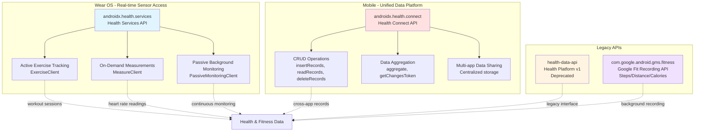

**Sources:** 
- [health-connect/HealthConnectSample/app/src/main/java/com/example/healthconnectsample/data/HealthConnectManager.kt:1-507]()
- [health-services/ExerciseSampleCompose/app/src/main/java/com/example/exercisesamplecompose/data/ExerciseClientManager.kt:1-261]()

---

## API Comparison Matrix

| Characteristic | Health Services | Health Connect | Health Platform v1 | Recording API |
|---|---|---|---|---|
| **Package** | `androidx.health.services` | `androidx.health.connect` | `health-data-api` | `com.google.android.gms.fitness` |
| **Platform** | Wear OS | Mobile (Android 8.1+) | Mobile (legacy) | Mobile |
| **Primary Use Case** | Real-time sensor access | Cross-app data sharing | Deprecated compatibility | Background passive recording |
| **Data Access Pattern** | Direct sensor callbacks | Record-based CRUD | Legacy platform interface | Subscription-based recording |
| **Samples** | ExerciseSample, MeasureData, PassiveData, PassiveGoals | HealthConnectSample | HealthPlatformSample | RecordingAPIonMobile |
| **Min SDK** | API 30 (Wear OS 3.0) | API 27 (O_MR1) | Deprecated | API 14+ |
| **Architecture** | Service-bound clients | Centralized data store | Platform service | Background subscriptions |
| **Status** | Active | Active | Deprecated | Maintenance mode |

**Sources:**
- [health-connect/HealthConnectSample/app/src/main/java/com/example/healthconnectsample/data/HealthConnectManager.kt:59-60]()
- [health-services/ExerciseSampleCompose/app/src/main/java/com/example/exercisesamplecompose/service/ExerciseService.kt:1-237]()

---

## Health Services API (androidx.health.services)

### Overview

The Health Services API provides direct access to Wear OS device sensors for fitness tracking. It operates through three primary client interfaces: `ExerciseClient` for active workouts, `MeasureClient` for on-demand readings, and `PassiveMonitoringClient` for background collection.

### Client Architecture

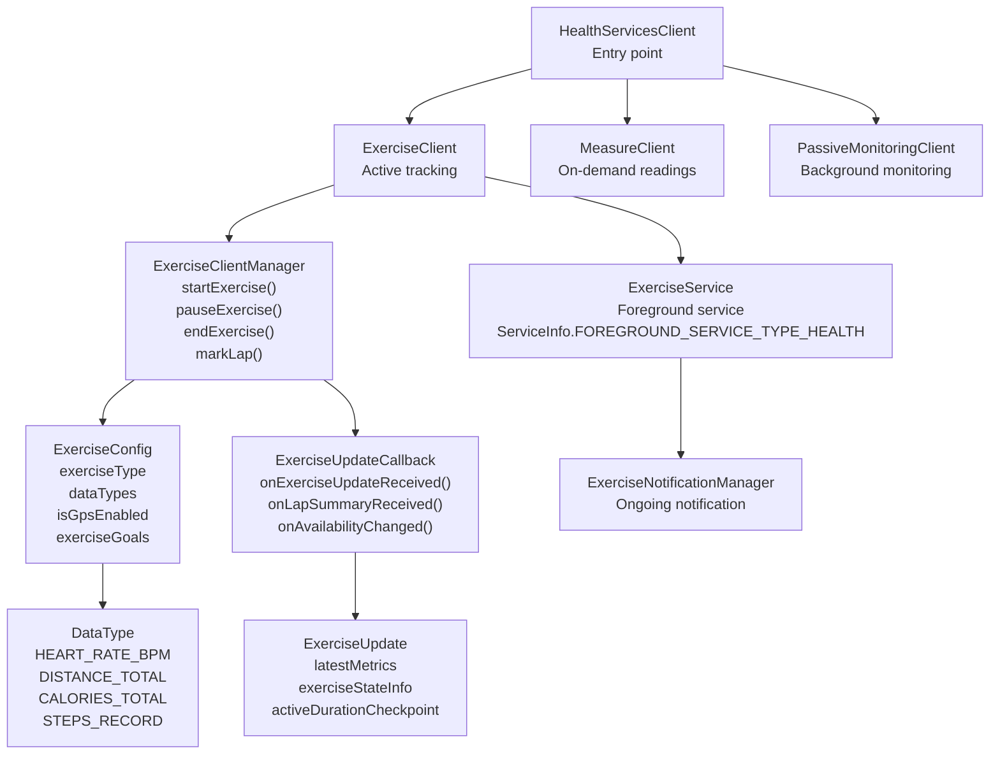

**Sources:**
- [health-services/ExerciseSampleCompose/app/src/main/java/com/example/exercisesamplecompose/data/ExerciseClientManager.kt:49-239]()
- [health-services/ExerciseSampleCompose/app/src/main/java/com/example/exercisesamplecompose/service/ExerciseService.kt:42-236]()

### Data Type Coverage

The Health Services API supports the following data types demonstrated in the samples:

| Data Type | Constant | Sample Usage | Client |
|---|---|---|---|
| Heart Rate | `DataType.HEART_RATE_BPM` | Real-time BPM during exercise | ExerciseClient, MeasureClient |
| Heart Rate Stats | `DataType.HEART_RATE_BPM_STATS` | Average/min/max calculations | ExerciseClient |
| Distance | `DataType.DISTANCE_TOTAL` | Cumulative meters traveled | ExerciseClient |
| Calories | `DataType.CALORIES_TOTAL` | Energy expenditure | ExerciseClient |
| Steps | `DataType.STEPS` | Step count | PassiveMonitoringClient |
| Location | `DataType.LOCATION` | GPS coordinates | ExerciseClient |
| Active Duration | `DataType.ACTIVE_EXERCISE_DURATION_TOTAL` | Exercise time tracking | ExerciseClient |

**Sources:**
- [health-services/ExerciseSampleCompose/app/src/main/java/com/example/exercisesamplecompose/data/ExerciseClientManager.kt:88-94]()
- [health-services/ExerciseSampleCompose/app/src/main/java/com/example/exercisesamplecompose/service/ExerciseState.kt:18-42]()

### Exercise Lifecycle Management

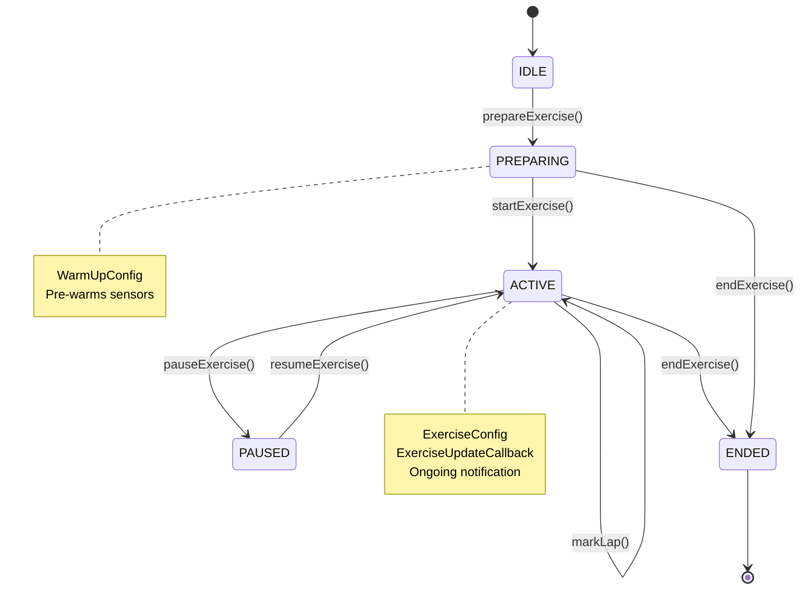

**Sources:**
- [health-services/ExerciseSampleCompose/app/src/main/java/com/example/exercisesamplecompose/data/ExerciseClientManager.kt:155-191]()
- [health-services/ExerciseSampleCompose/app/src/main/java/com/example/exercisesamplecompose/service/ExerciseService.kt:63-106]()

### Foreground Service Requirements

Health Services exercises run in a foreground service with specific requirements:

- **Service Type**: `ServiceInfo.FOREGROUND_SERVICE_TYPE_HEALTH` (API 34+) combined with `FOREGROUND_SERVICE_TYPE_LOCATION`
- **Ongoing Notification**: Required during active exercise using `ExerciseNotificationManager`
- **Lifecycle Management**: Service lifecycle bound to exercise state via `ExerciseServiceMonitor`

**Sources:**
- [health-services/ExerciseSampleCompose/app/src/main/java/com/example/exercisesamplecompose/service/ExerciseService.kt:199-223]()
- [health-services/ExerciseSampleCompose/app/src/main/java/com/example/exercisesamplecompose/service/ExerciseServiceMonitor.kt:27-85]()

---

## Health Connect API (androidx.health.connect)

### Overview

Health Connect provides a centralized, shared storage platform for health and fitness data on mobile devices. Multiple apps can read and write health records, enabling cross-app data sharing with user consent through a unified permission system.

### Core Components

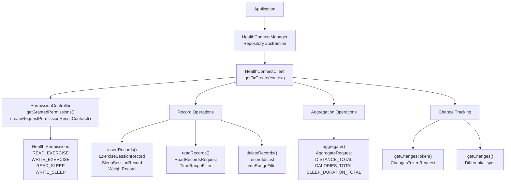

**Sources:**
- [health-connect/HealthConnectSample/app/src/main/java/com/example/healthconnectsample/data/HealthConnectManager.kt:62-126]()
- [health-connect/HealthConnectSample/app/src/main/res/values/strings.xml:1-144]()

### Record Types Demonstrated

The Health Connect sample demonstrates CRUD operations on the following record types:

| Record Type | Class | Operations | Key Fields |
|---|---|---|---|
| Exercise Sessions | `ExerciseSessionRecord` | Insert, Read, Delete, Read Associated Data | `startTime`, `endTime`, `exerciseType`, `title` |
| Sleep Sessions | `SleepSessionRecord` | Insert, Read, Generate data | `startTime`, `endTime`, `stages`, `notes` |
| Weight | `WeightRecord` | Insert, Read, Delete, Aggregate | `weight`, `time`, `zoneOffset` |
| Heart Rate | `HeartRateRecord` | Insert (with exercise), Read series | `samples`, `beatsPerMinute` |
| Steps | `StepsRecord` | Insert (with exercise) | `count`, `startTime`, `endTime` |
| Distance | `DistanceRecord` | Insert (with exercise) | `distance` (meters) |
| Speed | `SpeedRecord` | Read series | `samples`, `metersPerSecond` |
| Total Calories | `TotalCaloriesBurnedRecord` | Insert (with exercise), Aggregate | `energy` (calories) |

**Sources:**
- [health-connect/HealthConnectSample/app/src/main/java/com/example/healthconnectsample/data/HealthConnectManager.kt:128-385]()
- [health-connect/HealthConnectSample/app/src/main/AndroidManifest.xml:18-33]()

### Permission Model

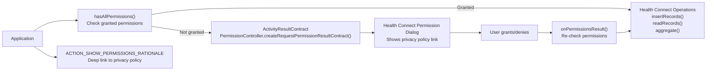

**Sources:**
- [health-connect/HealthConnectSample/app/src/main/java/com/example/healthconnectsample/data/HealthConnectManager.kt:109-126]()
- [health-connect/HealthConnectSample/app/src/main/AndroidManifest.xml:52-61]()

### Aggregation Operations

Health Connect supports aggregating data across time ranges:

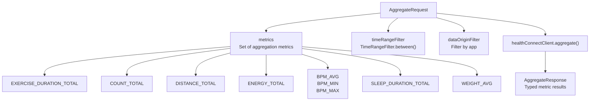

**Sources:**
- [health-connect/HealthConnectSample/app/src/main/java/com/example/healthconnectsample/data/HealthConnectManager.kt:217-257]()
- [health-connect/HealthConnectSample/app/src/main/java/com/example/healthconnectsample/data/HealthConnectManager.kt:366-374]()

### Differential Changes API

The changes API enables efficient synchronization by tracking modifications since a given token:

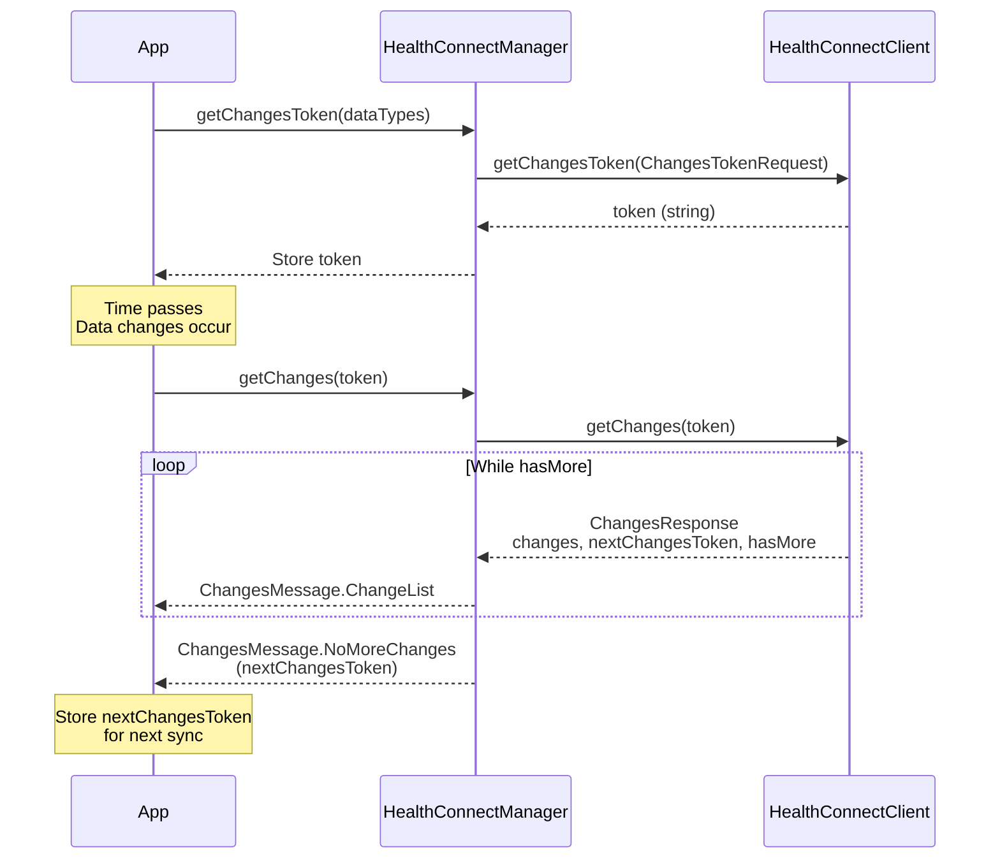

**Key implementation details:**
- Tokens expire after 30 days (must check `changesTokenExpired`)
- Each `Change` is either `UpsertionChange` or `DeletionChange`
- Changes include record type and metadata

**Sources:**
- [health-connect/HealthConnectSample/app/src/main/java/com/example/healthconnectsample/data/HealthConnectManager.kt:387-416]()
- [health-connect/HealthConnectSample/app/src/main/res/values/strings.xml:115-133]()

### Availability Checking

Health Connect requires runtime availability checking:

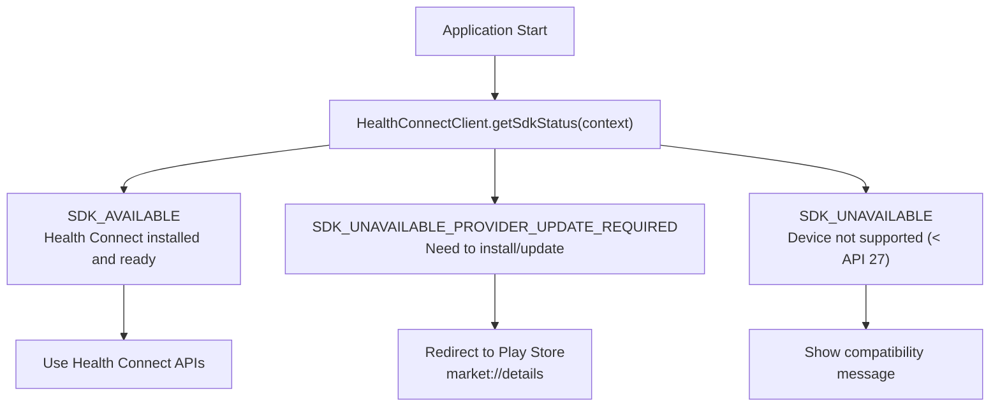

**Sources:**
- [health-connect/HealthConnectSample/app/src/main/java/com/example/healthconnectsample/data/HealthConnectManager.kt:98-107]()
- [health-connect/HealthConnectSample/app/src/main/java/com/example/healthconnectsample/presentation/screen/WelcomeScreen.kt:51-107]()

---

## Health Platform API (health-data-api)

### Overview

The Health Platform v1 API is a deprecated health data interface for mobile devices. The HealthPlatformSample demonstrates this legacy API for compatibility reference but is not recommended for new development.

**Status**: Deprecated - migrate to Health Connect for mobile health data

**Sources:**
- Repository structure analysis from high-level diagrams
- [health-platform/HealthPlatformSample/settings.gradle]() (inferred from repository structure)

---

## Google Fit Recording API

### Overview

The Google Fit Recording API (`com.google.android.gms.fitness`) enables passive background recording of fitness data on mobile devices. The RecordingAPIonMobile sample demonstrates subscribing to automatic data collection for steps, distance, and calories.

### Recording Subscription Model

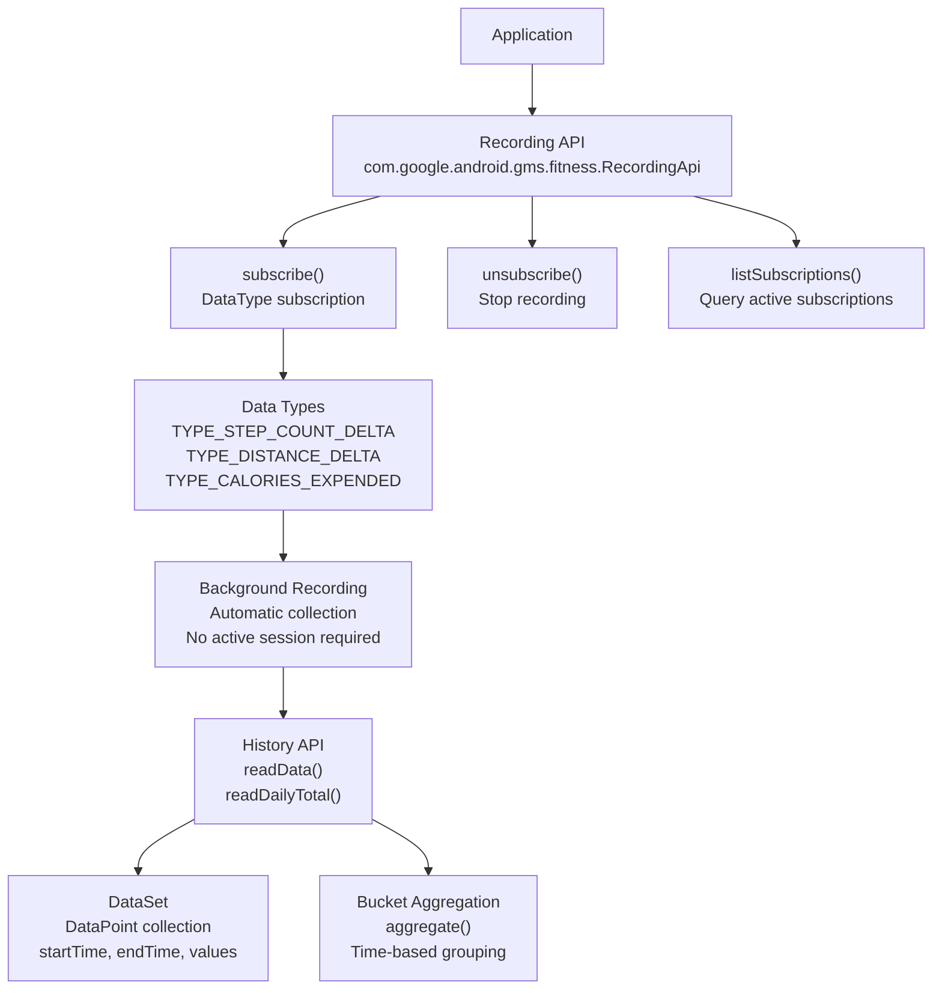

**Data types supported:**
- `TYPE_STEP_COUNT_DELTA`: Step count increments
- `TYPE_DISTANCE_DELTA`: Distance traveled (meters)
- `TYPE_CALORIES_EXPENDED`: Calories burned

**Sources:**
- [recording-api-on-mobile/RecordingApiOnMobileSample/app/src/main/java/com/example/recordingapionmobilesample/screen/recordingAPIonMobile/RecordingAPIonMobileViewModel.kt:1-200]()
- [recording-api-on-mobile/RecordingApiOnMobileSample/app/src/main/java/com/example/recordingapionmobilesample/data/DataPointData.kt:1-25]()

### Reading Recorded Data

The Recording API provides two patterns for reading data:

**Raw Data Points:**
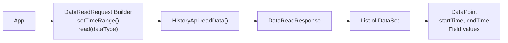

**Aggregated Buckets:**
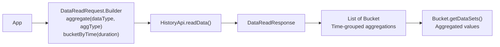

**Sources:**
- [recording-api-on-mobile/RecordingApiOnMobileSample/app/src/main/java/com/example/recordingapionmobilesample/screen/recordingAPIonMobile/RecordingAPIonMobileViewModel.kt:78-146]()
- [recording-api-on-mobile/RecordingApiOnMobileSample/app/src/main/java/com/example/recordingapionmobilesample/component/DataPointRow.kt:1-90]()
- [recording-api-on-mobile/RecordingApiOnMobileSample/app/src/main/java/com/example/recordingapionmobilesample/component/BucketRow.kt:1-100]()

---

## API Selection Guide

### Decision Matrix

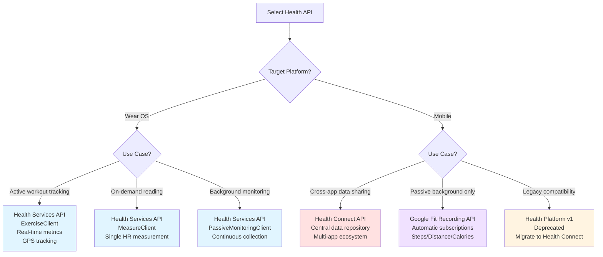

### Capability Comparison

| Capability | Health Services | Health Connect | Recording API | Health Platform v1 |
|---|---|---|---|---|
| **Real-time sensor access** | ✓ | ✗ | ✗ | ✗ |
| **Background data collection** | ✓ (passive) | ✗ | ✓ | ? |
| **Cross-app data sharing** | ✗ | ✓ | ✓ (via Fit) | ? |
| **GPS tracking** | ✓ | Records only | ✗ | ? |
| **Exercise lifecycle** | ✓ | Records only | ✗ | ? |
| **Data aggregation** | ✗ | ✓ | ✓ | ? |
| **Change tracking** | ✗ | ✓ | ✗ | ? |
| **Wear OS support** | ✓ | ✗ | ✗ | ✗ |
| **Mobile support** | ✗ | ✓ | ✓ | ✓ |
| **Permission model** | Android runtime | Health Connect | Google Fit | Platform |
| **Data persistence** | None (client only) | Central storage | Google account | Platform storage |

**Sources:**
- [health-services/ExerciseSampleCompose/app/src/main/java/com/example/exercisesamplecompose/data/ExerciseClientManager.kt:62-70]()
- [health-connect/HealthConnectSample/app/src/main/java/com/example/healthconnectsample/data/HealthConnectManager.kt:115-126]()
- [recording-api-on-mobile/RecordingApiOnMobileSample/app/src/main/java/com/example/recordingapionmobilesample/screen/home/HomeScreen.kt:1-300]()

### Use Case Recommendations

**Choose Health Services API when:**
- Building for Wear OS
- Need real-time sensor data during active exercise
- Require exercise lifecycle management (prepare, start, pause, end)
- Need GPS tracking with health metrics
- Want on-demand heart rate measurements

**Choose Health Connect API when:**
- Building for mobile (Android 8.1+)
- Need to read data from multiple fitness apps
- Want to write data accessible by other apps
- Require data aggregation across time ranges
- Need differential synchronization
- Building a comprehensive health dashboard

**Choose Recording API when:**
- Need simple passive background recording on mobile
- Only require steps, distance, and calories
- Don't need real-time data access
- Want automatic collection without active sessions

**Avoid Health Platform v1:**
- Deprecated API - use Health Connect instead for new development

**Sources:**
- Repository structure and high-level diagrams
- [health-connect/HealthConnectSample/app/src/main/res/values/strings.xml:28-65]()
- [health-services/ExerciseSampleCompose/app/src/main/java/com/example/exercisesamplecompose/data/HealthServicesRepository.kt:1-120]()

---

