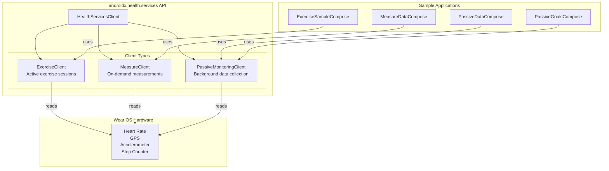
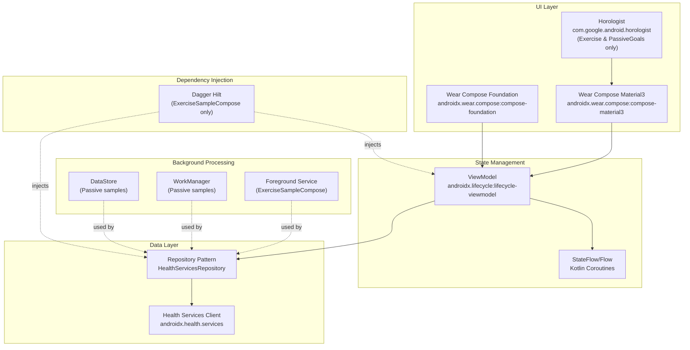
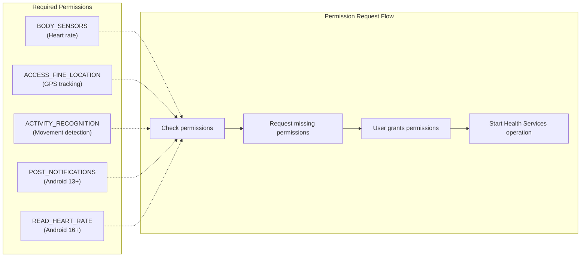
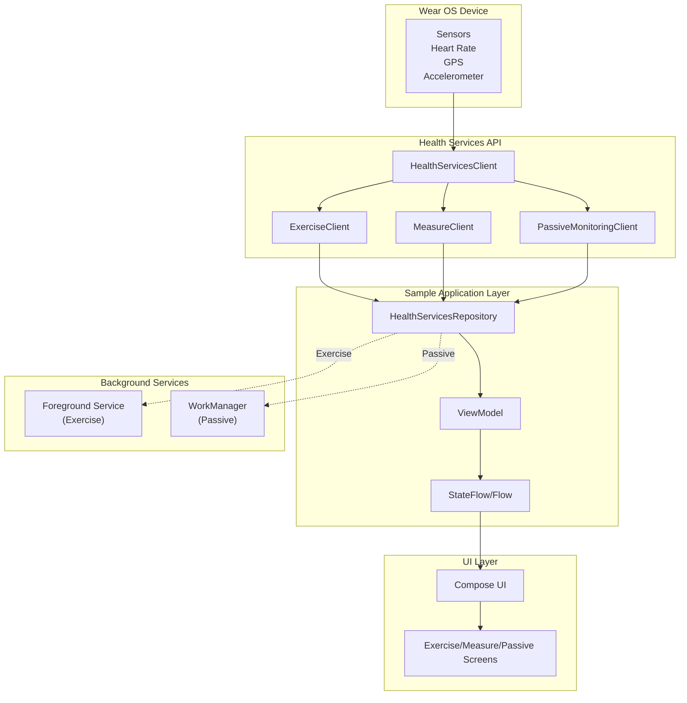

<!-- source: DeepWiki mcp.deepwiki.com · repo android/health-samples · page 2 Health Services Samples · fetched 2026-10-23 -->

# Health Services Samples

<details>
<summary>Relevant source files</summary>

The following files were used as context for generating this wiki page:

- [health-connect/HealthConnectSample/build.gradle](health-connect/HealthConnectSample/build.gradle)
- [health-platform-v1/HealthPlatformSample/build.gradle](health-platform-v1/HealthPlatformSample/build.gradle)
- [health-services/ExerciseSampleCompose/app/build.gradle](health-services/ExerciseSampleCompose/app/build.gradle)
- [health-services/ExerciseSampleCompose/app/src/main/AndroidManifest.xml](health-services/ExerciseSampleCompose/app/src/main/AndroidManifest.xml)
- [health-services/ExerciseSampleCompose/app/src/main/java/com/example/exercisesamplecompose/app/MainActivity.kt](health-services/ExerciseSampleCompose/app/src/main/java/com/example/exercisesamplecompose/app/MainActivity.kt)
- [health-services/ExerciseSampleCompose/app/src/main/java/com/example/exercisesamplecompose/presentation/component/FormattingUtils.kt](health-services/ExerciseSampleCompose/app/src/main/java/com/example/exercisesamplecompose/presentation/component/FormattingUtils.kt)
- [health-services/ExerciseSampleCompose/app/src/main/java/com/example/exercisesamplecompose/presentation/component/HRText.kt](health-services/ExerciseSampleCompose/app/src/main/java/com/example/exercisesamplecompose/presentation/component/HRText.kt)
- [health-services/ExerciseSampleCompose/app/src/main/java/com/example/exercisesamplecompose/presentation/exercise/ExerciseScreen.kt](health-services/ExerciseSampleCompose/app/src/main/java/com/example/exercisesamplecompose/presentation/exercise/ExerciseScreen.kt)
- [health-services/ExerciseSampleCompose/app/src/main/java/com/example/exercisesamplecompose/presentation/preparing/PreparingViewModel.kt](health-services/ExerciseSampleCompose/app/src/main/java/com/example/exercisesamplecompose/presentation/preparing/PreparingViewModel.kt)
- [health-services/ExerciseSampleCompose/app/src/test/java/com/example/exercisesamplecompose/presentation/ExerciseScreenTest.kt](health-services/ExerciseSampleCompose/app/src/test/java/com/example/exercisesamplecompose/presentation/ExerciseScreenTest.kt)
- [health-services/ExerciseSampleCompose/gradle/libs.versions.toml](health-services/ExerciseSampleCompose/gradle/libs.versions.toml)
- [health-services/MeasureDataCompose/gradle/libs.versions.toml](health-services/MeasureDataCompose/gradle/libs.versions.toml)
- [health-services/PassiveDataCompose/gradle/libs.versions.toml](health-services/PassiveDataCompose/gradle/libs.versions.toml)
- [health-services/PassiveGoalsCompose/gradle/libs.versions.toml](health-services/PassiveGoalsCompose/gradle/libs.versions.toml)

</details>


## Purpose and Scope

This page provides an overview of the four sample applications demonstrating the `androidx.health.services` API for Wear OS devices. These samples illustrate different use cases for health and fitness data collection on wearables, from active exercise tracking to passive background monitoring.

For detailed information about individual samples, see:
- Active exercise tracking: [ExerciseSampleCompose](#2.1)
- On-demand measurements: [MeasureDataCompose](#2.2)
- Passive background data collection: [PassiveDataCompose](#2.3)
- Passive goal tracking: [PassiveGoalsCompose](#2.4)

For Health Connect (mobile health data platform), see [Health Connect Sample](#3). For legacy Health Platform API, see [Health Platform Sample](#4).

## Health Services API Overview

The Health Services API (`androidx.health.services`) provides direct access to Wear OS device sensors for health and fitness applications. Unlike Health Connect which aggregates data across apps on mobile devices, Health Services is specifically designed for real-time sensor access on wearables.

**Key Capabilities:**
- **Exercise Tracking**: Active workout sessions with real-time metrics (heart rate, distance, pace)
- **Passive Monitoring**: Background health data collection without user interaction
- **On-Demand Measurement**: Single sensor readings (e.g., heart rate check)
- **Goal Tracking**: Progress monitoring against fitness objectives

**API Version**: All samples use `androidx.health:health-services-client:1.0.0`

Sources: [health-services/ExerciseSampleCompose/gradle/libs.versions.toml:9](), [health-services/MeasureDataCompose/gradle/libs.versions.toml:12](), [health-services/PassiveDataCompose/gradle/libs.versions.toml:13](), [health-services/PassiveGoalsCompose/gradle/libs.versions.toml:14]()

## Sample Applications Overview

The repository includes four Health Services samples, each demonstrating different aspects of the API:

| Sample | Purpose | Key Features | Complexity |
|--------|---------|--------------|------------|
| **ExerciseSampleCompose** | Active exercise session tracking | Foreground service, exercise lifecycle, ambient mode, Dagger Hilt, screenshot testing | High (~4000 LOC) |
| **MeasureDataCompose** | On-demand heart rate measurement | Simple single-screen UI, MeasureClient API | Low (~500 LOC) |
| **PassiveDataCompose** | Background health data collection | WorkManager, DataStore, PassiveMonitoringClient | Medium (~1000 LOC) |
| **PassiveGoalsCompose** | Background goal tracking and notifications | WorkManager, DataStore, goal achievements, notifications | Medium (~1200 LOC) |

All samples use **Jetpack Compose** for UI and target **Wear OS** devices (minSdk 30).

### Architecture Diagram: Health Services Client Types



Sources: [health-services/ExerciseSampleCompose/app/src/main/java/com/example/exercisesamplecompose/presentation/preparing/PreparingViewModel.kt:23](), [health-services/ExerciseSampleCompose/app/build.gradle:106]()

## Common Architecture Patterns

All Health Services samples follow consistent architectural patterns:

### MVVM Architecture

Each sample implements the Model-View-ViewModel pattern with:
- **ViewModels**: Manage UI state and business logic
- **Repository Pattern**: Abstract Health Services API interactions
- **StateFlow**: Reactive state management with Kotlin coroutines
- **Compose UI**: Declarative user interface

### Technology Stack



Sources: [health-services/ExerciseSampleCompose/gradle/libs.versions.toml:1-73](), [health-services/ExerciseSampleCompose/app/build.gradle:80-141]()

### Permission Handling

All samples require runtime permissions for sensor access:



**Permission Implementation Example:**
[health-services/ExerciseSampleCompose/app/src/main/java/com/example/exercisesamplecompose/presentation/preparing/PreparingViewModel.kt:85-95]()

The `PreparingViewModel` defines the required permissions list that adapts based on API level. The `MainActivity` uses `ActivityResultContracts.RequestMultiplePermissions()` to request these permissions on app launch.

**Manifest Declaration:**
[health-services/ExerciseSampleCompose/app/src/main/AndroidManifest.xml:18-33]()

Sources: [health-services/ExerciseSampleCompose/app/src/main/java/com/example/exercisesamplecompose/presentation/preparing/PreparingViewModel.kt:85-95](), [health-services/ExerciseSampleCompose/app/src/main/AndroidManifest.xml:18-33](), [health-services/ExerciseSampleCompose/app/src/main/java/com/example/exercisesamplecompose/app/MainActivity.kt:39-47]()

## Common Dependencies

### Core Dependencies Across All Samples

| Dependency | Purpose | Versions Used |
|------------|---------|---------------|
| `androidx.health:health-services-client` | Health Services API client | 1.0.0 (all samples) |
| `androidx.wear.compose:compose-material3` | Wear OS Material Design 3 components | 1.5.0-beta02 to 1.5.0-beta04 |
| `androidx.wear.compose:compose-foundation` | Wear OS Compose fundamentals | 1.4.1 to 1.5.0-beta04 |
| `androidx.activity:activity-compose` | Compose integration for Activity | 1.9.2 to 1.10.1 |
| `androidx.lifecycle:lifecycle-viewmodel-compose` | ViewModel integration for Compose | 2.8.6 to 2.9.0 |
| `androidx.concurrent:concurrent-futures-ktx` | Async operations with ListenableFuture | 1.2.0 (all samples) |
| `com.google.guava:guava` | Google core libraries | 33.3.1-android (all samples) |

### Sample-Specific Dependencies

**ExerciseSampleCompose** (Most Complex):
- `com.google.dagger:hilt-android:2.56.2` - Dependency injection
- `com.google.android.horologist:horologist-*:0.7.14-beta` - Wear OS utilities and health UI components
- `io.github.takahirom.roborazzi:roborazzi:1.45.1` - Screenshot testing
- `androidx.wear:wear-ongoing:1.0.0` - Ongoing activity notifications

**PassiveDataCompose & PassiveGoalsCompose**:
- `androidx.work:work-runtime-ktx:2.10.1` - Background task scheduling
- `androidx.datastore:datastore-preferences:1.1.7` - Persistent key-value storage

### Version Catalog Comparison

```mermaid
graph TB
    subgraph "ExerciseSampleCompose<br/>Most Advanced"
        ESC_AGP["Android Gradle Plugin: 8.10.1"]
        ESC_KOTLIN["Kotlin: 2.1.21"]
        ESC_FEATURES["+ Dagger Hilt<br/>+ Horologist<br/>+ Roborazzi"]
    end
    
    subgraph "MeasureDataCompose<br/>Simple"
        MDC_AGP["Android Gradle Plugin: 8.7.3"]
        MDC_KOTLIN["Kotlin: 1.9.25"]
        MDC_FEATURES["Basic Compose<br/>+ Accompanist Permissions"]
    end
    
    subgraph "PassiveDataCompose<br/>Background Focus"
        PDC_AGP["Android Gradle Plugin: 8.7.3"]
        PDC_KOTLIN["Kotlin: 1.9.25"]
        PDC_FEATURES["+ WorkManager<br/>+ DataStore"]
    end
    
    subgraph "PassiveGoalsCompose<br/>Background + Goals"
        PGC_AGP["Android Gradle Plugin: 8.7.3"]
        PGC_KOTLIN["Kotlin: 2.1.20"]
        PGC_FEATURES["+ WorkManager<br/>+ DataStore<br/>+ Horologist"]
    end
    
    SHARED["Shared Dependencies:<br/>Health Services 1.0.0<br/>Wear Compose Material3<br/>Lifecycle Components"]
    
    ESC_FEATURES -.-> SHARED
    MDC_FEATURES -.-> SHARED
    PDC_FEATURES -.-> SHARED
    PGC_FEATURES -.-> SHARED
```



**Note**: ExerciseSampleCompose uses the latest Kotlin (2.1.21) and Android Gradle Plugin (8.10.1), indicating it receives more active maintenance and serves as the flagship sample.

Sources: [health-services/ExerciseSampleCompose/gradle/libs.versions.toml:1-18](), [health-services/MeasureDataCompose/gradle/libs.versions.toml:1-17](), [health-services/PassiveDataCompose/gradle/libs.versions.toml:1-17](), [health-services/PassiveGoalsCompose/gradle/libs.versions.toml:1-19]()

## Sample-Specific Features

### Exercise Sample: Active Tracking with Foreground Service

The most complex sample demonstrating a complete exercise tracking application:

**Key Components:**
- `ExerciseService`: Foreground service managing exercise lifecycle [health-services/ExerciseSampleCompose/app/src/main/AndroidManifest.xml:64-67]()
- `ExerciseViewModel`: State management for active exercise [health-services/ExerciseSampleCompose/app/src/main/java/com/example/exercisesamplecompose/presentation/exercise/ExerciseScreen.kt:78]()
- `PreparingViewModel`: Pre-exercise warmup and permission checks [health-services/ExerciseSampleCompose/app/src/main/java/com/example/exercisesamplecompose/presentation/preparing/PreparingViewModel.kt:35-96]()
- `HealthServicesRepository`: Repository pattern for ExerciseClient interactions [health-services/ExerciseSampleCompose/app/src/main/java/com/example/exercisesamplecompose/presentation/preparing/PreparingViewModel.kt:39]()

**UI Features:**
- Multi-page layout using `HorizontalPager` for metrics and controls [health-services/ExerciseSampleCompose/app/src/main/java/com/example/exercisesamplecompose/presentation/exercise/ExerciseScreen.kt:164-201]()
- Real-time metric display (heart rate, calories, distance, duration) [health-services/ExerciseSampleCompose/app/src/main/java/com/example/exercisesamplecompose/presentation/exercise/ExerciseScreen.kt:268-315]()
- Ambient mode support for always-on display
- Exercise goal achievement dialogs

For complete details, see [ExerciseSampleCompose](#2.1).

### Measure Sample: On-Demand Readings

Simple single-screen application for quick heart rate measurements using `MeasureClient`.

For details, see [MeasureDataCompose](#2.2).

### Passive Samples: Background Monitoring

Both passive samples use `WorkManager` and `DataStore` for background operation:

**PassiveDataCompose**: Continuously collects health data in the background without user interaction.

**PassiveGoalsCompose**: Tracks progress toward daily goals and displays achievement notifications.

For details, see [PassiveDataCompose](#2.3) and [PassiveGoalsCompose](#2.4).

## Build Configuration

### Gradle Wrapper Versions

- **ExerciseSampleCompose**: Gradle 8.14.2 (latest)
- **Other samples**: Gradle 8.10.2

### Compile and Target SDK

All samples use:
- `compileSdk 36`
- `targetSdk 36`
- `minSdk 30` (Wear OS 3.0+)

### Code Quality

All samples include:
- **Spotless**: Code formatting with ktlint [health-services/ExerciseSampleCompose/gradle/libs.versions.toml:72]()
- **ProGuard**: Code shrinking in release builds [health-services/ExerciseSampleCompose/app/build.gradle:38-41]()

**ExerciseSampleCompose** additionally includes:
- **Roborazzi**: Screenshot testing with Robolectric [health-services/ExerciseSampleCompose/gradle/libs.versions.toml:15]()
- **JUnit**: Unit testing framework

Sources: [health-services/ExerciseSampleCompose/app/build.gradle:25-74](), [health-services/ExerciseSampleCompose/gradle/libs.versions.toml:72]()

## Wear OS Specific Considerations

### Horologist Integration

Horologist provides Wear OS utilities and health-specific UI components. Used in:
- **ExerciseSampleCompose**: Layout, health composables, and screenshot testing
- **PassiveGoalsCompose**: Layout components

**Key Horologist Components:**
- `horologist-compose-layout`: Responsive layouts for different watch sizes
- `horologist-health-composables`: Pre-built health data UI components (e.g., `ActiveDurationText`)
- `horologist-health-service`: Health Services integration utilities
- `horologist-roboscreenshots`: Screenshot testing support

Example usage: [health-services/ExerciseSampleCompose/app/src/main/java/com/example/exercisesamplecompose/presentation/exercise/ExerciseScreen.kt:68]() shows `ActiveDurationText` from Horologist displaying elapsed exercise time.

### Foreground Service Requirements

Active exercise tracking requires a foreground service with notification:

**Service Declaration:**
[health-services/ExerciseSampleCompose/app/src/main/AndroidManifest.xml:64-67]()

The service type `health|location` indicates it accesses both health sensors and location data.

**Required Permissions:**
- `android.permission.FOREGROUND_SERVICE`
- `android.permission.FOREGROUND_SERVICE_HEALTH`
- `android.permission.FOREGROUND_SERVICE_LOCATION`

Sources: [health-services/ExerciseSampleCompose/gradle/libs.versions.toml:49-52](), [health-services/ExerciseSampleCompose/app/src/main/AndroidManifest.xml:31-33](), [health-services/ExerciseSampleCompose/app/src/main/java/com/example/exercisesamplecompose/presentation/exercise/ExerciseScreen.kt:68]()

## Testing and Quality Assurance

### Screenshot Testing (ExerciseSampleCompose Only)

The flagship sample includes comprehensive screenshot testing:

**Test Configuration:**
[health-services/ExerciseSampleCompose/app/src/test/java/com/example/exercisesamplecompose/presentation/ExerciseScreenTest.kt:35-107]()

Tests run across multiple device configurations using `WearDeviceScreenshotTest` base class from Horologist, verifying UI rendering in both interactive and ambient modes.

**Device Matrix**: Tests execute on various Wear OS device sizes to ensure responsive layout.

For more details on testing, see [Testing Strategy](#2.1.4).

### CI/CD Integration

Each sample has a dedicated GitHub Actions workflow:
- `ExerciseSampleCompose.yml`
- `MeasureDataCompose.yml`
- `PassiveDataCompose.yml`
- `PassiveGoalsCompose.yml`

For CI/CD details, see [GitHub Actions Workflows](#7.1).

Sources: [health-services/ExerciseSampleCompose/app/src/test/java/com/example/exercisesamplecompose/presentation/ExerciseScreenTest.kt:35-107]()

## Data Flow Architecture



**Data Flow:**
1. Sensors provide raw data to Health Services API
2. Client interfaces (ExerciseClient, MeasureClient, PassiveMonitoringClient) expose sensor data
3. Repository layer abstracts API calls and manages data transformations
4. ViewModel processes data and exposes StateFlow for UI observation
5. Compose UI reacts to StateFlow changes and updates display
6. Background services (Foreground Service or WorkManager) maintain data collection when app is backgrounded

Sources: [health-services/ExerciseSampleCompose/app/src/main/java/com/example/exercisesamplecompose/presentation/preparing/PreparingViewModel.kt:39-67](), [health-services/ExerciseSampleCompose/app/src/main/java/com/example/exercisesamplecompose/presentation/exercise/ExerciseScreen.kt:78-85]()

## Getting Started

To run any Health Services sample:

1. **Hardware Requirements**: 
   - Wear OS device with Health Services support (Wear OS 3.0+, API level 30+)
   - Physical device or emulator with appropriate sensor capabilities

2. **Prerequisites**:
   - Android Studio Arctic Fox or later
   - Wear OS emulator or physical device paired with companion phone

3. **Build and Deploy**:
   ```bash
   # Navigate to sample directory
   cd health-services/ExerciseSampleCompose
   
   # Build APK
   ./gradlew assembleDebug
   
   # Install on connected device
   ./gradlew installDebug
   ```

4. **Grant Permissions**:
   - Launch app on Wear OS device
   - Grant requested permissions (body sensors, location, activity recognition)
   - Start using the sample

For sample-specific setup and usage, refer to individual sample pages: [ExerciseSampleCompose](#2.1), [MeasureDataCompose](#2.2), [PassiveDataCompose](#2.3), [PassiveGoalsCompose](#2.4).

---

