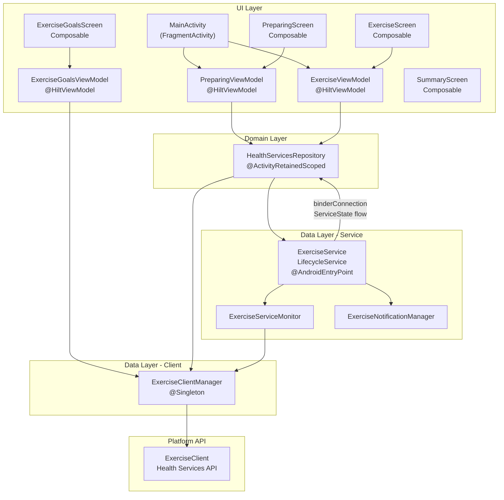
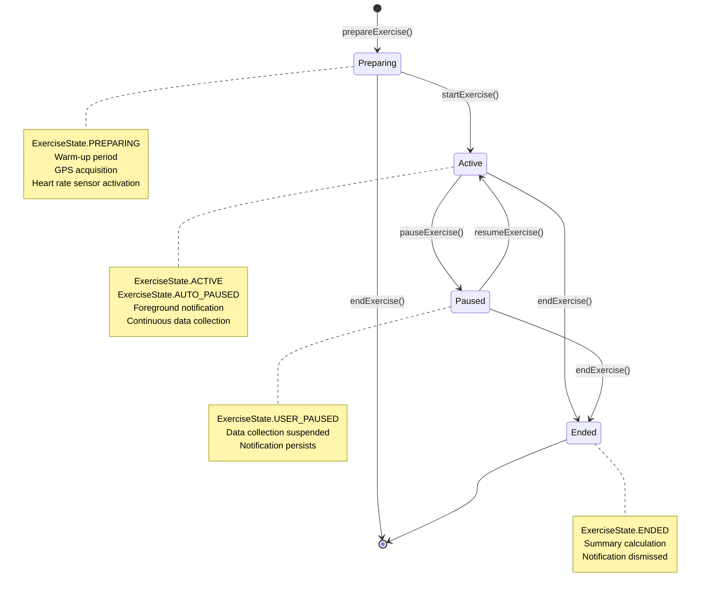
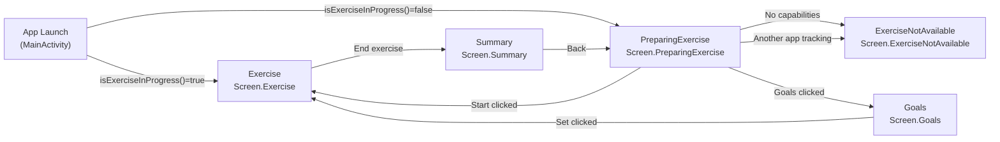
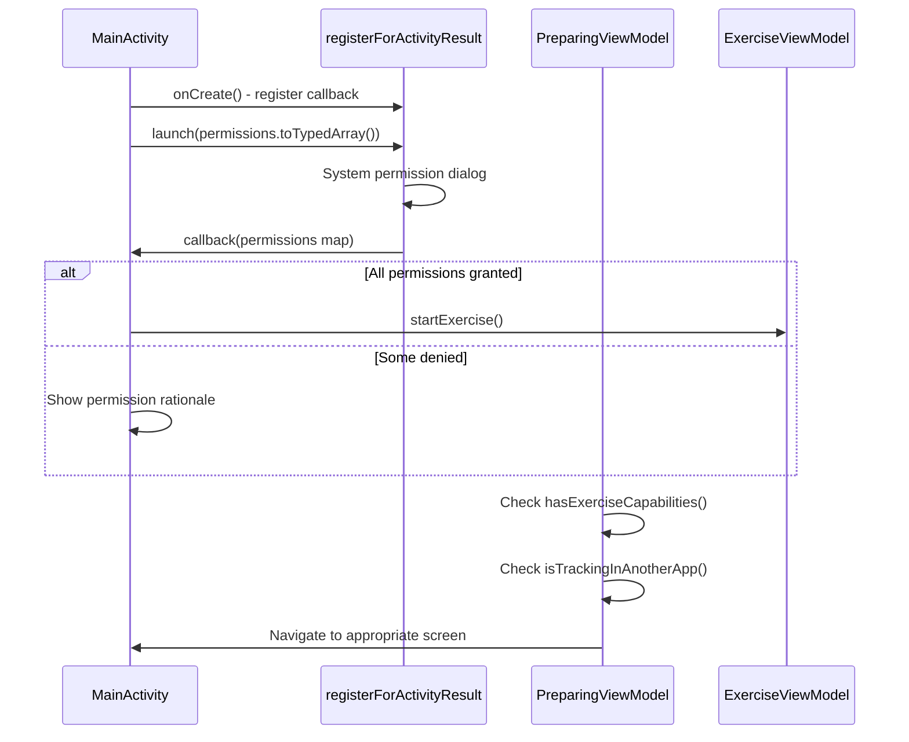

<!-- source: DeepWiki mcp.deepwiki.com · repo android/health-samples · page 2.1 ExerciseSampleCompose · fetched 2026-10-23 -->

# ExerciseSampleCompose

<details>
<summary>Relevant source files</summary>

The following files were used as context for generating this wiki page:

- [health-services/ExerciseSampleCompose/app/build.gradle](health-services/ExerciseSampleCompose/app/build.gradle)
- [health-services/ExerciseSampleCompose/app/src/main/AndroidManifest.xml](health-services/ExerciseSampleCompose/app/src/main/AndroidManifest.xml)
- [health-services/ExerciseSampleCompose/app/src/main/java/com/example/exercisesamplecompose/app/MainActivity.kt](health-services/ExerciseSampleCompose/app/src/main/java/com/example/exercisesamplecompose/app/MainActivity.kt)
- [health-services/ExerciseSampleCompose/app/src/main/java/com/example/exercisesamplecompose/app/Screens.kt](health-services/ExerciseSampleCompose/app/src/main/java/com/example/exercisesamplecompose/app/Screens.kt)
- [health-services/ExerciseSampleCompose/app/src/main/java/com/example/exercisesamplecompose/data/ExerciseClientKtx.kt](health-services/ExerciseSampleCompose/app/src/main/java/com/example/exercisesamplecompose/data/ExerciseClientKtx.kt)
- [health-services/ExerciseSampleCompose/app/src/main/java/com/example/exercisesamplecompose/data/ExerciseClientManager.kt](health-services/ExerciseSampleCompose/app/src/main/java/com/example/exercisesamplecompose/data/ExerciseClientManager.kt)
- [health-services/ExerciseSampleCompose/app/src/main/java/com/example/exercisesamplecompose/data/HealthServicesRepository.kt](health-services/ExerciseSampleCompose/app/src/main/java/com/example/exercisesamplecompose/data/HealthServicesRepository.kt)
- [health-services/ExerciseSampleCompose/app/src/main/java/com/example/exercisesamplecompose/presentation/component/FormattingUtils.kt](health-services/ExerciseSampleCompose/app/src/main/java/com/example/exercisesamplecompose/presentation/component/FormattingUtils.kt)
- [health-services/ExerciseSampleCompose/app/src/main/java/com/example/exercisesamplecompose/presentation/component/HRText.kt](health-services/ExerciseSampleCompose/app/src/main/java/com/example/exercisesamplecompose/presentation/component/HRText.kt)
- [health-services/ExerciseSampleCompose/app/src/main/java/com/example/exercisesamplecompose/presentation/dialogs/ExerciseGoalMet.kt](health-services/ExerciseSampleCompose/app/src/main/java/com/example/exercisesamplecompose/presentation/dialogs/ExerciseGoalMet.kt)
- [health-services/ExerciseSampleCompose/app/src/main/java/com/example/exercisesamplecompose/presentation/exercise/ExerciseScreen.kt](health-services/ExerciseSampleCompose/app/src/main/java/com/example/exercisesamplecompose/presentation/exercise/ExerciseScreen.kt)
- [health-services/ExerciseSampleCompose/app/src/main/java/com/example/exercisesamplecompose/presentation/goals/ExerciseGoalsScreen.kt](health-services/ExerciseSampleCompose/app/src/main/java/com/example/exercisesamplecompose/presentation/goals/ExerciseGoalsScreen.kt)
- [health-services/ExerciseSampleCompose/app/src/main/java/com/example/exercisesamplecompose/presentation/goals/ExerciseGoalsViewModel.kt](health-services/ExerciseSampleCompose/app/src/main/java/com/example/exercisesamplecompose/presentation/goals/ExerciseGoalsViewModel.kt)
- [health-services/ExerciseSampleCompose/app/src/main/java/com/example/exercisesamplecompose/presentation/preparing/PreparingViewModel.kt](health-services/ExerciseSampleCompose/app/src/main/java/com/example/exercisesamplecompose/presentation/preparing/PreparingViewModel.kt)
- [health-services/ExerciseSampleCompose/app/src/main/java/com/example/exercisesamplecompose/presentation/theme/ThemePreview.kt](health-services/ExerciseSampleCompose/app/src/main/java/com/example/exercisesamplecompose/presentation/theme/ThemePreview.kt)
- [health-services/ExerciseSampleCompose/app/src/main/java/com/example/exercisesamplecompose/service/ExerciseService.kt](health-services/ExerciseSampleCompose/app/src/main/java/com/example/exercisesamplecompose/service/ExerciseService.kt)
- [health-services/ExerciseSampleCompose/app/src/main/java/com/example/exercisesamplecompose/service/ExerciseServiceMonitor.kt](health-services/ExerciseSampleCompose/app/src/main/java/com/example/exercisesamplecompose/service/ExerciseServiceMonitor.kt)
- [health-services/ExerciseSampleCompose/app/src/main/java/com/example/exercisesamplecompose/service/ExerciseState.kt](health-services/ExerciseSampleCompose/app/src/main/java/com/example/exercisesamplecompose/service/ExerciseState.kt)
- [health-services/ExerciseSampleCompose/app/src/test/java/com/example/exercisesamplecompose/presentation/ExerciseScreenTest.kt](health-services/ExerciseSampleCompose/app/src/test/java/com/example/exercisesamplecompose/presentation/ExerciseScreenTest.kt)

</details>


## Purpose and Scope

ExerciseSampleCompose is the flagship Wear OS sample application in the health-samples repository that demonstrates active exercise tracking using the `androidx.health.services` API. This sample showcases a production-grade implementation of real-time workout monitoring for running exercises, including heart rate measurement, GPS tracking, distance calculation, calorie counting, and exercise goal management.

The application implements the full exercise lifecycle: preparation (warm-up), active tracking with pause/resume capabilities, and summary presentation. It demonstrates Android best practices including MVVM architecture with Jetpack Compose, Dagger Hilt dependency injection, foreground service management, ambient mode support, and permission handling.

For on-demand heart rate measurements without exercise tracking, see [MeasureDataCompose](#2.2). For passive background data collection, see [PassiveDataCompose](#2.3) and [PassiveGoalsCompose](#2.4).

**Sources:** [health-services/ExerciseSampleCompose/app/build.gradle:1-142](), [health-services/ExerciseSampleCompose/app/src/main/AndroidManifest.xml:1-70]()

---

## Application Architecture

ExerciseSampleCompose follows a layered MVVM architecture with clear separation of concerns:

| Layer | Components | Responsibility |
|-------|------------|----------------|
| **UI Layer** | Compose screens, ViewModels | User interaction, state presentation |
| **Domain Layer** | Repository abstraction | Business logic coordination |
| **Data Layer** | ExerciseClientManager, ExerciseService | Health Services API integration, data collection |
| **Platform Layer** | Health Services ExerciseClient | Android platform API |

The application uses **Dagger Hilt** for compile-time dependency injection across all layers, with `@HiltViewModel` for ViewModels and `@AndroidEntryPoint` for the service and activities.

### Architecture Diagram



**Key architectural components:**

- **HealthServicesRepository** ([data/HealthServicesRepository.kt:40-106]()): `@ActivityRetainedScoped` repository that bridges UI and service layers, managing service binding and state flow aggregation.
- **ExerciseService** ([service/ExerciseService.kt:42-236]()): Foreground `LifecycleService` that manages the exercise lifecycle and maintains an ongoing notification.
- **ExerciseClientManager** ([data/ExerciseClientManager.kt:53-239]()): `@Singleton` wrapper around `ExerciseClient` that provides coroutine-friendly APIs and exercise update flows.
- **ExerciseServiceMonitor** ([service/ExerciseServiceMonitor.kt:27-85]()): Collects exercise updates from `ExerciseClientManager` and maintains exercise state.

**Sources:** [health-services/ExerciseSampleCompose/app/src/main/java/com/example/exercisesamplecompose/data/HealthServicesRepository.kt:40-106](), [health-services/ExerciseSampleCompose/app/src/main/java/com/example/exercisesamplecompose/service/ExerciseService.kt:42-236](), [health-services/ExerciseSampleCompose/app/src/main/java/com/example/exercisesamplecompose/data/ExerciseClientManager.kt:53-239](), [health-services/ExerciseSampleCompose/app/build.gradle:80-141]()

---

## Exercise Lifecycle Management

The exercise lifecycle is managed through a coordinated interaction between `ExerciseService`, `ExerciseClientManager`, and the Health Services `ExerciseClient`. The service runs in the foreground to ensure continuous data collection even when the UI is not visible.

### Exercise State Flow Diagram



### Lifecycle Methods

**Preparation Phase:**
- `ExerciseService.prepareExercise()` ([service/ExerciseService.kt:66-68]()): Calls `exerciseClientManager.prepareExercise()`
- `ExerciseClientManager.prepareExercise()` ([data/ExerciseClientManager.kt:155-167]()): Configures `WarmUpConfig` with heart rate and location data types, invokes `exerciseClient.prepareExercise(warmUpConfig)`

**Active Tracking Phase:**
- `ExerciseService.startExercise()` ([service/ExerciseService.kt:73-76]()): Posts foreground notification, then starts exercise
- `ExerciseClientManager.startExercise()` ([data/ExerciseClientManager.kt:78-149]()): 
  - Queries exercise capabilities to determine supported data types and goals
  - Creates `ExerciseConfig` with running exercise type, data types (heart rate, calories, distance), GPS enabled, auto-pause support, and exercise goals
  - Invokes `exerciseClient.startExercise(config)`

**Pause/Resume:**
- `ExerciseService.pauseExercise()` / `resumeExercise()` ([service/ExerciseService.kt:81-90]()): Delegate to client manager
- `ExerciseClientManager.pauseExercise()` / `resumeExercise()` ([data/ExerciseClientManager.kt:174-182]()): Call corresponding `exerciseClient` methods

**End Phase:**
- `ExerciseService.endExercise()` ([service/ExerciseService.kt:95-98]()): Ends exercise and removes notification
- `ExerciseClientManager.endExercise()` ([data/ExerciseClientManager.kt:169-172]()): Invokes `exerciseClient.endExercise()`

### Foreground Service Management

The service becomes a foreground service when exercise starts to ensure it isn't killed by the system:

- **Notification Creation:** `ExerciseNotificationManager.buildNotification()` creates an ongoing activity notification
- **Foreground Service Type:** `ServiceInfo.FOREGROUND_SERVICE_TYPE_LOCATION | FOREGROUND_SERVICE_TYPE_HEALTH` ([service/ExerciseService.kt:214-220]())
- **Lifecycle Binding:** The service uses `LifecycleService` to manage coroutine scopes tied to service lifecycle states

The service automatically stops itself if no exercise is in progress when unbound ([service/ExerciseService.kt:137-153]()):

```
private fun stopSelfIfNotRunning() {
    lifecycleScope.launch {
        if (!isExerciseInProgress()) {
            if (exerciseServiceMonitor.exerciseServiceState.value.exerciseState == ExerciseState.PREPARING) {
                endExercise()
            }
            stopSelf()
        }
    }
}
```

**Sources:** [health-services/ExerciseSampleCompose/app/src/main/java/com/example/exercisesamplecompose/service/ExerciseService.kt:42-236](), [health-services/ExerciseSampleCompose/app/src/main/java/com/example/exercisesamplecompose/data/ExerciseClientManager.kt:53-239](), [health-services/ExerciseSampleCompose/app/src/main/AndroidManifest.xml:64-68]()

---

## Data Flow and State Management

The application uses reactive state flows to propagate exercise updates from the Health Services API to the UI layer.

### Data Flow Diagram

```mermaid
flowchart LR
    subgraph "Health Services Platform"
        HS["ExerciseClient<br/>(Health Services API)"]
    end
    
    subgraph "ExerciseClientManager"
        Callback["ExerciseUpdateCallback"]
        Flow["exerciseUpdateFlow<br/>(callbackFlow)"]
    end
    
    subgraph "ExerciseServiceMonitor"
        Monitor["monitor()<br/>collect updates"]
        StateFlow["exerciseServiceState<br/>(MutableStateFlow)"]
    end
    
    subgraph "HealthServicesRepository"
        Binder["binderConnection<br/>bindService"]
        ServiceState["serviceState<br/>(StateFlow)"]
    end
    
    subgraph "ViewModel Layer"
        PrepVM["PreparingViewModel.uiState"]
        ExVM["ExerciseViewModel.uiState"]
    end
    
    subgraph "UI Layer"
        UI["Compose Screens<br/>collectAsStateWithLifecycle()"]
    end
    
    HS -->|"setUpdateCallback"| Callback
    Callback -->|"emit messages"| Flow
    Flow -->|"collect"| Monitor
    Monitor -->|"update state"| StateFlow
    StateFlow -->|"flowWhenConnected"| ServiceState
    ServiceState -->|"map to UI state"| PrepVM
    ServiceState -->|"map to UI state"| ExVM
    PrepVM -->|"StateFlow"| UI
    ExVM -->|"StateFlow"| UI
```



### Exercise Data Collection

**ExerciseClientManager.exerciseUpdateFlow** ([data/ExerciseClientManager.kt:198-234]()): Uses `callbackFlow` to bridge the callback-based `ExerciseUpdateCallback` to Kotlin Flow:

- **ExerciseUpdateMessage**: Contains `ExerciseUpdate` with state, metrics, active duration checkpoint, and achieved goals
- **LapSummaryMessage**: Contains lap count
- **LocationAvailabilityMessage**: Contains GPS availability status

The flow automatically registers/unregisters the callback when collectors subscribe/unsubscribe.

**ExerciseServiceMonitor.monitor()** ([service/ExerciseServiceMonitor.kt:44-65]()): Collects from `exerciseUpdateFlow` and updates `exerciseServiceState` with:
- Current `ExerciseState` (PREPARING, ACTIVE, PAUSED, etc.)
- Real-time metrics via `ExerciseMetrics.update()` ([service/ExerciseState.kt:31-42]())
- Active duration checkpoint for time tracking
- Location availability
- Achieved exercise goals

**ExerciseMetrics Data Class** ([service/ExerciseState.kt:25-42]()): Holds extracted metric values:

| Field | Data Type | Source |
|-------|-----------|--------|
| `heartRate` | Double? | DataType.HEART_RATE_BPM (last point) |
| `heartRateAverage` | Double? | DataType.HEART_RATE_BPM_STATS (average) |
| `distance` | Double? | DataType.DISTANCE_TOTAL (cumulative) |
| `calories` | Double? | DataType.CALORIES_TOTAL (cumulative) |

### State Aggregation in Repository

**HealthServicesRepository.serviceState** ([data/HealthServicesRepository.kt:60-68]()): Combines exercise service state with error state:

```
val serviceState: StateFlow<ServiceState> =
    exerciseServiceStateUpdates
        .combine(errorState) { exerciseServiceState, errorString ->
            ServiceState.Connected(exerciseServiceState.copy(error = errorString))
        }.stateIn(coroutineScope, SharingStarted.Eagerly, ServiceState.Disconnected)
```

This provides a single source of truth for the UI layer, with states:
- `ServiceState.Disconnected`: Service not bound
- `ServiceState.Connected(ExerciseServiceState)`: Service bound with exercise data

**Sources:** [health-services/ExerciseSampleCompose/app/src/main/java/com/example/exercisesamplecompose/data/ExerciseClientManager.kt:198-234](), [health-services/ExerciseSampleCompose/app/src/main/java/com/example/exercisesamplecompose/service/ExerciseServiceMonitor.kt:27-85](), [health-services/ExerciseSampleCompose/app/src/main/java/com/example/exercisesamplecompose/data/HealthServicesRepository.kt:40-106](), [health-services/ExerciseSampleCompose/app/src/main/java/com/example/exercisesamplecompose/service/ExerciseState.kt:1-54]()

---

## User Interface Components

The UI is built with Jetpack Compose for Wear OS, using Material3 components and Horologist libraries for Wear-specific patterns.

### Navigation Structure



### Screen Components

**PreparingExerciseScreen** ([presentation/preparing/PreparingScreen.kt]()): 
- Displays warm-up state with heart rate and GPS status
- Requests runtime permissions (BODY_SENSORS, ACCESS_FINE_LOCATION, ACTIVITY_RECOGNITION, POST_NOTIFICATIONS, READ_HEART_RATE)
- Shows warnings if capabilities missing or another app is tracking
- Provides "Start" and "Set Goals" buttons

**PreparingViewModel** ([presentation/preparing/PreparingViewModel.kt:36-96]()): 
- Automatically calls `prepareExercise()` in init block
- Maps `serviceState` to `PreparingScreenState` (Disconnected or Preparing)
- Defines required permissions list ([presentation/preparing/PreparingViewModel.kt:86-95]())

**ExerciseScreen** ([presentation/exercise/ExerciseScreen.kt:150-202]()): Horizontal pager with two pages:
1. **Page 0 - Control Buttons**: Start/Stop and Pause/Resume buttons
2. **Page 1 - Metrics Display**: Real-time exercise data

Uses `HorizontalPagerScaffold` and `HorizontalPager` from Wear Compose to enable horizontal swipe navigation between pages.

**Metrics Display Components:**
- `HRText` ([presentation/component/HRText.kt:34-57]()): Heart rate in BPM
- `CaloriesText`: Total calories burned
- `DistanceText`: Distance in kilometers
- `ActiveDurationText`: Elapsed time using Horologist's `ActiveDurationText` composable

**ExerciseViewModel** ([presentation/exercise/ExerciseViewModel.kt]()): 
- Delegates exercise control methods to `HealthServicesRepository`
- Maps `serviceState` to `ExerciseScreenState`
- Handles errors from exercise start failures

**GoalsScreen** ([presentation/goals/ExerciseGoalsScreen.kt:68-160]()): 
- Provides sliders for distance (0-10 km) and duration (0-60 minutes) goals
- Uses `SwitchButton` with expandable state to show/hide sliders
- Calls `ExerciseGoalsViewModel.setGoals()` which updates `ExerciseClientManager.updateGoals()`

### Ambient Mode Support

ExerciseScreen uses Horologist's `AmbientAware` composable ([presentation/exercise/ExerciseScreen.kt:94]()):
- In interactive mode: Shows all metrics with full color
- In ambient mode: Hides seconds in time display, shows "--" for heart rate to preserve battery

**Sources:** [health-services/ExerciseSampleCompose/app/src/main/java/com/example/exercisesamplecompose/presentation/exercise/ExerciseScreen.kt:1-379](), [health-services/ExerciseSampleCompose/app/src/main/java/com/example/exercisesamplecompose/presentation/preparing/PreparingViewModel.kt:36-96](), [health-services/ExerciseSampleCompose/app/src/main/java/com/example/exercisesamplecompose/app/Screens.kt:21-54](), [health-services/ExerciseSampleCompose/app/src/main/java/com/example/exercisesamplecompose/presentation/goals/ExerciseGoalsScreen.kt:1-240]()

---

## Exercise Goals and Achievements

The application supports three types of exercise goals:

| Goal Type | Data Type | Threshold | Implementation |
|-----------|-----------|-----------|----------------|
| Calories (fixed) | CALORIES_TOTAL | 250.0 cal | One-time goal, automatically configured |
| Distance (user-set) | DISTANCE_TOTAL | User-defined (km) | One-time goal, set via GoalsScreen |
| Duration (user-set) | ACTIVE_EXERCISE_DURATION_TOTAL | User-defined (minutes) | One-time goal, set via GoalsScreen |

### Goal Configuration

Goals are configured in `ExerciseClientManager.startExercise()` ([data/ExerciseClientManager.kt:95-134]()): 

The method checks exercise capabilities to determine which goal types are supported:
- `supportsCalorieGoal()` ([data/ExerciseClientKtx.kt:38-41]()): Checks if CALORIES_TOTAL with GREATER_THAN_OR_EQUAL is supported
- `supportsDistanceMilestone()` ([data/ExerciseClientKtx.kt:43-46]()): Checks for distance goal support
- `supportsDurationMilestone()` ([data/ExerciseClientKtx.kt:48-51]()): Checks for duration goal support

Goals are passed to Health Services via `ExerciseConfig.exerciseGoals` ([data/ExerciseClientManager.kt:138-145]()).

### Goal Achievement Notification

When a goal is achieved:
1. Health Services sends `ExerciseUpdate` with `latestAchievedGoals` set
2. `ExerciseServiceMonitor` updates `exerciseServiceState.exerciseGoal` ([service/ExerciseServiceMonitor.kt:81]())
3. `ExerciseScreen` observes the state and displays `ExerciseGoalMet` dialog ([presentation/exercise/ExerciseScreen.kt:197-200]())
4. `ExerciseGoalMet` is a `ConfirmationDialog` that shows "Goal Achieved!" with a sports score icon ([presentation/dialogs/ExerciseGoalMet.kt:32-45]())

**Note:** The sample acknowledges this approach doesn't guarantee processing in all cases (e.g., if user exits the app during the dialog). A production app should consider more robust alternatives like notifications or persisted state.

**Sources:** [health-services/ExerciseSampleCompose/app/src/main/java/com/example/exercisesamplecompose/data/ExerciseClientManager.kt:78-149](), [health-services/ExerciseSampleCompose/app/src/main/java/com/example/exercisesamplecompose/data/ExerciseClientKtx.kt:38-51](), [health-services/ExerciseSampleCompose/app/src/main/java/com/example/exercisesamplecompose/presentation/dialogs/ExerciseGoalMet.kt:1-52]()

---

## Permission Handling

The application requires multiple runtime permissions for exercise tracking:

### Required Permissions Table

| Permission | Min SDK | Purpose |
|------------|---------|---------|
| `BODY_SENSORS` | All | Heart rate sensor access (deprecated in API 36) |
| `ACCESS_FINE_LOCATION` | All | GPS for distance/speed tracking |
| `ACTIVITY_RECOGNITION` | All | Exercise detection and classification |
| `POST_NOTIFICATIONS` | 33+ (TIRAMISU) | Display ongoing notification |
| `health.READ_HEART_RATE` | 36+ (BAKLAVA) | New heart rate permission model |

Permission list is defined in `PreparingViewModel.permissions` ([presentation/preparing/PreparingViewModel.kt:86-95]()).

### Permission Request Flow



**MainActivity.requestPermissions** ([app/MainActivity.kt:39-47]()): 
- Registers `ActivityResultContracts.RequestMultiplePermissions()`
- Launches permission request in `onCreate()`
- If all granted, automatically starts exercise

**Manifest Declaration** ([AndroidManifest.xml:18-33]()): All permissions are declared with appropriate SDK version constraints using `android:maxSdkVersion` for deprecated permissions.

**Sources:** [health-services/ExerciseSampleCompose/app/src/main/java/com/example/exercisesamplecompose/presentation/preparing/PreparingViewModel.kt:86-95](), [health-services/ExerciseSampleCompose/app/src/main/java/com/example/exercisesamplecompose/app/MainActivity.kt:33-84](), [health-services/ExerciseSampleCompose/app/src/main/AndroidManifest.xml:18-33]()

---

## Testing Strategy

ExerciseSampleCompose implements screenshot testing using **Roborazzi** to capture and verify UI across multiple device configurations.

### Test Configuration

**Screenshot Test Class** ([app/src/test/java/com/example/exercisesamplecompose/presentation/ExerciseScreenTest.kt:36-107]()): 
- Uses `@RunWith(ParameterizedRobolectricTestRunner::class)` to run tests across multiple `WearDevice` configurations
- Extends `WearDeviceScreenshotTest(device)` from Horologist's screenshot testing library
- Tests both interactive and ambient modes

### Device Matrix

Tests run against Horologist's `WearDevice` configurations:
- GooglePixelWatch
- SamsungGalaxyWatch5
- MobvoiTicWatchPro5
- And additional Wear OS device profiles

### Test Scenarios

**Interactive Mode Test** ([ExerciseScreenTest.kt:52-75]()): 
- Renders `ExerciseScreen` in interactive `AmbientState`
- Uses `FixedTimeSource` for consistent time display
- Captures screenshots for all device configurations

**Ambient Mode Test** ([ExerciseScreenTest.kt:78-106]()): 
- Only runs for `GooglePixelWatch` to reduce redundancy
- Sets `LocalAmbientState` to `AmbientState.Ambient()`
- Verifies ambient mode UI rendering (hidden seconds, simplified display)

### Screenshot Output

Test screenshots are saved to `src/test/screenshots/` with naming pattern:
```
ExerciseScreenTest_active_<deviceId>.png
ExerciseScreenTest_ambient_<deviceId>.png
```

The custom `testName()` method ([ExerciseScreenTest.kt:39-49]()) generates appropriate file paths based on test method and device configuration.

### Build Integration

Roborazzi is configured in the build file ([app/build.gradle:20-23]()):
- Plugin: `alias libs.plugins.roborazzi`
- Test dependencies: `roborazzi`, `roborazzi-compose`, `roborazzi-rule`
- Horologist integration: `horologist.roboscreenshots`

Test execution: `./gradlew verifyRoborazziDebug` verifies screenshots match reference images.

**Sources:** [health-services/ExerciseSampleCompose/app/src/test/java/com/example/exercisesamplecompose/presentation/ExerciseScreenTest.kt:1-108](), [health-services/ExerciseSampleCompose/app/build.gradle:20-23](), [health-services/ExerciseSampleCompose/app/build.gradle:128-136]()

---

## Build Configuration and Dependencies

### Key Dependencies

| Category | Library | Version | Purpose |
|----------|---------|---------|---------|
| Compose Wear | `wear.compose.material` | 1.5.0-beta04 | Wear Material3 components |
| Compose Wear | `wear.compose.foundation` | Latest | Wear-specific layouts |
| Horologist | `horologist.compose.layout` | 0.7.14-beta | Responsive layouts for Wear |
| Horologist | `horologist.health.composables` | 0.7.14-beta | Health UI components (ActiveDurationText) |
| Horologist | `horologist.health.service` | 0.7.14-beta | Health service utilities |
| Health Services | `androidx.health.services` | Latest | Exercise tracking API |
| Hilt | `dagger.hilt.android` | Latest | Dependency injection |
| Hilt | `hilt.navigation.compose` | Latest | ViewModel injection |
| Lifecycle | `androidx.lifecycle.*` | Latest | ViewModel, Service, Compose integration |
| Testing | `roborazzi` | Latest | Screenshot testing |

### Gradle Configuration

**Target SDK:** 36 (compileSdk, targetSdk)  
**Minimum SDK:** 30 (Wear OS 3.0)  
**Java Version:** 17 with core library desugaring  
**Kotlin JVM Target:** 17  

**Compiler Options** ([app/build.gradle:55-59]()): 
- `-opt-in=kotlin.RequiresOptIn`
- `-opt-in=com.google.android.horologist.annotations.ExperimentalHorologistApi`

**ProGuard:** Enabled for release builds with resource shrinking ([app/build.gradle:36-42]()).

### Foreground Service Configuration

The `ExerciseService` is declared in the manifest with foreground service types ([AndroidManifest.xml:64-68]()):
```xml
<service
    android:name=".service.ExerciseService"
    android:exported="false"
    android:foregroundServiceType="health|location" />
```

This requires corresponding permissions:
- `android.permission.FOREGROUND_SERVICE`
- `android.permission.FOREGROUND_SERVICE_HEALTH`
- `android.permission.FOREGROUND_SERVICE_LOCATION`

**Sources:** [health-services/ExerciseSampleCompose/app/build.gradle:1-142](), [health-services/ExerciseSampleCompose/app/src/main/AndroidManifest.xml:1-70]()

---

## Key Implementation Patterns

### Service Binding Pattern

The repository uses a custom service binding utility ([data/HealthServicesRepository.kt:50-56]()):
```kotlin
private val binderConnection = 
    lifecycle.bindService<ExerciseService.LocalBinder, ExerciseService>(applicationContext)

private val exerciseServiceStateUpdates: Flow<ExerciseServiceState> =
    binderConnection.flowWhenConnected(
        ExerciseService.LocalBinder::exerciseServiceState
    )
```

This provides:
- Automatic binding/unbinding tied to activity lifecycle
- Flow-based state observation that only emits when service is connected
- Type-safe binder interface

### Flow-Based Callback Bridge

`ExerciseClientManager` uses `callbackFlow` to convert Health Services callbacks to Kotlin Flow ([data/ExerciseClientManager.kt:198-234]()):
- Registers `ExerciseUpdateCallback` when flow is collected
- Emits sealed class `ExerciseMessage` variants (ExerciseUpdate, LapSummary, LocationAvailability)
- Automatically unregisters callback in `awaitClose`

This pattern enables:
- Lifecycle-aware collection with `collectAsStateWithLifecycle()`
- Reactive state propagation through multiple layers
- Automatic cleanup when collectors are disposed

### State Aggregation with Combine

Multiple state sources are merged using Flow operators ([data/HealthServicesRepository.kt:60-68]()):
```kotlin
val serviceState: StateFlow<ServiceState> =
    exerciseServiceStateUpdates
        .combine(errorState) { exerciseServiceState, errorString ->
            ServiceState.Connected(exerciseServiceState.copy(error = errorString))
        }.stateIn(coroutineScope, SharingStarted.Eagerly, ServiceState.Disconnected)
```

This creates a single source of truth by combining:
- Exercise state from service
- Error state from repository operations
- Connection state (Disconnected vs Connected)

**Sources:** [health-services/ExerciseSampleCompose/app/src/main/java/com/example/exercisesamplecompose/data/HealthServicesRepository.kt:40-106](), [health-services/ExerciseSampleCompose/app/src/main/java/com/example/exercisesamplecompose/data/ExerciseClientManager.kt:198-234]()

---

## Summary

ExerciseSampleCompose demonstrates a production-grade Wear OS exercise tracking application with:

1. **Robust Architecture**: Clean separation of concerns with MVVM, repository pattern, and dependency injection
2. **Full Lifecycle Management**: Proper handling of exercise states including preparation, active tracking, pause/resume, and termination
3. **Foreground Service**: Ensures continuous tracking with appropriate permissions and notification management
4. **Reactive State**: Flow-based data propagation from Health Services API to UI with automatic lifecycle management
5. **Modern UI**: Jetpack Compose with Wear Material3, Horologist components, and ambient mode support
6. **Exercise Goals**: Support for user-defined distance and duration goals with achievement notifications
7. **Comprehensive Testing**: Screenshot testing across multiple device configurations using Roborazzi
8. **Platform Best Practices**: Runtime permissions, proper service types, and Wear OS-specific patterns

This sample serves as a reference implementation for developers building exercise tracking applications on Wear OS using the Health Services API.

---

