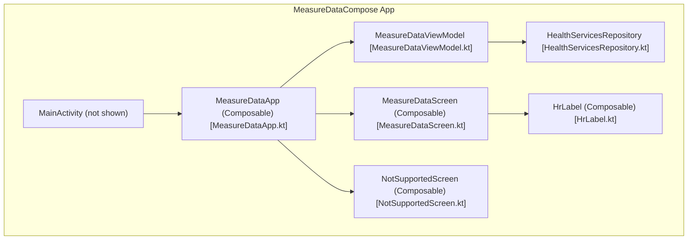
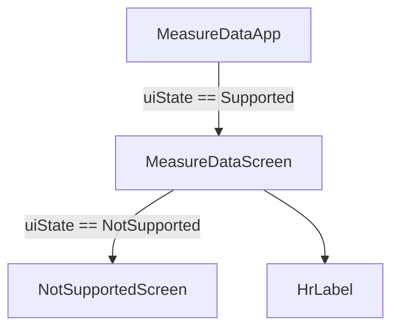

<!-- source: DeepWiki mcp.deepwiki.com · repo android/health-samples · page 2.2 MeasureDataCompose · fetched 2026-10-23 -->

# MeasureDataCompose

<details>
<summary>Relevant source files</summary>

The following files were used as context for generating this wiki page:

- [health-connect/HealthConnectSample/build.gradle](health-connect/HealthConnectSample/build.gradle)
- [health-platform-v1/HealthPlatformSample/build.gradle](health-platform-v1/HealthPlatformSample/build.gradle)
- [health-services/ExerciseSampleCompose/gradle/libs.versions.toml](health-services/ExerciseSampleCompose/gradle/libs.versions.toml)
- [health-services/MeasureDataCompose/app/build.gradle.kts](health-services/MeasureDataCompose/app/build.gradle.kts)
- [health-services/MeasureDataCompose/app/src/main/java/com/example/measuredatacompose/data/HealthServicesRepository.kt](health-services/MeasureDataCompose/app/src/main/java/com/example/measuredatacompose/data/HealthServicesRepository.kt)
- [health-services/MeasureDataCompose/app/src/main/java/com/example/measuredatacompose/presentation/HrLabel.kt](health-services/MeasureDataCompose/app/src/main/java/com/example/measuredatacompose/presentation/HrLabel.kt)
- [health-services/MeasureDataCompose/app/src/main/java/com/example/measuredatacompose/presentation/MeasureDataApp.kt](health-services/MeasureDataCompose/app/src/main/java/com/example/measuredatacompose/presentation/MeasureDataApp.kt)
- [health-services/MeasureDataCompose/app/src/main/java/com/example/measuredatacompose/presentation/MeasureDataScreen.kt](health-services/MeasureDataCompose/app/src/main/java/com/example/measuredatacompose/presentation/MeasureDataScreen.kt)
- [health-services/MeasureDataCompose/app/src/main/java/com/example/measuredatacompose/presentation/MeasureDataViewModel.kt](health-services/MeasureDataCompose/app/src/main/java/com/example/measuredatacompose/presentation/MeasureDataViewModel.kt)
- [health-services/MeasureDataCompose/app/src/main/java/com/example/measuredatacompose/presentation/NotSupportedScreen.kt](health-services/MeasureDataCompose/app/src/main/java/com/example/measuredatacompose/presentation/NotSupportedScreen.kt)
- [health-services/MeasureDataCompose/app/src/main/java/com/example/measuredatacompose/theme/Theme.kt](health-services/MeasureDataCompose/app/src/main/java/com/example/measuredatacompose/theme/Theme.kt)
- [health-services/MeasureDataCompose/build.gradle.kts](health-services/MeasureDataCompose/build.gradle.kts)
- [health-services/MeasureDataCompose/gradle/libs.versions.toml](health-services/MeasureDataCompose/gradle/libs.versions.toml)
- [health-services/PassiveDataCompose/gradle/libs.versions.toml](health-services/PassiveDataCompose/gradle/libs.versions.toml)
- [health-services/PassiveGoalsCompose/gradle/libs.versions.toml](health-services/PassiveGoalsCompose/gradle/libs.versions.toml)

</details>


## Purpose and Scope

This document provides a technical overview of the **MeasureDataCompose** sample application in the [`android/health-samples`](#1) repository. MeasureDataCompose demonstrates how to perform **on-demand heart rate measurement** on Wear OS devices using the [androidx.health.services](https://developer.android.com/reference/androidx/health/services/package-summary) API, specifically the `MeasureClient`. The sample is focused on a single, simple use case: requesting a heart rate reading from the device's sensor and displaying it in a Compose-based UI.

This page covers:
- The system architecture and data flow of MeasureDataCompose
- Key code entities and their responsibilities
- UI structure and user interaction
- Permission handling and state management

For information about other Health Services samples, see:
- [ExerciseSampleCompose (active exercise tracking)](#2.1)
- [PassiveDataCompose (background data collection)](#2.3)
- [PassiveGoalsCompose (goal monitoring)](#2.4)

---

## System Overview

MeasureDataCompose is a **single-screen Wear OS sample** that demonstrates how to:
- Check for heart rate sensor support
- Request runtime permissions
- Start and stop on-demand heart rate measurement
- Display the latest heart rate value and sensor availability

The sample uses the following architectural patterns and technologies:
- **MVVM** (Model-View-ViewModel) for state management
- **Kotlin Coroutines** and **Flow** for asynchronous data streams
- **Jetpack Compose** (Material3 for Wear) for UI
- **Accompanist Permissions** for runtime permission handling

### Diagram: High-Level System and Code Entities


**Sources:**  
- [health-services/MeasureDataCompose/app/src/main/java/com/example/measuredatacompose/presentation/MeasureDataApp.kt:16-69]()
- [health-services/MeasureDataCompose/app/src/main/java/com/example/measuredatacompose/presentation/MeasureDataViewModel.kt:30-77]()
- [health-services/MeasureDataCompose/app/src/main/java/com/example/measuredatacompose/data/HealthServicesRepository.kt:39-84]()
- [health-services/MeasureDataCompose/app/src/main/java/com/example/measuredatacompose/presentation/MeasureDataScreen.kt:41-79]()
- [health-services/MeasureDataCompose/app/src/main/java/com/example/measuredatacompose/presentation/HrLabel.kt:41-74]()
- [health-services/MeasureDataCompose/app/src/main/java/com/example/measuredatacompose/presentation/NotSupportedScreen.kt:39-57]()

---

## Data Flow and State Management

### Data Flow Description

1. **Startup**: On launch, the app checks if the device supports heart rate measurement.
2. **Permission Handling**: The app requests the necessary runtime permission (`ACTIVITY_RECOGNITION`) before starting measurement.
3. **Measurement**: When the user taps "Start", the app subscribes to heart rate data using a Kotlin Flow bridged from the callback-based Health Services API.
4. **UI Update**: The latest heart rate value and sensor availability are displayed in real time.
5. **Stop**: Tapping "Stop" unsubscribes from the measurement.

### Diagram: Data Flow and State Transitions

```mermaid
stateDiagram-v2
    [*] --> "UiState.Startup"
    "UiState.Startup" --> "UiState.Supported" : hasHeartRateCapability() == true
    "UiState.Startup" --> "UiState.NotSupported" : hasHeartRateCapability() == false

    "UiState.Supported" --> "Measuring" : Permission granted + Start
    "Measuring" --> "UiState.Supported" : Stop

    state "Measuring" {
        [*] --> "Collecting HR"
        "Collecting HR" --> "Collecting HR" : New data from heartRateMeasureFlow()
    }
```
**Sources:**  
- [health-services/MeasureDataCompose/app/src/main/java/com/example/measuredatacompose/presentation/MeasureDataViewModel.kt:41-69]()
- [health-services/MeasureDataCompose/app/src/main/java/com/example/measuredatacompose/data/HealthServicesRepository.kt:43-84]()

---

## Key Code Entities

| Entity | Type | Responsibility | File |
|--------|------|----------------|------|
| `HealthServicesRepository` | Class | Wraps Health Services API, exposes `hasHeartRateCapability()` and `heartRateMeasureFlow()` | [HealthServicesRepository.kt](health-services/MeasureDataCompose/app/src/main/java/com/example/measuredatacompose/data/HealthServicesRepository.kt) |
| `MeasureDataViewModel` | ViewModel | Manages UI state, permission state, and measurement lifecycle | [MeasureDataViewModel.kt](health-services/MeasureDataCompose/app/src/main/java/com/example/measuredatacompose/presentation/MeasureDataViewModel.kt) |
| `UiState` | Sealed class | Represents app state: `Startup`, `Supported`, `NotSupported` | [MeasureDataViewModel.kt](health-services/MeasureDataCompose/app/src/main/java/com/example/measuredatacompose/presentation/MeasureDataViewModel.kt) |
| `MeasureDataApp` | Composable | Top-level UI, wires ViewModel and screens | [MeasureDataApp.kt](health-services/MeasureDataCompose/app/src/main/java/com/example/measuredatacompose/presentation/MeasureDataApp.kt) |
| `MeasureDataScreen` | Composable | Main screen for measurement and user interaction | [MeasureDataScreen.kt](health-services/MeasureDataCompose/app/src/main/java/com/example/measuredatacompose/presentation/MeasureDataScreen.kt) |
| `HrLabel` | Composable | Displays heart rate value and sensor status | [HrLabel.kt](health-services/MeasureDataCompose/app/src/main/java/com/example/measuredatacompose/presentation/HrLabel.kt) |
| `NotSupportedScreen` | Composable | Shown if device lacks heart rate support | [NotSupportedScreen.kt](health-services/MeasureDataCompose/app/src/main/java/com/example/measuredatacompose/presentation/NotSupportedScreen.kt) |

**Sources:**  
- [health-services/MeasureDataCompose/app/src/main/java/com/example/measuredatacompose/data/HealthServicesRepository.kt:39-90]()
- [health-services/MeasureDataCompose/app/src/main/java/com/example/measuredatacompose/presentation/MeasureDataViewModel.kt:30-97]()
- [health-services/MeasureDataCompose/app/src/main/java/com/example/measuredatacompose/presentation/MeasureDataApp.kt:33-69]()
- [health-services/MeasureDataCompose/app/src/main/java/com/example/measuredatacompose/presentation/MeasureDataScreen.kt:41-79]()
- [health-services/MeasureDataCompose/app/src/main/java/com/example/measuredatacompose/presentation/HrLabel.kt:41-74]()
- [health-services/MeasureDataCompose/app/src/main/java/com/example/measuredatacompose/presentation/NotSupportedScreen.kt:39-57]()

---

## UI Structure and User Interaction

### UI Flow

- **Startup**: The app checks for heart rate support and displays either the measurement screen or a "Not Supported" message.
- **Measurement Screen**: Shows the current heart rate (or a placeholder if unavailable), a button to start/stop measurement, and handles permission requests.
- **Not Supported Screen**: Displays a warning icon and message if the device does not support heart rate measurement.

### Diagram: UI Composables and State


**Sources:**  
- [health-services/MeasureDataCompose/app/src/main/java/com/example/measuredatacompose/presentation/MeasureDataApp.kt:33-69]()
- [health-services/MeasureDataCompose/app/src/main/java/com/example/measuredatacompose/presentation/MeasureDataScreen.kt:41-79]()
- [health-services/MeasureDataCompose/app/src/main/java/com/example/measuredatacompose/presentation/HrLabel.kt:41-74]()
- [health-services/MeasureDataCompose/app/src/main/java/com/example/measuredatacompose/presentation/NotSupportedScreen.kt:39-57]()

---

## Permission Handling

MeasureDataCompose uses the **Accompanist Permissions** library to request and manage runtime permissions for heart rate measurement. The required permission is typically `android.permission.BODY_SENSORS` or `android.permission.ACTIVITY_RECOGNITION`, depending on the device and API level.

- The permission is checked before starting measurement.
- If not granted, the app prompts the user.
- On permission grant, measurement starts automatically.

**Sources:**  
- [health-services/MeasureDataCompose/app/src/main/java/com/example/measuredatacompose/presentation/MeasureDataApp.kt:51-56]()
- [health-services/MeasureDataCompose/app/src/main/java/com/example/measuredatacompose/presentation/MeasureDataScreen.kt:60-64]()

For more on permission handling patterns, see [Permission Handling](#8.1).

---

## Build and Dependencies

MeasureDataCompose uses the following key dependencies:

| Library | Purpose |
|---------|---------|
| `androidx.health:health-services-client` | Access Health Services API |
| `androidx.wear.compose:compose-material3` | Wear OS Material3 UI components |
| `com.google.accompanist:accompanist-permissions` | Runtime permission handling |
| `androidx.lifecycle:lifecycle-viewmodel-compose` | ViewModel integration with Compose |
| `androidx.compose.material:material-icons-extended` | Material icons for Compose |
| `androidx.concurrent:concurrent-futures-ktx` | Futures support for coroutines |
| `com.google.guava:guava` | Utility library (Futures) |

See [health-services/MeasureDataCompose/gradle/libs.versions.toml]() and [health-services/MeasureDataCompose/app/build.gradle.kts]() for the full list.

**Sources:**  
- [health-services/MeasureDataCompose/gradle/libs.versions.toml:1-39]()
- [health-services/MeasureDataCompose/app/build.gradle.kts:63-86]()

---

## Summary

MeasureDataCompose is a focused, single-purpose Wear OS sample that demonstrates best practices for on-demand sensor measurement using the Health Services API, Compose UI, and modern Android architecture. It is intended as a reference for developers seeking to implement simple, real-time health data collection in their own Wear OS applications.

**Sources:**  
- All files cited above.

---

