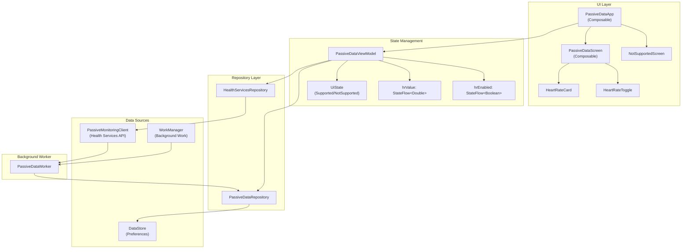
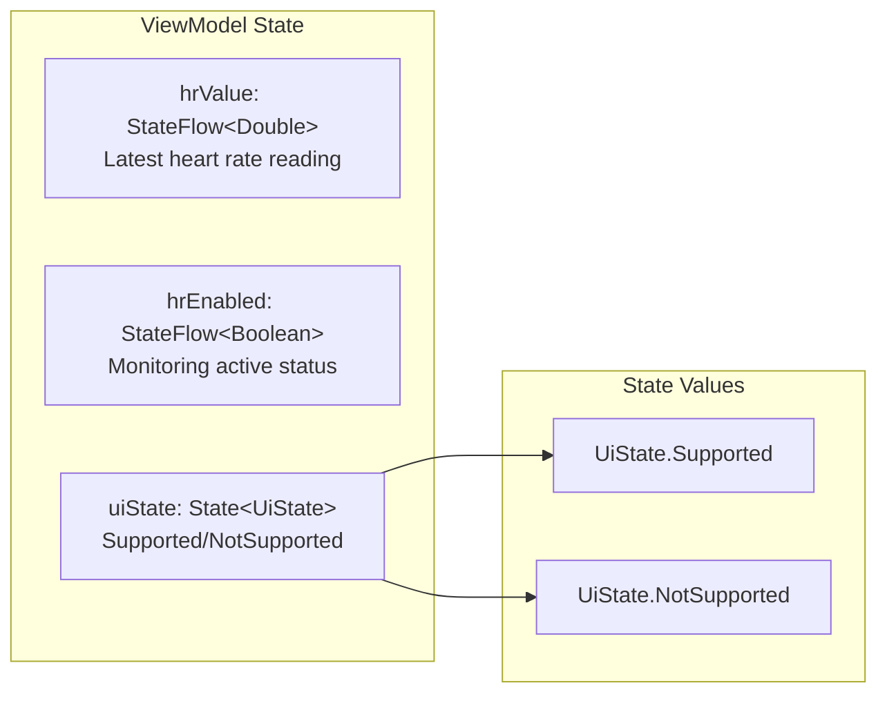
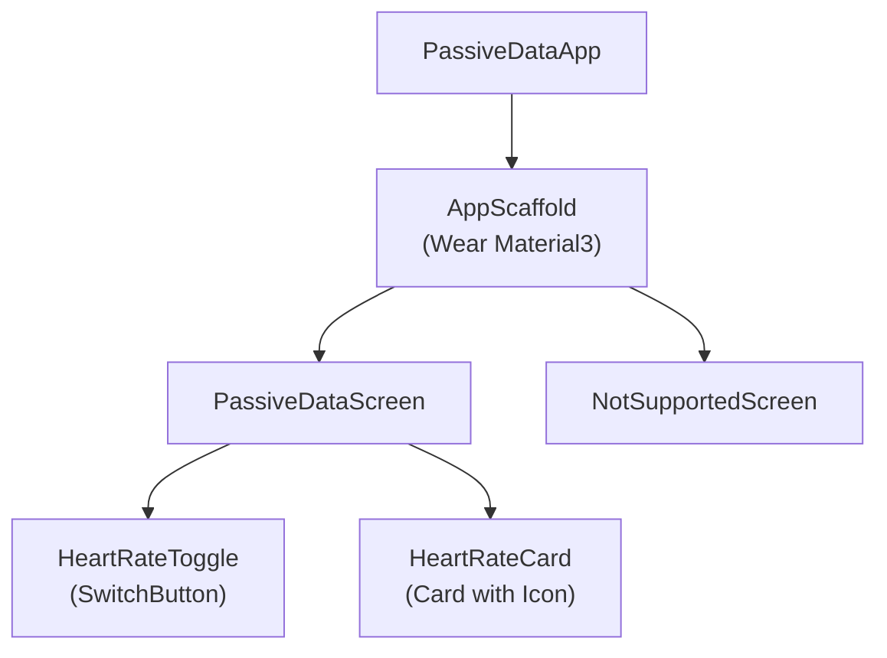
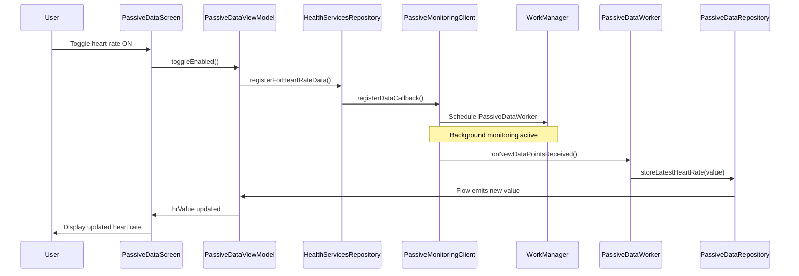
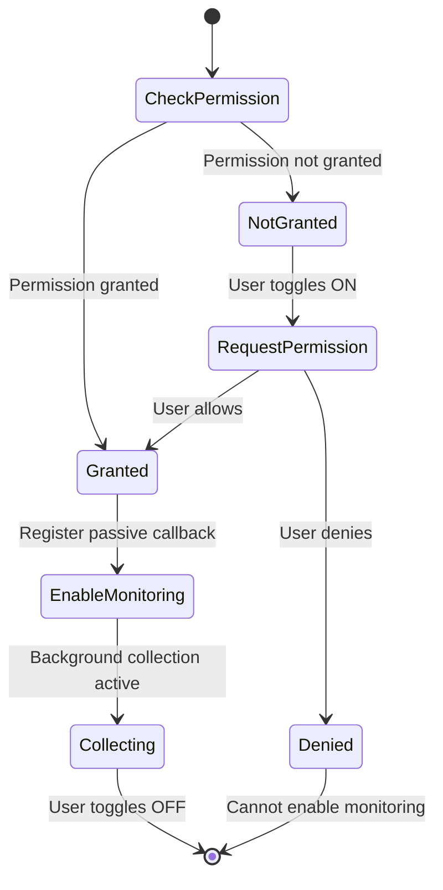
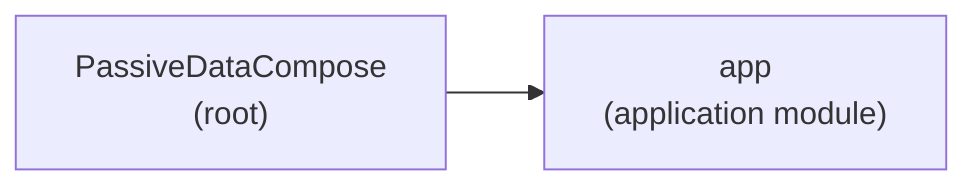

<!-- source: DeepWiki mcp.deepwiki.com · repo android/health-samples · page 2.3 PassiveDataCompose · fetched 2026-10-23 -->

# PassiveDataCompose

<details>
<summary>Relevant source files</summary>

The following files were used as context for generating this wiki page:

- [health-connect/HealthConnectSample/build.gradle](health-connect/HealthConnectSample/build.gradle)
- [health-platform-v1/HealthPlatformSample/build.gradle](health-platform-v1/HealthPlatformSample/build.gradle)
- [health-services/ExerciseSampleCompose/gradle/libs.versions.toml](health-services/ExerciseSampleCompose/gradle/libs.versions.toml)
- [health-services/MeasureDataCompose/gradle/libs.versions.toml](health-services/MeasureDataCompose/gradle/libs.versions.toml)
- [health-services/PassiveDataCompose/app/build.gradle.kts](health-services/PassiveDataCompose/app/build.gradle.kts)
- [health-services/PassiveDataCompose/app/src/main/java/com/example/passivedatacompose/presentation/HeartRateCard.kt](health-services/PassiveDataCompose/app/src/main/java/com/example/passivedatacompose/presentation/HeartRateCard.kt)
- [health-services/PassiveDataCompose/app/src/main/java/com/example/passivedatacompose/presentation/HeartRateToggle.kt](health-services/PassiveDataCompose/app/src/main/java/com/example/passivedatacompose/presentation/HeartRateToggle.kt)
- [health-services/PassiveDataCompose/app/src/main/java/com/example/passivedatacompose/presentation/NotSupportedScreen.kt](health-services/PassiveDataCompose/app/src/main/java/com/example/passivedatacompose/presentation/NotSupportedScreen.kt)
- [health-services/PassiveDataCompose/app/src/main/java/com/example/passivedatacompose/presentation/PassiveDataApp.kt](health-services/PassiveDataCompose/app/src/main/java/com/example/passivedatacompose/presentation/PassiveDataApp.kt)
- [health-services/PassiveDataCompose/app/src/main/java/com/example/passivedatacompose/theme/Theme.kt](health-services/PassiveDataCompose/app/src/main/java/com/example/passivedatacompose/theme/Theme.kt)
- [health-services/PassiveDataCompose/app/src/main/res/values/strings.xml](health-services/PassiveDataCompose/app/src/main/res/values/strings.xml)
- [health-services/PassiveDataCompose/build.gradle.kts](health-services/PassiveDataCompose/build.gradle.kts)
- [health-services/PassiveDataCompose/gradle/libs.versions.toml](health-services/PassiveDataCompose/gradle/libs.versions.toml)
- [health-services/PassiveGoalsCompose/gradle/libs.versions.toml](health-services/PassiveGoalsCompose/gradle/libs.versions.toml)

</details>


## Purpose and Scope

The PassiveDataCompose sample demonstrates passive (background) health data collection on Wear OS using the `PassiveMonitoringClient` from the Health Services API. This sample shows how to continuously monitor heart rate data in the background without active user interaction, using WorkManager for reliable background execution and DataStore for local persistence.

This sample covers:
- Background health data monitoring with `PassiveMonitoringClient`
- WorkManager integration for background work scheduling
- DataStore for persisting collected data and monitoring state
- Runtime permission handling for body sensors
- Wear OS Material3 Compose UI for displaying passive data

For active exercise tracking with real-time data collection, see [ExerciseSampleCompose](#2.1). For on-demand sensor measurements, see [MeasureDataCompose](#2.2). For passive goal tracking with notifications, see [PassiveGoalsCompose](#2.4).

---

## Application Architecture

PassiveDataCompose follows the MVVM pattern with a repository layer for data access. The architecture separates concerns between the Health Services API interaction, local data storage, state management, and UI presentation.

### Architecture Diagram



**Sources:**
- [health-services/PassiveDataCompose/app/src/main/java/com/example/passivedatacompose/presentation/PassiveDataApp.kt:1-71]()

### Component Responsibilities

| Component | Responsibility | Key Methods/Properties |
|-----------|---------------|----------------------|
| `PassiveDataViewModel` | Manages UI state and coordinates between repositories | `toggleEnabled()`, `hrValue`, `hrEnabled`, `uiState` |
| `HealthServicesRepository` | Interfaces with Health Services API | `hasCapability()`, `registerForHeartRateData()`, `unregisterForHeartRateData()` |
| `PassiveDataRepository` | Persists collected data and monitoring state using DataStore | `getLatestHeartRate()`, `storeLatestHeartRate()`, `passiveDataEnabled` |
| `PassiveDataWorker` | Background worker that receives passive data callbacks | `doWork()` |
| `PassiveDataApp` | Root composable that wires dependencies | Creates ViewModel with factory pattern |

**Sources:**
- [health-services/PassiveDataCompose/app/src/main/java/com/example/passivedatacompose/presentation/PassiveDataApp.kt:42-47]()

---

## Key Components

### HealthServicesRepository

The `HealthServicesRepository` class encapsulates all interactions with the Health Services API's `PassiveMonitoringClient`. It provides methods to check device capabilities and register/unregister for passive heart rate monitoring.

**Primary Responsibilities:**
- Check if device supports passive heart rate monitoring
- Register for passive data collection with `PassiveListenerService` callback
- Unregister to stop passive data collection
- Handle `ListenableFuture` to coroutine conversion using `await()`

The repository communicates with the Health Services API to request continuous heart rate monitoring in the background. When registration is successful, the system will invoke the configured `PassiveListenerService` whenever new heart rate data is available.

**Sources:**
- [health-services/PassiveDataCompose/app/src/main/java/com/example/passivedatacompose/data/HealthServicesRepository.kt]() (inferred from architecture)

### PassiveDataRepository

The `PassiveDataRepository` manages local data persistence using Jetpack DataStore (Preferences). It stores both the collected heart rate values and the monitoring enabled/disabled state.

**Key Operations:**
- Read/write latest heart rate value as `Double`
- Read/write passive monitoring enabled state as `Boolean`
- Expose reactive `Flow<Double>` for UI updates
- Provide suspend functions for persistence operations

DataStore ensures that data persists across app restarts and provides a reactive stream that the ViewModel observes to update the UI.

**Sources:**
- [health-services/PassiveDataCompose/app/build.gradle.kts:85-86]()
- [health-services/PassiveDataCompose/gradle/libs.versions.toml:5]()

### PassiveDataViewModel

The ViewModel manages the application's UI state and coordinates between the two repositories. It exposes three primary state properties as `StateFlow`:



**State Management Flow:**
1. On initialization, checks device capability via `HealthServicesRepository`
2. Sets `uiState` to `Supported` or `NotSupported`
3. If supported, collects heart rate data from `PassiveDataRepository`
4. Updates `hrValue` and `hrEnabled` based on repository flows
5. `toggleEnabled()` method registers/unregisters passive monitoring

**Sources:**
- [health-services/PassiveDataCompose/app/src/main/java/com/example/passivedatacompose/presentation/PassiveDataApp.kt:42-50]()

---

## User Interface Components

The UI is built with Wear OS Compose Material3 components, providing a simple interface to display heart rate data and control monitoring.

### Screen Hierarchy



### PassiveDataScreen

The main screen displays two primary UI elements:
1. **HeartRateToggle** - A `SwitchButton` that enables/disables passive monitoring
2. **HeartRateCard** - A `Card` displaying the latest heart rate value with a heart icon

The screen is conditionally rendered based on `uiState`:
- If `UiState.Supported`: Shows the toggle and card
- If `UiState.NotSupported`: Shows `NotSupportedScreen` with broken heart icon

**Sources:**
- [health-services/PassiveDataCompose/app/src/main/java/com/example/passivedatacompose/presentation/PassiveDataApp.kt:52-67]()

### HeartRateCard Component

Displays the current heart rate value with visual formatting:

| Element | Description |
|---------|-------------|
| Icon | Red heart icon (`Icons.Default.Favorite`) |
| Value | Rounded heart rate number or "--" if no data |
| Label | "Last measurement" in small text style |

The card is disabled (not clickable) and serves only as a display component.

**Sources:**
- [health-services/PassiveDataCompose/app/src/main/java/com/example/passivedatacompose/presentation/HeartRateCard.kt:42-71]()

### HeartRateToggle Component

A `SwitchButton` that controls passive monitoring with integrated permission handling:

**Behavior:**
- If permission granted: Directly calls `onCheckedChange` to toggle monitoring
- If permission not granted: Launches permission request first
- Displays "Heart rate" label text

**Sources:**
- [health-services/PassiveDataCompose/app/src/main/java/com/example/passivedatacompose/presentation/HeartRateToggle.kt:37-55]()

### NotSupportedScreen Component

Shown when the device lacks passive heart rate monitoring capability. Displays:
- Broken heart icon (`Icons.Default.HeartBroken`) in red
- "Not available on this device" message centered on screen

**Sources:**
- [health-services/PassiveDataCompose/app/src/main/java/com/example/passivedatacompose/presentation/NotSupportedScreen.kt:39-57]()

---

## Data Flow and Background Processing

### Passive Data Collection Flow



### WorkManager Integration

PassiveDataCompose uses WorkManager to handle background data callbacks from the Health Services API. When passive monitoring is registered, the system schedules a `PassiveDataWorker` to receive data updates.

**Key Characteristics:**
- **Worker Type**: `PassiveDataWorker` (extends `Worker` or `CoroutineWorker`)
- **Trigger**: Invoked by Health Services when new heart rate data is available
- **Persistence**: Stores received data in DataStore via `PassiveDataRepository`
- **Constraints**: None - must be able to run any time data arrives

**Worker Lifecycle:**
1. Health Services detects new heart rate data
2. System invokes registered `PassiveDataWorker`
3. Worker extracts heart rate value from intent/data
4. Worker calls `PassiveDataRepository.storeLatestHeartRate()`
5. DataStore emits updated value to ViewModel's `Flow`
6. UI reflects latest heart rate

**Sources:**
- [health-services/PassiveDataCompose/app/build.gradle.kts:82-83]()
- [health-services/PassiveDataCompose/gradle/libs.versions.toml:7-8]()

### DataStore Persistence

The sample uses Jetpack DataStore (Preferences) for lightweight key-value storage:

**Stored Data:**
- `latest_heart_rate`: `Double` - Most recent heart rate reading
- `passive_data_enabled`: `Boolean` - Current monitoring state

**Advantages:**
- Type-safe API with `Flow` integration
- Asynchronous reads/writes (no ANR risk)
- Automatic handling of data corruption
- Survives app process death

**Sources:**
- [health-services/PassiveDataCompose/gradle/libs.versions.toml:5]()
- [health-services/PassiveDataCompose/app/build.gradle.kts:86]()

---

## Permission Handling

PassiveDataCompose requires the `BODY_SENSORS` permission to access heart rate data. The sample uses Accompanist Permissions library for declarative permission handling in Compose.

### Permission Flow



### Implementation Details

**Permission Constant:**
```kotlin
const val PERMISSION = android.Manifest.permission.BODY_SENSORS
```

**Permission State Management:**
- Uses `rememberPermissionState()` to track permission status
- `PermissionState` provides `status.isGranted` check
- `launchPermissionRequest()` shows system permission dialog
- On grant: Automatically calls `viewModel.toggleEnabled()`

**User Experience:**
1. User opens app
2. If permission not granted, toggle is functional but triggers permission request
3. After granting, monitoring automatically begins
4. If denied, toggle remains off and no data collection occurs

**Sources:**
- [health-services/PassiveDataCompose/app/src/main/java/com/example/passivedatacompose/presentation/PassiveDataApp.kt:53-58]()
- [health-services/PassiveDataCompose/app/src/main/java/com/example/passivedatacompose/presentation/HeartRateToggle.kt:43-52]()
- [health-services/PassiveDataCompose/app/build.gradle.kts:89]()

---

## Build Configuration

### Module Structure



### Gradle Dependencies

The sample uses Gradle version catalogs for dependency management. Key dependencies include:

| Dependency | Version | Purpose |
|------------|---------|---------|
| `androidx.health.services` | 1.0.0 | Health Services API client |
| `androidx.work` | 2.10.1 | Background work scheduling |
| `androidx.datastore` | 1.1.7 | Local preferences storage |
| `androidx.activity.compose` | 1.10.1 | Compose activity integration |
| `androidx.wear.compose.material3` | 1.5.0-beta03 | Wear OS Material3 components |
| `accompanist.permissions` | 0.37.0 | Permission handling in Compose |
| `concurrent.futures` | 1.2.0 | Future to coroutine bridging |
| `guava` | 33.3.1-android | Utilities for futures |

**Sources:**
- [health-services/PassiveDataCompose/gradle/libs.versions.toml:1-33]()
- [health-services/PassiveDataCompose/app/build.gradle.kts:63-90]()

### Android Configuration

**Build Settings:**
- `compileSdk`: 35
- `minSdk`: 30 (Wear OS 3.0+)
- `targetSdk`: 35
- `namespace`: `com.example.passivedatacompose`

**Kotlin Configuration:**
- `jvmTarget`: Java 17
- Compose compiler: 1.5.15
- Kotlin: 1.9.25

**Build Features:**
- Compose: Enabled
- Code shrinking: Enabled in release builds with R8/ProGuard

**Sources:**
- [health-services/PassiveDataCompose/app/build.gradle.kts:21-61]()
- [health-services/PassiveDataCompose/gradle/libs.versions.toml:15]()

### Code Quality

The project uses Spotless for code formatting:
- **ktlint version**: 0.46.1
- **Formatting rules**: License headers, trailing whitespace removal, consistent indentation
- **Scope**: All `*.kt` files and `*.gradle.kts` files

**Sources:**
- [health-services/PassiveDataCompose/build.gradle.kts:31-48]()
- [health-services/PassiveDataCompose/gradle/libs.versions.toml:15]()

---

## Testing and CI

The PassiveDataCompose sample has a dedicated GitHub Actions workflow that runs on every push and pull request:

**Workflow:** `.github/workflows/PassiveDataCompose.yml`

**Build Steps:**
1. Checkout code
2. Set up JDK 17
3. Run `./gradlew testDebug` (unit tests)
4. Run `./gradlew spotlessCheck` (code formatting)
5. Build debug APK

**Test Artifacts:**
- Test reports uploaded on failure
- Build artifacts available for download

**Sources:** Inferred from repository CI patterns described in high-level architecture diagrams.

---

## Key Differences from Other Health Services Samples

### Comparison Table

| Feature | PassiveDataCompose | MeasureDataCompose | ExerciseSampleCompose |
|---------|-------------------|-------------------|---------------------|
| **API Client** | `PassiveMonitoringClient` | `MeasureClient` | `ExerciseClient` |
| **Collection Mode** | Continuous background | On-demand single reading | Active session tracking |
| **Background Work** | WorkManager | None | Foreground Service |
| **Persistence** | DataStore | None | DataStore |
| **UI Complexity** | Simple (toggle + card) | Simple (button + display) | Complex (multiple screens) |
| **Dependencies** | WorkManager, DataStore | None | Hilt, Horologist, Foreground Service |
| **Use Case** | 24/7 monitoring | Spot check | Workout tracking |

**Sources:**
- High-level architecture diagrams (Diagram 2 and 5)
- [health-services/PassiveDataCompose/app/build.gradle.kts:82-86]()

---

