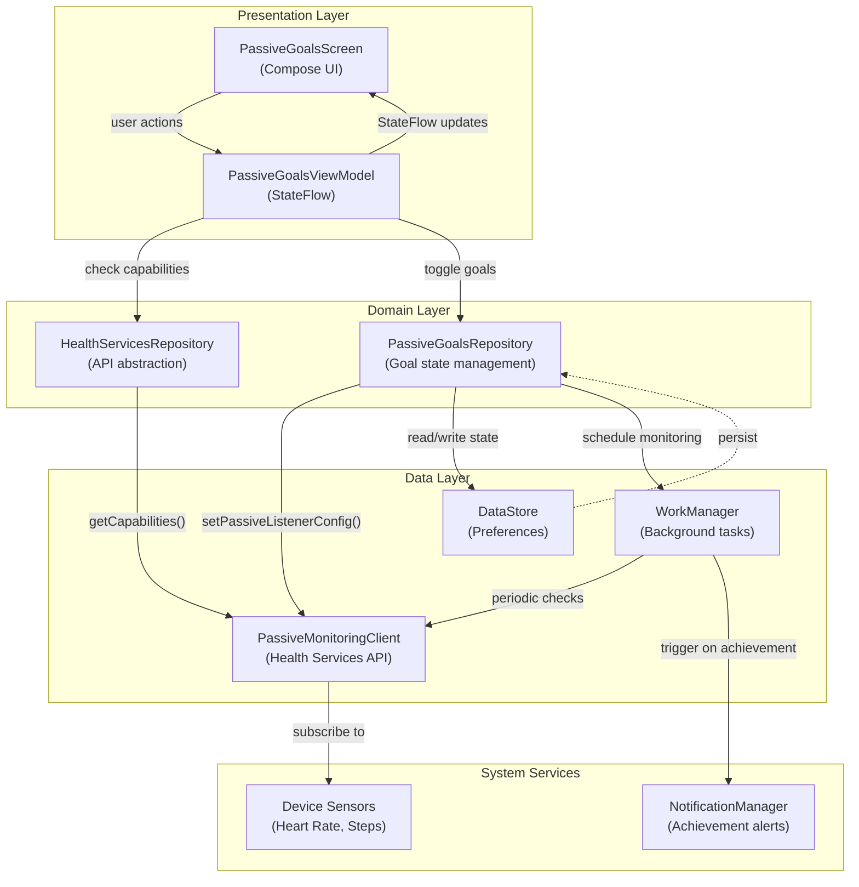
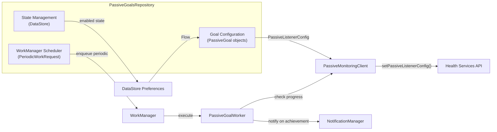
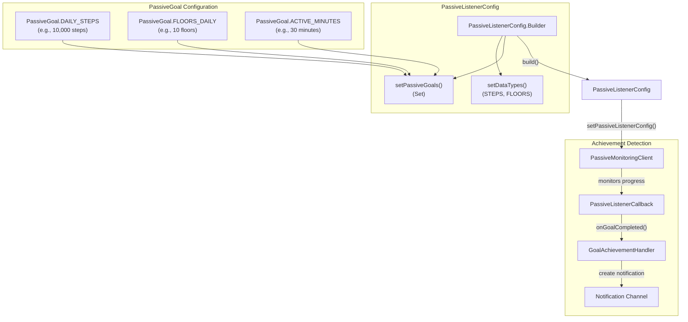
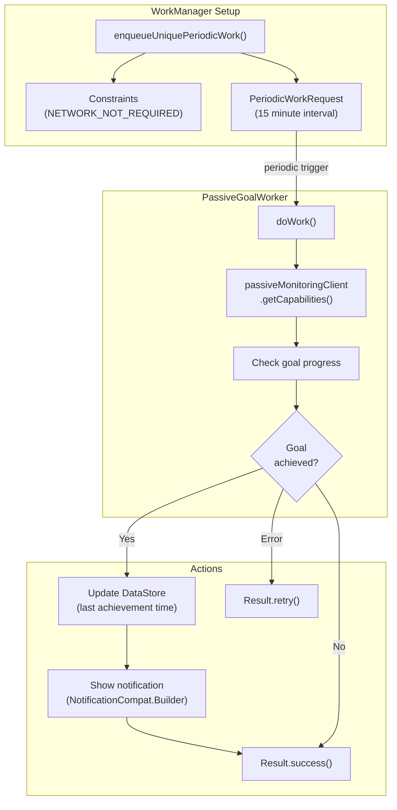
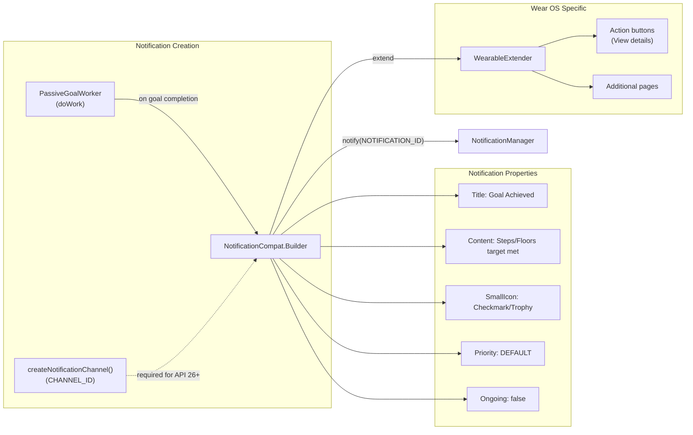
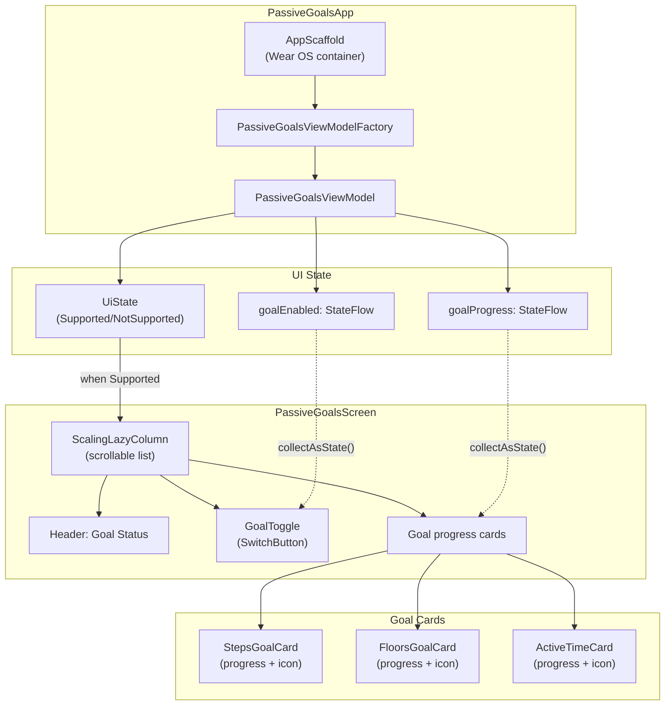
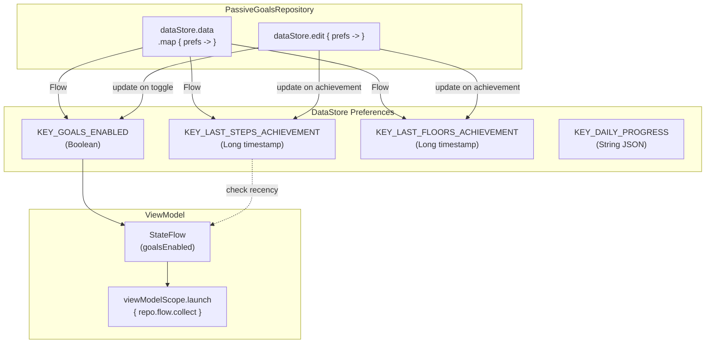
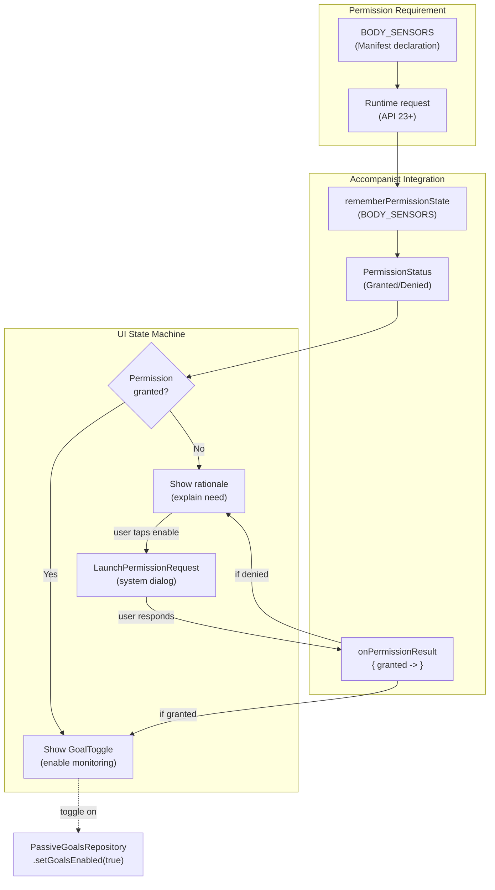

<!-- source: DeepWiki mcp.deepwiki.com · repo android/health-samples · page 2.4 PassiveGoalsCompose · fetched 2026-10-23 -->

# PassiveGoalsCompose

Relevant source files

The following files were used as context for generating this wiki page:

- [health-connect/HealthConnectSample/build.gradle](health-connect/HealthConnectSample/build.gradle)
- [health-platform-v1/HealthPlatformSample/build.gradle](health-platform-v1/HealthPlatformSample/build.gradle)
- [health-services/ExerciseSampleCompose/gradle/libs.versions.toml](health-services/ExerciseSampleCompose/gradle/libs.versions.toml)
- [health-services/MeasureDataCompose/gradle/libs.versions.toml](health-services/MeasureDataCompose/gradle/libs.versions.toml)
- [health-services/PassiveDataCompose/app/build.gradle.kts](health-services/PassiveDataCompose/app/build.gradle.kts)
- [health-services/PassiveDataCompose/app/src/main/java/com/example/passivedatacompose/presentation/HeartRateCard.kt](health-services/PassiveDataCompose/app/src/main/java/com/example/passivedatacompose/presentation/HeartRateCard.kt)
- [health-services/PassiveDataCompose/app/src/main/java/com/example/passivedatacompose/presentation/HeartRateToggle.kt](health-services/PassiveDataCompose/app/src/main/java/com/example/passivedatacompose/presentation/HeartRateToggle.kt)
- [health-services/PassiveDataCompose/app/src/main/java/com/example/passivedatacompose/presentation/NotSupportedScreen.kt](health-services/PassiveDataCompose/app/src/main/java/com/example/passivedatacompose/presentation/NotSupportedScreen.kt)
- [health-services/PassiveDataCompose/app/src/main/java/com/example/passivedatacompose/presentation/PassiveDataApp.kt](health-services/PassiveDataCompose/app/src/main/java/com/example/passivedatacompose/presentation/PassiveDataApp.kt)
- [health-services/PassiveDataCompose/app/src/main/java/com/example/passivedatacompose/theme/Theme.kt](health-services/PassiveDataCompose/app/src/main/java/com/example/passivedatacompose/theme/Theme.kt)
- [health-services/PassiveDataCompose/app/src/main/res/values/strings.xml](health-services/PassiveDataCompose/app/src/main/res/values/strings.xml)
- [health-services/PassiveDataCompose/build.gradle.kts](health-services/PassiveDataCompose/build.gradle.kts)
- [health-services/PassiveDataCompose/gradle/libs.versions.toml](health-services/PassiveDataCompose/gradle/libs.versions.toml)
- [health-services/PassiveGoalsCompose/gradle/libs.versions.toml](health-services/PassiveGoalsCompose/gradle/libs.versions.toml)

## Purpose and Scope

PassiveGoalsCompose is a Wear OS sample application demonstrating passive health goal tracking using the Health Services API. This sample shows how to configure background health data collection with achievement thresholds, monitor progress towards goals, and notify users when goals are met.

The sample illustrates:
- Configuring passive data goals using `PassiveMonitoringClient`
- Background goal monitoring with WorkManager
- Persistent goal state management with DataStore
- Achievement notifications
- Jetpack Compose UI for Wear OS with Material3

For general passive data collection without goal tracking, see [PassiveDataCompose](#2.3). For active exercise tracking with real-time goals, see [ExerciseSampleCompose](#2.1).

**Sources:** [health-services/PassiveGoalsCompose/gradle/libs.versions.toml:1-44]()

---

## Application Architecture

PassiveGoalsCompose follows the MVVM (Model-View-ViewModel) architectural pattern with a repository layer for Health Services API interactions. The application uses Jetpack Compose for UI, WorkManager for background processing, and DataStore for persistent state management.

### Architecture Overview

**Sources:** [health-services/PassiveGoalsCompose/gradle/libs.versions.toml:21-38](), [health-services/PassiveDataCompose/app/src/main/java/com/example/passivedatacompose/presentation/PassiveDataApp.kt:34-70]()

---

## Core Components

### HealthServicesRepository

The `HealthServicesRepository` provides an abstraction over the Health Services API, checking device capabilities and managing the `PassiveMonitoringClient` lifecycle.

**Key Responsibilities:**
- Initialize `PassiveMonitoringClient` from `HealthServicesClient`
- Query device capabilities (`PASSIVE_GOALS` support)
- Provide suspend functions for coroutine-based operations

### PassiveGoalsRepository

The `PassiveGoalsRepository` manages goal configuration, state persistence, and WorkManager scheduling for background monitoring.

**Key Methods:**
- `setGoalsEnabled(enabled: Boolean)` - Configures passive goals or clears monitoring
- `isGoalsEnabled(): Flow<Boolean>` - Exposes goal state as reactive Flow
- `scheduleWorker()` - Enqueues periodic WorkManager task

**Sources:** [health-services/PassiveGoalsCompose/gradle/libs.versions.toml:5-8](), [health-services/PassiveGoalsCompose/gradle/libs.versions.toml:24-28]()

---

## Goal Configuration and Monitoring

PassiveGoalsCompose configures health goals using the `PassiveGoal` API, which defines achievement thresholds for passive data types.

### Goal Types Configuration

**Configuration Flow:**
1. Create `PassiveGoal` instances with achievement thresholds
2. Build `PassiveListenerConfig` with goals and required data types
3. Register config via `PassiveMonitoringClient.setPassiveListenerConfig()`
4. Health Services monitors data in background
5. Callback triggered when goal threshold met

**Sources:** [health-services/PassiveGoalsCompose/gradle/libs.versions.toml:25]()

---

## Background Processing with WorkManager

PassiveGoalsCompose uses WorkManager to periodically check goal progress and handle achievement notifications. This ensures monitoring continues even when the app is not in the foreground.

### WorkManager Integration

**Worker Configuration:**
| Property | Value | Purpose |
|----------|-------|---------|
| **Work Type** | `PeriodicWorkRequest` | Repeated execution |
| **Interval** | 15 minutes (minimum) | Balance between responsiveness and battery |
| **Constraints** | Battery not low | Preserve battery life |
| **Backoff Policy** | Exponential | Handle transient failures |
| **Keep Results** | Until next execution | Track achievement state |

**Sources:** [health-services/PassiveGoalsCompose/gradle/libs.versions.toml:8](), [health-services/PassiveGoalsCompose/gradle/libs.versions.toml:27-28]()

---

## Notification System

When goals are achieved, the application displays notifications to inform the user. Notifications are created using Android's `NotificationCompat.Builder` with Wear OS-specific styling.

### Notification Architecture

**Notification Channels:**
| Channel ID | Name | Importance | Usage |
|-----------|------|------------|-------|
| `passive_goals_channel` | Goal Achievements | Default | Daily goal completions |
| `goal_progress_channel` | Goal Progress | Low | Periodic progress updates (optional) |

**Sources:** [health-services/PassiveGoalsCompose/gradle/libs.versions.toml:1-44]()

---

## User Interface

The PassiveGoalsCompose UI is built with Jetpack Compose for Wear OS, using Material3 components and Horologist for Wear-specific layouts.

### Screen Components

**Key UI Components:**

| Component | Type | Purpose |
|-----------|------|---------|
| `GoalToggle` | `SwitchButton` | Enable/disable goal monitoring |
| `StepsGoalCard` | `Card` | Display daily steps progress |
| `FloorsGoalCard` | `Card` | Display floors climbed progress |
| `ProgressBar` | `CircularProgressIndicator` | Visual progress towards goal |
| `AchievementBadge` | `Icon` | Trophy/checkmark when goal met |

**Theme:**
- Uses `MaterialTheme` with Wear OS Material3 components
- Custom `ColorScheme` for Wear OS readability
- Typography optimized for small screens

**Sources:** [health-services/PassiveGoalsCompose/gradle/libs.versions.toml:7](), [health-services/PassiveGoalsCompose/gradle/libs.versions.toml:17](), [health-services/PassiveGoalsCompose/gradle/libs.versions.toml:35](), [health-services/PassiveGoalsCompose/gradle/libs.versions.toml:37](), [health-services/PassiveDataCompose/app/src/main/java/com/example/passivedatacompose/presentation/PassiveDataApp.kt:34-70]()

---

## Data Persistence with DataStore

PassiveGoalsCompose uses Jetpack DataStore (Preferences) to persist goal configuration and achievement state across app restarts.

### DataStore Schema

**Preference Keys:**
| Key | Type | Purpose |
|-----|------|---------|
| `goals_enabled` | Boolean | Whether goal monitoring is active |
| `last_steps_achievement` | Long | Timestamp of last steps goal achievement |
| `last_floors_achievement` | Long | Timestamp of last floors goal achievement |
| `daily_reset_timestamp` | Long | When to reset daily progress (midnight) |
| `goal_thresholds` | String (JSON) | Configurable goal thresholds |

**Data Flow:**
1. Repository reads DataStore as `Flow<Preferences>`
2. Maps preferences to domain objects (e.g., `GoalState`)
3. ViewModel collects Flow and updates UI state
4. User actions trigger `dataStore.edit {}` to persist changes
5. Flow emits new values, triggering UI recomposition

**Sources:** [health-services/PassiveGoalsCompose/gradle/libs.versions.toml:5](), [health-services/PassiveGoalsCompose/gradle/libs.versions.toml:24]()

---

## Permission Handling

PassiveGoalsCompose requires runtime permission for body sensor access to monitor health data. The app uses Accompanist Permissions for Compose-friendly permission handling.

### Permission Flow

**Permission States:**
| State | UI Behavior | Action |
|-------|-------------|--------|
| **Not Determined** | Show enable button | Request on tap |
| **Granted** | Show toggle switch | Enable/disable goals |
| **Denied** | Show rationale text | Link to settings |
| **Permanently Denied** | Show settings button | Open app info |

**Sources:** [health-services/PassiveGoalsCompose/gradle/libs.versions.toml:2](), [health-services/PassiveGoalsCompose/gradle/libs.versions.toml:22](), [health-services/PassiveDataCompose/app/src/main/java/com/example/passivedatacompose/presentation/PassiveDataApp.kt:52-64]()

---

## Build Configuration

PassiveGoalsCompose uses Gradle with Kotlin DSL and version catalogs for dependency management.

### Dependency Overview

```mermaid
graph TB
    subgraph "Core Dependencies"
        COMPOSE["Compose UI<br/>(1.7.8)"]
        WEAR["Wear Compose Material3<br/>(1.5.0-beta03)"]
        HOROLOGIST["Horologist Layout<br/>(0.7.14-beta)"]
    end
    
    subgraph "Health Services"
        HS["health-services-client<br/>(1.0.0)"]
    end
    
    subgraph "Background Processing"
        WM["WorkManager<br/>(2.10.1)"]
        DS["DataStore<br/>(1.1.7)"]
    end
    
    subgraph "Utilities"
        GUAVA["Guava<br/>(33.3.1-android)"]
        FUTURES["concurrent-futures-ktx<br/>(1.2.0)"]
        PERMS["accompanist-permissions<br/>(0.37.0)"]
    end
    
    subgraph "Build Tools"
        AGP["Android Gradle Plugin<br/>(8.7.3)"]
        KOTLIN["Kotlin<br/>(2.1.20)"]
        SPOTLESS["Spotless<br/>(6.25.0)"]
    end
    
    COMPOSE --> APP["PassiveGoalsCompose App"]
    WEAR --> APP
    HOROLOGIST --> APP
    HS --> APP
    WM --> APP
    DS --> APP
    GUAVA --> APP
    FUTURES --> APP
    PERMS --> APP
    
    AGP -.->|"builds"| APP
    KOTLIN -.->|"compiles"| APP
    SPOTLESS -.->|"formats"| APP
```

### Key Build Properties

| Property | Value | Purpose |
|----------|-------|---------|
| **minSdk** | 30 | Wear OS 3.0+ required |
| **targetSdk** | 35 | Latest Android API |
| **Kotlin Version** | 2.1.20 | Latest stable with Compose support |
| **Compose Compiler** | Plugin-based | Decoupled from Kotlin version |
| **Java Compatibility** | 17 | Modern Java features |

**Gradle Plugins:**
- `com.android.application` - Android app build
- `org.jetbrains.kotlin.android` - Kotlin support
- `org.jetbrains.kotlin.plugin.compose` - Compose compiler
- `com.diffplug.spotless` - Code formatting

**Sources:** [health-services/PassiveGoalsCompose/gradle/libs.versions.toml:1-44]()

---

## Related Samples

| Sample | Purpose | Key Difference |
|--------|---------|----------------|
| [PassiveDataCompose](#2.3) | Passive data collection | No goal tracking, continuous monitoring |
| [ExerciseSampleCompose](#2.1) | Active exercise tracking | Foreground sessions, real-time metrics |
| [MeasureDataCompose](#2.2) | On-demand measurements | Single readings, no background collection |

---

