<!-- source: DeepWiki mcp.deepwiki.com · repo android/health-samples · page 3 Health Connect Sample · fetched 2026-10-23 -->

# Health Connect Sample

<details>
<summary>Relevant source files</summary>

The following files were used as context for generating this wiki page:

- [health-connect/HealthConnectSample/app/build.gradle](health-connect/HealthConnectSample/app/build.gradle)
- [health-connect/HealthConnectSample/app/src/main/AndroidManifest.xml](health-connect/HealthConnectSample/app/src/main/AndroidManifest.xml)
- [health-connect/HealthConnectSample/app/src/main/java/com/example/healthconnectsample/data/HealthConnectManager.kt](health-connect/HealthConnectSample/app/src/main/java/com/example/healthconnectsample/data/HealthConnectManager.kt)
- [health-connect/HealthConnectSample/app/src/main/java/com/example/healthconnectsample/presentation/component/Series.kt](health-connect/HealthConnectSample/app/src/main/java/com/example/healthconnectsample/presentation/component/Series.kt)
- [health-connect/HealthConnectSample/app/src/main/java/com/example/healthconnectsample/presentation/navigation/HealthConnectNavigation.kt](health-connect/HealthConnectSample/app/src/main/java/com/example/healthconnectsample/presentation/navigation/HealthConnectNavigation.kt)
- [health-connect/HealthConnectSample/app/src/main/java/com/example/healthconnectsample/presentation/navigation/Screen.kt](health-connect/HealthConnectSample/app/src/main/java/com/example/healthconnectsample/presentation/navigation/Screen.kt)
- [health-connect/HealthConnectSample/app/src/main/java/com/example/healthconnectsample/presentation/screen/WelcomeScreen.kt](health-connect/HealthConnectSample/app/src/main/java/com/example/healthconnectsample/presentation/screen/WelcomeScreen.kt)
- [health-connect/HealthConnectSample/app/src/main/java/com/example/healthconnectsample/presentation/screen/exercisesession/ExerciseSessionScreen.kt](health-connect/HealthConnectSample/app/src/main/java/com/example/healthconnectsample/presentation/screen/exercisesession/ExerciseSessionScreen.kt)
- [health-connect/HealthConnectSample/app/src/main/java/com/example/healthconnectsample/presentation/screen/exercisesession/ExerciseSessionViewModel.kt](health-connect/HealthConnectSample/app/src/main/java/com/example/healthconnectsample/presentation/screen/exercisesession/ExerciseSessionViewModel.kt)
- [health-connect/HealthConnectSample/app/src/main/java/com/example/healthconnectsample/presentation/screen/inputreadings/InputReadingsScreen.kt](health-connect/HealthConnectSample/app/src/main/java/com/example/healthconnectsample/presentation/screen/inputreadings/InputReadingsScreen.kt)
- [health-connect/HealthConnectSample/app/src/main/java/com/example/healthconnectsample/presentation/screen/inputreadings/InputReadingsViewModel.kt](health-connect/HealthConnectSample/app/src/main/java/com/example/healthconnectsample/presentation/screen/inputreadings/InputReadingsViewModel.kt)
- [health-connect/HealthConnectSample/app/src/main/java/com/example/healthconnectsample/presentation/screen/recordlist/RecordListScreen.kt](health-connect/HealthConnectSample/app/src/main/java/com/example/healthconnectsample/presentation/screen/recordlist/RecordListScreen.kt)
- [health-connect/HealthConnectSample/app/src/main/res/values/strings.xml](health-connect/HealthConnectSample/app/src/main/res/values/strings.xml)
- [health-connect/HealthConnectSample/settings.gradle](health-connect/HealthConnectSample/settings.gradle)
- [health-platform-v1/HealthPlatformSample/app/build.gradle](health-platform-v1/HealthPlatformSample/app/build.gradle)

</details>


## Purpose and Scope

The Health Connect Sample demonstrates the **androidx.health.connect** API, which provides a unified platform for reading, writing, and aggregating health and fitness data on Android devices. This sample is a comprehensive mobile application (~3000 lines of code across 9 screens) that showcases CRUD operations, data aggregation, differential change tracking, and permission management for health records.

This document covers the Health Connect Sample only. For information about:
- Wear OS health tracking samples, see [Health Services Samples](#2)
- Legacy health platform APIs, see [Health Platform Sample](#4)
- Google Fit Recording API, see [Recording API Sample](#5)

**Source**: [health-connect/HealthConnectSample/]()

---

## Application Architecture

The Health Connect Sample follows **MVVM (Model-View-ViewModel)** architecture with Jetpack Compose for UI. The architecture separates concerns into distinct layers: data management, business logic, and presentation.

### Architecture Diagram

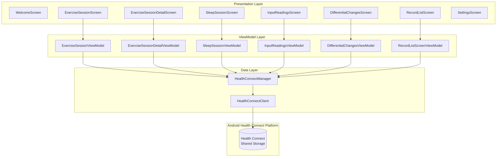

**Sources**: [health-connect/HealthConnectSample/app/src/main/java/com/example/healthconnectsample/data/HealthConnectManager.kt](), [health-connect/HealthConnectSample/app/src/main/java/com/example/healthconnectsample/presentation/navigation/HealthConnectNavigation.kt]()

### Technology Stack

| Component | Technology | Configuration |
|-----------|-----------|---------------|
| UI Framework | Jetpack Compose | kotlinCompilerExtensionVersion 1.5.15 |
| State Management | ViewModel + StateFlow | lifecycle-viewmodel-compose |
| Navigation | Navigation Compose | navigation-compose |
| Async Operations | Kotlin Coroutines | viewModelScope launch |
| Health API | androidx.health.connect:connect-client | Version from catalog |
| Build System | Gradle | compileSdk 35, minSdk 26 |

**Sources**: [health-connect/HealthConnectSample/app/build.gradle:22-64](), [health-connect/HealthConnectSample/app/build.gradle:66-100]()

---

## Core Components

### HealthConnectManager

`HealthConnectManager` is the central abstraction for all Health Connect operations. It encapsulates the `HealthConnectClient` and provides high-level methods for data access.

**Class Definition**: [health-connect/HealthConnectSample/app/src/main/java/com/example/healthconnectsample/data/HealthConnectManager.kt:63]()

#### Key Responsibilities

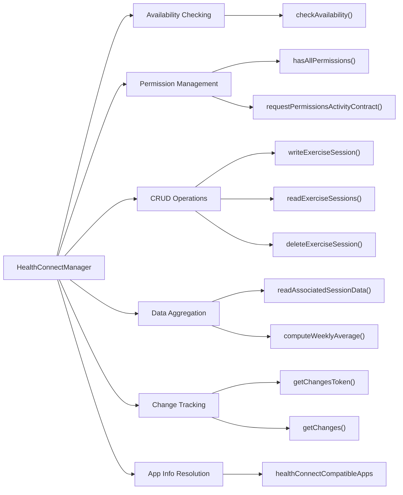

**Sources**: [health-connect/HealthConnectSample/app/src/main/java/com/example/healthconnectsample/data/HealthConnectManager.kt:63-507]()

#### Core Operations Table

| Operation Category | Methods | Record Types |
|-------------------|---------|--------------|
| Exercise Sessions | `readExerciseSessions()`, `writeExerciseSession()`, `deleteExerciseSession()`, `readAssociatedSessionData()` | `ExerciseSessionRecord`, `StepsRecord`, `DistanceRecord`, `HeartRateRecord`, `TotalCaloriesBurnedRecord` |
| Sleep Sessions | `readSleepSessions()`, `generateSleepData()`, `deleteAllSleepData()` | `SleepSessionRecord` with stages |
| Weight Tracking | `readWeightInputs()`, `writeWeightInput()`, `deleteWeightInput()`, `computeWeeklyAverage()` | `WeightRecord` |
| Series Data | `fetchSeriesRecordsFromUid()` | `HeartRateRecord`, `SpeedRecord`, `StepsRecord`, `DistanceRecord` |
| Change Tracking | `getChangesToken()`, `getChanges()` | All tracked record types |

**Sources**: [health-connect/HealthConnectSample/app/src/main/java/com/example/healthconnectsample/data/HealthConnectManager.kt:128-416]()

#### HealthConnectClient Initialization

The `HealthConnectClient` is lazily initialized and availability is checked on construction:

```
private val healthConnectClient by lazy { HealthConnectClient.getOrCreate(context) }

var availability = mutableStateOf(SDK_UNAVAILABLE)
    private set

fun checkAvailability() {
    availability.value = HealthConnectClient.getSdkStatus(context)
}
```

**Sources**: [health-connect/HealthConnectSample/app/src/main/java/com/example/healthconnectsample/data/HealthConnectManager.kt:64](), [health-connect/HealthConnectSample/app/src/main/java/com/example/healthconnectsample/data/HealthConnectManager.kt:98-107]()

---

### Navigation and Screen Routes

The application uses Jetpack Navigation Compose with a defined set of screen routes in the `Screen` enum.

#### Navigation Graph

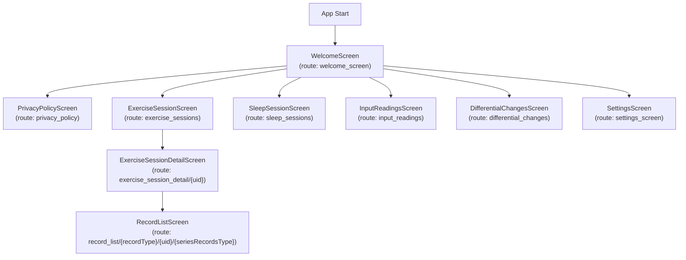

**Sources**: [health-connect/HealthConnectSample/app/src/main/java/com/example/healthconnectsample/presentation/navigation/Screen.kt:32-43](), [health-connect/HealthConnectSample/app/src/main/java/com/example/healthconnectsample/presentation/navigation/HealthConnectNavigation.kt:58-301]()

#### Screen Enum Definition

The `Screen` enum defines all routes with associated string resources for titles:

| Screen | Route | Title Resource | Menu Item |
|--------|-------|---------------|-----------|
| WelcomeScreen | `"welcome_screen"` | `R.string.welcome_screen` | No |
| ExerciseSessions | `"exercise_sessions"` | `R.string.exercise_sessions` | Yes |
| ExerciseSessionDetail | `"exercise_session_detail"` | `R.string.exercise_session_detail` | No |
| SleepSessions | `"sleep_sessions"` | `R.string.sleep_sessions` | Yes |
| InputReadings | `"input_readings"` | `R.string.input_readings` | Yes |
| DifferentialChanges | `"differential_changes"` | `R.string.differential_changes` | Yes |
| SettingsScreen | `"settings_screen"` | `R.string.settings` | Yes |
| RecordListScreen | `"record_list"` | `R.string.record_list` | No |

**Sources**: [health-connect/HealthConnectSample/app/src/main/java/com/example/healthconnectsample/presentation/navigation/Screen.kt:32-43]()

#### Deep Links

The Privacy Policy screen handles the required deep link for permission rationale:

```
composable(
    route = Screen.PrivacyPolicy.route,
    deepLinks = listOf(
        navDeepLink {
            action = "androidx.health.ACTION_SHOW_PERMISSIONS_RATIONALE"
        }
    )
)
```

**Sources**: [health-connect/HealthConnectSample/app/src/main/java/com/example/healthconnectsample/presentation/navigation/HealthConnectNavigation.kt:75-84]()

---

### ViewModels and State Management

All ViewModels follow a consistent pattern for state management, permission checking, and error handling.

#### Common ViewModel Pattern

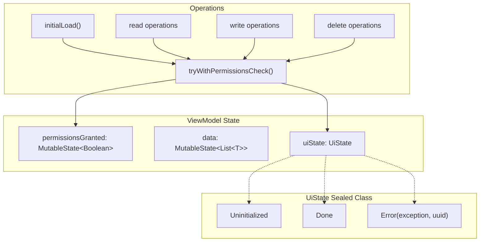

**Sources**: [health-connect/HealthConnectSample/app/src/main/java/com/example/healthconnectsample/presentation/screen/exercisesession/ExerciseSessionViewModel.kt:47-189]()

#### UiState Pattern

All ViewModels define a sealed `UiState` class with three states:

```kotlin
sealed class UiState {
    object Uninitialized : UiState()
    object Done : UiState()
    data class Error(val exception: Throwable, val uuid: UUID = UUID.randomUUID()) : UiState()
}
```

The UUID in the Error state prevents duplicate error notifications during recomposition.

**Sources**: [health-connect/HealthConnectSample/app/src/main/java/com/example/healthconnectsample/presentation/screen/exercisesession/ExerciseSessionViewModel.kt:166-173](), [health-connect/HealthConnectSample/app/src/main/java/com/example/healthconnectsample/presentation/screen/inputreadings/InputReadingsViewModel.kt:142-149]()

#### Permission Checking Pattern

The `tryWithPermissionsCheck` method provides consistent permission validation and error handling:

```kotlin
private suspend fun tryWithPermissionsCheck(block: suspend () -> Unit) {
    permissionsGranted.value = healthConnectManager.hasAllPermissions(permissions)
    uiState = try {
        if (permissionsGranted.value) {
            block()
        }
        UiState.Done
    } catch (remoteException: RemoteException) {
        UiState.Error(remoteException)
    } catch (securityException: SecurityException) {
        UiState.Error(securityException)
    } catch (ioException: IOException) {
        UiState.Error(ioException)
    } catch (illegalStateException: IllegalStateException) {
        UiState.Error(illegalStateException)
    }
}
```

**Sources**: [health-connect/HealthConnectSample/app/src/main/java/com/example/healthconnectsample/presentation/screen/inputreadings/InputReadingsViewModel.kt:124-140]()

---

## Data Types and Operations

### Supported Record Types

The sample demonstrates operations on multiple Health Connect record types:

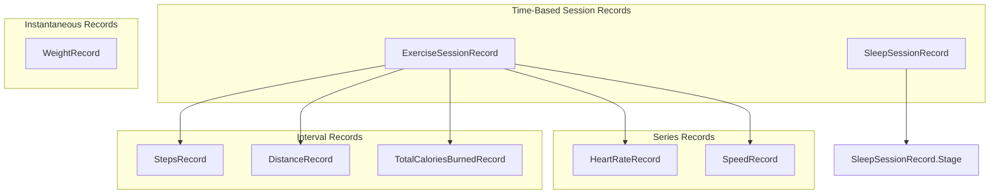

**Sources**: [health-connect/HealthConnectSample/app/src/main/java/com/example/healthconnectsample/data/HealthConnectManager.kt:30-38]()

### Exercise Session Data Flow

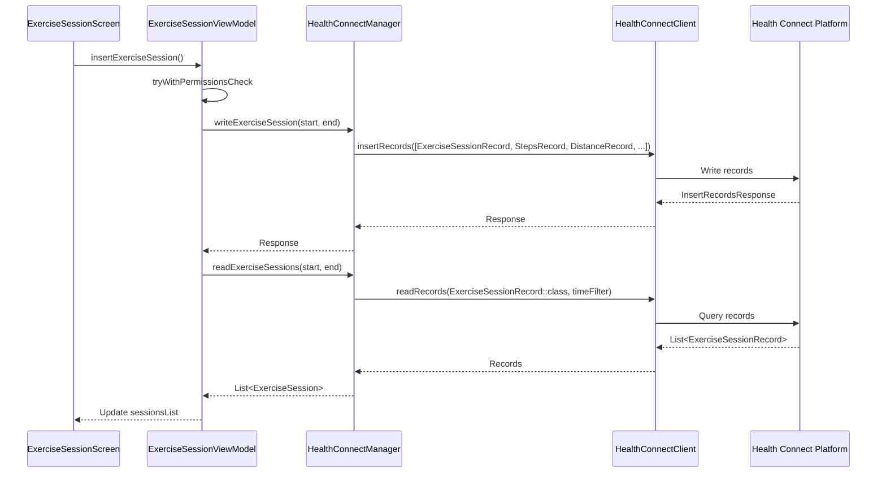

**Sources**: [health-connect/HealthConnectSample/app/src/main/java/com/example/healthconnectsample/data/HealthConnectManager.kt:147-188](), [health-connect/HealthConnectSample/app/src/main/java/com/example/healthconnectsample/presentation/screen/exercisesession/ExerciseSessionViewModel.kt:86-103]()

### Writing Exercise Sessions with Associated Data

When writing an exercise session, the sample creates multiple related records atomically:

| Record Type | Purpose | Fields |
|-------------|---------|--------|
| `ExerciseSessionRecord` | Main session container | `startTime`, `endTime`, `exerciseType`, `title` |
| `StepsRecord` | Step count during session | `count` (randomized 1000-4000) |
| `DistanceRecord` | Distance covered | `distance` in meters (randomized) |
| `TotalCaloriesBurnedRecord` | Energy expenditure | `energy` in calories (randomized) |
| `HeartRateRecord` | Heart rate samples | `samples` list with BPM values every 30 seconds |

**Sources**: [health-connect/HealthConnectSample/app/src/main/java/com/example/healthconnectsample/data/HealthConnectManager.kt:147-188](), [health-connect/HealthConnectSample/app/src/main/java/com/example/healthconnectsample/data/HealthConnectManager.kt:474-493]()

### Sleep Session Generation

The `generateSleepData()` method creates 7 days of sleep data with randomized stages:

- Bedtime: Random hour between 19-22
- Wake time: Random hour between 7-10 the next day
- Notes: Random selection from string array
- Stages: Generated with random durations (30-120 minutes each)

**Sources**: [health-connect/HealthConnectSample/app/src/main/java/com/example/healthconnectsample/data/HealthConnectManager.kt:272-297](), [health-connect/HealthConnectSample/app/src/main/java/com/example/healthconnectsample/data/HealthConnectManager.kt:419-436]()

### Weight Input and Aggregation

Weight records demonstrate instantaneous data points with aggregation:

```kotlin
// Write weight
suspend fun writeWeightInput(weight: WeightRecord) {
    val records = listOf(weight)
    healthConnectClient.insertRecords(records)
}

// Compute weekly average
suspend fun computeWeeklyAverage(start: Instant, end: Instant): Mass? {
    val request = AggregateRequest(
        metrics = setOf(WeightRecord.WEIGHT_AVG),
        timeRangeFilter = TimeRangeFilter.between(start, end)
    )
    val response = healthConnectClient.aggregate(request)
    return response[WeightRecord.WEIGHT_AVG]
}
```

**Sources**: [health-connect/HealthConnectSample/app/src/main/java/com/example/healthconnectsample/data/HealthConnectManager.kt:347-374]()

---

## Permission Management

### Required Permissions

The sample declares all required Health Connect permissions in the manifest:

```xml
<uses-permission android:name="android.permission.health.READ_HEART_RATE"/>
<uses-permission android:name="android.permission.health.WRITE_HEART_RATE"/>
<uses-permission android:name="android.permission.health.READ_STEPS"/>
<uses-permission android:name="android.permission.health.WRITE_STEPS"/>
<uses-permission android:name="android.permission.health.READ_EXERCISE"/>
<uses-permission android:name="android.permission.health.WRITE_EXERCISE"/>
<uses-permission android:name="android.permission.health.READ_SLEEP"/>
<uses-permission android:name="android.permission.health.WRITE_SLEEP"/>
<uses-permission android:name="android.permission.health.READ_SPEED"/>
<uses-permission android:name="android.permission.health.WRITE_SPEED"/>
<uses-permission android:name="android.permission.health.READ_DISTANCE"/>
<uses-permission android:name="android.permission.health.WRITE_DISTANCE"/>
<uses-permission android:name="android.permission.health.READ_TOTAL_CALORIES_BURNED"/>
<uses-permission android:name="android.permission.health.WRITE_TOTAL_CALORIES_BURNED"/>
<uses-permission android:name="android.permission.health.READ_WEIGHT"/>
<uses-permission android:name="android.permission.health.WRITE_WEIGHT"/>
<uses-permission android:name="android.permission.health.READ_HEALTH_DATA_IN_BACKGROUND" />
```

**Sources**: [health-connect/HealthConnectSample/app/src/main/AndroidManifest.xml:18-34]()

### Permission Request Flow

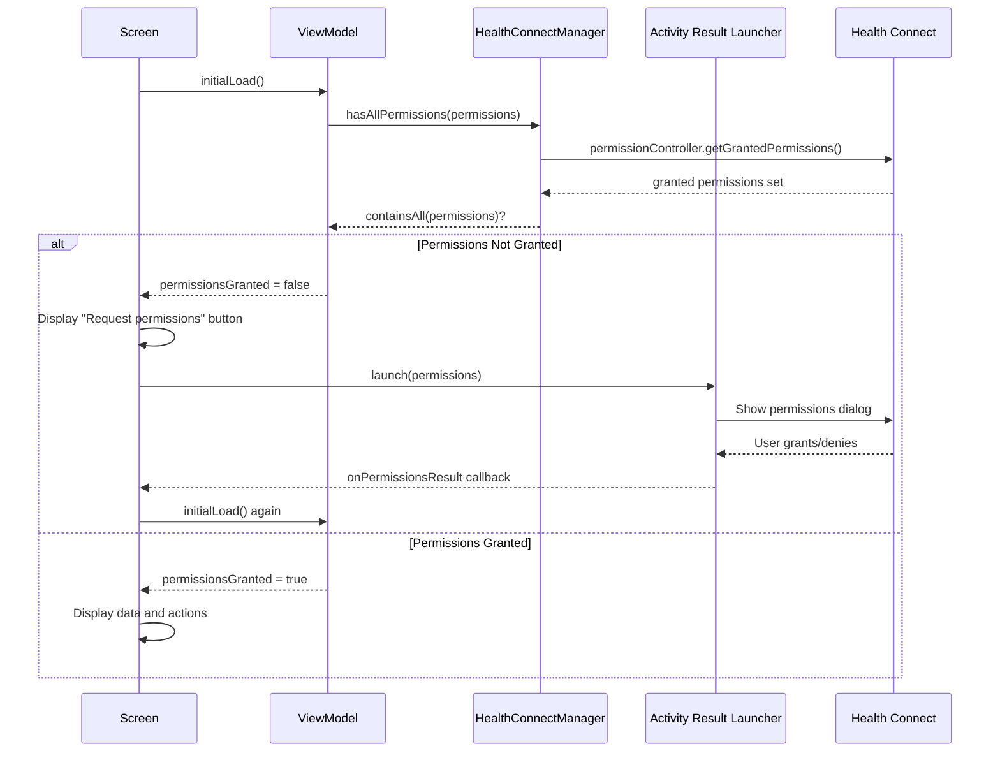

**Sources**: [health-connect/HealthConnectSample/app/src/main/java/com/example/healthconnectsample/data/HealthConnectManager.kt:115-122](), [health-connect/HealthConnectSample/app/src/main/java/com/example/healthconnectsample/presentation/navigation/HealthConnectNavigation.kt:94-127]()

### Permission Set Definitions

Each ViewModel defines its required permissions using `HealthPermission` helper methods:

```kotlin
// ExerciseSessionViewModel
val permissions = setOf(
    HealthPermission.getWritePermission(ExerciseSessionRecord::class),
    HealthPermission.getReadPermission(ExerciseSessionRecord::class),
    HealthPermission.getWritePermission(StepsRecord::class),
    HealthPermission.getWritePermission(SpeedRecord::class),
    HealthPermission.getWritePermission(DistanceRecord::class),
    HealthPermission.getWritePermission(TotalCaloriesBurnedRecord::class),
    HealthPermission.getWritePermission(HeartRateRecord::class)
)
```

**Sources**: [health-connect/HealthConnectSample/app/src/main/java/com/example/healthconnectsample/presentation/screen/exercisesession/ExerciseSessionViewModel.kt:51-59]()

### Background Read Permission

The sample demonstrates the optional `PERMISSION_READ_HEALTH_DATA_IN_BACKGROUND` permission, checking feature availability first:

```kotlin
backgroundReadAvailable.value = healthConnectManager.isFeatureAvailable(
    HealthConnectFeatures.FEATURE_READ_HEALTH_DATA_IN_BACKGROUND
)
backgroundReadGranted.value = healthConnectManager.hasAllPermissions(
    setOf(PERMISSION_READ_HEALTH_DATA_IN_BACKGROUND)
)
```

**Sources**: [health-connect/HealthConnectSample/app/src/main/java/com/example/healthconnectsample/presentation/screen/exercisesession/ExerciseSessionViewModel.kt:144-149]()

---

## Key Features

### CRUD Operations

The sample demonstrates complete Create, Read, Update, and Delete operations for health records.

#### Create Example: Exercise Session

```
suspend fun writeExerciseSession(
    start: ZonedDateTime,
    end: ZonedDateTime
): InsertRecordsResponse {
    return healthConnectClient.insertRecords(
        listOf(
            ExerciseSessionRecord(...),
            StepsRecord(...),
            DistanceRecord(...),
            TotalCaloriesBurnedRecord(...)
        ) + buildHeartRateSeries(start, end)
    )
}
```

**Sources**: [health-connect/HealthConnectSample/app/src/main/java/com/example/healthconnectsample/data/HealthConnectManager.kt:147-188]()

#### Read Example: Exercise Sessions

```
suspend fun readExerciseSessions(start: Instant, end: Instant): List<ExerciseSessionRecord> {
    val request = ReadRecordsRequest(
        recordType = ExerciseSessionRecord::class,
        timeRangeFilter = TimeRangeFilter.between(start, end)
    )
    val response = healthConnectClient.readRecords(request)
    return response.records
}
```

**Sources**: [health-connect/HealthConnectSample/app/src/main/java/com/example/healthconnectsample/data/HealthConnectManager.kt:134-141]()

#### Delete Example: Exercise Session with Associated Data

Deleting an exercise session also deletes all associated raw data:

```
suspend fun deleteExerciseSession(uid: String) {
    val exerciseSession = healthConnectClient.readRecord(ExerciseSessionRecord::class, uid)
    healthConnectClient.deleteRecords(
        ExerciseSessionRecord::class,
        recordIdsList = listOf(uid),
        clientRecordIdsList = emptyList()
    )
    val timeRangeFilter = TimeRangeFilter.between(
        exerciseSession.record.startTime,
        exerciseSession.record.endTime
    )
    val rawDataTypes: Set<KClass<out Record>> = setOf(
        HeartRateRecord::class,
        SpeedRecord::class,
        DistanceRecord::class,
        StepsRecord::class,
        TotalCaloriesBurnedRecord::class
    )
    rawDataTypes.forEach { rawType ->
        healthConnectClient.deleteRecords(rawType, timeRangeFilter)
    }
}
```

**Sources**: [health-connect/HealthConnectSample/app/src/main/java/com/example/healthconnectsample/data/HealthConnectManager.kt:193-214]()

### Data Aggregation

The sample demonstrates aggregating data using `AggregateRequest`:

#### Exercise Session Aggregates

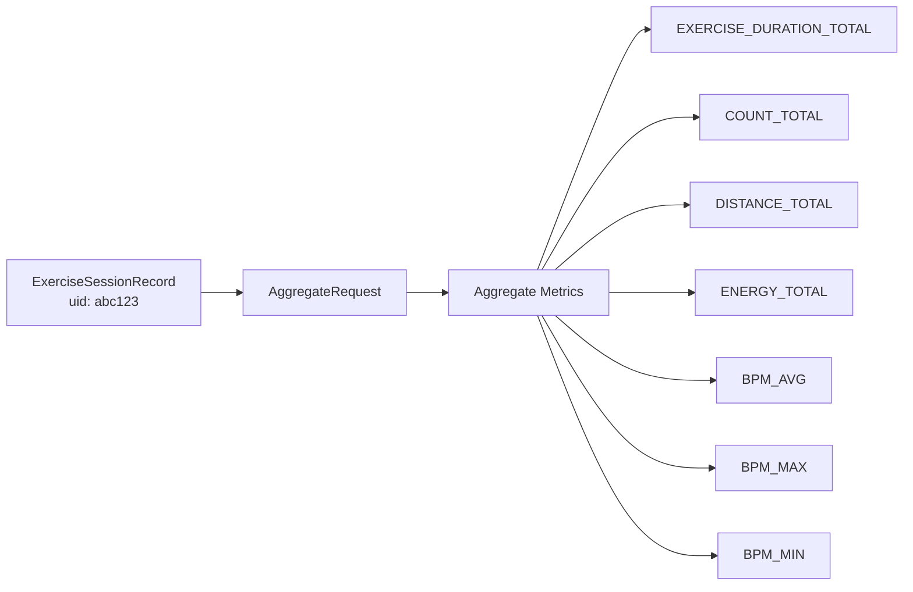

**Sources**: [health-connect/HealthConnectSample/app/src/main/java/com/example/healthconnectsample/data/HealthConnectManager.kt:219-257]()

#### Aggregation Code Pattern

```kotlin
val aggregateDataTypes = setOf(
    ExerciseSessionRecord.EXERCISE_DURATION_TOTAL,
    StepsRecord.COUNT_TOTAL,
    DistanceRecord.DISTANCE_TOTAL,
    TotalCaloriesBurnedRecord.ENERGY_TOTAL,
    HeartRateRecord.BPM_AVG,
    HeartRateRecord.BPM_MAX,
    HeartRateRecord.BPM_MIN,
)
val aggregateRequest = AggregateRequest(
    metrics = aggregateDataTypes,
    timeRangeFilter = timeRangeFilter,
    dataOriginFilter = dataOriginFilter
)
val aggregateData = healthConnectClient.aggregate(aggregateRequest)

return ExerciseSessionData(
    uid = uid,
    totalActiveTime = aggregateData[ExerciseSessionRecord.EXERCISE_DURATION_TOTAL],
    totalSteps = aggregateData[StepsRecord.COUNT_TOTAL],
    totalDistance = aggregateData[DistanceRecord.DISTANCE_TOTAL],
    totalEnergyBurned = aggregateData[TotalCaloriesBurnedRecord.ENERGY_TOTAL],
    minHeartRate = aggregateData[HeartRateRecord.BPM_MIN],
    maxHeartRate = aggregateData[HeartRateRecord.BPM_MAX],
    avgHeartRate = aggregateData[HeartRateRecord.BPM_AVG],
)
```

**Sources**: [health-connect/HealthConnectSample/app/src/main/java/com/example/healthconnectsample/data/HealthConnectManager.kt:228-256]()

### Differential Changes API

The Differential Changes API enables efficient synchronization by tracking only changes since a given token.

#### Changes Flow Architecture

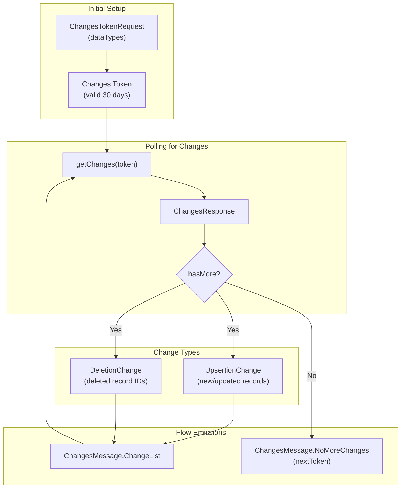

**Sources**: [health-connect/HealthConnectSample/app/src/main/java/com/example/healthconnectsample/data/HealthConnectManager.kt:388-416]()

#### Obtaining Changes Token

```kotlin
suspend fun getChangesToken(dataTypes: Set<KClass<out Record>>): String {
    val request = ChangesTokenRequest(dataTypes)
    return healthConnectClient.getChangesToken(request)
}
```

**Sources**: [health-connect/HealthConnectSample/app/src/main/java/com/example/healthconnectsample/data/HealthConnectManager.kt:390-393]()

#### Consuming Changes as Flow

```kotlin
suspend fun getChanges(token: String): Flow<ChangesMessage> = flow {
    var nextChangesToken = token
    do {
        val response = healthConnectClient.getChanges(nextChangesToken)
        if (response.changesTokenExpired) {
            throw IOException("Changes token has expired")
        }
        emit(ChangesMessage.ChangeList(response.changes))
        nextChangesToken = response.nextChangesToken
    } while (response.hasMore)
    emit(ChangesMessage.NoMoreChanges(nextChangesToken))
}
```

**Sources**: [health-connect/HealthConnectSample/app/src/main/java/com/example/healthconnectsample/data/HealthConnectManager.kt:400-416]()

#### ChangesMessage Sealed Class

```kotlin
sealed class ChangesMessage {
    data class NoMoreChanges(val nextChangesToken: String) : ChangesMessage()
    data class ChangeList(val changes: List<Change>) : ChangesMessage()
}
```

**Sources**: [health-connect/HealthConnectSample/app/src/main/java/com/example/healthconnectsample/data/HealthConnectManager.kt:502-506]()

---

## UI Structure

### Welcome Screen

The `WelcomeScreen` is the entry point that checks Health Connect availability:

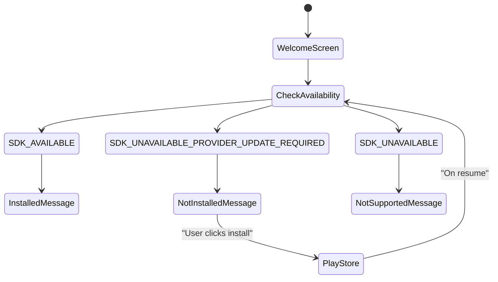

**Sources**: [health-connect/HealthConnectSample/app/src/main/java/com/example/healthconnectsample/presentation/screen/WelcomeScreen.kt:54-107]()

The screen uses a `DisposableEffect` to re-check availability when resumed, ensuring proper detection after Health Connect installation.

**Sources**: [health-connect/HealthConnectSample/app/src/main/java/com/example/healthconnectsample/presentation/screen/WelcomeScreen.kt:67-81]()

### Exercise Session Screens

#### ExerciseSessionScreen (List View)

Displays a list of exercise sessions from today with options to insert and delete:

| Component | Description |
|-----------|-------------|
| "Insert session" button | Creates random exercise session with current day timestamp |
| Exercise session rows | Shows session title, time range, source app icon/name |
| "Details" button per row | Navigates to detail screen with UID parameter |
| "Delete" button per row | Removes session and all associated data |
| Background read button | Requests optional background permission if available |

**Sources**: [health-connect/HealthConnectSample/app/src/main/java/com/example/healthconnectsample/presentation/screen/exercisesession/ExerciseSessionScreen.kt:50-157]()

#### ExerciseSessionDetailScreen

Shows aggregated metrics and series data for a specific exercise session:

- Total active duration
- Total steps
- Total distance
- Total calories burned
- Heart rate statistics (min, max, avg)
- Clickable buttons to view series data (heart rate samples, speed samples)

**Sources**: String resources at [health-connect/HealthConnectSample/app/src/main/res/values/strings.xml:78-89]()

### Sleep Session Screen

The `SleepSessionScreen` demonstrates sleep data with stages:

- "Generate sleep data" button creates 7 days of randomized sleep sessions
- Each sleep session displays:
  - Notes (random from predefined list)
  - Duration (aggregated)
  - Time range (bedtime to wake time)
  - Sleep stages breakdown

**Sources**: [health-connect/HealthConnectSample/app/src/main/res/values/strings.xml:92-103]()

### Input Readings Screen (Weight)

The `InputReadingsScreen` demonstrates instantaneous data with aggregation:

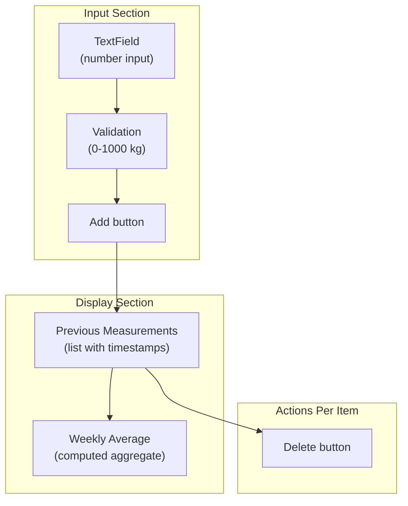

**Sources**: [health-connect/HealthConnectSample/app/src/main/java/com/example/healthconnectsample/presentation/screen/inputreadings/InputReadingsScreen.kt:65-216]()

The screen validates weight input is between 0 and 1000 kg before allowing insertion.

**Sources**: [health-connect/HealthConnectSample/app/src/main/java/com/example/healthconnectsample/presentation/screen/inputreadings/InputReadingsScreen.kt:102-107]()

### Differential Changes Screen

Enables and disables change tracking, then displays changes when requested:

| Element | Purpose |
|---------|---------|
| "Track changes" toggle | Enables/disables change tracking (obtains/discards token) |
| Current token display | Shows truncated token when tracking enabled |
| "Get new changes" button | Fetches changes since last token |
| Upserted records list | Shows created/updated records by type |
| Deleted records list | Shows deleted record IDs by type |

**Sources**: [health-connect/HealthConnectSample/app/src/main/res/values/strings.xml:116-133]()

### RecordListScreen

Displays series data for a parent record (e.g., heart rate samples for an exercise session):

```
RecordListScreen(
    uid = parentRecordId,
    recordType = EXERCISE_SESSION,
    seriesRecordsType = HEARTRATE,
    recordList = List<HeartRateRecord>
)
```

The screen is reached via navigation with three parameters:
- `recordType`: The parent record type (enum)
- `uid`: The parent record ID
- `seriesRecordsType`: The type of series data to display (enum)

**Sources**: [health-connect/HealthConnectSample/app/src/main/java/com/example/healthconnectsample/presentation/screen/recordlist/RecordListScreen.kt:52-159](), [health-connect/HealthConnectSample/app/src/main/java/com/example/healthconnectsample/presentation/navigation/HealthConnectNavigation.kt:162-195]()

---

## App Information Resolution

The sample queries installed apps that support Health Connect to display friendly names and icons for data attribution:

```kotlin
val healthConnectCompatibleApps by lazy {
    val intent = Intent("androidx.health.ACTION_SHOW_PERMISSIONS_RATIONALE")
    
    val packages = if (Build.VERSION.SDK_INT >= Build.VERSION_CODES.TIRAMISU) {
        context.packageManager.queryIntentActivities(
            intent,
            PackageManager.ResolveInfoFlags.of(PackageManager.MATCH_ALL.toLong())
        )
    } else {
        context.packageManager.queryIntentActivities(
            intent,
            PackageManager.MATCH_ALL
        )
    }
    
    packages.associate {
        val icon = try {
            context.packageManager.getApplicationIcon(it.activityInfo.packageName)
        } catch (e: NotFoundException) {
            null
        }
        val label = context.packageManager.getApplicationLabel(it.activityInfo.applicationInfo)
            .toString()
        it.activityInfo.packageName to
                HealthConnectAppInfo(
                    packageName = it.activityInfo.packageName,
                    icon = icon,
                    appLabel = label
                )
    }
}
```

This map is used throughout the UI to show which app wrote each record.

**Sources**: [health-connect/HealthConnectSample/app/src/main/java/com/example/healthconnectsample/data/HealthConnectManager.kt:66-96]()

The manifest queries configuration enables this lookup:

```xml
<queries>
    <package android:name="com.google.android.apps.healthdata" />
    <intent>
        <action android:name="androidx.health.ACTION_SHOW_PERMISSIONS_RATIONALE" />
    </intent>
</queries>
```

**Sources**: [health-connect/HealthConnectSample/app/src/main/AndroidManifest.xml:72-83]()

---

## Build Configuration

### Gradle Setup

| Configuration | Value |
|--------------|-------|
| Application ID | `com.example.healthconnectsample` |
| Compile SDK | 35 |
| Min SDK | 26 (Android 8.0) |
| Target SDK | 34 |
| JVM Target | Java 17 |
| Compose Compiler | 1.5.15 |

**Sources**: [health-connect/HealthConnectSample/app/build.gradle:22-57]()

### Key Dependencies

```gradle
// Health Connect
implementation "androidx.health.connect:connect-client:$health_connect_version"

// Compose BOM
def composeBom = platform('androidx.compose:compose-bom:2024.09.03')
implementation(composeBom)

// ViewModel
implementation "androidx.lifecycle:lifecycle-viewmodel-compose:$lifecycle_version"

// Navigation
implementation "androidx.navigation:navigation-compose:$navigation_compose_version"

// Async operations
implementation "androidx.concurrent:concurrent-futures-ktx:$concurrent_futures_version"

// Desugaring for java.time on API < 26
coreLibraryDesugaring "com.android.tools:desugar_jdk_libs:2.1.2"
```

**Sources**: [health-connect/HealthConnectSample/app/build.gradle:66-100]()

---

**Summary**: The Health Connect Sample is a comprehensive demonstration of the androidx.health.connect API, showcasing CRUD operations, data aggregation, differential change tracking, and permission management across multiple health data types. The architecture follows MVVM with Jetpack Compose, providing a clear pattern for building health data applications on Android.

---

