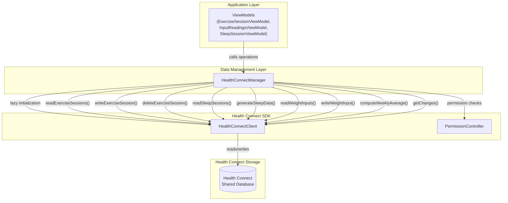
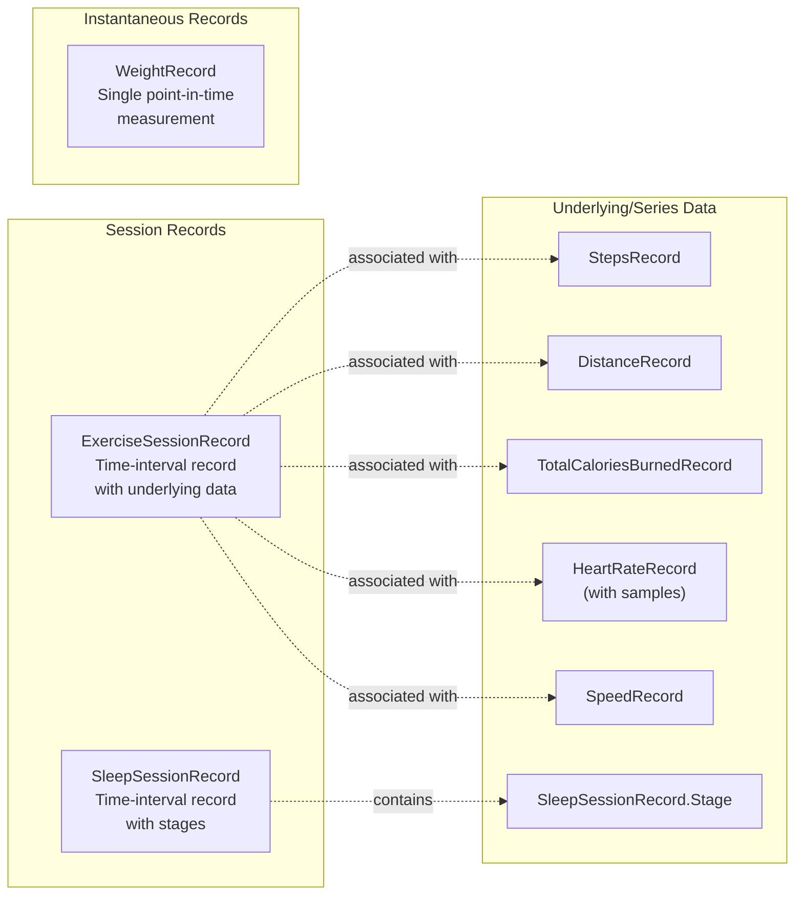
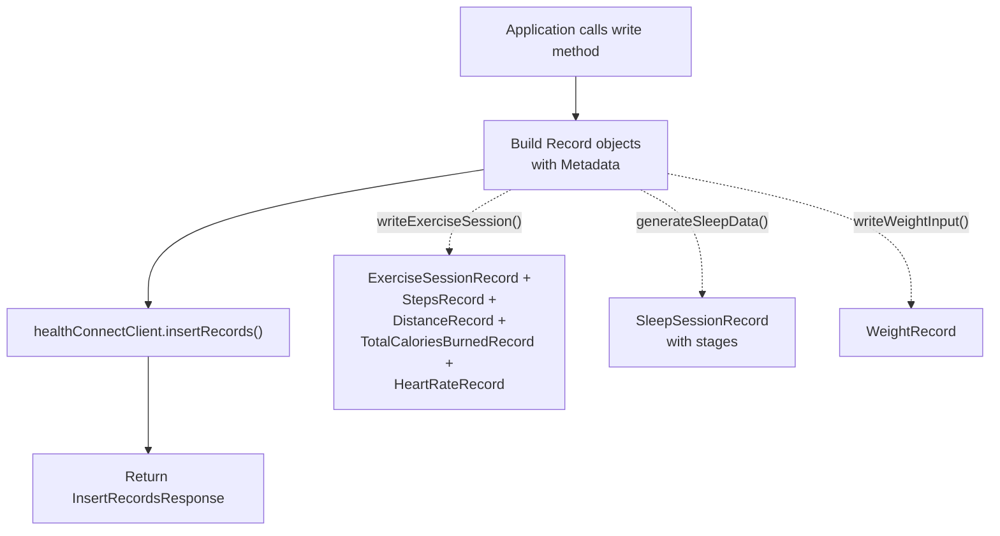
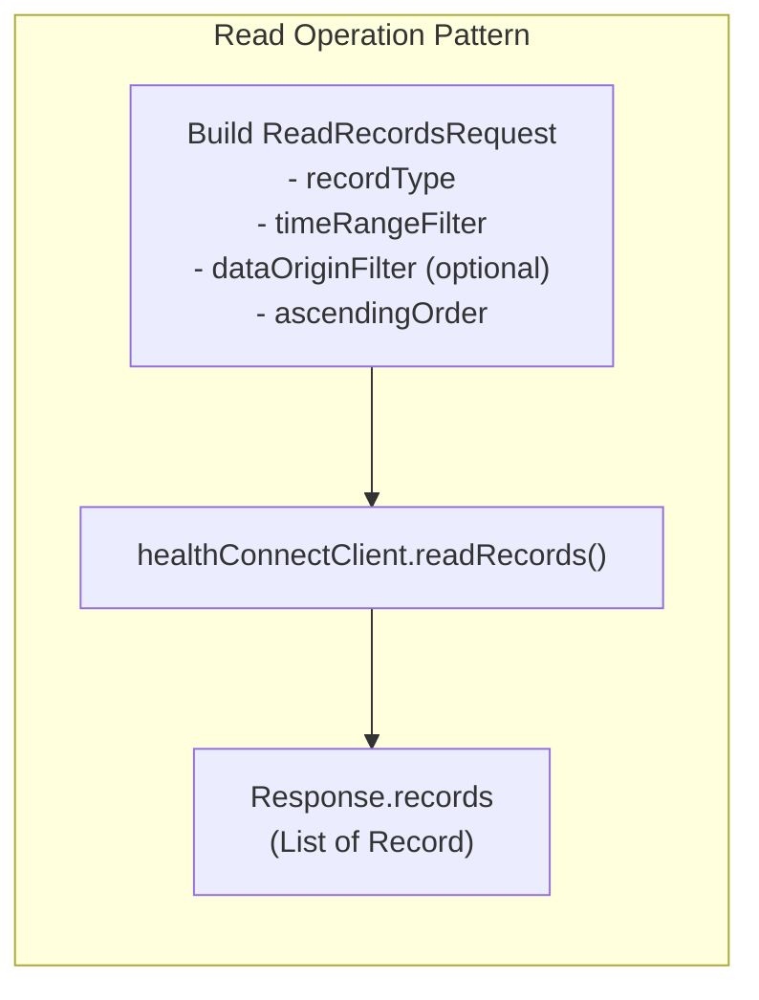
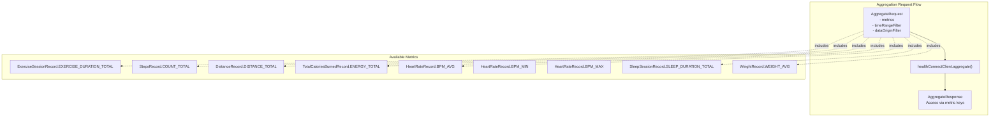
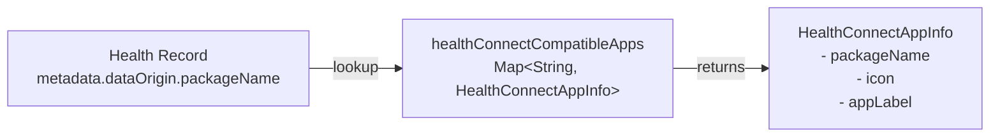
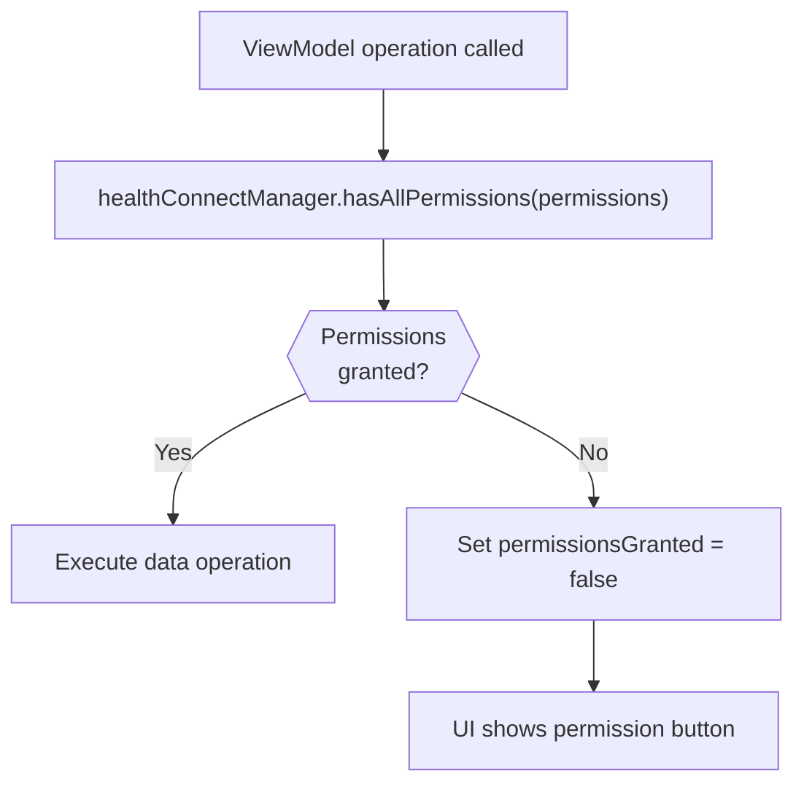

<!-- source: DeepWiki mcp.deepwiki.com · repo android/health-samples · page 3.1 Data Management · fetched 2026-10-23 -->

# Data Management

<details>
<summary>Relevant source files</summary>

The following files were used as context for generating this wiki page:

- [health-connect/HealthConnectSample/app/src/main/AndroidManifest.xml](health-connect/HealthConnectSample/app/src/main/AndroidManifest.xml)
- [health-connect/HealthConnectSample/app/src/main/java/com/example/healthconnectsample/data/HealthConnectManager.kt](health-connect/HealthConnectSample/app/src/main/java/com/example/healthconnectsample/data/HealthConnectManager.kt)
- [health-connect/HealthConnectSample/app/src/main/java/com/example/healthconnectsample/presentation/component/Series.kt](health-connect/HealthConnectSample/app/src/main/java/com/example/healthconnectsample/presentation/component/Series.kt)
- [health-connect/HealthConnectSample/app/src/main/java/com/example/healthconnectsample/presentation/navigation/HealthConnectNavigation.kt](health-connect/HealthConnectSample/app/src/main/java/com/example/healthconnectsample/presentation/navigation/HealthConnectNavigation.kt)
- [health-connect/HealthConnectSample/app/src/main/java/com/example/healthconnectsample/presentation/navigation/Screen.kt](health-connect/HealthConnectSample/app/src/main/java/com/example/healthconnectsample/presentation/navigation/Screen.kt)
- [health-connect/HealthConnectSample/app/src/main/java/com/example/healthconnectsample/presentation/screen/WelcomeScreen.kt](health-connect/HealthConnectSample/app/src/main/java/com/example/healthconnectsample/presentation/screen/WelcomeScreen.kt)
- [health-connect/HealthConnectSample/app/src/main/java/com/example/healthconnectsample/presentation/screen/exercisesession/ExerciseSessionScreen.kt](health-connect/HealthConnectSample/app/src/main/java/com/example/healthconnectsample/presentation/screen/exercisesession/ExerciseSessionScreen.kt)
- [health-connect/HealthConnectSample/app/src/main/java/com/example/healthconnectsample/presentation/screen/exercisesession/ExerciseSessionViewModel.kt](health-connect/HealthConnectSample/app/src/main/java/com/example/healthconnectsample/presentation/screen/exercisesession/ExerciseSessionViewModel.kt)
- [health-connect/HealthConnectSample/app/src/main/java/com/example/healthconnectsample/presentation/screen/inputreadings/InputReadingsScreen.kt](health-connect/HealthConnectSample/app/src/main/java/com/example/healthconnectsample/presentation/screen/inputreadings/InputReadingsScreen.kt)
- [health-connect/HealthConnectSample/app/src/main/java/com/example/healthconnectsample/presentation/screen/inputreadings/InputReadingsViewModel.kt](health-connect/HealthConnectSample/app/src/main/java/com/example/healthconnectsample/presentation/screen/inputreadings/InputReadingsViewModel.kt)
- [health-connect/HealthConnectSample/app/src/main/java/com/example/healthconnectsample/presentation/screen/recordlist/RecordListScreen.kt](health-connect/HealthConnectSample/app/src/main/java/com/example/healthconnectsample/presentation/screen/recordlist/RecordListScreen.kt)
- [health-connect/HealthConnectSample/app/src/main/res/values/strings.xml](health-connect/HealthConnectSample/app/src/main/res/values/strings.xml)
- [health-connect/HealthConnectSample/settings.gradle](health-connect/HealthConnectSample/settings.gradle)

</details>


## Purpose and Scope

This document describes the data management layer of the Health Connect sample application, specifically focusing on the `HealthConnectManager` abstraction and how it handles Create, Read, Update, Delete (CRUD) operations for health data. This page covers the supported data types (exercise sessions, sleep sessions, weight records), aggregation queries, and working with series data.

For information about how this data is presented in the UI, see [UI and Navigation](#3.2). For information about tracking changes to data over time, see [Differential Changes](#3.3).

## HealthConnectManager Overview

The `HealthConnectManager` class serves as the primary abstraction layer between the application and the Health Connect SDK. It encapsulates all interactions with the `HealthConnectClient` and provides higher-level operations for managing health data.



**Sources:** [health-connect/HealthConnectSample/app/src/main/java/com/example/healthconnectsample/data/HealthConnectManager.kt:63-64](), [health-connect/HealthConnectSample/app/src/main/java/com/example/healthconnectsample/presentation/navigation/HealthConnectNavigation.kt:88-93]()

### Key Responsibilities

The `HealthConnectManager` handles:

| Responsibility | Methods | Description |
|---------------|---------|-------------|
| **Client Initialization** | `healthConnectClient` (lazy) | Initializes the Health Connect client on first access |
| **Availability Checks** | `checkAvailability()`, `availability` | Determines if Health Connect is available on the device |
| **Permission Management** | `hasAllPermissions()`, `requestPermissionsActivityContract()`, `revokeAllPermissions()` | Manages runtime permissions for health data access |
| **Exercise Session Management** | `readExerciseSessions()`, `writeExerciseSession()`, `deleteExerciseSession()`, `readAssociatedSessionData()` | CRUD operations for exercise sessions and associated data |
| **Sleep Session Management** | `readSleepSessions()`, `generateSleepData()`, `deleteAllSleepData()` | CRUD operations for sleep sessions with stage data |
| **Weight Record Management** | `readWeightInputs()`, `writeWeightInput()`, `deleteWeightInput()`, `computeWeeklyAverage()` | CRUD operations and aggregations for weight records |
| **Change Tracking** | `getChangesToken()`, `getChanges()` | Differential change tracking for efficient synchronization |
| **Data Origin Resolution** | `healthConnectCompatibleApps` | Maps package names to app information for data attribution |

**Sources:** [health-connect/HealthConnectSample/app/src/main/java/com/example/healthconnectsample/data/HealthConnectManager.kt:63-107]()

## Supported Data Types

The Health Connect sample demonstrates three primary data types, each with specific characteristics and use cases:



**Sources:** [health-connect/HealthConnectSample/app/src/main/java/com/example/healthconnectsample/data/HealthConnectManager.kt:30-38]()

### Exercise Session Records

Exercise sessions represent a period of physical activity. An `ExerciseSessionRecord` is a conceptual period (e.g., "Afternoon run") that may contain multiple types of underlying data captured during that time.

**Record Structure:**
- **Time bounds**: `startTime`, `startZoneOffset`, `endTime`, `endZoneOffset`
- **Metadata**: `Metadata.manualEntry()` or automatic
- **Type**: `exerciseType` (e.g., `EXERCISE_TYPE_RUNNING`)
- **Optional title**: User-friendly name

**Associated Data Types:**
- `StepsRecord` - Step counts during the session
- `DistanceRecord` - Distance traveled during the session
- `TotalCaloriesBurnedRecord` - Energy expenditure during the session
- `HeartRateRecord` - Heart rate samples with time series data
- `SpeedRecord` - Speed measurements during the session

**Sources:** [health-connect/HealthConnectSample/app/src/main/java/com/example/healthconnectsample/data/HealthConnectManager.kt:129-141](), [health-connect/HealthConnectSample/app/src/main/java/com/example/healthconnectsample/data/HealthConnectManager.kt:147-188]()

### Sleep Session Records

Sleep sessions represent periods of sleep with detailed stage information. Each `SleepSessionRecord` contains a list of `Stage` objects that cover the entire sleep duration.

**Record Structure:**
- **Time bounds**: `startTime`, `startZoneOffset`, `endTime`, `endZoneOffset`
- **Optional title**: User-friendly name
- **Optional notes**: Text notes about the sleep session
- **Stages**: List of `SleepSessionRecord.Stage` objects

**Stage Types:**
Each stage covers a continuous time period within the sleep session with types like awake, light sleep, deep sleep, REM sleep, etc.

**Sources:** [health-connect/HealthConnectSample/app/src/main/java/com/example/healthconnectsample/data/HealthConnectManager.kt:267-297](), [health-connect/HealthConnectSample/app/src/main/java/com/example/healthconnectsample/data/HealthConnectManager.kt:418-436]()

### Weight Records

Weight records represent instantaneous weight measurements at a specific point in time.

**Record Structure:**
- **Weight value**: `Mass` object (e.g., `Mass.kilograms(70.5)`)
- **Time**: `time` and `zoneOffset`
- **Metadata**: `Metadata.manualEntry()` or automatic

**Sources:** [health-connect/HealthConnectSample/app/src/main/java/com/example/healthconnectsample/data/HealthConnectManager.kt:346-350]()

## CRUD Operations

The `HealthConnectManager` provides comprehensive CRUD operations for each data type. All operations are suspend functions that must be called from a coroutine context.

### Create (Write) Operations



**Sources:** [health-connect/HealthConnectSample/app/src/main/java/com/example/healthconnectsample/data/HealthConnectManager.kt:147-188](), [health-connect/HealthConnectSample/app/src/main/java/com/example/healthconnectsample/data/HealthConnectManager.kt:272-296](), [health-connect/HealthConnectSample/app/src/main/java/com/example/healthconnectsample/data/HealthConnectManager.kt:347-350]()

#### Writing Exercise Sessions

The `writeExerciseSession()` method demonstrates creating a composite record with multiple associated data types:

**Method signature:**
```kotlin
suspend fun writeExerciseSession(start: ZonedDateTime, end: ZonedDateTime): InsertRecordsResponse
```

**Process:**
1. Creates an `ExerciseSessionRecord` with the specified time range
2. Generates random data for demonstration: steps (1000-4000), distance (1000-3000m), calories (140-160)
3. Builds a heart rate series with 30-second intervals
4. Inserts all records in a single transaction using `healthConnectClient.insertRecords()`

The method returns an `InsertRecordsResponse` containing the record IDs of the inserted data.

**Sources:** [health-connect/HealthConnectSample/app/src/main/java/com/example/healthconnectsample/data/HealthConnectManager.kt:147-188](), [health-connect/HealthConnectSample/app/src/main/java/com/example/healthconnectsample/data/HealthConnectManager.kt:474-493]()

#### Generating Sleep Data

The `generateSleepData()` method creates a week's worth of synthetic sleep data:

**Process:**
1. Generates 7 sleep sessions, one per day
2. Each session has a random bedtime (19:00-22:00) and wake time (07:00-10:00)
3. Creates random sleep stages that span the entire session duration
4. Adds notes from a predefined string array
5. Inserts all records at once

**Sources:** [health-connect/HealthConnectSample/app/src/main/java/com/example/healthconnectsample/data/HealthConnectManager.kt:272-297](), [health-connect/HealthConnectSample/app/src/main/res/values/strings.xml:93-99]()

#### Writing Weight Records

The `writeWeightInput()` method creates a single weight measurement:

**Method signature:**
```kotlin
suspend fun writeWeightInput(weight: WeightRecord)
```

The caller constructs the `WeightRecord` with the measurement value, timestamp, and metadata before passing it to this method.

**Sources:** [health-connect/HealthConnectSample/app/src/main/java/com/example/healthconnectsample/data/HealthConnectManager.kt:347-350](), [health-connect/HealthConnectSample/app/src/main/java/com/example/healthconnectsample/presentation/screen/inputreadings/InputReadingsViewModel.kt:70-84]()

### Read Operations

All read operations use the `ReadRecordsRequest` API with time range filters to query specific time periods.



**Sources:** [health-connect/HealthConnectSample/app/src/main/java/com/example/healthconnectsample/data/HealthConnectManager.kt:134-141]()

#### Reading Exercise Sessions

The `readExerciseSessions()` method retrieves sessions within a time range:

**Method signature:**
```kotlin
suspend fun readExerciseSessions(start: Instant, end: Instant): List<ExerciseSessionRecord>
```

**Implementation details:**
1. Creates a `ReadRecordsRequest` with `ExerciseSessionRecord::class`
2. Applies a `TimeRangeFilter.between(start, end)` to limit results
3. Returns the list of records from the response

**Sources:** [health-connect/HealthConnectSample/app/src/main/java/com/example/healthconnectsample/data/HealthConnectManager.kt:134-141]()

#### Reading Sleep Sessions

The `readSleepSessions()` method retrieves the previous week's sleep data and computes durations:

**Process:**
1. Defines a 7-day time window ending yesterday at noon
2. Reads all `SleepSessionRecord` objects in that window
3. For each session, performs an aggregation query to compute total sleep duration
4. Returns a list of `SleepSessionData` objects containing the session info, duration, and stages

**Sources:** [health-connect/HealthConnectSample/app/src/main/java/com/example/healthconnectsample/data/HealthConnectManager.kt:306-342]()

#### Reading Weight Records

The `readWeightInputs()` method retrieves weight measurements:

**Method signature:**
```kotlin
suspend fun readWeightInputs(start: Instant, end: Instant): List<WeightRecord>
```

This follows the same pattern as reading exercise sessions, querying for `WeightRecord::class` within the specified time range.

**Sources:** [health-connect/HealthConnectSample/app/src/main/java/com/example/healthconnectsample/data/HealthConnectManager.kt:355-362]()

### Delete Operations

Delete operations remove records by their unique identifiers. Some deletions cascade to remove associated data.

#### Deleting Exercise Sessions

The `deleteExerciseSession()` method demonstrates cascading deletion:

**Method signature:**
```kotlin
suspend fun deleteExerciseSession(uid: String)
```

**Process:**
1. Reads the exercise session record by UID to get its time bounds
2. Deletes the `ExerciseSessionRecord` by its record ID
3. Creates a `TimeRangeFilter` for the session's time period
4. Deletes all associated raw data types within that time range:
   - `HeartRateRecord`
   - `SpeedRecord`
   - `DistanceRecord`
   - `StepsRecord`
   - `TotalCaloriesBurnedRecord`

This ensures that when an exercise session is deleted, all its underlying data is also removed.

**Sources:** [health-connect/HealthConnectSample/app/src/main/java/com/example/healthconnectsample/data/HealthConnectManager.kt:193-214]()

#### Deleting Weight Records

The `deleteWeightInput()` method removes a single weight measurement:

**Method signature:**
```kotlin
suspend fun deleteWeightInput(uid: String)
```

**Implementation:**
Calls `healthConnectClient.deleteRecords()` with the `WeightRecord::class` and the record ID.

**Sources:** [health-connect/HealthConnectSample/app/src/main/java/com/example/healthconnectsample/data/HealthConnectManager.kt:379-385]()

#### Deleting All Sleep Data

The `deleteAllSleepData()` method removes all sleep sessions:

**Method signature:**
```kotlin
suspend fun deleteAllSleepData()
```

**Implementation:**
Uses `TimeRangeFilter.before(Instant.now())` to delete all sleep records before the current time, effectively clearing all sleep data.

**Sources:** [health-connect/HealthConnectSample/app/src/main/java/com/example/healthconnectsample/data/HealthConnectManager.kt:262-265]()

## Reading and Aggregating Data

Health Connect supports aggregation queries that compute statistics over time ranges without retrieving individual records.

### Aggregation Operations



**Sources:** [health-connect/HealthConnectSample/app/src/main/java/com/example/healthconnectsample/data/HealthConnectManager.kt:228-257]()

### Reading Associated Exercise Session Data

The `readAssociatedSessionData()` method demonstrates comprehensive aggregation:

**Method signature:**
```kotlin
suspend fun readAssociatedSessionData(uid: String): ExerciseSessionData
```

**Process:**
1. Reads the `ExerciseSessionRecord` by UID
2. Extracts the session's time bounds
3. Creates an `AggregateRequest` with multiple metrics:
   - `EXERCISE_DURATION_TOTAL` - Total active time
   - `COUNT_TOTAL` (steps) - Total step count
   - `DISTANCE_TOTAL` - Total distance traveled
   - `ENERGY_TOTAL` (calories) - Total energy burned
   - `BPM_AVG`, `BPM_MAX`, `BPM_MIN` - Heart rate statistics
4. Applies a `dataOriginFilter` to limit results to data written by the same app that created the session
5. Executes the aggregation query
6. Returns an `ExerciseSessionData` object with all computed metrics

**Sources:** [health-connect/HealthConnectSample/app/src/main/java/com/example/healthconnectsample/data/HealthConnectManager.kt:219-257]()

### Computing Weekly Weight Average

The `computeWeeklyAverage()` method demonstrates simple aggregation:

**Method signature:**
```kotlin
suspend fun computeWeeklyAverage(start: Instant, end: Instant): Mass?
```

**Implementation:**
1. Creates an `AggregateRequest` with the `WeightRecord.WEIGHT_AVG` metric
2. Applies a time range filter
3. Returns the averaged `Mass` value or null if no data exists

**Sources:** [health-connect/HealthConnectSample/app/src/main/java/com/example/healthconnectsample/data/HealthConnectManager.kt:367-374]()

## Working with Series Data

Series data represents time-ordered samples within a record. The sample demonstrates this with heart rate data.

### Reading Series Records from Sessions

The `fetchSeriesRecordsFromUid()` method retrieves series data associated with a session:

**Method signature:**
```kotlin
suspend fun fetchSeriesRecordsFromUid(
    recordType: KClass<out Record>,
    uid: String,
    seriesRecordsType: KClass<out Record>
): List<Record>
```

**Process:**
1. Reads the parent record (e.g., `ExerciseSessionRecord` or `SleepSessionRecord`) by UID
2. Extracts the time bounds from the session
3. Creates a `TimeRangeFilter` for that period
4. Optionally applies a `dataOriginFilter` to match the session's data origin
5. Reads all records of the series type within that time range
6. Returns the list of series records

This method is used to display detailed time-series data (like heart rate samples) for a specific session.

**Sources:** [health-connect/HealthConnectSample/app/src/main/java/com/example/healthconnectsample/data/HealthConnectManager.kt:443-472]()

### Building Heart Rate Series

When writing exercise sessions, heart rate data is generated as a series:

**Implementation pattern:**
The `buildHeartRateSeries()` private method creates a `HeartRateRecord` with samples at 30-second intervals:

1. Iterates from session start to end time
2. Creates `HeartRateRecord.Sample` objects with timestamp and BPM value
3. Returns a single `HeartRateRecord` containing all samples

Each sample includes:
- `time`: `Instant` - The sample timestamp
- `beatsPerMinute`: `Long` - The heart rate value

**Sources:** [health-connect/HealthConnectSample/app/src/main/java/com/example/healthconnectsample/data/HealthConnectManager.kt:474-493](), [health-connect/HealthConnectSample/app/src/main/java/com/example/healthconnectsample/data/HealthConnectManager.kt:186]()

## Metadata and Data Origin

All Health Connect records include metadata that tracks their origin and provides unique identification.

### Metadata Types

Records use two primary metadata types:

| Metadata Type | Usage | Created By |
|---------------|-------|------------|
| `Metadata.manualEntry()` | User-entered data | `Metadata.manualEntry()` static method |
| Automatic metadata | Sensor/system data | Health Connect client when writing records |

**Sources:** [health-connect/HealthConnectSample/app/src/main/java/com/example/healthconnectsample/data/HealthConnectManager.kt:154]()

### Data Origin Tracking

Each record's metadata includes a `dataOrigin` that identifies which app wrote the data:



The `healthConnectCompatibleApps` property queries the system for all apps that support Health Connect and caches their information (package name, icon, label). This mapping is used throughout the UI to display which app recorded each piece of data.

**Sources:** [health-connect/HealthConnectSample/app/src/main/java/com/example/healthconnectsample/data/HealthConnectManager.kt:66-96]()

### Filtering by Data Origin

When reading associated session data, the implementation applies a data origin filter:

```kotlin
val dataOriginFilter = setOf(exerciseSession.record.metadata.dataOrigin)
```

This ensures that aggregations and queries only include data written by the same app that created the session record. This is optional behavior - in some use cases, combining data from multiple apps may be desirable.

**Sources:** [health-connect/HealthConnectSample/app/src/main/java/com/example/healthconnectsample/data/HealthConnectManager.kt:240-244](), [health-connect/HealthConnectSample/app/src/main/java/com/example/healthconnectsample/data/HealthConnectManager.kt:465]()

## Permission Management

Before performing any data operations, the application must obtain appropriate permissions.

### Permission Check Pattern

All ViewModels follow a consistent permission checking pattern:



**Sources:** [health-connect/HealthConnectSample/app/src/main/java/com/example/healthconnectsample/data/HealthConnectManager.kt:115-118]()

### Permission Request Contract

The `requestPermissionsActivityContract()` method returns an `ActivityResultContract` for requesting permissions:

**Usage pattern in ViewModels:**
```kotlin
val permissionsLauncher = healthConnectManager.requestPermissionsActivityContract()
```

This contract is registered with `rememberLauncherForActivityResult()` in the UI layer and launched when the user clicks the permissions button.

**Sources:** [health-connect/HealthConnectSample/app/src/main/java/com/example/healthconnectsample/data/HealthConnectManager.kt:120-122](), [health-connect/HealthConnectSample/app/src/main/java/com/example/healthconnectsample/presentation/navigation/HealthConnectNavigation.kt:100-102]()

### Required Permissions

Different screens require different permission sets:

| Feature | Permissions Required |
|---------|---------------------|
| **Exercise Sessions** | READ/WRITE: ExerciseSession, Steps, Speed, Distance, TotalCaloriesBurned, HeartRate |
| **Sleep Sessions** | READ/WRITE: SleepSession |
| **Weight Records** | READ/WRITE: Weight |
| **Background Read** | READ_HEALTH_DATA_IN_BACKGROUND (optional feature) |

**Sources:** [health-connect/HealthConnectSample/app/src/main/AndroidManifest.xml:18-34](), [health-connect/HealthConnectSample/app/src/main/java/com/example/healthconnectsample/presentation/screen/exercisesession/ExerciseSessionViewModel.kt:51-59]()

## Error Handling

The `HealthConnectManager` throws standard exceptions that must be caught by callers:

| Exception Type | Cause | Handling |
|----------------|-------|----------|
| `RemoteException` | Communication failure with Health Connect service | Display error to user, retry operation |
| `SecurityException` | Missing or revoked permissions | Request permissions again |
| `IOException` | Network or storage errors | Display error, retry operation |
| `IllegalStateException` | Invalid API usage or state | Log error, fix application logic |

All ViewModels implement a `tryWithPermissionsCheck()` pattern that catches these exceptions and sets a `UiState.Error` state, which triggers a snackbar notification in the UI.

**Sources:** [health-connect/HealthConnectSample/app/src/main/java/com/example/healthconnectsample/presentation/screen/inputreadings/InputReadingsViewModel.kt:124-140]()

---

