<!-- source: DeepWiki mcp.deepwiki.com · repo android/health-samples · page 3.2 UI and Navigation · fetched 2026-10-23 -->

# UI and Navigation

Relevant source files

The following files were used as context for generating this wiki page:

- [health-connect/HealthConnectSample/app/src/main/AndroidManifest.xml](health-connect/HealthConnectSample/app/src/main/AndroidManifest.xml)
- [health-connect/HealthConnectSample/app/src/main/java/com/example/healthconnectsample/data/HealthConnectManager.kt](health-connect/HealthConnectSample/app/src/main/java/com/example/healthconnectsample/data/HealthConnectManager.kt)
- [health-connect/HealthConnectSample/app/src/main/java/com/example/healthconnectsample/presentation/component/Series.kt](health-connect/HealthConnectSample/app/src/main/java/com/example/healthconnectsample/presentation/component/Series.kt)
- [health-connect/HealthConnectSample/app/src/main/java/com/example/healthconnectsample/presentation/navigation/HealthConnectNavigation.kt](health-connect/HealthConnectSample/app/src/main/java/com/example/healthconnectsample/presentation/navigation/HealthConnectNavigation.kt)
- [health-connect/HealthConnectSample/app/src/main/java/com/example/healthconnectsample/presentation/navigation/Screen.kt](health-connect/HealthConnectSample/app/src/main/java/com/example/healthconnectsample/presentation/navigation/Screen.kt)
- [health-connect/HealthConnectSample/app/src/main/java/com/example/healthconnectsample/presentation/screen/WelcomeScreen.kt](health-connect/HealthConnectSample/app/src/main/java/com/example/healthconnectsample/presentation/screen/WelcomeScreen.kt)
- [health-connect/HealthConnectSample/app/src/main/java/com/example/healthconnectsample/presentation/screen/exercisesession/ExerciseSessionScreen.kt](health-connect/HealthConnectSample/app/src/main/java/com/example/healthconnectsample/presentation/screen/exercisesession/ExerciseSessionScreen.kt)
- [health-connect/HealthConnectSample/app/src/main/java/com/example/healthconnectsample/presentation/screen/exercisesession/ExerciseSessionViewModel.kt](health-connect/HealthConnectSample/app/src/main/java/com/example/healthconnectsample/presentation/screen/exercisesession/ExerciseSessionViewModel.kt)
- [health-connect/HealthConnectSample/app/src/main/java/com/example/healthconnectsample/presentation/screen/inputreadings/InputReadingsScreen.kt](health-connect/HealthConnectSample/app/src/main/java/com/example/healthconnectsample/presentation/screen/inputreadings/InputReadingsScreen.kt)
- [health-connect/HealthConnectSample/app/src/main/java/com/example/healthconnectsample/presentation/screen/inputreadings/InputReadingsViewModel.kt](health-connect/HealthConnectSample/app/src/main/java/com/example/healthconnectsample/presentation/screen/inputreadings/InputReadingsViewModel.kt)
- [health-connect/HealthConnectSample/app/src/main/java/com/example/healthconnectsample/presentation/screen/recordlist/RecordListScreen.kt](health-connect/HealthConnectSample/app/src/main/java/com/example/healthconnectsample/presentation/screen/recordlist/RecordListScreen.kt)
- [health-connect/HealthConnectSample/app/src/main/res/values/strings.xml](health-connect/HealthConnectSample/app/src/main/res/values/strings.xml)
- [health-connect/HealthConnectSample/settings.gradle](health-connect/HealthConnectSample/settings.gradle)

This document describes the user interface structure and navigation architecture of the HealthConnectSample application. It covers the Compose-based multi-screen UI, navigation graph configuration, permission handling flows, and screen-specific functionality. For information about the underlying data operations, see [Data Management](#3.1). For change tracking implementation, see [Differential Changes](#3.3).

## Purpose and Scope

The HealthConnectSample demonstrates a complete Jetpack Compose UI with navigation between multiple screens, each showcasing different Health Connect capabilities. The UI architecture emphasizes permission-driven flows, reactive state management, and reusable patterns for health data display.

**Sources:** [health-connect/HealthConnectSample/app/src/main/java/com/example/healthconnectsample/presentation/navigation/HealthConnectNavigation.kt:1-302]()

## Navigation Architecture

### Screen Definitions

The application defines all screens in the `Screen` enum, which associates each screen with a navigation route and title resource.

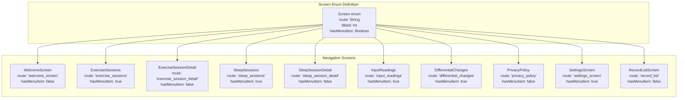

The `hasMenuItem` property determines whether a screen appears in the navigation drawer. Detail screens and utility screens (Privacy Policy, Record List) are accessible only through navigation from parent screens.

**Sources:** [health-connect/HealthConnectSample/app/src/main/java/com/example/healthconnectsample/presentation/navigation/Screen.kt:24-43]()

### Navigation Graph Structure

The `HealthConnectNavigation` composable configures a `NavHost` with all application routes and their associated composable screens.

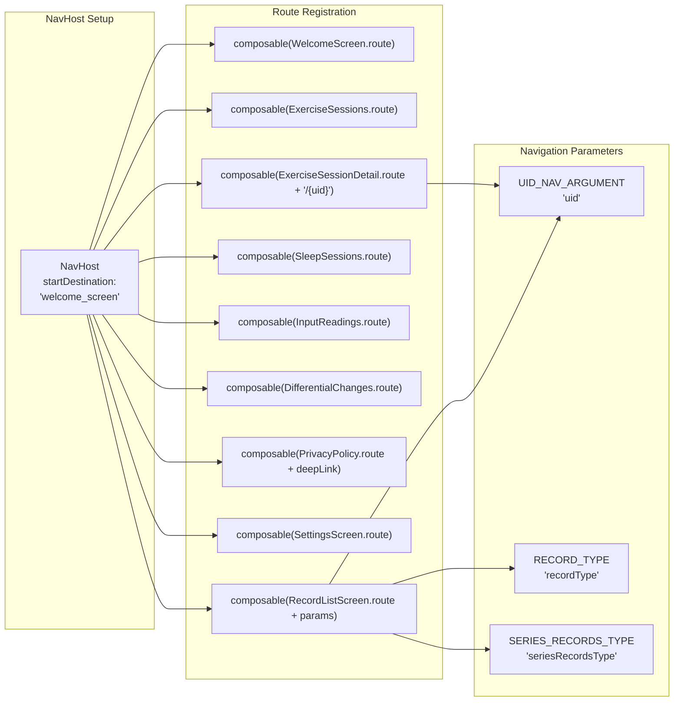

Navigation arguments are defined as constants and extracted from route parameters:
- `UID_NAV_ARGUMENT = "uid"` - identifies specific records
- `RECORD_TYPE = "recordType"` - specifies parent record type (ExerciseSession, SleepSession)
- `SERIES_RECORDS_TYPE = "seriesRecordsType"` - specifies child record type (Steps, HeartRate, etc.)

**Sources:** [health-connect/HealthConnectSample/app/src/main/java/com/example/healthconnectsample/presentation/navigation/Screen.kt:20-22](), [health-connect/HealthConnectSample/app/src/main/java/com/example/healthconnectsample/presentation/navigation/HealthConnectNavigation.kt:55-301]()

### Deep Linking Support

The Privacy Policy screen supports deep linking via the `androidx.health.ACTION_SHOW_PERMISSIONS_RATIONALE` action, allowing Health Connect to redirect users to the app's privacy policy.

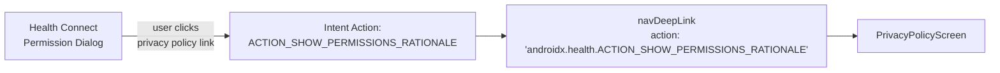

This deep link is registered in both the navigation graph and AndroidManifest.

**Sources:** [health-connect/HealthConnectSample/app/src/main/java/com/example/healthconnectsample/presentation/navigation/HealthConnectNavigation.kt:75-84](), [health-connect/HealthConnectSample/app/src/main/AndroidManifest.xml:59-61]()

## Screen Hierarchy and Flow

### Welcome Screen

The `WelcomeScreen` serves as the entry point, checking Health Connect availability and displaying appropriate messages.

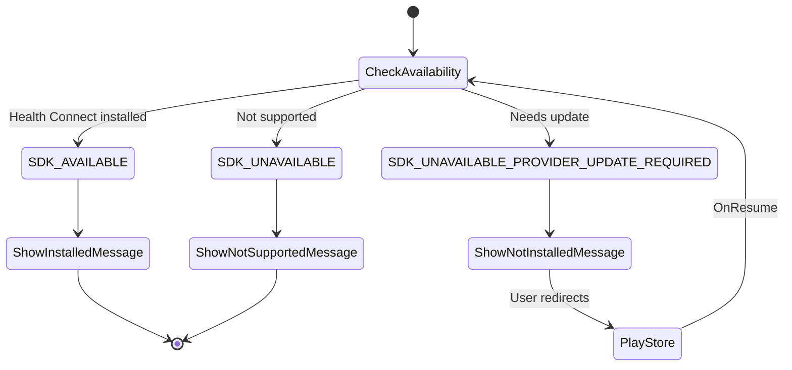

The screen uses a `DisposableEffect` with `LifecycleEventObserver` to re-check availability when resumed, ensuring that if a user installs Health Connect via Play Store, the UI updates accordingly.

**Sources:** [health-connect/HealthConnectSample/app/src/main/java/com/example/healthconnectsample/presentation/screen/WelcomeScreen.kt:54-107]()

### Main Feature Screens

Four main screens demonstrate different Health Connect capabilities:

| Screen | Route | ViewModel | Primary Function |
|--------|-------|-----------|------------------|
| ExerciseSessions | `exercise_sessions` | `ExerciseSessionViewModel` | List and manage exercise sessions |
| SleepSessions | `sleep_sessions` | `SleepSessionViewModel` | Display and generate sleep data |
| InputReadings | `input_readings` | `InputReadingsViewModel` | Record and view weight measurements |
| DifferentialChanges | `differential_changes` | `DifferentialChangesViewModel` | Track data changes with tokens |

Each screen follows the same initialization pattern:

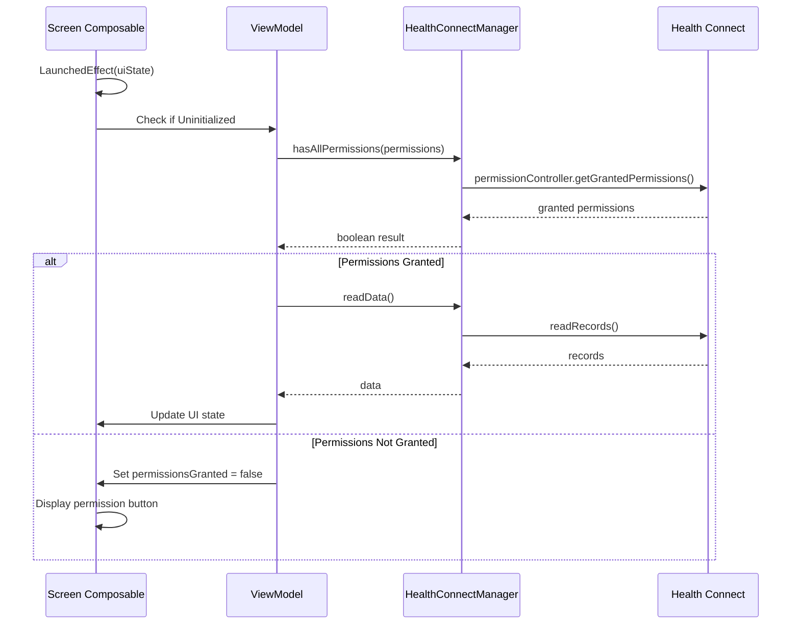

**Sources:** [health-connect/HealthConnectSample/app/src/main/java/com/example/healthconnectsample/presentation/screen/exercisesession/ExerciseSessionScreen.kt:47-157](), [health-connect/HealthConnectSample/app/src/main/java/com/example/healthconnectsample/presentation/screen/inputreadings/InputReadingsScreen.kt:65-216]()

### Detail Screens

Detail screens display expanded information about specific records.

**Exercise Session Detail Flow:**

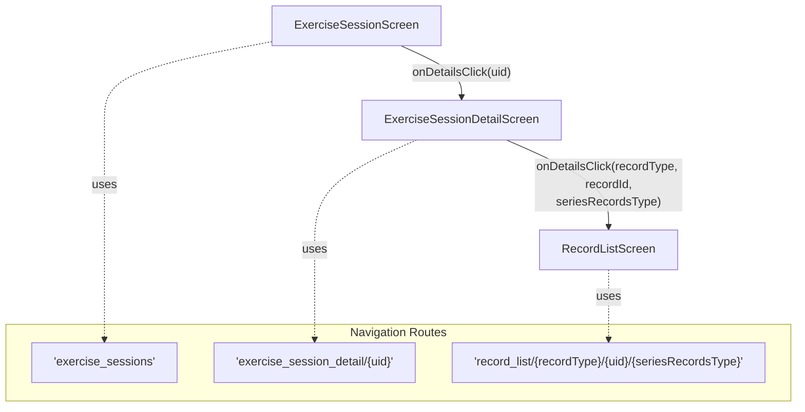

The detail screen extracts the `uid` parameter, creates a `ExerciseSessionDetailViewModel`, and displays aggregated metrics. Users can then navigate to the Record List screen to view series data (heart rate samples, step counts, etc.).

**Sources:** [health-connect/HealthConnectSample/app/src/main/java/com/example/healthconnectsample/presentation/navigation/HealthConnectNavigation.kt:129-161](), [health-connect/HealthConnectSample/app/src/main/java/com/example/healthconnectsample/presentation/navigation/HealthConnectNavigation.kt:162-195]()

### Record List Screen

The `RecordListScreen` displays time-series data associated with a parent record (exercise or sleep session).

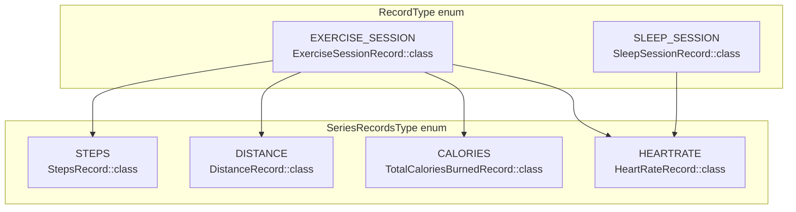

The screen uses pattern matching to render different data types appropriately, displaying count for steps, distance values, energy for calories, and sample lists for heart rate.

**Sources:** [health-connect/HealthConnectSample/app/src/main/java/com/example/healthconnectsample/presentation/screen/recordlist/RecordListScreen.kt:52-159]()

## Permission Handling Pattern

All feature screens implement a consistent permission handling pattern using ViewModels and ActivityResultContracts.

### Permission Request Flow

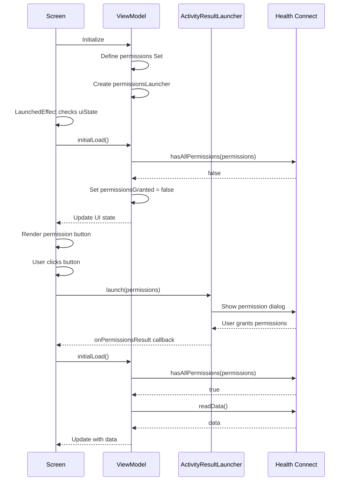

**Sources:** [health-connect/HealthConnectSample/app/src/main/java/com/example/healthconnectsample/presentation/screen/exercisesession/ExerciseSessionViewModel.kt:47-84](), [health-connect/HealthConnectSample/app/src/main/java/com/example/healthconnectsample/presentation/navigation/HealthConnectNavigation.kt:94-127]()

### ViewModel Permission Pattern

Each ViewModel follows this structure:

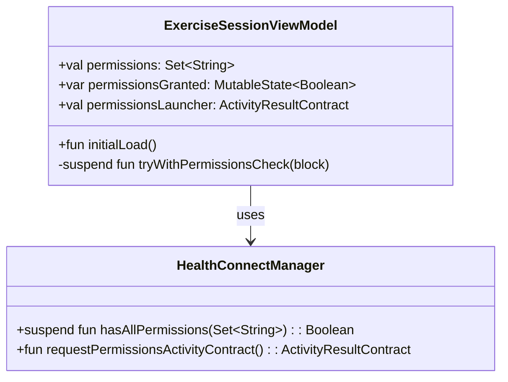

The `tryWithPermissionsCheck` function wraps all data operations, checking permissions before execution and updating `uiState` based on the result.

**Sources:** [health-connect/HealthConnectSample/app/src/main/java/com/example/healthconnectsample/presentation/screen/exercisesession/ExerciseSessionViewModel.kt:47-174](), [health-connect/HealthConnectSample/app/src/main/java/com/example/healthconnectsample/presentation/screen/inputreadings/InputReadingsViewModel.kt:40-149]()

### Background Read Permission

The Exercise Session screen demonstrates requesting the special background read permission (`PERMISSION_READ_HEALTH_DATA_IN_BACKGROUND`), checking feature availability first:

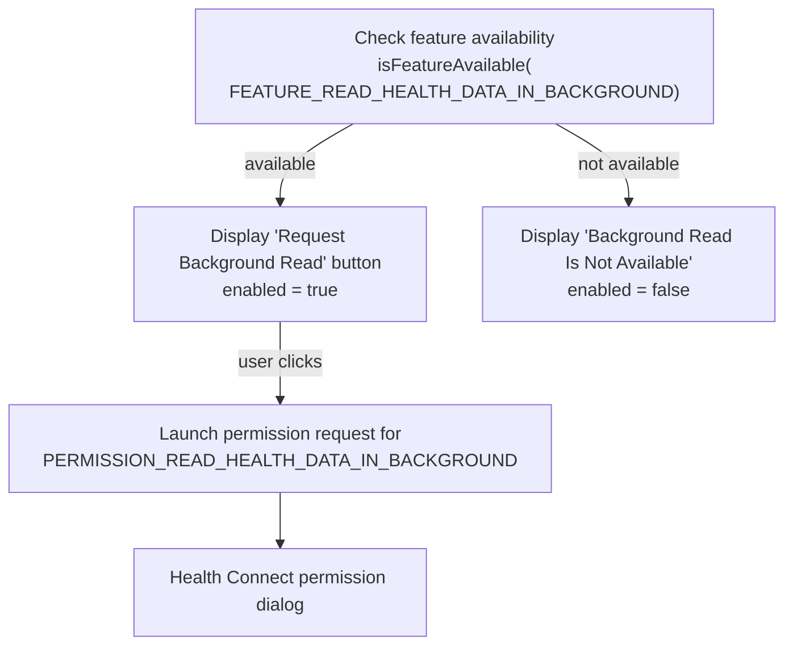

**Sources:** [health-connect/HealthConnectSample/app/src/main/java/com/example/healthconnectsample/presentation/screen/exercisesession/ExerciseSessionScreen.kt:116-135](), [health-connect/HealthConnectSample/app/src/main/java/com/example/healthconnectsample/presentation/screen/exercisesession/ExerciseSessionViewModel.kt:142-149]()

## Common UI Patterns

### LazyColumn Layout Structure

All list screens use `LazyColumn` with consistent structure:

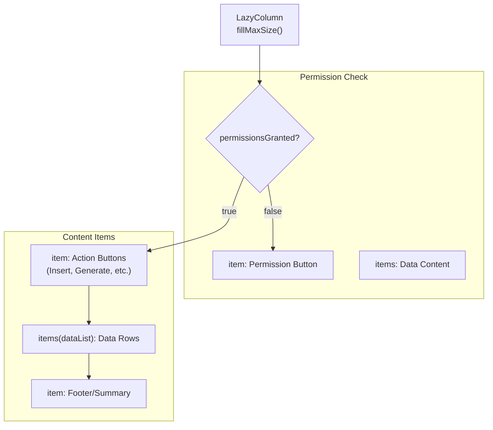

Example from Exercise Session Screen:

| Section | Implementation |
|---------|---------------|
| Permission Button | Displayed when `!permissionsGranted` |
| Insert Button | Button to create new exercise session |
| Background Read Button | Conditional, based on feature availability |
| Session List | `items(sessionsList)` with `ExerciseSessionRow` components |

**Sources:** [health-connect/HealthConnectSample/app/src/main/java/com/example/healthconnectsample/presentation/screen/exercisesession/ExerciseSessionScreen.kt:86-156](), [health-connect/HealthConnectSample/app/src/main/java/com/example/healthconnectsample/presentation/screen/inputreadings/InputReadingsScreen.kt:109-214]()

### Error Handling with Snackbar

Screens receive an `onError` callback from the navigation setup, which displays errors via Snackbar:

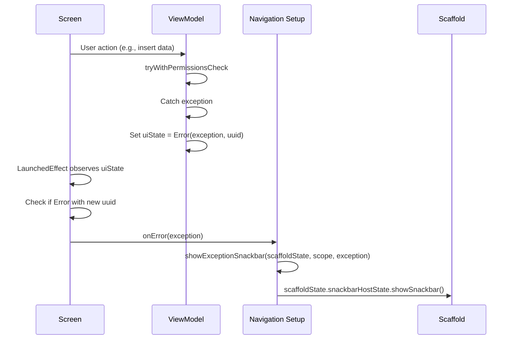

Each error is assigned a unique UUID to prevent duplicate Snackbars during recomposition.

**Sources:** [health-connect/HealthConnectSample/app/src/main/java/com/example/healthconnectsample/presentation/screen/exercisesession/ExerciseSessionScreen.kt:68-84](), [health-connect/HealthConnectSample/app/src/main/java/com/example/healthconnectsample/presentation/navigation/HealthConnectNavigation.kt:119-121]()

### UI State Management

ViewModels use a sealed class `UiState` to represent screen state:

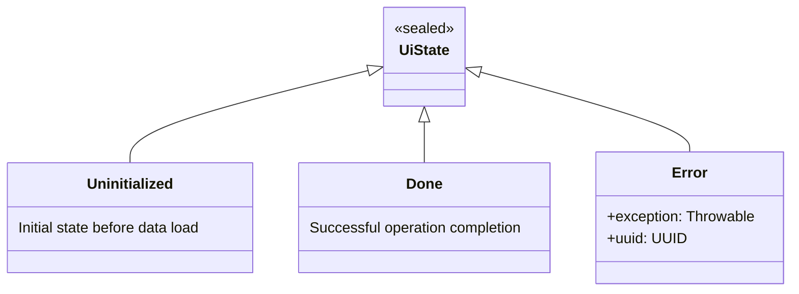

The `Uninitialized` state triggers initial data loading via `LaunchedEffect`. The `Done` state indicates successful operations. The `Error` state contains the exception and a unique UUID for error deduplication.

**Sources:** [health-connect/HealthConnectSample/app/src/main/java/com/example/healthconnectsample/presentation/screen/exercisesession/ExerciseSessionViewModel.kt:166-173](), [health-connect/HealthConnectSample/app/src/main/java/com/example/healthconnectsample/presentation/screen/inputreadings/InputReadingsViewModel.kt:142-149]()

## Input Validation Pattern

The Input Readings screen demonstrates form validation with immediate feedback:

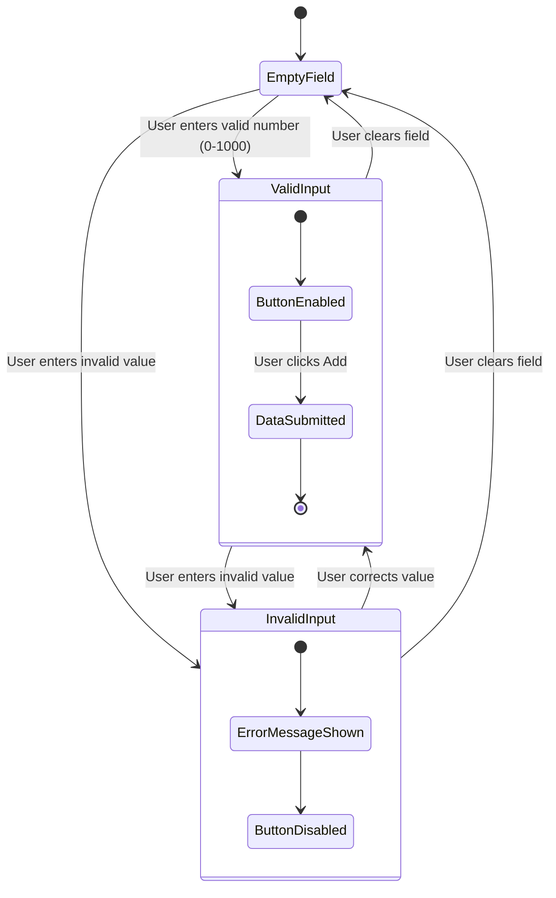

The validation function `hasValidDoubleInRange` checks bounds, and the UI displays error text and disables the submit button for invalid input.

**Sources:** [health-connect/HealthConnectSample/app/src/main/java/com/example/healthconnectsample/presentation/screen/inputreadings/InputReadingsScreen.kt:99-160]()

## Screen Title Resources

Screen titles are defined in `strings.xml` and referenced by the `Screen` enum:

| Screen | String Resource | String Value |
|--------|----------------|--------------|
| WelcomeScreen | `welcome_screen` | "Welcome screen" |
| ExerciseSessions | `exercise_sessions` | "Exercise sessions" |
| ExerciseSessionDetail | `exercise_session_detail` | "Exercise session detail" |
| SleepSessions | `sleep_sessions` | "Sleep sessions" |
| SleepSessionDetail | `sleep_session_detail` | "Sleep session detail" |
| InputReadings | `input_readings` | "Record weight" |
| DifferentialChanges | `differential_changes` | "Changes" |
| PrivacyPolicy | `privacy_policy` | "Privacy policy" |
| SettingsScreen | `settings` | "Settings" |

**Sources:** [health-connect/HealthConnectSample/app/src/main/res/values/strings.xml:20-27](), [health-connect/HealthConnectSample/app/src/main/java/com/example/healthconnectsample/presentation/navigation/Screen.kt:32-42]()

---

