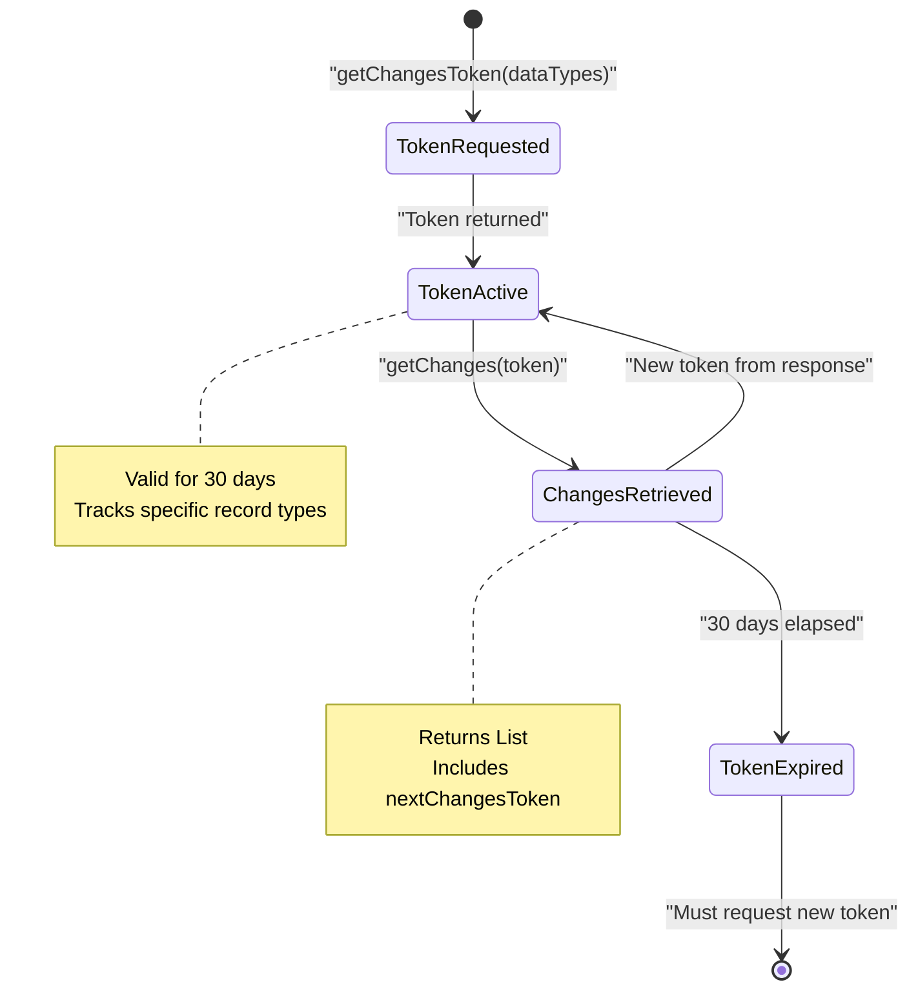
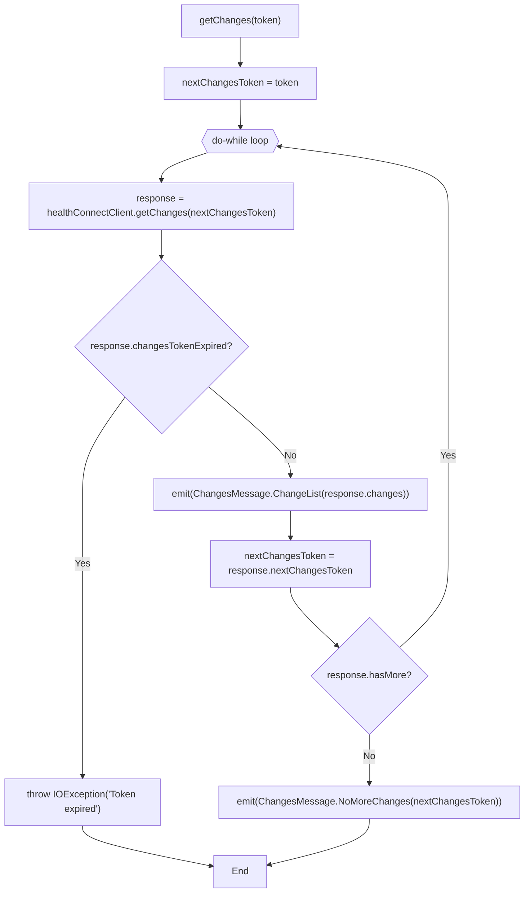
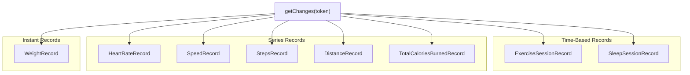
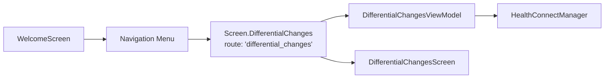
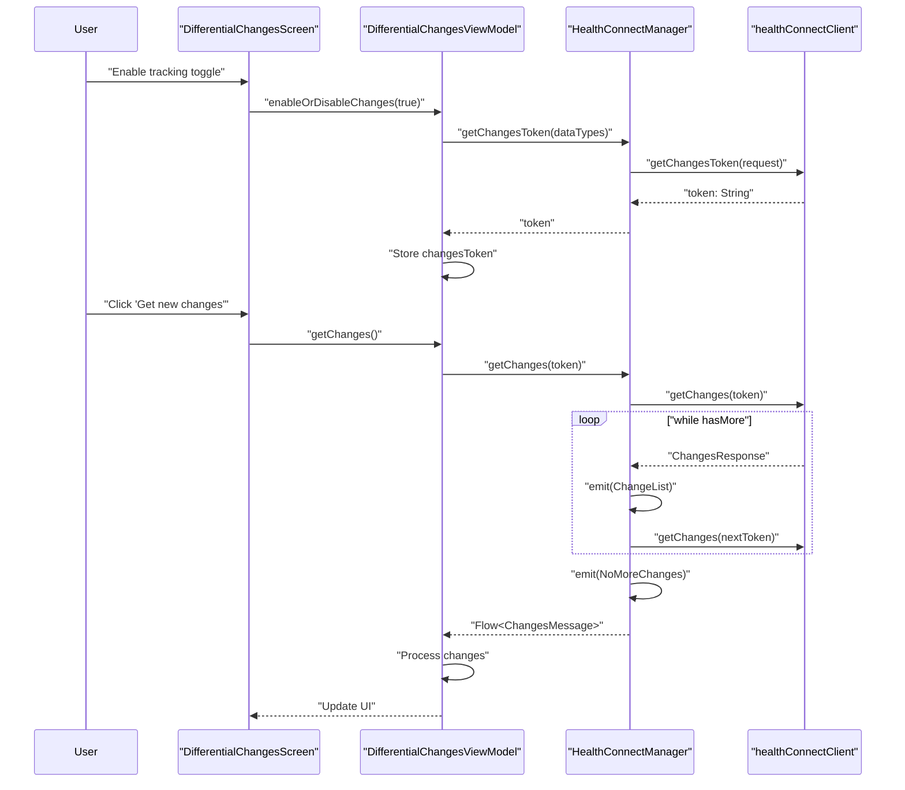
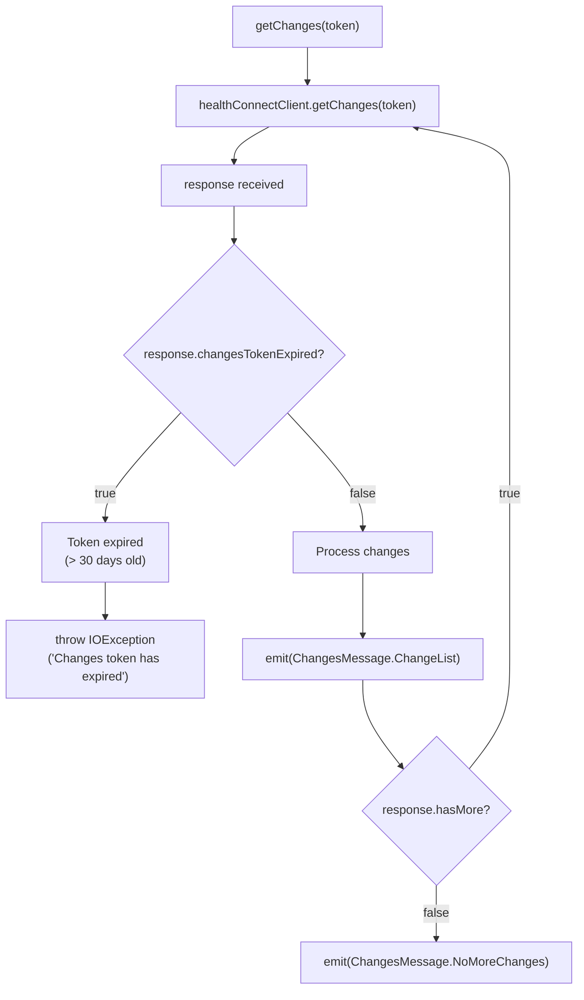
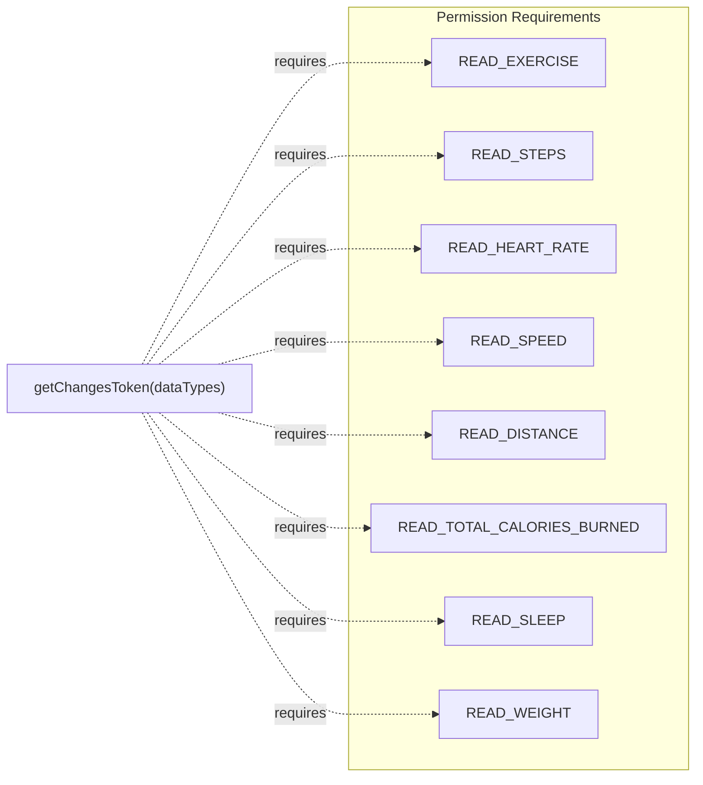

<!-- source: DeepWiki mcp.deepwiki.com · repo android/health-samples · page 3.3 Differential Changes · fetched 2026-10-23 -->

# Differential Changes

<details>
<summary>Relevant source files</summary>

The following files were used as context for generating this wiki page:

- [health-connect/HealthConnectSample/app/src/main/AndroidManifest.xml](health-connect/HealthConnectSample/app/src/main/AndroidManifest.xml)
- [health-connect/HealthConnectSample/app/src/main/java/com/example/healthconnectsample/data/HealthConnectManager.kt](health-connect/HealthConnectSample/app/src/main/java/com/example/healthconnectsample/data/HealthConnectManager.kt)
- [health-connect/HealthConnectSample/app/src/main/java/com/example/healthconnectsample/presentation/component/Series.kt](health-connect/HealthConnectSample/app/src/main/java/com/example/healthconnectsample/presentation/component/Series.kt)
- [health-connect/HealthConnectSample/app/src/main/java/com/example/healthconnectsample/presentation/navigation/HealthConnectNavigation.kt](health-connect/HealthConnectSample/app/src/main/java/com/example/healthconnectsample/presentation/navigation/HealthConnectNavigation.kt)
- [health-connect/HealthConnectSample/app/src/main/java/com/example/healthconnectsample/presentation/navigation/Screen.kt](health-connect/HealthConnectSample/app/src/main/java/com/example/healthconnectsample/presentation/navigation/Screen.kt)
- [health-connect/HealthConnectSample/app/src/main/java/com/example/healthconnectsample/presentation/screen/WelcomeScreen.kt](health-connect/HealthConnectSample/app/src/main/java/com/example/healthconnectsample/presentation/screen/WelcomeScreen.kt)
- [health-connect/HealthConnectSample/app/src/main/java/com/example/healthconnectsample/presentation/screen/exercisesession/ExerciseSessionScreen.kt](health-connect/HealthConnectSample/app/src/main/java/com/example/healthconnectsample/presentation/screen/exercisesession/ExerciseSessionScreen.kt)
- [health-connect/HealthConnectSample/app/src/main/java/com/example/healthconnectsample/presentation/screen/exercisesession/ExerciseSessionViewModel.kt](health-connect/HealthConnectSample/app/src/main/java/com/example/healthconnectsample/presentation/screen/exercisesession/ExerciseSessionViewModel.kt)
- [health-connect/HealthConnectSample/app/src/main/java/com/example/healthconnectsample/presentation/screen/inputreadings/InputReadingsScreen.kt](health-connect/HealthConnectSample/app/src/main/java/com/example/healthconnectsample/presentation/screen/inputreadings/InputReadingsScreen.kt)
- [health-connect/HealthConnectSample/app/src/main/java/com/example/healthconnectsample/presentation/screen/inputreadings/InputReadingsViewModel.kt](health-connect/HealthConnectSample/app/src/main/java/com/example/healthconnectsample/presentation/screen/inputreadings/InputReadingsViewModel.kt)
- [health-connect/HealthConnectSample/app/src/main/java/com/example/healthconnectsample/presentation/screen/recordlist/RecordListScreen.kt](health-connect/HealthConnectSample/app/src/main/java/com/example/healthconnectsample/presentation/screen/recordlist/RecordListScreen.kt)
- [health-connect/HealthConnectSample/app/src/main/res/values/strings.xml](health-connect/HealthConnectSample/app/src/main/res/values/strings.xml)
- [health-connect/HealthConnectSample/settings.gradle](health-connect/HealthConnectSample/settings.gradle)

</details>


## Purpose and Scope

This document describes the differential changes functionality in the Health Connect Sample, which demonstrates how to efficiently track and retrieve incremental updates to health data using token-based change synchronization. This API allows applications to detect insertions, updates, and deletions of health records without repeatedly querying the entire dataset.

For information about reading and writing health records, see [Data Management](#3.1). For information about the UI structure, see [UI and Navigation](#3.2).

## Overview

The differential changes system provides an efficient mechanism for synchronizing health data by tracking changes since a specific point in time. The system uses opaque tokens to mark positions in the change history, allowing applications to retrieve only the changes that occurred after a given token was issued. This approach is particularly useful for background synchronization, data export, and maintaining local caches of Health Connect data.

**Sources:** [health-connect/HealthConnectSample/app/src/main/java/com/example/healthconnectsample/data/HealthConnectManager.kt:387-416]()

## Token-Based Change Tracking Architecture

The differential changes API operates on a token-based model where tokens represent specific points in time within the Health Connect change history. Each token is valid for 30 days and can be used to retrieve all changes that occurred after the token was created.

### Token Lifecycle



**Sources:** [health-connect/HealthConnectSample/app/src/main/java/com/example/healthconnectsample/data/HealthConnectManager.kt:387-416]()

## HealthConnectManager Implementation

The `HealthConnectManager` class provides two primary methods for differential change tracking:

### getChangesToken

The `getChangesToken` method obtains an initial token for a set of record types:

| Method | Parameters | Return Type | Purpose |
|--------|-----------|-------------|---------|
| `getChangesToken` | `Set<KClass<out Record>>` | `String` | Creates a new changes token for specified record types |

The method creates a `ChangesTokenRequest` and retrieves a token from the `healthConnectClient`. This token marks the current state of the data and will be used to retrieve subsequent changes.

**Sources:** [health-connect/HealthConnectSample/app/src/main/java/com/example/healthconnectsample/data/HealthConnectManager.kt:390-393]()

### getChanges

The `getChanges` method retrieves changes since a given token:



**Sources:** [health-connect/HealthConnectSample/app/src/main/java/com/example/healthconnectsample/data/HealthConnectManager.kt:400-416]()

### ChangesMessage Sealed Class

The method returns a `Flow<ChangesMessage>` where `ChangesMessage` is a sealed class with two subtypes:

| Type | Properties | Purpose |
|------|-----------|---------|
| `ChangesMessage.ChangeList` | `changes: List<Change>` | Contains a batch of changes to process |
| `ChangesMessage.NoMoreChanges` | `nextChangesToken: String` | Indicates no more changes available, provides token for next sync |

**Sources:** [health-connect/HealthConnectSample/app/src/main/java/com/example/healthconnectsample/data/HealthConnectManager.kt:502-506]()

## Change Types and Data Structures

The system tracks changes for multiple record types defined in the sample application:

### Supported Record Types



**Sources:** 
- [health-connect/HealthConnectSample/app/src/main/res/values/strings.xml:125-133]()
- [health-connect/HealthConnectSample/app/src/main/java/com/example/healthconnectsample/data/HealthConnectManager.kt:30-38]()

### Change Operations

Each `Change` object represents one of two operations:

| Operation | Description | Use Case |
|-----------|-------------|----------|
| **Upsert** | Record inserted or updated | Displayed as "Upserted" in UI with record details |
| **Delete** | Record deleted | Displayed as "Deleted" with record ID |

**Sources:** [health-connect/HealthConnectSample/app/src/main/res/values/strings.xml:122-123]()

## User Interface Integration

The differential changes functionality is exposed through a dedicated screen in the navigation hierarchy:

### Screen Navigation



**Sources:** [health-connect/HealthConnectSample/app/src/main/java/com/example/healthconnectsample/presentation/navigation/Screen.kt:39](), [health-connect/HealthConnectSample/app/src/main/java/com/example/healthconnectsample/presentation/navigation/HealthConnectNavigation.kt:264-299]()

### ViewModel State Management

The `DifferentialChangesViewModel` manages:

| State Property | Type | Purpose |
|----------------|------|---------|
| `changesToken` | `String?` | Currently active token, null if tracking disabled |
| `permissionsGranted` | `Boolean` | Whether required permissions are granted |
| `changes` | Collection | Accumulated changes retrieved |
| `uiState` | `UiState` | Overall screen state (Uninitialized, Done, Error) |

**Sources:** [health-connect/HealthConnectSample/app/src/main/java/com/example/healthconnectsample/presentation/navigation/HealthConnectNavigation.kt:270-285]()

### Screen Functionality

The `DifferentialChangesScreen` composable provides:

1. **Permission Request**: Button to request necessary Health Connect permissions
2. **Change Tracking Toggle**: Switch to enable/disable tracking (obtains initial token)
3. **Retrieve Changes Button**: Fetches new changes since last retrieval
4. **Changes Display**: Shows upserted and deleted records with type information

**Sources:** [health-connect/HealthConnectSample/app/src/main/java/com/example/healthconnectsample/presentation/navigation/HealthConnectNavigation.kt:277-298](), [health-connect/HealthConnectSample/app/src/main/res/values/strings.xml:116-123]()

## Data Flow and Processing

The complete flow for differential change tracking involves multiple components:



**Sources:** 
- [health-connect/HealthConnectSample/app/src/main/java/com/example/healthconnectsample/data/HealthConnectManager.kt:390-416]()
- [health-connect/HealthConnectSample/app/src/main/java/com/example/healthconnectsample/presentation/navigation/HealthConnectNavigation.kt:270-298]()

## Token Expiration and Error Handling

### Token Validity Period

Tokens are valid for **30 days** from creation. The system must check for expiration on each `getChanges` call:



**Sources:** [health-connect/HealthConnectSample/app/src/main/java/com/example/healthconnectsample/data/HealthConnectManager.kt:404-411]()

### Handling Expired Tokens

When a token expires, the application must:

1. **Detect expiration** via `response.changesTokenExpired == true`
2. **Throw an IOException** to signal the error condition
3. **Implement a fallback strategy** such as:
   - Requesting a new token with `getChangesToken`
   - Performing a full data sync from a specific date
   - Notifying the user of synchronization issues

The comment in the code emphasizes two critical points:

> "tokens are only valid for 30 days. It is important to check whether the token has expired. As well as ensuring there is a fallback to using the token (for example importing data since a certain date), more importantly, the app should ensure that the changes API is used sufficiently regularly that tokens do not expire."

**Sources:** [health-connect/HealthConnectSample/app/src/main/java/com/example/healthconnectsample/data/HealthConnectManager.kt:405-410]()

## Permissions Required

The differential changes API requires read permissions for all record types being tracked:



Permissions are requested through the standard Health Connect permission flow using `PermissionController.createRequestPermissionResultContract()`.

**Sources:** 
- [health-connect/HealthConnectSample/app/src/main/AndroidManifest.xml:18-33]()
- [health-connect/HealthConnectSample/app/src/main/java/com/example/healthconnectsample/data/HealthConnectManager.kt:120-122]()

## Implementation Considerations

### Efficient Synchronization Strategy

Applications should implement differential changes tracking with these considerations:

| Consideration | Recommendation | Rationale |
|---------------|----------------|-----------|
| **Sync Frequency** | At least every 25-28 days | Prevents token expiration |
| **Token Storage** | Persist token in local storage | Maintain sync position across app restarts |
| **Batch Processing** | Process all `ChangeList` messages | Ensure no changes are missed |
| **Error Recovery** | Implement full sync fallback | Handle token expiration gracefully |

### Token Scope

Each token is scoped to specific record types provided in the `getChangesToken` call. To track changes across multiple data types, include all relevant `KClass<out Record>` types in the `dataTypes` parameter.

**Example record type set:**
```kotlin
val dataTypes = setOf(
    ExerciseSessionRecord::class,
    StepsRecord::class,
    HeartRateRecord::class,
    DistanceRecord::class,
    TotalCaloriesBurnedRecord::class,
    SleepSessionRecord::class,
    WeightRecord::class
)
```

**Sources:** [health-connect/HealthConnectSample/app/src/main/java/com/example/healthconnectsample/data/HealthConnectManager.kt:390-393]()

## Related Components

The differential changes system interacts with several other components in the Health Connect Sample:

| Component | File Path | Relationship |
|-----------|-----------|--------------|
| `HealthConnectManager` | [health-connect/HealthConnectSample/app/src/main/java/com/example/healthconnectsample/data/HealthConnectManager.kt]() | Provides changes API implementation |
| `DifferentialChangesViewModel` | Referenced in navigation | Manages screen state and change tracking |
| `DifferentialChangesScreen` | Referenced in navigation | UI for enabling tracking and viewing changes |
| Permission handling | [health-connect/HealthConnectSample/app/src/main/AndroidManifest.xml]() | Required permissions for data access |

**Sources:** [health-connect/HealthConnectSample/app/src/main/java/com/example/healthconnectsample/presentation/navigation/HealthConnectNavigation.kt:264-299]()

---

