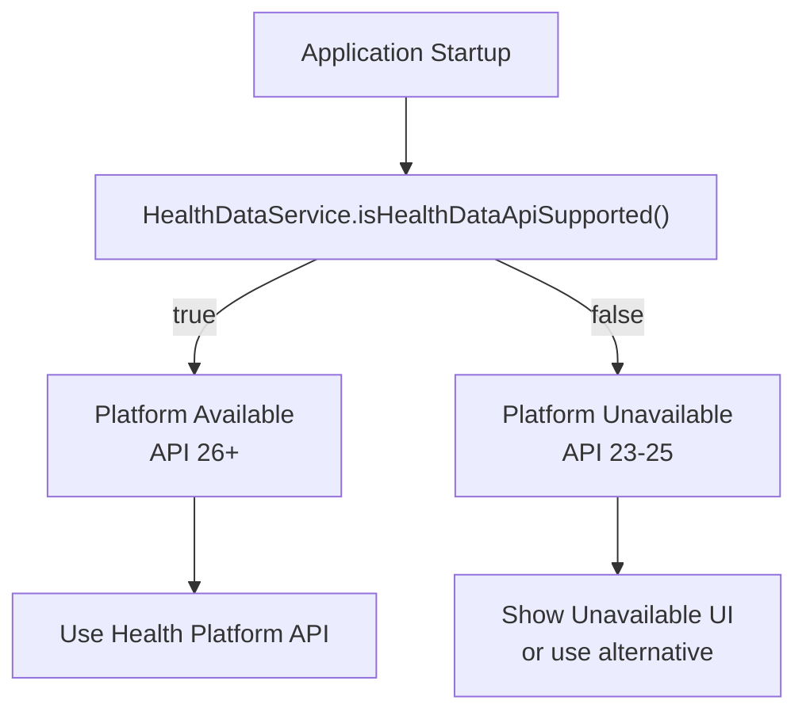
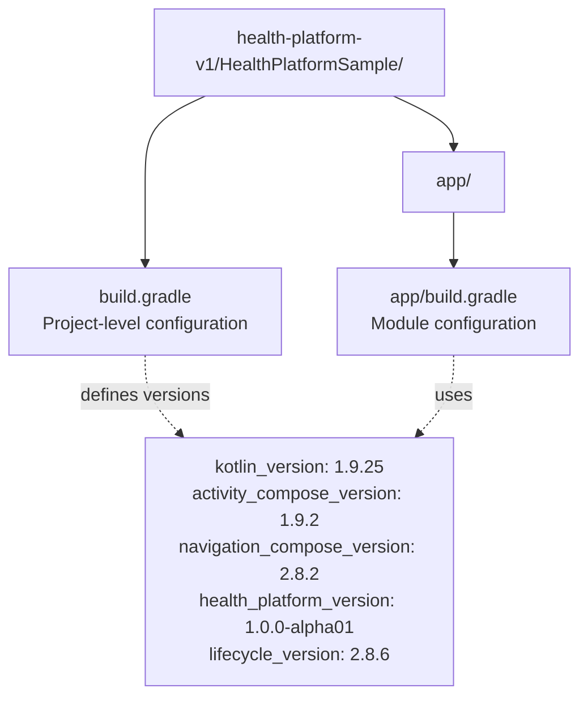
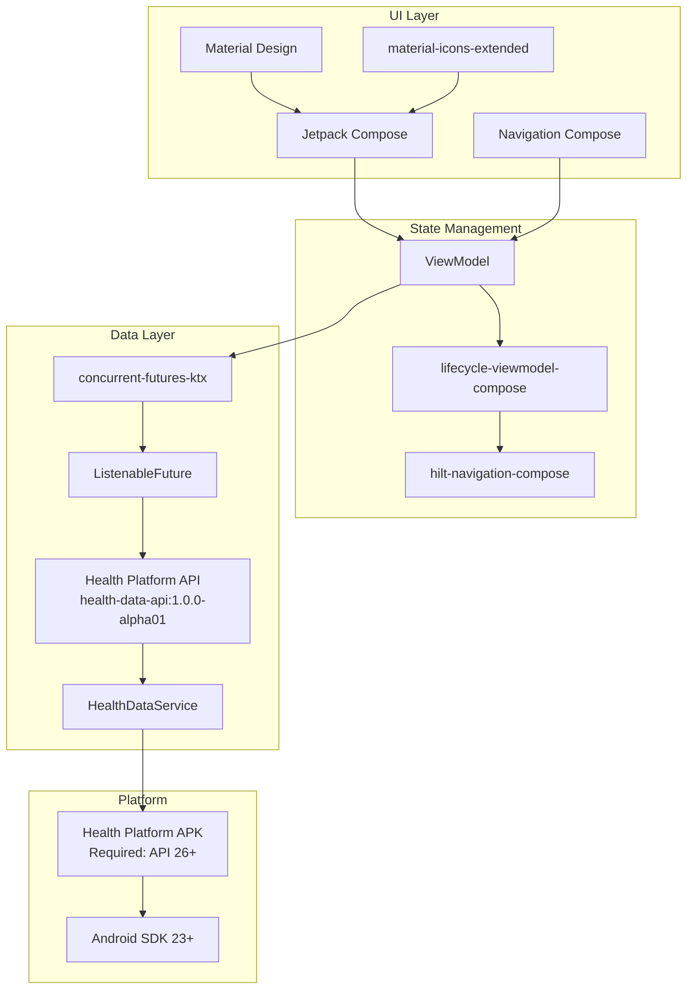
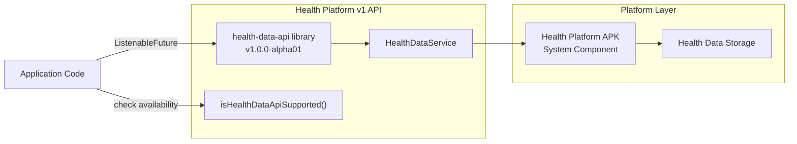
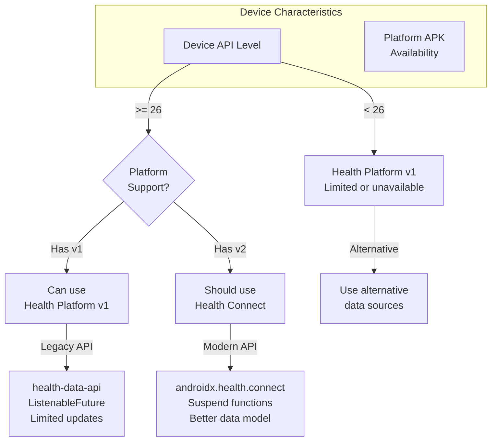
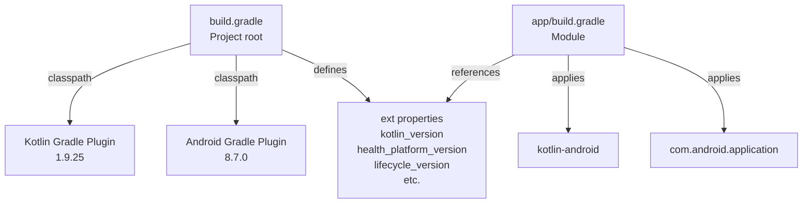

<!-- source: DeepWiki mcp.deepwiki.com · repo android/health-samples · page 4 Health Platform Sample · fetched 2026-10-23 -->

# Health Platform Sample

<details>
<summary>Relevant source files</summary>

The following files were used as context for generating this wiki page:

- [health-connect/HealthConnectSample/app/build.gradle](health-connect/HealthConnectSample/app/build.gradle)
- [health-connect/HealthConnectSample/build.gradle](health-connect/HealthConnectSample/build.gradle)
- [health-platform-v1/HealthPlatformSample/app/build.gradle](health-platform-v1/HealthPlatformSample/app/build.gradle)
- [health-platform-v1/HealthPlatformSample/build.gradle](health-platform-v1/HealthPlatformSample/build.gradle)
- [health-services/ExerciseSampleCompose/gradle/libs.versions.toml](health-services/ExerciseSampleCompose/gradle/libs.versions.toml)
- [health-services/MeasureDataCompose/gradle/libs.versions.toml](health-services/MeasureDataCompose/gradle/libs.versions.toml)
- [health-services/PassiveDataCompose/gradle/libs.versions.toml](health-services/PassiveDataCompose/gradle/libs.versions.toml)
- [health-services/PassiveGoalsCompose/gradle/libs.versions.toml](health-services/PassiveGoalsCompose/gradle/libs.versions.toml)

</details>


## Purpose and Scope

The Health Platform Sample demonstrates the legacy **Health Platform v1 API** (`com.google.android.libraries.healthdata:health-data-api`), a predecessor to the modern Health Connect API. This sample is maintained for devices running older Android versions or specific device configurations where the Health Platform v1 API remains the available health data interface.

For modern health data integration on Android devices, see [Health Connect Sample](#3). For wearable device health tracking, see [Health Services Samples](#2).

**Sources:** [health-platform-v1/HealthPlatformSample/app/build.gradle:76-77]()

---

## Platform Requirements and API Availability

### Version Compatibility

The Health Platform v1 API has specific platform requirements that differ from modern health APIs:

| Requirement | Value | Notes |
|-------------|-------|-------|
| Minimum SDK | 23 (Android 6.0) | API declared minimum |
| Target SDK | 33 (Android 13) | Build target |
| Compile SDK | 34 (Android 14) | Development target |
| Platform APK Availability | API 26+ (Android 8.0+) | Runtime requirement |

The Health Platform APK is only available on devices running Android Oreo (API 26) and above. While the SDK supports lower API levels (minSdk 23), the `HealthDataService.isHealthDataApiSupported()` method will return `false` on devices below API 26.

**Sources:** [health-platform-v1/HealthPlatformSample/app/build.gradle:23-33]()

### API Availability Check



**Sources:** [health-platform-v1/HealthPlatformSample/app/build.gradle:29-31]()

---

## Build Configuration

### Project Structure

The Health Platform Sample follows a standard Android application structure with Gradle build configuration split across project and module levels.



**Sources:** [health-platform-v1/HealthPlatformSample/build.gradle:17-27]()

### Core Dependencies

The sample relies on several key dependency categories:

#### Health Platform API

```groovy
implementation "com.google.android.libraries.healthdata:health-data-api:1.0.0-alpha01"
```

This is the primary dependency providing access to the Health Platform v1 API. Note the `alpha01` designation indicating early-stage API stability.

**Sources:** [health-platform-v1/HealthPlatformSample/app/build.gradle:77]()

#### Jetpack Compose UI Stack

The sample uses Compose BOM (Bill of Materials) version `2024.09.03` for dependency alignment:

```groovy
def composeBom = platform('androidx.compose:compose-bom:2024.09.03')
implementation(composeBom)
```

This includes:
- `androidx.compose.ui:ui` - Core Compose UI
- `androidx.compose.material:material` - Material Design components
- `androidx.compose.ui:ui-tooling-preview` - Preview support
- `androidx.compose.material:material-icons-extended` - Extended icon set

**Sources:** [health-platform-v1/HealthPlatformSample/app/build.gradle:73-94]()

#### State Management and Navigation

```groovy
implementation "androidx.lifecycle:lifecycle-viewmodel-compose:2.8.6"
implementation "androidx.navigation:navigation-compose:2.8.2"
implementation "androidx.hilt:hilt-navigation-compose:1.2.0"
```

The sample uses ViewModel pattern with Compose integration and Navigation component for multi-screen flows. Hilt navigation compose provides dependency injection integration.

**Sources:** [health-platform-v1/HealthPlatformSample/app/build.gradle:80-84]()

#### Async Operations Bridge

```groovy
implementation "androidx.concurrent:concurrent-futures-ktx:1.2.0"
```

This library bridges between `ListenableFuture` (used by the Health Platform API) and Kotlin coroutines/suspend functions, enabling modern async programming patterns.

**Sources:** [health-platform-v1/HealthPlatformSample/app/build.gradle:87]()

### Compiler Configuration

The sample requires specific compiler settings to support both legacy API levels and modern language features:

| Configuration | Value | Purpose |
|---------------|-------|---------|
| Java Compatibility | `JavaVersion.VERSION_17` | Modern language features |
| Kotlin JVM Target | `17` | Align with Java version |
| Compose Compiler | `1.5.15` | Compose UI compilation |
| Core Library Desugaring | Enabled | java.time support on API < 26 |

```groovy
coreLibraryDesugaringEnabled true
```

Desugaring is required because the minSdk is 23 (below API 26), enabling the use of `java.time` classes and other modern JDK APIs on older Android versions.

**Sources:** [health-platform-v1/HealthPlatformSample/app/build.gradle:49-63](), [health-platform-v1/HealthPlatformSample/app/build.gradle:100]()

---

## Architecture Overview

### Technology Stack Diagram



**Sources:** [health-platform-v1/HealthPlatformSample/app/build.gradle:71-98]()

### Architectural Patterns

The sample demonstrates modern Android architecture patterns adapted for the legacy Health Platform API:

1. **MVVM (Model-View-ViewModel)**: ViewModels manage UI state and business logic, exposing data streams to Compose UI
2. **Repository Pattern**: Likely abstracts Health Platform API calls (inferred from standard Android architecture)
3. **Reactive Data Flow**: Using Kotlin coroutines and Flow via the concurrent-futures bridge
4. **Dependency Injection**: Hilt integration for navigation suggests DI throughout the app
5. **Declarative UI**: Jetpack Compose for UI construction

**Sources:** [health-platform-v1/HealthPlatformSample/app/build.gradle:79-84]()

---

## Health Platform API Integration

### API Surface

The Health Platform v1 API uses a different package and API surface compared to modern Health Connect:



**Sources:** [health-platform-v1/HealthPlatformSample/app/build.gradle:76-77]()

### Key API Characteristics

| Aspect | Health Platform v1 | Modern Health Connect (for comparison) |
|--------|-------------------|----------------------------------------|
| Package | `com.google.android.libraries.healthdata` | `androidx.health.connect` |
| Version | `1.0.0-alpha01` (legacy) | `1.1.0-alpha12+` (active) |
| Async Model | `ListenableFuture` | Kotlin coroutines (suspend) |
| Min SDK | 23 | 26 |
| Status | Legacy/deprecated | Current API |

**Sources:** [health-platform-v1/HealthPlatformSample/app/build.gradle:77](), [health-connect/HealthConnectSample/build.gradle:25]()

### Async Operation Bridge

Since the Health Platform API returns `ListenableFuture` objects (pre-coroutines async pattern), the sample uses `concurrent-futures-ktx` to convert these to suspend functions:

```kotlin
// Health Platform API returns ListenableFuture
// concurrent-futures-ktx provides .await() extension
val result = healthDataService.someOperation().await()
```

This allows modern coroutine-based code to interact with the legacy callback-based API.

**Sources:** [health-platform-v1/HealthPlatformSample/app/build.gradle:86-87]()

---

## Build Variants and Optimization

### Release Configuration

The sample includes production-ready build optimization:

```groovy
buildTypes {
    release {
        minifyEnabled true
        shrinkResources true
        proguardFiles getDefaultProguardFile('proguard-android-optimize.txt'), 'proguard-rules.pro'
    }
}
```

| Optimization | Enabled | Effect |
|--------------|---------|--------|
| Code Minification | Yes | R8 removes unused code |
| Resource Shrinking | Yes | Removes unused resources |
| ProGuard Rules | Custom | API-specific keep rules |

**Sources:** [health-platform-v1/HealthPlatformSample/app/build.gradle:42-47]()

---

## Comparison with Modern Health APIs

### Migration Considerations



### When to Use Health Platform v1

- **Device Compatibility**: Targeting devices with Health Platform APK but not Health Connect
- **Legacy System Support**: Maintaining existing integrations with v1 API
- **Gradual Migration**: Transitioning from v1 to Health Connect over time

### When to Use Health Connect Instead

- **New Projects**: All new development should target Health Connect API (see [Health Connect Sample](#3))
- **Modern Devices**: API 26+ devices with Health Connect platform support
- **Feature Requirements**: Need for latest health data types and aggregation features

**Sources:** [health-platform-v1/HealthPlatformSample/app/build.gradle:29-33]()

---

## Package and Application Configuration

### Application Identity

```groovy
namespace "com.example.healthplatformsample"
applicationId "com.example.healthplatformsample"
versionCode 1
versionName "1.0"
```

The sample uses the `com.example.healthplatformsample` package for demonstration purposes. Production applications should use their own package naming.

**Sources:** [health-platform-v1/HealthPlatformSample/app/build.gradle:25-35]()

### Packaging Options

```groovy
packagingOptions {
    resources {
        excludes += '/META-INF/{AL2.0,LGPL2.1}'
    }
}
```

Standard Android packaging exclusions for duplicate license files in dependencies.

**Sources:** [health-platform-v1/HealthPlatformSample/app/build.gradle:64-68]()

---

## Development Tooling

### Gradle Build System

The sample uses Gradle with Kotlin DSL for build configuration:



**Sources:** [health-platform-v1/HealthPlatformSample/build.gradle:17-38]()

### Android Gradle Plugin Version

```groovy
classpath 'com.android.tools.build:gradle:8.7.0'
```

Uses AGP 8.7.0, which is modern but slightly behind the latest Health Services samples (8.10.1). This suggests stable, production-ready tooling rather than cutting-edge features.

**Sources:** [health-platform-v1/HealthPlatformSample/build.gradle:33]()

---

## Summary

The Health Platform Sample provides a reference implementation for the legacy Health Platform v1 API. Key characteristics:

- **Legacy API**: Uses `health-data-api:1.0.0-alpha01` for devices without Health Connect
- **Platform Requirements**: Requires Health Platform APK (API 26+) despite minSdk 23
- **Modern Architecture**: Despite legacy API, uses modern patterns (Compose, ViewModel, Navigation)
- **Async Bridge**: Uses `concurrent-futures-ktx` to bridge ListenableFuture to coroutines
- **Desugaring**: Enables java.time support on older devices
- **Migration Path**: Serves as reference but new projects should use Health Connect (see [Health Connect Sample](#3))

For active development targeting modern devices, the [Health Connect Sample](#3) demonstrates the current recommended API. For Wear OS health tracking, see [Health Services Samples](#2).

**Sources:** [health-platform-v1/HealthPlatformSample/build.gradle:1-43](), [health-platform-v1/HealthPlatformSample/app/build.gradle:1-101]()

---

