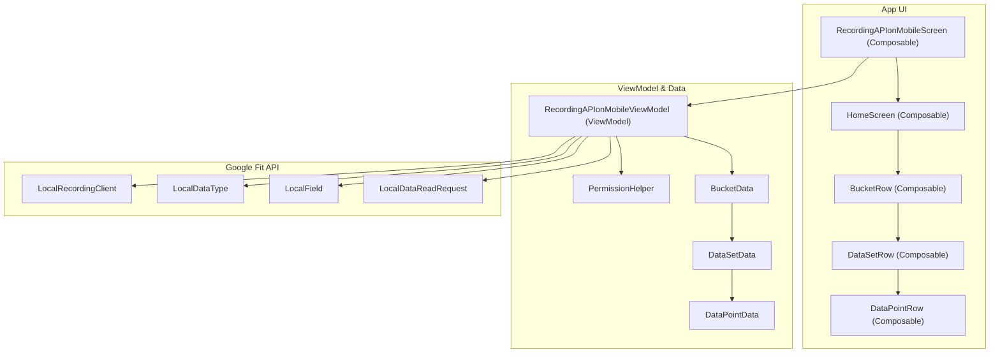

<!-- source: DeepWiki mcp.deepwiki.com · repo android/health-samples · page 5 Recording API Sample · fetched 2026-10-23 -->

# Recording API Sample

<details>
<summary>Relevant source files</summary>

The following files were used as context for generating this wiki page:

- [recording-api-on-mobile/RecordingApiOnMobileSample/app/src/main/java/com/example/recordingapionmobilesample/component/BucketRow.kt](recording-api-on-mobile/RecordingApiOnMobileSample/app/src/main/java/com/example/recordingapionmobilesample/component/BucketRow.kt)
- [recording-api-on-mobile/RecordingApiOnMobileSample/app/src/main/java/com/example/recordingapionmobilesample/component/DataPointRow.kt](recording-api-on-mobile/RecordingApiOnMobileSample/app/src/main/java/com/example/recordingapionmobilesample/component/DataPointRow.kt)
- [recording-api-on-mobile/RecordingApiOnMobileSample/app/src/main/java/com/example/recordingapionmobilesample/component/DataSetRow.kt](recording-api-on-mobile/RecordingApiOnMobileSample/app/src/main/java/com/example/recordingapionmobilesample/component/DataSetRow.kt)
- [recording-api-on-mobile/RecordingApiOnMobileSample/app/src/main/java/com/example/recordingapionmobilesample/data/DataPointData.kt](recording-api-on-mobile/RecordingApiOnMobileSample/app/src/main/java/com/example/recordingapionmobilesample/data/DataPointData.kt)
- [recording-api-on-mobile/RecordingApiOnMobileSample/app/src/main/java/com/example/recordingapionmobilesample/screen/home/HomeScreen.kt](recording-api-on-mobile/RecordingApiOnMobileSample/app/src/main/java/com/example/recordingapionmobilesample/screen/home/HomeScreen.kt)
- [recording-api-on-mobile/RecordingApiOnMobileSample/app/src/main/java/com/example/recordingapionmobilesample/screen/recordingAPIonMobile/RecordingAPIonMobileScreen.kt](recording-api-on-mobile/RecordingApiOnMobileSample/app/src/main/java/com/example/recordingapionmobilesample/screen/recordingAPIonMobile/RecordingAPIonMobileScreen.kt)
- [recording-api-on-mobile/RecordingApiOnMobileSample/app/src/main/java/com/example/recordingapionmobilesample/screen/recordingAPIonMobile/RecordingAPIonMobileViewModel.kt](recording-api-on-mobile/RecordingApiOnMobileSample/app/src/main/java/com/example/recordingapionmobilesample/screen/recordingAPIonMobile/RecordingAPIonMobileViewModel.kt)
- [recording-api-on-mobile/RecordingApiOnMobileSample/screenshots/read-aggregate.png](recording-api-on-mobile/RecordingApiOnMobileSample/screenshots/read-aggregate.png)
- [recording-api-on-mobile/RecordingApiOnMobileSample/screenshots/read-raw.png](recording-api-on-mobile/RecordingApiOnMobileSample/screenshots/read-raw.png)
- [recording-api-on-mobile/RecordingApiOnMobileSample/screenshots/request-permission.png](recording-api-on-mobile/RecordingApiOnMobileSample/screenshots/request-permission.png)

</details>


This document describes the **RecordingAPIonMobile** sample in the [`android/health-samples`](https://github.com/android/health-samples) repository. It explains the sample’s purpose, architecture, main code entities, and user interface structure. The focus is on how the sample demonstrates the use of the **Google Fit Recording API** for passive background health data collection on Android mobile devices.

For information about other health data APIs and samples, see:
- [Health Services Samples](#2) for Wear OS active and passive tracking
- [Health Connect Sample](#3) for the unified Health Connect API
- [Health Platform Sample](#4) for the legacy Health Platform v1 API

---

## Purpose and Scope

The **RecordingAPIonMobile** sample demonstrates:
- How to request and handle runtime permissions for activity recognition
- How to subscribe to background data collection for steps, distance, and calories using the Google Fit Recording API
- How to read both raw and aggregated health data for the last 24 hours
- How to display the collected data in a Compose-based UI

This sample is intended for developers who want to learn how to use the Google Fit Recording API for passive data collection on Android mobile devices.

Sources:  
[recording-api-on-mobile/RecordingApiOnMobileSample/app/src/main/java/com/example/recordingapionmobilesample/screen/recordingAPIonMobile/RecordingAPIonMobileScreen.kt:17-89]()  
[recording-api-on-mobile/RecordingApiOnMobileSample/app/src/main/java/com/example/recordingapionmobilesample/screen/recordingAPIonMobile/RecordingAPIonMobileViewModel.kt:17-210]()  

---

## System Overview

The sample is structured around a **ViewModel** (`RecordingAPIonMobileViewModel`) that manages permission state, data subscriptions, and data retrieval. The UI is built with Jetpack Compose and consists of a main screen (`RecordingAPIonMobileScreen`) that delegates to a reusable `HomeScreen` component.

### Diagram: High-Level System and Code Entities


Sources:  
[recording-api-on-mobile/RecordingApiOnMobileSample/app/src/main/java/com/example/recordingapionmobilesample/screen/recordingAPIonMobile/RecordingAPIonMobileScreen.kt:17-89]()  
[recording-api-on-mobile/RecordingApiOnMobileSample/app/src/main/java/com/example/recordingapionmobilesample/screen/recordingAPIonMobile/RecordingAPIonMobileViewModel.kt:17-210]()  
[recording-api-on-mobile/RecordingApiOnMobileSample/app/src/main/java/com/example/recordingapionmobilesample/component/BucketRow.kt:17-106]()  
[recording-api-on-mobile/RecordingApiOnMobileSample/app/src/main/java/com/example/recordingapionmobilesample/component/DataSetRow.kt:17-79]()  
[recording-api-on-mobile/RecordingApiOnMobileSample/app/src/main/java/com/example/recordingapionmobilesample/component/DataPointRow.kt:17-81]()  

---

## Key Features

| Feature                        | Description                                                                                  | Code Reference |
|---------------------------------|----------------------------------------------------------------------------------------------|---------------|
| Permission Handling             | Requests `ACTIVITY_RECOGNITION` permission at runtime                                        | [RecordingAPIonMobileScreen.kt:46-51]() |
| Data Subscription               | Subscribes to step, distance, and calorie data types using `LocalRecordingClient.subscribe`  | [RecordingAPIonMobileViewModel.kt:96-111]() |
| Data Reading (Raw/Aggregate)    | Reads raw and aggregate data for the last 24 hours using `LocalDataReadRequest`              | [RecordingAPIonMobileViewModel.kt:122-210]() |
| Data Display                    | Shows buckets, datasets, and datapoints in a hierarchical Compose UI                         | [BucketRow.kt:40-67](), [DataSetRow.kt:36-55](), [DataPointRow.kt:39-62]() |

Sources:  
See code references in the table above.

---

## Permission Handling

The sample checks for and requests the `ACTIVITY_RECOGNITION` permission, which is required for background step, distance, and calorie data collection.

- The permission is checked in the ViewModel (`checkPermission`).
- If not granted, the UI displays a "Request Permissions" button.
- When clicked, the permission is requested using `ActivityResultContracts.RequestPermission`.

**Relevant code:**
- Permission check: [RecordingAPIonMobileViewModel.kt:89-91]()
- Permission request: [RecordingAPIonMobileScreen.kt:46-51]()

**UI Example:**  


Sources:  
[recording-api-on-mobile/RecordingApiOnMobileSample/app/src/main/java/com/example/recordingapionmobilesample/screen/recordingAPIonMobile/RecordingAPIonMobileScreen.kt:46-51]()  
[recording-api-on-mobile/RecordingApiOnMobileSample/app/src/main/java/com/example/recordingapionmobilesample/screen/recordingAPIonMobile/RecordingAPIonMobileViewModel.kt:89-91]()  

---

## Data Subscription and Types

Upon permission grant, the ViewModel subscribes to three data types:
- Steps (`TYPE_STEP_COUNT_DELTA`)
- Distance (`TYPE_DISTANCE_DELTA`)
- Calories (`TYPE_CALORIES_EXPENDED`)

This is done using `LocalRecordingClient.subscribe(LocalDataType)` for each type.

**Relevant code:**
- Data type list: [RecordingAPIonMobileViewModel.kt:52-56]()
- Subscription logic: [RecordingAPIonMobileViewModel.kt:96-111]()

Sources:  
[recording-api-on-mobile/RecordingApiOnMobileSample/app/src/main/java/com/example/recordingapionmobilesample/screen/recordingAPIonMobile/RecordingAPIonMobileViewModel.kt:52-56,96-111]()  

---

## Data Reading: Raw and Aggregate

The sample provides two actions:
- **Read Raw Data in Last 24 Hours**: Reads all raw data points for the selected type.
- **Read Aggregate Data in Last 24 Hours**: Reads hourly aggregates for the selected type.

Both actions use `LocalDataReadRequest` with a 24-hour time range, bucketed by hour.

**Relevant code:**
- Raw data: [RecordingAPIonMobileViewModel.kt:172-210]()
- Aggregate data: [RecordingAPIonMobileViewModel.kt:122-210]()

**UI Example:**  
- Raw data: 
- Aggregate data: 

Sources:  
[recording-api-on-mobile/RecordingApiOnMobileSample/app/src/main/java/com/example/recordingapionmobilesample/screen/recordingAPIonMobile/RecordingAPIonMobileViewModel.kt:122-210]()  

---

## User Interface Structure

The UI is built with Jetpack Compose and displays:
- Permission request (if needed)
- Data type selection (radio buttons for steps, distance, calories)
- Buttons to read raw or aggregate data
- A hierarchical list of buckets, datasets, and datapoints

### Diagram: UI Flow and Data Binding

```mermaid
flowchart TD
    "RecordingAPIonMobileScreen" --> "HomeScreen"
    "HomeScreen" --> "PermissionButton[Request Permissions Button]"
    "HomeScreen" --> "DataTypeRadioButtons"
    "HomeScreen" --> "ReadRawButton[Read Raw Data Button]"
    "HomeScreen" --> "ReadAggregateButton[Read Aggregate Data Button]"
    "HomeScreen" --> "BucketList"
    "BucketList" --> "BucketRow"
    "BucketRow" --> "DataSetRow"
    "DataSetRow" --> "DataPointRow"
    "HomeScreen" -.-> "ViewModel.bucketDataList"
    "DataTypeRadioButtons" -.-> "ViewModel.selectedLocalDataType"
    "ReadRawButton" -.-> "ViewModel.readRawData"
    "ReadAggregateButton" -.-> "ViewModel.readAggregateData"
```

Sources:  
[recording-api-on-mobile/RecordingApiOnMobileSample/app/src/main/java/com/example/recordingapionmobilesample/screen/recordingAPIonMobile/RecordingAPIonMobileScreen.kt:40-89]()  
[recording-api-on-mobile/RecordingApiOnMobileSample/app/src/main/java/com/example/recordingapionmobilesample/screen/home/HomeScreen.kt:50-127]()  
[recording-api-on-mobile/RecordingApiOnMobileSample/app/src/main/java/com/example/recordingapionmobilesample/component/BucketRow.kt:40-67]()  
[recording-api-on-mobile/RecordingApiOnMobileSample/app/src/main/java/com/example/recordingapionmobilesample/component/DataSetRow.kt:36-55]()  
[recording-api-on-mobile/RecordingApiOnMobileSample/app/src/main/java/com/example/recordingapionmobilesample/component/DataPointRow.kt:39-62]()  

---

## Data Model

The data is structured in a hierarchy:

| Entity         | Description                                 | Code Reference |
|----------------|---------------------------------------------|---------------|
| `BucketData`   | Represents a time bucket (e.g., 1 hour)     | [BucketData.kt]() |
| `DataSetData`  | Represents a dataset within a bucket        | [DataSetData.kt]() |
| `DataPointData`| Represents a single data point              | [DataPointData.kt:19-25]() |

Each bucket contains one or more datasets, and each dataset contains one or more data points.

Sources:  
[recording-api-on-mobile/RecordingApiOnMobileSample/app/src/main/java/com/example/recordingapionmobilesample/data/BucketData.kt]()  
[recording-api-on-mobile/RecordingApiOnMobileSample/app/src/main/java/com/example/recordingapionmobilesample/data/DataSetData.kt]()  
[recording-api-on-mobile/RecordingApiOnMobileSample/app/src/main/java/com/example/recordingapionmobilesample/data/DataPointData.kt:19-25]()  

---

## Summary Table: Main Code Entities

| Entity/Class                        | Role/Responsibility                                                                 |
|--------------------------------------|-------------------------------------------------------------------------------------|
| `RecordingAPIonMobileViewModel`      | Manages permission state, subscriptions, and data retrieval                         |
| `PermissionHelper`                   | Checks for runtime permissions                                                      |
| `LocalRecordingClient`               | Google Fit API client for subscriptions and data reads                              |
| `HomeScreen`                         | Main UI for permission, data type selection, and data display                       |
| `BucketRow`, `DataSetRow`, `DataPointRow` | Compose components for displaying hierarchical data                              |
| `BucketData`, `DataSetData`, `DataPointData` | Data model classes for buckets, datasets, and data points                      |

Sources:  
See code references in the table above.

---

## Additional Notes

- The sample uses only the Google Fit **Recording API** and does not demonstrate Health Connect or Health Services APIs.
- The sample is mobile-focused and does not target Wear OS.
- The code follows modern Android best practices: MVVM, Jetpack Compose, and clear separation of concerns.

---

## References

- [recording-api-on-mobile/RecordingApiOnMobileSample/app/src/main/java/com/example/recordingapionmobilesample/screen/recordingAPIonMobile/RecordingAPIonMobileScreen.kt]()
- [recording-api-on-mobile/RecordingApiOnMobileSample/app/src/main/java/com/example/recordingapionmobilesample/screen/recordingAPIonMobile/RecordingAPIonMobileViewModel.kt]()
- [recording-api-on-mobile/RecordingApiOnMobileSample/app/src/main/java/com/example/recordingapionmobilesample/screen/home/HomeScreen.kt]()
- [recording-api-on-mobile/RecordingApiOnMobileSample/app/src/main/java/com/example/recordingapionmobilesample/component/BucketRow.kt]()
- [recording-api-on-mobile/RecordingApiOnMobileSample/app/src/main/java/com/example/recordingapionmobilesample/component/DataSetRow.kt]()
- [recording-api-on-mobile/RecordingApiOnMobileSample/app/src/main/java/com/example/recordingapionmobilesample/component/DataPointRow.kt]()
- [recording-api-on-mobile/RecordingApiOnMobileSample/app/src/main/java/com/example/recordingapionmobilesample/data/BucketData.kt]()
- [recording-api-on-mobile/RecordingApiOnMobileSample/app/src/main/java/com/example/recordingapionmobilesample/data/DataSetData.kt]()
- [recording-api-on-mobile/RecordingApiOnMobileSample/app/src/main/java/com/example/recordingapionmobilesample/data/DataPointData.kt]()

---

---

