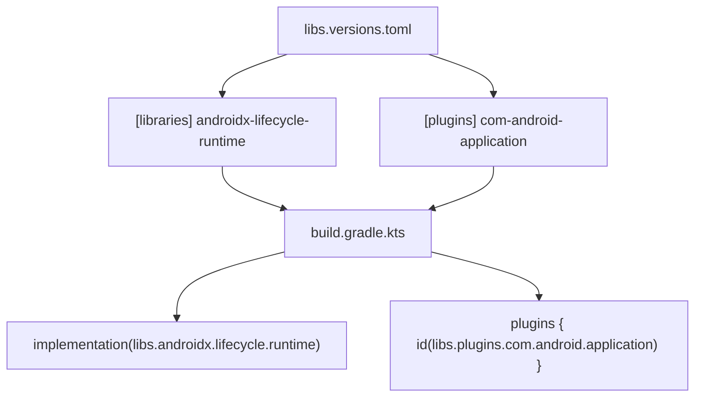
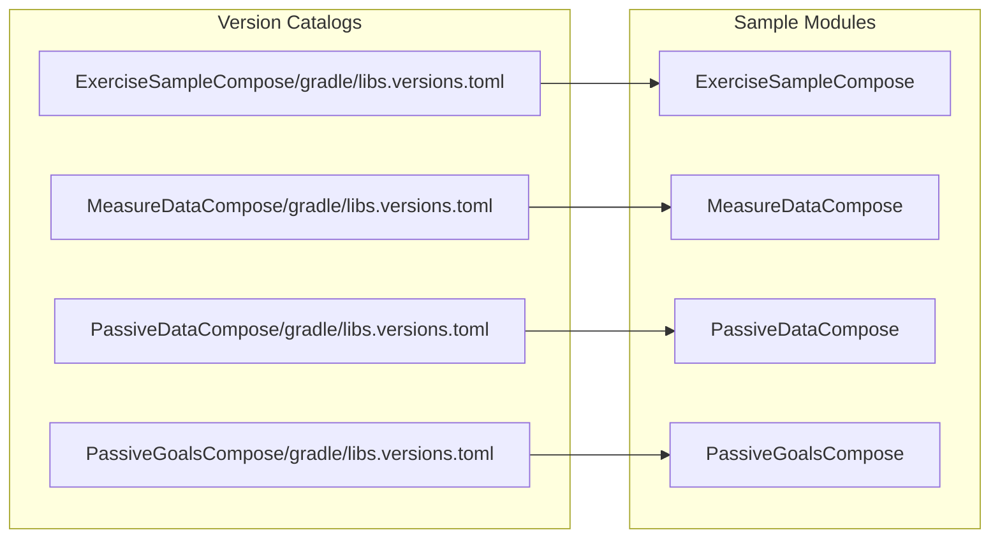

<!-- source: DeepWiki mcp.deepwiki.com · repo android/health-samples · page 6.1 Version Catalogs · fetched 2026-10-23 -->

# Version Catalogs

<details>
<summary>Relevant source files</summary>

The following files were used as context for generating this wiki page:

- [health-connect/HealthConnectSample/build.gradle](health-connect/HealthConnectSample/build.gradle)
- [health-platform-v1/HealthPlatformSample/build.gradle](health-platform-v1/HealthPlatformSample/build.gradle)
- [health-services/ExerciseSampleCompose/gradle/libs.versions.toml](health-services/ExerciseSampleCompose/gradle/libs.versions.toml)
- [health-services/MeasureDataCompose/gradle/libs.versions.toml](health-services/MeasureDataCompose/gradle/libs.versions.toml)
- [health-services/PassiveDataCompose/gradle/libs.versions.toml](health-services/PassiveDataCompose/gradle/libs.versions.toml)
- [health-services/PassiveGoalsCompose/gradle/libs.versions.toml](health-services/PassiveGoalsCompose/gradle/libs.versions.toml)

</details>


This document explains the use of **Gradle Version Catalogs** in the `android/health-samples` repository. It covers the structure and purpose of the `libs.versions.toml` files, how dependency versions are defined and referenced, and how this approach supports consistent dependency management across the sample applications. 

This page is focused on the mechanics and structure of version catalogs. For broader information about the build system and dependency automation, see [Build System and Dependencies](#6) and [Dependency Automation](#6.2).

---

## Purpose and Scope

Version catalogs in this repository are used to:

- Centralize dependency and plugin version definitions.
- Promote consistency and reduce duplication across multiple sample modules.
- Simplify dependency upgrades and maintenance, especially when used with automation tools.

This document details:

- The structure of `libs.versions.toml` files.
- How versions, libraries, and plugins are defined and referenced.
- The mapping between catalog entries and actual code usage in the samples.

---

## Version Catalog Structure

Each major sample module contains its own `libs.versions.toml` file under its `gradle/` directory. The file is divided into three main sections:

1. `[versions]`: Defines version numbers for dependencies and plugins.
2. `[libraries]`: Maps logical names to Maven coordinates, referencing versions from `[versions]`.
3. `[plugins]`: Maps plugin IDs to versions, referencing `[versions]` as needed.

### Example Structure

| Section      | Purpose                                      | Example Entry                                      |
|--------------|----------------------------------------------|----------------------------------------------------|
| `[versions]` | Central version definitions                  | `androidx-lifecycle = "2.8.6"`                     |
| `[libraries]`| Logical names to Maven coordinates/versions  | `androidx-lifecycle-runtime = { module = "androidx.lifecycle:lifecycle-runtime-ktx", version.ref = "androidx-lifecycle" }` |
| `[plugins]`  | Plugin IDs to versions                       | `com-android-application = { id = "com.android.application", version.ref = "android-gradle-plugin" }` |

Sources:  
- [health-services/ExerciseSampleCompose/gradle/libs.versions.toml:1-74]()
- [health-services/MeasureDataCompose/gradle/libs.versions.toml:1-39]()
- [health-services/PassiveDataCompose/gradle/libs.versions.toml:1-38]()
- [health-services/PassiveGoalsCompose/gradle/libs.versions.toml:1-44]()

---

## Diagram: Version Catalog File Structure

**"Version Catalog Structure in Sample Module"**

```mermaid
flowchart TB
    A["libs.versions.toml"]
    subgraph "Sections"
        V["[versions]"]
        L["[libraries]"]
        P["[plugins]"]
    end
    A --> V
    A --> L
    A --> P
    V -->|"androidx-lifecycle = \"2.8.6\""| L
    L -->|"androidx-lifecycle-runtime = { module = \"androidx.lifecycle:lifecycle-runtime-ktx\", version.ref = \"androidx-lifecycle\" }"| P
    P -->|"com-android-application = { id = \"com.android.application\", version.ref = \"android-gradle-plugin\" }"| A
```

Sources:  
- [health-services/ExerciseSampleCompose/gradle/libs.versions.toml:1-74]()

---

## Mapping Catalog Entries to Code Usage

Version catalog entries are referenced in module-level `build.gradle` or `build.gradle.kts` files using the logical names defined in `[libraries]` and `[plugins]`. This enables consistent and centralized dependency management.

### Example: Referencing a Library

In `libs.versions.toml`:
```toml
[versions]
androidx-lifecycle = "2.8.6"

[libraries]
androidx-lifecycle-runtime = { module = "androidx.lifecycle:lifecycle-runtime-ktx", version.ref = "androidx-lifecycle" }
```

In `build.gradle.kts`:
```kotlin
implementation(libs.androidx.lifecycle.runtime)
```

### Example: Referencing a Plugin

In `libs.versions.toml`:
```toml
[plugins]
com-android-application = { id = "com.android.application", version.ref = "android-gradle-plugin" }
```

In `build.gradle.kts`:
```kotlin
plugins {
    id(libs.plugins.com.android.application)
}
```

Sources:  
- [health-services/ExerciseSampleCompose/gradle/libs.versions.toml:1-74]()
- [health-services/MeasureDataCompose/gradle/libs.versions.toml:1-39]()
- [health-services/PassiveDataCompose/gradle/libs.versions.toml:1-38]()
- [health-services/PassiveGoalsCompose/gradle/libs.versions.toml:1-44]()

---

## Diagram: Mapping Version Catalog Entries to Build Files

**"How Version Catalog Entries Are Used in Build Scripts"**



Sources:  
- [health-services/ExerciseSampleCompose/gradle/libs.versions.toml:1-74]()

---

## Sample Catalog Comparison Table

The following table summarizes key differences in the version catalog files across the main Health Services samples:

| Sample Module                | AGP Version   | Compose Version | Kotlin Version | Horologist Version | Ktlint Version |
|-----------------------------|--------------|----------------|---------------|-------------------|---------------|
| ExerciseSampleCompose        | 8.10.1       | 1.7.8          | 2.1.21        | 0.7.14-beta       | 0.50.0        |
| MeasureDataCompose           | 8.7.3        | 1.8.1          | 1.9.25        | N/A               | 0.50.0        |
| PassiveDataCompose           | 8.7.3        | 1.7.8          | 1.9.25        | N/A               | 0.46.1        |
| PassiveGoalsCompose          | 8.7.3        | 1.7.8          | 2.1.20        | 0.7.14-beta       | 0.46.1        |

Sources:  
- [health-services/ExerciseSampleCompose/gradle/libs.versions.toml:1-74]()
- [health-services/MeasureDataCompose/gradle/libs.versions.toml:1-39]()
- [health-services/PassiveDataCompose/gradle/libs.versions.toml:1-38]()
- [health-services/PassiveGoalsCompose/gradle/libs.versions.toml:1-44]()

---

## Version Catalogs in the Context of the Repository

Each sample maintains its own version catalog, allowing for:

- Independent evolution of dependencies per sample.
- Experimentation with newer or different library versions in flagship samples (e.g., ExerciseSampleCompose).
- Isolation of breaking changes and easier troubleshooting.

This approach is especially useful in a multi-sample repository where each sample may have different requirements or stability constraints.

### Diagram: Version Catalogs Across Samples

**"Version Catalogs and Sample Module Boundaries"**



Sources:  
- [health-services/ExerciseSampleCompose/gradle/libs.versions.toml:1-74]()
- [health-services/MeasureDataCompose/gradle/libs.versions.toml:1-39]()
- [health-services/PassiveDataCompose/gradle/libs.versions.toml:1-38]()
- [health-services/PassiveGoalsCompose/gradle/libs.versions.toml:1-44]()

---

## Summary

- **Version catalogs** (`libs.versions.toml`) are used per sample module to centralize and standardize dependency and plugin versions.
- This approach supports maintainability, consistency, and safe experimentation across the repository.
- Catalog entries are referenced in build scripts using logical names, decoupling code from hardcoded version numbers.
- Each sample can independently manage its dependencies, which is important for a repository demonstrating multiple API and technology versions.

For more on how dependency updates are automated, see [Dependency Automation](#6.2).

---

**Sources:**  
- [health-services/ExerciseSampleCompose/gradle/libs.versions.toml:1-74]()  
- [health-services/MeasureDataCompose/gradle/libs.versions.toml:1-39]()  
- [health-services/PassiveDataCompose/gradle/libs.versions.toml:1-38]()  
- [health-services/PassiveGoalsCompose/gradle/libs.versions.toml:1-44]()  
- [health-connect/HealthConnectSample/build.gradle:1-60]()  
- [health-platform-v1/HealthPlatformSample/build.gradle:1-44]()

---

