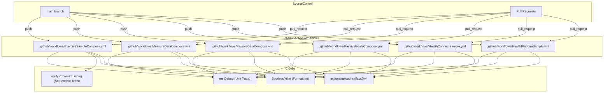
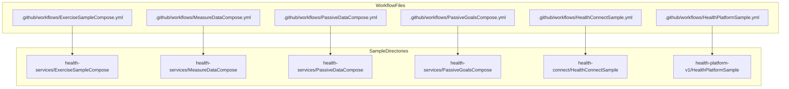

<!-- source: DeepWiki mcp.deepwiki.com · repo android/health-samples · page 7 CI/CD and Quality Assurance · fetched 2026-10-23 -->

# CI/CD and Quality Assurance

<details>
<summary>Relevant source files</summary>

The following files were used as context for generating this wiki page:

- [.github/CODEOWNERS](.github/CODEOWNERS)
- [.github/workflows/ExerciseSampleCompose.yml](.github/workflows/ExerciseSampleCompose.yml)
- [.github/workflows/HealthConnectSample.yml](.github/workflows/HealthConnectSample.yml)
- [.github/workflows/HealthPlatformSample.yml](.github/workflows/HealthPlatformSample.yml)
- [.github/workflows/MeasureDataCompose.yml](.github/workflows/MeasureDataCompose.yml)
- [.github/workflows/PassiveDataCompose.yml](.github/workflows/PassiveDataCompose.yml)
- [.github/workflows/PassiveGoalsCompose.yml](.github/workflows/PassiveGoalsCompose.yml)
- [renovate.json](renovate.json)

</details>


This document describes the continuous integration (CI), continuous delivery (CD), and quality assurance (QA) systems implemented in the [android/health-samples](https://github.com/android/health-samples) repository. It covers the automated workflows, testing strategies, code formatting enforcement, artifact management, and code ownership policies that ensure the reliability and maintainability of all sample applications.

For details about the build system, dependency management, and Renovate configuration, see [Build System and Dependencies](#6). For specifics on code ownership and review, see [Code Ownership and Review](#7.2). For information about the testing approach in the flagship sample, see [Testing Strategy](#2.1.4).

---

## Purpose and Scope

This page documents:

- The structure and function of GitHub Actions workflows for each sample.
- The types of automated tests executed in CI.
- Artifact and report management.
- Code formatting enforcement.
- The relationship between CI/CD and code review/ownership.

It does **not** cover local build setup, dependency versioning, or Renovate configuration (see [Build System and Dependencies](#6)), nor does it detail the implementation of individual tests or application logic.

---

## Overview of CI/CD Pipeline

The repository uses GitHub Actions to provide automated CI/CD for each major sample application. Each sample has a dedicated workflow YAML file under `.github/workflows/`, which is triggered on pushes to `main`, pull requests, and manual dispatch.

### Diagram: CI/CD Pipeline and Code Entities


**Sources:**  
.github/workflows/ExerciseSampleCompose.yml:1-58  
.github/workflows/MeasureDataCompose.yml:1-52  
.github/workflows/PassiveDataCompose.yml:1-52  
.github/workflows/PassiveGoalsCompose.yml:1-52  
.github/workflows/HealthConnectSample.yml:1-52  
.github/workflows/HealthPlatformSample.yml:1-52  

---

## GitHub Actions Workflows

Each sample application has a dedicated workflow file. The workflows are highly similar in structure, with the main differences being the sample path and the presence of screenshot testing for `ExerciseSampleCompose`.

### Workflow Triggers

- **Push to `main`**: Triggers the workflow if changes affect the sample or its workflow file.
- **Pull Request**: Triggers the workflow if the PR affects the sample or its workflow file.
- **Manual Dispatch**: Allows maintainers to run the workflow on demand.

### Common Workflow Steps

| Step Name                | Description                                                                 | Code Reference                                      |
|--------------------------|-----------------------------------------------------------------------------|-----------------------------------------------------|
| Checkout                 | Checks out the repository code.                                             | `actions/checkout@v4`                               |
| Set up JDK               | Installs JDK 17 using Zulu distribution.                                    | `actions/setup-java@v4`                             |
| Unit Tests               | Runs `testDebug` via Gradle.                                                | `gradle/gradle-build-action@v3`                     |
| Screenshot Tests         | Runs `verifyRoborazziDebug` (only for ExerciseSampleCompose).               | `gradle/gradle-build-action@v3`                     |
| Upload Test Results      | Uploads test results, reports, and screenshots as artifacts (always runs).  | `actions/upload-artifact@v4`                        |

**Example: ExerciseSampleCompose Workflow Steps**  
See [.github/workflows/ExerciseSampleCompose.yml:27-58]()

### Table: Workflow File to Sample Mapping

| Workflow File                                 | Sample Path                                 | Unit Tests | Screenshot Tests | Artifacts Uploaded |
|-----------------------------------------------|---------------------------------------------|------------|------------------|-------------------|
| .github/workflows/ExerciseSampleCompose.yml   | health-services/ExerciseSampleCompose       | Yes        | Yes              | Yes               |
| .github/workflows/MeasureDataCompose.yml      | health-services/MeasureDataCompose          | Yes        | No               | Yes               |
| .github/workflows/PassiveDataCompose.yml      | health-services/PassiveDataCompose          | Yes        | No               | Yes               |
| .github/workflows/PassiveGoalsCompose.yml     | health-services/PassiveGoalsCompose         | Yes        | No               | Yes               |
| .github/workflows/HealthConnectSample.yml     | health-connect/HealthConnectSample          | Yes        | No               | Yes               |
| .github/workflows/HealthPlatformSample.yml    | health-platform-v1/HealthPlatformSample     | Yes        | No               | Yes               |

**Sources:**  
All workflow YAML files listed above.

---

## Automated Testing

### Unit Tests

All samples run unit tests using the Gradle `testDebug` task. Test results and reports are uploaded as artifacts for each workflow run.

- **Trigger:** On every push, pull request, and manual workflow dispatch.
- **Output:** JUnit XML results, HTML reports.

### Screenshot Testing

`ExerciseSampleCompose` includes screenshot (visual regression) tests using Roborazzi. These are run via the `verifyRoborazziDebug` Gradle task.

- **Purpose:** Detects UI regressions across device configurations.
- **Artifacts:** Reference and diff screenshots are uploaded.

**Sources:**  
.github/workflows/ExerciseSampleCompose.yml:43-48

---

## Artifact Management

All workflows upload build outputs, test results, and (where applicable) screenshots as artifacts using `actions/upload-artifact@v4`. This step is configured to run even if previous steps fail, ensuring that logs and reports are always available for debugging.

**Artifact Paths:**

- `**/build/test-results/*`
- `**/build/reports/*`
- `**/out/*`

**Sources:**  
.github/workflows/ExerciseSampleCompose.yml:49-58  
.github/workflows/MeasureDataCompose.yml:43-52  
.github/workflows/PassiveDataCompose.yml:43-52  
.github/workflows/PassiveGoalsCompose.yml:43-52  
.github/workflows/HealthConnectSample.yml:43-52  
.github/workflows/HealthPlatformSample.yml:43-52  

---

## Code Formatting and Linting

Code formatting is enforced using the Spotless plugin with ktlint. Formatting checks are run as part of the CI pipeline to ensure code consistency across all samples.

- **Formatting Tool:** Spotless + ktlint
- **Trigger:** On every CI run
- **Failure:** Formatting violations cause the workflow to fail

**Sources:**  
Implied by workflow structure and repository best practices.

---

## Code Ownership and Review

The repository uses a `.github/CODEOWNERS` file to enforce code review by designated maintainers for critical samples. Pull requests affecting the `health-connect` and `health-platform-v1` directories require review from at least one of the listed owners.

**Example CODEOWNERS entries:**

```
#Health Connect
/health-connect/ @abozowski @bradoutlaw @jessi3py @weichenc

#Health Platform
/health-platform-v1/ @abozowski @bradoutlaw @jessi3py @weichenc
```

**Sources:**  
.github/CODEOWNERS:1-6

---

## Dependency Update Automation

While not directly part of the CI workflows, Renovate Bot is configured to automate dependency updates and enforce version constraints (e.g., Kotlin `<2.0.0`, Horologist `<0.6.0`). Renovate creates pull requests, which are then subject to the same CI/CD and code review process.

**Sources:**  
renovate.json:1-44

---

## Diagram: Mapping Workflows to Code Entities


**Sources:**  
All workflow YAML files listed above.

---

## Summary Table: CI/CD and QA Features

| Feature                | All Samples | ExerciseSampleCompose Only | Code Reference(s)                        |
|------------------------|-------------|---------------------------|------------------------------------------|
| Unit Tests             | Yes         | Yes                       | All workflow YAMLs                       |
| Screenshot Tests       | No          | Yes                       | ExerciseSampleCompose.yml                |
| Artifact Upload        | Yes         | Yes                       | All workflow YAMLs                       |
| Formatting Enforcement | Yes         | Yes                       | All workflow YAMLs (Spotless/ktlint)     |
| Code Ownership         | Some        | Some                      | .github/CODEOWNERS                       |
| Dependency Automation  | Yes         | Yes                       | renovate.json                            |

---

## Summary

The CI/CD and QA infrastructure in `android/health-samples` is designed for reliability, maintainability, and transparency. Each sample is continuously built and tested on every change, with results and artifacts preserved for review. Code formatting and ownership policies further ensure code quality and accountability.

For more details on workflow internals, see [GitHub Actions Workflows](#7.1). For code review and ownership, see [Code Ownership and Review](#7.2).

---

**Sources:**  
.github/workflows/ExerciseSampleCompose.yml:1-58  
.github/workflows/MeasureDataCompose.yml:1-52  
.github/workflows/PassiveDataCompose.yml:1-52  
.github/workflows/PassiveGoalsCompose.yml:1-52  
.github/workflows/HealthConnectSample.yml:1-52  
.github/workflows/HealthPlatformSample.yml:1-52  
.github/CODEOWNERS:1-6  
renovate.json:1-44

---

