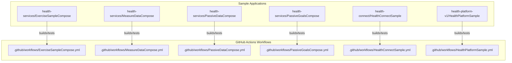
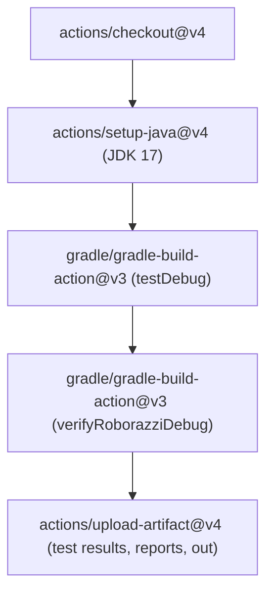
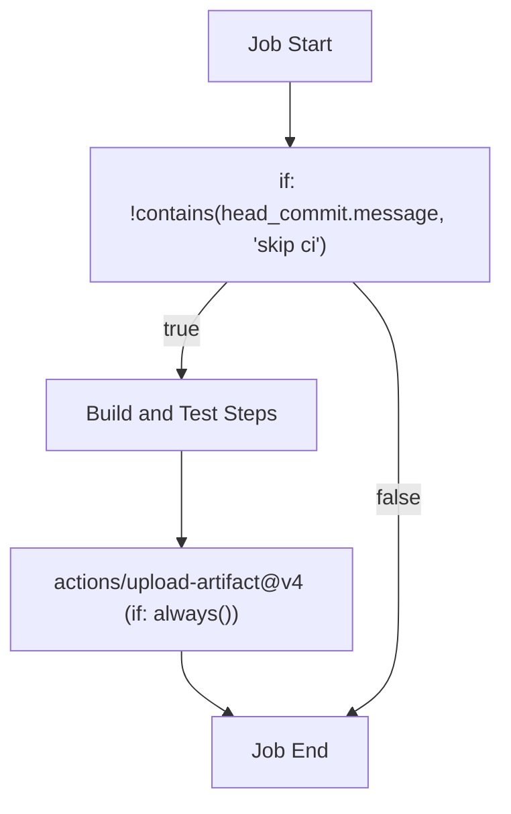

<!-- source: DeepWiki mcp.deepwiki.com · repo android/health-samples · page 7.1 GitHub Actions Workflows · fetched 2026-10-23 -->

# GitHub Actions Workflows

<details>
<summary>Relevant source files</summary>

The following files were used as context for generating this wiki page:

- [.github/workflows/ExerciseSampleCompose.yml](.github/workflows/ExerciseSampleCompose.yml)
- [.github/workflows/HealthConnectSample.yml](.github/workflows/HealthConnectSample.yml)
- [.github/workflows/HealthPlatformSample.yml](.github/workflows/HealthPlatformSample.yml)
- [.github/workflows/MeasureDataCompose.yml](.github/workflows/MeasureDataCompose.yml)
- [.github/workflows/PassiveDataCompose.yml](.github/workflows/PassiveDataCompose.yml)
- [.github/workflows/PassiveGoalsCompose.yml](.github/workflows/PassiveGoalsCompose.yml)

</details>


This document describes the GitHub Actions workflows used for continuous integration (CI) in the `android/health-samples` repository. It details the structure, triggers, build steps, and artifact management for each sample application's workflow. The focus is on the six primary workflows that provide automated build and test coverage for each major sample.

For an overview of the entire CI/CD and quality assurance pipeline, including code formatting and artifact management, see [CI/CD and Quality Assurance](#7). For information about code ownership and review requirements, see [Code Ownership and Review](#7.2).

---

## Purpose and Scope

This page covers:

- The structure and configuration of the six GitHub Actions workflows for sample applications.
- Trigger conditions for each workflow.
- Build, test, and artifact upload steps.
- How these workflows map to specific code entities and sample directories.

This page does **not** cover dependency automation (see [Dependency Automation](#6.2)), code formatting, or review policies.

---

## Overview of Workflows

Each major sample in the repository has a dedicated GitHub Actions workflow YAML file located in `.github/workflows/`. The workflows are:

| Sample Application            | Workflow File Name                      | Sample Path                                 |
|------------------------------|-----------------------------------------|---------------------------------------------|
| ExerciseSampleCompose         | ExerciseSampleCompose.yml               | health-services/ExerciseSampleCompose       |
| MeasureDataCompose           | MeasureDataCompose.yml                  | health-services/MeasureDataCompose          |
| PassiveDataCompose           | PassiveDataCompose.yml                  | health-services/PassiveDataCompose          |
| PassiveGoalsCompose          | PassiveGoalsCompose.yml                 | health-services/PassiveGoalsCompose         |
| HealthConnectSample          | HealthConnectSample.yml                 | health-connect/HealthConnectSample          |
| HealthPlatformSample         | HealthPlatformSample.yml                | health-platform-v1/HealthPlatformSample     |

Each workflow is responsible for building, testing, and uploading artifacts for its corresponding sample.

**Sources:**  
.github/workflows/ExerciseSampleCompose.yml:1-58  
.github/workflows/MeasureDataCompose.yml:1-52  
.github/workflows/PassiveDataCompose.yml:1-52  
.github/workflows/PassiveGoalsCompose.yml:1-52  
.github/workflows/HealthConnectSample.yml:1-52  
.github/workflows/HealthPlatformSample.yml:1-52  

---

### Diagram: Mapping Workflows to Sample Directories


**Sources:**  
.github/workflows/ExerciseSampleCompose.yml:1-58  
.github/workflows/MeasureDataCompose.yml:1-52  
.github/workflows/PassiveDataCompose.yml:1-52  
.github/workflows/PassiveGoalsCompose.yml:1-52  
.github/workflows/HealthConnectSample.yml:1-52  
.github/workflows/HealthPlatformSample.yml:1-52  

---

## Workflow Triggers

Each workflow is triggered by the following events:

- **workflow_dispatch**: Manual trigger from the GitHub UI.
- **push**: On push to the `main` branch, but only if files in the relevant sample directory or the workflow file itself are changed.
- **pull_request**: On pull requests that modify files in the relevant sample directory or the workflow file.

The `paths` filter ensures that only relevant changes trigger the workflow, reducing unnecessary CI runs.

**Example (ExerciseSampleCompose):**
```yaml
on:
  workflow_dispatch:
  push:
    branches:
      - main
    paths:
      - 'health-services/ExerciseSampleCompose/**'
      - '.github/workflows/ExerciseSampleCompose.yml'
  pull_request:
    paths:
      - 'health-services/ExerciseSampleCompose/**'
      - '.github/workflows/ExerciseSampleCompose.yml'
```

**Sources:**  
.github/workflows/ExerciseSampleCompose.yml:3-14  
.github/workflows/MeasureDataCompose.yml:3-14  
.github/workflows/PassiveDataCompose.yml:3-14  
.github/workflows/PassiveGoalsCompose.yml:3-14  
.github/workflows/HealthConnectSample.yml:3-14  
.github/workflows/HealthPlatformSample.yml:3-14  

---

### Diagram: Workflow Trigger Conditions

```mermaid
flowchart TB
    MAIN["main branch push"]
    PR["pull_request"]
    DISPATCH["workflow_dispatch"]
    WF1[".github/workflows/ExerciseSampleCompose.yml"]
    WF2[".github/workflows/MeasureDataCompose.yml"]
    WF3[".github/workflows/PassiveDataCompose.yml"]
    WF4[".github/workflows/PassiveGoalsCompose.yml"]
    WF5[".github/workflows/HealthConnectSample.yml"]
    WF6[".github/workflows/HealthPlatformSample.yml"]

    MAIN -- "if sample dir or workflow file changed" --> WF1
    MAIN -- "if sample dir or workflow file changed" --> WF2
    MAIN -- "if sample dir or workflow file changed" --> WF3
    MAIN -- "if sample dir or workflow file changed" --> WF4
    MAIN -- "if sample dir or workflow file changed" --> WF5
    MAIN -- "if sample dir or workflow file changed" --> WF6

    PR -- "if sample dir or workflow file changed" --> WF1
    PR -- "if sample dir or workflow file changed" --> WF2
    PR -- "if sample dir or workflow file changed" --> WF3
    PR -- "if sample dir or workflow file changed" --> WF4
    PR -- "if sample dir or workflow file changed" --> WF5
    PR -- "if sample dir or workflow file changed" --> WF6

    DISPATCH --> WF1
    DISPATCH --> WF2
    DISPATCH --> WF3
    DISPATCH --> WF4
    DISPATCH --> WF5
    DISPATCH --> WF6
```


**Sources:**  
.github/workflows/ExerciseSampleCompose.yml:3-14  
.github/workflows/MeasureDataCompose.yml:3-14  
.github/workflows/PassiveDataCompose.yml:3-14  
.github/workflows/PassiveGoalsCompose.yml:3-14  
.github/workflows/HealthConnectSample.yml:3-14  
.github/workflows/HealthPlatformSample.yml:3-14  

---

## Job Structure and Build Steps

Each workflow defines a single `build` job with the following characteristics:

- **Conditional Execution**: The job is skipped if the commit message contains `skip ci`.
- **Runner**: Uses `ubuntu-latest` as the build environment.
- **Timeout**: Each job has a 40-minute timeout.

### Steps in Each Job

| Step Name                    | Action/Plugin Used                      | Purpose                                                      |
|------------------------------|-----------------------------------------|--------------------------------------------------------------|
| Checkout                     | actions/checkout@v4                     | Checks out the repository code                               |
| Set up JDK                   | actions/setup-java@v4                   | Installs JDK 17 (Zulu distribution)                          |
| Unit Tests                   | gradle/gradle-build-action@v3           | Runs `testDebug` for the sample module                       |
| Screenshot Tests (if present)| gradle/gradle-build-action@v3           | Runs `verifyRoborazziDebug` (only in ExerciseSampleCompose)   |
| Upload test results and reports | actions/upload-artifact@v4           | Uploads test results, reports, and output directories         |

**Note:** Only the `ExerciseSampleCompose` workflow includes a screenshot testing step.

**Sources:**  
.github/workflows/ExerciseSampleCompose.yml:19-58  
.github/workflows/MeasureDataCompose.yml:19-52  
.github/workflows/PassiveDataCompose.yml:19-52  
.github/workflows/PassiveGoalsCompose.yml:19-52  
.github/workflows/HealthConnectSample.yml:19-52  
.github/workflows/HealthPlatformSample.yml:19-52  

---

### Diagram: Build Job Steps for ExerciseSampleCompose


**Sources:**  
.github/workflows/ExerciseSampleCompose.yml:27-58  

---

## Artifact Management

All workflows upload build artifacts at the end of the job, regardless of success or failure (`if: always()`). The following directories are uploaded:

- `**/build/test-results/*`
- `**/build/reports/*`
- `**/out/*`

Artifacts are named `build-results` and can be downloaded from the GitHub Actions run summary. This ensures that test results and reports are always available for inspection, even if the build fails.

**Sources:**  
.github/workflows/ExerciseSampleCompose.yml:49-57  
.github/workflows/MeasureDataCompose.yml:43-51  
.github/workflows/PassiveDataCompose.yml:43-51  
.github/workflows/PassiveGoalsCompose.yml:43-51  
.github/workflows/HealthConnectSample.yml:43-51  
.github/workflows/HealthPlatformSample.yml:43-51  

---

## Special Considerations

- **Screenshot Testing**: Only `ExerciseSampleCompose` runs screenshot tests using the `verifyRoborazziDebug` Gradle task. This is not present in other workflows.
- **Java Version**: All workflows use JDK 17 (Zulu distribution).
- **Selective CI**: The `if: ${{ !contains(github.event.head_commit.message, 'skip ci') }}` condition allows contributors to skip CI by including `skip ci` in the commit message.

**Sources:**  
.github/workflows/ExerciseSampleCompose.yml:22, 47  
.github/workflows/MeasureDataCompose.yml:22  
.github/workflows/PassiveDataCompose.yml:22  
.github/workflows/PassiveGoalsCompose.yml:22  
.github/workflows/HealthConnectSample.yml:22  
.github/workflows/HealthPlatformSample.yml:22  

---

### Diagram: Conditional Execution and Artifact Upload


**Sources:**  
.github/workflows/ExerciseSampleCompose.yml:22, 49-57  
.github/workflows/MeasureDataCompose.yml:22, 43-51  
.github/workflows/PassiveDataCompose.yml:22, 43-51  
.github/workflows/PassiveGoalsCompose.yml:22, 43-51  
.github/workflows/HealthConnectSample.yml:22, 43-51  
.github/workflows/HealthPlatformSample.yml:22, 43-51  

---

## Summary Table: Workflow Features

| Workflow File                        | Unit Tests | Screenshot Tests | Artifact Upload | JDK Version | CI Skip Supported |
|--------------------------------------|------------|-----------------|----------------|-------------|------------------|
| ExerciseSampleCompose.yml            | Yes        | Yes             | Yes            | 17          | Yes              |
| MeasureDataCompose.yml               | Yes        | No              | Yes            | 17          | Yes              |
| PassiveDataCompose.yml               | Yes        | No              | Yes            | 17          | Yes              |
| PassiveGoalsCompose.yml              | Yes        | No              | Yes            | 17          | Yes              |
| HealthConnectSample.yml              | Yes        | No              | Yes            | 17          | Yes              |
| HealthPlatformSample.yml             | Yes        | No              | Yes            | 17          | Yes              |

**Sources:**  
.github/workflows/ExerciseSampleCompose.yml:1-58  
.github/workflows/MeasureDataCompose.yml:1-52  
.github/workflows/PassiveDataCompose.yml:1-52  
.github/workflows/PassiveGoalsCompose.yml:1-52  
.github/workflows/HealthConnectSample.yml:1-52  
.github/workflows/HealthPlatformSample.yml:1-52  

---

## Relationship to Other Quality Systems

- For details on code formatting and linting, see [CI/CD and Quality Assurance](#7).
- For review and ownership policies, see [Code Ownership and Review](#7.2).
- For dependency update automation, see [Dependency Automation](#6.2).

---

**End of document.**

---

