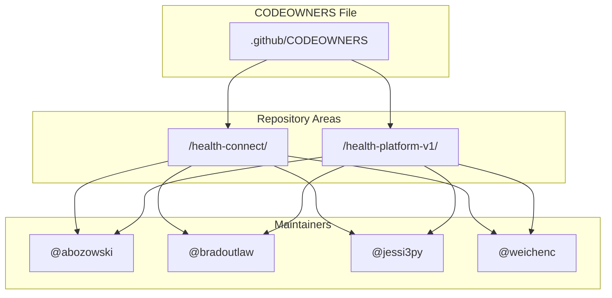
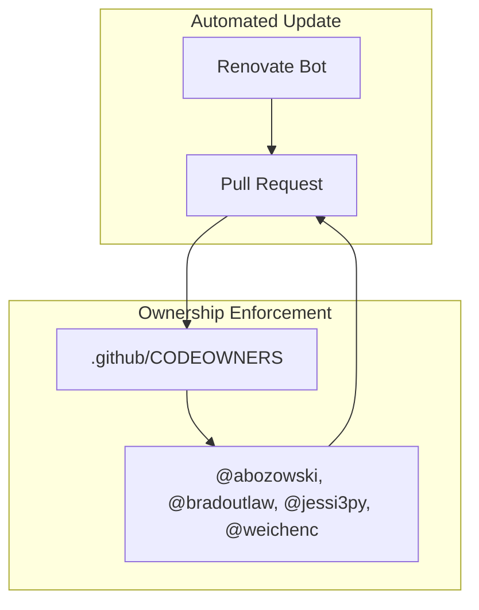

<!-- source: DeepWiki mcp.deepwiki.com · repo android/health-samples · page 7.2 Code Ownership and Review · fetched 2026-10-23 -->

# Code Ownership and Review

<details>
<summary>Relevant source files</summary>

The following files were used as context for generating this wiki page:

- [.github/CODEOWNERS](.github/CODEOWNERS)
- [renovate.json](renovate.json)

</details>


This document describes the code ownership and review process for the `android/health-samples` repository. It covers how code ownership is defined, which maintainers are responsible for specific code areas, and the requirements for code review before changes are merged. This ensures code quality, accountability, and maintainability across the repository.

For information about the CI/CD workflows and automated quality gates, see [CI/CD and Quality Assurance](#7). For details on dependency automation and Renovate configuration, see [Dependency Automation](#6.2).

---

## Purpose and Scope

The purpose of this page is to:

- Explain how code ownership is enforced using the `.github/CODEOWNERS` file.
- Identify the maintainers responsible for reviewing changes in key areas of the repository.
- Describe the code review requirements and their integration with GitHub's pull request process.

This page does **not** cover automated dependency updates (see [Dependency Automation](#6.2)) or the specifics of CI workflows (see [GitHub Actions Workflows](#7.1)).

---

## Code Ownership Definition

Code ownership in this repository is managed using the `.github/CODEOWNERS` file. This file specifies which GitHub users or teams are responsible for reviewing and approving changes to specific directories or files.

### Example: CODEOWNERS File Structure

| Path Pattern                | Owners                                      |
|-----------------------------|---------------------------------------------|
| `/health-connect/`          | @abozowski, @bradoutlaw, @jessi3py, @weichenc |
| `/health-platform-v1/`      | @abozowski, @bradoutlaw, @jessi3py, @weichenc |

- Each line in the `.github/CODEOWNERS` file maps a directory or file pattern to one or more GitHub usernames.
- When a pull request modifies files matching a pattern, the listed owners are automatically requested as reviewers.

**Sources:**  
[.github/CODEOWNERS:1-6]()

---

### Diagram: Mapping Code Areas to Owners



**Sources:**  
[.github/CODEOWNERS:1-6]()

---

## Maintainer Responsibilities

Designated code owners are responsible for:

- Reviewing all pull requests that modify files in their owned areas.
- Ensuring that changes meet repository standards for code quality, documentation, and testing.
- Providing feedback and requesting changes as needed.
- Approving pull requests when they are ready to merge.

If a pull request affects multiple areas with different owners, all relevant owners are requested for review.

**Sources:**  
[.github/CODEOWNERS:1-6]()

---

### Diagram: Pull Request Review Flow

```mermaid
sequenceDiagram
    participant "Contributor"
    participant "GitHub"
    participant "CODEOWNERS"
    participant "Maintainer (@abozowski, etc.)"

    "Contributor"->>"GitHub": "Open Pull Request"
    "GitHub"->>"CODEOWNERS": "Check changed files"
    "CODEOWNERS"->>"GitHub": "Identify required reviewers"
    "GitHub"->>"Maintainer (@abozowski, etc.)": "Request review"
    "Maintainer (@abozowski, etc.)"->>"GitHub": "Review and approve/deny"
    "GitHub"->>"Contributor": "Notify of review outcome"
```

**Sources:**  
[.github/CODEOWNERS:1-6]()

---

## Code Review Requirements

- **Mandatory Review:** All changes to owned areas require at least one approval from a listed code owner before merging.
- **Automated Enforcement:** GitHub enforces these requirements based on the `.github/CODEOWNERS` file.
- **Best Practices:** Owners are expected to check for code correctness, adherence to architectural patterns, and sufficient test coverage.

**Sources:**  
[.github/CODEOWNERS:1-6]()

---

## Relationship to Automated Dependency Updates

Automated tools such as Renovate Bot may create pull requests for dependency updates. These pull requests are also subject to code ownership rules and require approval from the designated owners before merging.

For more details on Renovate configuration and package rules, see [Dependency Automation](#6.2).

**Sources:**  
[.github/CODEOWNERS:1-6]()  
[renovate.json:1-44]()

---

### Diagram: Integration of Renovate and Code Review



**Sources:**  
[.github/CODEOWNERS:1-6]()  
[renovate.json:1-44]()

---

## Summary Table: Code Ownership Coverage

| Directory/Area         | Code Owners                                 | Review Required? |
|------------------------|---------------------------------------------|------------------|
| `/health-connect/`     | @abozowski, @bradoutlaw, @jessi3py, @weichenc | Yes              |
| `/health-platform-v1/` | @abozowski, @bradoutlaw, @jessi3py, @weichenc | Yes              |

**Sources:**  
[.github/CODEOWNERS:1-6]()

---

## Maintenance and Updates

- The `.github/CODEOWNERS` file should be updated whenever maintainers change or new areas of the repository are added.
- Owners should monitor their review requests and respond promptly to keep development moving efficiently.

**Sources:**  
[.github/CODEOWNERS:1-6]()

---

## See Also

- [Dependency Automation](#6.2)
- [GitHub Actions Workflows](#7.1)
- [Build System and Dependencies](#6)

---

---

