<!-- source: DeepWiki mcp.deepwiki.com · repo android/health-samples · page 8 Common Patterns and Best Practices · fetched 2026-10-23 -->

# Common Patterns and Best Practices

<details>
<summary>Relevant source files</summary>

The following files were used as context for generating this wiki page:

- [health-connect/HealthConnectSample/app/src/main/AndroidManifest.xml](health-connect/HealthConnectSample/app/src/main/AndroidManifest.xml)
- [health-connect/HealthConnectSample/app/src/main/java/com/example/healthconnectsample/data/HealthConnectManager.kt](health-connect/HealthConnectSample/app/src/main/java/com/example/healthconnectsample/data/HealthConnectManager.kt)
- [health-connect/HealthConnectSample/app/src/main/java/com/example/healthconnectsample/presentation/component/Series.kt](health-connect/HealthConnectSample/app/src/main/java/com/example/healthconnectsample/presentation/component/Series.kt)
- [health-connect/HealthConnectSample/app/src/main/java/com/example/healthconnectsample/presentation/navigation/HealthConnectNavigation.kt](health-connect/HealthConnectSample/app/src/main/java/com/example/healthconnectsample/presentation/navigation/HealthConnectNavigation.kt)
- [health-connect/HealthConnectSample/app/src/main/java/com/example/healthconnectsample/presentation/navigation/Screen.kt](health-connect/HealthConnectSample/app/src/main/java/com/example/healthconnectsample/presentation/navigation/Screen.kt)
- [health-connect/HealthConnectSample/app/src/main/java/com/example/healthconnectsample/presentation/screen/WelcomeScreen.kt](health-connect/HealthConnectSample/app/src/main/java/com/example/healthconnectsample/presentation/screen/WelcomeScreen.kt)
- [health-connect/HealthConnectSample/app/src/main/java/com/example/healthconnectsample/presentation/screen/exercisesession/ExerciseSessionScreen.kt](health-connect/HealthConnectSample/app/src/main/java/com/example/healthconnectsample/presentation/screen/exercisesession/ExerciseSessionScreen.kt)
- [health-connect/HealthConnectSample/app/src/main/java/com/example/healthconnectsample/presentation/screen/exercisesession/ExerciseSessionViewModel.kt](health-connect/HealthConnectSample/app/src/main/java/com/example/healthconnectsample/presentation/screen/exercisesession/ExerciseSessionViewModel.kt)
- [health-connect/HealthConnectSample/app/src/main/java/com/example/healthconnectsample/presentation/screen/inputreadings/InputReadingsScreen.kt](health-connect/HealthConnectSample/app/src/main/java/com/example/healthconnectsample/presentation/screen/inputreadings/InputReadingsScreen.kt)
- [health-connect/HealthConnectSample/app/src/main/java/com/example/healthconnectsample/presentation/screen/inputreadings/InputReadingsViewModel.kt](health-connect/HealthConnectSample/app/src/main/java/com/example/healthconnectsample/presentation/screen/inputreadings/InputReadingsViewModel.kt)
- [health-connect/HealthConnectSample/app/src/main/java/com/example/healthconnectsample/presentation/screen/recordlist/RecordListScreen.kt](health-connect/HealthConnectSample/app/src/main/java/com/example/healthconnectsample/presentation/screen/recordlist/RecordListScreen.kt)
- [health-connect/HealthConnectSample/app/src/main/res/values/strings.xml](health-connect/HealthConnectSample/app/src/main/res/values/strings.xml)
- [health-connect/HealthConnectSample/settings.gradle](health-connect/HealthConnectSample/settings.gradle)
- [health-services/ExerciseSampleCompose/app/build.gradle](health-services/ExerciseSampleCompose/app/build.gradle)
- [health-services/ExerciseSampleCompose/app/src/main/AndroidManifest.xml](health-services/ExerciseSampleCompose/app/src/main/AndroidManifest.xml)
- [health-services/ExerciseSampleCompose/app/src/main/java/com/example/exercisesamplecompose/app/MainActivity.kt](health-services/ExerciseSampleCompose/app/src/main/java/com/example/exercisesamplecompose/app/MainActivity.kt)
- [health-services/ExerciseSampleCompose/app/src/main/java/com/example/exercisesamplecompose/presentation/component/FormattingUtils.kt](health-services/ExerciseSampleCompose/app/src/main/java/com/example/exercisesamplecompose/presentation/component/FormattingUtils.kt)
- [health-services/ExerciseSampleCompose/app/src/main/java/com/example/exercisesamplecompose/presentation/component/HRText.kt](health-services/ExerciseSampleCompose/app/src/main/java/com/example/exercisesamplecompose/presentation/component/HRText.kt)
- [health-services/ExerciseSampleCompose/app/src/main/java/com/example/exercisesamplecompose/presentation/exercise/ExerciseScreen.kt](health-services/ExerciseSampleCompose/app/src/main/java/com/example/exercisesamplecompose/presentation/exercise/ExerciseScreen.kt)
- [health-services/ExerciseSampleCompose/app/src/main/java/com/example/exercisesamplecompose/presentation/preparing/PreparingViewModel.kt](health-services/ExerciseSampleCompose/app/src/main/java/com/example/exercisesamplecompose/presentation/preparing/PreparingViewModel.kt)
- [health-services/ExerciseSampleCompose/app/src/test/java/com/example/exercisesamplecompose/presentation/ExerciseScreenTest.kt](health-services/ExerciseSampleCompose/app/src/test/java/com/example/exercisesamplecompose/presentation/ExerciseScreenTest.kt)
- [health-services/MeasureDataCompose/app/build.gradle.kts](health-services/MeasureDataCompose/app/build.gradle.kts)
- [health-services/MeasureDataCompose/app/src/main/java/com/example/measuredatacompose/data/HealthServicesRepository.kt](health-services/MeasureDataCompose/app/src/main/java/com/example/measuredatacompose/data/HealthServicesRepository.kt)
- [health-services/MeasureDataCompose/app/src/main/java/com/example/measuredatacompose/presentation/HrLabel.kt](health-services/MeasureDataCompose/app/src/main/java/com/example/measuredatacompose/presentation/HrLabel.kt)
- [health-services/MeasureDataCompose/app/src/main/java/com/example/measuredatacompose/presentation/MeasureDataApp.kt](health-services/MeasureDataCompose/app/src/main/java/com/example/measuredatacompose/presentation/MeasureDataApp.kt)
- [health-services/MeasureDataCompose/app/src/main/java/com/example/measuredatacompose/presentation/MeasureDataScreen.kt](health-services/MeasureDataCompose/app/src/main/java/com/example/measuredatacompose/presentation/MeasureDataScreen.kt)
- [health-services/MeasureDataCompose/app/src/main/java/com/example/measuredatacompose/presentation/MeasureDataViewModel.kt](health-services/MeasureDataCompose/app/src/main/java/com/example/measuredatacompose/presentation/MeasureDataViewModel.kt)
- [health-services/MeasureDataCompose/app/src/main/java/com/example/measuredatacompose/presentation/NotSupportedScreen.kt](health-services/MeasureDataCompose/app/src/main/java/com/example/measuredatacompose/presentation/NotSupportedScreen.kt)
- [health-services/MeasureDataCompose/app/src/main/java/com/example/measuredatacompose/theme/Theme.kt](health-services/MeasureDataCompose/app/src/main/java/com/example/measuredatacompose/theme/Theme.kt)
- [health-services/MeasureDataCompose/build.gradle.kts](health-services/MeasureDataCompose/build.gradle.kts)

</details>


## Purpose and Scope

This page documents recurring architectural patterns, implementation strategies, and coding practices used across all samples in the android/health-samples repository. These patterns demonstrate Android development best practices for health and fitness applications, including permission management, state handling, error recovery, and UI composition.

For detailed information on specific patterns:
- Permission handling strategies → See [Permission Handling](#8.1)
- Reactive state management → See [State Management with Flow](#8.2)
- Wear OS-specific UI patterns → See [Wear OS UI Patterns](#8.3)

For API-specific implementation details:
- Health Services patterns → See [Health Services Samples](#2)
- Health Connect patterns → See [Health Connect Sample](#3)

---

## MVVM Architecture Pattern

All samples implement the Model-View-ViewModel (MVVM) architectural pattern with clear separation of concerns. ViewModels manage UI state and business logic, while Compose functions handle UI rendering.

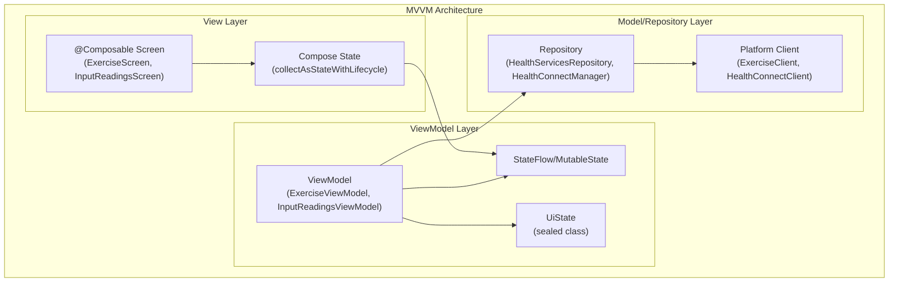

**Sources:**
- [health-services/ExerciseSampleCompose/app/src/main/java/com/example/exercisesamplecompose/presentation/preparing/PreparingViewModel.kt:36-67]()
- [health-connect/HealthConnectSample/app/src/main/java/com/example/healthconnectsample/presentation/screen/inputreadings/InputReadingsViewModel.kt:40-59]()
- [health-services/MeasureDataCompose/app/src/main/java/com/example/measuredatacompose/presentation/MeasureDataViewModel.kt:30-39]()

### ViewModel Implementation Pattern

ViewModels consistently follow this structure:

| Component | Purpose | Example |
|-----------|---------|---------|
| State Properties | Hold UI state as `MutableState` or `StateFlow` | `permissionsGranted`, `sessionsList`, `uiState` |
| Repository Reference | Access data layer | `healthServicesRepository`, `healthConnectManager` |
| Permission Contract | Handle permission requests | `permissionsLauncher` |
| Initialization Block | Load initial data | `init { viewModelScope.launch { ... } }` |
| Public Functions | Handle user actions | `insertExerciseSession()`, `deleteWeightInput()` |

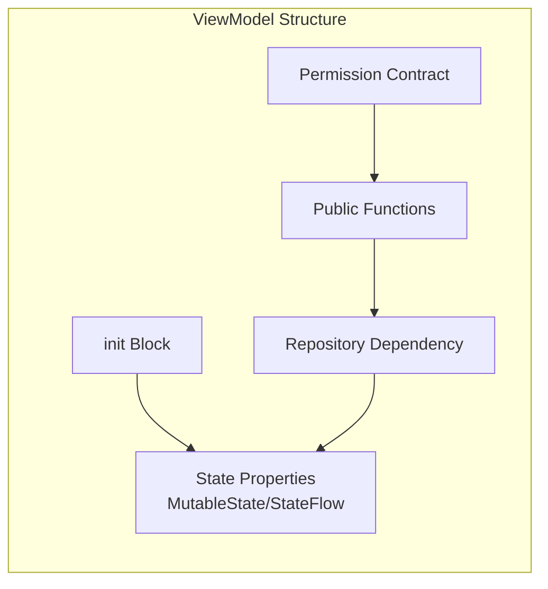

**Sources:**
- [health-connect/HealthConnectSample/app/src/main/java/com/example/healthconnectsample/presentation/screen/exercisesession/ExerciseSessionViewModel.kt:47-84]()
- [health-services/ExerciseSampleCompose/app/src/main/java/com/example/exercisesamplecompose/presentation/preparing/PreparingViewModel.kt:35-67]()

---

## Repository Pattern for Data Access

All samples use the Repository pattern to abstract platform API access. Repositories provide a clean interface for ViewModels and handle API complexity.

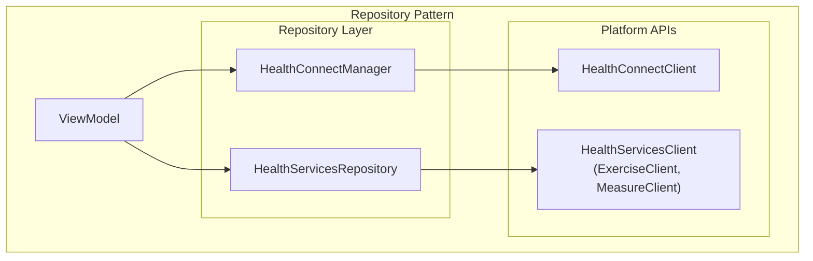

**Key Repository Characteristics:**

1. **Lazy Client Initialization**: Platform clients are initialized lazily to avoid unnecessary resource allocation
   - [health-connect/HealthConnectSample/app/src/main/java/com/example/healthconnectsample/data/HealthConnectManager.kt:64]()

2. **Suspend Functions**: All data operations are suspend functions for coroutine support
   - [health-connect/HealthConnectSample/app/src/main/java/com/example/healthconnectsample/data/HealthConnectManager.kt:134-141]()

3. **Error Propagation**: Repositories throw exceptions; ViewModels handle error recovery
   - [health-connect/HealthConnectSample/app/src/main/java/com/example/healthconnectsample/presentation/screen/inputreadings/InputReadingsViewModel.kt:124-140]()

**Sources:**
- [health-connect/HealthConnectSample/app/src/main/java/com/example/healthconnectsample/data/HealthConnectManager.kt:63-107]()
- [health-services/MeasureDataCompose/app/src/main/java/com/example/measuredatacompose/data/HealthServicesRepository.kt:39-46]()

---

## Error Handling Pattern

All samples implement consistent error handling using sealed class hierarchies for UI state and exception-specific catch blocks.

### UiState Sealed Class Pattern

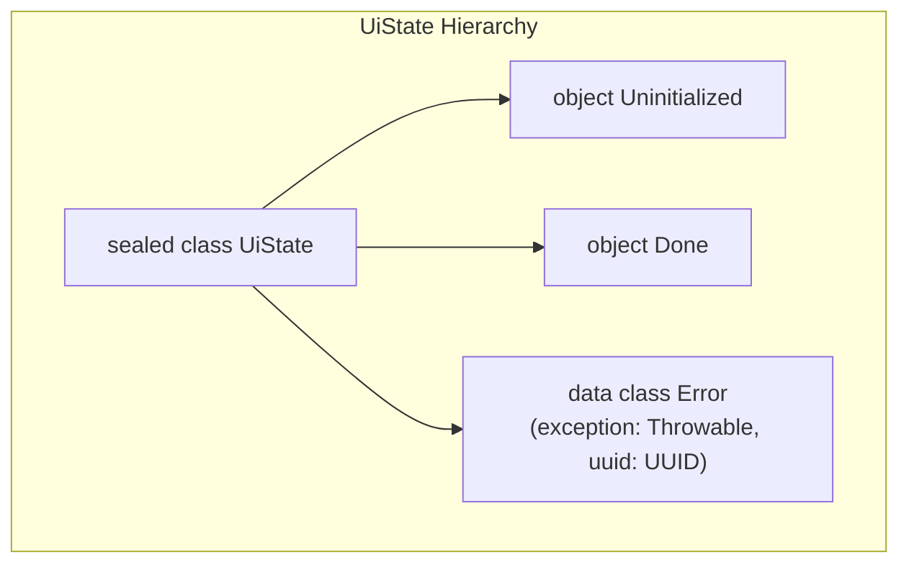

**Error State Characteristics:**

| Feature | Purpose | Implementation |
|---------|---------|----------------|
| UUID Tracking | Prevent duplicate error displays on recomposition | `uuid: UUID = UUID.randomUUID()` |
| Exception Storage | Provide error details for logging/display | `exception: Throwable` |
| Sealed Class | Exhaustive when expressions | `sealed class UiState` |

**Sources:**
- [health-connect/HealthConnectSample/app/src/main/java/com/example/healthconnectsample/presentation/screen/inputreadings/InputReadingsViewModel.kt:142-149]()
- [health-connect/HealthConnectSample/app/src/main/java/com/example/healthconnectsample/presentation/screen/exercisesession/ExerciseSessionViewModel.kt:166-173]()

### Exception Handling in ViewModels

ViewModels catch specific exception types thrown by Health Connect and Health Services:

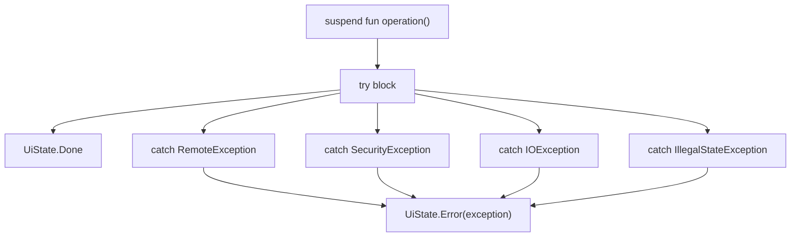

**Exception Types:**

| Exception | Cause | Example |
|-----------|-------|---------|
| `RemoteException` | IPC communication failure | Health Connect service crash |
| `SecurityException` | Permission denial | Missing required permissions |
| `IOException` | Network/storage issues | Changes token expired |
| `IllegalStateException` | Invalid operation state | Client not initialized |

**Sources:**
- [health-connect/HealthConnectSample/app/src/main/java/com/example/healthconnectsample/presentation/screen/inputreadings/InputReadingsViewModel.kt:131-139]()
- [health-connect/HealthConnectSample/app/src/main/java/com/example/healthconnectsample/presentation/screen/exercisesession/ExerciseSessionViewModel.kt:155-163]()

### Screen-Level Error Handling

Screens use `LaunchedEffect` to observe UI state and trigger error notifications:

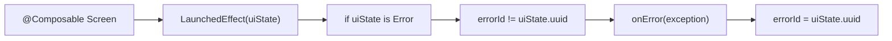

**Sources:**
- [health-connect/HealthConnectSample/app/src/main/java/com/example/healthconnectsample/presentation/screen/inputreadings/InputReadingsScreen.kt:83-96]()
- [health-connect/HealthConnectSample/app/src/main/java/com/example/healthconnectsample/presentation/screen/exercisesession/ExerciseSessionScreen.kt:70-84]()

---

## Async Operations with Coroutines

All samples use Kotlin Coroutines for asynchronous operations, with consistent patterns for lifecycle management and cancellation.

### ViewModel Coroutine Scope

ViewModels use `viewModelScope` for lifecycle-aware coroutine launching:

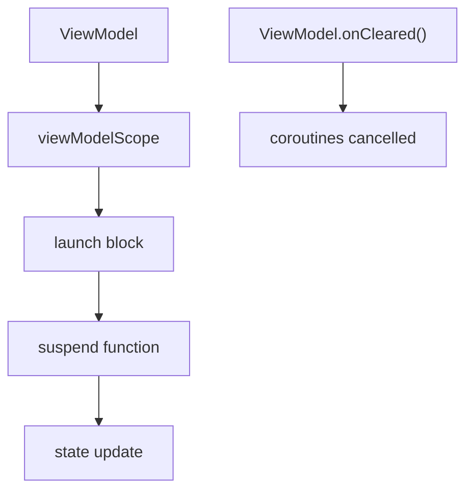

**Pattern Implementation:**
```kotlin
// Example pattern from samples
fun loadData() {
    viewModelScope.launch {
        tryWithPermissionsCheck {
            val data = repository.fetchData()
            stateProperty.value = data
        }
    }
}
```

**Sources:**
- [health-connect/HealthConnectSample/app/src/main/java/com/example/healthconnectsample/presentation/screen/inputreadings/InputReadingsViewModel.kt:62-68]()
- [health-services/MeasureDataCompose/app/src/main/java/com/example/measuredatacompose/presentation/MeasureDataViewModel.kt:51-68]()

### Flow-Based Data Streams

Health Services samples use `callbackFlow` to bridge callback-based APIs with Kotlin Flows:

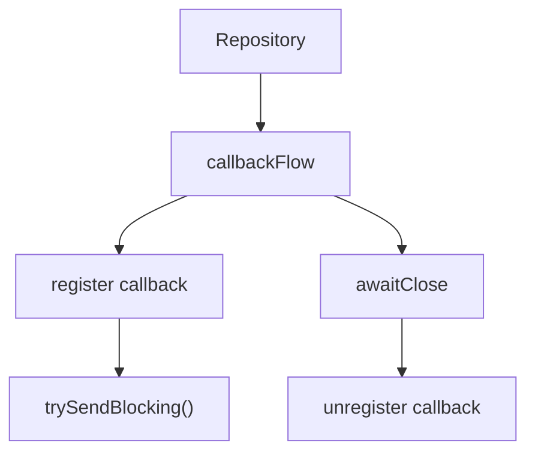

**Pattern Characteristics:**

| Aspect | Implementation | Purpose |
|--------|----------------|---------|
| Registration | Inside `callbackFlow` block | Ensure callback exists for flow lifetime |
| Emission | `trySendBlocking()` | Non-blocking data emission |
| Cleanup | `awaitClose` block | Guaranteed callback unregistration |
| Cancellation | Automatic with flow cancellation | Prevent memory leaks |

**Sources:**
- [health-services/MeasureDataCompose/app/src/main/java/com/example/measuredatacompose/data/HealthServicesRepository.kt:55-83]()

---

## Compose UI Patterns

All samples follow consistent Compose patterns for screen construction, state management, and preview generation.

### Screen Structure Pattern

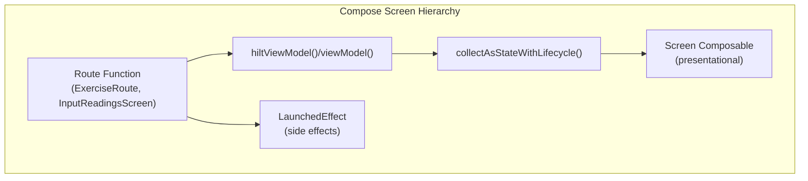

**Two-Function Pattern:**

| Function Type | Responsibility | Example |
|--------------|----------------|---------|
| Route/Container | ViewModel creation, state collection, side effects | `ExerciseRoute`, `InputReadingsScreen` |
| Presentation | Pure UI rendering with parameters | `ExerciseScreen`, presentation components |

**Sources:**
- [health-services/ExerciseSampleCompose/app/src/main/java/com/example/exercisesamplecompose/presentation/exercise/ExerciseScreen.kt:72-106]()
- [health-connect/HealthConnectSample/app/src/main/java/com/example/healthconnectsample/presentation/screen/inputreadings/InputReadingsScreen.kt:66-98]()

### LazyColumn Item Pattern

All list screens follow a consistent pattern for conditional content in `LazyColumn`:

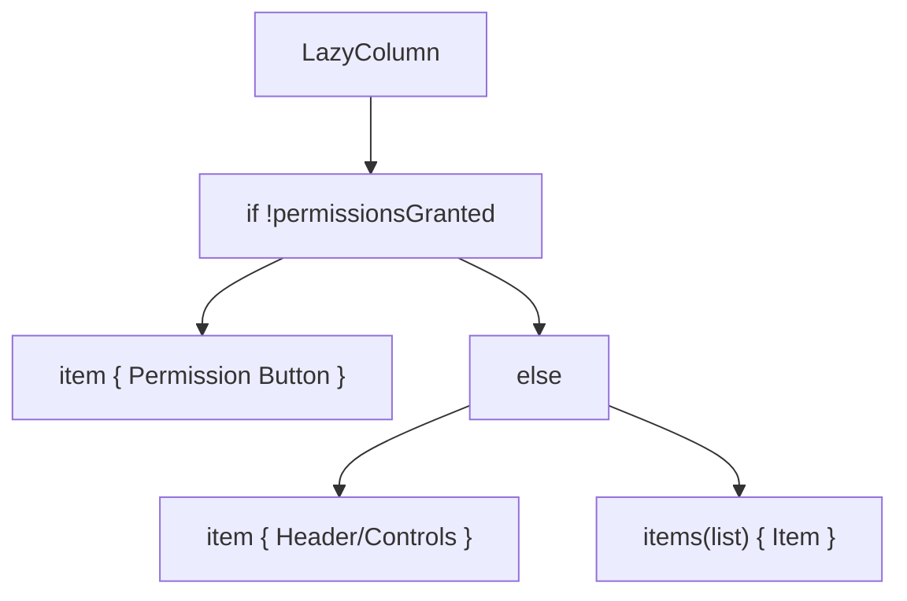

**Sources:**
- [health-connect/HealthConnectSample/app/src/main/java/com/example/healthconnectsample/presentation/screen/exercisesession/ExerciseSessionScreen.kt:86-156]()
- [health-connect/HealthConnectSample/app/src/main/java/com/example/healthconnectsample/presentation/screen/inputreadings/InputReadingsScreen.kt:110-214]()

### Preview Annotations

All Composables include preview functions with sample data:

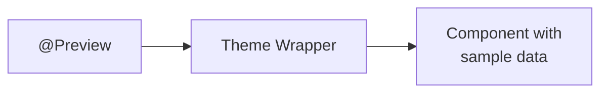

**Pattern Characteristics:**
- Wrapped in theme composable (`HealthConnectTheme`, `ThemePreview`)
- Use realistic sample data
- Include multiple states (empty, populated, error)

**Sources:**
- [health-connect/HealthConnectSample/app/src/main/java/com/example/healthconnectsample/presentation/screen/inputreadings/InputReadingsScreen.kt:218-250]()
- [health-services/ExerciseSampleCompose/app/src/main/java/com/example/exercisesamplecompose/presentation/exercise/ExerciseScreen.kt:318-339]()

---

## Data Formatting Utilities

All samples implement consistent formatting utilities for displaying health metrics with proper null handling.

### Formatting Pattern

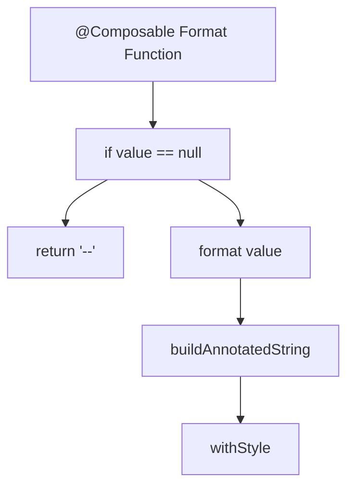

**Common Formatting Functions:**

| Function | Purpose | Null Handling | Units |
|----------|---------|---------------|-------|
| `formatElapsedTime()` | Duration formatting | `"--"` | h, m, s |
| `formatCalories()` | Calorie display | `"--"` | cal (implicit) |
| `formatDistanceKm()` | Distance in kilometers | `"--"` | km (implicit) |
| `formatHeartRate()` | Heart rate with BPM | `"--"` | bpm (styled) |

**Ambient Mode Handling:**
- Seconds hidden in ambient mode: `if (LocalAmbientState.current.isInteractive)`
- Prevents battery drain from frequent updates

**Sources:**
- [health-services/ExerciseSampleCompose/app/src/main/java/com/example/exercisesamplecompose/presentation/component/FormattingUtils.kt:31-95]()
- [health-services/ExerciseSampleCompose/app/src/main/java/com/example/exercisesamplecompose/presentation/component/HRText.kt:34-57]()

---

## Permission Request Flow

All samples implement a consistent flow for requesting and checking runtime permissions.

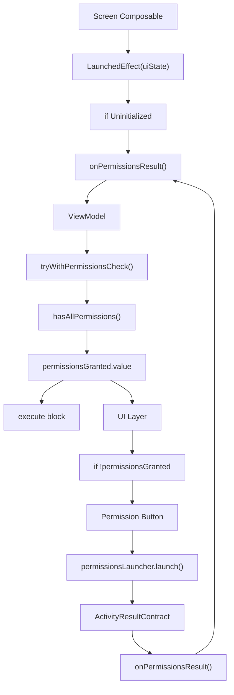

**Permission Check Pattern:**

1. **ViewModel**: Maintains permission state and contract
   - [health-connect/HealthConnectSample/app/src/main/java/com/example/healthconnectsample/presentation/screen/inputreadings/InputReadingsViewModel.kt:44-61]()

2. **Screen**: Shows permission button or content based on state
   - [health-connect/HealthConnectSample/app/src/main/java/com/example/healthconnectsample/presentation/screen/inputreadings/InputReadingsScreen.kt:116-124]()

3. **Navigation/Container**: Registers launcher and handles callbacks
   - [health-connect/HealthConnectSample/app/src/main/java/com/example/healthconnectsample/presentation/navigation/HealthConnectNavigation.kt:237-262]()

**Sources:**
- [health-services/ExerciseSampleCompose/app/src/main/java/com/example/exercisesamplecompose/app/MainActivity.kt:39-47]()
- [health-connect/HealthConnectSample/app/src/main/java/com/example/healthconnectsample/data/HealthConnectManager.kt:115-122]()

---

## Dependency Injection Patterns

Samples demonstrate two DI approaches: Hilt (compile-time) for Health Services and manual ViewModelFactory for Health Connect.

### Hilt Pattern (ExerciseSampleCompose)

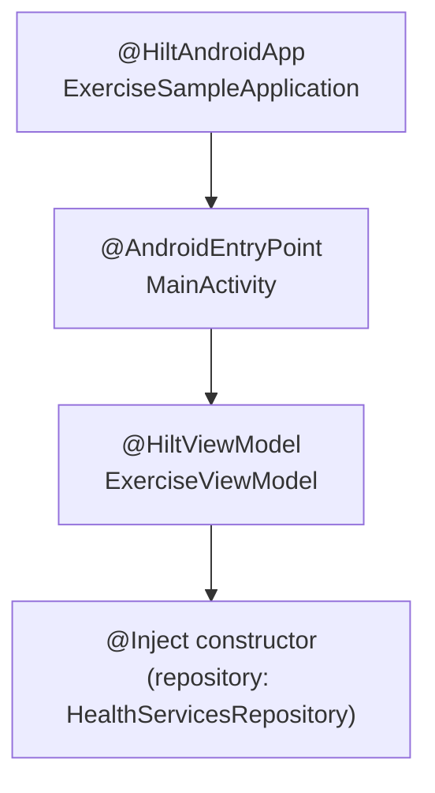

**Hilt Configuration:**
- Application class: `@HiltAndroidApp` annotation
- Activity: `@AndroidEntryPoint` for injection
- ViewModel: `@HiltViewModel` with `@Inject` constructor
- Retrieval: `hiltViewModel()` in Composables

**Sources:**
- [health-services/ExerciseSampleCompose/app/src/main/java/com/example/exercisesamplecompose/presentation/preparing/PreparingViewModel.kt:35-40]()
- [health-services/ExerciseSampleCompose/app/build.gradle:19-22]()

### Manual Factory Pattern (HealthConnectSample)

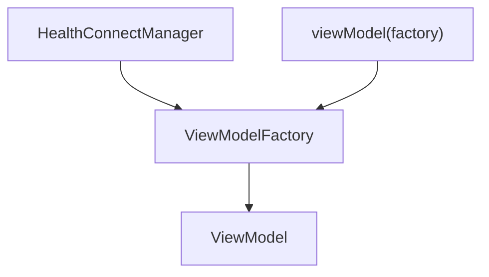

**Factory Implementation Pattern:**
```kotlin
class ViewModelFactory(
    private val healthConnectManager: HealthConnectManager
) : ViewModelProvider.Factory {
    override fun <T : ViewModel> create(modelClass: Class<T>): T {
        if (modelClass.isAssignableFrom(SpecificViewModel::class.java)) {
            @Suppress("UNCHECKED_CAST")
            return SpecificViewModel(healthConnectManager) as T
        }
        throw IllegalArgumentException("Unknown ViewModel class")
    }
}
```

**Sources:**
- [health-connect/HealthConnectSample/app/src/main/java/com/example/healthconnectsample/presentation/screen/inputreadings/InputReadingsViewModel.kt:152-164]()
- [health-connect/HealthConnectSample/app/src/main/java/com/example/healthconnectsample/presentation/navigation/HealthConnectNavigation.kt:228-231]()

---

## Manifest Permissions Declaration

All samples declare permissions in `AndroidManifest.xml` with appropriate SDK targeting and service type annotations.

### Permission Declaration Pattern

**Health Services (Wear OS):**

| Permission | Purpose | Max SDK |
|------------|---------|---------|
| `BODY_SENSORS` | Heart rate, sensor data | 35 (replaced by health.READ_HEART_RATE) |
| `ACCESS_FINE_LOCATION` | GPS tracking | - |
| `ACTIVITY_RECOGNITION` | Activity detection | - |
| `POST_NOTIFICATIONS` | Exercise notifications | - |
| `health.READ_HEART_RATE` | Heart rate (Android 36+) | - |
| `FOREGROUND_SERVICE_HEALTH` | Health tracking service | - |
| `FOREGROUND_SERVICE_LOCATION` | Location tracking service | - |

**Health Connect (Mobile):**

| Permission | Purpose |
|------------|---------|
| `health.READ_HEART_RATE` | Read heart rate records |
| `health.WRITE_HEART_RATE` | Write heart rate records |
| `health.READ_EXERCISE` | Read exercise sessions |
| `health.WRITE_EXERCISE` | Write exercise sessions |
| `health.READ_SLEEP` | Read sleep sessions |
| `health.READ_HEALTH_DATA_IN_BACKGROUND` | Background data access |

**Sources:**
- [health-services/ExerciseSampleCompose/app/src/main/AndroidManifest.xml:18-33]()
- [health-connect/HealthConnectSample/app/src/main/AndroidManifest.xml:18-34]()

### Service Declaration Pattern

Foreground services require explicit type declaration:

```xml
<service
    android:name=".service.ExerciseService"
    android:exported="false"
    android:foregroundServiceType="health|location" />
```

**Sources:**
- [health-services/ExerciseSampleCompose/app/src/main/AndroidManifest.xml:64-67]()

---

## Build Configuration Patterns

All samples follow consistent build configuration patterns with Gradle Kotlin DSL and version catalogs.

### Common Build Features

| Feature | Purpose | All Samples |
|---------|---------|-------------|
| `compileSdk 35-36` | Target latest APIs | ✓ |
| `minSdk 30` | Wear OS / Health Connect minimum | ✓ |
| `compose = true` | Enable Jetpack Compose | ✓ |
| `coreLibraryDesugaring` | Java 8+ API backport | ✓ |
| ProGuard rules | Code shrinking for release | ✓ |

### Spotless Code Formatting

All projects apply Spotless plugin in `subprojects` block:

```kotlin
subprojects {
    apply(plugin = "com.diffplug.spotless")
    configure<SpotlessExtension> {
        kotlin {
            target("**/*.kt")
            ktlint(libs.versions.ktlint.get())
            licenseHeaderFile(rootProject.file("../spotless/copyright.kt"))
        }
    }
}
```

**Sources:**
- [health-services/MeasureDataCompose/build.gradle.kts:24-36]()
- [health-services/ExerciseSampleCompose/app/build.gradle:25-73]()

---

## Navigation Patterns

### Health Connect Multi-Screen Navigation

Health Connect sample uses Compose Navigation with deep link support:

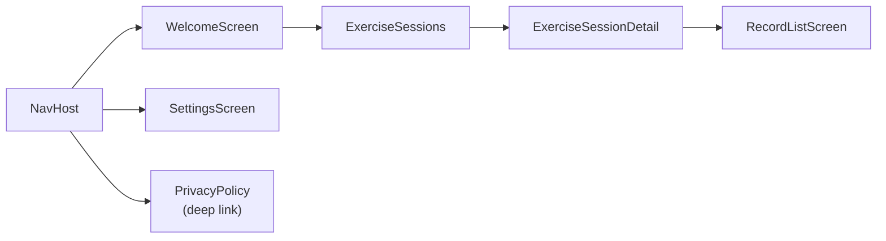

**Route Parameters:**
- UID navigation: `"exercise_session_detail/{uid}"`
- Multiple parameters: `"record_list/{recordType}/{uid}/{seriesRecordsType}"`

**Sources:**
- [health-connect/HealthConnectSample/app/src/main/java/com/example/healthconnectsample/presentation/navigation/HealthConnectNavigation.kt:65-300]()
- [health-connect/HealthConnectSample/app/src/main/java/com/example/healthconnectsample/presentation/navigation/Screen.kt:32-43]()

### Wear OS Navigation

ExerciseSampleCompose uses swipe-dismissable navigation:

```kotlin
navController = rememberSwipeDismissableNavController()
```

**Sources:**
- [health-services/ExerciseSampleCompose/app/src/main/java/com/example/exercisesamplecompose/app/MainActivity.kt:61]()

---

## Testing Patterns

ExerciseSampleCompose demonstrates screenshot testing with Roborazzi for UI regression detection.

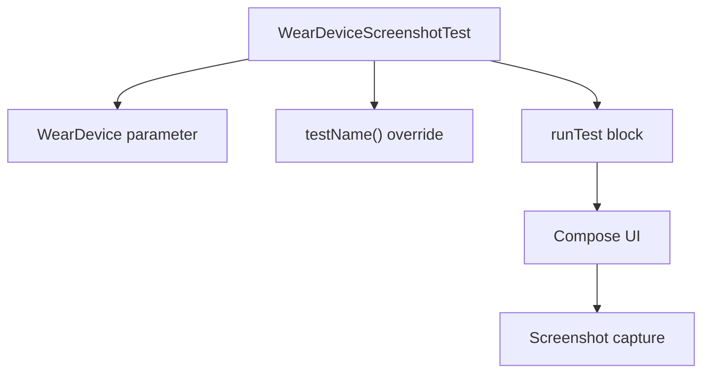

**Test Configuration:**

| Aspect | Implementation |
|--------|----------------|
| Base Class | `WearDeviceScreenshotTest` |
| Parameterization | `@RunWith(ParameterizedRobolectricTestRunner)` |
| Devices | Multiple Wear OS device configurations |
| Naming | Custom path with device ID suffix |

**Sources:**
- [health-services/ExerciseSampleCompose/app/src/test/java/com/example/exercisesamplecompose/presentation/ExerciseScreenTest.kt:36-107]()

---

## Summary

This repository demonstrates production-ready patterns for Android health applications:

1. **Architecture**: Consistent MVVM with repository pattern
2. **Async**: Coroutines with `viewModelScope` and Flow-based streams
3. **Error Handling**: Sealed class UI states with UUID-tracked errors
4. **Permissions**: Runtime permission flow with proper checks
5. **UI**: Compose-based with state hoisting and preview support
6. **Formatting**: Null-safe utility functions with ambient awareness
7. **DI**: Both Hilt and manual factory patterns demonstrated
8. **Testing**: Screenshot-based UI regression testing

For implementation details of specific patterns, refer to the sub-pages listed at the top of this document.

---

