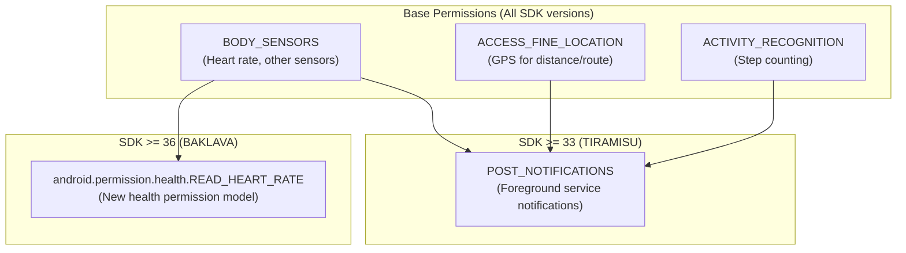
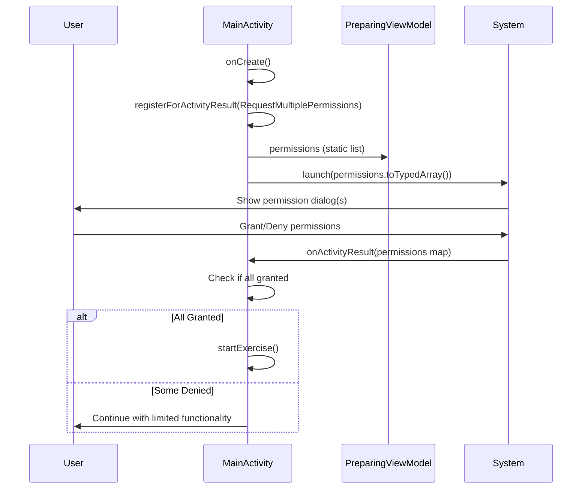
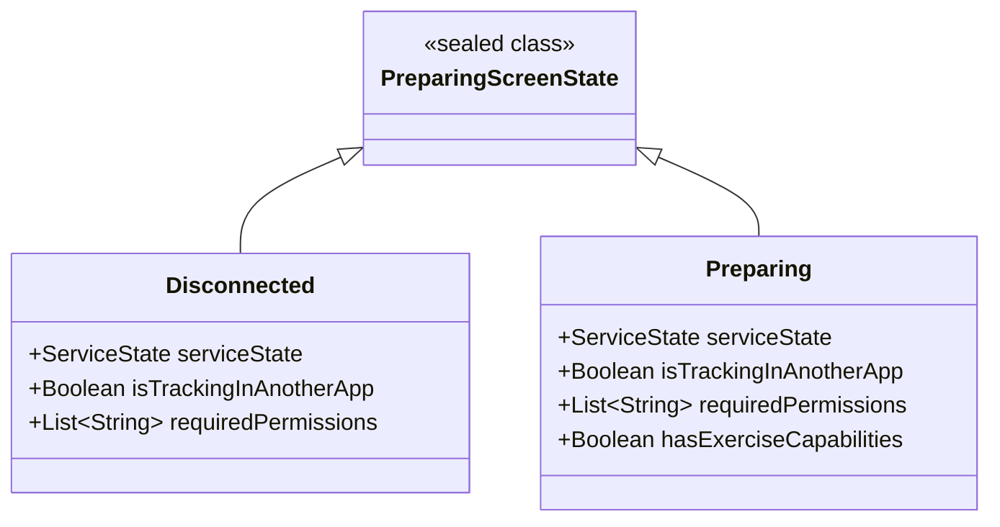
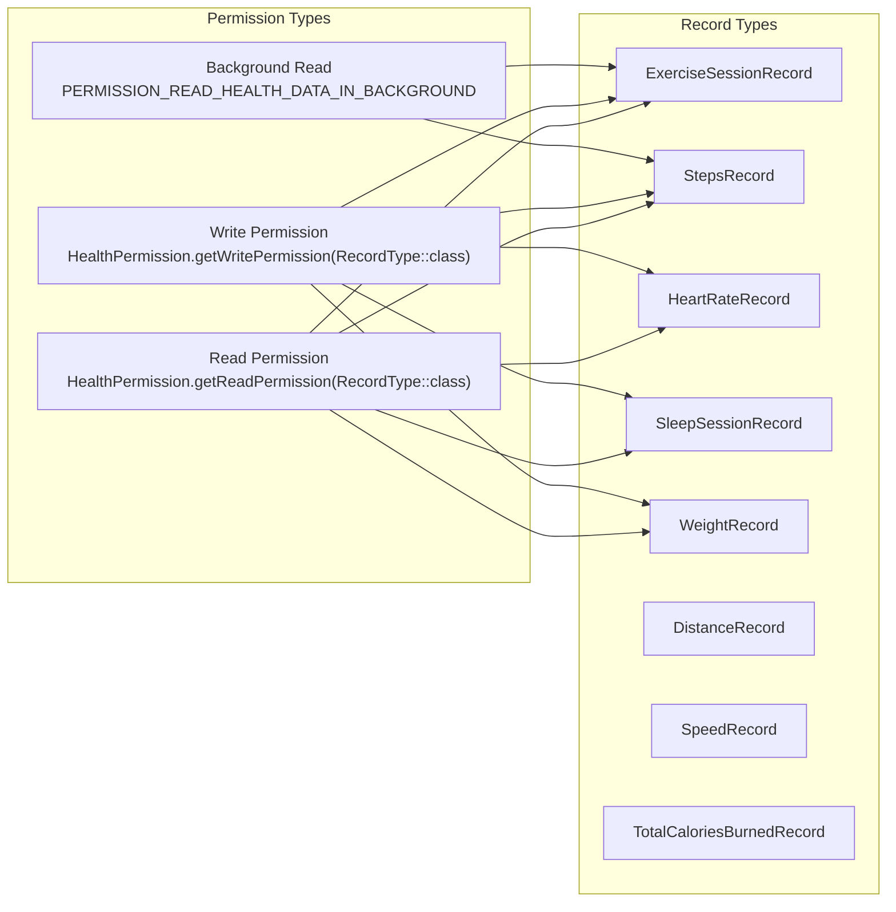
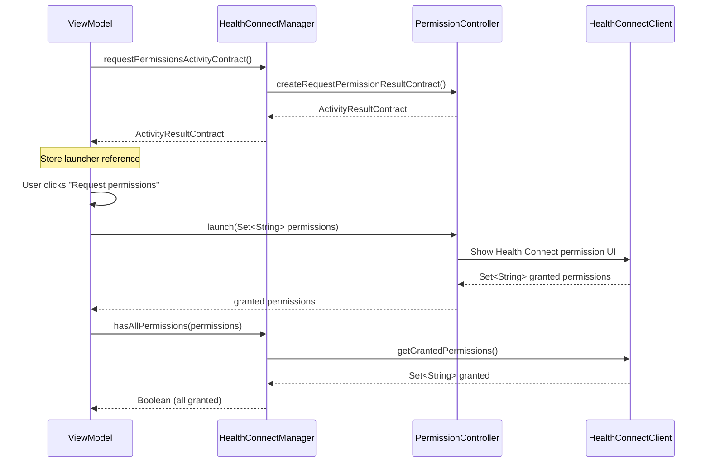
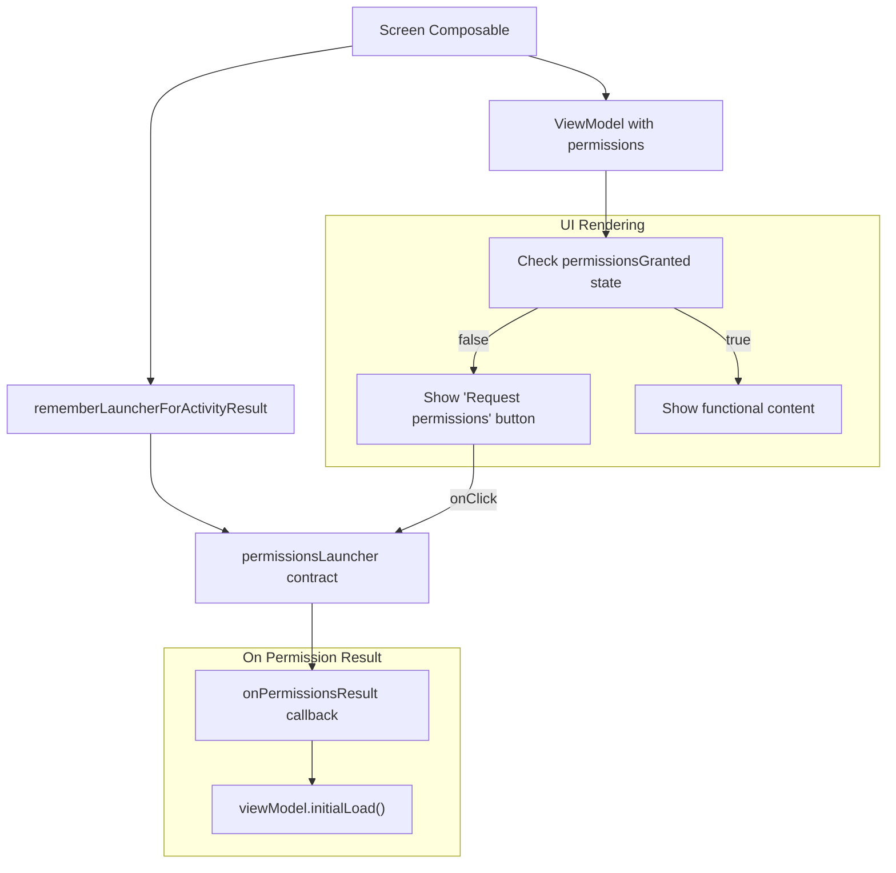
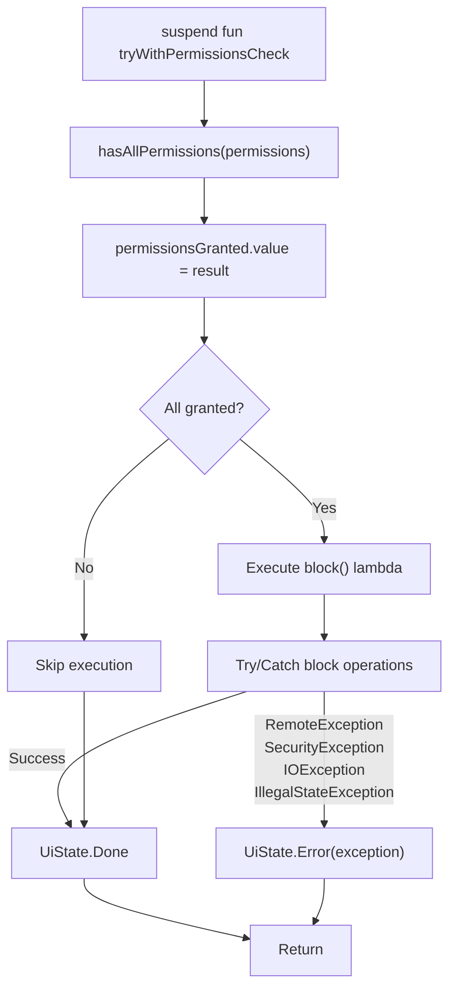
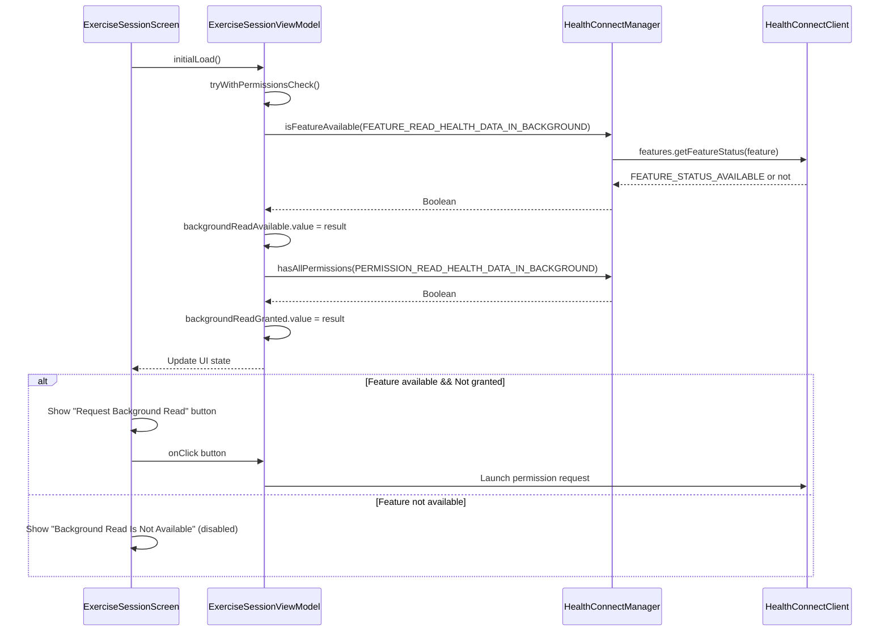
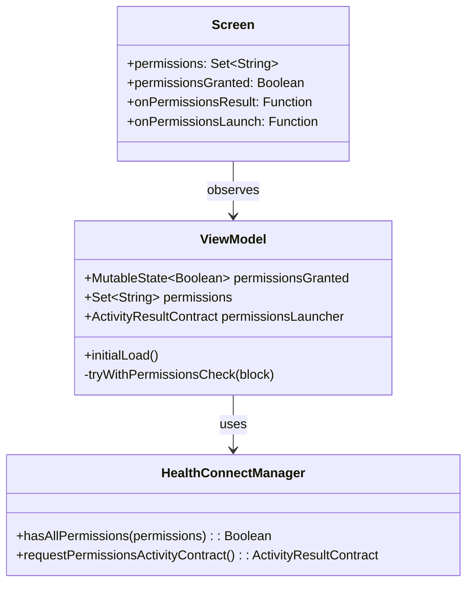

<!-- source: DeepWiki mcp.deepwiki.com · repo android/health-samples · page 8.1 Permission Handling · fetched 2026-10-23 -->

# Permission Handling

Relevant source files

The following files were used as context for generating this wiki page:

- [health-connect/HealthConnectSample/app/src/main/AndroidManifest.xml](health-connect/HealthConnectSample/app/src/main/AndroidManifest.xml)
- [health-connect/HealthConnectSample/app/src/main/java/com/example/healthconnectsample/data/HealthConnectManager.kt](health-connect/HealthConnectSample/app/src/main/java/com/example/healthconnectsample/data/HealthConnectManager.kt)
- [health-connect/HealthConnectSample/app/src/main/java/com/example/healthconnectsample/presentation/component/Series.kt](health-connect/HealthConnectSample/app/src/main/java/com/example/healthconnectsample/presentation/component/Series.kt)
- [health-connect/HealthConnectSample/app/src/main/java/com/example/healthconnectsample/presentation/navigation/HealthConnectNavigation.kt](health-connect/HealthConnectSample/app/src/main/java/com/example/healthconnectsample/presentation/navigation/HealthConnectNavigation.kt)
- [health-connect/HealthConnectSample/app/src/main/java/com/example/healthconnectsample/presentation/navigation/Screen.kt](health-connect/HealthConnectSample/app/src/main/java/com/example/healthconnectsample/presentation/navigation/Screen.kt)
- [health-connect/HealthConnectSample/app/src/main/java/com/example/healthconnectsample/presentation/screen/WelcomeScreen.kt](health-connect/HealthConnectSample/app/src/main/java/com/example/healthconnectsample/presentation/screen/WelcomeScreen.kt)
- [health-connect/HealthConnectSample/app/src/main/java/com/example/healthconnectsample/presentation/screen/exercisesession/ExerciseSessionScreen.kt](health-connect/HealthConnectSample/app/src/main/java/com/example/healthconnectsample/presentation/screen/exercisesession/ExerciseSessionScreen.kt)
- [health-connect/HealthConnectSample/app/src/main/java/com/example/healthconnectsample/presentation/screen/exercisesession/ExerciseSessionViewModel.kt](health-connect/HealthConnectSample/app/src/main/java/com/example/healthconnectsample/presentation/screen/exercisesession/ExerciseSessionViewModel.kt)
- [health-connect/HealthConnectSample/app/src/main/java/com/example/healthconnectsample/presentation/screen/inputreadings/InputReadingsScreen.kt](health-connect/HealthConnectSample/app/src/main/java/com/example/healthconnectsample/presentation/screen/inputreadings/InputReadingsScreen.kt)
- [health-connect/HealthConnectSample/app/src/main/java/com/example/healthconnectsample/presentation/screen/inputreadings/InputReadingsViewModel.kt](health-connect/HealthConnectSample/app/src/main/java/com/example/healthconnectsample/presentation/screen/inputreadings/InputReadingsViewModel.kt)
- [health-connect/HealthConnectSample/app/src/main/java/com/example/healthconnectsample/presentation/screen/recordlist/RecordListScreen.kt](health-connect/HealthConnectSample/app/src/main/java/com/example/healthconnectsample/presentation/screen/recordlist/RecordListScreen.kt)
- [health-connect/HealthConnectSample/app/src/main/res/values/strings.xml](health-connect/HealthConnectSample/app/src/main/res/values/strings.xml)
- [health-connect/HealthConnectSample/settings.gradle](health-connect/HealthConnectSample/settings.gradle)
- [health-services/ExerciseSampleCompose/app/build.gradle](health-services/ExerciseSampleCompose/app/build.gradle)
- [health-services/ExerciseSampleCompose/app/src/main/AndroidManifest.xml](health-services/ExerciseSampleCompose/app/src/main/AndroidManifest.xml)
- [health-services/ExerciseSampleCompose/app/src/main/java/com/example/exercisesamplecompose/app/MainActivity.kt](health-services/ExerciseSampleCompose/app/src/main/java/com/example/exercisesamplecompose/app/MainActivity.kt)
- [health-services/ExerciseSampleCompose/app/src/main/java/com/example/exercisesamplecompose/presentation/component/FormattingUtils.kt](health-services/ExerciseSampleCompose/app/src/main/java/com/example/exercisesamplecompose/presentation/component/FormattingUtils.kt)
- [health-services/ExerciseSampleCompose/app/src/main/java/com/example/exercisesamplecompose/presentation/component/HRText.kt](health-services/ExerciseSampleCompose/app/src/main/java/com/example/exercisesamplecompose/presentation/component/HRText.kt)
- [health-services/ExerciseSampleCompose/app/src/main/java/com/example/exercisesamplecompose/presentation/exercise/ExerciseScreen.kt](health-services/ExerciseSampleCompose/app/src/main/java/com/example/exercisesamplecompose/presentation/exercise/ExerciseScreen.kt)
- [health-services/ExerciseSampleCompose/app/src/main/java/com/example/exercisesamplecompose/presentation/preparing/PreparingViewModel.kt](health-services/ExerciseSampleCompose/app/src/main/java/com/example/exercisesamplecompose/presentation/preparing/PreparingViewModel.kt)
- [health-services/ExerciseSampleCompose/app/src/test/java/com/example/exercisesamplecompose/presentation/ExerciseScreenTest.kt](health-services/ExerciseSampleCompose/app/src/test/java/com/example/exercisesamplecompose/presentation/ExerciseScreenTest.kt)

## Purpose and Scope

This document describes the permission handling patterns implemented across the android/health-samples repository. It covers runtime permission request flows, permission checking mechanisms, and user education strategies for both Health Services (Wear OS) and Health Connect (mobile) samples.

For information about specific sample architectures, see:
- Health Services samples: [2](#2)
- Health Connect sample: [3](#3)
- State management patterns: [8.2](#8.2)

---

## Overview

The repository demonstrates two distinct permission models based on the Android health API being used:

| API | Permission Type | Request Mechanism | Scope |
|-----|----------------|-------------------|-------|
| Health Services | Standard Android runtime permissions | `ActivityResultContracts.RequestMultiplePermissions()` | Device sensors (body, location, activity) |
| Health Connect | Health-specific platform permissions | `PermissionController.createRequestPermissionResultContract()` | Health data types (read/write per record type) |

Both models follow Android's runtime permission model (API 23+) requiring explicit user consent before accessing sensitive data or hardware.

---

## Health Services Permission Model

### Required Permissions

Health Services samples require standard Android runtime permissions to access device sensors and features. Permissions vary by Android SDK version to accommodate platform evolution.

**Permission List by SDK Version**

**Sources:**
- [health-services/ExerciseSampleCompose/app/src/main/java/com/example/exercisesamplecompose/presentation/preparing/PreparingViewModel.kt:85-95]()
- [health-services/ExerciseSampleCompose/app/src/main/AndroidManifest.xml:18-25]()

### Permission Declaration

The `PreparingViewModel` defines permissions as a companion object, allowing SDK-level conditional inclusion:

[health-services/ExerciseSampleCompose/app/src/main/java/com/example/exercisesamplecompose/presentation/preparing/PreparingViewModel.kt:85-95]()

This list is built dynamically using `buildList` to conditionally add permissions based on `Build.VERSION.SDK_INT` checks. The `BODY_SENSORS` permission in the manifest includes `android:maxSdkVersion="35"` to indicate it's deprecated in SDK 36+ in favor of the new health permission model.

**Sources:**
- [health-services/ExerciseSampleCompose/app/src/main/java/com/example/exercisesamplecompose/presentation/preparing/PreparingViewModel.kt:85-95]()
- [health-services/ExerciseSampleCompose/app/src/main/AndroidManifest.xml:19]()

### Permission Request Flow

The ExerciseSampleCompose app requests permissions during activity creation using the Activity Result API:

**Sources:**
- [health-services/ExerciseSampleCompose/app/src/main/java/com/example/exercisesamplecompose/app/MainActivity.kt:38-47]()
- [health-services/ExerciseSampleCompose/app/src/main/java/com/example/exercisesamplecompose/app/MainActivity.kt:58]()

The `registerForActivityResult` call on lines 39-47 establishes a callback that receives the permission grant results. The callback checks if all requested permissions were granted before proceeding with exercise functionality.

**Sources:**
- [health-services/ExerciseSampleCompose/app/src/main/java/com/example/exercisesamplecompose/app/MainActivity.kt:39-47]()

### UI State Representation

The `PreparingScreenState` sealed class encapsulates permission state for UI rendering:

The `requiredPermissions` field allows the UI layer to display permission prompts without knowledge of the specific permission strings.

**Sources:**
- [health-services/ExerciseSampleCompose/app/src/main/java/com/example/exercisesamplecompose/presentation/preparing/PreparingViewModel.kt:69-83]()

---

## Health Connect Permission Model

### Permission Architecture

Health Connect uses a granular permission model where each health data record type requires separate read and/or write permissions. This differs from Health Services' sensor-based model by focusing on data types rather than hardware access.

**Sources:**
- [health-connect/HealthConnectSample/app/src/main/java/com/example/healthconnectsample/presentation/screen/exercisesession/ExerciseSessionViewModel.kt:51-59]()
- [health-connect/HealthConnectSample/app/src/main/AndroidManifest.xml:18-34]()

### Permission Definition Pattern

Each ViewModel defines the specific permissions it needs as a property. The pattern is consistent across all screens:

**ExerciseSessionViewModel Example:**

[health-connect/HealthConnectSample/app/src/main/java/com/example/healthconnectsample/presentation/screen/exercisesession/ExerciseSessionViewModel.kt:51-59]()

This includes both the primary record type (ExerciseSessionRecord) and related data types that are written alongside the session (steps, speed, distance, calories, heart rate).

**InputReadingsViewModel Example:**

[health-connect/HealthConnectSample/app/src/main/java/com/example/healthconnectsample/presentation/screen/inputreadings/InputReadingsViewModel.kt:44-47]()

Simpler screens like InputReadings only require permissions for a single data type.

**Sources:**
- [health-connect/HealthConnectSample/app/src/main/java/com/example/healthconnectsample/presentation/screen/exercisesession/ExerciseSessionViewModel.kt:51-59]()
- [health-connect/HealthConnectSample/app/src/main/java/com/example/healthconnectsample/presentation/screen/inputreadings/InputReadingsViewModel.kt:44-47]()

### Permission Request Contract

Health Connect provides a specialized `ActivityResultContract` through the `PermissionController` class:

**Sources:**
- [health-connect/HealthConnectSample/app/src/main/java/com/example/healthconnectsample/data/HealthConnectManager.kt:120-122]()
- [health-connect/HealthConnectSample/app/src/main/java/com/example/healthconnectsample/data/HealthConnectManager.kt:115-118]()

### Composable Permission Flow

The Health Connect sample uses `rememberLauncherForActivityResult` in Composable screens to handle permission requests within the Compose UI lifecycle:

**Navigation Integration Example:**

[health-connect/HealthConnectSample/app/src/main/java/com/example/healthconnectsample/presentation/navigation/HealthConnectNavigation.kt:89-127]()

This pattern is repeated for each screen requiring permissions, with the launcher registered once per screen and callbacks wired to ViewModel methods.

**Sources:**
- [health-connect/HealthConnectSample/app/src/main/java/com/example/healthconnectsample/presentation/navigation/HealthConnectNavigation.kt:100-102]()
- [health-connect/HealthConnectSample/app/src/main/java/com/example/healthconnectsample/presentation/navigation/HealthConnectNavigation.kt:96-99]()

---

## Permission Checking Patterns

### Health Connect Permission Check

The `HealthConnectManager` provides a centralized permission checking method:

[health-connect/HealthConnectSample/app/src/main/java/com/example/healthconnectsample/data/HealthConnectManager.kt:115-118]()

This method calls `healthConnectClient.permissionController.getGrantedPermissions()` and compares the result with the requested permission set. It's marked `suspend` because the permission check is an asynchronous operation.

**Sources:**
- [health-connect/HealthConnectSample/app/src/main/java/com/example/healthconnectsample/data/HealthConnectManager.kt:115-118]()

### ViewModel Permission Check Pattern

ViewModels wrap data operations with permission checks using a consistent `tryWithPermissionsCheck` pattern:

**Implementation Example:**

[health-connect/HealthConnectSample/app/src/main/java/com/example/healthconnectsample/presentation/screen/inputreadings/InputReadingsViewModel.kt:124-140]()

This pattern provides:
1. **Permission check before execution**: Prevents unauthorized API calls
2. **UI state updates**: Sets `permissionsGranted` to show/hide permission button
3. **Error handling**: Catches known Health Connect exceptions
4. **Graceful degradation**: Returns Done state even when permissions are missing (UI handles display)

**Sources:**
- [health-connect/HealthConnectSample/app/src/main/java/com/example/healthconnectsample/presentation/screen/inputreadings/InputReadingsViewModel.kt:124-140]()
- [health-connect/HealthConnectSample/app/src/main/java/com/example/healthconnectsample/presentation/screen/exercisesession/ExerciseSessionViewModel.kt:142-164]()

### Background Read Permission

Health Connect supports a special background read permission that allows apps to read health data without user interaction. This requires both availability checking and permission granting:

**Sources:**
- [health-connect/HealthConnectSample/app/src/main/java/com/example/healthconnectsample/presentation/screen/exercisesession/ExerciseSessionViewModel.kt:144-149]()
- [health-connect/HealthConnectSample/app/src/main/java/com/example/healthconnectsample/data/HealthConnectManager.kt:495-499]()
- [health-connect/HealthConnectSample/app/src/main/java/com/example/healthconnectsample/presentation/screen/exercisesession/ExerciseSessionScreen.kt:116-134]()

---

## User Education and Privacy Policy

### Privacy Policy Intent Filter

Health Connect requires apps to handle a special intent that displays the app's privacy policy when users click "Learn more" in the permission dialog:

[health-connect/HealthConnectSample/app/src/main/AndroidManifest.xml:59-61]()

The corresponding deep link is configured in the navigation graph:

[health-connect/HealthConnectSample/app/src/main/java/com/example/healthconnectsample/presentation/navigation/HealthConnectNavigation.kt:75-84]()

This intent filter is **required** for Health Connect apps to pass Play Store review.

**Sources:**
- [health-connect/HealthConnectSample/app/src/main/AndroidManifest.xml:52-61]()
- [health-connect/HealthConnectSample/app/src/main/java/com/example/healthconnectsample/presentation/navigation/HealthConnectNavigation.kt:75-84]()

### Permission Usage Intent (Android 14+)

Android 14 introduced a new intent filter for viewing permission usage:

[health-connect/HealthConnectSample/app/src/main/AndroidManifest.xml:64-67]()

This allows users to view which app is accessing which health permissions through the system settings.

**Sources:**
- [health-connect/HealthConnectSample/app/src/main/AndroidManifest.xml:63-68]()

### Queries Declaration

The Health Connect manifest includes a `<queries>` element to allow the app to:
1. Check if Health Connect is installed
2. Query apps that have written health data for attribution display

[health-connect/HealthConnectSample/app/src/main/AndroidManifest.xml:72-83]()

The `healthConnectCompatibleApps` property in `HealthConnectManager` uses these query results to fetch app icons and labels:

[health-connect/HealthConnectSample/app/src/main/java/com/example/healthconnectsample/data/HealthConnectManager.kt:66-96]()

**Sources:**
- [health-connect/HealthConnectSample/app/src/main/AndroidManifest.xml:72-83]()
- [health-connect/HealthConnectSample/app/src/main/java/com/example/healthconnectsample/data/HealthConnectManager.kt:66-96]()

---

## UI Patterns for Permission Requests

### Conditional Button Display

Both sample apps follow a pattern where the permission request button is displayed when permissions are not granted, and functional content is shown when permissions are available:

**Health Connect Screen Pattern:**

[health-connect/HealthConnectSample/app/src/main/java/com/example/healthconnectsample/presentation/screen/exercisesession/ExerciseSessionScreen.kt:92-101]()

**Health Connect Input Readings Pattern:**

[health-connect/HealthConnectSample/app/src/main/java/com/example/healthconnectsample/presentation/screen/inputreadings/InputReadingsScreen.kt:116-123]()

This provides a clear call-to-action for users while preventing them from attempting operations that would fail due to missing permissions.

**Sources:**
- [health-connect/HealthConnectSample/app/src/main/java/com/example/healthconnectsample/presentation/screen/exercisesession/ExerciseSessionScreen.kt:92-101]()
- [health-connect/HealthConnectSample/app/src/main/java/com/example/healthconnectsample/presentation/screen/inputreadings/InputReadingsScreen.kt:116-123]()

### Permission State Management

ViewModels expose permission state as `MutableState<Boolean>` properties observed by Composable screens:

This reactive pattern ensures UI updates automatically when permission state changes.

**Sources:**
- [health-connect/HealthConnectSample/app/src/main/java/com/example/healthconnectsample/presentation/screen/exercisesession/ExerciseSessionViewModel.kt:61-62]()
- [health-connect/HealthConnectSample/app/src/main/java/com/example/healthconnectsample/presentation/screen/inputreadings/InputReadingsViewModel.kt:51-52]()

---

## Permission Revocation

### Manual Revocation

The HealthConnectSample includes a settings screen that allows users to revoke all permissions:

[health-connect/HealthConnectSample/app/src/main/java/com/example/healthconnectsample/presentation/navigation/HealthConnectNavigation.kt:85-87]()

The `revokeAllPermissions()` method calls the platform API:

[health-connect/HealthConnectSample/app/src/main/java/com/example/healthconnectsample/data/HealthConnectManager.kt:124-126]()

This demonstrates best practices for allowing users to manage their consent.

**Sources:**
- [health-connect/HealthConnectSample/app/src/main/java/com/example/healthconnectsample/presentation/navigation/HealthConnectNavigation.kt:85-87]()
- [health-connect/HealthConnectSample/app/src/main/java/com/example/healthconnectsample/data/HealthConnectManager.kt:124-126]()

---

## Summary of Patterns

### Health Services (Wear OS)

| Aspect | Implementation |
|--------|---------------|
| Permission Type | Standard Android runtime permissions |
| Declaration | Static list in `PreparingViewModel.permissions` |
| Request Mechanism | `ActivityResultContracts.RequestMultiplePermissions()` |
| Timing | On app launch in `MainActivity.onCreate()` |
| UI Pattern | Permission status shown in `PreparingScreenState` |
| Version Handling | Conditional inclusion based on `Build.VERSION.SDK_INT` |

**Sources:**
- [health-services/ExerciseSampleCompose/app/src/main/java/com/example/exercisesamplecompose/presentation/preparing/PreparingViewModel.kt:85-95]()
- [health-services/ExerciseSampleCompose/app/src/main/java/com/example/exercisesamplecompose/app/MainActivity.kt:39-47]()

### Health Connect (Mobile)

| Aspect | Implementation |
|--------|---------------|
| Permission Type | Health Connect platform permissions |
| Declaration | Per-ViewModel `Set<String>` of record-type permissions |
| Request Mechanism | `PermissionController.createRequestPermissionResultContract()` |
| Timing | Per-screen, on-demand via button click |
| UI Pattern | Conditional button in LazyColumn, functional content when granted |
| Check Method | `HealthConnectManager.hasAllPermissions()` |
| Error Handling | `tryWithPermissionsCheck` wrapper with exception catching |
| Privacy Policy | Required intent filter for `ACTION_SHOW_PERMISSIONS_RATIONALE` |

**Sources:**
- [health-connect/HealthConnectSample/app/src/main/java/com/example/healthconnectsample/data/HealthConnectManager.kt:115-122]()
- [health-connect/HealthConnectSample/app/src/main/java/com/example/healthconnectsample/presentation/screen/exercisesession/ExerciseSessionViewModel.kt:51-59]()
- [health-connect/HealthConnectSample/app/src/main/AndroidManifest.xml:59-61]()

---

